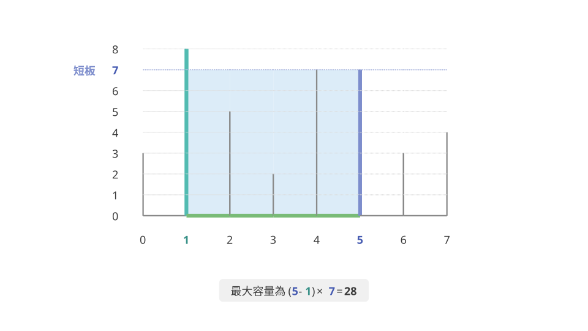
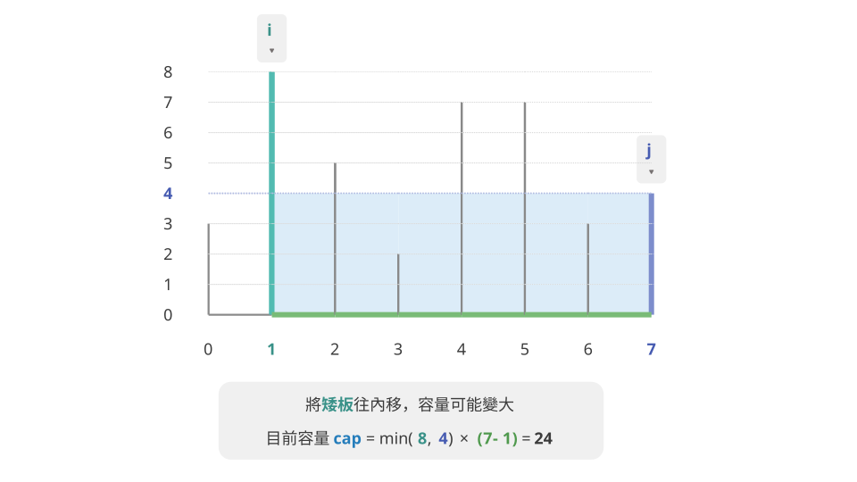
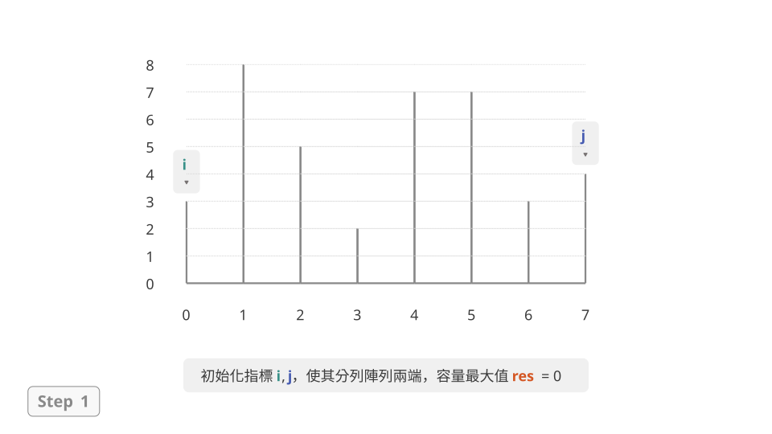
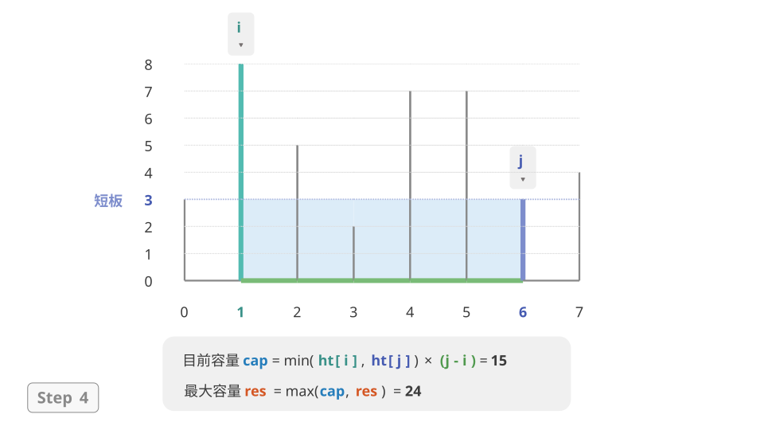
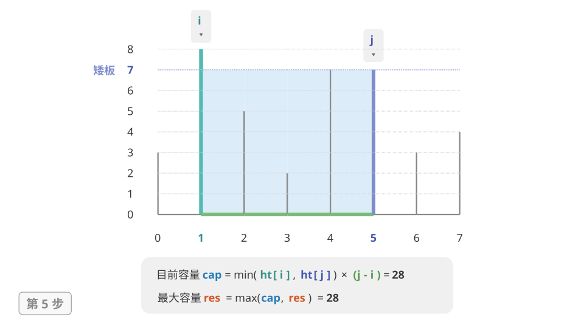
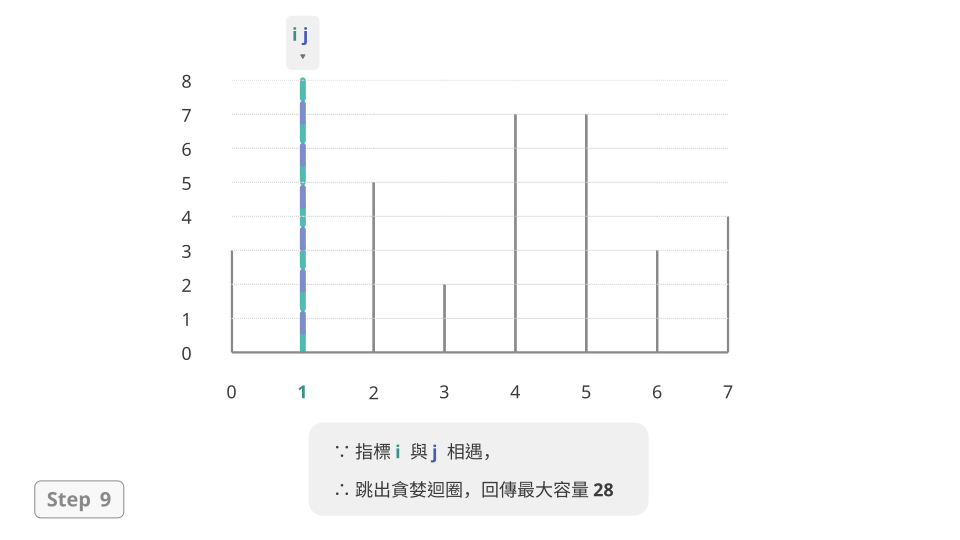

# 15.3 &nbsp; 最大容量問題

!!! question

    輸入一個陣列 $ht$，每個元素代表一塊直立隔板的高度。任選兩塊隔板，就能用兩板之間的空間圍成一個容器。
    
    容器容量等於高度與寬度的乘積（面積）。高度取決於較矮的隔板，寬度則是兩塊隔板在陣列中的索引差。
    
    請從陣列中選出兩塊隔板，使它們圍成的容器容量最大，並回傳這個最大容量。範例如圖 15-7 。

{ class="animation-figure" }

<p align="center"> 圖 15-7 &nbsp; 最大容量問題的範例資料 </p>

任意兩塊隔板都能圍成容器，**因此可以用兩塊隔板的索引來表示本題的狀態，記為 $[i, j]$**。

依題意，容量等於高度乘以寬度。高度由矮板決定，寬度則是兩塊隔板的陣列索引差。以 $cap[i, j]$ 表示容量，可得下列公式：

$$
cap[i, j] = \min(ht[i], ht[j]) \times (j - i)
$$

設陣列長度為 $n$，兩塊隔板的組合數（狀態總數）就是 $C_n^2 = \frac{n(n - 1)}{2}$。最直接的做法是**列舉所有狀態**，找出最大容量，時間複雜度為 $O(n^2)$。

### 1. &nbsp; 決定貪婪策略

這道題還有更有效率的解法。如圖 15-8 所示，選取一個狀態 $[i, j]$，使索引滿足 $i < j$，且高度滿足 $ht[i] < ht[j]$。也就是說，$i$ 是矮板，$j$ 是高板。

{ class="animation-figure" }

<p align="center"> 圖 15-8 &nbsp; 起始狀態 </p>

如圖 15-9 所示，**此時若將高板 $j$ 往矮板 $i$ 的方向移動，容量一定會變小**。

這是因為移動高板 $j$ 後，寬度 $j-i$ 一定變小。高度由矮板決定，因此只可能維持原高度（$i$ 仍是矮板）或降低（移動後的 $j$ 成為矮板）。

{ class="animation-figure" }

<p align="center"> 圖 15-9 &nbsp; 將高板往內移後的狀態 </p>

反過來想，**只有將矮板 $i$ 往內移，容量才有可能變大**。雖然寬度一定會變小，**高度卻可能增加**（矮板 $i$ 的指標可能移到較高的隔板）。例如圖 15-10 中，移動矮板後面積就變大了。

{ class="animation-figure" }

<p align="center"> 圖 15-10 &nbsp; 將矮板往內移後的狀態 </p>

由此可以推導本題的貪婪策略：先將兩個指標分別設在容器兩端，每一輪都將較矮隔板的指標往內移，直到兩個指標相遇。

圖 15-11 展示這個貪婪策略的執行過程。

1. 在起始狀態下，指標 $i$ 和 $j$ 分別位於陣列的兩端。
2. 計算目前狀態的容量 $cap[i, j]$，並更新最大容量。
3. 比較隔板 $i$ 和隔板 $j$ 的高度，將矮板的指標往內移一格。
4. 重複執行第 `2.` 步和第 `3.` 步，直到 $i$ 和 $j$ 相遇就結束。

=== "<1>"
    { class="animation-figure" }

=== "<2>"
    { class="animation-figure" }

=== "<3>"
    { class="animation-figure" }

=== "<4>"
    { class="animation-figure" }

=== "<5>"
    { class="animation-figure" }

=== "<6>"
    { class="animation-figure" }

=== "<7>"
    { class="animation-figure" }

=== "<8>"
    { class="animation-figure" }

=== "<9>"
    { class="animation-figure" }

<p align="center"> 圖 15-11 &nbsp; 以貪婪法求最大容量的過程 </p>

### 2. &nbsp; 程式實作

迴圈最多執行 $n$ 輪，**因此時間複雜度為 $O(n)$**。

變數 $i$、$j$、$res$ 只需常數大小的額外空間，**因此空間複雜度為 $O(1)$**。

=== "Python"

    ```python title="max_capacity.py"
    def max_capacity(ht: list[int]) -> int:
        """最大容量：貪婪法"""
        # 將 i、j 分別設在陣列的兩端
        i, j = 0, len(ht) - 1
        # 起始最大容量為 0
        res = 0
        # 反覆執行貪婪選擇，直到兩塊隔板相遇
        while i < j:
            # 更新最大容量
            cap = min(ht[i], ht[j]) * (j - i)
            res = max(res, cap)
            # 將較矮隔板的指標往內移
            if ht[i] < ht[j]:
                i += 1
            else:
                j -= 1
        return res
    ```

=== "C++"

    ```cpp title="max_capacity.cpp"
    /* 最大容量：貪婪法 */
    int maxCapacity(vector<int> &ht) {
        // 將 i、j 分別設在陣列的兩端
        int i = 0, j = ht.size() - 1;
        // 起始最大容量為 0
        int res = 0;
        // 反覆執行貪婪選擇，直到兩塊隔板相遇
        while (i < j) {
            // 更新最大容量
            int cap = min(ht[i], ht[j]) * (j - i);
            res = max(res, cap);
            // 將較矮隔板的指標往內移
            if (ht[i] < ht[j]) {
                i++;
            } else {
                j--;
            }
        }
        return res;
    }
    ```

=== "Java"

    ```java title="max_capacity.java"
    /* 最大容量：貪婪法 */
    int maxCapacity(int[] ht) {
        // 將 i、j 分別設在陣列的兩端
        int i = 0, j = ht.length - 1;
        // 起始最大容量為 0
        int res = 0;
        // 反覆執行貪婪選擇，直到兩塊隔板相遇
        while (i < j) {
            // 更新最大容量
            int cap = Math.min(ht[i], ht[j]) * (j - i);
            res = Math.max(res, cap);
            // 將較矮隔板的指標往內移
            if (ht[i] < ht[j]) {
                i++;
            } else {
                j--;
            }
        }
        return res;
    }
    ```

=== "C#"

    ```csharp title="max_capacity.cs"
    /* 最大容量：貪婪法 */
    int MaxCapacity(int[] ht) {
        // 將 i、j 分別設在陣列的兩端
        int i = 0, j = ht.Length - 1;
        // 起始最大容量為 0
        int res = 0;
        // 反覆執行貪婪選擇，直到兩塊隔板相遇
        while (i < j) {
            // 更新最大容量
            int cap = Math.Min(ht[i], ht[j]) * (j - i);
            res = Math.Max(res, cap);
            // 將較矮隔板的指標往內移
            if (ht[i] < ht[j]) {
                i++;
            } else {
                j--;
            }
        }
        return res;
    }
    ```

=== "Go"

    ```go title="max_capacity.go"
    /* 最大容量：貪婪法 */
    func maxCapacity(ht []int) int {
        // 將 i、j 分別設在陣列的兩端
        i, j := 0, len(ht)-1
        // 起始最大容量為 0
        res := 0
        // 反覆執行貪婪選擇，直到兩塊隔板相遇
        for i < j {
            // 更新最大容量
            capacity := int(math.Min(float64(ht[i]), float64(ht[j]))) * (j - i)
            res = int(math.Max(float64(res), float64(capacity)))
            // 將較矮隔板的指標往內移
            if ht[i] < ht[j] {
                i++
            } else {
                j--
            }
        }
        return res
    }
    ```

=== "Swift"

    ```swift title="max_capacity.swift"
    /* 最大容量：貪婪法 */
    func maxCapacity(ht: [Int]) -> Int {
        // 將 i、j 分別設在陣列的兩端
        var i = ht.startIndex, j = ht.endIndex - 1
        // 起始最大容量為 0
        var res = 0
        // 反覆執行貪婪選擇，直到兩塊隔板相遇
        while i < j {
            // 更新最大容量
            let cap = min(ht[i], ht[j]) * (j - i)
            res = max(res, cap)
            // 將較矮隔板的指標往內移
            if ht[i] < ht[j] {
                i += 1
            } else {
                j -= 1
            }
        }
        return res
    }
    ```

=== "JS"

    ```javascript title="max_capacity.js"
    /* 最大容量：貪婪法 */
    function maxCapacity(ht) {
        // 將 i、j 分別設在陣列的兩端
        let i = 0,
            j = ht.length - 1;
        // 起始最大容量為 0
        let res = 0;
        // 反覆執行貪婪選擇，直到兩塊隔板相遇
        while (i < j) {
            // 更新最大容量
            const cap = Math.min(ht[i], ht[j]) * (j - i);
            res = Math.max(res, cap);
            // 將較矮隔板的指標往內移
            if (ht[i] < ht[j]) {
                i += 1;
            } else {
                j -= 1;
            }
        }
        return res;
    }
    ```

=== "TS"

    ```typescript title="max_capacity.ts"
    /* 最大容量：貪婪法 */
    function maxCapacity(ht: number[]): number {
        // 將 i、j 分別設在陣列的兩端
        let i = 0,
            j = ht.length - 1;
        // 起始最大容量為 0
        let res = 0;
        // 反覆執行貪婪選擇，直到兩塊隔板相遇
        while (i < j) {
            // 更新最大容量
            const cap: number = Math.min(ht[i], ht[j]) * (j - i);
            res = Math.max(res, cap);
            // 將較矮隔板的指標往內移
            if (ht[i] < ht[j]) {
                i += 1;
            } else {
                j -= 1;
            }
        }
        return res;
    }
    ```

=== "Dart"

    ```dart title="max_capacity.dart"
    /* 最大容量：貪婪法 */
    int maxCapacity(List<int> ht) {
      // 將 i、j 分別設在陣列的兩端
      int i = 0, j = ht.length - 1;
      // 起始最大容量為 0
      int res = 0;
      // 反覆執行貪婪選擇，直到兩塊隔板相遇
      while (i < j) {
        // 更新最大容量
        int cap = min(ht[i], ht[j]) * (j - i);
        res = max(res, cap);
        // 將較矮隔板的指標往內移
        if (ht[i] < ht[j]) {
          i++;
        } else {
          j--;
        }
      }
      return res;
    }
    ```

=== "Rust"

    ```rust title="max_capacity.rs"
    /* 最大容量：貪婪法 */
    fn max_capacity(ht: &[i32]) -> i32 {
        // 將 i、j 分別設在陣列的兩端
        let mut i = 0;
        let mut j = ht.len() - 1;
        // 起始最大容量為 0
        let mut res = 0;
        // 反覆執行貪婪選擇，直到兩塊隔板相遇
        while i < j {
            // 更新最大容量
            let cap = std::cmp::min(ht[i], ht[j]) * (j - i) as i32;
            res = std::cmp::max(res, cap);
            // 將較矮隔板的指標往內移
            if ht[i] < ht[j] {
                i += 1;
            } else {
                j -= 1;
            }
        }
        res
    }
    ```

=== "C"

    ```c title="max_capacity.c"
    /* 最大容量：貪婪法 */
    int maxCapacity(int ht[], int htLength) {
        // 將 i、j 分別設在陣列的兩端
        int i = 0;
        int j = htLength - 1;
        // 起始最大容量為 0
        int res = 0;
        // 反覆執行貪婪選擇，直到兩塊隔板相遇
        while (i < j) {
            // 更新最大容量
            int capacity = myMin(ht[i], ht[j]) * (j - i);
            res = myMax(res, capacity);
            // 將較矮隔板的指標往內移
            if (ht[i] < ht[j]) {
                i++;
            } else {
                j--;
            }
        }
        return res;
    }
    ```

=== "Kotlin"

    ```kotlin title="max_capacity.kt"
    /* 最大容量：貪婪法 */
    fun maxCapacity(ht: IntArray): Int {
        // 將 i、j 分別設在陣列的兩端
        var i = 0
        var j = ht.size - 1
        // 起始最大容量為 0
        var res = 0
        // 反覆執行貪婪選擇，直到兩塊隔板相遇
        while (i < j) {
            // 更新最大容量
            val cap = min(ht[i], ht[j]) * (j - i)
            res = max(res, cap)
            // 將較矮隔板的指標往內移
            if (ht[i] < ht[j]) {
                i++
            } else {
                j--
            }
        }
        return res
    }
    ```

=== "Ruby"

    ```ruby title="max_capacity.rb"
    ### 最大容量：貪婪法 ###
    def max_capacity(ht)
      # 將 i、j 分別設在陣列的兩端
      i, j = 0, ht.length - 1
      # 起始最大容量為 0
      res = 0

      # 反覆執行貪婪選擇，直到兩塊隔板相遇
      while i < j
        # 更新最大容量
        cap = [ht[i], ht[j]].min * (j - i)
        res = [res, cap].max
        # 將較矮隔板的指標往內移
        if ht[i] < ht[j]
          i += 1
        else
          j -= 1
        end
      end

      res
    end
    ```

??? pythontutor "執行視覺化示範"

    <div style="height: 549px; width: 100%;"><iframe class="pythontutor-iframe" title="執行視覺化示範" src="https://pythontutor.com/iframe-embed.html#code=def%20max_capacity%28ht%3A%20list%5Bint%5D%29%20-%3E%20int%3A%0A%20%20%20%20%22%22%22%E6%9C%80%E5%A4%A7%E5%AE%B9%E9%87%8F%EF%BC%9A%E8%B2%AA%E5%A9%AA%E6%B3%95%22%22%22%0A%20%20%20%20%23%20%E5%B0%87%20i%E3%80%81j%20%E5%88%86%E5%88%A5%E8%A8%AD%E5%9C%A8%E9%99%A3%E5%88%97%E7%9A%84%E5%85%A9%E7%AB%AF%0A%20%20%20%20i,%20j%20%3D%200,%20len%28ht%29%20-%201%0A%20%20%20%20%23%20%E8%B5%B7%E5%A7%8B%E6%9C%80%E5%A4%A7%E5%AE%B9%E9%87%8F%E7%82%BA%200%0A%20%20%20%20res%20%3D%200%0A%20%20%20%20%23%20%E5%8F%8D%E8%A6%86%E5%9F%B7%E8%A1%8C%E8%B2%AA%E5%A9%AA%E9%81%B8%E6%93%87%EF%BC%8C%E7%9B%B4%E5%88%B0%E5%85%A9%E5%A1%8A%E9%9A%94%E6%9D%BF%E7%9B%B8%E9%81%87%0A%20%20%20%20while%20i%20%3C%20j%3A%0A%20%20%20%20%20%20%20%20%23%20%E6%9B%B4%E6%96%B0%E6%9C%80%E5%A4%A7%E5%AE%B9%E9%87%8F%0A%20%20%20%20%20%20%20%20cap%20%3D%20min%28ht%5Bi%5D,%20ht%5Bj%5D%29%20%2A%20%28j%20-%20i%29%0A%20%20%20%20%20%20%20%20res%20%3D%20max%28res,%20cap%29%0A%20%20%20%20%20%20%20%20%23%20%E5%B0%87%E8%BC%83%E7%9F%AE%E9%9A%94%E6%9D%BF%E7%9A%84%E6%8C%87%E6%A8%99%E5%BE%80%E5%85%A7%E7%A7%BB%0A%20%20%20%20%20%20%20%20if%20ht%5Bi%5D%20%3C%20ht%5Bj%5D%3A%0A%20%20%20%20%20%20%20%20%20%20%20%20i%20%2B%3D%201%0A%20%20%20%20%20%20%20%20else%3A%0A%20%20%20%20%20%20%20%20%20%20%20%20j%20-%3D%201%0A%20%20%20%20return%20res%0A%0A%0A%22%22%22Driver%20Code%22%22%22%0Aif%20__name__%20%3D%3D%20%22__main__%22%3A%0A%20%20%20%20ht%20%3D%20%5B3,%208,%205,%202,%207,%207,%203,%204%5D%0A%0A%20%20%20%20%23%20%E8%B2%AA%E5%A9%AA%E6%BC%94%E7%AE%97%E6%B3%95%0A%20%20%20%20res%20%3D%20max_capacity%28ht%29%0A%20%20%20%20print%28f%22%E6%9C%80%E5%A4%A7%E5%AE%B9%E9%87%8F%E7%82%BA%20%7Bres%7D%22%29&codeDivHeight=472&codeDivWidth=350&cumulative=false&curInstr=4&heapPrimitives=nevernest&origin=opt-frontend.js&py=311&rawInputLstJSON=%5B%5D&textReferences=false"> </iframe></div>
    <div style="margin-top: 5px;"><a href="https://pythontutor.com/iframe-embed.html#code=def%20max_capacity%28ht%3A%20list%5Bint%5D%29%20-%3E%20int%3A%0A%20%20%20%20%22%22%22%E6%9C%80%E5%A4%A7%E5%AE%B9%E9%87%8F%EF%BC%9A%E8%B2%AA%E5%A9%AA%E6%B3%95%22%22%22%0A%20%20%20%20%23%20%E5%B0%87%20i%E3%80%81j%20%E5%88%86%E5%88%A5%E8%A8%AD%E5%9C%A8%E9%99%A3%E5%88%97%E7%9A%84%E5%85%A9%E7%AB%AF%0A%20%20%20%20i,%20j%20%3D%200,%20len%28ht%29%20-%201%0A%20%20%20%20%23%20%E8%B5%B7%E5%A7%8B%E6%9C%80%E5%A4%A7%E5%AE%B9%E9%87%8F%E7%82%BA%200%0A%20%20%20%20res%20%3D%200%0A%20%20%20%20%23%20%E5%8F%8D%E8%A6%86%E5%9F%B7%E8%A1%8C%E8%B2%AA%E5%A9%AA%E9%81%B8%E6%93%87%EF%BC%8C%E7%9B%B4%E5%88%B0%E5%85%A9%E5%A1%8A%E9%9A%94%E6%9D%BF%E7%9B%B8%E9%81%87%0A%20%20%20%20while%20i%20%3C%20j%3A%0A%20%20%20%20%20%20%20%20%23%20%E6%9B%B4%E6%96%B0%E6%9C%80%E5%A4%A7%E5%AE%B9%E9%87%8F%0A%20%20%20%20%20%20%20%20cap%20%3D%20min%28ht%5Bi%5D,%20ht%5Bj%5D%29%20%2A%20%28j%20-%20i%29%0A%20%20%20%20%20%20%20%20res%20%3D%20max%28res,%20cap%29%0A%20%20%20%20%20%20%20%20%23%20%E5%B0%87%E8%BC%83%E7%9F%AE%E9%9A%94%E6%9D%BF%E7%9A%84%E6%8C%87%E6%A8%99%E5%BE%80%E5%85%A7%E7%A7%BB%0A%20%20%20%20%20%20%20%20if%20ht%5Bi%5D%20%3C%20ht%5Bj%5D%3A%0A%20%20%20%20%20%20%20%20%20%20%20%20i%20%2B%3D%201%0A%20%20%20%20%20%20%20%20else%3A%0A%20%20%20%20%20%20%20%20%20%20%20%20j%20-%3D%201%0A%20%20%20%20return%20res%0A%0A%0A%22%22%22Driver%20Code%22%22%22%0Aif%20__name__%20%3D%3D%20%22__main__%22%3A%0A%20%20%20%20ht%20%3D%20%5B3,%208,%205,%202,%207,%207,%203,%204%5D%0A%0A%20%20%20%20%23%20%E8%B2%AA%E5%A9%AA%E6%BC%94%E7%AE%97%E6%B3%95%0A%20%20%20%20res%20%3D%20max_capacity%28ht%29%0A%20%20%20%20print%28f%22%E6%9C%80%E5%A4%A7%E5%AE%B9%E9%87%8F%E7%82%BA%20%7Bres%7D%22%29&codeDivHeight=800&codeDivWidth=600&cumulative=false&curInstr=4&heapPrimitives=nevernest&origin=opt-frontend.js&py=311&rawInputLstJSON=%5B%5D&textReferences=false" target="_blank" rel="noopener noreferrer">全螢幕觀看 ></a></div>

### 3. &nbsp; 正確性證明

貪婪法比列舉法快，是因為每一輪的貪婪選擇都會「跳過」一些狀態。

例如，在狀態 $cap[i, j]$ 下，$i$ 是矮板，$j$ 是高板。若依貪婪策略將矮板 $i$ 往內移一格，就會「跳過」圖 15-12 中的狀態。**也就是說，之後不會再有機會檢驗這些狀態的容量**。

$$
cap[i, i+1], cap[i, i+2], \dots, cap[i, j-2], cap[i, j-1]
$$

{ class="animation-figure" }

<p align="center"> 圖 15-12 &nbsp; 移動矮板時跳過的狀態 </p>

仔細觀察，**跳過的正是固定矮板、將高板 $j$ 往內移所能得到的所有狀態**。前面已證明，將高板往內移一定會讓容量變小。因此，這些狀態都不可能是最佳解，**跳過它們也就不會錯過最佳解**。

以上分析說明，移動矮板是「安全」的做法，這個貪婪策略確實有效。
