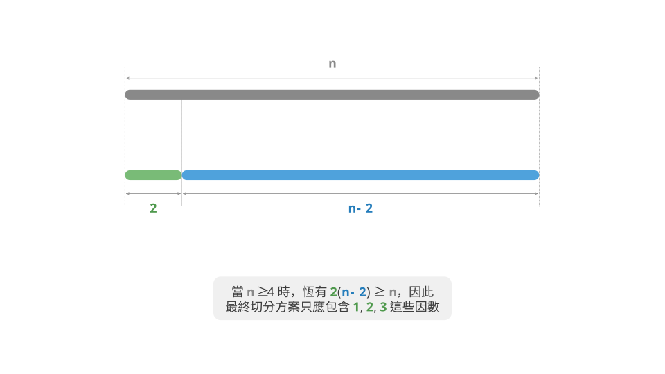
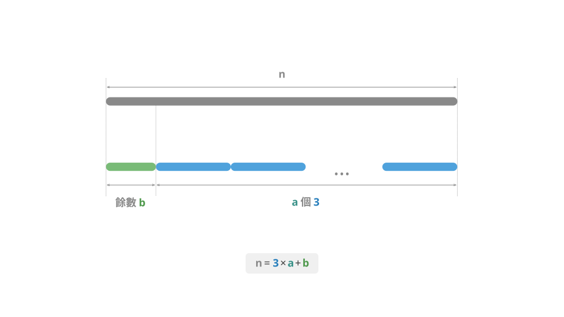

# 最大切分乘積問題

!!! question

    給定正整數 $n$，將它切分成至少兩個正整數的和，如下圖所示。請問切分後，這些整數的乘積最大可以是多少？


假設將 $n$ 切分成 $m$ 個整數因子，並將第 $i$ 個因子記為 $n_i$，也就是

$$
n = \sum_{i=1}^{m}n_i
$$

本題的目標是找出使這些整數因子的乘積最大的切法，也就是求

$$
\max(\prod_{i=1}^{m}n_i)
$$

我們需要決定的是：切分的段數 $m$ 應該是多少？每一段的大小 $n_i$ 又該是多少？

### 決定貪婪策略

從經驗來看，兩個整數的乘積往往大於它們的和。假設從 $n$ 中切出一個因子 $2$，兩段的乘積便是 $2(n-2)$。我們把這個乘積和 $n$ 比較：

$$
\begin{aligned}
2(n-2) & \geq n \newline
2n - n - 4 & \geq 0 \newline
n & \geq 4
\end{aligned}
$$

如下圖所示，當 $n \geq 4$ 時，切出一個 $2$ 會讓乘積變大，**因此大於或等於 $4$ 的整數都應該繼續切分**。

**貪婪策略一**：如果切分方案裡有 $\geq 4$ 的因子，就應繼續切分這個因子。最後的切分方案應只出現 $1$、$2$、$3$ 這三種因子。



接著來看哪個因子最好。在 $1$、$2$、$3$ 之中，顯然 $1$ 最差，因為 $1 \times (n-1) < n$ 恆成立。換句話說，切出 $1$ 反而會讓乘積變小。

如下圖所示，當 $n = 6$ 時，$3 \times 3 > 2 \times 2 \times 2$。**可見切出 $3$ 比切出 $2$ 更好**。

**貪婪策略二**：切分方案中最多只該有兩個 $2$，因為總能將三個 $2$ 換成兩個 $3$，得到更大的乘積。


綜合以上觀察，可以推導出以下貪婪策略。

1. 給定整數 $n$，反覆從中切出因子 $3$，直到餘數為 $0$、$1$ 或 $2$。
2. 若餘數為 $0$，表示 $n$ 是 $3$ 的倍數，不需要調整。
3. 若餘數為 $2$，就保留這一段，不再切分。
4. 若餘數為 $1$，由於 $2 \times 2 > 1 \times 3$，應將最後一個 $3$ 和餘數 $1$ 換成兩個 $2$。

### 程式實作

如下圖所示，我們不必用迴圈逐次切分整數。用整數除法將商向下取整，就能算出因子 $3$ 的個數 $a$，再以取餘數運算求得餘數 $b$。此時有：

$$
n = 3 a + b
$$

請注意，在 $n \leq 3$ 的邊界情況下，一定要切出一個 $1$，乘積為 $1 \times (n - 1)$。

```src
[file]{max_product_cutting}-[class]{}-[func]{max_product_cutting}
```



**時間複雜度取決於程式語言如何實作次方運算**。以 Python 為例，計算次方常用的方式有三種。

- 運算子 `**` 和函式 `pow()` 的時間複雜度都是 $O(\log⁡ a)$。
- 函式 `math.pow()` 會呼叫 C 標準函式庫的 `pow()` 函式來計算浮點數次方，時間複雜度為 $O(1)$。

變數 $a$ 和 $b$ 只需常數大小的額外空間，**因此空間複雜度為 $O(1)$**。

### 正確性證明

以下用反證法證明，只討論 $n \geq 4$ 的情況。

1. **所有因子都 $\leq 3$**：假設最佳切分方案中有一個 $\geq 4$ 的因子 $x$，就一定能繼續切分，使這兩段的乘積為 $2(x-2)$，得到更大（或相等）的乘積。這與假設矛盾。
2. **切分方案不含 $1$**：假設最佳切分方案裡有一個因子 $1$，就一定能將它併入另一個因子，使乘積更大。這與假設矛盾。
3. **切分方案最多只含兩個 $2$**：假設最佳切分方案裡有三個 $2$，就一定能將它們換成兩個 $3$，使乘積更大。這與假設矛盾。
