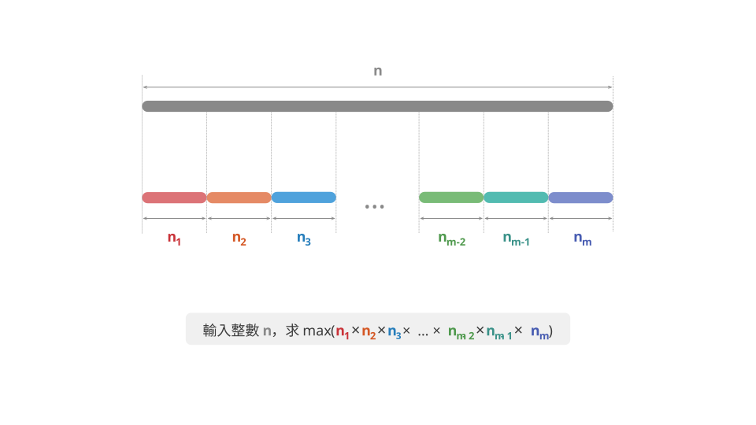
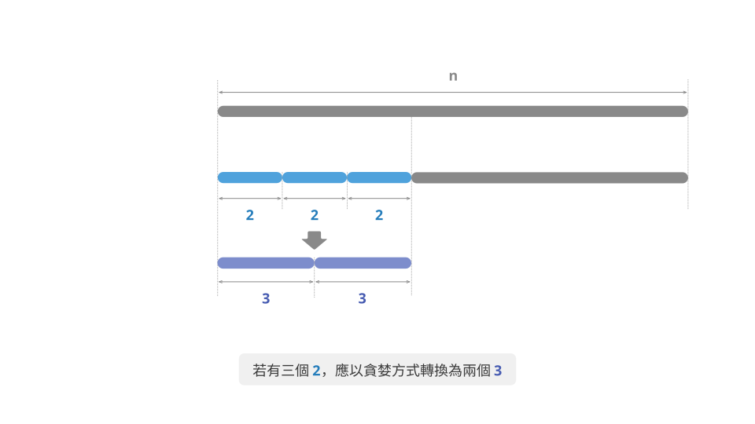

# 15.4 &nbsp; 最大切分乘積問題

!!! question

    給定正整數 $n$，將它切分成至少兩個正整數的和，如圖 15-13 所示。請問切分後，這些整數的乘積最大可以是多少？

{ class="animation-figure" }

<p align="center"> 圖 15-13 &nbsp; 最大切分乘積的問題定義 </p>

假設將 $n$ 切分成 $m$ 個整數因子，並將第 $i$ 個因子記為 $n_i$，也就是

$$
n = \sum_{i=1}^{m}n_i
$$

本題的目標是找出使這些整數因子的乘積最大的切法，也就是求

$$
\max(\prod_{i=1}^{m}n_i)
$$

我們需要決定的是：切分的段數 $m$ 應該是多少？每一段的大小 $n_i$ 又該是多少？

### 1. &nbsp; 決定貪婪策略

從經驗來看，兩個整數的乘積往往大於它們的和。假設從 $n$ 中切出一個因子 $2$，兩段的乘積便是 $2(n-2)$。我們把這個乘積和 $n$ 比較：

$$
\begin{aligned}
2(n-2) & \geq n \newline
2n - n - 4 & \geq 0 \newline
n & \geq 4
\end{aligned}
$$

如圖 15-14 所示，當 $n \geq 4$ 時，切出一個 $2$ 會讓乘積變大，**因此大於或等於 $4$ 的整數都應該繼續切分**。

**貪婪策略一**：如果切分方案裡有 $\geq 4$ 的因子，就應繼續切分這個因子。最後的切分方案應只出現 $1$、$2$、$3$ 這三種因子。

{ class="animation-figure" }

<p align="center"> 圖 15-14 &nbsp; 切分使乘積變大 </p>

接著來看哪個因子最好。在 $1$、$2$、$3$ 之中，顯然 $1$ 最差，因為 $1 \times (n-1) < n$ 恆成立。換句話說，切出 $1$ 反而會讓乘積變小。

如圖 15-15 所示，當 $n = 6$ 時，$3 \times 3 > 2 \times 2 \times 2$。**可見切出 $3$ 比切出 $2$ 更好**。

**貪婪策略二**：切分方案中最多只該有兩個 $2$，因為總能將三個 $2$ 換成兩個 $3$，得到更大的乘積。

{ class="animation-figure" }

<p align="center"> 圖 15-15 &nbsp; 最佳切分因子 </p>

綜合以上觀察，可以推導出以下貪婪策略。

1. 給定整數 $n$，反覆從中切出因子 $3$，直到餘數為 $0$、$1$ 或 $2$。
2. 若餘數為 $0$，表示 $n$ 是 $3$ 的倍數，不需要調整。
3. 若餘數為 $2$，就保留這一段，不再切分。
4. 若餘數為 $1$，由於 $2 \times 2 > 1 \times 3$，應將最後一個 $3$ 和餘數 $1$ 換成兩個 $2$。

### 2. &nbsp; 程式實作

如圖 15-16 所示，我們不必用迴圈逐次切分整數。用整數除法將商向下取整，就能算出因子 $3$ 的個數 $a$，再以取餘數運算求得餘數 $b$。此時有：

$$
n = 3 a + b
$$

請注意，在 $n \leq 3$ 的邊界情況下，一定要切出一個 $1$，乘積為 $1 \times (n - 1)$。

=== "Python"

    ```python title="max_product_cutting.py"
    def max_product_cutting(n: int) -> int:
        """最大切分乘積：貪婪法"""
        # 當 n <= 3 時，必須切出一個 1
        if n <= 3:
            return 1 * (n - 1)
        # 依貪婪策略盡量切出 3，a 為 3 的個數，b 為餘數
        a, b = n // 3, n % 3
        if b == 1:
            # 若餘數為 1，將一組 1 * 3 改為 2 * 2
            return int(math.pow(3, a - 1)) * 2 * 2
        if b == 2:
            # 若餘數為 2，無須調整
            return int(math.pow(3, a)) * 2
        # 若餘數為 0，無須調整
        return int(math.pow(3, a))
    ```

=== "C++"

    ```cpp title="max_product_cutting.cpp"
    /* 最大切分乘積：貪婪法 */
    int maxProductCutting(int n) {
        // 當 n <= 3 時，必須切出一個 1
        if (n <= 3) {
            return 1 * (n - 1);
        }
        // 依貪婪策略盡量切出 3，a 為 3 的個數，b 為餘數
        int a = n / 3;
        int b = n % 3;
        if (b == 1) {
            // 若餘數為 1，將一組 1 * 3 改為 2 * 2
            return (int)pow(3, a - 1) * 2 * 2;
        }
        if (b == 2) {
            // 若餘數為 2，無須調整
            return (int)pow(3, a) * 2;
        }
        // 若餘數為 0，無須調整
        return (int)pow(3, a);
    }
    ```

=== "Java"

    ```java title="max_product_cutting.java"
    /* 最大切分乘積：貪婪法 */
    int maxProductCutting(int n) {
        // 當 n <= 3 時，必須切出一個 1
        if (n <= 3) {
            return 1 * (n - 1);
        }
        // 依貪婪策略盡量切出 3，a 為 3 的個數，b 為餘數
        int a = n / 3;
        int b = n % 3;
        if (b == 1) {
            // 若餘數為 1，將一組 1 * 3 改為 2 * 2
            return (int) Math.pow(3, a - 1) * 2 * 2;
        }
        if (b == 2) {
            // 若餘數為 2，無須調整
            return (int) Math.pow(3, a) * 2;
        }
        // 若餘數為 0，無須調整
        return (int) Math.pow(3, a);
    }
    ```

=== "C#"

    ```csharp title="max_product_cutting.cs"
    /* 最大切分乘積：貪婪法 */
    int MaxProductCutting(int n) {
        // 當 n <= 3 時，必須切出一個 1
        if (n <= 3) {
            return 1 * (n - 1);
        }
        // 依貪婪策略盡量切出 3，a 為 3 的個數，b 為餘數
        int a = n / 3;
        int b = n % 3;
        if (b == 1) {
            // 若餘數為 1，將一組 1 * 3 改為 2 * 2
            return (int)Math.Pow(3, a - 1) * 2 * 2;
        }
        if (b == 2) {
            // 若餘數為 2，無須調整
            return (int)Math.Pow(3, a) * 2;
        }
        // 若餘數為 0，無須調整
        return (int)Math.Pow(3, a);
    }
    ```

=== "Go"

    ```go title="max_product_cutting.go"
    /* 最大切分乘積：貪婪法 */
    func maxProductCutting(n int) int {
        // 當 n <= 3 時，必須切出一個 1
        if n <= 3 {
            return 1 * (n - 1)
        }
        // 依貪婪策略盡量切出 3，a 為 3 的個數，b 為餘數
        a := n / 3
        b := n % 3
        if b == 1 {
            // 若餘數為 1，將一組 1 * 3 改為 2 * 2
            return int(math.Pow(3, float64(a-1))) * 2 * 2
        }
        if b == 2 {
            // 若餘數為 2，無須調整
            return int(math.Pow(3, float64(a))) * 2
        }
        // 若餘數為 0，無須調整
        return int(math.Pow(3, float64(a)))
    }
    ```

=== "Swift"

    ```swift title="max_product_cutting.swift"
    /* 最大切分乘積：貪婪法 */
    func maxProductCutting(n: Int) -> Int {
        // 當 n <= 3 時，必須切出一個 1
        if n <= 3 {
            return 1 * (n - 1)
        }
        // 依貪婪策略盡量切出 3，a 為 3 的個數，b 為餘數
        let a = n / 3
        let b = n % 3
        if b == 1 {
            // 若餘數為 1，將一組 1 * 3 改為 2 * 2
            return pow(3, a - 1) * 2 * 2
        }
        if b == 2 {
            // 若餘數為 2，無須調整
            return pow(3, a) * 2
        }
        // 若餘數為 0，無須調整
        return pow(3, a)
    }
    ```

=== "JS"

    ```javascript title="max_product_cutting.js"
    /* 最大切分乘積：貪婪法 */
    function maxProductCutting(n) {
        // 當 n <= 3 時，必須切出一個 1
        if (n <= 3) {
            return 1 * (n - 1);
        }
        // 依貪婪策略盡量切出 3，a 為 3 的個數，b 為餘數
        let a = Math.floor(n / 3);
        let b = n % 3;
        if (b === 1) {
            // 若餘數為 1，將一組 1 * 3 改為 2 * 2
            return Math.pow(3, a - 1) * 2 * 2;
        }
        if (b === 2) {
            // 若餘數為 2，無須調整
            return Math.pow(3, a) * 2;
        }
        // 若餘數為 0，無須調整
        return Math.pow(3, a);
    }
    ```

=== "TS"

    ```typescript title="max_product_cutting.ts"
    /* 最大切分乘積：貪婪法 */
    function maxProductCutting(n: number): number {
        // 當 n <= 3 時，必須切出一個 1
        if (n <= 3) {
            return 1 * (n - 1);
        }
        // 依貪婪策略盡量切出 3，a 為 3 的個數，b 為餘數
        let a: number = Math.floor(n / 3);
        let b: number = n % 3;
        if (b === 1) {
            // 若餘數為 1，將一組 1 * 3 改為 2 * 2
            return Math.pow(3, a - 1) * 2 * 2;
        }
        if (b === 2) {
            // 若餘數為 2，無須調整
            return Math.pow(3, a) * 2;
        }
        // 若餘數為 0，無須調整
        return Math.pow(3, a);
    }
    ```

=== "Dart"

    ```dart title="max_product_cutting.dart"
    /* 最大切分乘積：貪婪法 */
    int maxProductCutting(int n) {
      // 當 n <= 3 時，必須切出一個 1
      if (n <= 3) {
        return 1 * (n - 1);
      }
      // 依貪婪策略盡量切出 3，a 為 3 的個數，b 為餘數
      int a = n ~/ 3;
      int b = n % 3;
      if (b == 1) {
        // 若餘數為 1，將一組 1 * 3 改為 2 * 2
        return (pow(3, a - 1) * 2 * 2).toInt();
      }
      if (b == 2) {
        // 若餘數為 2，無須調整
        return (pow(3, a) * 2).toInt();
      }
      // 若餘數為 0，無須調整
      return pow(3, a).toInt();
    }
    ```

=== "Rust"

    ```rust title="max_product_cutting.rs"
    /* 最大切分乘積：貪婪法 */
    fn max_product_cutting(n: i32) -> i32 {
        // 當 n <= 3 時，必須切出一個 1
        if n <= 3 {
            return 1 * (n - 1);
        }
        // 依貪婪策略盡量切出 3，a 為 3 的個數，b 為餘數
        let a = n / 3;
        let b = n % 3;
        if b == 1 {
            // 若餘數為 1，將一組 1 * 3 改為 2 * 2
            3_i32.pow(a as u32 - 1) * 2 * 2
        } else if b == 2 {
            // 若餘數為 2，無須調整
            3_i32.pow(a as u32) * 2
        } else {
            // 若餘數為 0，無須調整
            3_i32.pow(a as u32)
        }
    }
    ```

=== "C"

    ```c title="max_product_cutting.c"
    /* 最大切分乘積：貪婪法 */
    int maxProductCutting(int n) {
        // 當 n <= 3 時，必須切出一個 1
        if (n <= 3) {
            return 1 * (n - 1);
        }
        // 依貪婪策略盡量切出 3，a 為 3 的個數，b 為餘數
        int a = n / 3;
        int b = n % 3;
        if (b == 1) {
            // 若餘數為 1，將一組 1 * 3 改為 2 * 2
            return pow(3, a - 1) * 2 * 2;
        }
        if (b == 2) {
            // 若餘數為 2，無須調整
            return pow(3, a) * 2;
        }
        // 若餘數為 0，無須調整
        return pow(3, a);
    }
    ```

=== "Kotlin"

    ```kotlin title="max_product_cutting.kt"
    /* 最大切分乘積：貪婪法 */
    fun maxProductCutting(n: Int): Int {
        // 當 n <= 3 時，必須切出一個 1
        if (n <= 3) {
            return 1 * (n - 1)
        }
        // 依貪婪策略盡量切出 3，a 為 3 的個數，b 為餘數
        val a = n / 3
        val b = n % 3
        if (b == 1) {
            // 若餘數為 1，將一組 1 * 3 改為 2 * 2
            return 3.0.pow((a - 1)).toInt() * 2 * 2
        }
        if (b == 2) {
            // 若餘數為 2，無須調整
            return 3.0.pow(a).toInt() * 2
        }
        // 若餘數為 0，無須調整
        return 3.0.pow(a).toInt()
    }
    ```

=== "Ruby"

    ```ruby title="max_product_cutting.rb"
    ### 最大切分乘積：貪婪法 ###
    def max_product_cutting(n)
      # 當 n <= 3 時，必須切出一個 1
      return 1 * (n - 1) if n <= 3
      # 依貪婪策略盡量切出 3，a 為 3 的個數，b 為餘數
      a, b = n / 3, n % 3
      # 若餘數為 1，將一組 1 * 3 改為 2 * 2
      return (3.pow(a - 1) * 2 * 2).to_i if b == 1
      # 若餘數為 2，無須調整
      return (3.pow(a) * 2).to_i if b == 2
      # 若餘數為 0，無須調整
      3.pow(a).to_i
    end
    ```

??? pythontutor "執行視覺化示範"

    <div style="height: 549px; width: 100%;"><iframe class="pythontutor-iframe" title="執行視覺化示範" src="https://pythontutor.com/iframe-embed.html#code=import%20math%0A%0Adef%20max_product_cutting%28n%3A%20int%29%20-%3E%20int%3A%0A%20%20%20%20%22%22%22%E6%9C%80%E5%A4%A7%E5%88%87%E5%88%86%E4%B9%98%E7%A9%8D%EF%BC%9A%E8%B2%AA%E5%A9%AA%E6%B3%95%22%22%22%0A%20%20%20%20%23%20%E7%95%B6%20n%20%3C%3D%203%20%E6%99%82%EF%BC%8C%E5%BF%85%E9%A0%88%E5%88%87%E5%87%BA%E4%B8%80%E5%80%8B%201%0A%20%20%20%20if%20n%20%3C%3D%203%3A%0A%20%20%20%20%20%20%20%20return%201%20%2A%20%28n%20-%201%29%0A%20%20%20%20%23%20%E4%BE%9D%E8%B2%AA%E5%A9%AA%E7%AD%96%E7%95%A5%E7%9B%A1%E9%87%8F%E5%88%87%E5%87%BA%203%EF%BC%8Ca%20%E7%82%BA%203%20%E7%9A%84%E5%80%8B%E6%95%B8%EF%BC%8Cb%20%E7%82%BA%E9%A4%98%E6%95%B8%0A%20%20%20%20a,%20b%20%3D%20n%20//%203,%20n%20%25%203%0A%20%20%20%20if%20b%20%3D%3D%201%3A%0A%20%20%20%20%20%20%20%20%23%20%E8%8B%A5%E9%A4%98%E6%95%B8%E7%82%BA%201%EF%BC%8C%E5%B0%87%E4%B8%80%E7%B5%84%201%20%2A%203%20%E6%94%B9%E7%82%BA%202%20%2A%202%0A%20%20%20%20%20%20%20%20return%20int%28math.pow%283,%20a%20-%201%29%29%20%2A%202%20%2A%202%0A%20%20%20%20if%20b%20%3D%3D%202%3A%0A%20%20%20%20%20%20%20%20%23%20%E8%8B%A5%E9%A4%98%E6%95%B8%E7%82%BA%202%EF%BC%8C%E7%84%A1%E9%A0%88%E8%AA%BF%E6%95%B4%0A%20%20%20%20%20%20%20%20return%20int%28math.pow%283,%20a%29%29%20%2A%202%0A%20%20%20%20%23%20%E8%8B%A5%E9%A4%98%E6%95%B8%E7%82%BA%200%EF%BC%8C%E7%84%A1%E9%A0%88%E8%AA%BF%E6%95%B4%0A%20%20%20%20return%20int%28math.pow%283,%20a%29%29%0A%0A%22%22%22Driver%20Code%22%22%22%0Aif%20__name__%20%3D%3D%20%22__main__%22%3A%0A%20%20%20%20n%20%3D%2058%0A%0A%20%20%20%20%23%20%E8%B2%AA%E5%A9%AA%E6%BC%94%E7%AE%97%E6%B3%95%0A%20%20%20%20res%20%3D%20max_product_cutting%28n%29%0A%20%20%20%20print%28f%22%E6%9C%80%E5%A4%A7%E5%88%87%E5%88%86%E4%B9%98%E7%A9%8D%E7%82%BA%20%7Bres%7D%22%29&codeDivHeight=472&codeDivWidth=350&cumulative=false&curInstr=5&heapPrimitives=nevernest&origin=opt-frontend.js&py=311&rawInputLstJSON=%5B%5D&textReferences=false"> </iframe></div>
    <div style="margin-top: 5px;"><a href="https://pythontutor.com/iframe-embed.html#code=import%20math%0A%0Adef%20max_product_cutting%28n%3A%20int%29%20-%3E%20int%3A%0A%20%20%20%20%22%22%22%E6%9C%80%E5%A4%A7%E5%88%87%E5%88%86%E4%B9%98%E7%A9%8D%EF%BC%9A%E8%B2%AA%E5%A9%AA%E6%B3%95%22%22%22%0A%20%20%20%20%23%20%E7%95%B6%20n%20%3C%3D%203%20%E6%99%82%EF%BC%8C%E5%BF%85%E9%A0%88%E5%88%87%E5%87%BA%E4%B8%80%E5%80%8B%201%0A%20%20%20%20if%20n%20%3C%3D%203%3A%0A%20%20%20%20%20%20%20%20return%201%20%2A%20%28n%20-%201%29%0A%20%20%20%20%23%20%E4%BE%9D%E8%B2%AA%E5%A9%AA%E7%AD%96%E7%95%A5%E7%9B%A1%E9%87%8F%E5%88%87%E5%87%BA%203%EF%BC%8Ca%20%E7%82%BA%203%20%E7%9A%84%E5%80%8B%E6%95%B8%EF%BC%8Cb%20%E7%82%BA%E9%A4%98%E6%95%B8%0A%20%20%20%20a,%20b%20%3D%20n%20//%203,%20n%20%25%203%0A%20%20%20%20if%20b%20%3D%3D%201%3A%0A%20%20%20%20%20%20%20%20%23%20%E8%8B%A5%E9%A4%98%E6%95%B8%E7%82%BA%201%EF%BC%8C%E5%B0%87%E4%B8%80%E7%B5%84%201%20%2A%203%20%E6%94%B9%E7%82%BA%202%20%2A%202%0A%20%20%20%20%20%20%20%20return%20int%28math.pow%283,%20a%20-%201%29%29%20%2A%202%20%2A%202%0A%20%20%20%20if%20b%20%3D%3D%202%3A%0A%20%20%20%20%20%20%20%20%23%20%E8%8B%A5%E9%A4%98%E6%95%B8%E7%82%BA%202%EF%BC%8C%E7%84%A1%E9%A0%88%E8%AA%BF%E6%95%B4%0A%20%20%20%20%20%20%20%20return%20int%28math.pow%283,%20a%29%29%20%2A%202%0A%20%20%20%20%23%20%E8%8B%A5%E9%A4%98%E6%95%B8%E7%82%BA%200%EF%BC%8C%E7%84%A1%E9%A0%88%E8%AA%BF%E6%95%B4%0A%20%20%20%20return%20int%28math.pow%283,%20a%29%29%0A%0A%22%22%22Driver%20Code%22%22%22%0Aif%20__name__%20%3D%3D%20%22__main__%22%3A%0A%20%20%20%20n%20%3D%2058%0A%0A%20%20%20%20%23%20%E8%B2%AA%E5%A9%AA%E6%BC%94%E7%AE%97%E6%B3%95%0A%20%20%20%20res%20%3D%20max_product_cutting%28n%29%0A%20%20%20%20print%28f%22%E6%9C%80%E5%A4%A7%E5%88%87%E5%88%86%E4%B9%98%E7%A9%8D%E7%82%BA%20%7Bres%7D%22%29&codeDivHeight=800&codeDivWidth=600&cumulative=false&curInstr=5&heapPrimitives=nevernest&origin=opt-frontend.js&py=311&rawInputLstJSON=%5B%5D&textReferences=false" target="_blank" rel="noopener noreferrer">全螢幕觀看 ></a></div>

{ class="animation-figure" }

<p align="center"> 圖 15-16 &nbsp; 最大切分乘積的計算方法 </p>

**時間複雜度取決於程式語言如何實作次方運算**。以 Python 為例，計算次方常用的方式有三種。

- 運算子 `**` 和函式 `pow()` 的時間複雜度都是 $O(\log⁡ a)$。
- 函式 `math.pow()` 會呼叫 C 標準函式庫的 `pow()` 函式來計算浮點數次方，時間複雜度為 $O(1)$。

變數 $a$ 和 $b$ 只需常數大小的額外空間，**因此空間複雜度為 $O(1)$**。

### 3. &nbsp; 正確性證明

以下用反證法證明，只討論 $n \geq 4$ 的情況。

1. **所有因子都 $\leq 3$**：假設最佳切分方案中有一個 $\geq 4$ 的因子 $x$，就一定能繼續切分，使這兩段的乘積為 $2(x-2)$，得到更大（或相等）的乘積。這與假設矛盾。
2. **切分方案不含 $1$**：假設最佳切分方案裡有一個因子 $1$，就一定能將它併入另一個因子，使乘積更大。這與假設矛盾。
3. **切分方案最多只含兩個 $2$**：假設最佳切分方案裡有三個 $2$，就一定能將它們換成兩個 $3$，使乘積更大。這與假設矛盾。
