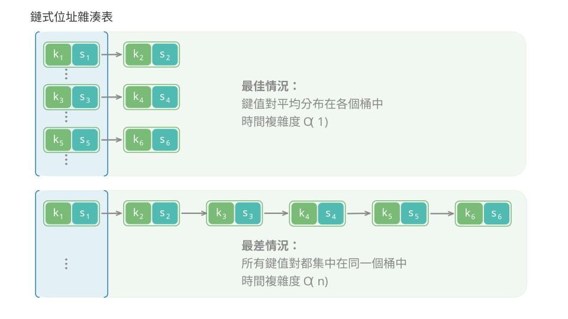

# 6.3 &nbsp; 雜湊演算法

前兩節介紹了雜湊表的運作原理，以及處理雜湊碰撞的方法。無論是開放定址法還是鏈結法，**都只能確保雜湊表在發生碰撞時正常運作，無法減少碰撞發生的次數**。

雜湊碰撞若過於頻繁，雜湊表的效能就會大幅下降。如圖 6-8 所示，採用鏈結法時，理想的情況是鍵值對均勻分布在各個桶中，查詢效率最高。最差的情況是所有鍵值對都集中在同一個桶中，查詢的時間複雜度會退化為 $O(n)$。

{ class="animation-figure" }

<p align="center"> 圖 6-8 &nbsp; 雜湊碰撞的最佳與最差情況 </p>

**雜湊函式決定鍵值對的分布**。回想一下，雜湊函式會先算出雜湊值，再把它除以陣列長度，取其餘數：

```shell
index = hash(key) % capacity
```

從上式可看出，當雜湊表的容量 `capacity` 固定時，**輸出值由雜湊演算法 `hash()` 決定**，進而決定鍵值對在雜湊表中的分布。

由此可知，要降低雜湊碰撞的機率，就應該從雜湊演算法 `hash()` 的設計著手。

## 6.3.1 &nbsp; 雜湊演算法的目標

要實作一個又快又穩的雜湊表，雜湊演算法應具備以下特性。

- **確定性**：只要輸入相同，雜湊演算法就應該每次都產生相同的輸出。這樣才能確保雜湊表可靠。
- **效率高**：計算雜湊值的速度要夠快。計算成本越低，雜湊表就越實用。
- **均勻分布**：雜湊演算法應讓鍵值對均勻分布在雜湊表中。分布越均勻，發生雜湊碰撞的機率就越低。

除了用來實作雜湊表，雜湊演算法也廣泛應用在其他領域。

- **密碼儲存**：為了保護使用者的密碼，系統通常只儲存密碼的雜湊值，不直接儲存明文密碼。當使用者輸入密碼時，系統會算出該密碼的雜湊值，再與先前儲存的雜湊值比對。兩者相符，就視為密碼正確。
- **資料完整性檢查**：傳送端可以算出資料的雜湊值，連同資料一起送出。接收端收到資料後，可以重新計算雜湊值，再與收到的雜湊值比對。兩者相符，就視為資料完整。

用在密碼學上時，為了防止有人從雜湊值反推出原始密碼或進行類似的逆向工程，雜湊演算法需要具備更高等級的安全特性。

- **單向性**：無法從雜湊值反推出任何關於輸入資料的資訊。
- **抗碰撞性**：要找到兩個不同的輸入，使它們產生相同的雜湊值，應該極為困難。
- **雪崩效應**：輸入的微小變化，應使輸出產生顯著且無法預測的變化。

請留意，**「均勻分布」與「抗碰撞性」是兩個獨立的概念**。即使分布均勻，也不一定具備抗碰撞性。例如，對隨機輸入的 `key` 而言，雜湊函式 `key % 100` 可以產生均勻分布的輸出。然而，這個雜湊演算法過於簡單，只要 `key` 的末兩位相同，輸出就相同。因此，我們很容易從雜湊值反推出一個可用的 `key`，藉此破解密碼。

## 6.3.2 &nbsp; 雜湊演算法的設計

設計雜湊演算法相當複雜，需要考量許多因素。不過，在要求不高的使用情境中，我們也能自己設計簡單的雜湊演算法。

- **加法雜湊**：將輸入中各字元的 ASCII 碼相加，以總和作為雜湊值。
- **乘法雜湊**：利用乘法降低關聯性，每一輪先將目前的雜湊值乘上一個常數，再加上當前字元的 ASCII 碼。
- **互斥或雜湊**：依序對輸入資料的各個元素做互斥或運算，逐步累積出一個雜湊值。
- **旋轉雜湊**：將各字元的 ASCII 碼累加到雜湊值中，每次累加前，都先對目前的雜湊值做位元旋轉。

=== "Python"

    ```python title="simple_hash.py"
    def add_hash(key: str) -> int:
        """加法雜湊"""
        hash = 0
        modulus = 1000000007
        for c in key:
            hash += ord(c)
        return hash % modulus

    def mul_hash(key: str) -> int:
        """乘法雜湊"""
        hash = 0
        modulus = 1000000007
        for c in key:
            hash = 31 * hash + ord(c)
        return hash % modulus

    def xor_hash(key: str) -> int:
        """互斥或雜湊"""
        hash = 0
        modulus = 1000000007
        for c in key:
            hash ^= ord(c)
        return hash % modulus

    def rot_hash(key: str) -> int:
        """旋轉雜湊"""
        hash = 0
        modulus = 1000000007
        for c in key:
            hash = (hash << 4) ^ (hash >> 28) ^ ord(c)
        return hash % modulus
    ```

=== "C++"

    ```cpp title="simple_hash.cpp"
    /* 加法雜湊 */
    int addHash(string key) {
        long long hash = 0;
        const int MODULUS = 1000000007;
        for (unsigned char c : key) {
            hash = (hash + (int)c) % MODULUS;
        }
        return (int)hash;
    }

    /* 乘法雜湊 */
    int mulHash(string key) {
        long long hash = 0;
        const int MODULUS = 1000000007;
        for (unsigned char c : key) {
            hash = (31 * hash + (int)c) % MODULUS;
        }
        return (int)hash;
    }

    /* 互斥或雜湊 */
    int xorHash(string key) {
        int hash = 0;
        const int MODULUS = 1000000007;
        for (unsigned char c : key) {
            hash ^= (int)c;
        }
        return hash & MODULUS;
    }

    /* 旋轉雜湊 */
    int rotHash(string key) {
        long long hash = 0;
        const int MODULUS = 1000000007;
        for (unsigned char c : key) {
            hash = ((hash << 4) ^ (hash >> 28) ^ (int)c) % MODULUS;
        }
        return (int)hash;
    }
    ```

=== "Java"

    ```java title="simple_hash.java"
    /* 加法雜湊 */
    int addHash(String key) {
        long hash = 0;
        final int MODULUS = 1000000007;
        for (char c : key.toCharArray()) {
            hash = (hash + (int) c) % MODULUS;
        }
        return (int) hash;
    }

    /* 乘法雜湊 */
    int mulHash(String key) {
        long hash = 0;
        final int MODULUS = 1000000007;
        for (char c : key.toCharArray()) {
            hash = (31 * hash + (int) c) % MODULUS;
        }
        return (int) hash;
    }

    /* 互斥或雜湊 */
    int xorHash(String key) {
        int hash = 0;
        final int MODULUS = 1000000007;
        for (char c : key.toCharArray()) {
            hash ^= (int) c;
        }
        return hash & MODULUS;
    }

    /* 旋轉雜湊 */
    int rotHash(String key) {
        long hash = 0;
        final int MODULUS = 1000000007;
        for (char c : key.toCharArray()) {
            hash = ((hash << 4) ^ (hash >> 28) ^ (int) c) % MODULUS;
        }
        return (int) hash;
    }
    ```

=== "C#"

    ```csharp title="simple_hash.cs"
    /* 加法雜湊 */
    int AddHash(string key) {
        long hash = 0;
        const int MODULUS = 1000000007;
        foreach (char c in key) {
            hash = (hash + c) % MODULUS;
        }
        return (int)hash;
    }

    /* 乘法雜湊 */
    int MulHash(string key) {
        long hash = 0;
        const int MODULUS = 1000000007;
        foreach (char c in key) {
            hash = (31 * hash + c) % MODULUS;
        }
        return (int)hash;
    }

    /* 互斥或雜湊 */
    int XorHash(string key) {
        int hash = 0;
        const int MODULUS = 1000000007;
        foreach (char c in key) {
            hash ^= c;
        }
        return hash & MODULUS;
    }

    /* 旋轉雜湊 */
    int RotHash(string key) {
        long hash = 0;
        const int MODULUS = 1000000007;
        foreach (char c in key) {
            hash = ((hash << 4) ^ (hash >> 28) ^ c) % MODULUS;
        }
        return (int)hash;
    }
    ```

=== "Go"

    ```go title="simple_hash.go"
    /* 加法雜湊 */
    func addHash(key string) int {
        var hash int64
        var modulus int64

        modulus = 1000000007
        for _, b := range []byte(key) {
            hash = (hash + int64(b)) % modulus
        }
        return int(hash)
    }

    /* 乘法雜湊 */
    func mulHash(key string) int {
        var hash int64
        var modulus int64

        modulus = 1000000007
        for _, b := range []byte(key) {
            hash = (31*hash + int64(b)) % modulus
        }
        return int(hash)
    }

    /* 互斥或雜湊 */
    func xorHash(key string) int {
        hash := 0
        modulus := 1000000007
        for _, b := range []byte(key) {
            fmt.Println(int(b))
            hash ^= int(b)
            hash = (31*hash + int(b)) % modulus
        }
        return hash & modulus
    }

    /* 旋轉雜湊 */
    func rotHash(key string) int {
        var hash int64
        var modulus int64

        modulus = 1000000007
        for _, b := range []byte(key) {
            hash = ((hash << 4) ^ (hash >> 28) ^ int64(b)) % modulus
        }
        return int(hash)
    }
    ```

=== "Swift"

    ```swift title="simple_hash.swift"
    /* 加法雜湊 */
    func addHash(key: String) -> Int {
        var hash = 0
        let MODULUS = 1_000_000_007
        for c in key {
            for scalar in c.unicodeScalars {
                hash = (hash + Int(scalar.value)) % MODULUS
            }
        }
        return hash
    }

    /* 乘法雜湊 */
    func mulHash(key: String) -> Int {
        var hash = 0
        let MODULUS = 1_000_000_007
        for c in key {
            for scalar in c.unicodeScalars {
                hash = (31 * hash + Int(scalar.value)) % MODULUS
            }
        }
        return hash
    }

    /* 互斥或雜湊 */
    func xorHash(key: String) -> Int {
        var hash = 0
        let MODULUS = 1_000_000_007
        for c in key {
            for scalar in c.unicodeScalars {
                hash ^= Int(scalar.value)
            }
        }
        return hash & MODULUS
    }

    /* 旋轉雜湊 */
    func rotHash(key: String) -> Int {
        var hash = 0
        let MODULUS = 1_000_000_007
        for c in key {
            for scalar in c.unicodeScalars {
                hash = ((hash << 4) ^ (hash >> 28) ^ Int(scalar.value)) % MODULUS
            }
        }
        return hash
    }
    ```

=== "JS"

    ```javascript title="simple_hash.js"
    /* 加法雜湊 */
    function addHash(key) {
        let hash = 0;
        const MODULUS = 1000000007;
        for (const c of key) {
            hash = (hash + c.charCodeAt(0)) % MODULUS;
        }
        return hash;
    }

    /* 乘法雜湊 */
    function mulHash(key) {
        let hash = 0;
        const MODULUS = 1000000007;
        for (const c of key) {
            hash = (31 * hash + c.charCodeAt(0)) % MODULUS;
        }
        return hash;
    }

    /* 互斥或雜湊 */
    function xorHash(key) {
        let hash = 0;
        const MODULUS = 1000000007;
        for (const c of key) {
            hash ^= c.charCodeAt(0);
        }
        return hash % MODULUS;
    }

    /* 旋轉雜湊 */
    function rotHash(key) {
        let hash = 0;
        const MODULUS = 1000000007;
        for (const c of key) {
            hash = ((hash << 4) ^ (hash >> 28) ^ c.charCodeAt(0)) % MODULUS;
        }
        return hash;
    }
    ```

=== "TS"

    ```typescript title="simple_hash.ts"
    /* 加法雜湊 */
    function addHash(key: string): number {
        let hash = 0;
        const MODULUS = 1000000007;
        for (const c of key) {
            hash = (hash + c.charCodeAt(0)) % MODULUS;
        }
        return hash;
    }

    /* 乘法雜湊 */
    function mulHash(key: string): number {
        let hash = 0;
        const MODULUS = 1000000007;
        for (const c of key) {
            hash = (31 * hash + c.charCodeAt(0)) % MODULUS;
        }
        return hash;
    }

    /* 互斥或雜湊 */
    function xorHash(key: string): number {
        let hash = 0;
        const MODULUS = 1000000007;
        for (const c of key) {
            hash ^= c.charCodeAt(0);
        }
        return hash % MODULUS;
    }

    /* 旋轉雜湊 */
    function rotHash(key: string): number {
        let hash = 0;
        const MODULUS = 1000000007;
        for (const c of key) {
            hash = ((hash << 4) ^ (hash >> 28) ^ c.charCodeAt(0)) % MODULUS;
        }
        return hash;
    }
    ```

=== "Dart"

    ```dart title="simple_hash.dart"
    /* 加法雜湊 */
    int addHash(String key) {
      int hash = 0;
      final int MODULUS = 1000000007;
      for (int i = 0; i < key.length; i++) {
        hash = (hash + key.codeUnitAt(i)) % MODULUS;
      }
      return hash;
    }

    /* 乘法雜湊 */
    int mulHash(String key) {
      int hash = 0;
      final int MODULUS = 1000000007;
      for (int i = 0; i < key.length; i++) {
        hash = (31 * hash + key.codeUnitAt(i)) % MODULUS;
      }
      return hash;
    }

    /* 互斥或雜湊 */
    int xorHash(String key) {
      int hash = 0;
      final int MODULUS = 1000000007;
      for (int i = 0; i < key.length; i++) {
        hash ^= key.codeUnitAt(i);
      }
      return hash & MODULUS;
    }

    /* 旋轉雜湊 */
    int rotHash(String key) {
      int hash = 0;
      final int MODULUS = 1000000007;
      for (int i = 0; i < key.length; i++) {
        hash = ((hash << 4) ^ (hash >> 28) ^ key.codeUnitAt(i)) % MODULUS;
      }
      return hash;
    }
    ```

=== "Rust"

    ```rust title="simple_hash.rs"
    /* 加法雜湊 */
    fn add_hash(key: &str) -> i32 {
        let mut hash = 0_i64;
        const MODULUS: i64 = 1000000007;

        for c in key.chars() {
            hash = (hash + c as i64) % MODULUS;
        }

        hash as i32
    }

    /* 乘法雜湊 */
    fn mul_hash(key: &str) -> i32 {
        let mut hash = 0_i64;
        const MODULUS: i64 = 1000000007;

        for c in key.chars() {
            hash = (31 * hash + c as i64) % MODULUS;
        }

        hash as i32
    }

    /* 互斥或雜湊 */
    fn xor_hash(key: &str) -> i32 {
        let mut hash = 0_i64;
        const MODULUS: i64 = 1000000007;

        for c in key.chars() {
            hash ^= c as i64;
        }

        (hash & MODULUS) as i32
    }

    /* 旋轉雜湊 */
    fn rot_hash(key: &str) -> i32 {
        let mut hash = 0_i64;
        const MODULUS: i64 = 1000000007;

        for c in key.chars() {
            hash = ((hash << 4) ^ (hash >> 28) ^ c as i64) % MODULUS;
        }

        hash as i32
    }
    ```

=== "C"

    ```c title="simple_hash.c"
    /* 加法雜湊 */
    int addHash(char *key) {
        long long hash = 0;
        const int MODULUS = 1000000007;
        for (int i = 0; i < strlen(key); i++) {
            hash = (hash + (unsigned char)key[i]) % MODULUS;
        }
        return (int)hash;
    }

    /* 乘法雜湊 */
    int mulHash(char *key) {
        long long hash = 0;
        const int MODULUS = 1000000007;
        for (int i = 0; i < strlen(key); i++) {
            hash = (31 * hash + (unsigned char)key[i]) % MODULUS;
        }
        return (int)hash;
    }

    /* 互斥或雜湊 */
    int xorHash(char *key) {
        int hash = 0;
        const int MODULUS = 1000000007;

        for (int i = 0; i < strlen(key); i++) {
            hash ^= (unsigned char)key[i];
        }
        return hash & MODULUS;
    }

    /* 旋轉雜湊 */
    int rotHash(char *key) {
        long long hash = 0;
        const int MODULUS = 1000000007;
        for (int i = 0; i < strlen(key); i++) {
            hash = ((hash << 4) ^ (hash >> 28) ^ (unsigned char)key[i]) % MODULUS;
        }

        return (int)hash;
    }
    ```

=== "Kotlin"

    ```kotlin title="simple_hash.kt"
    /* 加法雜湊 */
    fun addHash(key: String): Int {
        var hash = 0L
        val MODULUS = 1000000007
        for (c in key.toCharArray()) {
            hash = (hash + c.code) % MODULUS
        }
        return hash.toInt()
    }

    /* 乘法雜湊 */
    fun mulHash(key: String): Int {
        var hash = 0L
        val MODULUS = 1000000007
        for (c in key.toCharArray()) {
            hash = (31 * hash + c.code) % MODULUS
        }
        return hash.toInt()
    }

    /* 互斥或雜湊 */
    fun xorHash(key: String): Int {
        var hash = 0
        val MODULUS = 1000000007
        for (c in key.toCharArray()) {
            hash = hash xor c.code
        }
        return hash and MODULUS
    }

    /* 旋轉雜湊 */
    fun rotHash(key: String): Int {
        var hash = 0L
        val MODULUS = 1000000007
        for (c in key.toCharArray()) {
            hash = ((hash shl 4) xor (hash shr 28) xor c.code.toLong()) % MODULUS
        }
        return hash.toInt()
    }
    ```

=== "Ruby"

    ```ruby title="simple_hash.rb"
    ### 加法雜湊 ###
    def add_hash(key)
      hash = 0
      modulus = 1_000_000_007

      key.each_char { |c| hash += c.ord }

      hash % modulus
    end

    ### 乘法雜湊 ###
    def mul_hash(key)
      hash = 0
      modulus = 1_000_000_007

      key.each_char { |c| hash = 31 * hash + c.ord }

      hash % modulus
    end

    ### 互斥或雜湊 ###
    def xor_hash(key)
      hash = 0
      modulus = 1_000_000_007

      key.each_char { |c| hash ^= c.ord }

      hash % modulus
    end

    ### 旋轉雜湊 ###
    def rot_hash(key)
      hash = 0
      modulus = 1_000_000_007

      key.each_char { |c| hash = (hash << 4) ^ (hash >> 28) ^ c.ord }

      hash % modulus
    end
    ```

??? pythontutor "執行視覺化示範"

    <div style="height: 549px; width: 100%;"><iframe class="pythontutor-iframe" title="執行視覺化示範" src="https://pythontutor.com/iframe-embed.html#code=def%20add_hash%28key%3A%20str%29%20-%3E%20int%3A%0A%20%20%20%20%22%22%22%E5%8A%A0%E6%B3%95%E9%9B%9C%E6%B9%8A%22%22%22%0A%20%20%20%20hash%20%3D%200%0A%20%20%20%20modulus%20%3D%201000000007%0A%20%20%20%20for%20c%20in%20key%3A%0A%20%20%20%20%20%20%20%20hash%20%2B%3D%20ord%28c%29%0A%20%20%20%20return%20hash%20%25%20modulus%0A%0A%0Adef%20mul_hash%28key%3A%20str%29%20-%3E%20int%3A%0A%20%20%20%20%22%22%22%E4%B9%98%E6%B3%95%E9%9B%9C%E6%B9%8A%22%22%22%0A%20%20%20%20hash%20%3D%200%0A%20%20%20%20modulus%20%3D%201000000007%0A%20%20%20%20for%20c%20in%20key%3A%0A%20%20%20%20%20%20%20%20hash%20%3D%2031%20%2A%20hash%20%2B%20ord%28c%29%0A%20%20%20%20return%20hash%20%25%20modulus%0A%0A%0Adef%20xor_hash%28key%3A%20str%29%20-%3E%20int%3A%0A%20%20%20%20%22%22%22%E4%BA%92%E6%96%A5%E6%88%96%E9%9B%9C%E6%B9%8A%22%22%22%0A%20%20%20%20hash%20%3D%200%0A%20%20%20%20modulus%20%3D%201000000007%0A%20%20%20%20for%20c%20in%20key%3A%0A%20%20%20%20%20%20%20%20hash%20%5E%3D%20ord%28c%29%0A%20%20%20%20return%20hash%20%25%20modulus%0A%0A%0Adef%20rot_hash%28key%3A%20str%29%20-%3E%20int%3A%0A%20%20%20%20%22%22%22%E6%97%8B%E8%BD%89%E9%9B%9C%E6%B9%8A%22%22%22%0A%20%20%20%20hash%20%3D%200%0A%20%20%20%20modulus%20%3D%201000000007%0A%20%20%20%20for%20c%20in%20key%3A%0A%20%20%20%20%20%20%20%20hash%20%3D%20%28hash%20%3C%3C%204%29%20%5E%20%28hash%20%3E%3E%2028%29%20%5E%20ord%28c%29%0A%20%20%20%20return%20hash%20%25%20modulus%0A%0A%0A%22%22%22Driver%20Code%22%22%22%0Aif%20__name__%20%3D%3D%20%22__main__%22%3A%0A%20%20%20%20key%20%3D%20%22Hello%20%E7%AE%97%E6%B3%95%22%0A%0A%20%20%20%20hash%20%3D%20add_hash%28key%29%0A%20%20%20%20print%28f%22%E5%8A%A0%E6%B3%95%E9%9B%9C%E6%B9%8A%E5%80%BC%E7%82%BA%20%7Bhash%7D%22%29%0A%0A%20%20%20%20hash%20%3D%20mul_hash%28key%29%0A%20%20%20%20print%28f%22%E4%B9%98%E6%B3%95%E9%9B%9C%E6%B9%8A%E5%80%BC%E7%82%BA%20%7Bhash%7D%22%29%0A%0A%20%20%20%20hash%20%3D%20xor_hash%28key%29%0A%20%20%20%20print%28f%22%E4%BA%92%E6%96%A5%E6%88%96%E9%9B%9C%E6%B9%8A%E5%80%BC%E7%82%BA%20%7Bhash%7D%22%29%0A%0A%20%20%20%20hash%20%3D%20rot_hash%28key%29%0A%20%20%20%20print%28f%22%E6%97%8B%E8%BD%89%E9%9B%9C%E6%B9%8A%E5%80%BC%E7%82%BA%20%7Bhash%7D%22%29%0A&codeDivHeight=472&codeDivWidth=350&cumulative=false&curInstr=6&heapPrimitives=nevernest&origin=opt-frontend.js&py=311&rawInputLstJSON=%5B%5D&textReferences=false"> </iframe></div>
    <div style="margin-top: 5px;"><a href="https://pythontutor.com/iframe-embed.html#code=def%20add_hash%28key%3A%20str%29%20-%3E%20int%3A%0A%20%20%20%20%22%22%22%E5%8A%A0%E6%B3%95%E9%9B%9C%E6%B9%8A%22%22%22%0A%20%20%20%20hash%20%3D%200%0A%20%20%20%20modulus%20%3D%201000000007%0A%20%20%20%20for%20c%20in%20key%3A%0A%20%20%20%20%20%20%20%20hash%20%2B%3D%20ord%28c%29%0A%20%20%20%20return%20hash%20%25%20modulus%0A%0A%0Adef%20mul_hash%28key%3A%20str%29%20-%3E%20int%3A%0A%20%20%20%20%22%22%22%E4%B9%98%E6%B3%95%E9%9B%9C%E6%B9%8A%22%22%22%0A%20%20%20%20hash%20%3D%200%0A%20%20%20%20modulus%20%3D%201000000007%0A%20%20%20%20for%20c%20in%20key%3A%0A%20%20%20%20%20%20%20%20hash%20%3D%2031%20%2A%20hash%20%2B%20ord%28c%29%0A%20%20%20%20return%20hash%20%25%20modulus%0A%0A%0Adef%20xor_hash%28key%3A%20str%29%20-%3E%20int%3A%0A%20%20%20%20%22%22%22%E4%BA%92%E6%96%A5%E6%88%96%E9%9B%9C%E6%B9%8A%22%22%22%0A%20%20%20%20hash%20%3D%200%0A%20%20%20%20modulus%20%3D%201000000007%0A%20%20%20%20for%20c%20in%20key%3A%0A%20%20%20%20%20%20%20%20hash%20%5E%3D%20ord%28c%29%0A%20%20%20%20return%20hash%20%25%20modulus%0A%0A%0Adef%20rot_hash%28key%3A%20str%29%20-%3E%20int%3A%0A%20%20%20%20%22%22%22%E6%97%8B%E8%BD%89%E9%9B%9C%E6%B9%8A%22%22%22%0A%20%20%20%20hash%20%3D%200%0A%20%20%20%20modulus%20%3D%201000000007%0A%20%20%20%20for%20c%20in%20key%3A%0A%20%20%20%20%20%20%20%20hash%20%3D%20%28hash%20%3C%3C%204%29%20%5E%20%28hash%20%3E%3E%2028%29%20%5E%20ord%28c%29%0A%20%20%20%20return%20hash%20%25%20modulus%0A%0A%0A%22%22%22Driver%20Code%22%22%22%0Aif%20__name__%20%3D%3D%20%22__main__%22%3A%0A%20%20%20%20key%20%3D%20%22Hello%20%E7%AE%97%E6%B3%95%22%0A%0A%20%20%20%20hash%20%3D%20add_hash%28key%29%0A%20%20%20%20print%28f%22%E5%8A%A0%E6%B3%95%E9%9B%9C%E6%B9%8A%E5%80%BC%E7%82%BA%20%7Bhash%7D%22%29%0A%0A%20%20%20%20hash%20%3D%20mul_hash%28key%29%0A%20%20%20%20print%28f%22%E4%B9%98%E6%B3%95%E9%9B%9C%E6%B9%8A%E5%80%BC%E7%82%BA%20%7Bhash%7D%22%29%0A%0A%20%20%20%20hash%20%3D%20xor_hash%28key%29%0A%20%20%20%20print%28f%22%E4%BA%92%E6%96%A5%E6%88%96%E9%9B%9C%E6%B9%8A%E5%80%BC%E7%82%BA%20%7Bhash%7D%22%29%0A%0A%20%20%20%20hash%20%3D%20rot_hash%28key%29%0A%20%20%20%20print%28f%22%E6%97%8B%E8%BD%89%E9%9B%9C%E6%B9%8A%E5%80%BC%E7%82%BA%20%7Bhash%7D%22%29%0A&codeDivHeight=800&codeDivWidth=600&cumulative=false&curInstr=6&heapPrimitives=nevernest&origin=opt-frontend.js&py=311&rawInputLstJSON=%5B%5D&textReferences=false" target="_blank" rel="noopener noreferrer">全螢幕觀看 ></a></div>

這幾種雜湊演算法的最後一步，都是對大質數 $1000000007$ 取餘數，確保雜湊值落在適當範圍內。為什麼要特別選用質數？換句話說，對合數取餘數有什麼缺點？這個問題值得思考。

先說結論：**使用大質數作為模數，最能讓雜湊值均勻分布**。原理在於，質數與其他數沒有大於 1 的公因數，因此能減少取餘數時出現的週期性規律，進而避免雜湊碰撞。

舉例來說，假設我們選用合數 $9$ 作為模數，它可以被 $3$ 整除，那麼所有能被 $3$ 整除的 `key` 都會對應到 $0$、$3$、$6$ 這三個雜湊值之一。

$$
\begin{aligned}
\text{modulus} & = 9 \newline
\text{key} & = \{ 0, 3, 6, 9, 12, 15, 18, 21, 24, 27, 30, 33, \dots \} \newline
\text{hash} & = \{ 0, 3, 6, 0, 3, 6, 0, 3, 6, 0, 3, 6,\dots \}
\end{aligned}
$$

如果輸入的 `key` 恰好按這種等差數列分布，雜湊值就會集中在少數位置，使碰撞更頻繁。現在假設把 `modulus` 換成質數 $13$，由於 `key` 與 `modulus` 沒有大於 1 的公因數，輸出的雜湊值就會分布得更均勻。

$$
\begin{aligned}
\text{modulus} & = 13 \newline
\text{key} & = \{ 0, 3, 6, 9, 12, 15, 18, 21, 24, 27, 30, 33, \dots \} \newline
\text{hash} & = \{ 0, 3, 6, 9, 12, 2, 5, 8, 11, 1, 4, 7, \dots \}
\end{aligned}
$$

如果能確定 `key` 是均勻隨機分布的，選擇質數或合數作為模數都可以，兩者都能產生均勻分布的雜湊值。但如果 `key` 的分布具有某種週期性，對合數取餘數時就更容易出現集中的現象。

因此，我們通常選擇質數作為模數，而且這個質數最好夠大，以便盡可能消除週期性規律，讓雜湊演算法更穩定。

## 6.3.3 &nbsp; 常見的雜湊演算法

前面介紹的簡單雜湊演算法都相當「脆弱」，距離設計目標還很遠。例如，加法和互斥或運算都滿足交換律，因此加法雜湊與互斥或雜湊無法區分字元組成相同、排列順序不同的字串。這可能使雜湊碰撞更頻繁，也可能引發安全問題。

實務上常用標準的雜湊演算法，例如 MD5、SHA-1、SHA-2 和 SHA-3。這些演算法能將任意長度的輸入資料對應到固定長度的雜湊值。

近一個世紀以來，雜湊演算法持續演進與改良。有些研究人員致力於提升演算法的效能，另一些研究人員和駭客則設法找出其中的安全問題。表 6-2 列出實務上常見的雜湊演算法。

- MD5 和 SHA-1 已多次遭到成功攻擊，因此各類安全應用都已棄用它們。
- SHA-2 系列中的 SHA-256 是最安全的雜湊演算法之一，至今仍無攻擊成功的案例，因此常用於各類安全應用與通訊協定。
- 與 SHA-2 相比，SHA-3 的實作成本較低、運算效率較高，但目前的普及程度仍不及 SHA-2 系列。

<p align="center"> 表 6-2 &nbsp; 常見的雜湊演算法 </p>

<div class="center-table" markdown>

|          | MD5                            | SHA-1            | SHA-2                        | SHA-3               |
| -------- | ------------------------------ | ---------------- | ---------------------------- | ------------------- |
| 推出時間 | 1992                           | 1995             | 2002                         | 2008                |
| 輸出長度 | 128 bit                        | 160 bit          | 256/512 bit                  | 224/256/384/512 bit |
| 雜湊碰撞 | 較多                           | 較多             | 很少                         | 很少                |
| 安全等級 | 低，曾遭成功攻擊               | 低，曾遭成功攻擊 | 高                           | 高                  |
| 應用     | 已棄用，仍用於檢查資料完整性 | 已棄用         | 驗證加密貨幣交易、數位簽章等 | 可用來取代 SHA-2    |

</div>

## 6.3.4 &nbsp; 資料結構的雜湊值

我們知道，雜湊表的 `key` 可以是整數、小數或字串等資料型別。程式語言通常會為這些型別提供內建的雜湊演算法，用來計算雜湊表中的桶索引。以 Python 為例，我們可以呼叫 `hash()` 函式，算出各種資料型別的雜湊值。

- 整數和布林值的雜湊值就是它們本身的數值。
- 浮點數和字串的雜湊值計算方式較複雜，有興趣的讀者可以自行深入了解。
- 計算元組的雜湊值時，先分別算出各元素的雜湊值，再將這些值組合成一個雜湊值。
- 物件的雜湊值是根據其記憶體位址產生的。我們也可以覆寫物件的雜湊方法，改以物件的內容產生雜湊值。

!!! tip

    請留意，各種程式語言對內建雜湊函式的定義與計算方式各有不同。

=== "Python"

    ```python title="built_in_hash.py"
    num = 3
    hash_num = hash(num)
    print(f"整數 {num} 的雜湊值為 {hash_num}")
    # 整數 3 的雜湊值為 3

    bol = True
    hash_bol = hash(bol)
    print(f"布林值 {bol} 的雜湊值為 {hash_bol}")
    # 布林值 True 的雜湊值為 1

    dec = 3.14159
    hash_dec = hash(dec)
    print(f"小數 {dec} 的雜湊值為 {hash_dec}")
    # 小數 3.14159 的雜湊值為 326484311674566659

    str = "Hello 算法"
    hash_str = hash(str)
    print(f"字串「{str}」的雜湊值為 {hash_str}")
    # 字串「Hello 算法」的雜湊值為 4617003410720528961

    tup = (12836, "小哈")
    hash_tup = hash(tup)
    print(f"元組 {tup} 的雜湊值為 {hash_tup}")
    # 元組 (12836, '小哈') 的雜湊值為 1029005403108185979

    obj = ListNode(0)
    hash_obj = hash(obj)
    print(f"節點物件 {obj} 的雜湊值為 {hash_obj}")
    # 節點物件 <modules.list_node.ListNode object at 0x1058fd810> 的雜湊值為 274267521
    ```

=== "C++"

    ```cpp title="built_in_hash.cpp"
    int num = 3;
    size_t hashNum = hash<int>()(num);
    cout << "整數 " << num << " 的雜湊值為 " << hashNum << "\n";
    // 整數 3 的雜湊值為 3

    bool bol = true;
    size_t hashBol = hash<bool>()(bol);
    cout << "布林值 " << bol << " 的雜湊值為 " << hashBol << "\n";
    // 布林值 1 的雜湊值為 1

    double dec = 3.14159;
    size_t hashDec = hash<double>()(dec);
    cout << "小數 " << dec << " 的雜湊值為 " << hashDec << "\n";
    // 小數 3.14159 的雜湊值為 4614256650576692846

    string str = "Hello 算法";
    size_t hashStr = hash<string>()(str);
    cout << "字串「" << str << "」的雜湊值為 " << hashStr << "\n";
    // 字串「Hello 算法」的雜湊值為 15466937326284535026

    // 在 C++ 中，內建的 std::hash() 只支援基本資料型別與部分標準函式庫型別（例如 std::string）的雜湊值計算
    // 若要計算陣列與物件的雜湊值，必須自行實作
    ```

=== "Java"

    ```java title="built_in_hash.java"
    int num = 3;
    int hashNum = Integer.hashCode(num);
    System.out.println("整數 " + num + " 的雜湊值為 " + hashNum);
    // 整數 3 的雜湊值為 3

    boolean bol = true;
    int hashBol = Boolean.hashCode(bol);
    System.out.println("布林值 " + bol + " 的雜湊值為 " + hashBol);
    // 布林值 true 的雜湊值為 1231

    double dec = 3.14159;
    int hashDec = Double.hashCode(dec);
    System.out.println("小數 " + dec + " 的雜湊值為 " + hashDec);
    // 小數 3.14159 的雜湊值為 -1340954729

    String str = "Hello 算法";
    int hashStr = str.hashCode();
    System.out.println("字串「" + str + "」的雜湊值為 " + hashStr);
    // 字串「Hello 算法」的雜湊值為 -727081396

    Object[] arr = { 12836, "小哈" };
    int hashArr = Arrays.hashCode(arr);
    System.out.println("陣列 " + Arrays.toString(arr) + " 的雜湊值為 " + hashArr);
    // 陣列 [12836, 小哈] 的雜湊值為 1151158

    ListNode obj = new ListNode(0);
    int hashObj = obj.hashCode();
    System.out.println("節點物件 " + obj + " 的雜湊值為 " + hashObj);
    // 節點物件 utils.ListNode@7dc5e7b4 的雜湊值為 2110121908
    ```

=== "C#"

    ```csharp title="built_in_hash.cs"
    int num = 3;
    int hashNum = num.GetHashCode();
    Console.WriteLine("整數 " + num + " 的雜湊值為 " + hashNum);
    // 整數 3 的雜湊值為 3

    bool bol = true;
    int hashBol = bol.GetHashCode();
    Console.WriteLine("布林值 " + bol + " 的雜湊值為 " + hashBol);
    // 布林值 True 的雜湊值為 1

    double dec = 3.14159;
    int hashDec = dec.GetHashCode();
    Console.WriteLine("小數 " + dec + " 的雜湊值為 " + hashDec);
    // 小數 3.14159 的雜湊值為 -1340954729

    string str = "Hello 算法";
    int hashStr = str.GetHashCode();
    Console.WriteLine("字串「" + str + "」的雜湊值為 " + hashStr);
    // 字串「Hello 算法」的雜湊值為 -586107568

    object[] arr = [12836, "小哈"];
    int hashArr = arr.GetHashCode();
    Console.WriteLine("陣列 [" + string.Join(", ", arr) + "] 的雜湊值為 " + hashArr);
    // 陣列 [12836, 小哈] 的雜湊值為 42931033

    ListNode obj = new(0);
    int hashObj = obj.GetHashCode();
    Console.WriteLine("節點物件 " + obj + " 的雜湊值為 " + hashObj);
    // 節點物件 0 的雜湊值為 39053774
    ```

=== "Go"

    ```go title="built_in_hash.go"
    // Go 沒有內建的雜湊碼函式
    ```

=== "Swift"

    ```swift title="built_in_hash.swift"
    let num = 3
    let hashNum = num.hashValue
    print("整數 \(num) 的雜湊值為 \(hashNum)")
    // 整數 3 的雜湊值為 9047044699613009734

    let bol = true
    let hashBol = bol.hashValue
    print("布林值 \(bol) 的雜湊值為 \(hashBol)")
    // 布林值 true 的雜湊值為 -4431640247352757451

    let dec = 3.14159
    let hashDec = dec.hashValue
    print("小數 \(dec) 的雜湊值為 \(hashDec)")
    // 小數 3.14159 的雜湊值為 -2465384235396674631

    let str = "Hello 算法"
    let hashStr = str.hashValue
    print("字串「\(str)」的雜湊值為 \(hashStr)")
    // 字串「Hello 算法」的雜湊值為 -7850626797806988787

    let arr = [AnyHashable(12836), AnyHashable("小哈")]
    let hashArr = arr.hashValue
    print("陣列 \(arr) 的雜湊值為 \(hashArr)")
    // 陣列 [AnyHashable(12836), AnyHashable("小哈")] 的雜湊值為 -2308633508154532996

    let obj = ListNode(x: 0)
    let hashObj = obj.hashValue
    print("節點物件 \(obj) 的雜湊值為 \(hashObj)")
    // 節點物件 utils.ListNode 的雜湊值為 -2434780518035996159
    ```

=== "JS"

    ```javascript title="built_in_hash.js"
    // JavaScript 沒有內建的雜湊碼函式
    ```

=== "TS"

    ```typescript title="built_in_hash.ts"
    // TypeScript 沒有內建的雜湊碼函式
    ```

=== "Dart"

    ```dart title="built_in_hash.dart"
    int num = 3;
    int hashNum = num.hashCode;
    print("整數 $num 的雜湊值為 $hashNum");
    // 整數 3 的雜湊值為 34803

    bool bol = true;
    int hashBol = bol.hashCode;
    print("布林值 $bol 的雜湊值為 $hashBol");
    // 布林值 true 的雜湊值為 1231

    double dec = 3.14159;
    int hashDec = dec.hashCode;
    print("小數 $dec 的雜湊值為 $hashDec");
    // 小數 3.14159 的雜湊值為 2570631074981783

    String str = "Hello 算法";
    int hashStr = str.hashCode;
    print("字串「$str」的雜湊值為 $hashStr");
    // 字串「Hello 算法」的雜湊值為 468167534

    List arr = [12836, "小哈"];
    int hashArr = arr.hashCode;
    print("陣列 $arr 的雜湊值為 $hashArr");
    // 陣列 [12836, 小哈] 的雜湊值為 976512528

    ListNode obj = ListNode(0);
    int hashObj = obj.hashCode;
    print("節點物件 $obj 的雜湊值為 $hashObj");
    // 節點物件 Instance of 'ListNode' 的雜湊值為 1033450432
    ```

=== "Rust"

    ```rust title="built_in_hash.rs"
    use std::collections::hash_map::DefaultHasher;
    use std::hash::{Hash, Hasher};

    let num = 3;
    let mut num_hasher = DefaultHasher::new();
    num.hash(&mut num_hasher);
    let hash_num = num_hasher.finish();
    println!("整數 {} 的雜湊值為 {}", num, hash_num);
    // 整數 3 的雜湊值為 568126464209439262

    let bol = true;
    let mut bol_hasher = DefaultHasher::new();
    bol.hash(&mut bol_hasher);
    let hash_bol = bol_hasher.finish();
    println!("布林值 {} 的雜湊值為 {}", bol, hash_bol);
    // 布林值 true 的雜湊值為 4952851536318644461

    let dec: f32 = 3.14159;
    let mut dec_hasher = DefaultHasher::new();
    dec.to_bits().hash(&mut dec_hasher);
    let hash_dec = dec_hasher.finish();
    println!("小數 {} 的雜湊值為 {}", dec, hash_dec);
    // 小數 3.14159 的雜湊值為 2566941990314602357

    let str = "Hello 算法";
    let mut str_hasher = DefaultHasher::new();
    str.hash(&mut str_hasher);
    let hash_str = str_hasher.finish();
    println!("字串「{}」的雜湊值為 {}", str, hash_str);
    // 字串「Hello 算法」的雜湊值為 16092673739211250988

    let tup = (&12836, &"小哈");
    let mut tup_hasher = DefaultHasher::new();
    tup.hash(&mut tup_hasher);
    let hash_tup = tup_hasher.finish();
    println!("元組 {:?} 的雜湊值為 {}", tup, hash_tup);
    // 元組 (12836, "小哈") 的雜湊值為 1885128010422702749

    let node = ListNode::new(42);
    let mut node_hasher = DefaultHasher::new();
    node.borrow().val.hash(&mut node_hasher);
    let hash_node = node_hasher.finish();
    println!("節點 {:?} 中所存值的雜湊值為 {}", node, hash_node);
    // 節點 RefCell { value: ListNode { val: 42, next: None } } 中所存值的雜湊值為 15387811073369036852
    ```

=== "C"

    ```c title="built_in_hash.c"
    // C 沒有內建的雜湊碼函式
    ```

=== "Kotlin"

    ```kotlin title="built_in_hash.kt"
    val num = 3
    val hashNum = num.hashCode()
    println("整數 $num 的雜湊值為 $hashNum")
    // 整數 3 的雜湊值為 3

    val bol = true
    val hashBol = bol.hashCode()
    println("布林值 $bol 的雜湊值為 $hashBol")
    // 布林值 true 的雜湊值為 1231

    val dec = 3.14159
    val hashDec = dec.hashCode()
    println("小數 $dec 的雜湊值為 $hashDec")
    // 小數 3.14159 的雜湊值為 -1340954729

    val str = "Hello 算法"
    val hashStr = str.hashCode()
    println("字串「$str」的雜湊值為 $hashStr")
    // 字串「Hello 算法」的雜湊值為 -727081396

    val arr = arrayOf<Any>(12836, "小哈")
    val hashArr = arr.contentHashCode()
    println("陣列 ${arr.contentToString()} 的雜湊值為 $hashArr")
    // 陣列 [12836, 小哈] 的雜湊值為 1151158

    val obj = ListNode(0)
    val hashObj = obj.hashCode()
    println("節點物件 $obj 的雜湊值為 $hashObj")
    // 節點物件 utils.ListNode@1d81eb93 的雜湊值為 495053715
    ```

=== "Ruby"

    ```ruby title="built_in_hash.rb"
    num = 3
    hash_num = num.hash
    puts "整數 #{num} 的雜湊值為 #{hash_num}"
    # 整數 3 的雜湊值為 -4385856518450339636

    bol = true
    hash_bol = bol.hash
    puts "布林值 #{bol} 的雜湊值為 #{hash_bol}"
    # 布林值 true 的雜湊值為 -1617938112149317027

    dec = 3.14159
    hash_dec = dec.hash
    puts "小數 #{dec} 的雜湊值為 #{hash_dec}"
    # 小數 3.14159 的雜湊值為 -1479186995943067893

    str = "Hello 算法"
    hash_str = str.hash
    puts "字串「#{str}」的雜湊值為 #{hash_str}"
    # 字串「Hello 算法」的雜湊值為 -4075943250025831763

    arr = [12836, '小哈']
    hash_arr = arr.hash
    puts "陣列 #{arr} 的雜湊值為 #{hash_arr}"
    # 陣列 [12836, "小哈"] 的雜湊值為 1999544809202288822

    obj = ListNode.new(0)
    hash_obj = obj.hash
    puts "節點物件 #{obj} 的雜湊值為 #{hash_obj}"
    # 節點物件 #<ListNode:0x000078133140ab70> 的雜湊值為 4302940560806366381
    ```

??? pythontutor "執行視覺化示範"

    <div style="height: 549px; width: 100%;"><iframe class="pythontutor-iframe" title="執行視覺化示範" src="https://pythontutor.com/iframe-embed.html#code=class%20ListNode%3A%0A%20%20%20%20%22%22%22%E9%8F%88%E7%B5%90%E4%B8%B2%E5%88%97%E7%9A%84%E7%AF%80%E9%BB%9E%E9%A1%9E%E5%88%A5%22%22%22%0A%20%20%20%20def%20__init__%28self,%20val%3A%20int%29%3A%0A%20%20%20%20%20%20%20%20self.val%3A%20int%20%3D%20val%20%20%23%20%E7%AF%80%E9%BB%9E%E5%80%BC%0A%20%20%20%20%20%20%20%20self.next%3A%20ListNode%20%7C%20None%20%3D%20None%20%20%23%20%E6%8C%87%E5%90%91%E4%B8%8B%E4%B8%80%E5%80%8B%E7%AF%80%E9%BB%9E%E7%9A%84%E5%8F%83%E7%85%A7%0A%0A%22%22%22Driver%20Code%22%22%22%0Aif%20__name__%20%3D%3D%20%22__main__%22%3A%0A%20%20%20%20num%20%3D%203%0A%20%20%20%20hash_num%20%3D%20hash%28num%29%0A%20%20%20%20print%28f%22%E6%95%B4%E6%95%B8%20%7Bnum%7D%20%E7%9A%84%E9%9B%9C%E6%B9%8A%E5%80%BC%E7%82%BA%20%7Bhash_num%7D%22%29%0A%20%20%20%20%23%20%E6%95%B4%E6%95%B8%203%20%E7%9A%84%E9%9B%9C%E6%B9%8A%E5%80%BC%E7%82%BA%203%0A%0A%20%20%20%20bol%20%3D%20True%0A%20%20%20%20hash_bol%20%3D%20hash%28bol%29%0A%20%20%20%20print%28f%22%E5%B8%83%E6%9E%97%E5%80%BC%20%7Bbol%7D%20%E7%9A%84%E9%9B%9C%E6%B9%8A%E5%80%BC%E7%82%BA%20%7Bhash_bol%7D%22%29%0A%20%20%20%20%23%20%E5%B8%83%E6%9E%97%E5%80%BC%20True%20%E7%9A%84%E9%9B%9C%E6%B9%8A%E5%80%BC%E7%82%BA%201%0A%0A%20%20%20%20dec%20%3D%203.14159%0A%20%20%20%20hash_dec%20%3D%20hash%28dec%29%0A%20%20%20%20print%28f%22%E5%B0%8F%E6%95%B8%20%7Bdec%7D%20%E7%9A%84%E9%9B%9C%E6%B9%8A%E5%80%BC%E7%82%BA%20%7Bhash_dec%7D%22%29%0A%20%20%20%20%23%20%E5%B0%8F%E6%95%B8%203.14159%20%E7%9A%84%E9%9B%9C%E6%B9%8A%E5%80%BC%E7%82%BA%20326484311674566659%0A%0A%20%20%20%20str%20%3D%20%22Hello%20%E7%AE%97%E6%B3%95%22%0A%20%20%20%20hash_str%20%3D%20hash%28str%29%0A%20%20%20%20print%28f%22%E5%AD%97%E4%B8%B2%E3%80%8C%7Bstr%7D%E3%80%8D%E7%9A%84%E9%9B%9C%E6%B9%8A%E5%80%BC%E7%82%BA%20%7Bhash_str%7D%22%29%0A%20%20%20%20%23%20%E5%AD%97%E4%B8%B2%E3%80%8CHello%20%E7%AE%97%E6%B3%95%E3%80%8D%E7%9A%84%E9%9B%9C%E6%B9%8A%E5%80%BC%E7%82%BA%204617003410720528961%0A%0A%20%20%20%20tup%20%3D%20%2812836,%20%22%E5%B0%8F%E5%93%88%22%29%0A%20%20%20%20hash_tup%20%3D%20hash%28tup%29%0A%20%20%20%20print%28f%22%E5%85%83%E7%B5%84%20%7Btup%7D%20%E7%9A%84%E9%9B%9C%E6%B9%8A%E5%80%BC%E7%82%BA%20%7Bhash_tup%7D%22%29%0A%20%20%20%20%23%20%E5%85%83%E7%B5%84%20%2812836,%20%27%E5%B0%8F%E5%93%88%27%29%20%E7%9A%84%E9%9B%9C%E6%B9%8A%E5%80%BC%E7%82%BA%201029005403108185979%0A%0A%20%20%20%20obj%20%3D%20ListNode%280%29%0A%20%20%20%20hash_obj%20%3D%20hash%28obj%29%0A%20%20%20%20print%28f%22%E7%AF%80%E9%BB%9E%E7%89%A9%E4%BB%B6%20%7Bobj%7D%20%E7%9A%84%E9%9B%9C%E6%B9%8A%E5%80%BC%E7%82%BA%20%7Bhash_obj%7D%22%29%0A%20%20%20%20%23%20%E7%AF%80%E9%BB%9E%E7%89%A9%E4%BB%B6%20%3Cmodules.list_node.ListNode%20object%20at%200x1058fd810%3E%20%E7%9A%84%E9%9B%9C%E6%B9%8A%E5%80%BC%E7%82%BA%20274267521%0A&codeDivHeight=472&codeDivWidth=350&cumulative=false&curInstr=19&heapPrimitives=nevernest&origin=opt-frontend.js&py=311&rawInputLstJSON=%5B%5D&textReferences=false"> </iframe></div>
    <div style="margin-top: 5px;"><a href="https://pythontutor.com/iframe-embed.html#code=class%20ListNode%3A%0A%20%20%20%20%22%22%22%E9%8F%88%E7%B5%90%E4%B8%B2%E5%88%97%E7%9A%84%E7%AF%80%E9%BB%9E%E9%A1%9E%E5%88%A5%22%22%22%0A%20%20%20%20def%20__init__%28self,%20val%3A%20int%29%3A%0A%20%20%20%20%20%20%20%20self.val%3A%20int%20%3D%20val%20%20%23%20%E7%AF%80%E9%BB%9E%E5%80%BC%0A%20%20%20%20%20%20%20%20self.next%3A%20ListNode%20%7C%20None%20%3D%20None%20%20%23%20%E6%8C%87%E5%90%91%E4%B8%8B%E4%B8%80%E5%80%8B%E7%AF%80%E9%BB%9E%E7%9A%84%E5%8F%83%E7%85%A7%0A%0A%22%22%22Driver%20Code%22%22%22%0Aif%20__name__%20%3D%3D%20%22__main__%22%3A%0A%20%20%20%20num%20%3D%203%0A%20%20%20%20hash_num%20%3D%20hash%28num%29%0A%20%20%20%20print%28f%22%E6%95%B4%E6%95%B8%20%7Bnum%7D%20%E7%9A%84%E9%9B%9C%E6%B9%8A%E5%80%BC%E7%82%BA%20%7Bhash_num%7D%22%29%0A%20%20%20%20%23%20%E6%95%B4%E6%95%B8%203%20%E7%9A%84%E9%9B%9C%E6%B9%8A%E5%80%BC%E7%82%BA%203%0A%0A%20%20%20%20bol%20%3D%20True%0A%20%20%20%20hash_bol%20%3D%20hash%28bol%29%0A%20%20%20%20print%28f%22%E5%B8%83%E6%9E%97%E5%80%BC%20%7Bbol%7D%20%E7%9A%84%E9%9B%9C%E6%B9%8A%E5%80%BC%E7%82%BA%20%7Bhash_bol%7D%22%29%0A%20%20%20%20%23%20%E5%B8%83%E6%9E%97%E5%80%BC%20True%20%E7%9A%84%E9%9B%9C%E6%B9%8A%E5%80%BC%E7%82%BA%201%0A%0A%20%20%20%20dec%20%3D%203.14159%0A%20%20%20%20hash_dec%20%3D%20hash%28dec%29%0A%20%20%20%20print%28f%22%E5%B0%8F%E6%95%B8%20%7Bdec%7D%20%E7%9A%84%E9%9B%9C%E6%B9%8A%E5%80%BC%E7%82%BA%20%7Bhash_dec%7D%22%29%0A%20%20%20%20%23%20%E5%B0%8F%E6%95%B8%203.14159%20%E7%9A%84%E9%9B%9C%E6%B9%8A%E5%80%BC%E7%82%BA%20326484311674566659%0A%0A%20%20%20%20str%20%3D%20%22Hello%20%E7%AE%97%E6%B3%95%22%0A%20%20%20%20hash_str%20%3D%20hash%28str%29%0A%20%20%20%20print%28f%22%E5%AD%97%E4%B8%B2%E3%80%8C%7Bstr%7D%E3%80%8D%E7%9A%84%E9%9B%9C%E6%B9%8A%E5%80%BC%E7%82%BA%20%7Bhash_str%7D%22%29%0A%20%20%20%20%23%20%E5%AD%97%E4%B8%B2%E3%80%8CHello%20%E7%AE%97%E6%B3%95%E3%80%8D%E7%9A%84%E9%9B%9C%E6%B9%8A%E5%80%BC%E7%82%BA%204617003410720528961%0A%0A%20%20%20%20tup%20%3D%20%2812836,%20%22%E5%B0%8F%E5%93%88%22%29%0A%20%20%20%20hash_tup%20%3D%20hash%28tup%29%0A%20%20%20%20print%28f%22%E5%85%83%E7%B5%84%20%7Btup%7D%20%E7%9A%84%E9%9B%9C%E6%B9%8A%E5%80%BC%E7%82%BA%20%7Bhash_tup%7D%22%29%0A%20%20%20%20%23%20%E5%85%83%E7%B5%84%20%2812836,%20%27%E5%B0%8F%E5%93%88%27%29%20%E7%9A%84%E9%9B%9C%E6%B9%8A%E5%80%BC%E7%82%BA%201029005403108185979%0A%0A%20%20%20%20obj%20%3D%20ListNode%280%29%0A%20%20%20%20hash_obj%20%3D%20hash%28obj%29%0A%20%20%20%20print%28f%22%E7%AF%80%E9%BB%9E%E7%89%A9%E4%BB%B6%20%7Bobj%7D%20%E7%9A%84%E9%9B%9C%E6%B9%8A%E5%80%BC%E7%82%BA%20%7Bhash_obj%7D%22%29%0A%20%20%20%20%23%20%E7%AF%80%E9%BB%9E%E7%89%A9%E4%BB%B6%20%3Cmodules.list_node.ListNode%20object%20at%200x1058fd810%3E%20%E7%9A%84%E9%9B%9C%E6%B9%8A%E5%80%BC%E7%82%BA%20274267521%0A&codeDivHeight=800&codeDivWidth=600&cumulative=false&curInstr=19&heapPrimitives=nevernest&origin=opt-frontend.js&py=311&rawInputLstJSON=%5B%5D&textReferences=false" target="_blank" rel="noopener noreferrer">全螢幕觀看 ></a></div>

在許多程式語言中，**只有不可變物件才能當作雜湊表的 `key`**。假設以串列（動態陣列）作為 `key`，更改串列內容後，雜湊值也會跟著改變，我們就無法從雜湊表查到原來的 `value`。

自訂物件（例如鏈結串列節點）的成員變數雖然可以改變，物件本身仍可計算雜湊值。**這是因為物件的雜湊值通常是根據記憶體位址產生的**。即使物件內容改變，記憶體位址仍然相同，雜湊值也就維持不變。

你可能會發現，在不同的主控台中執行程式，輸出的雜湊值會不同。**這是因為 Python 直譯器每次啟動時，都會在字串雜湊函式中加入一個隨機的鹽值（salt）**。這種做法能有效防範 HashDoS 攻擊，提升雜湊演算法的安全性。
