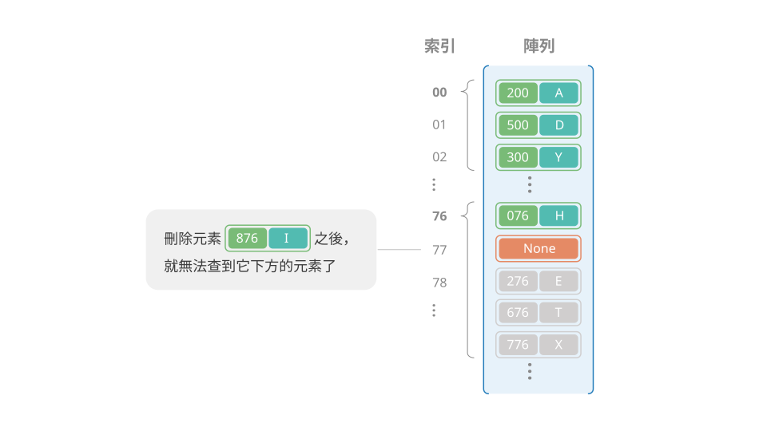

# 雜湊碰撞

上一節提到，**雜湊函式的輸入空間通常遠大於輸出空間**，因此理論上無法避免雜湊碰撞。例如，若輸入可以是任意整數，輸出的索引數量卻受限於陣列容量，就一定有多個整數對應到同一個桶索引。

雜湊碰撞會導致查詢結果錯誤，嚴重影響雜湊表的可用性。一個解決方法是，每當發生碰撞，就擴充雜湊表的容量，直到碰撞消失。這個方法簡單直接，雖然有效，效率卻太低，因為擴充容量需要搬移大量資料並重新計算雜湊值。為了提高效率，可以採用以下策略。

1. 改良雜湊表的資料結構，**讓雜湊表在發生碰撞時仍能正常運作**。
2. 只在必要時，也就是雜湊碰撞較為嚴重時，才擴充容量。

改良雜湊表結構的方法主要有「鏈結法」與「開放定址法」兩種。

## 鏈結法

原本的雜湊表每個桶只能存放一個鍵值對。<u>鏈結法（separate chaining）</u>將桶中的單一元素改為鏈結串列，每個節點存放一個鍵值對，讓所有發生碰撞的鍵值對都存在同一條串列中。下圖是一個採用鏈結法的雜湊表。


採用鏈結法後，雜湊表的各項操作會有以下變化。

- **查詢元素**：輸入 `key`，由雜湊函式算出桶索引，便可存取鏈結串列的首節點。接著走訪串列，逐一比對 `key`，找出目標鍵值對。
- **新增元素**：先透過雜湊函式找到鏈結串列的首節點，再將新節點（鍵值對）加入串列。
- **刪除元素**：根據雜湊函式的結果找到鏈結串列的開頭，再走訪串列，找出目標節點並將它刪除。

鏈結法有以下限制。

- **占用更多空間**：鏈結串列需要指向節點的指標，比陣列耗用更多記憶體。
- **查詢效率降低**：為了找到對應的元素，必須依序走訪鏈結串列。

以下程式碼示範如何用鏈結法實作簡單的雜湊表。有兩點值得留意。

- 為了簡化程式碼，我們用串列（動態陣列）取代鏈結串列。在這個實作中，雜湊表（陣列）包含多個桶，每個桶都是一個串列。
- 以下實作提供擴充雜湊表容量的方法。當負載因子超過 $\frac{2}{3}$ 時，我們就將雜湊表的容量擴充為原來的 $2$ 倍。

```src
[file]{hash_map_chaining}-[class]{hash_map_chaining}-[func]{}
```

當鏈結串列很長時，查詢的效率 $O(n)$ 很差。**此時可以將鏈結串列改為「AVL 樹」或「紅黑樹」**，將查詢的時間複雜度改善為 $O(\log n)$。

## 開放定址法

<u>開放定址法（open addressing）</u>無須額外的資料結構，而是透過多次探測來處理雜湊碰撞。常見的探測方式有線性探測、平方探測和多重雜湊等。

以下以線性探測為例，說明採用開放定址法的雜湊表如何運作。

### 線性探測

線性探測每次向後移動固定步數，以線性搜尋的方式探測。它的操作與一般雜湊表略有不同。

- **插入元素**：先用雜湊函式算出桶索引。如果桶裡已有元素，就從碰撞位置開始，以固定步長（通常為 $1$）向後依序探測，找到空桶後將元素放入。
- **查找元素**：若發生雜湊碰撞，就以相同的步長向後依序探測，找到對應的元素後回傳 `value`。如果遇到空桶，表示目標元素不在雜湊表中，便回傳 `None`。

下圖顯示採用開放定址法（線性探測）的雜湊表如何存放鍵值對。依照圖中的雜湊函式，末兩位相同的 `key` 都會對應到同一個桶。經過線性探測，這些鍵值對會依序放在該桶及其下方的桶中。


不過，**線性探測容易產生「群聚現象」**。陣列中連續被占用的區段越長，新元素在這段區間發生碰撞的機率就越高，使這個群集進一步擴大。如此形成惡性循環，最後會降低新增、刪除、查詢與更新的效率。

請留意，**在採用開放定址法的雜湊表中，不能直接刪除元素**。直接刪除會在陣列中留下一個空桶 `None`。查詢時，線性探測遇到這個空桶就會結束，無法再繼續查找空桶後方的元素，程式便可能誤判這些元素不存在，如下圖所示。



為了解決這個問題，可以採用<u>延遲刪除（lazy deletion）</u>：刪除時不直接從雜湊表移除元素，**而是用常數 `TOMBSTONE` 標記這個桶**。此時 `None` 和 `TOMBSTONE` 都表示空桶，都能放入鍵值對。差別在於線性探測遇到 `TOMBSTONE` 時要繼續往後找，因為後面可能還有鍵值對。

然而，**延遲刪除可能會讓雜湊表的效能下降得更快**。每次刪除都會留下一個刪除標記。隨著 `TOMBSTONE` 增多，線性探測可能要跳過好幾個 `TOMBSTONE` 才能找到目標元素，搜尋所需的時間也會增加。

為此，可以在線性探測時記下遇到的第一個 `TOMBSTONE` 的索引，找到目標元素後，再讓它和這個 `TOMBSTONE` 交換位置。如此一來，每次查詢或新增元素時，都有機會將元素移到更接近理想位置（探測起點）的桶，提升查詢效率。

以下程式碼以開放定址法（線性探測）實作雜湊表，並支援延遲刪除。為了充分運用雜湊表的空間，我們把它視為「環狀陣列」：探測超過陣列尾端時，就回到開頭繼續走訪。

```src
[file]{hash_map_open_addressing}-[class]{hash_map_open_addressing}-[func]{}
```

### 平方探測

和線性探測一樣，平方探測也是開放定址法的常見策略。發生碰撞時，平方探測跳過的步數並不固定，而是取「探測次數的平方」，也就是 $1, 4, 9, \dots$ 步。

平方探測有以下優點。

- 每次探測都跳過相當於探測次數平方的距離，有助於緩解線性探測造成的群聚現象。
- 平方探測會跨越較大的距離來尋找空位，有助於讓資料分布得更均勻。

不過，平方探測也有侷限。

- 群聚現象仍可能發生，某些位置比其他位置更容易被占用。
- 由於平方值的成長方式，探測可能無法涵蓋整個雜湊表。也就是說，即使表中有空桶，平方探測也可能無法到達那裡。

### 多重雜湊

顧名思義，多重雜湊使用多個雜湊函式 $f_1(x)$、$f_2(x)$、$f_3(x)$、$\dots$ 來探測。

- **插入元素**：若使用雜湊函式 $f_1(x)$ 時發生碰撞，就改試 $f_2(x)$，依此類推，直到找到空位再插入元素。
- **查找元素**：以相同順序使用各個雜湊函式查找，找到目標元素後就回傳。如果遇到空位，或已試過所有雜湊函式仍未找到，便表示該元素不在雜湊表中，回傳 `None`。

與線性探測相比，多重雜湊較不容易產生群聚，但使用多個雜湊函式也會增加計算量。

!!! tip

    請留意，採用開放定址法的雜湊表，無論使用線性探測、平方探測或多重雜湊，都有「不能直接刪除元素」的問題。

## 各種程式語言的選擇

不同程式語言採用的雜湊表實作策略各有不同，以下是幾個例子。

- Python 採用開放定址法，字典 `dict` 使用虛擬亂數進行探測。
- Java 採用鏈結法。從 JDK 1.8 開始，當 `HashMap` 內部的陣列長度達到 64，且鏈結串列的長度達到 8 時，就會將串列轉為紅黑樹，以提升查找效能。
- 從 Go 1.24 開始，內建的 `map` 預設採用以 Swiss Table 為基礎的開放定址實作。Go 1.23 及更早的版本採用鏈結法，每個桶最多可存放 8 個鍵值對，超過容量時便連接溢位桶。
