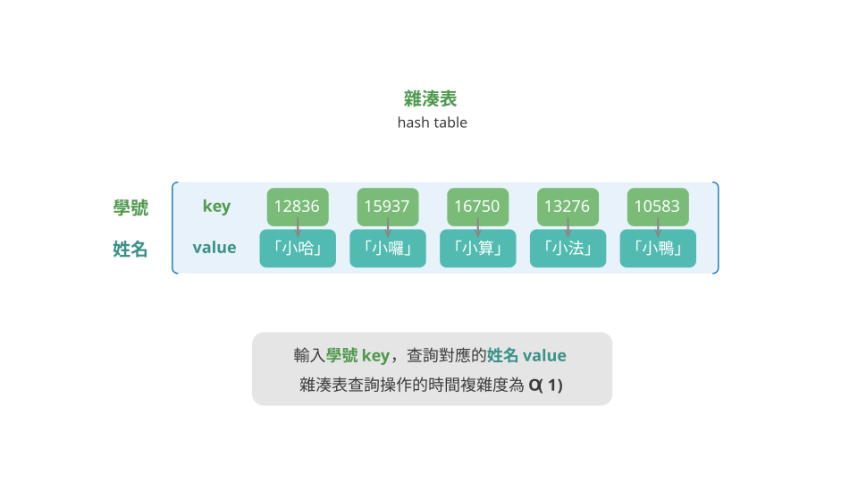
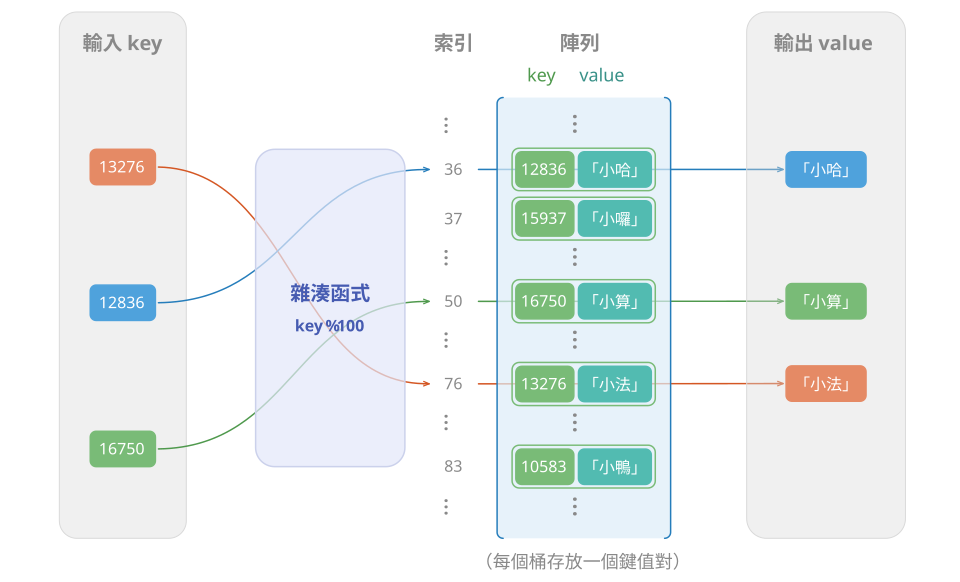
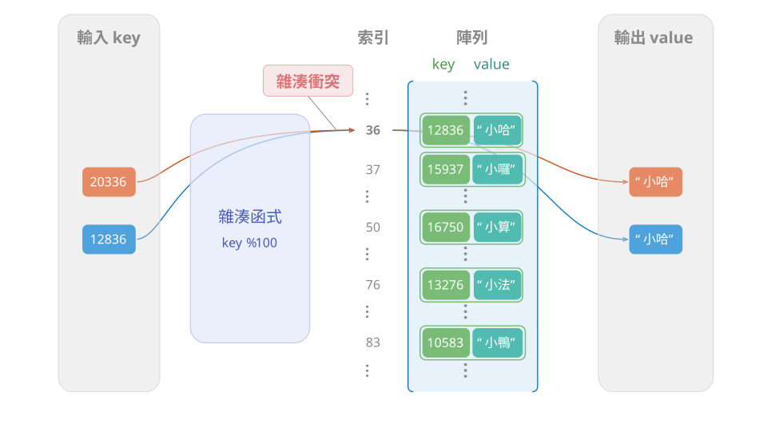
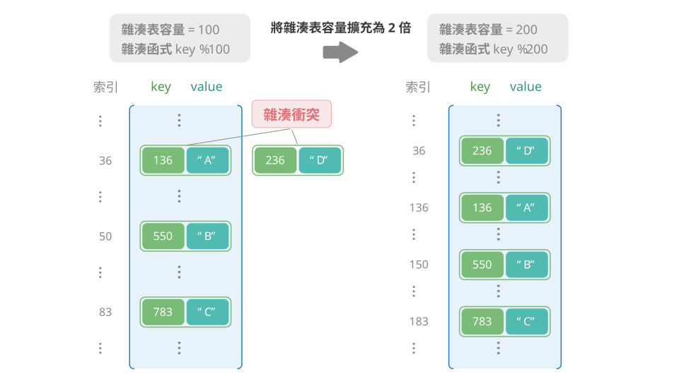

# 6.1 &nbsp; 雜湊表

<u>雜湊表（hash table）</u>又稱<u>散列表</u>，透過建立鍵 `key` 與值 `value` 的對應關係，讓我們能有效率地查詢元素。具體來說，將鍵 `key` 輸入雜湊表，就能在 $O(1)$ 的時間內取得對應的值 `value`。

假設有 $n$ 位學生，每位學生都有「姓名」與「學號」兩項資料。如果希望輸入學號就能查到並回傳對應的姓名，可以使用圖 6-1 的雜湊表。

{ class="animation-figure" }

<p align="center"> 圖 6-1 &nbsp; 雜湊表的抽象表示 </p>

除了雜湊表，陣列與鏈結串列也能用來查詢元素。表 6-1 比較三者的操作效率。

- **新增元素**：只需將元素加到陣列（或鏈結串列）的尾端，需要 $O(1)$ 的時間。
- **查詢元素**：陣列（或鏈結串列）中的元素沒有排序，因此需要逐一走訪所有元素，花費 $O(n)$ 的時間。
- **刪除元素**：必須先找到元素，再從陣列（或鏈結串列）中刪除，需要 $O(n)$ 的時間。

<p align="center"> 表 6-1 &nbsp; 元素查詢效率比較 </p>

<div class="center-table" markdown>

|          | 陣列   | 鏈結串列   | 雜湊表 |
| -------- | ------ | ------ | ------ |
| 查找元素 | $O(n)$ | $O(n)$ | $O(1)$ |
| 新增元素 | $O(1)$ | $O(1)$ | $O(1)$ |
| 刪除元素 | $O(n)$ | $O(n)$ | $O(1)$ |

</div>

從表中可以看出，**雜湊表的新增、刪除、查詢和更新操作，時間複雜度都是 $O(1)$**，效率很高。

## 6.1.1 &nbsp; 雜湊表的常用操作

雜湊表的常用操作包括初始化、查詢、新增鍵值對和刪除鍵值對。以下是程式碼範例：

=== "Python"

    ```python title="hash_map.py"
    # 初始化雜湊表
    hmap = dict[int, str]()

    # 新增操作
    # 在雜湊表中新增鍵值對 (key, value)
    hmap[12836] = "小哈"
    hmap[15937] = "小囉"
    hmap[16750] = "小算"
    hmap[13276] = "小法"
    hmap[10583] = "小鴨"

    # 查詢操作
    # 輸入鍵 key，從雜湊表取得對應的值 value
    name: str = hmap[15937]

    # 刪除操作
    # 從雜湊表刪除鍵值對 (key, value)
    hmap.pop(10583)
    ```

=== "C++"

    ```cpp title="hash_map.cpp"
    /* 初始化雜湊表 */
    unordered_map<int, string> map;

    /* 新增操作 */
    // 在雜湊表中新增鍵值對 (key, value)
    map[12836] = "小哈";
    map[15937] = "小囉";
    map[16750] = "小算";
    map[13276] = "小法";
    map[10583] = "小鴨";

    /* 查詢操作 */
    // 輸入鍵 key，從雜湊表取得對應的值 value
    string name = map[15937];

    /* 刪除操作 */
    // 從雜湊表刪除鍵值對 (key, value)
    map.erase(10583);
    ```

=== "Java"

    ```java title="hash_map.java"
    /* 初始化雜湊表 */
    Map<Integer, String> map = new HashMap<>();

    /* 新增操作 */
    // 在雜湊表中新增鍵值對 (key, value)
    map.put(12836, "小哈");
    map.put(15937, "小囉");
    map.put(16750, "小算");
    map.put(13276, "小法");
    map.put(10583, "小鴨");

    /* 查詢操作 */
    // 輸入鍵 key，從雜湊表取得對應的值 value
    String name = map.get(15937);

    /* 刪除操作 */
    // 從雜湊表刪除鍵值對 (key, value)
    map.remove(10583);
    ```

=== "C#"

    ```csharp title="hash_map.cs"
    /* 初始化雜湊表 */
    Dictionary<int, string> map = new() {
        /* 新增操作 */
        // 在雜湊表中新增鍵值對 (key, value)
        { 12836, "小哈" },
        { 15937, "小囉" },
        { 16750, "小算" },
        { 13276, "小法" },
        { 10583, "小鴨" }
    };

    /* 查詢操作 */
    // 輸入鍵 key，從雜湊表取得對應的值 value
    string name = map[15937];

    /* 刪除操作 */
    // 從雜湊表刪除鍵值對 (key, value)
    map.Remove(10583);
    ```

=== "Go"

    ```go title="hash_map_test.go"
    /* 初始化雜湊表 */
    hmap := make(map[int]string)

    /* 新增操作 */
    // 在雜湊表中新增鍵值對 (key, value)
    hmap[12836] = "小哈"
    hmap[15937] = "小囉"
    hmap[16750] = "小算"
    hmap[13276] = "小法"
    hmap[10583] = "小鴨"

    /* 查詢操作 */
    // 輸入鍵 key，從雜湊表取得對應的值 value
    name := hmap[15937]

    /* 刪除操作 */
    // 從雜湊表刪除鍵值對 (key, value)
    delete(hmap, 10583)
    ```

=== "Swift"

    ```swift title="hash_map.swift"
    /* 初始化雜湊表 */
    var map: [Int: String] = [:]

    /* 新增操作 */
    // 在雜湊表中新增鍵值對 (key, value)
    map[12836] = "小哈"
    map[15937] = "小囉"
    map[16750] = "小算"
    map[13276] = "小法"
    map[10583] = "小鴨"

    /* 查詢操作 */
    // 輸入鍵 key，從雜湊表取得對應的值 value
    let name = map[15937]!

    /* 刪除操作 */
    // 從雜湊表刪除鍵值對 (key, value)
    map.removeValue(forKey: 10583)
    ```

=== "JS"

    ```javascript title="hash_map.js"
    /* 初始化雜湊表 */
    const map = new Map();

    /* 新增操作 */
    // 在雜湊表中新增鍵值對 (key, value)
    map.set(12836, '小哈');
    map.set(15937, '小囉');
    map.set(16750, '小算');
    map.set(13276, '小法');
    map.set(10583, '小鴨');

    /* 查詢操作 */
    // 輸入鍵 key，從雜湊表取得對應的值 value
    let name = map.get(15937);

    /* 刪除操作 */
    // 從雜湊表刪除鍵值對 (key, value)
    map.delete(10583);
    ```

=== "TS"

    ```typescript title="hash_map.ts"
    /* 初始化雜湊表 */
    const map = new Map<number, string>();

    /* 新增操作 */
    // 在雜湊表中新增鍵值對 (key, value)
    map.set(12836, '小哈');
    map.set(15937, '小囉');
    map.set(16750, '小算');
    map.set(13276, '小法');
    map.set(10583, '小鴨');

    /* 查詢操作 */
    // 輸入鍵 key，從雜湊表取得對應的值 value
    let name = map.get(15937);

    /* 刪除操作 */
    // 從雜湊表刪除鍵值對 (key, value)
    map.delete(10583);
    ```

=== "Dart"

    ```dart title="hash_map.dart"
    /* 初始化雜湊表 */
    final Map<int, String> map = {};

    /* 新增操作 */
    // 在雜湊表中新增鍵值對 (key, value)
    map[12836] = "小哈";
    map[15937] = "小囉";
    map[16750] = "小算";
    map[13276] = "小法";
    map[10583] = "小鴨";

    /* 查詢操作 */
    // 輸入鍵 key，從雜湊表取得對應的值 value
    final String? name = map[15937];

    /* 刪除操作 */
    // 從雜湊表刪除鍵值對 (key, value)
    map.remove(10583);
    ```

=== "Rust"

    ```rust title="hash_map.rs"
    use std::collections::HashMap;

    // 初始化雜湊表
    let mut map = HashMap::new();

    // 新增操作
    // 在雜湊表中新增鍵值對 (key, value)
    map.insert(12836, "小哈");
    map.insert(15937, "小囉");
    map.insert(16750, "小算");
    map.insert(13276, "小法");
    map.insert(10583, "小鴨");

    // 查詢操作
    // 輸入鍵 key，從雜湊表取得對應的值 value
    let name = map.get(&15937).copied().unwrap();

    // 刪除操作
    // 從雜湊表刪除鍵值對 (key, value)
    _ = map.remove(&10583);
    ```

=== "C"

    ```c title="hash_map.c"
    // C 沒有內建的雜湊表
    ```

=== "Kotlin"

    ```kotlin title="hash_map.kt"
    /* 初始化雜湊表 */
    val map = HashMap<Int, String>()

    /* 新增操作 */
    // 在雜湊表中新增鍵值對 (key, value)
    map[12836] = "小哈"
    map[15937] = "小囉"
    map[16750] = "小算"
    map[13276] = "小法"
    map[10583] = "小鴨"

    /* 查詢操作 */
    // 輸入鍵 key，從雜湊表取得對應的值 value
    val name = map[15937]

    /* 刪除操作 */
    // 從雜湊表刪除鍵值對 (key, value)
    map.remove(10583)
    ```

=== "Ruby"

    ```ruby title="hash_map.rb"
    # 初始化雜湊表
    hmap = {}

    # 新增操作
    # 在雜湊表中新增鍵值對 (key, value)
    hmap[12836] = "小哈"
    hmap[15937] = "小囉"
    hmap[16750] = "小算"
    hmap[13276] = "小法"
    hmap[10583] = "小鴨"

    # 查詢操作
    # 輸入鍵 key，從雜湊表取得對應的值 value
    name = hmap[15937]

    # 刪除操作
    # 從雜湊表刪除鍵值對 (key, value)
    hmap.delete(10583)
    ```

??? pythontutor "執行視覺化示範"

    <div style="height: 549px; width: 100%;"><iframe class="pythontutor-iframe" title="執行視覺化示範" src="https://pythontutor.com/iframe-embed.html#code=%22%22%22Driver%20Code%22%22%22%0Aif%20__name__%20%3D%3D%20%22__main__%22%3A%0A%20%20%20%20%23%20%E5%88%9D%E5%A7%8B%E5%8C%96%E9%9B%9C%E6%B9%8A%E8%A1%A8%0A%20%20%20%20hmap%20%3D%20%7B%7D%0A%20%20%20%20%0A%20%20%20%20%23%20%E6%96%B0%E5%A2%9E%E6%93%8D%E4%BD%9C%0A%20%20%20%20%23%20%E5%9C%A8%E9%9B%9C%E6%B9%8A%E8%A1%A8%E4%B8%AD%E6%96%B0%E5%A2%9E%E9%8D%B5%E5%80%BC%E5%B0%8D%20%28key,%20value%29%0A%20%20%20%20hmap%5B12836%5D%20%3D%20%22%E5%B0%8F%E5%93%88%22%0A%20%20%20%20hmap%5B15937%5D%20%3D%20%22%E5%B0%8F%E5%9B%89%22%0A%20%20%20%20hmap%5B16750%5D%20%3D%20%22%E5%B0%8F%E7%AE%97%22%0A%20%20%20%20hmap%5B13276%5D%20%3D%20%22%E5%B0%8F%E6%B3%95%22%0A%20%20%20%20hmap%5B10583%5D%20%3D%20%22%E5%B0%8F%E9%B4%A8%22%0A%20%20%20%20%0A%20%20%20%20%23%20%E6%9F%A5%E8%A9%A2%E6%93%8D%E4%BD%9C%0A%20%20%20%20%23%20%E7%94%A8%E9%8D%B5%20key%20%E6%9F%A5%E8%A9%A2%E9%9B%9C%E6%B9%8A%E8%A1%A8%EF%BC%8C%E5%8F%96%E5%BE%97%E5%B0%8D%E6%87%89%E7%9A%84%E5%80%BC%20value%0A%20%20%20%20name%20%3D%20hmap%5B15937%5D%0A%20%20%20%20%0A%20%20%20%20%23%20%E5%88%AA%E9%99%A4%E6%93%8D%E4%BD%9C%0A%20%20%20%20%23%20%E5%BE%9E%E9%9B%9C%E6%B9%8A%E8%A1%A8%E4%B8%AD%E5%88%AA%E9%99%A4%E9%8D%B5%E5%80%BC%E5%B0%8D%20%28key,%20value%29%0A%20%20%20%20hmap.pop%2810583%29&codeDivHeight=472&codeDivWidth=350&cumulative=false&curInstr=2&heapPrimitives=nevernest&origin=opt-frontend.js&py=311&rawInputLstJSON=%5B%5D&textReferences=false"> </iframe></div>
    <div style="margin-top: 5px;"><a href="https://pythontutor.com/iframe-embed.html#code=%22%22%22Driver%20Code%22%22%22%0Aif%20__name__%20%3D%3D%20%22__main__%22%3A%0A%20%20%20%20%23%20%E5%88%9D%E5%A7%8B%E5%8C%96%E9%9B%9C%E6%B9%8A%E8%A1%A8%0A%20%20%20%20hmap%20%3D%20%7B%7D%0A%20%20%20%20%0A%20%20%20%20%23%20%E6%96%B0%E5%A2%9E%E6%93%8D%E4%BD%9C%0A%20%20%20%20%23%20%E5%9C%A8%E9%9B%9C%E6%B9%8A%E8%A1%A8%E4%B8%AD%E6%96%B0%E5%A2%9E%E9%8D%B5%E5%80%BC%E5%B0%8D%20%28key,%20value%29%0A%20%20%20%20hmap%5B12836%5D%20%3D%20%22%E5%B0%8F%E5%93%88%22%0A%20%20%20%20hmap%5B15937%5D%20%3D%20%22%E5%B0%8F%E5%9B%89%22%0A%20%20%20%20hmap%5B16750%5D%20%3D%20%22%E5%B0%8F%E7%AE%97%22%0A%20%20%20%20hmap%5B13276%5D%20%3D%20%22%E5%B0%8F%E6%B3%95%22%0A%20%20%20%20hmap%5B10583%5D%20%3D%20%22%E5%B0%8F%E9%B4%A8%22%0A%20%20%20%20%0A%20%20%20%20%23%20%E6%9F%A5%E8%A9%A2%E6%93%8D%E4%BD%9C%0A%20%20%20%20%23%20%E7%94%A8%E9%8D%B5%20key%20%E6%9F%A5%E8%A9%A2%E9%9B%9C%E6%B9%8A%E8%A1%A8%EF%BC%8C%E5%8F%96%E5%BE%97%E5%B0%8D%E6%87%89%E7%9A%84%E5%80%BC%20value%0A%20%20%20%20name%20%3D%20hmap%5B15937%5D%0A%20%20%20%20%0A%20%20%20%20%23%20%E5%88%AA%E9%99%A4%E6%93%8D%E4%BD%9C%0A%20%20%20%20%23%20%E5%BE%9E%E9%9B%9C%E6%B9%8A%E8%A1%A8%E4%B8%AD%E5%88%AA%E9%99%A4%E9%8D%B5%E5%80%BC%E5%B0%8D%20%28key,%20value%29%0A%20%20%20%20hmap.pop%2810583%29&codeDivHeight=800&codeDivWidth=600&cumulative=false&curInstr=2&heapPrimitives=nevernest&origin=opt-frontend.js&py=311&rawInputLstJSON=%5B%5D&textReferences=false" target="_blank" rel="noopener noreferrer">全螢幕觀看 ></a></div>

走訪雜湊表有三種常見方式：走訪鍵值對、只走訪鍵、只走訪值。以下是程式碼範例：

=== "Python"

    ```python title="hash_map.py"
    # 走訪雜湊表
    # 走訪鍵值對 key->value
    for key, value in hmap.items():
        print(key, "->", value)

    # 只走訪鍵 key
    for key in hmap.keys():
        print(key)

    # 只走訪值 value
    for val in hmap.values():
        print(val)
    ```

=== "C++"

    ```cpp title="hash_map.cpp"
    /* 走訪雜湊表 */
    // 走訪鍵值對 key->value
    for (auto kv : map) {
        cout << kv.first << " -> " << kv.second << endl;
    }

    // 使用迭代器走訪 key->value
    for (auto iter = map.begin(); iter != map.end(); iter++) {
        cout << iter->first << " -> " << iter->second << endl;
    }
    ```

=== "Java"

    ```java title="hash_map.java"
    /* 走訪雜湊表 */
    // 走訪鍵值對 key->value
    for (Map.Entry<Integer, String> kv : map.entrySet()) {
        System.out.println(kv.getKey() + " -> " + kv.getValue());
    }

    // 只走訪鍵 key
    for (int key : map.keySet()) {
        System.out.println(key);
    }

    // 只走訪值 value
    for (String val : map.values()) {
        System.out.println(val);
    }
    ```

=== "C#"

    ```csharp title="hash_map.cs"
    /* 走訪雜湊表 */
    // 走訪鍵值對 key->value
    foreach (var kv in map) {
        Console.WriteLine(kv.Key + " -> " + kv.Value);
    }

    // 只走訪鍵 key
    foreach (int key in map.Keys) {
        Console.WriteLine(key);
    }

    // 只走訪值 value
    foreach (string val in map.Values) {
        Console.WriteLine(val);
    }
    ```

=== "Go"

    ```go title="hash_map_test.go"
    /* 走訪雜湊表 */
    // 走訪鍵值對 key->value
    for key, value := range hmap {
        fmt.Println(key, "->", value)
    }

    // 只走訪鍵 key
    for key := range hmap {
        fmt.Println(key)
    }

    // 只走訪值 value
    for _, value := range hmap {
        fmt.Println(value)
    }
    ```

=== "Swift"

    ```swift title="hash_map.swift"
    /* 走訪雜湊表 */
    // 走訪鍵值對 key->value
    for (key, value) in map {
        print("\(key) -> \(value)")
    }

    // 只走訪鍵 key
    for key in map.keys {
        print(key)
    }

    // 只走訪值 value
    for value in map.values {
        print(value)
    }
    ```

=== "JS"

    ```javascript title="hash_map.js"
    /* 走訪雜湊表 */
    // 走訪鍵值對 key->value
    for (const [k, v] of map.entries()) {
        console.info(k + ' -> ' + v);
    }

    // 只走訪鍵 key
    for (const k of map.keys()) {
        console.info(k);
    }

    // 只走訪值 value
    for (const v of map.values()) {
        console.info(v);
    }
    ```

=== "TS"

    ```typescript title="hash_map.ts"
    /* 走訪雜湊表 */
    // 走訪鍵值對 key->value
    for (const [k, v] of map.entries()) {
        console.info(k + ' -> ' + v);
    }

    // 只走訪鍵 key
    for (const k of map.keys()) {
        console.info(k);
    }

    // 只走訪值 value
    for (const v of map.values()) {
        console.info(v);
    }
    ```

=== "Dart"

    ```dart title="hash_map.dart"
    /* 走訪雜湊表 */
    // 走訪鍵值對 key->value
    map.forEach((key, value) => print("$key -> $value"));

    // 只走訪鍵 key
    map.keys.forEach((key) => print(key));

    // 只走訪值 value
    map.values.forEach((value) => print(value));
    ```

=== "Rust"

    ```rust title="hash_map.rs"
    // 走訪雜湊表
    // 走訪鍵值對 key->value
    for (key, value) in &map {
        println!("{key} -> {value}");
    }

    // 只走訪鍵 key
    for key in map.keys() {
        println!("{key}");
    }

    // 只走訪值 value
    for value in map.values() {
        println!("{value}");
    }
    ```

=== "C"

    ```c title="hash_map.c"
    // C 沒有內建的雜湊表
    ```

=== "Kotlin"

    ```kotlin title="hash_map.kt"
    /* 走訪雜湊表 */
    // 走訪鍵值對 key->value
    for ((key, value) in map) {
        println("$key -> $value")
    }

    // 只走訪鍵 key
    for (key in map.keys) {
        println(key)
    }

    // 只走訪值 value
    for (_val in map.values) {
        println(_val)
    }
    ```

=== "Ruby"

    ```ruby title="hash_map.rb"
    # 走訪雜湊表
    # 走訪鍵值對 key->value
    hmap.entries.each { |key, value| puts "#{key} -> #{value}" }

    # 只走訪鍵 key
    hmap.keys.each { |key| puts key }

    # 只走訪值 value
    hmap.values.each { |val| puts val }
    ```

??? pythontutor "執行視覺化示範"

    <div style="height: 549px; width: 100%;"><iframe class="pythontutor-iframe" title="執行視覺化示範" src="https://pythontutor.com/iframe-embed.html#code=%22%22%22Driver%20Code%22%22%22%0Aif%20__name__%20%3D%3D%20%22__main__%22%3A%0A%20%20%20%20%23%20%E5%88%9D%E5%A7%8B%E5%8C%96%E9%9B%9C%E6%B9%8A%E8%A1%A8%0A%20%20%20%20hmap%20%3D%20%7B%7D%0A%20%20%20%20%0A%20%20%20%20%23%20%E6%96%B0%E5%A2%9E%E6%93%8D%E4%BD%9C%0A%20%20%20%20%23%20%E5%9C%A8%E9%9B%9C%E6%B9%8A%E8%A1%A8%E4%B8%AD%E6%96%B0%E5%A2%9E%E9%8D%B5%E5%80%BC%E5%B0%8D%20%28key,%20value%29%0A%20%20%20%20hmap%5B12836%5D%20%3D%20%22%E5%B0%8F%E5%93%88%22%0A%20%20%20%20hmap%5B15937%5D%20%3D%20%22%E5%B0%8F%E5%9B%89%22%0A%20%20%20%20hmap%5B16750%5D%20%3D%20%22%E5%B0%8F%E7%AE%97%22%0A%20%20%20%20hmap%5B13276%5D%20%3D%20%22%E5%B0%8F%E6%B3%95%22%0A%20%20%20%20hmap%5B10583%5D%20%3D%20%22%E5%B0%8F%E9%B4%A8%22%0A%20%20%20%20%0A%20%20%20%20%23%20%E8%B5%B0%E8%A8%AA%E9%9B%9C%E6%B9%8A%E8%A1%A8%0A%20%20%20%20%23%20%E8%B5%B0%E8%A8%AA%E9%8D%B5%E5%80%BC%E5%B0%8D%20key-%3Evalue%0A%20%20%20%20for%20key,%20value%20in%20hmap.items%28%29%3A%0A%20%20%20%20%20%20%20%20print%28key,%20%22-%3E%22,%20value%29%0A%20%20%20%20%23%20%E5%8F%AA%E8%B5%B0%E8%A8%AA%E9%8D%B5%20key%0A%20%20%20%20for%20key%20in%20hmap.keys%28%29%3A%0A%20%20%20%20%20%20%20%20print%28key%29%0A%20%20%20%20%23%20%E5%8F%AA%E8%B5%B0%E8%A8%AA%E5%80%BC%20value%0A%20%20%20%20for%20val%20in%20hmap.values%28%29%3A%0A%20%20%20%20%20%20%20%20print%28val%29&codeDivHeight=472&codeDivWidth=350&cumulative=false&curInstr=8&heapPrimitives=nevernest&origin=opt-frontend.js&py=311&rawInputLstJSON=%5B%5D&textReferences=false"> </iframe></div>
    <div style="margin-top: 5px;"><a href="https://pythontutor.com/iframe-embed.html#code=%22%22%22Driver%20Code%22%22%22%0Aif%20__name__%20%3D%3D%20%22__main__%22%3A%0A%20%20%20%20%23%20%E5%88%9D%E5%A7%8B%E5%8C%96%E9%9B%9C%E6%B9%8A%E8%A1%A8%0A%20%20%20%20hmap%20%3D%20%7B%7D%0A%20%20%20%20%0A%20%20%20%20%23%20%E6%96%B0%E5%A2%9E%E6%93%8D%E4%BD%9C%0A%20%20%20%20%23%20%E5%9C%A8%E9%9B%9C%E6%B9%8A%E8%A1%A8%E4%B8%AD%E6%96%B0%E5%A2%9E%E9%8D%B5%E5%80%BC%E5%B0%8D%20%28key,%20value%29%0A%20%20%20%20hmap%5B12836%5D%20%3D%20%22%E5%B0%8F%E5%93%88%22%0A%20%20%20%20hmap%5B15937%5D%20%3D%20%22%E5%B0%8F%E5%9B%89%22%0A%20%20%20%20hmap%5B16750%5D%20%3D%20%22%E5%B0%8F%E7%AE%97%22%0A%20%20%20%20hmap%5B13276%5D%20%3D%20%22%E5%B0%8F%E6%B3%95%22%0A%20%20%20%20hmap%5B10583%5D%20%3D%20%22%E5%B0%8F%E9%B4%A8%22%0A%20%20%20%20%0A%20%20%20%20%23%20%E8%B5%B0%E8%A8%AA%E9%9B%9C%E6%B9%8A%E8%A1%A8%0A%20%20%20%20%23%20%E8%B5%B0%E8%A8%AA%E9%8D%B5%E5%80%BC%E5%B0%8D%20key-%3Evalue%0A%20%20%20%20for%20key,%20value%20in%20hmap.items%28%29%3A%0A%20%20%20%20%20%20%20%20print%28key,%20%22-%3E%22,%20value%29%0A%20%20%20%20%23%20%E5%8F%AA%E8%B5%B0%E8%A8%AA%E9%8D%B5%20key%0A%20%20%20%20for%20key%20in%20hmap.keys%28%29%3A%0A%20%20%20%20%20%20%20%20print%28key%29%0A%20%20%20%20%23%20%E5%8F%AA%E8%B5%B0%E8%A8%AA%E5%80%BC%20value%0A%20%20%20%20for%20val%20in%20hmap.values%28%29%3A%0A%20%20%20%20%20%20%20%20print%28val%29&codeDivHeight=800&codeDivWidth=600&cumulative=false&curInstr=8&heapPrimitives=nevernest&origin=opt-frontend.js&py=311&rawInputLstJSON=%5B%5D&textReferences=false" target="_blank" rel="noopener noreferrer">全螢幕觀看 ></a></div>

## 6.1.2 &nbsp; 實作簡單的雜湊表

先考慮最簡單的情況：**只用一個陣列實作雜湊表**。在雜湊表中，陣列裡的每個位置稱為一個<u>桶（bucket）</u>，每個桶可存放一個鍵值對。要查詢資料，只需找到 `key` 對應的桶，再從桶中取得 `value`。

該如何根據 `key` 找到對應的桶呢？這就要用到<u>雜湊函式（hash function）</u>。雜湊函式會將較大的輸入空間對應到較小的輸出空間。在雜湊表中，輸入空間包含所有的 `key`，輸出空間則涵蓋所有的桶（陣列索引）。換句話說，輸入一個 `key`，**就能用雜湊函式算出 `key` 對應的鍵值對在陣列中的存放位置**。

輸入一個 `key` 後，雜湊函式的計算過程可分為兩步。

1. 用某個雜湊演算法 `hash()` 算出雜湊值。
2. 將雜湊值除以桶數（陣列長度）`capacity`，取其餘數，得到 `key` 對應的桶索引（陣列索引）`index`。

```shell
index = hash(key) % capacity
```

接著，就能用 `index` 存取雜湊表中對應的桶，取得 `value`。

假設陣列長度 `capacity = 100`，雜湊演算法為 `hash(key) = key`，便可得出雜湊函式 `key % 100`。圖 6-2 以學號作為 `key`、姓名作為 `value`，說明雜湊函式如何運作。

{ class="animation-figure" }

<p align="center"> 圖 6-2 &nbsp; 雜湊函式的運作原理 </p>

以下程式碼實作了一個簡單的雜湊表。我們將 `key` 和 `value` 封裝成一個類別 `Pair`，用它來表示鍵值對。

=== "Python"

    ```python title="array_hash_map.py"
    class Pair:
        """鍵值對"""

        def __init__(self, key: int, val: str):
            self.key = key
            self.val = val

    class ArrayHashMap:
        """以陣列實作的雜湊表"""

        def __init__(self):
            """建構方法"""
            # 初始化包含 100 個桶的陣列
            self.buckets: list[Pair | None] = [None] * 100

        def hash_func(self, key: int) -> int:
            """雜湊函式"""
            index = key % 100
            return index

        def get(self, key: int) -> str | None:
            """查詢操作"""
            index: int = self.hash_func(key)
            pair: Pair = self.buckets[index]
            if pair is None:
                return None
            return pair.val

        def put(self, key: int, val: str):
            """新增與更新操作"""
            pair = Pair(key, val)
            index: int = self.hash_func(key)
            self.buckets[index] = pair

        def remove(self, key: int):
            """刪除操作"""
            index: int = self.hash_func(key)
            # 設為 None，表示刪除
            self.buckets[index] = None

        def entry_set(self) -> list[Pair]:
            """取得所有鍵值對"""
            result: list[Pair] = []
            for pair in self.buckets:
                if pair is not None:
                    result.append(pair)
            return result

        def key_set(self) -> list[int]:
            """取得所有鍵"""
            result = []
            for pair in self.buckets:
                if pair is not None:
                    result.append(pair.key)
            return result

        def value_set(self) -> list[str]:
            """取得所有值"""
            result = []
            for pair in self.buckets:
                if pair is not None:
                    result.append(pair.val)
            return result

        def print(self):
            """印出雜湊表"""
            for pair in self.buckets:
                if pair is not None:
                    print(pair.key, "->", pair.val)
    ```

=== "C++"

    ```cpp title="array_hash_map.cpp"
    /* 鍵值對 */
    struct Pair {
      public:
        int key;
        string val;
        Pair(int key, string val) {
            this->key = key;
            this->val = val;
        }
    };

    /* 以陣列實作的雜湊表 */
    class ArrayHashMap {
      private:
        vector<Pair *> buckets;

      public:
        ArrayHashMap() {
            // 初始化包含 100 個桶的陣列
            buckets = vector<Pair *>(100);
        }

        ~ArrayHashMap() {
            // 釋放記憶體
            for (const auto &bucket : buckets) {
                delete bucket;
            }
            buckets.clear();
        }

        /* 雜湊函式 */
        int hashFunc(int key) {
            int index = key % 100;
            return index;
        }

        /* 查詢操作 */
        string get(int key) {
            int index = hashFunc(key);
            Pair *pair = buckets[index];
            if (pair == nullptr)
                return "";
            return pair->val;
        }

        /* 新增操作 */
        void put(int key, string val) {
            Pair *pair = new Pair(key, val);
            int index = hashFunc(key);
            buckets[index] = pair;
        }

        /* 刪除操作 */
        void remove(int key) {
            int index = hashFunc(key);
            // 釋放記憶體並設為 nullptr
            delete buckets[index];
            buckets[index] = nullptr;
        }

        /* 取得所有鍵值對 */
        vector<Pair *> pairSet() {
            vector<Pair *> pairSet;
            for (Pair *pair : buckets) {
                if (pair != nullptr) {
                    pairSet.push_back(pair);
                }
            }
            return pairSet;
        }

        /* 取得所有鍵 */
        vector<int> keySet() {
            vector<int> keySet;
            for (Pair *pair : buckets) {
                if (pair != nullptr) {
                    keySet.push_back(pair->key);
                }
            }
            return keySet;
        }

        /* 取得所有值 */
        vector<string> valueSet() {
            vector<string> valueSet;
            for (Pair *pair : buckets) {
                if (pair != nullptr) {
                    valueSet.push_back(pair->val);
                }
            }
            return valueSet;
        }

        /* 印出雜湊表 */
        void print() {
            for (Pair *kv : pairSet()) {
                cout << kv->key << " -> " << kv->val << endl;
            }
        }
    };
    ```

=== "Java"

    ```java title="array_hash_map.java"
    /* 鍵值對 */
    class Pair {
        public int key;
        public String val;

        public Pair(int key, String val) {
            this.key = key;
            this.val = val;
        }
    }

    /* 以陣列實作的雜湊表 */
    class ArrayHashMap {
        private List<Pair> buckets;

        public ArrayHashMap() {
            // 初始化包含 100 個桶的陣列
            buckets = new ArrayList<>();
            for (int i = 0; i < 100; i++) {
                buckets.add(null);
            }
        }

        /* 雜湊函式 */
        private int hashFunc(int key) {
            int index = key % 100;
            return index;
        }

        /* 查詢操作 */
        public String get(int key) {
            int index = hashFunc(key);
            Pair pair = buckets.get(index);
            if (pair == null)
                return null;
            return pair.val;
        }

        /* 新增操作 */
        public void put(int key, String val) {
            Pair pair = new Pair(key, val);
            int index = hashFunc(key);
            buckets.set(index, pair);
        }

        /* 刪除操作 */
        public void remove(int key) {
            int index = hashFunc(key);
            // 設為 null，表示刪除
            buckets.set(index, null);
        }

        /* 取得所有鍵值對 */
        public List<Pair> pairSet() {
            List<Pair> pairSet = new ArrayList<>();
            for (Pair pair : buckets) {
                if (pair != null)
                    pairSet.add(pair);
            }
            return pairSet;
        }

        /* 取得所有鍵 */
        public List<Integer> keySet() {
            List<Integer> keySet = new ArrayList<>();
            for (Pair pair : buckets) {
                if (pair != null)
                    keySet.add(pair.key);
            }
            return keySet;
        }

        /* 取得所有值 */
        public List<String> valueSet() {
            List<String> valueSet = new ArrayList<>();
            for (Pair pair : buckets) {
                if (pair != null)
                    valueSet.add(pair.val);
            }
            return valueSet;
        }

        /* 印出雜湊表 */
        public void print() {
            for (Pair kv : pairSet()) {
                System.out.println(kv.key + " -> " + kv.val);
            }
        }
    }
    ```

=== "C#"

    ```csharp title="array_hash_map.cs"
    /* 鍵值對 int->string */
    class Pair(int key, string val) {
        public int key = key;
        public string val = val;
    }

    /* 以陣列實作的雜湊表 */
    class ArrayHashMap {
        List<Pair?> buckets;
        public ArrayHashMap() {
            // 初始化包含 100 個桶的陣列
            buckets = [];
            for (int i = 0; i < 100; i++) {
                buckets.Add(null);
            }
        }

        /* 雜湊函式 */
        int HashFunc(int key) {
            int index = key % 100;
            return index;
        }

        /* 查詢操作 */
        public string? Get(int key) {
            int index = HashFunc(key);
            Pair? pair = buckets[index];
            if (pair == null) return null;
            return pair.val;
        }

        /* 新增操作 */
        public void Put(int key, string val) {
            Pair pair = new(key, val);
            int index = HashFunc(key);
            buckets[index] = pair;
        }

        /* 刪除操作 */
        public void Remove(int key) {
            int index = HashFunc(key);
            // 設為 null，表示刪除
            buckets[index] = null;
        }

        /* 取得所有鍵值對 */
        public List<Pair> PairSet() {
            List<Pair> pairSet = [];
            foreach (Pair? pair in buckets) {
                if (pair != null)
                    pairSet.Add(pair);
            }
            return pairSet;
        }

        /* 取得所有鍵 */
        public List<int> KeySet() {
            List<int> keySet = [];
            foreach (Pair? pair in buckets) {
                if (pair != null)
                    keySet.Add(pair.key);
            }
            return keySet;
        }

        /* 取得所有值 */
        public List<string> ValueSet() {
            List<string> valueSet = [];
            foreach (Pair? pair in buckets) {
                if (pair != null)
                    valueSet.Add(pair.val);
            }
            return valueSet;
        }

        /* 印出雜湊表 */
        public void Print() {
            foreach (Pair kv in PairSet()) {
                Console.WriteLine(kv.key + " -> " + kv.val);
            }
        }
    }
    ```

=== "Go"

    ```go title="array_hash_map.go"
    /* 鍵值對 */
    type pair struct {
        key int
        val string
    }

    /* 以陣列實作的雜湊表 */
    type arrayHashMap struct {
        buckets []*pair
    }

    /* 初始化雜湊表 */
    func newArrayHashMap() *arrayHashMap {
        // 初始化包含 100 個桶的陣列
        buckets := make([]*pair, 100)
        return &arrayHashMap{buckets: buckets}
    }

    /* 雜湊函式 */
    func (a *arrayHashMap) hashFunc(key int) int {
        index := key % 100
        return index
    }

    /* 查詢操作 */
    func (a *arrayHashMap) get(key int) string {
        index := a.hashFunc(key)
        pair := a.buckets[index]
        if pair == nil {
            return "Not Found"
        }
        return pair.val
    }

    /* 新增操作 */
    func (a *arrayHashMap) put(key int, val string) {
        pair := &pair{key: key, val: val}
        index := a.hashFunc(key)
        a.buckets[index] = pair
    }

    /* 刪除操作 */
    func (a *arrayHashMap) remove(key int) {
        index := a.hashFunc(key)
        // 設為 nil，表示刪除
        a.buckets[index] = nil
    }

    /* 取得所有鍵值對 */
    func (a *arrayHashMap) pairSet() []*pair {
        var pairs []*pair
        for _, pair := range a.buckets {
            if pair != nil {
                pairs = append(pairs, pair)
            }
        }
        return pairs
    }

    /* 取得所有鍵 */
    func (a *arrayHashMap) keySet() []int {
        var keys []int
        for _, pair := range a.buckets {
            if pair != nil {
                keys = append(keys, pair.key)
            }
        }
        return keys
    }

    /* 取得所有值 */
    func (a *arrayHashMap) valueSet() []string {
        var values []string
        for _, pair := range a.buckets {
            if pair != nil {
                values = append(values, pair.val)
            }
        }
        return values
    }

    /* 印出雜湊表 */
    func (a *arrayHashMap) print() {
        for _, pair := range a.buckets {
            if pair != nil {
                fmt.Println(pair.key, "->", pair.val)
            }
        }
    }
    ```

=== "Swift"

    ```swift title="array_hash_map.swift"
    /* 鍵值對 */
    class Pair: Equatable {
        public var key: Int
        public var val: String

        public init(key: Int, val: String) {
            self.key = key
            self.val = val
        }

        public static func == (lhs: Pair, rhs: Pair) -> Bool {
            lhs.key == rhs.key && lhs.val == rhs.val
        }
    }

    /* 以陣列實作的雜湊表 */
    class ArrayHashMap {
        private var buckets: [Pair?]

        init() {
            // 初始化包含 100 個桶的陣列
            buckets = Array(repeating: nil, count: 100)
        }

        /* 雜湊函式 */
        private func hashFunc(key: Int) -> Int {
            let index = key % 100
            return index
        }

        /* 查詢操作 */
        func get(key: Int) -> String? {
            let index = hashFunc(key: key)
            let pair = buckets[index]
            return pair?.val
        }

        /* 新增操作 */
        func put(key: Int, val: String) {
            let pair = Pair(key: key, val: val)
            let index = hashFunc(key: key)
            buckets[index] = pair
        }

        /* 刪除操作 */
        func remove(key: Int) {
            let index = hashFunc(key: key)
            // 設為 nil，表示刪除
            buckets[index] = nil
        }

        /* 取得所有鍵值對 */
        func pairSet() -> [Pair] {
            buckets.compactMap { $0 }
        }

        /* 取得所有鍵 */
        func keySet() -> [Int] {
            buckets.compactMap { $0?.key }
        }

        /* 取得所有值 */
        func valueSet() -> [String] {
            buckets.compactMap { $0?.val }
        }

        /* 印出雜湊表 */
        func print() {
            for pair in pairSet() {
                Swift.print("\(pair.key) -> \(pair.val)")
            }
        }
    }
    ```

=== "JS"

    ```javascript title="array_hash_map.js"
    /* 鍵值對 Number -> String */
    class Pair {
        constructor(key, val) {
            this.key = key;
            this.val = val;
        }
    }

    /* 以陣列實作的雜湊表 */
    class ArrayHashMap {
        #buckets;
        constructor() {
            // 初始化包含 100 個桶的陣列
            this.#buckets = new Array(100).fill(null);
        }

        /* 雜湊函式 */
        #hashFunc(key) {
            return key % 100;
        }

        /* 查詢操作 */
        get(key) {
            let index = this.#hashFunc(key);
            let pair = this.#buckets[index];
            if (pair === null) return null;
            return pair.val;
        }

        /* 新增操作 */
        set(key, val) {
            let index = this.#hashFunc(key);
            this.#buckets[index] = new Pair(key, val);
        }

        /* 刪除操作 */
        delete(key) {
            let index = this.#hashFunc(key);
            // 設為 null，表示刪除
            this.#buckets[index] = null;
        }

        /* 取得所有鍵值對 */
        entries() {
            let arr = [];
            for (let i = 0; i < this.#buckets.length; i++) {
                if (this.#buckets[i]) {
                    arr.push(this.#buckets[i]);
                }
            }
            return arr;
        }

        /* 取得所有鍵 */
        keys() {
            let arr = [];
            for (let i = 0; i < this.#buckets.length; i++) {
                if (this.#buckets[i]) {
                    arr.push(this.#buckets[i].key);
                }
            }
            return arr;
        }

        /* 取得所有值 */
        values() {
            let arr = [];
            for (let i = 0; i < this.#buckets.length; i++) {
                if (this.#buckets[i]) {
                    arr.push(this.#buckets[i].val);
                }
            }
            return arr;
        }

        /* 印出雜湊表 */
        print() {
            let pairSet = this.entries();
            for (const pair of pairSet) {
                console.info(`${pair.key} -> ${pair.val}`);
            }
        }
    }
    ```

=== "TS"

    ```typescript title="array_hash_map.ts"
    /* 鍵值對 Number -> String */
    class Pair {
        public key: number;
        public val: string;

        constructor(key: number, val: string) {
            this.key = key;
            this.val = val;
        }
    }

    /* 以陣列實作的雜湊表 */
    class ArrayHashMap {
        private readonly buckets: (Pair | null)[];

        constructor() {
            // 初始化包含 100 個桶的陣列
            this.buckets = new Array(100).fill(null);
        }

        /* 雜湊函式 */
        private hashFunc(key: number): number {
            return key % 100;
        }

        /* 查詢操作 */
        public get(key: number): string | null {
            let index = this.hashFunc(key);
            let pair = this.buckets[index];
            if (pair === null) return null;
            return pair.val;
        }

        /* 新增操作 */
        public set(key: number, val: string) {
            let index = this.hashFunc(key);
            this.buckets[index] = new Pair(key, val);
        }

        /* 刪除操作 */
        public delete(key: number) {
            let index = this.hashFunc(key);
            // 設為 null，表示刪除
            this.buckets[index] = null;
        }

        /* 取得所有鍵值對 */
        public entries(): (Pair | null)[] {
            let arr: (Pair | null)[] = [];
            for (let i = 0; i < this.buckets.length; i++) {
                if (this.buckets[i]) {
                    arr.push(this.buckets[i]);
                }
            }
            return arr;
        }

        /* 取得所有鍵 */
        public keys(): (number | undefined)[] {
            let arr: (number | undefined)[] = [];
            for (let i = 0; i < this.buckets.length; i++) {
                if (this.buckets[i]) {
                    arr.push(this.buckets[i].key);
                }
            }
            return arr;
        }

        /* 取得所有值 */
        public values(): (string | undefined)[] {
            let arr: (string | undefined)[] = [];
            for (let i = 0; i < this.buckets.length; i++) {
                if (this.buckets[i]) {
                    arr.push(this.buckets[i].val);
                }
            }
            return arr;
        }

        /* 印出雜湊表 */
        public print() {
            let pairSet = this.entries();
            for (const pair of pairSet) {
                console.info(`${pair.key} -> ${pair.val}`);
            }
        }
    }
    ```

=== "Dart"

    ```dart title="array_hash_map.dart"
    /* 鍵值對 */
    class Pair {
      int key;
      String val;
      Pair(this.key, this.val);
    }

    /* 以陣列實作的雜湊表 */
    class ArrayHashMap {
      late List<Pair?> _buckets;

      ArrayHashMap() {
        // 初始化包含 100 個桶的陣列
        _buckets = List.filled(100, null);
      }

      /* 雜湊函式 */
      int _hashFunc(int key) {
        final int index = key % 100;
        return index;
      }

      /* 查詢操作 */
      String? get(int key) {
        final int index = _hashFunc(key);
        final Pair? pair = _buckets[index];
        if (pair == null) {
          return null;
        }
        return pair.val;
      }

      /* 新增操作 */
      void put(int key, String val) {
        final Pair pair = Pair(key, val);
        final int index = _hashFunc(key);
        _buckets[index] = pair;
      }

      /* 刪除操作 */
      void remove(int key) {
        final int index = _hashFunc(key);
        _buckets[index] = null;
      }

      /* 取得所有鍵值對 */
      List<Pair> pairSet() {
        List<Pair> pairSet = [];
        for (final Pair? pair in _buckets) {
          if (pair != null) {
            pairSet.add(pair);
          }
        }
        return pairSet;
      }

      /* 取得所有鍵 */
      List<int> keySet() {
        List<int> keySet = [];
        for (final Pair? pair in _buckets) {
          if (pair != null) {
            keySet.add(pair.key);
          }
        }
        return keySet;
      }

      /* 取得所有值 */
      List<String> values() {
        List<String> valueSet = [];
        for (final Pair? pair in _buckets) {
          if (pair != null) {
            valueSet.add(pair.val);
          }
        }
        return valueSet;
      }

      /* 印出雜湊表 */
      void printHashMap() {
        for (final Pair kv in pairSet()) {
          print("${kv.key} -> ${kv.val}");
        }
      }
    }
    ```

=== "Rust"

    ```rust title="array_hash_map.rs"
    /* 鍵值對 */
    #[derive(Debug, Clone, PartialEq)]
    pub struct Pair {
        pub key: i32,
        pub val: String,
    }

    /* 以陣列實作的雜湊表 */
    pub struct ArrayHashMap {
        buckets: Vec<Option<Pair>>,
    }

    impl ArrayHashMap {
        pub fn new() -> ArrayHashMap {
            // 初始化包含 100 個桶的陣列
            Self {
                buckets: vec![None; 100],
            }
        }

        /* 雜湊函式 */
        fn hash_func(&self, key: i32) -> usize {
            key as usize % 100
        }

        /* 查詢操作 */
        pub fn get(&self, key: i32) -> Option<&String> {
            let index = self.hash_func(key);
            self.buckets[index].as_ref().map(|pair| &pair.val)
        }

        /* 新增操作 */
        pub fn put(&mut self, key: i32, val: &str) {
            let index = self.hash_func(key);
            self.buckets[index] = Some(Pair {
                key,
                val: val.to_string(),
            });
        }

        /* 刪除操作 */
        pub fn remove(&mut self, key: i32) {
            let index = self.hash_func(key);
            // 設為 None，表示刪除
            self.buckets[index] = None;
        }

        /* 取得所有鍵值對 */
        pub fn entry_set(&self) -> Vec<&Pair> {
            self.buckets
                .iter()
                .filter_map(|pair| pair.as_ref())
                .collect()
        }

        /* 取得所有鍵 */
        pub fn key_set(&self) -> Vec<&i32> {
            self.buckets
                .iter()
                .filter_map(|pair| pair.as_ref().map(|pair| &pair.key))
                .collect()
        }

        /* 取得所有值 */
        pub fn value_set(&self) -> Vec<&String> {
            self.buckets
                .iter()
                .filter_map(|pair| pair.as_ref().map(|pair| &pair.val))
                .collect()
        }

        /* 印出雜湊表 */
        pub fn print(&self) {
            for pair in self.entry_set() {
                println!("{} -> {}", pair.key, pair.val);
            }
        }
    }
    ```

=== "C"

    ```c title="array_hash_map.c"
    /* 鍵值對 int->string */
    typedef struct {
        int key;
        char *val;
    } Pair;

    /* 以陣列實作的雜湊表 */
    typedef struct {
        Pair *buckets[MAX_SIZE];
    } ArrayHashMap;

    /* 建構函式 */
    ArrayHashMap *newArrayHashMap() {
        ArrayHashMap *hmap = malloc(sizeof(ArrayHashMap));
        for (int i=0; i < MAX_SIZE; i++) {
            hmap->buckets[i] = NULL;
        }
        return hmap;
    }

    /* 解構函式 */
    void delArrayHashMap(ArrayHashMap *hmap) {
        for (int i = 0; i < MAX_SIZE; i++) {
            if (hmap->buckets[i] != NULL) {
                free(hmap->buckets[i]->val);
                free(hmap->buckets[i]);
            }
        }
        free(hmap);
    }

    /* 新增操作 */
    void put(ArrayHashMap *hmap, const int key, const char *val) {
        Pair *pair = malloc(sizeof(Pair));
        pair->key = key;
        pair->val = malloc(strlen(val) + 1);
        strcpy(pair->val, val);

        int index = hashFunc(key);
        hmap->buckets[index] = pair;
    }

    /* 刪除操作 */
    void removeItem(ArrayHashMap *hmap, const int key) {
        int index = hashFunc(key);
        free(hmap->buckets[index]->val);
        free(hmap->buckets[index]);
        hmap->buckets[index] = NULL;
    }

    /* 取得所有鍵值對 */
    void pairSet(ArrayHashMap *hmap, MapSet *set) {
        Pair *entries;
        int i = 0, index = 0;
        int total = 0;
        /* 計算有效鍵值對的數量 */
        for (i = 0; i < MAX_SIZE; i++) {
            if (hmap->buckets[i] != NULL) {
                total++;
            }
        }
        entries = malloc(sizeof(Pair) * total);
        for (i = 0; i < MAX_SIZE; i++) {
            if (hmap->buckets[i] != NULL) {
                entries[index].key = hmap->buckets[i]->key;
                entries[index].val = malloc(strlen(hmap->buckets[i]->val) + 1);
                strcpy(entries[index].val, hmap->buckets[i]->val);
                index++;
            }
        }
        set->set = entries;
        set->len = total;
    }

    /* 取得所有鍵 */
    void keySet(ArrayHashMap *hmap, MapSet *set) {
        int *keys;
        int i = 0, index = 0;
        int total = 0;
        /* 計算有效鍵值對的數量 */
        for (i = 0; i < MAX_SIZE; i++) {
            if (hmap->buckets[i] != NULL) {
                total++;
            }
        }
        keys = malloc(total * sizeof(int));
        for (i = 0; i < MAX_SIZE; i++) {
            if (hmap->buckets[i] != NULL) {
                keys[index] = hmap->buckets[i]->key;
                index++;
            }
        }
        set->set = keys;
        set->len = total;
    }

    /* 取得所有值 */
    void valueSet(ArrayHashMap *hmap, MapSet *set) {
        char **vals;
        int i = 0, index = 0;
        int total = 0;
        /* 計算有效鍵值對的數量 */
        for (i = 0; i < MAX_SIZE; i++) {
            if (hmap->buckets[i] != NULL) {
                total++;
            }
        }
        vals = malloc(total * sizeof(char *));
        for (i = 0; i < MAX_SIZE; i++) {
            if (hmap->buckets[i] != NULL) {
                vals[index] = hmap->buckets[i]->val;
                index++;
            }
        }
        set->set = vals;
        set->len = total;
    }

    /* 印出雜湊表 */
    void print(ArrayHashMap *hmap) {
        int i;
        MapSet set;
        pairSet(hmap, &set);
        Pair *entries = (Pair *)set.set;
        for (i = 0; i < set.len; i++) {
            printf("%d -> %s\n", entries[i].key, entries[i].val);
        }
        free(set.set);
    }
    ```

=== "Kotlin"

    ```kotlin title="array_hash_map.kt"
    /* 鍵值對 */
    class Pair(
        var key: Int,
        var _val: String
    )

    /* 以陣列實作的雜湊表 */
    class ArrayHashMap {
        // 初始化包含 100 個桶的陣列
        private val buckets = arrayOfNulls<Pair>(100)

        /* 雜湊函式 */
        fun hashFunc(key: Int): Int {
            val index = key % 100
            return index
        }

        /* 查詢操作 */
        fun get(key: Int): String? {
            val index = hashFunc(key)
            val pair = buckets[index] ?: return null
            return pair._val
        }

        /* 新增操作 */
        fun put(key: Int, _val: String) {
            val pair = Pair(key, _val)
            val index = hashFunc(key)
            buckets[index] = pair
        }

        /* 刪除操作 */
        fun remove(key: Int) {
            val index = hashFunc(key)
            // 設為 null，表示刪除
            buckets[index] = null
        }

        /* 取得所有鍵值對 */
        fun pairSet(): MutableList<Pair> {
            val pairSet = mutableListOf<Pair>()
            for (pair in buckets) {
                if (pair != null)
                    pairSet.add(pair)
            }
            return pairSet
        }

        /* 取得所有鍵 */
        fun keySet(): MutableList<Int> {
            val keySet = mutableListOf<Int>()
            for (pair in buckets) {
                if (pair != null)
                    keySet.add(pair.key)
            }
            return keySet
        }

        /* 取得所有值 */
        fun valueSet(): MutableList<String> {
            val valueSet = mutableListOf<String>()
            for (pair in buckets) {
                if (pair != null)
                    valueSet.add(pair._val)
            }
            return valueSet
        }

        /* 印出雜湊表 */
        fun print() {
            for (kv in pairSet()) {
                val key = kv.key
                val _val = kv._val
                println("$key -> $_val")
            }
        }
    }
    ```

=== "Ruby"

    ```ruby title="array_hash_map.rb"
    ### 鍵值對 ###
    class Pair
      attr_accessor :key, :val

      def initialize(key, val)
        @key = key
        @val = val
      end
    end

    ### 以陣列實作的雜湊表 ###
    class ArrayHashMap
      ### 建構方法 ###
      def initialize
        # 初始化包含 100 個桶的陣列
        @buckets = Array.new(100)
      end

      ### 雜湊函式 ###
      def hash_func(key)
        index = key % 100
      end

      ### 查詢操作 ###
      def get(key)
        index = hash_func(key)
        pair = @buckets[index]

        return if pair.nil?
        pair.val
      end

      ### 新增操作 ###
      def put(key, val)
        pair = Pair.new(key, val)
        index = hash_func(key)
        @buckets[index] = pair
      end

      ### 刪除操作 ###
      def remove(key)
        index = hash_func(key)
        # 設為 nil，表示刪除
        @buckets[index] = nil
      end

      ### 取得所有鍵值對 ###
      def entry_set
        result = []
        @buckets.each { |pair| result << pair unless pair.nil? }
        result
      end

      ### 取得所有鍵 ###
      def key_set
        result = []
        @buckets.each { |pair| result << pair.key unless pair.nil? }
        result
      end

      ### 取得所有值 ###
      def value_set
        result = []
        @buckets.each { |pair| result << pair.val unless pair.nil? }
        result
      end

      ### 印出雜湊表 ###
      def print
        @buckets.each { |pair| puts "#{pair.key} -> #{pair.val}" unless pair.nil? }
      end
    end
    ```

??? pythontutor "執行視覺化示範"

    <div style="height: 549px; width: 100%;"><iframe class="pythontutor-iframe" title="執行視覺化示範" src="https://pythontutor.com/iframe-embed.html#code=class%20Pair%3A%0A%20%20%20%20%22%22%22%E9%8D%B5%E5%80%BC%E5%B0%8D%22%22%22%0A%20%20%20%20def%20__init__%28self,%20key%3A%20int,%20val%3A%20str%29%3A%0A%20%20%20%20%20%20%20%20self.key%20%3D%20key%0A%20%20%20%20%20%20%20%20self.val%20%3D%20val%0A%0A%0Aclass%20ArrayHashMap%3A%0A%20%20%20%20%22%22%22%E4%BB%A5%E9%99%A3%E5%88%97%E5%AF%A6%E4%BD%9C%E7%9A%84%E9%9B%9C%E6%B9%8A%E8%A1%A8%22%22%22%0A%0A%20%20%20%20def%20__init__%28self%29%3A%0A%20%20%20%20%20%20%20%20%22%22%22%E5%BB%BA%E6%A7%8B%E6%96%B9%E6%B3%95%22%22%22%0A%20%20%20%20%20%20%20%20%23%20%E5%88%9D%E5%A7%8B%E5%8C%96%E5%8C%85%E5%90%AB%2020%20%E5%80%8B%E6%A1%B6%E7%9A%84%E9%99%A3%E5%88%97%0A%20%20%20%20%20%20%20%20self.buckets%3A%20list%5BPair%20%7C%20None%5D%20%3D%20%5BNone%5D%20%2A%2020%0A%0A%20%20%20%20def%20hash_func%28self,%20key%3A%20int%29%20-%3E%20int%3A%0A%20%20%20%20%20%20%20%20%22%22%22%E9%9B%9C%E6%B9%8A%E5%87%BD%E5%BC%8F%22%22%22%0A%20%20%20%20%20%20%20%20index%20%3D%20key%20%25%2020%0A%20%20%20%20%20%20%20%20return%20index%0A%0A%20%20%20%20def%20get%28self,%20key%3A%20int%29%20-%3E%20str%3A%0A%20%20%20%20%20%20%20%20%22%22%22%E6%9F%A5%E8%A9%A2%E6%93%8D%E4%BD%9C%22%22%22%0A%20%20%20%20%20%20%20%20index%3A%20int%20%3D%20self.hash_func%28key%29%0A%20%20%20%20%20%20%20%20pair%3A%20Pair%20%3D%20self.buckets%5Bindex%5D%0A%20%20%20%20%20%20%20%20if%20pair%20is%20None%3A%0A%20%20%20%20%20%20%20%20%20%20%20%20return%20None%0A%20%20%20%20%20%20%20%20return%20pair.val%0A%0A%20%20%20%20def%20put%28self,%20key%3A%20int,%20val%3A%20str%29%3A%0A%20%20%20%20%20%20%20%20%22%22%22%E6%96%B0%E5%A2%9E%E6%93%8D%E4%BD%9C%22%22%22%0A%20%20%20%20%20%20%20%20pair%20%3D%20Pair%28key,%20val%29%0A%20%20%20%20%20%20%20%20index%3A%20int%20%3D%20self.hash_func%28key%29%0A%20%20%20%20%20%20%20%20self.buckets%5Bindex%5D%20%3D%20pair%0A%0A%20%20%20%20def%20remove%28self,%20key%3A%20int%29%3A%0A%20%20%20%20%20%20%20%20%22%22%22%E5%88%AA%E9%99%A4%E6%93%8D%E4%BD%9C%22%22%22%0A%20%20%20%20%20%20%20%20index%3A%20int%20%3D%20self.hash_func%28key%29%0A%20%20%20%20%20%20%20%20%23%20%E8%A8%AD%E7%82%BA%20None%EF%BC%8C%E8%A1%A8%E7%A4%BA%E5%88%AA%E9%99%A4%0A%20%20%20%20%20%20%20%20self.buckets%5Bindex%5D%20%3D%20None%0A%0A%20%20%20%20def%20entry_set%28self%29%20-%3E%20list%5BPair%5D%3A%0A%20%20%20%20%20%20%20%20%22%22%22%E5%8F%96%E5%BE%97%E6%89%80%E6%9C%89%E9%8D%B5%E5%80%BC%E5%B0%8D%22%22%22%0A%20%20%20%20%20%20%20%20result%3A%20list%5BPair%5D%20%3D%20%5B%5D%0A%20%20%20%20%20%20%20%20for%20pair%20in%20self.buckets%3A%0A%20%20%20%20%20%20%20%20%20%20%20%20if%20pair%20is%20not%20None%3A%0A%20%20%20%20%20%20%20%20%20%20%20%20%20%20%20%20result.append%28pair%29%0A%20%20%20%20%20%20%20%20return%20result%0A%0A%20%20%20%20def%20key_set%28self%29%20-%3E%20list%5Bint%5D%3A%0A%20%20%20%20%20%20%20%20%22%22%22%E5%8F%96%E5%BE%97%E6%89%80%E6%9C%89%E9%8D%B5%22%22%22%0A%20%20%20%20%20%20%20%20result%20%3D%20%5B%5D%0A%20%20%20%20%20%20%20%20for%20pair%20in%20self.buckets%3A%0A%20%20%20%20%20%20%20%20%20%20%20%20if%20pair%20is%20not%20None%3A%0A%20%20%20%20%20%20%20%20%20%20%20%20%20%20%20%20result.append%28pair.key%29%0A%20%20%20%20%20%20%20%20return%20result%0A%0A%20%20%20%20def%20value_set%28self%29%20-%3E%20list%5Bstr%5D%3A%0A%20%20%20%20%20%20%20%20%22%22%22%E5%8F%96%E5%BE%97%E6%89%80%E6%9C%89%E5%80%BC%22%22%22%0A%20%20%20%20%20%20%20%20result%20%3D%20%5B%5D%0A%20%20%20%20%20%20%20%20for%20pair%20in%20self.buckets%3A%0A%20%20%20%20%20%20%20%20%20%20%20%20if%20pair%20is%20not%20None%3A%0A%20%20%20%20%20%20%20%20%20%20%20%20%20%20%20%20result.append%28pair.val%29%0A%20%20%20%20%20%20%20%20return%20result%0A%0A%20%20%20%20def%20print%28self%29%3A%0A%20%20%20%20%20%20%20%20%22%22%22%E5%8D%B0%E5%87%BA%E9%9B%9C%E6%B9%8A%E8%A1%A8%22%22%22%0A%20%20%20%20%20%20%20%20for%20pair%20in%20self.buckets%3A%0A%20%20%20%20%20%20%20%20%20%20%20%20if%20pair%20is%20not%20None%3A%0A%20%20%20%20%20%20%20%20%20%20%20%20%20%20%20%20print%28pair.key,%20%22-%3E%22,%20pair.val%29%0A%0A%0A%22%22%22Driver%20Code%22%22%22%0Aif%20__name__%20%3D%3D%20%22__main__%22%3A%0A%20%20%20%20%23%20%E5%88%9D%E5%A7%8B%E5%8C%96%E9%9B%9C%E6%B9%8A%E8%A1%A8%0A%20%20%20%20hmap%20%3D%20ArrayHashMap%28%29%0A%0A%20%20%20%20%23%20%E6%96%B0%E5%A2%9E%E6%93%8D%E4%BD%9C%0A%20%20%20%20hmap.put%2812836,%20%22%E5%B0%8F%E5%93%88%22%29%0A%20%20%20%20hmap.put%2815937,%20%22%E5%B0%8F%E5%9B%89%22%29%0A%20%20%20%20hmap.put%2816750,%20%22%E5%B0%8F%E7%AE%97%22%29%0A%20%20%20%20hmap.put%2813276,%20%22%E5%B0%8F%E6%B3%95%22%29%0A%20%20%20%20hmap.put%2810583,%20%22%E5%B0%8F%E9%B4%A8%22%29%0A%0A%20%20%20%20%23%20%E6%9F%A5%E8%A9%A2%E6%93%8D%E4%BD%9C%0A%20%20%20%20name%20%3D%20hmap.get%2815937%29%0A%0A%20%20%20%20%23%20%E5%88%AA%E9%99%A4%E6%93%8D%E4%BD%9C%0A%20%20%20%20hmap.remove%2810583%29%0A%0A%20%20%20%20%23%20%E8%B5%B0%E8%A8%AA%E9%9B%9C%E6%B9%8A%E8%A1%A8%0A%20%20%20%20print%28%22%5Cn%E8%B5%B0%E8%A8%AA%E9%8D%B5%E5%80%BC%E5%B0%8D%20Key-%3EValue%22%29%0A%20%20%20%20for%20pair%20in%20hmap.entry_set%28%29%3A%0A%20%20%20%20%20%20%20%20print%28pair.key,%20%22-%3E%22,%20pair.val%29&codeDivHeight=472&codeDivWidth=350&cumulative=false&curInstr=4&heapPrimitives=nevernest&origin=opt-frontend.js&py=311&rawInputLstJSON=%5B%5D&textReferences=false"> </iframe></div>
    <div style="margin-top: 5px;"><a href="https://pythontutor.com/iframe-embed.html#code=class%20Pair%3A%0A%20%20%20%20%22%22%22%E9%8D%B5%E5%80%BC%E5%B0%8D%22%22%22%0A%20%20%20%20def%20__init__%28self,%20key%3A%20int,%20val%3A%20str%29%3A%0A%20%20%20%20%20%20%20%20self.key%20%3D%20key%0A%20%20%20%20%20%20%20%20self.val%20%3D%20val%0A%0A%0Aclass%20ArrayHashMap%3A%0A%20%20%20%20%22%22%22%E4%BB%A5%E9%99%A3%E5%88%97%E5%AF%A6%E4%BD%9C%E7%9A%84%E9%9B%9C%E6%B9%8A%E8%A1%A8%22%22%22%0A%0A%20%20%20%20def%20__init__%28self%29%3A%0A%20%20%20%20%20%20%20%20%22%22%22%E5%BB%BA%E6%A7%8B%E6%96%B9%E6%B3%95%22%22%22%0A%20%20%20%20%20%20%20%20%23%20%E5%88%9D%E5%A7%8B%E5%8C%96%E5%8C%85%E5%90%AB%2020%20%E5%80%8B%E6%A1%B6%E7%9A%84%E9%99%A3%E5%88%97%0A%20%20%20%20%20%20%20%20self.buckets%3A%20list%5BPair%20%7C%20None%5D%20%3D%20%5BNone%5D%20%2A%2020%0A%0A%20%20%20%20def%20hash_func%28self,%20key%3A%20int%29%20-%3E%20int%3A%0A%20%20%20%20%20%20%20%20%22%22%22%E9%9B%9C%E6%B9%8A%E5%87%BD%E5%BC%8F%22%22%22%0A%20%20%20%20%20%20%20%20index%20%3D%20key%20%25%2020%0A%20%20%20%20%20%20%20%20return%20index%0A%0A%20%20%20%20def%20get%28self,%20key%3A%20int%29%20-%3E%20str%3A%0A%20%20%20%20%20%20%20%20%22%22%22%E6%9F%A5%E8%A9%A2%E6%93%8D%E4%BD%9C%22%22%22%0A%20%20%20%20%20%20%20%20index%3A%20int%20%3D%20self.hash_func%28key%29%0A%20%20%20%20%20%20%20%20pair%3A%20Pair%20%3D%20self.buckets%5Bindex%5D%0A%20%20%20%20%20%20%20%20if%20pair%20is%20None%3A%0A%20%20%20%20%20%20%20%20%20%20%20%20return%20None%0A%20%20%20%20%20%20%20%20return%20pair.val%0A%0A%20%20%20%20def%20put%28self,%20key%3A%20int,%20val%3A%20str%29%3A%0A%20%20%20%20%20%20%20%20%22%22%22%E6%96%B0%E5%A2%9E%E6%93%8D%E4%BD%9C%22%22%22%0A%20%20%20%20%20%20%20%20pair%20%3D%20Pair%28key,%20val%29%0A%20%20%20%20%20%20%20%20index%3A%20int%20%3D%20self.hash_func%28key%29%0A%20%20%20%20%20%20%20%20self.buckets%5Bindex%5D%20%3D%20pair%0A%0A%20%20%20%20def%20remove%28self,%20key%3A%20int%29%3A%0A%20%20%20%20%20%20%20%20%22%22%22%E5%88%AA%E9%99%A4%E6%93%8D%E4%BD%9C%22%22%22%0A%20%20%20%20%20%20%20%20index%3A%20int%20%3D%20self.hash_func%28key%29%0A%20%20%20%20%20%20%20%20%23%20%E8%A8%AD%E7%82%BA%20None%EF%BC%8C%E8%A1%A8%E7%A4%BA%E5%88%AA%E9%99%A4%0A%20%20%20%20%20%20%20%20self.buckets%5Bindex%5D%20%3D%20None%0A%0A%20%20%20%20def%20entry_set%28self%29%20-%3E%20list%5BPair%5D%3A%0A%20%20%20%20%20%20%20%20%22%22%22%E5%8F%96%E5%BE%97%E6%89%80%E6%9C%89%E9%8D%B5%E5%80%BC%E5%B0%8D%22%22%22%0A%20%20%20%20%20%20%20%20result%3A%20list%5BPair%5D%20%3D%20%5B%5D%0A%20%20%20%20%20%20%20%20for%20pair%20in%20self.buckets%3A%0A%20%20%20%20%20%20%20%20%20%20%20%20if%20pair%20is%20not%20None%3A%0A%20%20%20%20%20%20%20%20%20%20%20%20%20%20%20%20result.append%28pair%29%0A%20%20%20%20%20%20%20%20return%20result%0A%0A%20%20%20%20def%20key_set%28self%29%20-%3E%20list%5Bint%5D%3A%0A%20%20%20%20%20%20%20%20%22%22%22%E5%8F%96%E5%BE%97%E6%89%80%E6%9C%89%E9%8D%B5%22%22%22%0A%20%20%20%20%20%20%20%20result%20%3D%20%5B%5D%0A%20%20%20%20%20%20%20%20for%20pair%20in%20self.buckets%3A%0A%20%20%20%20%20%20%20%20%20%20%20%20if%20pair%20is%20not%20None%3A%0A%20%20%20%20%20%20%20%20%20%20%20%20%20%20%20%20result.append%28pair.key%29%0A%20%20%20%20%20%20%20%20return%20result%0A%0A%20%20%20%20def%20value_set%28self%29%20-%3E%20list%5Bstr%5D%3A%0A%20%20%20%20%20%20%20%20%22%22%22%E5%8F%96%E5%BE%97%E6%89%80%E6%9C%89%E5%80%BC%22%22%22%0A%20%20%20%20%20%20%20%20result%20%3D%20%5B%5D%0A%20%20%20%20%20%20%20%20for%20pair%20in%20self.buckets%3A%0A%20%20%20%20%20%20%20%20%20%20%20%20if%20pair%20is%20not%20None%3A%0A%20%20%20%20%20%20%20%20%20%20%20%20%20%20%20%20result.append%28pair.val%29%0A%20%20%20%20%20%20%20%20return%20result%0A%0A%20%20%20%20def%20print%28self%29%3A%0A%20%20%20%20%20%20%20%20%22%22%22%E5%8D%B0%E5%87%BA%E9%9B%9C%E6%B9%8A%E8%A1%A8%22%22%22%0A%20%20%20%20%20%20%20%20for%20pair%20in%20self.buckets%3A%0A%20%20%20%20%20%20%20%20%20%20%20%20if%20pair%20is%20not%20None%3A%0A%20%20%20%20%20%20%20%20%20%20%20%20%20%20%20%20print%28pair.key,%20%22-%3E%22,%20pair.val%29%0A%0A%0A%22%22%22Driver%20Code%22%22%22%0Aif%20__name__%20%3D%3D%20%22__main__%22%3A%0A%20%20%20%20%23%20%E5%88%9D%E5%A7%8B%E5%8C%96%E9%9B%9C%E6%B9%8A%E8%A1%A8%0A%20%20%20%20hmap%20%3D%20ArrayHashMap%28%29%0A%0A%20%20%20%20%23%20%E6%96%B0%E5%A2%9E%E6%93%8D%E4%BD%9C%0A%20%20%20%20hmap.put%2812836,%20%22%E5%B0%8F%E5%93%88%22%29%0A%20%20%20%20hmap.put%2815937,%20%22%E5%B0%8F%E5%9B%89%22%29%0A%20%20%20%20hmap.put%2816750,%20%22%E5%B0%8F%E7%AE%97%22%29%0A%20%20%20%20hmap.put%2813276,%20%22%E5%B0%8F%E6%B3%95%22%29%0A%20%20%20%20hmap.put%2810583,%20%22%E5%B0%8F%E9%B4%A8%22%29%0A%0A%20%20%20%20%23%20%E6%9F%A5%E8%A9%A2%E6%93%8D%E4%BD%9C%0A%20%20%20%20name%20%3D%20hmap.get%2815937%29%0A%0A%20%20%20%20%23%20%E5%88%AA%E9%99%A4%E6%93%8D%E4%BD%9C%0A%20%20%20%20hmap.remove%2810583%29%0A%0A%20%20%20%20%23%20%E8%B5%B0%E8%A8%AA%E9%9B%9C%E6%B9%8A%E8%A1%A8%0A%20%20%20%20print%28%22%5Cn%E8%B5%B0%E8%A8%AA%E9%8D%B5%E5%80%BC%E5%B0%8D%20Key-%3EValue%22%29%0A%20%20%20%20for%20pair%20in%20hmap.entry_set%28%29%3A%0A%20%20%20%20%20%20%20%20print%28pair.key,%20%22-%3E%22,%20pair.val%29&codeDivHeight=800&codeDivWidth=600&cumulative=false&curInstr=4&heapPrimitives=nevernest&origin=opt-frontend.js&py=311&rawInputLstJSON=%5B%5D&textReferences=false" target="_blank" rel="noopener noreferrer">全螢幕觀看 ></a></div>

## 6.1.3 &nbsp; 雜湊碰撞與容量擴充

雜湊函式的作用，是將所有 `key` 構成的輸入空間，對應到陣列所有索引構成的輸出空間。輸入空間往往遠大於輸出空間，因此**理論上一定會有多個輸入對應到同一個輸出**。

以前例的雜湊函式來說，只要輸入的 `key` 末兩位相同，輸出也會相同。例如，查詢學號為 12836 和 20336 的兩位學生時，會得到以下結果：

```shell
12836 % 100 = 36
20336 % 100 = 36
```

如圖 6-3 所示，兩個學號指向了同一個姓名，結果顯然有誤。這種多個輸入對應到同一個輸出的情況，稱為<u>雜湊碰撞（hash collision）</u>。

{ class="animation-figure" }

<p align="center"> 圖 6-3 &nbsp; 雜湊碰撞範例 </p>

雜湊表的容量 $n$ 越大，多個 `key` 被分配到同一個桶的機率就越低，碰撞也就越少。因此，**我們可以透過擴充雜湊表的容量來減少碰撞**。

如圖 6-4 所示，擴充容量前，鍵值對 `(136, A)` 與 `(236, D)` 發生碰撞。擴充後，碰撞便消失了。

{ class="animation-figure" }

<p align="center"> 圖 6-4 &nbsp; 擴充雜湊表容量 </p>

和擴充陣列一樣，擴充雜湊表的容量也必須把所有鍵值對從舊表搬到新表，相當耗時。此外，雜湊表的容量 `capacity` 改變後，還要用雜湊函式重新計算所有鍵值對的存放位置，進一步增加擴充時的運算成本。因此，程式語言通常會為雜湊表預留夠大的容量，以免頻繁擴充。

<u>負載因子（load factor）</u>是雜湊表的重要概念，定義為表中的元素數量除以桶數。它可用來衡量雜湊碰撞的嚴重程度，**也常用來判斷何時該擴充雜湊表的容量**。例如在 Java 中，當負載因子超過 $0.75$ 時，系統就會將雜湊表的容量擴充為原來的 $2$ 倍。
