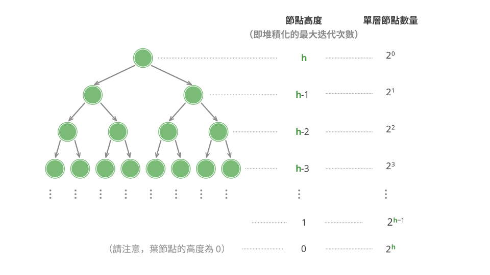

# 8.2 &nbsp; 建立堆積

有時我們想用串列中的所有元素建立一個堆積，這個過程稱為「建立堆積」。

## 8.2.1 &nbsp; 逐一加入元素

首先建立空堆積，再走訪串列，依序將每個元素加入堆積：先把元素加到堆積的尾端，再從該元素開始由下往上調整堆積。

每加入一個元素，堆積的長度就增加一。由於節點是從頂端到底層依序加入二元樹的，因此堆積是「由上往下」建立的。

設元素個數為 $n$，每個元素加入堆積耗時 $O(\log{n})$，因此這種建堆方法的時間複雜度為 $O(n \log n)$。

## 8.2.2 &nbsp; 走訪節點並向下調整

實際上，我們可以用更有效率的方法建立堆積，分為以下兩步。

1. 先依原順序將串列的所有元素放入堆積，此時尚未確保它們符合堆積性質。
2. 反向走訪堆積（依層序走訪的相反順序），依序從每個非葉節點開始，由上往下調整堆積。

**每調整完一個節點，以該節點為根的子樹就成為符合堆積性質的子堆積**。由於採用反向走訪，整個堆積是「由下往上」建立的。

選擇反向走訪，是為了確保目前節點下方的子樹都已符合堆積性質，這時從目前節點開始調整才有效。

值得注意的是，**葉節點沒有子節點，本身就是符合堆積性質的子堆積，無須調整**。如以下程式碼所示，最後一個非葉節點就是最後一個節點的父節點。我們從它開始，依反向順序走訪並調整堆積：

=== "Python"

    ```python title="my_heap.py"
    def __init__(self, nums: list[int]):
        """建構式，根據輸入串列建立堆積"""
        # 將串列元素依原順序全部加入堆積
        self.max_heap = nums
        # 從每個非葉節點向下調整堆積
        for i in range(self.parent(self.size() - 1), -1, -1):
            self.sift_down(i)
    ```

=== "C++"

    ```cpp title="my_heap.cpp"
    /* 建構式，根據輸入串列建立堆積 */
    MaxHeap(vector<int> nums) {
        // 將串列元素依原順序全部加入堆積
        maxHeap = nums;
        // 從每個非葉節點向下調整堆積
        for (int i = parent(size() - 1); i >= 0; i--) {
            siftDown(i);
        }
    }
    ```

=== "Java"

    ```java title="my_heap.java"
    /* 建構式，根據輸入串列建立堆積 */
    MaxHeap(List<Integer> nums) {
        // 將串列元素依原順序全部加入堆積
        maxHeap = new ArrayList<>(nums);
        // 從每個非葉節點向下調整堆積
        for (int i = parent(size() - 1); i >= 0; i--) {
            siftDown(i);
        }
    }
    ```

=== "C#"

    ```csharp title="my_heap.cs"
    /* 建構函式，根據輸入串列建立堆積 */
    MaxHeap(IEnumerable<int> nums) {
        // 將串列元素依原順序全部加入堆積
        maxHeap = new List<int>(nums);
        // 從每個非葉節點向下調整堆積
        var size = Parent(this.Size() - 1);
        for (int i = size; i >= 0; i--) {
            SiftDown(i);
        }
    }
    ```

=== "Go"

    ```go title="my_heap.go"
    /* 建構函式，根據切片建立堆積 */
    func newMaxHeap(nums []any) *maxHeap {
        // 將串列元素依原順序全部加入堆積
        h := &maxHeap{data: nums}
        for i := h.parent(len(h.data) - 1); i >= 0; i-- {
            // 從每個非葉節點向下調整堆積
            h.siftDown(i)
        }
        return h
    }
    ```

=== "Swift"

    ```swift title="my_heap.swift"
    /* 建構式，根據輸入串列建立堆積 */
    init(nums: [Int]) {
        // 將串列元素依原順序全部加入堆積
        maxHeap = nums
        // 從每個非葉節點向下調整堆積
        for i in (0 ... parent(i: size() - 1)).reversed() {
            siftDown(i: i)
        }
    }
    ```

=== "JS"

    ```javascript title="my_heap.js"
    /* 建構式，可建立空堆積，或根據輸入串列建立堆積 */
    constructor(nums) {
        // 將串列元素依原順序全部加入堆積
        this.#maxHeap = nums === undefined ? [] : [...nums];
        // 從每個非葉節點向下調整堆積
        for (let i = this.#parent(this.size() - 1); i >= 0; i--) {
            this.#siftDown(i);
        }
    }
    ```

=== "TS"

    ```typescript title="my_heap.ts"
    /* 建構式，可建立空堆積，或根據輸入串列建立堆積 */
    constructor(nums?: number[]) {
        // 將串列元素依原順序全部加入堆積
        this.maxHeap = nums === undefined ? [] : [...nums];
        // 從每個非葉節點向下調整堆積
        for (let i = this.parent(this.size() - 1); i >= 0; i--) {
            this.siftDown(i);
        }
    }
    ```

=== "Dart"

    ```dart title="my_heap.dart"
    /* 建構式，根據輸入串列建立堆積 */
    MaxHeap(List<int> nums) {
      // 將串列元素依原順序全部加入堆積
      _maxHeap = nums;
      // 從每個非葉節點向下調整堆積
      for (int i = _parent(size() - 1); i >= 0; i--) {
        siftDown(i);
      }
    }
    ```

=== "Rust"

    ```rust title="my_heap.rs"
    /* 建構式，根據輸入串列建立堆積 */
    fn new(nums: Vec<i32>) -> Self {
        // 將串列元素依原順序全部加入堆積
        let mut heap = MaxHeap { max_heap: nums };
        // 從每個非葉節點向下調整堆積
        for i in (0..=Self::parent(heap.size() - 1)).rev() {
            heap.sift_down(i);
        }
        heap
    }
    ```

=== "C"

    ```c title="my_heap.c"
    /* 建構函式，根據切片建立堆積 */
    MaxHeap *newMaxHeap(int nums[], int size) {
        // 將所有元素加入堆積
        MaxHeap *maxHeap = (MaxHeap *)malloc(sizeof(MaxHeap));
        maxHeap->size = size;
        memcpy(maxHeap->data, nums, size * sizeof(int));
        for (int i = parent(maxHeap, size - 1); i >= 0; i--) {
            // 從每個非葉節點向下調整堆積
            siftDown(maxHeap, i);
        }
        return maxHeap;
    }
    ```

=== "Kotlin"

    ```kotlin title="my_heap.kt"
    /* 最大堆積 */
    class MaxHeap(nums: MutableList<Int>?) {
        // 採用可擴充的串列取代陣列，無須自行處理擴充容量的問題
        private val maxHeap = mutableListOf<Int>()

        /* 建構式，根據輸入串列建立堆積 */
        init {
            // 將串列元素依原順序全部加入堆積
            maxHeap.addAll(nums!!)
            // 從每個非葉節點向下調整堆積
            for (i in parent(size() - 1) downTo 0) {
                siftDown(i)
            }
        }

        /* 取得左子節點的索引 */
        private fun left(i: Int): Int {
            return 2 * i + 1
        }

        /* 取得右子節點的索引 */
        private fun right(i: Int): Int {
            return 2 * i + 2
        }

        /* 取得父節點的索引 */
        private fun parent(i: Int): Int {
            return (i - 1) / 2 // 向下取整的整數除法
        }

        /* 交換元素 */
        private fun swap(i: Int, j: Int) {
            val temp = maxHeap[i]
            maxHeap[i] = maxHeap[j]
            maxHeap[j] = temp
        }

        /* 取得堆積大小 */
        fun size(): Int {
            return maxHeap.size
        }

        /* 判斷堆積是否為空 */
        fun isEmpty(): Boolean {
            /* 判斷堆積是否為空 */
            return size() == 0
        }

        /* 讀取堆積頂端元素 */
        fun peek(): Int {
            return maxHeap[0]
        }

        /* 將元素加入堆積 */
        fun push(_val: Int) {
            // 新增節點
            maxHeap.add(_val)
            // 由下往上調整堆積
            siftUp(size() - 1)
        }

        /* 從節點 i 開始向上調整堆積 */
        private fun siftUp(it: Int) {
            // Kotlin 的函式參數不能重新指派，因此建立暫存變數
            var i = it
            while (true) {
                // 取得節點 i 的父節點
                val p = parent(i)
                // 若已越過根節點，或節點已符合堆積性質，就結束調整
                if (p < 0 || maxHeap[i] <= maxHeap[p]) break
                // 交換兩個節點
                swap(i, p)
                // 繼續向上調整堆積
                i = p
            }
        }

        /* 從堆積取出元素 */
        fun pop(): Int {
            // 檢查堆積是否為空
            if (isEmpty()) throw IndexOutOfBoundsException()
            // 交換根節點與最右側的葉節點（即首尾兩個元素）
            swap(0, size() - 1)
            // 刪除節點
            val _val = maxHeap.removeAt(size() - 1)
            // 由上往下調整堆積
            siftDown(0)
            // 回傳堆積頂端元素
            return _val
        }

        /* 從節點 i 開始向下調整堆積 */
        private fun siftDown(it: Int) {
            // Kotlin 的函式參數不能重新指派，因此建立暫存變數
            var i = it
            while (true) {
                // 找出節點 i、l、r 中值最大的節點，記為 ma
                val l = left(i)
                val r = right(i)
                var ma = i
                if (l < size() && maxHeap[l] > maxHeap[ma]) ma = l
                if (r < size() && maxHeap[r] > maxHeap[ma]) ma = r
                // 若節點 i 的值最大，或子節點索引 l、r 均超出範圍，即可結束調整，跳出迴圈
                if (ma == i) break
                // 交換兩個節點
                swap(i, ma)
                // 繼續向下調整堆積
                i = ma
            }
        }

        /* 印出堆積（二元樹） */
        fun print() {
            val queue = PriorityQueue { a: Int, b: Int -> b - a }
            queue.addAll(maxHeap)
            printHeap(queue)
        }
    }
    ```

=== "Ruby"

    ```ruby title="my_heap.rb"
    ### 建構式，根據輸入串列建立堆積 ###
    def initialize(nums)
      # 將串列元素依原順序全部加入堆積
      @max_heap = nums
      # 從每個非葉節點向下調整堆積
      parent(size - 1).downto(0) do |i|
        sift_down(i)
      end
    end
    ```

??? pythontutor "執行視覺化示範"

    <div style="height: 549px; width: 100%;"><iframe class="pythontutor-iframe" title="執行視覺化示範" src="https://pythontutor.com/iframe-embed.html#code=class%20MaxHeap%3A%0A%20%20%20%20%22%22%22%E6%9C%80%E5%A4%A7%E5%A0%86%E7%A9%8D%22%22%22%0A%0A%20%20%20%20def%20__init__%28self,%20nums%3A%20list%5Bint%5D%29%3A%0A%20%20%20%20%20%20%20%20%22%22%22%E5%BB%BA%E6%A7%8B%E5%BC%8F%EF%BC%8C%E6%A0%B9%E6%93%9A%E8%BC%B8%E5%85%A5%E4%B8%B2%E5%88%97%E5%BB%BA%E7%AB%8B%E5%A0%86%E7%A9%8D%22%22%22%0A%20%20%20%20%20%20%20%20%23%20%E5%B0%87%E4%B8%B2%E5%88%97%E5%85%83%E7%B4%A0%E4%BE%9D%E5%8E%9F%E9%A0%86%E5%BA%8F%E5%85%A8%E9%83%A8%E5%8A%A0%E5%85%A5%E5%A0%86%E7%A9%8D%0A%20%20%20%20%20%20%20%20self.max_heap%20%3D%20nums%0A%20%20%20%20%20%20%20%20%23%20%E5%BE%9E%E6%AF%8F%E5%80%8B%E9%9D%9E%E8%91%89%E7%AF%80%E9%BB%9E%E5%90%91%E4%B8%8B%E8%AA%BF%E6%95%B4%E5%A0%86%E7%A9%8D%0A%20%20%20%20%20%20%20%20for%20i%20in%20range%28self.parent%28self.size%28%29%20-%201%29,%20-1,%20-1%29%3A%0A%20%20%20%20%20%20%20%20%20%20%20%20self.sift_down%28i%29%0A%0A%20%20%20%20def%20left%28self,%20i%3A%20int%29%20-%3E%20int%3A%0A%20%20%20%20%20%20%20%20%22%22%22%E5%8F%96%E5%BE%97%E5%B7%A6%E5%AD%90%E7%AF%80%E9%BB%9E%E7%9A%84%E7%B4%A2%E5%BC%95%22%22%22%0A%20%20%20%20%20%20%20%20return%202%20%2A%20i%20%2B%201%0A%0A%20%20%20%20def%20right%28self,%20i%3A%20int%29%20-%3E%20int%3A%0A%20%20%20%20%20%20%20%20%22%22%22%E5%8F%96%E5%BE%97%E5%8F%B3%E5%AD%90%E7%AF%80%E9%BB%9E%E7%9A%84%E7%B4%A2%E5%BC%95%22%22%22%0A%20%20%20%20%20%20%20%20return%202%20%2A%20i%20%2B%202%0A%0A%20%20%20%20def%20parent%28self,%20i%3A%20int%29%20-%3E%20int%3A%0A%20%20%20%20%20%20%20%20%22%22%22%E5%8F%96%E5%BE%97%E7%88%B6%E7%AF%80%E9%BB%9E%E7%9A%84%E7%B4%A2%E5%BC%95%22%22%22%0A%20%20%20%20%20%20%20%20return%20%28i%20-%201%29%20//%202%20%20%23%20%E5%90%91%E4%B8%8B%E5%8F%96%E6%95%B4%E7%9A%84%E6%95%B4%E6%95%B8%E9%99%A4%E6%B3%95%0A%0A%20%20%20%20def%20swap%28self,%20i%3A%20int,%20j%3A%20int%29%3A%0A%20%20%20%20%20%20%20%20%22%22%22%E4%BA%A4%E6%8F%9B%E5%85%83%E7%B4%A0%22%22%22%0A%20%20%20%20%20%20%20%20self.max_heap%5Bi%5D,%20self.max_heap%5Bj%5D%20%3D%20self.max_heap%5Bj%5D,%20self.max_heap%5Bi%5D%0A%0A%20%20%20%20def%20size%28self%29%20-%3E%20int%3A%0A%20%20%20%20%20%20%20%20%22%22%22%E5%8F%96%E5%BE%97%E5%A0%86%E7%A9%8D%E5%A4%A7%E5%B0%8F%22%22%22%0A%20%20%20%20%20%20%20%20return%20len%28self.max_heap%29%0A%0A%20%20%20%20def%20sift_down%28self,%20i%3A%20int%29%3A%0A%20%20%20%20%20%20%20%20%22%22%22%E5%BE%9E%E7%AF%80%E9%BB%9E%20i%20%E9%96%8B%E5%A7%8B%E5%90%91%E4%B8%8B%E8%AA%BF%E6%95%B4%E5%A0%86%E7%A9%8D%22%22%22%0A%20%20%20%20%20%20%20%20while%20True%3A%0A%20%20%20%20%20%20%20%20%20%20%20%20%23%20%E6%89%BE%E5%87%BA%E7%AF%80%E9%BB%9E%20i%E3%80%81l%E3%80%81r%20%E4%B8%AD%E5%80%BC%E6%9C%80%E5%A4%A7%E7%9A%84%E7%AF%80%E9%BB%9E%EF%BC%8C%E8%A8%98%E7%82%BA%20ma%0A%20%20%20%20%20%20%20%20%20%20%20%20l,%20r,%20ma%20%3D%20self.left%28i%29,%20self.right%28i%29,%20i%0A%20%20%20%20%20%20%20%20%20%20%20%20if%20l%20%3C%20self.size%28%29%20and%20self.max_heap%5Bl%5D%20%3E%20self.max_heap%5Bma%5D%3A%0A%20%20%20%20%20%20%20%20%20%20%20%20%20%20%20%20ma%20%3D%20l%0A%20%20%20%20%20%20%20%20%20%20%20%20if%20r%20%3C%20self.size%28%29%20and%20self.max_heap%5Br%5D%20%3E%20self.max_heap%5Bma%5D%3A%0A%20%20%20%20%20%20%20%20%20%20%20%20%20%20%20%20ma%20%3D%20r%0A%20%20%20%20%20%20%20%20%20%20%20%20%23%20%E8%8B%A5%E7%AF%80%E9%BB%9E%20i%20%E7%9A%84%E5%80%BC%E6%9C%80%E5%A4%A7%EF%BC%8C%E6%88%96%E5%AD%90%E7%AF%80%E9%BB%9E%E7%B4%A2%E5%BC%95%20l%E3%80%81r%20%E5%9D%87%E8%B6%85%E5%87%BA%E7%AF%84%E5%9C%8D%EF%BC%8C%E5%8D%B3%E5%8F%AF%E7%B5%90%E6%9D%9F%E8%AA%BF%E6%95%B4%EF%BC%8C%E8%B7%B3%E5%87%BA%E8%BF%B4%E5%9C%88%0A%20%20%20%20%20%20%20%20%20%20%20%20if%20ma%20%3D%3D%20i%3A%0A%20%20%20%20%20%20%20%20%20%20%20%20%20%20%20%20break%0A%20%20%20%20%20%20%20%20%20%20%20%20%23%20%E4%BA%A4%E6%8F%9B%E5%85%A9%E5%80%8B%E7%AF%80%E9%BB%9E%0A%20%20%20%20%20%20%20%20%20%20%20%20self.swap%28i,%20ma%29%0A%20%20%20%20%20%20%20%20%20%20%20%20%23%20%E7%B9%BC%E7%BA%8C%E5%90%91%E4%B8%8B%E8%AA%BF%E6%95%B4%E5%A0%86%E7%A9%8D%0A%20%20%20%20%20%20%20%20%20%20%20%20i%20%3D%20ma%0A%0A%0A%22%22%22Driver%20Code%22%22%22%0Aif%20__name__%20%3D%3D%20%22__main__%22%3A%0A%20%20%20%20%23%20%E5%88%9D%E5%A7%8B%E5%8C%96%E6%9C%80%E5%A4%A7%E5%A0%86%E7%A9%8D%0A%20%20%20%20max_heap%20%3D%20MaxHeap%28%5B1,%202,%203,%204,%205%5D%29&codeDivHeight=472&codeDivWidth=350&cumulative=false&curInstr=4&heapPrimitives=nevernest&origin=opt-frontend.js&py=311&rawInputLstJSON=%5B%5D&textReferences=false"> </iframe></div>
    <div style="margin-top: 5px;"><a href="https://pythontutor.com/iframe-embed.html#code=class%20MaxHeap%3A%0A%20%20%20%20%22%22%22%E6%9C%80%E5%A4%A7%E5%A0%86%E7%A9%8D%22%22%22%0A%0A%20%20%20%20def%20__init__%28self,%20nums%3A%20list%5Bint%5D%29%3A%0A%20%20%20%20%20%20%20%20%22%22%22%E5%BB%BA%E6%A7%8B%E5%BC%8F%EF%BC%8C%E6%A0%B9%E6%93%9A%E8%BC%B8%E5%85%A5%E4%B8%B2%E5%88%97%E5%BB%BA%E7%AB%8B%E5%A0%86%E7%A9%8D%22%22%22%0A%20%20%20%20%20%20%20%20%23%20%E5%B0%87%E4%B8%B2%E5%88%97%E5%85%83%E7%B4%A0%E4%BE%9D%E5%8E%9F%E9%A0%86%E5%BA%8F%E5%85%A8%E9%83%A8%E5%8A%A0%E5%85%A5%E5%A0%86%E7%A9%8D%0A%20%20%20%20%20%20%20%20self.max_heap%20%3D%20nums%0A%20%20%20%20%20%20%20%20%23%20%E5%BE%9E%E6%AF%8F%E5%80%8B%E9%9D%9E%E8%91%89%E7%AF%80%E9%BB%9E%E5%90%91%E4%B8%8B%E8%AA%BF%E6%95%B4%E5%A0%86%E7%A9%8D%0A%20%20%20%20%20%20%20%20for%20i%20in%20range%28self.parent%28self.size%28%29%20-%201%29,%20-1,%20-1%29%3A%0A%20%20%20%20%20%20%20%20%20%20%20%20self.sift_down%28i%29%0A%0A%20%20%20%20def%20left%28self,%20i%3A%20int%29%20-%3E%20int%3A%0A%20%20%20%20%20%20%20%20%22%22%22%E5%8F%96%E5%BE%97%E5%B7%A6%E5%AD%90%E7%AF%80%E9%BB%9E%E7%9A%84%E7%B4%A2%E5%BC%95%22%22%22%0A%20%20%20%20%20%20%20%20return%202%20%2A%20i%20%2B%201%0A%0A%20%20%20%20def%20right%28self,%20i%3A%20int%29%20-%3E%20int%3A%0A%20%20%20%20%20%20%20%20%22%22%22%E5%8F%96%E5%BE%97%E5%8F%B3%E5%AD%90%E7%AF%80%E9%BB%9E%E7%9A%84%E7%B4%A2%E5%BC%95%22%22%22%0A%20%20%20%20%20%20%20%20return%202%20%2A%20i%20%2B%202%0A%0A%20%20%20%20def%20parent%28self,%20i%3A%20int%29%20-%3E%20int%3A%0A%20%20%20%20%20%20%20%20%22%22%22%E5%8F%96%E5%BE%97%E7%88%B6%E7%AF%80%E9%BB%9E%E7%9A%84%E7%B4%A2%E5%BC%95%22%22%22%0A%20%20%20%20%20%20%20%20return%20%28i%20-%201%29%20//%202%20%20%23%20%E5%90%91%E4%B8%8B%E5%8F%96%E6%95%B4%E7%9A%84%E6%95%B4%E6%95%B8%E9%99%A4%E6%B3%95%0A%0A%20%20%20%20def%20swap%28self,%20i%3A%20int,%20j%3A%20int%29%3A%0A%20%20%20%20%20%20%20%20%22%22%22%E4%BA%A4%E6%8F%9B%E5%85%83%E7%B4%A0%22%22%22%0A%20%20%20%20%20%20%20%20self.max_heap%5Bi%5D,%20self.max_heap%5Bj%5D%20%3D%20self.max_heap%5Bj%5D,%20self.max_heap%5Bi%5D%0A%0A%20%20%20%20def%20size%28self%29%20-%3E%20int%3A%0A%20%20%20%20%20%20%20%20%22%22%22%E5%8F%96%E5%BE%97%E5%A0%86%E7%A9%8D%E5%A4%A7%E5%B0%8F%22%22%22%0A%20%20%20%20%20%20%20%20return%20len%28self.max_heap%29%0A%0A%20%20%20%20def%20sift_down%28self,%20i%3A%20int%29%3A%0A%20%20%20%20%20%20%20%20%22%22%22%E5%BE%9E%E7%AF%80%E9%BB%9E%20i%20%E9%96%8B%E5%A7%8B%E5%90%91%E4%B8%8B%E8%AA%BF%E6%95%B4%E5%A0%86%E7%A9%8D%22%22%22%0A%20%20%20%20%20%20%20%20while%20True%3A%0A%20%20%20%20%20%20%20%20%20%20%20%20%23%20%E6%89%BE%E5%87%BA%E7%AF%80%E9%BB%9E%20i%E3%80%81l%E3%80%81r%20%E4%B8%AD%E5%80%BC%E6%9C%80%E5%A4%A7%E7%9A%84%E7%AF%80%E9%BB%9E%EF%BC%8C%E8%A8%98%E7%82%BA%20ma%0A%20%20%20%20%20%20%20%20%20%20%20%20l,%20r,%20ma%20%3D%20self.left%28i%29,%20self.right%28i%29,%20i%0A%20%20%20%20%20%20%20%20%20%20%20%20if%20l%20%3C%20self.size%28%29%20and%20self.max_heap%5Bl%5D%20%3E%20self.max_heap%5Bma%5D%3A%0A%20%20%20%20%20%20%20%20%20%20%20%20%20%20%20%20ma%20%3D%20l%0A%20%20%20%20%20%20%20%20%20%20%20%20if%20r%20%3C%20self.size%28%29%20and%20self.max_heap%5Br%5D%20%3E%20self.max_heap%5Bma%5D%3A%0A%20%20%20%20%20%20%20%20%20%20%20%20%20%20%20%20ma%20%3D%20r%0A%20%20%20%20%20%20%20%20%20%20%20%20%23%20%E8%8B%A5%E7%AF%80%E9%BB%9E%20i%20%E7%9A%84%E5%80%BC%E6%9C%80%E5%A4%A7%EF%BC%8C%E6%88%96%E5%AD%90%E7%AF%80%E9%BB%9E%E7%B4%A2%E5%BC%95%20l%E3%80%81r%20%E5%9D%87%E8%B6%85%E5%87%BA%E7%AF%84%E5%9C%8D%EF%BC%8C%E5%8D%B3%E5%8F%AF%E7%B5%90%E6%9D%9F%E8%AA%BF%E6%95%B4%EF%BC%8C%E8%B7%B3%E5%87%BA%E8%BF%B4%E5%9C%88%0A%20%20%20%20%20%20%20%20%20%20%20%20if%20ma%20%3D%3D%20i%3A%0A%20%20%20%20%20%20%20%20%20%20%20%20%20%20%20%20break%0A%20%20%20%20%20%20%20%20%20%20%20%20%23%20%E4%BA%A4%E6%8F%9B%E5%85%A9%E5%80%8B%E7%AF%80%E9%BB%9E%0A%20%20%20%20%20%20%20%20%20%20%20%20self.swap%28i,%20ma%29%0A%20%20%20%20%20%20%20%20%20%20%20%20%23%20%E7%B9%BC%E7%BA%8C%E5%90%91%E4%B8%8B%E8%AA%BF%E6%95%B4%E5%A0%86%E7%A9%8D%0A%20%20%20%20%20%20%20%20%20%20%20%20i%20%3D%20ma%0A%0A%0A%22%22%22Driver%20Code%22%22%22%0Aif%20__name__%20%3D%3D%20%22__main__%22%3A%0A%20%20%20%20%23%20%E5%88%9D%E5%A7%8B%E5%8C%96%E6%9C%80%E5%A4%A7%E5%A0%86%E7%A9%8D%0A%20%20%20%20max_heap%20%3D%20MaxHeap%28%5B1,%202,%203,%204,%205%5D%29&codeDivHeight=800&codeDivWidth=600&cumulative=false&curInstr=4&heapPrimitives=nevernest&origin=opt-frontend.js&py=311&rawInputLstJSON=%5B%5D&textReferences=false" target="_blank" rel="noopener noreferrer">全螢幕觀看 ></a></div>

## 8.2.3 &nbsp; 複雜度分析

接下來推算第二種建堆方法的時間複雜度。

- 假設完全二元樹共有 $n$ 個節點，則葉節點有 $(n + 1) / 2$ 個，其中 $/$ 代表向下取整的整數除法。因此需要調整的節點共有 $n / 2$ 個。
- 由上往下調整時，每個節點最多下沉到葉節點，因此最大迭代次數等於二元樹的高度 $\log n$。

將上述兩者相乘，得到建堆的時間複雜度為 $O(n \log n)$。**但這項估計不夠精確，因為它沒有考慮到二元樹底層的節點數量遠多於頂層**。

接著進行更精確的計算。為了簡化推導，假設給定的是一棵含 $n$ 個節點、高度為 $h$ 的「完美二元樹」。這項假設不影響計算結果的正確性。

{ class="animation-figure" }

<p align="center"> 圖 8-5 &nbsp; 完美二元樹各層的節點數量 </p>

如圖 8-5 所示，從一個節點開始「由上往下調整堆積」，最大迭代次數等於該節點到葉節點的距離，也就是「節點高度」。因此，我們可以將各層的「節點數量 $\times$ 節點高度」相加，**得到所有節點調整堆積的迭代次數總和**。

$$
T(h) = 2^0h + 2^1(h-1) + 2^2(h-2) + \dots + 2^{(h-1)}\times1
$$

化簡上式需要用到中學學過的數列。先將 $T(h)$ 乘以 $2$，得到：

$$
\begin{aligned}
T(h) & = 2^0h + 2^1(h-1) + 2^2(h-2) + \dots + 2^{h-1}\times1 \newline
2 T(h) & = 2^1h + 2^2(h-1) + 2^3(h-2) + \dots + 2^{h}\times1 \newline
\end{aligned}
$$

將兩式錯開一項，以下式 $2 T(h)$ 減去上式 $T(h)$，可得：

$$
2T(h) - T(h) = T(h) = -2^0h + 2^1 + 2^2 + \dots + 2^{h-1} + 2^h
$$

觀察上式可見 $T(h)$ 為等比數列，直接套用求和公式，得到時間複雜度為：

$$
\begin{aligned}
T(h) & = 2 \frac{1 - 2^h}{1 - 2} - h \newline
& = 2^{h+1} - h - 2 \newline
& = O(2^h)
\end{aligned}
$$

進一步觀察，高度為 $h$ 的完美二元樹有 $n = 2^{h+1} - 1$ 個節點，因此可得複雜度為 $O(2^h) = O(n)$。上述推導顯示，**從輸入串列建立堆積的時間複雜度為 $O(n)$，效率很高**。
