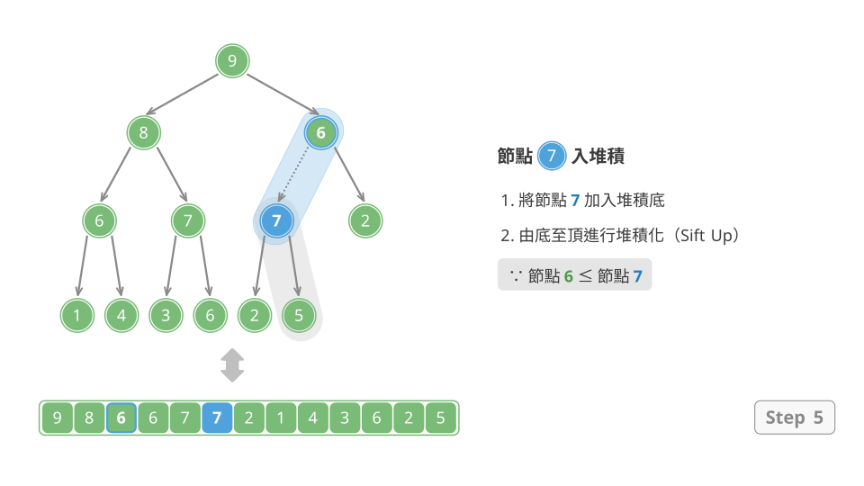
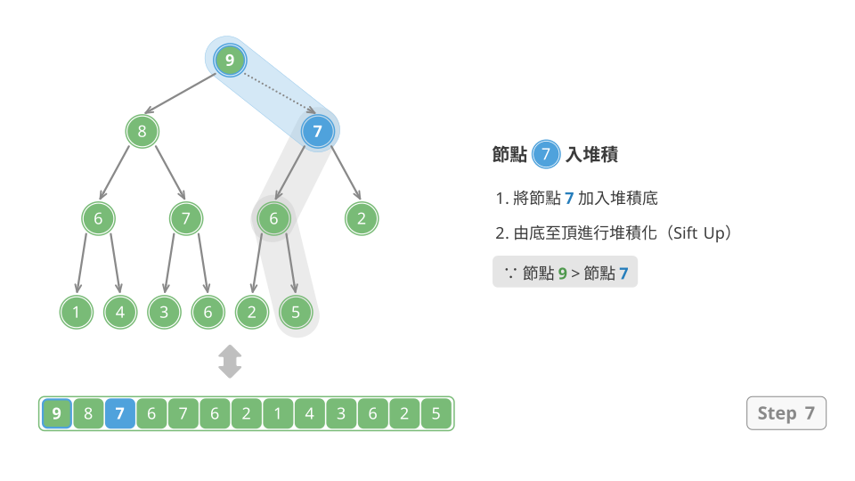
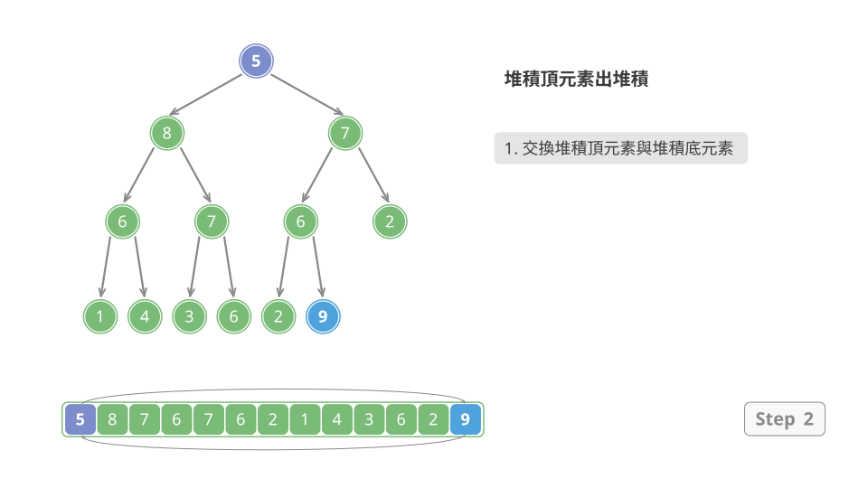
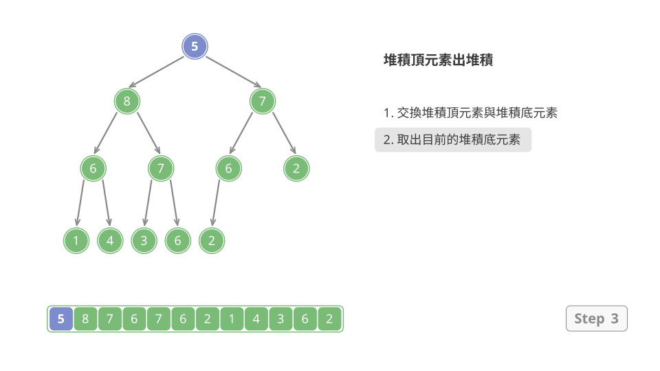
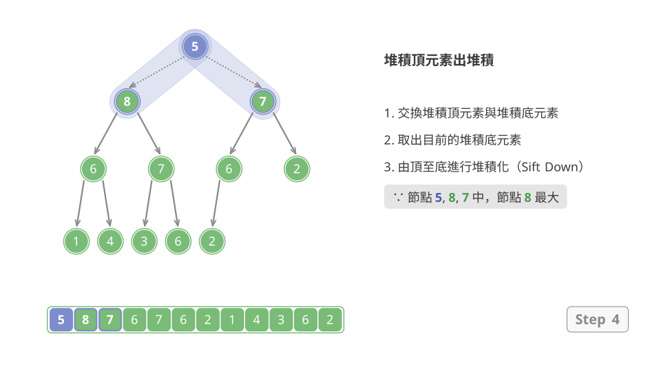
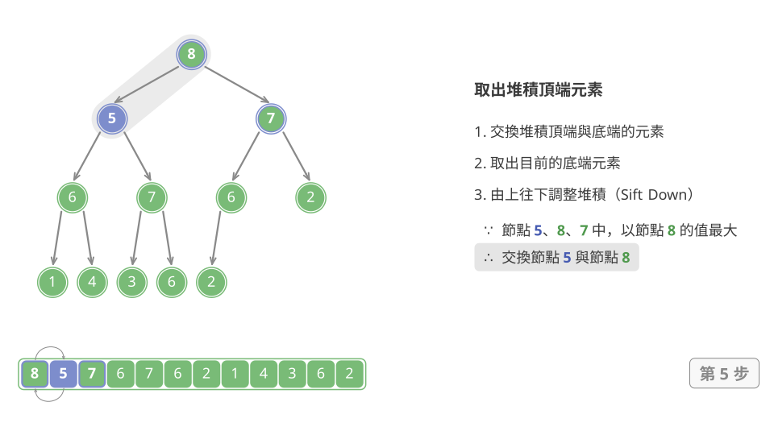

# 堆積

<u>堆積（heap）</u>是符合特定條件的完全二元樹，主要分為以下兩種，如下圖所示。

- <u>最小堆積（min heap）</u>：任一節點的值 $\leq$ 其子節點的值。
- <u>最大堆積（max heap）</u>：任一節點的值 $\geq$ 其子節點的值。


堆積是完全二元樹的一種特例，具有以下特性。

- 最底層的節點從左往右依序填入，其餘各層皆已填滿。
- 我們稱二元樹的根節點為「堆積頂端」，最底層最右側的節點為「堆積底端」。
- 在最大堆積（最小堆積）中，頂端元素也就是根節點，其值是整個堆積中的最大值（最小值）。

## 堆積的常用操作

許多程式語言提供的是<u>優先佇列（priority queue）</u>。這種抽象資料結構是一個依元素優先順序排列的佇列。

實際上，**優先佇列通常以堆積實作。最大堆積相當於依元素值由大到小取出元素的優先佇列**。從使用者的角度來看，可以將「優先佇列」和「堆積」視為等價的資料結構。因此，本書統稱兩者為「堆積」。

下表列出堆積的常用操作，實際的方法名稱依程式語言而定。

<p align="center"> 表 <id> &nbsp; 堆積的操作效率 </p>

| 方法名稱      | 說明                                             | 時間複雜度  |
| ----------- | ------------------------------------------------ | ----------- |
| `push()`    | 將元素加入堆積                                         | $O(\log n)$ |
| `pop()`     | 取出堆積頂端元素                                     | $O(\log n)$ |
| `peek()`    | 讀取堆積頂端元素（最大堆積為最大值，最小堆積為最小值） | $O(1)$      |
| `size()`    | 取得堆積中的元素個數                                 | $O(1)$      |
| `isEmpty()` | 判斷堆積是否為空                                   | $O(1)$      |

實際應用時，可以直接使用程式語言提供的堆積類別（或優先佇列類別）。

就像排序演算法可以「由小到大」或「由大到小」排列，我們可以設定 `flag` 或修改 `Comparator`，在最小堆積與最大堆積之間切換。程式碼如下：

```snippet
heap_operations
```

??? pythontutor "執行視覺化示範"

    @tutor heap_operations_tutor

## 堆積的實作

下文實作最大堆積。若要改成最小堆積，只要反轉所有大小比較的判斷條件（例如將 $\geq$ 改為 $\leq$）。有興趣的讀者可以動手試試。

### 堆積的儲存與表示法

「二元樹」一章提過，完全二元樹很適合用陣列表示。堆積正是一種完全二元樹，**因此我們用陣列來儲存堆積**。

用陣列表示二元樹時，元素代表節點值，索引代表節點在樹中的位置。**節點指標可透過索引之間的對應公式來實作**。

如下圖所示，給定索引 $i$，其左子節點的索引為 $2i + 1$，右子節點的索引為 $2i + 2$，父節點的索引為 $(i - 1) / 2$（向下取整的整數除法）。若索引超出範圍，表示該位置為空或節點不存在。


我們可以把這些索引公式寫成函式，方便後續使用：

```src
[file]{my_heap}-[class]{max_heap}-[func]{parent}
```

### 讀取堆積頂端元素

堆積頂端元素就是二元樹的根節點，也就是串列的第一個元素：

```src
[file]{my_heap}-[class]{max_heap}-[func]{peek}
```

### 將元素加入堆積

給定元素 `val`，先將它加到堆積底端。加入後，`val` 可能大於堆積中的其他元素，使堆積不再符合原本的性質。**因此，必須沿著插入節點到根節點的路徑調整節點**，這項操作稱為<u>堆積化（heapify）</u>。

從新加入的節點開始，**由下往上調整堆積**。如下圖所示，比較插入節點與父節點的值，若插入節點的值較大，就交換兩者。反覆執行這個操作，由下往上調整，直到越過根節點或遇到無須交換的節點為止。

=== "<1>"
    

=== "<2>"
    

=== "<3>"
    

=== "<4>"
    

=== "<5>"
    

=== "<6>"
    

=== "<7>"
    

=== "<8>"
    

=== "<9>"
    

設節點總數為 $n$，則樹的高度為 $O(\log n)$。因此調整堆積的迴圈最多執行 $O(\log n)$ 輪，**將元素加入堆積的時間複雜度為 $O(\log n)$**。程式碼如下：

```src
[file]{my_heap}-[class]{max_heap}-[func]{sift_up}
```

### 取出堆積頂端元素

堆積頂端元素是二元樹的根節點，也就是串列的第一個元素。如果直接刪除串列開頭的元素，樹中所有剩餘節點的索引都會改變，後續就難以透過調整來恢復堆積性質。為了盡量減少索引變動，我們採用以下步驟。

1. 交換堆積頂端與底端的元素（交換根節點與最右側的葉節點）。
2. 交換後，從串列尾端刪除堆積底端的元素（注意，因為已經交換過，實際刪除的是原本的頂端元素）。
3. 從根節點開始，**由上往下調整堆積**。

如下圖所示，**「由上往下調整堆積」與「由下往上調整堆積」的方向相反**。比較根節點與兩個子節點的值，若子節點的值較大，就將其中較大的那個與根節點交換。反覆執行這個操作，直到越過葉節點或遇到無須交換的節點。

=== "<1>"
    

=== "<2>"
    

=== "<3>"
    

=== "<4>"
    

=== "<5>"
    

=== "<6>"
    

=== "<7>"
    

=== "<8>"
    

=== "<9>"
    

=== "<10>"
    

和加入元素類似，取出堆積頂端元素的時間複雜度也是 $O(\log n)$。程式碼如下：

```src
[file]{my_heap}-[class]{max_heap}-[func]{sift_down}
```

## 堆積的常見應用

- **優先佇列**：堆積通常是實作優先佇列的首選資料結構。加入和取出元素的時間複雜度皆為 $O(\log n)$，建立堆積則為 $O(n)$，這些操作都很有效率。
- **堆積排序**：給定一組資料，可以先用它們建立堆積，再反覆取出頂端元素，就能得到排序好的資料。不過，我們通常會用更簡潔的方式實作堆積排序，詳見「堆積排序」一章。
- **取得最大的 $k$ 個元素**：這是經典的演算法問題，也是堆積的典型應用。例如選取熱門程度前 10 名的新聞作為微博熱搜，或選出銷量前 10 名的商品。
