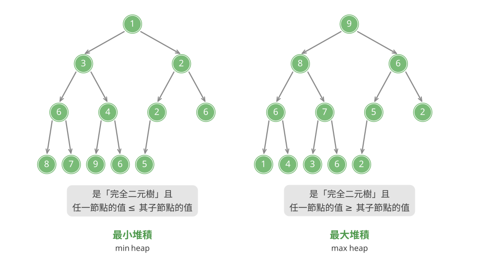
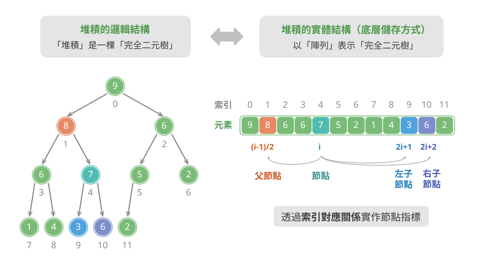
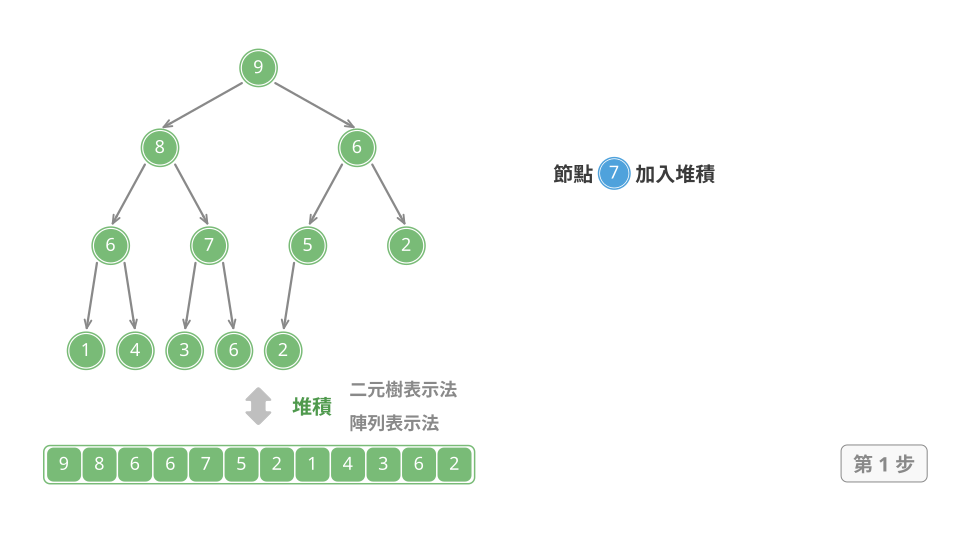
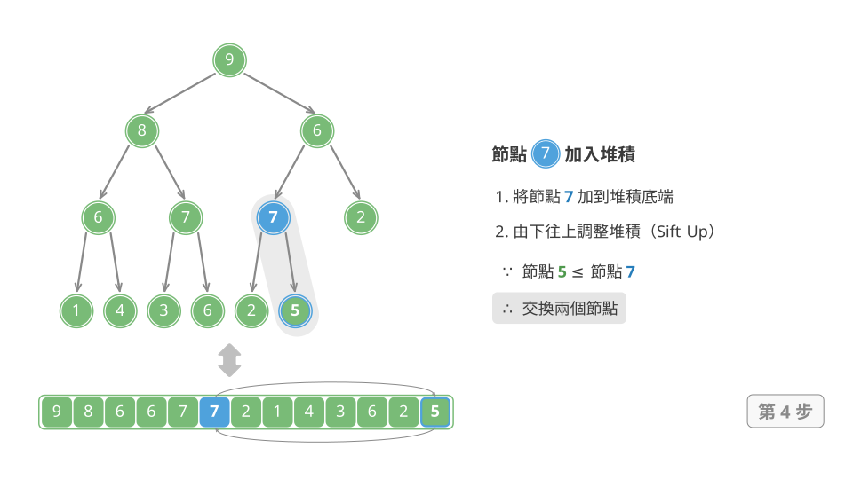
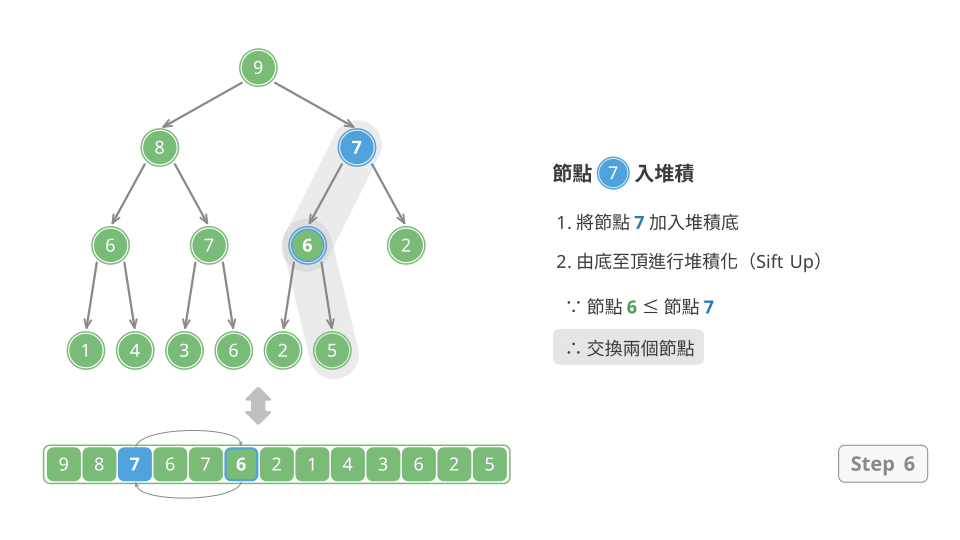
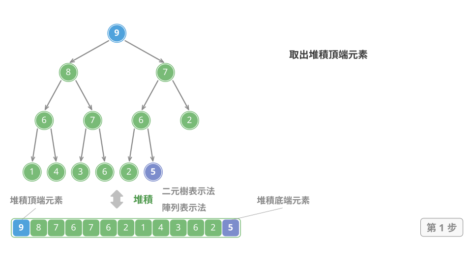

# 堆積

<u>堆積（heap）</u>是一種滿足特定條件的完全二元樹，主要可分為兩種型別，如下圖所示。

- <u>小頂堆積（min heap）</u>：任意節點的值 $\leq$ 其子節點的值。
- <u>大頂堆積（max heap）</u>：任意節點的值 $\geq$ 其子節點的值。



堆積作為完全二元樹的一個特例，具有以下特性。

- 最底層節點靠左填充，其他層的節點都被填滿。
- 我們將二元樹的根節點稱為“堆積頂”，將底層最靠右的節點稱為“堆積底”。
- 對於大頂堆積（小頂堆積），堆積頂元素（根節點）的值是最大（最小）的。

## 堆積的常用操作

需要指出的是，許多程式語言提供的是<u>優先佇列（priority queue）</u>，這是一種抽象的資料結構，定義為具有優先順序排序的佇列。

實際上，**堆積通常用於實現優先佇列，大頂堆積相當於元素按從大到小的順序出列的優先佇列**。從使用角度來看，我們可以將“優先佇列”和“堆積”看作等價的資料結構。因此，本書對兩者不做特別區分，統一稱作“堆積”。

堆積的常用操作見下表，方法名需要根據程式語言來確定。

<p align="center"> 表 <id> &nbsp; 堆積的操作效率 </p>

| 方法名      | 描述                                             | 時間複雜度  |
| ----------- | ------------------------------------------------ | ----------- |
| `push()`    | 元素入堆積                                         | $O(\log n)$ |
| `pop()`     | 堆積頂元素出堆積                                     | $O(\log n)$ |
| `peek()`    | 訪問堆積頂元素（對於大 / 小頂堆積分別為最大 / 小值） | $O(1)$      |
| `size()`    | 獲取堆積的元素數量                                 | $O(1)$      |
| `isEmpty()` | 判斷堆積是否為空                                   | $O(1)$      |

在實際應用中，我們可以直接使用程式語言提供的堆積類別（或優先佇列類別）。

類似於排序演算法中的“從小到大排列”和“從大到小排列”，我們可以透過設定一個 `flag` 或修改 `Comparator` 實現“小頂堆積”與“大頂堆積”之間的轉換。程式碼如下所示：

```snippet
heap_operations
```

??? pythontutor "視覺化執行"

    @tutor heap_operations_tutor

## 堆積的實現

下文實現的是大頂堆積。若要將其轉換為小頂堆積，只需將所有大小邏輯判斷進行逆轉（例如，將 $\geq$ 替換為 $\leq$ ）。感興趣的讀者可以自行實現。

### 堆積的儲存與表示

“二元樹”章節講過，完全二元樹非常適合用陣列來表示。由於堆積正是一種完全二元樹，**因此我們將採用陣列來儲存堆積**。

當使用陣列表示二元樹時，元素代表節點值，索引代表節點在二元樹中的位置。**節點指標透過索引對映公式來實現**。

如下圖所示，給定索引 $i$ ，其左子節點的索引為 $2i + 1$ ，右子節點的索引為 $2i + 2$ ，父節點的索引為 $(i - 1) / 2$（向下整除）。當索引越界時，表示空節點或節點不存在。



我們可以將索引對映公式封裝成函式，方便後續使用：

```src
[file]{my_heap}-[class]{max_heap}-[func]{parent}
```

### 訪問堆積頂元素

堆積頂元素即為二元樹的根節點，也就是串列的首個元素：

```src
[file]{my_heap}-[class]{max_heap}-[func]{peek}
```

### 元素入堆積

給定元素 `val` ，我們首先將其新增到堆積底。新增之後，由於 `val` 可能大於堆積中其他元素，堆積的成立條件可能已被破壞，**因此需要修復從插入節點到根節點的路徑上的各個節點**，這個操作被稱為<u>堆積化（heapify）</u>。

考慮從入堆積節點開始，**從底至頂執行堆積化**。如下圖所示，我們比較插入節點與其父節點的值，如果插入節點更大，則將它們交換。然後繼續執行此操作，從底至頂修復堆積中的各個節點，直至越過根節點或遇到無須交換的節點時結束。

=== "<1>"
    

=== "<2>"
    

=== "<3>"
    

=== "<4>"
    

=== "<5>"
    

=== "<6>"
    

=== "<7>"
    

=== "<8>"
    

=== "<9>"
    

設節點總數為 $n$ ，則樹的高度為 $O(\log n)$ 。由此可知，堆積化操作的迴圈輪數最多為 $O(\log n)$ ，**元素入堆積操作的時間複雜度為 $O(\log n)$** 。程式碼如下所示：

```src
[file]{my_heap}-[class]{max_heap}-[func]{sift_up}
```

### 堆積頂元素出堆積

堆積頂元素是二元樹的根節點，即串列首元素。如果我們直接從串列中刪除首元素，那麼二元樹中所有節點的索引都會發生變化，這將使得後續使用堆積化進行修復變得困難。為了儘量減少元素索引的變動，我們採用以下操作步驟。

1. 交換堆積頂元素與堆積底元素（交換根節點與最右葉節點）。
2. 交換完成後，將堆積底從串列中刪除（注意，由於已經交換，因此實際上刪除的是原來的堆積頂元素）。
3. 從根節點開始，**從頂至底執行堆積化**。

如下圖所示，**“從頂至底堆積化”的操作方向與“從底至頂堆積化”相反**，我們將根節點的值與其兩個子節點的值進行比較，將最大的子節點與根節點交換。然後迴圈執行此操作，直到越過葉節點或遇到無須交換的節點時結束。

=== "<1>"
    

=== "<2>"
    

=== "<3>"
    

=== "<4>"
    

=== "<5>"
    

=== "<6>"
    

=== "<7>"
    

=== "<8>"
    

=== "<9>"
    

=== "<10>"
    

與元素入堆積操作相似，堆積頂元素出堆積操作的時間複雜度也為 $O(\log n)$ 。程式碼如下所示：

```src
[file]{my_heap}-[class]{max_heap}-[func]{sift_down}
```

## 堆積的常見應用

- **優先佇列**：堆積通常作為實現優先佇列的首選資料結構，其入列和出列操作的時間複雜度均為 $O(\log n)$ ，而建堆積操作為 $O(n)$ ，這些操作都非常高效。
- **堆積排序**：給定一組資料，我們可以用它們建立一個堆積，然後不斷地執行元素出堆積操作，從而得到有序資料。然而，我們通常會使用一種更優雅的方式實現堆積排序，詳見“堆積排序”章節。
- **獲取最大的 $k$ 個元素**：這是一個經典的演算法問題，同時也是一種典型應用，例如選擇熱度前 10 的新聞作為微博熱搜，選取銷量前 10 的商品等。
