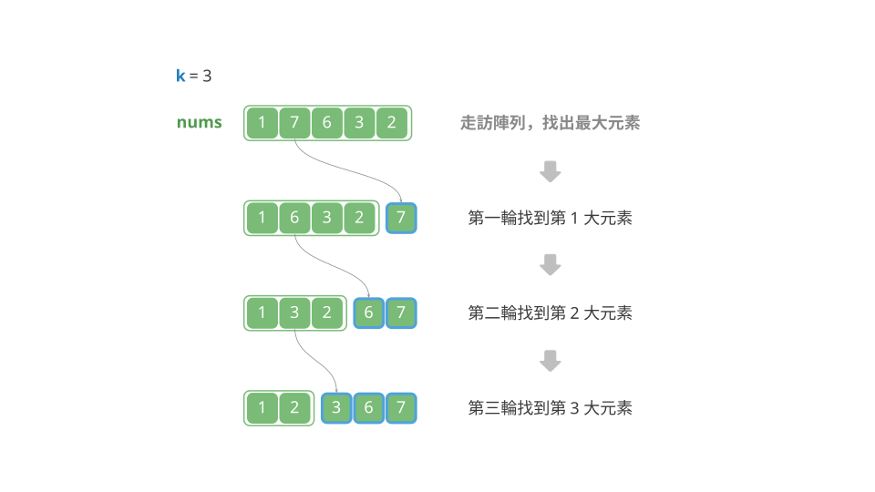
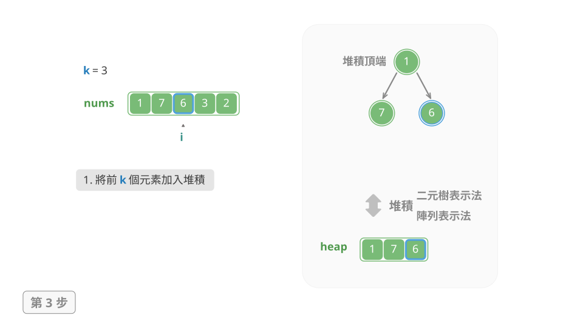
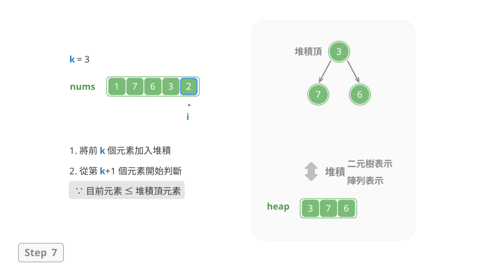
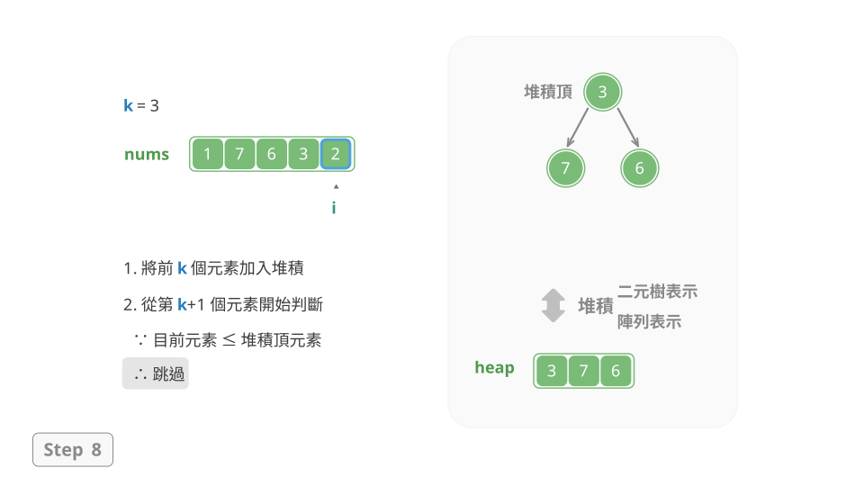

# 8.3 &nbsp; Top-k 問題

!!! question

    給定長度為 $n$ 的未排序陣列 `nums`，請回傳陣列中最大的 $k$ 個元素。

針對這個問題，我們先介紹兩種較直觀的解法，再介紹效率更高的堆積解法。

## 8.3.1 &nbsp; 方法一：反覆走訪選取

如圖 8-6 所示，我們可以走訪 $k$ 輪，在各輪依序取出第 $1$、$2$、$\dots$、$k$ 大的元素，時間複雜度為 $O(nk)$。

這個方法只適用於 $k \ll n$ 的情況。當 $k$ 與 $n$ 很接近時，時間複雜度趨近 $O(n^2)$，非常耗時。

{ class="animation-figure" }

<p align="center"> 圖 8-6 &nbsp; 反覆走訪，找出最大的 k 個元素 </p>

!!! tip

    當 $k = n$ 時，就能得到完整的已排序序列，此時相當於「選擇排序」演算法。

## 8.3.2 &nbsp; 方法二：排序

如圖 8-7 所示，可以先將陣列 `nums` 排序，再回傳最右側的 $k$ 個元素，時間複雜度為 $O(n \log n)$。

這個方法做了額外的工作：我們只需要找出最大的 $k$ 個元素，無須將其餘元素一併排序。

{ class="animation-figure" }

<p align="center"> 圖 8-7 &nbsp; 透過排序找出最大的 k 個元素 </p>

## 8.3.3 &nbsp; 方法三：堆積

利用堆積可以更有效率地解決 Top-k 問題，流程如圖 8-8 所示。

1. 初始化一個最小堆積，頂端是堆積中最小的元素。
2. 先將陣列的前 $k$ 個元素依序加入堆積。
3. 從第 $k + 1$ 個元素開始，若目前元素大於頂端元素，就先取出頂端元素，再將目前元素加入堆積。
4. 走訪結束後，堆積中保留的就是最大的 $k$ 個元素。

=== "<1>"
    { class="animation-figure" }

=== "<2>"
    { class="animation-figure" }

=== "<3>"
    { class="animation-figure" }

=== "<4>"
    { class="animation-figure" }

=== "<5>"
    { class="animation-figure" }

=== "<6>"
    { class="animation-figure" }

=== "<7>"
    { class="animation-figure" }

=== "<8>"
    { class="animation-figure" }

=== "<9>"
    { class="animation-figure" }

<p align="center"> 圖 8-8 &nbsp; 利用堆積找出最大的 k 個元素 </p>

範例程式碼如下：

=== "Python"

    ```python title="top_k.py"
    def top_k_heap(nums: list[int], k: int) -> list[int]:
        """以堆積找出陣列中最大的 k 個元素"""
        # 初始化最小堆積
        heap = []
        # 將陣列的前 k 個元素加入堆積
        for i in range(k):
            heapq.heappush(heap, nums[i])
        # 從第 k+1 個元素開始，讓堆積大小維持在 k
        for i in range(k, len(nums)):
            # 若目前元素大於堆積頂端元素，就取出頂端元素，再將目前元素加入堆積
            if nums[i] > heap[0]:
                heapq.heappop(heap)
                heapq.heappush(heap, nums[i])
        return heap
    ```

=== "C++"

    ```cpp title="top_k.cpp"
    /* 以堆積找出陣列中最大的 k 個元素 */
    priority_queue<int, vector<int>, greater<int>> topKHeap(vector<int> &nums, int k) {
        // 初始化最小堆積
        priority_queue<int, vector<int>, greater<int>> heap;
        // 將陣列的前 k 個元素加入堆積
        for (int i = 0; i < k; i++) {
            heap.push(nums[i]);
        }
        // 從第 k+1 個元素開始，讓堆積大小維持在 k
        for (int i = k; i < nums.size(); i++) {
            // 若目前元素大於堆積頂端元素，就取出頂端元素，再將目前元素加入堆積
            if (nums[i] > heap.top()) {
                heap.pop();
                heap.push(nums[i]);
            }
        }
        return heap;
    }
    ```

=== "Java"

    ```java title="top_k.java"
    /* 以堆積找出陣列中最大的 k 個元素 */
    Queue<Integer> topKHeap(int[] nums, int k) {
        // 初始化最小堆積
        Queue<Integer> heap = new PriorityQueue<Integer>();
        // 將陣列的前 k 個元素加入堆積
        for (int i = 0; i < k; i++) {
            heap.offer(nums[i]);
        }
        // 從第 k+1 個元素開始，讓堆積大小維持在 k
        for (int i = k; i < nums.length; i++) {
            // 若目前元素大於堆積頂端元素，就取出頂端元素，再將目前元素加入堆積
            if (nums[i] > heap.peek()) {
                heap.poll();
                heap.offer(nums[i]);
            }
        }
        return heap;
    }
    ```

=== "C#"

    ```csharp title="top_k.cs"
    /* 以堆積找出陣列中最大的 k 個元素 */
    PriorityQueue<int, int> TopKHeap(int[] nums, int k) {
        // 初始化最小堆積
        PriorityQueue<int, int> heap = new();
        // 將陣列的前 k 個元素加入堆積
        for (int i = 0; i < k; i++) {
            heap.Enqueue(nums[i], nums[i]);
        }
        // 從第 k+1 個元素開始，讓堆積大小維持在 k
        for (int i = k; i < nums.Length; i++) {
            // 若目前元素大於堆積頂端元素，就取出頂端元素，再將目前元素加入堆積
            if (nums[i] > heap.Peek()) {
                heap.Dequeue();
                heap.Enqueue(nums[i], nums[i]);
            }
        }
        return heap;
    }
    ```

=== "Go"

    ```go title="top_k.go"
    /* 以堆積找出陣列中最大的 k 個元素 */
    func topKHeap(nums []int, k int) *minHeap {
        // 初始化最小堆積
        h := &minHeap{}
        heap.Init(h)
        // 將陣列的前 k 個元素加入堆積
        for i := 0; i < k; i++ {
            heap.Push(h, nums[i])
        }
        // 從第 k+1 個元素開始，讓堆積大小維持在 k
        for i := k; i < len(nums); i++ {
            // 若目前元素大於堆積頂端元素，就取出頂端元素，再將目前元素加入堆積
            if nums[i] > h.Top().(int) {
                heap.Pop(h)
                heap.Push(h, nums[i])
            }
        }
        return h
    }
    ```

=== "Swift"

    ```swift title="top_k.swift"
    /* 以堆積找出陣列中最大的 k 個元素 */
    func topKHeap(nums: [Int], k: Int) -> [Int] {
        // 初始化最小堆積，以前 k 個元素建立堆積
        var heap = Heap(nums.prefix(k))
        // 從第 k+1 個元素開始，讓堆積大小維持在 k
        for i in nums.indices.dropFirst(k) {
            // 若目前元素大於堆積頂端元素，就取出頂端元素，再將目前元素加入堆積
            if nums[i] > heap.min()! {
                _ = heap.removeMin()
                heap.insert(nums[i])
            }
        }
        return heap.unordered
    }
    ```

=== "JS"

    ```javascript title="top_k.js"
    /* 將元素加入堆積 */
    function pushMinHeap(maxHeap, val) {
        // 將元素變號
        maxHeap.push(-val);
    }

    /* 從堆積取出元素 */
    function popMinHeap(maxHeap) {
        // 將元素變號
        return -maxHeap.pop();
    }

    /* 讀取堆積頂端元素 */
    function peekMinHeap(maxHeap) {
        // 將元素變號
        return -maxHeap.peek();
    }

    /* 取出堆積中的元素 */
    function getMinHeap(maxHeap) {
        // 將元素變號
        return maxHeap.getMaxHeap().map((num) => -num);
    }

    /* 以堆積找出陣列中最大的 k 個元素 */
    function topKHeap(nums, k) {
        // 初始化最小堆積
        // 注意：將堆積裡的所有元素變號，就能用最大堆積模擬最小堆積
        const maxHeap = new MaxHeap([]);
        // 將陣列的前 k 個元素加入堆積
        for (let i = 0; i < k; i++) {
            pushMinHeap(maxHeap, nums[i]);
        }
        // 從第 k+1 個元素開始，讓堆積大小維持在 k
        for (let i = k; i < nums.length; i++) {
            // 若目前元素大於堆積頂端元素，就取出頂端元素，再將目前元素加入堆積
            if (nums[i] > peekMinHeap(maxHeap)) {
                popMinHeap(maxHeap);
                pushMinHeap(maxHeap, nums[i]);
            }
        }
        // 回傳堆積中的元素
        return getMinHeap(maxHeap);
    }
    ```

=== "TS"

    ```typescript title="top_k.ts"
    /* 將元素加入堆積 */
    function pushMinHeap(maxHeap: MaxHeap, val: number): void {
        // 將元素變號
        maxHeap.push(-val);
    }

    /* 從堆積取出元素 */
    function popMinHeap(maxHeap: MaxHeap): number {
        // 將元素變號
        return -maxHeap.pop();
    }

    /* 讀取堆積頂端元素 */
    function peekMinHeap(maxHeap: MaxHeap): number {
        // 將元素變號
        return -maxHeap.peek();
    }

    /* 取出堆積中的元素 */
    function getMinHeap(maxHeap: MaxHeap): number[] {
        // 將元素變號
        return maxHeap.getMaxHeap().map((num: number) => -num);
    }

    /* 以堆積找出陣列中最大的 k 個元素 */
    function topKHeap(nums: number[], k: number): number[] {
        // 初始化最小堆積
        // 注意：將堆積裡的所有元素變號，就能用最大堆積模擬最小堆積
        const maxHeap = new MaxHeap([]);
        // 將陣列的前 k 個元素加入堆積
        for (let i = 0; i < k; i++) {
            pushMinHeap(maxHeap, nums[i]);
        }
        // 從第 k+1 個元素開始，讓堆積大小維持在 k
        for (let i = k; i < nums.length; i++) {
            // 若目前元素大於堆積頂端元素，就取出頂端元素，再將目前元素加入堆積
            if (nums[i] > peekMinHeap(maxHeap)) {
                popMinHeap(maxHeap);
                pushMinHeap(maxHeap, nums[i]);
            }
        }
        // 回傳堆積中的元素
        return getMinHeap(maxHeap);
    }
    ```

=== "Dart"

    ```dart title="top_k.dart"
    /* 以堆積找出陣列中最大的 k 個元素 */
    MinHeap topKHeap(List<int> nums, int k) {
      // 初始化最小堆積，將陣列的前 k 個元素加入堆積
      MinHeap heap = MinHeap(nums.sublist(0, k));
      // 從第 k+1 個元素開始，讓堆積大小維持在 k
      for (int i = k; i < nums.length; i++) {
        // 若目前元素大於堆積頂端元素，就取出頂端元素，再將目前元素加入堆積
        if (nums[i] > heap.peek()) {
          heap.pop();
          heap.push(nums[i]);
        }
      }
      return heap;
    }
    ```

=== "Rust"

    ```rust title="top_k.rs"
    /* 以堆積找出陣列中最大的 k 個元素 */
    fn top_k_heap(nums: Vec<i32>, k: usize) -> BinaryHeap<Reverse<i32>> {
        // BinaryHeap 是最大堆積，可用 Reverse 反轉元素的比較順序來實作最小堆積
        let mut heap = BinaryHeap::<Reverse<i32>>::new();
        // 將陣列的前 k 個元素加入堆積
        for &num in nums.iter().take(k) {
            heap.push(Reverse(num));
        }
        // 從第 k+1 個元素開始，讓堆積大小維持在 k
        for &num in nums.iter().skip(k) {
            // 若目前元素大於堆積頂端元素，就取出頂端元素，再將目前元素加入堆積
            if num > heap.peek().unwrap().0 {
                heap.pop();
                heap.push(Reverse(num));
            }
        }
        heap
    }
    ```

=== "C"

    ```c title="top_k.c"
    /* 將元素加入堆積 */
    void pushMinHeap(MaxHeap *maxHeap, int val) {
        // 將元素變號
        push(maxHeap, -val);
    }

    /* 從堆積取出元素 */
    int popMinHeap(MaxHeap *maxHeap) {
        // 將元素變號
        return -pop(maxHeap);
    }

    /* 讀取堆積頂端元素 */
    int peekMinHeap(MaxHeap *maxHeap) {
        // 將元素變號
        return -peek(maxHeap);
    }

    /* 取出堆積中的元素 */
    int *getMinHeap(MaxHeap *maxHeap) {
        // 將堆積裡的所有元素變號，存入陣列 res
        int *res = (int *)malloc(maxHeap->size * sizeof(int));
        for (int i = 0; i < maxHeap->size; i++) {
            res[i] = -maxHeap->data[i];
        }
        return res;
    }

    /* 以堆積找出陣列中最大 k 個元素的函式 */
    int *topKHeap(int *nums, int sizeNums, int k) {
        // 初始化最小堆積
        // 注意：將堆積裡的所有元素變號，就能用最大堆積模擬最小堆積
        int *empty = (int *)malloc(0);
        MaxHeap *maxHeap = newMaxHeap(empty, 0);
        // 將陣列的前 k 個元素加入堆積
        for (int i = 0; i < k; i++) {
            pushMinHeap(maxHeap, nums[i]);
        }
        // 從第 k+1 個元素開始，讓堆積大小維持在 k
        for (int i = k; i < sizeNums; i++) {
            // 若目前元素大於堆積頂端元素，就取出頂端元素，再將目前元素加入堆積
            if (nums[i] > peekMinHeap(maxHeap)) {
                popMinHeap(maxHeap);
                pushMinHeap(maxHeap, nums[i]);
            }
        }
        int *res = getMinHeap(maxHeap);
        // 釋放記憶體
        delMaxHeap(maxHeap);
        return res;
    }
    ```

=== "Kotlin"

    ```kotlin title="top_k.kt"
    /* 以堆積找出陣列中最大的 k 個元素 */
    fun topKHeap(nums: IntArray, k: Int): Queue<Int> {
        // 初始化最小堆積
        val heap = PriorityQueue<Int>()
        // 將陣列的前 k 個元素加入堆積
        for (i in 0..<k) {
            heap.offer(nums[i])
        }
        // 從第 k+1 個元素開始，讓堆積大小維持在 k
        for (i in k..<nums.size) {
            // 若目前元素大於堆積頂端元素，就取出頂端元素，再將目前元素加入堆積
            if (nums[i] > heap.peek()) {
                heap.poll()
                heap.offer(nums[i])
            }
        }
        return heap
    }
    ```

=== "Ruby"

    ```ruby title="top_k.rb"
    ### 以堆積找出陣列中最大的 k 個元素 ###
    def top_k_heap(nums, k)
      # 初始化最小堆積
      # 注意：將堆積裡的所有元素變號，就能用最大堆積模擬最小堆積
      max_heap = MaxHeap.new([])

      # 將陣列的前 k 個元素加入堆積
      for i in 0...k
        push_min_heap(max_heap, nums[i])
      end

      # 從第 k+1 個元素開始，讓堆積大小維持在 k
      for i in k...nums.length
        # 若目前元素大於堆積頂端元素，就取出頂端元素，再將目前元素加入堆積
        if nums[i] > peek_min_heap(max_heap)
          pop_min_heap(max_heap)
          push_min_heap(max_heap, nums[i])
        end
      end

      get_min_heap(max_heap)
    end
    ```

??? pythontutor "執行視覺化示範"

    <div style="height: 549px; width: 100%;"><iframe class="pythontutor-iframe" title="執行視覺化示範" src="https://pythontutor.com/iframe-embed.html#code=import%20heapq%0A%0Adef%20top_k_heap%28nums%3A%20list%5Bint%5D,%20k%3A%20int%29%20-%3E%20list%5Bint%5D%3A%0A%20%20%20%20%22%22%22%E4%BB%A5%E5%A0%86%E7%A9%8D%E6%89%BE%E5%87%BA%E9%99%A3%E5%88%97%E4%B8%AD%E6%9C%80%E5%A4%A7%E7%9A%84%20k%20%E5%80%8B%E5%85%83%E7%B4%A0%22%22%22%0A%20%20%20%20%23%20%E5%88%9D%E5%A7%8B%E5%8C%96%E6%9C%80%E5%B0%8F%E5%A0%86%E7%A9%8D%0A%20%20%20%20heap%20%3D%20%5B%5D%0A%20%20%20%20%23%20%E5%B0%87%E9%99%A3%E5%88%97%E7%9A%84%E5%89%8D%20k%20%E5%80%8B%E5%85%83%E7%B4%A0%E5%8A%A0%E5%85%A5%E5%A0%86%E7%A9%8D%0A%20%20%20%20for%20i%20in%20range%28k%29%3A%0A%20%20%20%20%20%20%20%20heapq.heappush%28heap,%20nums%5Bi%5D%29%0A%20%20%20%20%23%20%E5%BE%9E%E7%AC%AC%20k%2B1%20%E5%80%8B%E5%85%83%E7%B4%A0%E9%96%8B%E5%A7%8B%EF%BC%8C%E8%AE%93%E5%A0%86%E7%A9%8D%E5%A4%A7%E5%B0%8F%E7%B6%AD%E6%8C%81%E5%9C%A8%20k%0A%20%20%20%20for%20i%20in%20range%28k,%20len%28nums%29%29%3A%0A%20%20%20%20%20%20%20%20%23%20%E8%8B%A5%E7%9B%AE%E5%89%8D%E5%85%83%E7%B4%A0%E5%A4%A7%E6%96%BC%E5%A0%86%E7%A9%8D%E9%A0%82%E7%AB%AF%E5%85%83%E7%B4%A0%EF%BC%8C%E5%B0%B1%E5%8F%96%E5%87%BA%E9%A0%82%E7%AB%AF%E5%85%83%E7%B4%A0%EF%BC%8C%E5%86%8D%E5%B0%87%E7%9B%AE%E5%89%8D%E5%85%83%E7%B4%A0%E5%8A%A0%E5%85%A5%E5%A0%86%E7%A9%8D%0A%20%20%20%20%20%20%20%20if%20nums%5Bi%5D%20%3E%20heap%5B0%5D%3A%0A%20%20%20%20%20%20%20%20%20%20%20%20heapq.heappop%28heap%29%0A%20%20%20%20%20%20%20%20%20%20%20%20heapq.heappush%28heap,%20nums%5Bi%5D%29%0A%20%20%20%20return%20heap%0A%0A%22%22%22Driver%20Code%22%22%22%0Aif%20__name__%20%3D%3D%20%22__main__%22%3A%0A%20%20%20%20nums%20%3D%20%5B1,%207,%206,%203,%202%5D%0A%20%20%20%20k%20%3D%203%0A%0A%20%20%20%20res%20%3D%20top_k_heap%28nums,%20k%29&codeDivHeight=472&codeDivWidth=350&cumulative=false&curInstr=6&heapPrimitives=nevernest&origin=opt-frontend.js&py=311&rawInputLstJSON=%5B%5D&textReferences=false"> </iframe></div>
    <div style="margin-top: 5px;"><a href="https://pythontutor.com/iframe-embed.html#code=import%20heapq%0A%0Adef%20top_k_heap%28nums%3A%20list%5Bint%5D,%20k%3A%20int%29%20-%3E%20list%5Bint%5D%3A%0A%20%20%20%20%22%22%22%E4%BB%A5%E5%A0%86%E7%A9%8D%E6%89%BE%E5%87%BA%E9%99%A3%E5%88%97%E4%B8%AD%E6%9C%80%E5%A4%A7%E7%9A%84%20k%20%E5%80%8B%E5%85%83%E7%B4%A0%22%22%22%0A%20%20%20%20%23%20%E5%88%9D%E5%A7%8B%E5%8C%96%E6%9C%80%E5%B0%8F%E5%A0%86%E7%A9%8D%0A%20%20%20%20heap%20%3D%20%5B%5D%0A%20%20%20%20%23%20%E5%B0%87%E9%99%A3%E5%88%97%E7%9A%84%E5%89%8D%20k%20%E5%80%8B%E5%85%83%E7%B4%A0%E5%8A%A0%E5%85%A5%E5%A0%86%E7%A9%8D%0A%20%20%20%20for%20i%20in%20range%28k%29%3A%0A%20%20%20%20%20%20%20%20heapq.heappush%28heap,%20nums%5Bi%5D%29%0A%20%20%20%20%23%20%E5%BE%9E%E7%AC%AC%20k%2B1%20%E5%80%8B%E5%85%83%E7%B4%A0%E9%96%8B%E5%A7%8B%EF%BC%8C%E8%AE%93%E5%A0%86%E7%A9%8D%E5%A4%A7%E5%B0%8F%E7%B6%AD%E6%8C%81%E5%9C%A8%20k%0A%20%20%20%20for%20i%20in%20range%28k,%20len%28nums%29%29%3A%0A%20%20%20%20%20%20%20%20%23%20%E8%8B%A5%E7%9B%AE%E5%89%8D%E5%85%83%E7%B4%A0%E5%A4%A7%E6%96%BC%E5%A0%86%E7%A9%8D%E9%A0%82%E7%AB%AF%E5%85%83%E7%B4%A0%EF%BC%8C%E5%B0%B1%E5%8F%96%E5%87%BA%E9%A0%82%E7%AB%AF%E5%85%83%E7%B4%A0%EF%BC%8C%E5%86%8D%E5%B0%87%E7%9B%AE%E5%89%8D%E5%85%83%E7%B4%A0%E5%8A%A0%E5%85%A5%E5%A0%86%E7%A9%8D%0A%20%20%20%20%20%20%20%20if%20nums%5Bi%5D%20%3E%20heap%5B0%5D%3A%0A%20%20%20%20%20%20%20%20%20%20%20%20heapq.heappop%28heap%29%0A%20%20%20%20%20%20%20%20%20%20%20%20heapq.heappush%28heap,%20nums%5Bi%5D%29%0A%20%20%20%20return%20heap%0A%0A%22%22%22Driver%20Code%22%22%22%0Aif%20__name__%20%3D%3D%20%22__main__%22%3A%0A%20%20%20%20nums%20%3D%20%5B1,%207,%206,%203,%202%5D%0A%20%20%20%20k%20%3D%203%0A%0A%20%20%20%20res%20%3D%20top_k_heap%28nums,%20k%29&codeDivHeight=800&codeDivWidth=600&cumulative=false&curInstr=6&heapPrimitives=nevernest&origin=opt-frontend.js&py=311&rawInputLstJSON=%5B%5D&textReferences=false" target="_blank" rel="noopener noreferrer">全螢幕觀看 ></a></div>

總共執行 $n$ 輪加入與取出堆積元素的操作，堆積大小最多為 $k$，因此時間複雜度為 $O(n \log k)$。這種方法效率很高，當 $k$ 較小時，時間複雜度趨近 $O(n)$；當 $k$ 較大時，時間複雜度也不會超過 $O(n \log n)$。

這個方法也適用於動態資料流。資料陸續進來時，可以持續維護堆積裡的元素，隨時更新最大的 $k$ 個元素。
