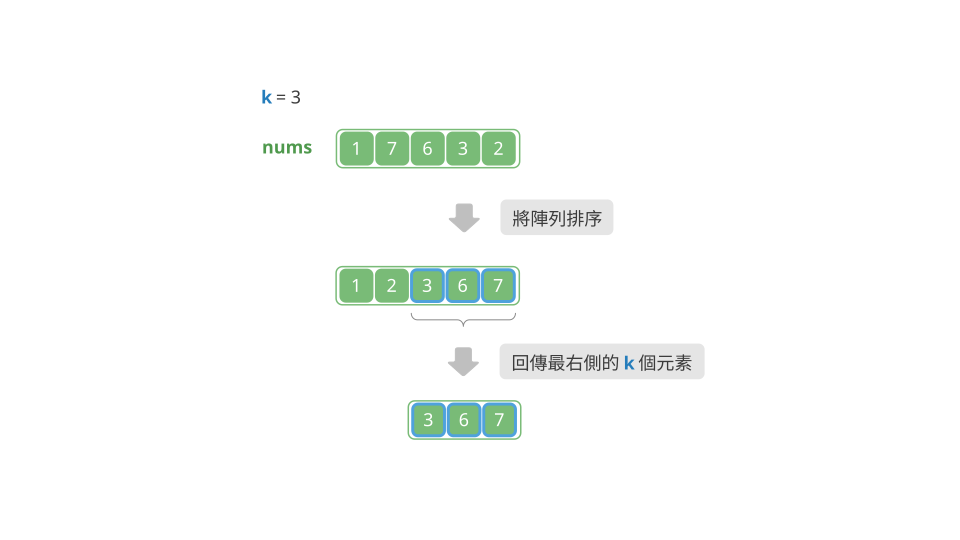
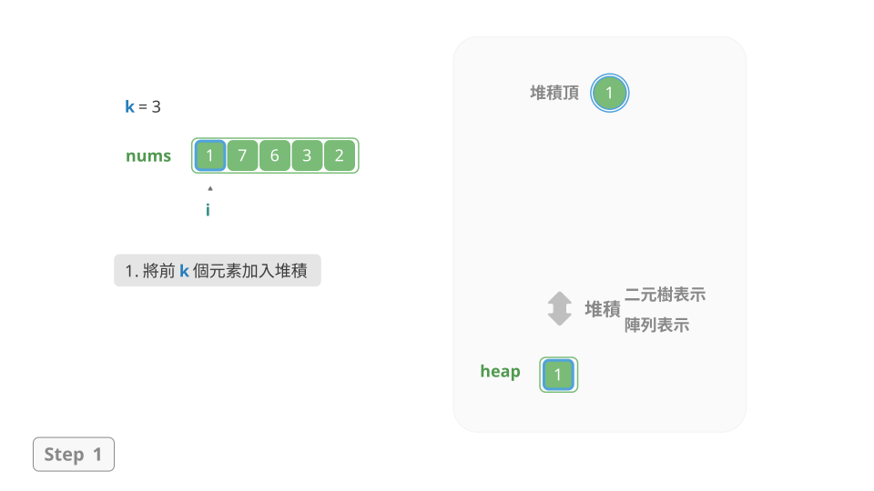
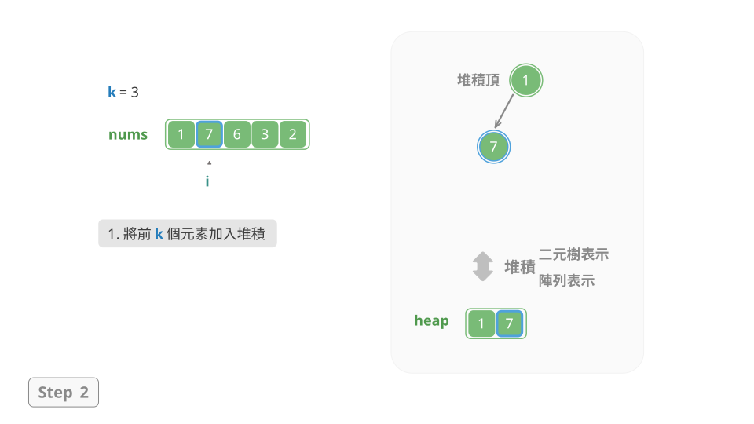
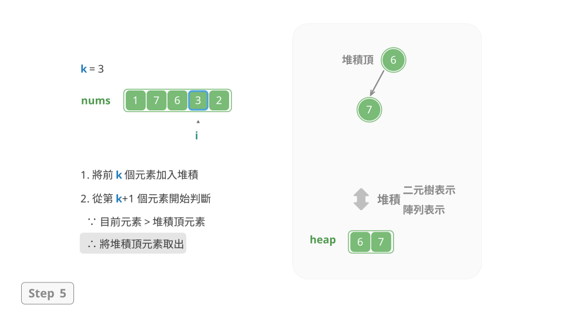
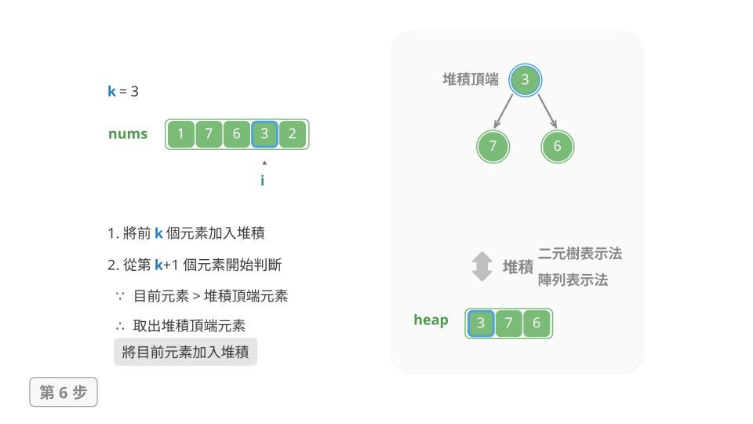
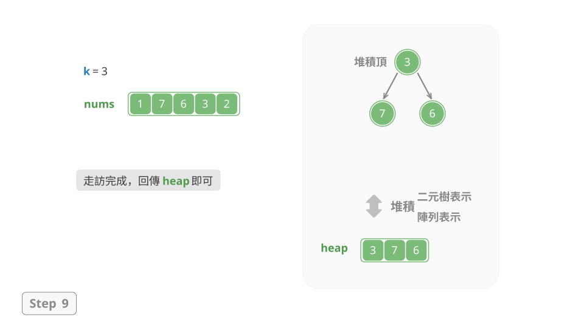

# Top-k 問題

!!! question

    給定長度為 $n$ 的未排序陣列 `nums`，請回傳陣列中最大的 $k$ 個元素。

針對這個問題，我們先介紹兩種較直觀的解法，再介紹效率更高的堆積解法。

## 方法一：反覆走訪選取

如下圖所示，我們可以走訪 $k$ 輪，在各輪依序取出第 $1$、$2$、$\dots$、$k$ 大的元素，時間複雜度為 $O(nk)$。

這個方法只適用於 $k \ll n$ 的情況。當 $k$ 與 $n$ 很接近時，時間複雜度趨近 $O(n^2)$，非常耗時。


!!! tip

    當 $k = n$ 時，就能得到完整的已排序序列，此時相當於「選擇排序」演算法。

## 方法二：排序

如下圖所示，可以先將陣列 `nums` 排序，再回傳最右側的 $k$ 個元素，時間複雜度為 $O(n \log n)$。

這個方法做了額外的工作：我們只需要找出最大的 $k$ 個元素，無須將其餘元素一併排序。



## 方法三：堆積

利用堆積可以更有效率地解決 Top-k 問題，流程如下圖所示。

1. 初始化一個最小堆積，頂端是堆積中最小的元素。
2. 先將陣列的前 $k$ 個元素依序加入堆積。
3. 從第 $k + 1$ 個元素開始，若目前元素大於頂端元素，就先取出頂端元素，再將目前元素加入堆積。
4. 走訪結束後，堆積中保留的就是最大的 $k$ 個元素。

=== "<1>"
    

=== "<2>"
    

=== "<3>"
    

=== "<4>"
    

=== "<5>"
    

=== "<6>"
    

=== "<7>"
    

=== "<8>"
    

=== "<9>"
    

範例程式碼如下：

```src
[file]{top_k}-[class]{}-[func]{top_k_heap}
```

總共執行 $n$ 輪加入與取出堆積元素的操作，堆積大小最多為 $k$，因此時間複雜度為 $O(n \log k)$。這種方法效率很高，當 $k$ 較小時，時間複雜度趨近 $O(n)$；當 $k$ 較大時，時間複雜度也不會超過 $O(n \log n)$。

這個方法也適用於動態資料流。資料陸續進來時，可以持續維護堆積裡的元素，隨時更新最大的 $k$ 個元素。
