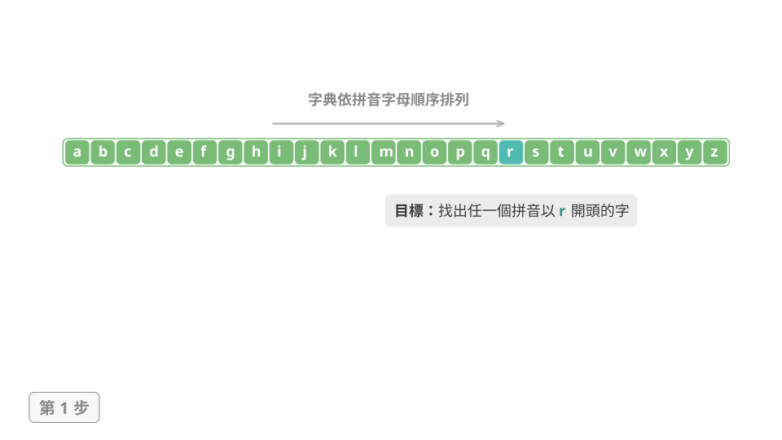
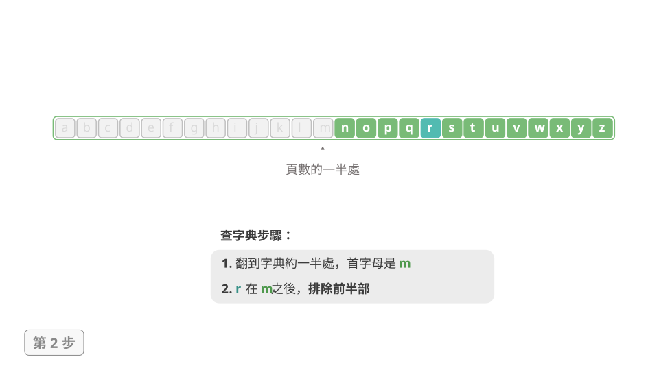
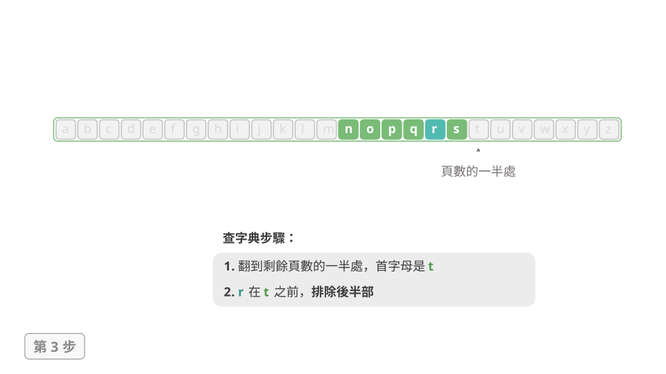
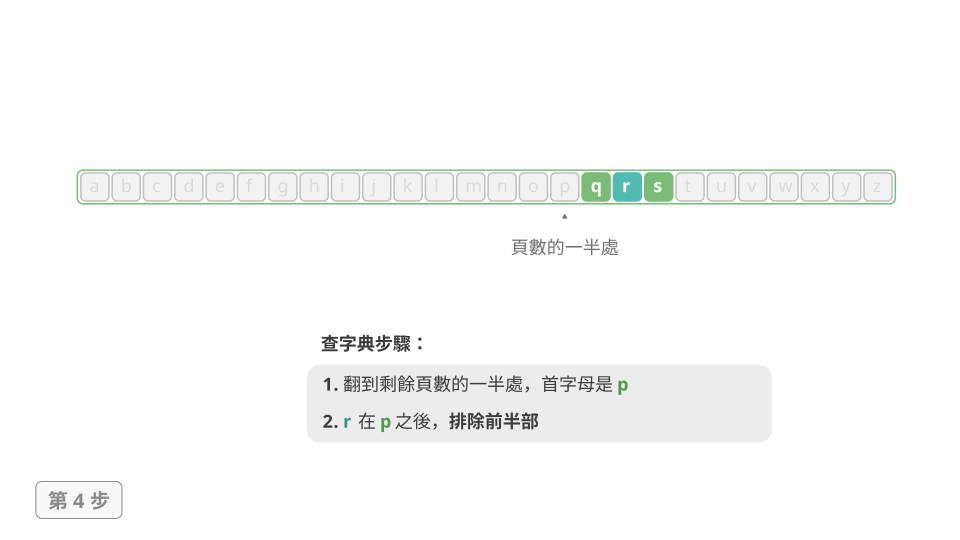
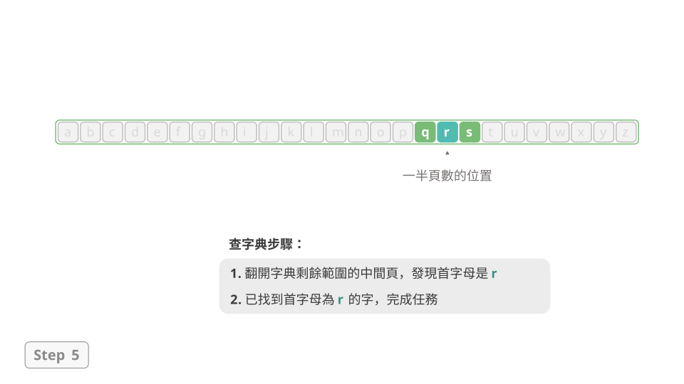
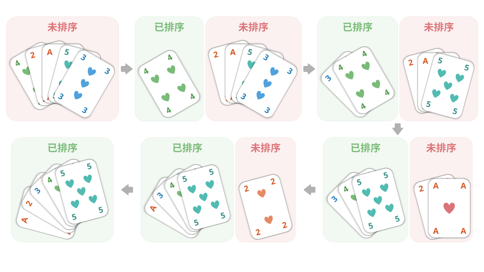
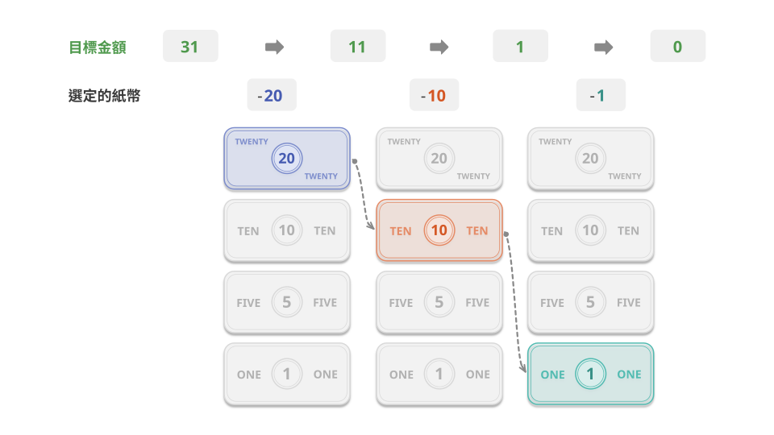

# 1.1 &nbsp; 演算法無所不在

聽到「演算法」，我們很自然會想到數學。其實，許多演算法用不到複雜的數學，靠的是基本邏輯，而這些邏輯在日常生活中隨處可見。

在正式討論演算法之前，先分享一件有趣的事：**你早已在不知不覺中學會許多演算法，而且習慣在日常生活中運用它們**。看看下面幾個例子就知道了。

**例一：查字典**。在這本字典裡，每個漢字都對應一個拼音，字典依照拼音字母的順序排列。假設要找一個拼音以 $r$ 開頭的字，我們通常會像圖 1-1 這樣查找。

1. 把字典翻到約一半處，看看這一頁的拼音首字母是什麼，假設看到的是 $m$。
2. 因為在拼音字母表中，$r$ 排在 $m$ 後面，所以可以排除字典的前半部，把搜尋範圍縮小到後半部。
3. 重複步驟 `1.` 與步驟 `2.`，直到翻到拼音首字母為 $r$ 的那一頁。

=== "<1>"
    { class="animation-figure" }

=== "<2>"
    { class="animation-figure" }

=== "<3>"
    { class="animation-figure" }

=== "<4>"
    { class="animation-figure" }

=== "<5>"
    { class="animation-figure" }

 圖 1-1 &nbsp; 查字典的步驟 

查字典這項小學生必備的技能，其實就是著名的「二分搜尋法」。從資料結構來看，可以把字典當成已排序的「陣列」；從演算法來看，上述查字典的步驟就是「二分搜尋」。

**例二：整理撲克牌**。打牌時，每局開始都要把手牌按點數由小到大排好，過程如圖 1-2 所示。

1. 將撲克牌分為「已排序」與「未排序」兩區，一開始先把最左邊的 1 張牌視為已排序。
2. 從未排序區抽出一張牌，插到已排序區的正確位置。此時，最左邊的 2 張牌就排好了。
3. 重複步驟 `2.`，每一輪都將一張牌從未排序區插入已排序區，直到所有手牌都排好。

{ class="animation-figure" }

 圖 1-2 &nbsp; 撲克牌排序步驟 

這種整理手牌的方法就是「插入排序」。它在處理小型資料集時效率很高，許多程式語言的函式庫都會在排序函式中用到它。

**例三：找零**。假設我們在超市買了 $69$ 元的商品，付給收銀員 $100$ 元，收銀員就需要找回 $31$ 元。他很自然地會像圖 1-3 這樣思考。

1. 可選的是面額小於 $31$ 元的貨幣，包括 $1$ 元、$5$ 元、$10$ 元、$20$ 元。
2. 從可選面額中取出最大的 $20$ 元，還要找 $31 - 20 = 11$ 元。
3. 從剩餘可選面額中取出最大的 $10$ 元，還要找 $11 - 10 = 1$ 元。
4. 從剩餘可選面額中取出最大的 $1$ 元，還要找 $1 - 1 = 0$ 元。
5. 完成找零，找回的金額組合為 $20 + 10 + 1 = 31$ 元。

{ class="animation-figure" }

 圖 1-3 &nbsp; 找零的過程 

在上述步驟中，我們每一步都做出當下看來最好的選擇，也就是盡量使用較大的面額，最後得到一個可行的找零方案。從資料結構與演算法的角度來看，這就是「貪婪演算法」。

小至做一道菜，大至星際航行，解決問題幾乎都離不開演算法。有了電腦，我們可以撰寫程式，把資料結構存入記憶體，並讓 CPU 和 GPU 執行演算法。如此一來，便能將生活中的問題交給電腦處理，以更有效率的方式解決各種複雜問題。

!!! tip

    如果你對資料結構、演算法、陣列與二分搜尋等概念還不太熟悉，請繼續讀下去。本書將帶你走進資料結構與演算法的世界。
