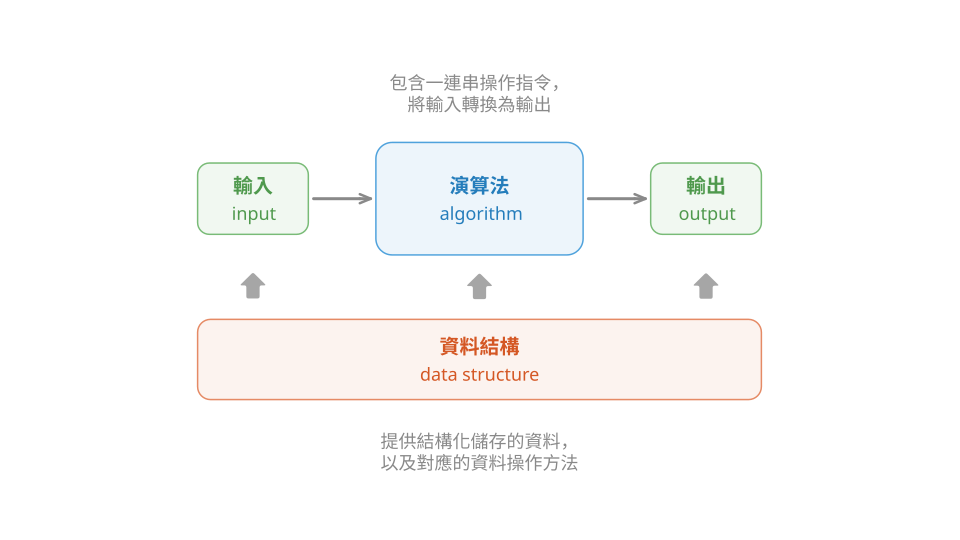

# 1.2 &nbsp; 什麼是演算法

## 1.2.1 &nbsp; 演算法的定義

<u>演算法（algorithm）</u> 是在有限時間內解決特定問題的一組指令或操作步驟，具有以下特性。

- 問題明確，輸入與輸出都有清楚的定義。
- 具備可行性，能在有限的步驟、時間與記憶體空間內完成。
- 每個步驟的意義都很明確，在相同的輸入與執行條件下，輸出始終相同。

## 1.2.2 &nbsp; 資料結構的定義

<u>資料結構（data structure）</u> 是組織與儲存資料的方式，涵蓋資料內容、資料之間的關係，以及操作資料的方法。設計資料結構時，有以下幾個目標。

- 盡量減少占用的空間，以節省記憶體。
- 盡量加快資料操作，包括存取、新增、刪除與更新等。
- 以簡潔的方式呈現資料及其邏輯關係，讓演算法能有效率地執行。

**設計資料結構時，往往需要做出取捨**。想改善某一方面，通常就得在另一方面讓步。以下舉兩個例子。

- 與陣列相比，鏈結串列在新增與刪除資料時較方便，代價是存取資料較慢。
- 與鏈結串列相比，圖能呈現更豐富的邏輯關係，但也需要更多記憶體空間。

## 1.2.3 &nbsp; 資料結構與演算法的關係

如圖 1-4 所示，資料結構與演算法密切相關，兩者的關係可以從三個面向來看。

- 資料結構是演算法的基礎。它為演算法提供有組織地儲存的資料，以及操作這些資料的方法。
- 演算法為資料結構注入生命力。資料結構本身只能儲存資料，必須結合演算法才能解決特定問題。
- 同一個演算法通常能採用不同的資料結構來實作，但執行效率可能相差很大，因此選擇合適的資料結構相當重要。

{ class="animation-figure" }

 圖 1-4 &nbsp; 資料結構與演算法的關係 

資料結構與演算法就像圖 1-5 中的組合積木。一套積木除了各式各樣的零件，還附有詳細的組裝說明書。跟著說明書一步一步做，就能組出精美的模型。

{ class="animation-figure" }

 圖 1-5 &nbsp; 組裝積木 

兩者的詳細對應關係如表 1-1 所示。

 表 1-1 &nbsp; 以組裝積木比喻資料結構與演算法 

| 資料結構與演算法 | 組裝積木                                 |
| -------------- | ---------------------------------------- |
| 輸入資料       | 尚未組裝的積木                             |
| 資料結構       | 積木的組織形式，包括形狀、大小、連接方式等 |
| 演算法           | 把積木組成目標形狀的一連串步驟       |
| 輸出資料       | 積木模型                                 |

值得一提的是，資料結構與演算法不受特定程式語言限制。正因如此，本書才能提供多種程式語言的實作。

!!! tip "約定俗成的簡稱"

    實際討論時，我們常將「資料結構與演算法」簡稱為「演算法」。例如，大家熟悉的 LeetCode 演算法題目，其實同時考驗資料結構與演算法兩方面的知識。
