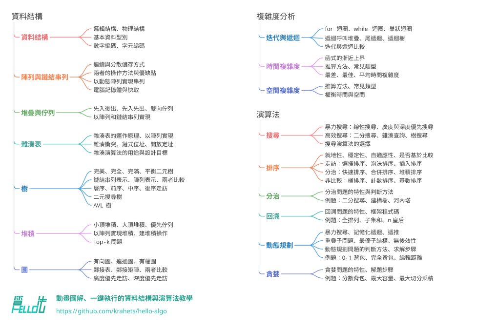

# 0.1 &nbsp; 關於本書

本專案希望打造一本開源、免費，適合初學者的資料結構與演算法入門書。

- 全書採用動畫圖解，讓內容清楚易懂，帶領初學者循序漸進地探索資料結構與演算法的知識地圖。
- 原始碼只要按一下就能執行，讀者可以一邊練習程式設計，一邊了解演算法的運作原理與資料結構的底層實作。
- 我們鼓勵讀者互相學習，歡迎在留言區提問、分享見解，一起從討論中進步。

## 0.1.1 &nbsp; 適合哪些讀者

如果你剛入門，從沒接觸過演算法，或是已經做過一些題目，卻對資料結構與演算法仍似懂非懂，時而覺得自己會了，時而又沒把握，那麼這本書就是為你寫的！

如果你已經做過不少題目，對多數題型都很熟悉，本書可以幫你回顧並整理演算法知識。程式碼儲存庫也可以當作「解題工具庫」或「演算法字典」來使用。

如果你是演算法高手，我們期待收到你的寶貴建議，也歡迎你[一起參與創作](../chapter_appendix/contribution.md)。

!!! success "先備知識"

    你至少需要具備一種語言的程式設計基礎，能讀懂並撰寫簡單的程式碼。

## 0.1.2 &nbsp; 內容架構

本書的主要內容如圖 0-1 所示。

- **複雜度分析**：評估資料結構與演算法的面向和方法，以及時間複雜度與空間複雜度的推算方法、常見類型和範例。
- **資料結構**：基本資料型別與資料結構的分類方式，以及陣列、鏈結串列、堆疊、佇列、雜湊表、樹、堆積、圖等結構的定義、優缺點、常用操作、常見類型、典型應用及實作方式。
- **演算法**：搜尋、排序、分治、回溯、動態規劃、貪婪法等演算法的定義、優缺點、效率、適用情境、解題步驟與例題。

{ class="animation-figure" }

 圖 0-1 &nbsp; 本書的主要內容 

## 0.1.3 &nbsp; 致謝

本書在開源社群許多貢獻者的合作下日益完善。感謝以下每一位投入時間與心力的撰稿人（依 GitHub 自動產生的順序排列）：krahets、coderonion、Gonglja、nuomi1、Reanon、justin-tse、hpstory、danielsss、curtishd、night-cruise、S-N-O-R-L-A-X、rongyi、msk397、gvenusleo、khoaxuantu、rivertwilight、K3v123、gyt95、zhuoqinyue、yuelinxin、Zuoxun、mingXta、Phoenix0415、FangYuan33、GN-Yu、longsizhuo、pengchzn、QiLOL、Cathay-Chen、guowei-gong、xBLACKICEx、IsChristina、JoseHung、qualifier1024、hello-ikun、magentaqin、Guanngxu、thomasq0、sunshinesDL、L-Super、Transmigration-zhou、WSL0809、Slone123c、lhxsm、yuan0221、what-is-me、theNefelibatas、Shyam-Chen、sangxiaai、longranger2、codeberg-user、xiongsp、JeffersonHuang、prinpal、seven1240、Wonderdch、malone6、xiaomiusa87、gaofer、bluebean-cloud、a16su、SamJin98、hongyun-robot、nanlei、XiaChuerwu、yd-j、iron-irax、mgisr、steventimes、junminhong、heshuyue、danny900714、Nigh、Dr-XYZ、MolDuM、XC-Zero、reeswell、PXG-XPG、NI-SW、Horbin-Magician、Enlightenus、YangXuanyi、xjr7670、beatrix-chan、DullSword、qq909244296、iStig、boloboloda、hts0000、gledfish、fbigm、echo1937、jiaxianhua、wenjianmin、keshida、kilikilikid、lclc6、lwbaptx、linyejoe2、liuxjerry、szu17dmy、dshlstarr、Yucao-cy、coderlef、czruby、bongbongbakudan、beintentional、ZongYangL、ZhongYuuu、ZhongGuanbin、hezhizhen、linzeyan、ZJKung、JTCPOWI、KawaiiAsh、luluxia、xb534、ztkuaikuai、yw-1021、ElaBosak233、baagod、zhouLion、yishangzhang、yi427、yanedie、yabo083、weibk、wangwang105、th1nk3r-ing、tao363、4yDX3906、syd168、sslmj2020、smilelsb、siqyka、selear、sdshaoda、Xi-Row、popozhu、nuquist19、noobcodemaker、XiaoK29、chadyi、lyl625760、lucaswangdev、llql1211、0130w、shanghai-Jerry、EJackYang、Javesun99、eltociear、lipusheng、KNChiu、BlindTerran、ShiMaRing、lovelock、FreddieLi、FloranceYeh、fanchenggang、gltianwen、goerll、nedchu、curly210102、CuB3y0nd、KraHsu、CarrotDLaw、youshaoXG、bubble9um、Asashishi、Asa0oo0o0o、fanenr、eagleanurag、akshiterate、52coder、foursevenlove、KorsChen、hopkings2008、yang-le、realwujing、Evilrabbit520、Umer-Jahangir、Turing-1024-Lee、Suremotoo、paoxiaomooo、Chieko-Seren、Senrian、Allen-Scai、19santosh99、ymmmas、Risuntsy、Richard-Zhang1019、RafaelCaso、qingpeng9802、primexiao、Urbaner3、codetypess、nidhoggfgg、MwumLi、CreatorMetaSky、martinx、ZnYang2018、hugtyftg、logan-qiu、psychelzh、Kunchen-Luo、Keynman 與 KeiichiKasai。

本書的程式碼由 coderonion、curtishd、Gonglja、gvenusleo、hpstory、justin-tse、khoaxuantu、krahets、night-cruise、nuomi1、Reanon 與 rongyi 審閱（依首字母排序）。感謝他們投入時間與心力，讓各語言的程式碼都能符合規範、維持一致。

本書英文版的審閱者為 yuelinxin、K3v123、magentaqin、QiLOL、Phoenix0415、SamJin98、yanedie、RafaelCaso、pengchzn 與 thomasq0，日文版由 eltociear 審閱，俄文版由 И. А. Шевкун 與 Yuyan Huang 審閱，繁體中文版由 Shyam-Chen 與 Dr-XYZ 審閱。感謝各位的貢獻，讓這本書能與更多讀者見面。

本書的 ePub 電子書產生工具由 zhongfq 開發。感謝他的貢獻，讓讀者能更靈活地選擇閱讀方式。

在寫作這本書的過程中，許多人給了我幫助。

- 感謝我在公司的導師李汐博士。一次暢談中，你鼓勵我「快行動起來」，讓我更加堅定了寫這本書的決心。
- 感謝我的女朋友泡泡擔任本書的第一位讀者。妳從演算法初學者的角度提出許多寶貴建議，讓本書更適合新手閱讀。
- 感謝騰寶、琦寶、飛寶為本書取了這個富有創意的名字，喚起大家寫下第一行程式碼「Hello World!」的美好回憶。
- 感謝校銓在智慧財產權方面提供專業協助，對完善這本開源書有很大幫助。
- 感謝蘇潼為本書設計精美的封面與標誌，也包容我對細節的執著，耐心修改了好幾次。
- 感謝 @squidfunk 提供排版建議，也感謝他開發的開源文件佈景主題 [Material-for-MkDocs](https://github.com/squidfunk/mkdocs-material)。

寫作期間，我閱讀了許多資料結構與演算法的教材和文章。這些作品是本書優秀的範本，幫助我確保內容的正確性與品質。在此感謝所有老師與前輩的傑出貢獻！

本書提倡動手也動腦的學習方式，這一點深受[《動手學深度學習》](https://github.com/d2l-ai/d2l-zh)啟發。我誠摯推薦各位讀者閱讀這本好書。

**衷心感謝我的父母。因為有你們一直以來的支持與鼓勵，我才有機會做這件這麼有趣的事**。
