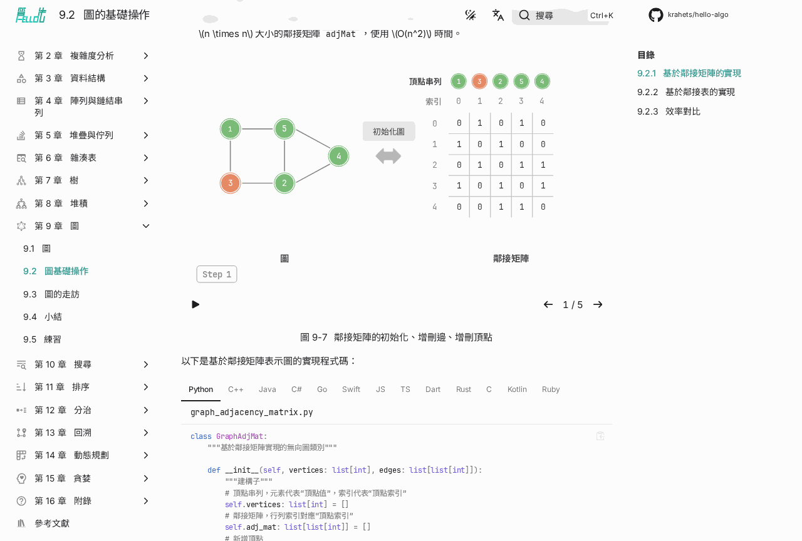
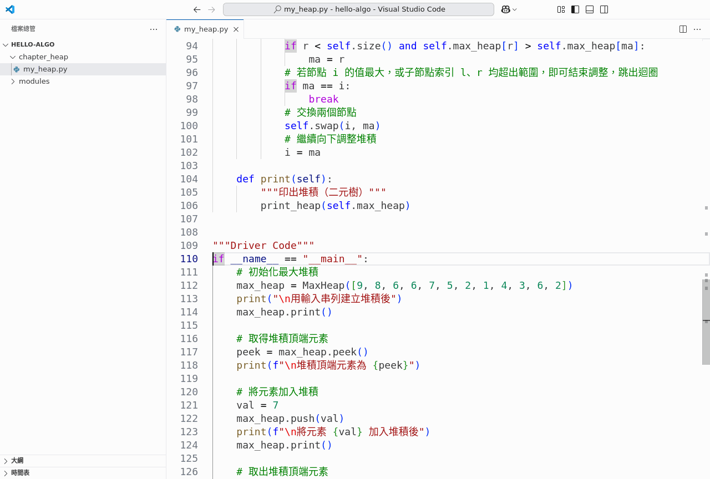
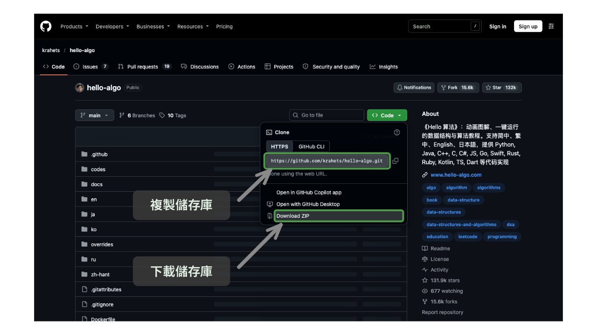
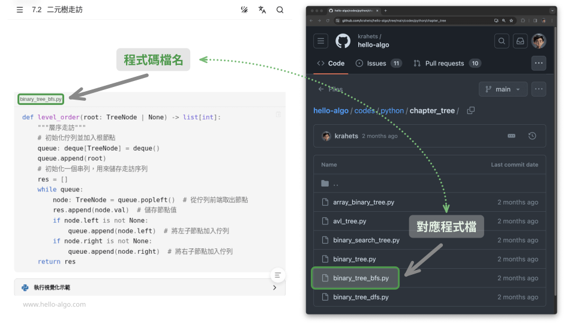
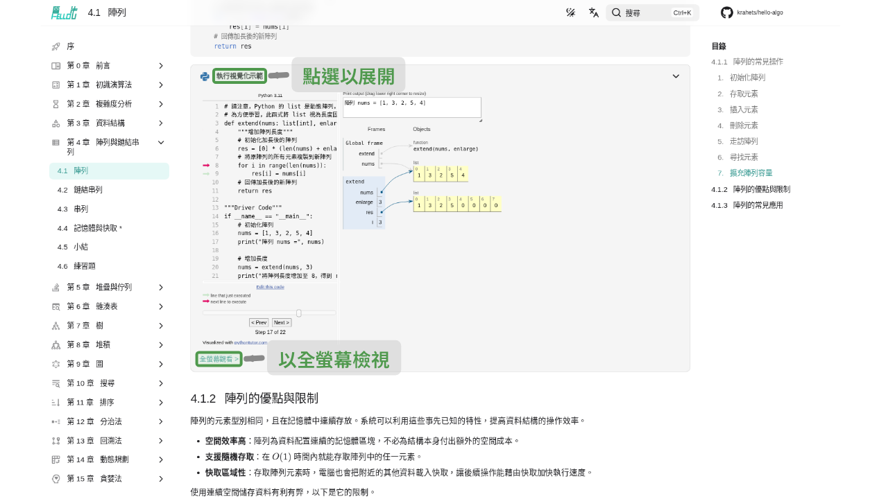
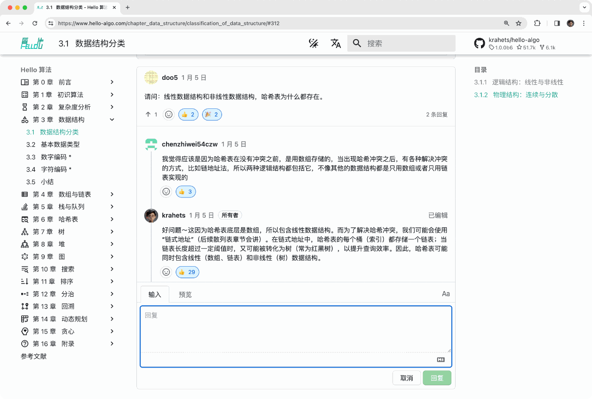
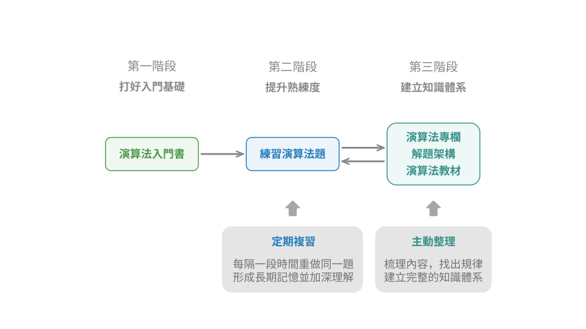

# 0.2 &nbsp; 如何使用本書

!!! tip

    為了有更好的閱讀體驗，建議你先讀完這一節。

## 0.2.1 &nbsp; 本書的體例

- 標題後有 `*` 的是選讀章節，內容比較難。如果時間有限，可以先跳過。
- 專業術語在紙本與 PDF 版以粗體排印，在網頁版則加上底線，例如<u>陣列（array）</u>。建議記住這些術語，日後閱讀文獻會更容易。
- 重點與總結性的句子會以**粗體**標示，閱讀時值得特別留意。
- 具有特定含義的詞句會加上「引號」，以免產生歧義。
- 遇到各程式語言用詞不同時，本書以 Python 的慣例為準，例如用 `None` 表示「空」。
- 為了讓版面更緊湊，本書有時會調整各程式語言慣用的註解格式。註解主要分成三類：標題註解、內容註解與多行註解。

=== "Python"

    ```python title=""
    """標題註解，用來標示函式、類別、測試案例等"""

    # 內容註解，用來詳細說明程式碼

    """
    多行
    註解
    """
    ```

=== "C++"

    ```cpp title=""
    /* 標題註解，用來標示函式、類別、測試案例等 */

    // 內容註解，用來詳細說明程式碼

    /**
     * 多行
     * 註解
     */
    ```

=== "Java"

    ```java title=""
    /* 標題註解，用來標示函式、類別、測試案例等 */

    // 內容註解，用來詳細說明程式碼

    /**
     * 多行
     * 註解
     */
    ```

=== "C#"

    ```csharp title=""
    /* 標題註解，用來標示函式、類別、測試案例等 */

    // 內容註解，用來詳細說明程式碼

    /**
     * 多行
     * 註解
     */
    ```

=== "Go"

    ```go title=""
    /* 標題註解，用來標示函式、類別、測試案例等 */

    // 內容註解，用來詳細說明程式碼

    /**
     * 多行
     * 註解
     */
    ```

=== "Swift"

    ```swift title=""
    /* 標題註解，用來標示函式、類別、測試案例等 */

    // 內容註解，用來詳細說明程式碼

    /**
     * 多行
     * 註解
     */
    ```

=== "JS"

    ```javascript title=""
    /* 標題註解，用來標示函式、類別、測試案例等 */

    // 內容註解，用來詳細說明程式碼

    /**
     * 多行
     * 註解
     */
    ```

=== "TS"

    ```typescript title=""
    /* 標題註解，用來標示函式、類別、測試案例等 */

    // 內容註解，用來詳細說明程式碼

    /**
     * 多行
     * 註解
     */
    ```

=== "Dart"

    ```dart title=""
    /* 標題註解，用來標示函式、類別、測試案例等 */

    // 內容註解，用來詳細說明程式碼

    /**
     * 多行
     * 註解
     */
    ```

=== "Rust"

    ```rust title=""
    /* 標題註解，用來標示函式、類別、測試案例等 */

    // 內容註解，用來詳細說明程式碼

    // 多行
    // 註解
    ```

=== "C"

    ```c title=""
    /* 標題註解，用來標示函式、類別、測試案例等 */

    // 內容註解，用來詳細說明程式碼

    /**
     * 多行
     * 註解
     */
    ```

=== "Kotlin"

    ```kotlin title=""
    /* 標題註解，用來標示函式、類別、測試案例等 */

    // 內容註解，用來詳細說明程式碼

    /**
     * 多行
     * 註解
     */
    ```

=== "Ruby"

    ```ruby title=""
    ### 標題註解，用來標示函式、類別、測試案例等 ###

    # 內容註解，用來詳細說明程式碼

    # 多行
    # 註解
    ```

## 0.2.2 &nbsp; 透過動畫圖解有效學習

和文字相比，影片與圖片能以更有組織的方式呈現更密集的資訊，也更容易理解。本書**主要透過動畫圖解呈現重點與較難的概念**，再以文字解釋與補充。

讀到附有動畫圖解的段落時（如圖 0-2 ），**請以圖為主、文字為輔**，搭配閱讀來理解內容。

{ class="animation-figure" }

<p align="center"> 圖 0-2 &nbsp; 動畫圖解範例 </p>

## 0.2.3 &nbsp; 動手寫程式，加深理解

本書的配套程式碼放在 [GitHub 儲存庫](https://github.com/krahets/hello-algo)。如圖 0-3 所示，**原始碼附有測試案例，只要按一下就能執行**。

時間允許的話，**建議你對照範例，自己把程式碼寫一遍**。如果時間有限，至少也請讀過並執行所有程式碼。

與單純閱讀相比，動手寫程式通常會有更多收穫。**親手做過，才是真的學會**。

{ class="animation-figure" }

<p align="center"> 圖 0-3 &nbsp; 執行程式碼的範例 </p>

開始執行程式碼之前，主要有三個步驟。

**第一步：在自己的電腦上安裝程式設計環境**。請參考附錄中的[教學](../chapter_appendix/installation.md)進行安裝。已經裝好的話，可以跳過這個步驟。

**第二步：複製或下載程式碼儲存庫**。前往 [GitHub 儲存庫](https://github.com/krahets/hello-algo)。如果已經安裝 [Git](https://git-scm.com/downloads)，可以用以下指令複製本儲存庫：

```shell
git clone https://github.com/krahets/hello-algo.git
```

也可以在圖 0-4 所示的位置按一下「Download ZIP」，直接下載程式碼壓縮檔，再到自己的電腦上解壓縮。

{ class="animation-figure" }

<p align="center"> 圖 0-4 &nbsp; 複製儲存庫與下載程式碼 </p>

**第三步：執行原始碼**。如圖 0-5 所示，如果程式碼區塊頂端標有檔名，就能在儲存庫的 `codes` 資料夾裡找到對應的原始碼檔案。檔案只需按一下就能執行，可以省去不必要的除錯時間，讓你專心學習。

{ class="animation-figure" }

<p align="center"> 圖 0-5 &nbsp; 程式碼區塊與對應的原始碼檔案 </p>

除了在自己的電腦上執行，**網頁版也提供 Python 程式碼的視覺化執行功能**（以 [pythontutor](https://pythontutor.com/) 實作）。如圖 0-6 所示，按一下程式碼區塊下方的「執行視覺化示範」，就能展開畫面，觀察演算法的執行過程；也可以按「全螢幕觀看」，看得更清楚。

{ class="animation-figure" }

<p align="center"> 圖 0-6 &nbsp; 以視覺化方式執行 Python 程式碼 </p>

## 0.2.4 &nbsp; 透過提問與討論一起成長

閱讀本書時，遇到還沒弄懂的概念，請別輕易跳過。**歡迎在留言區提問**，我和夥伴們會盡力解答，通常會在兩天內回覆。

如圖 0-7 所示，網頁版每個章節的底部都有留言區，不妨多看看大家的留言。一方面，別人的問題能幫助你發現自己忽略的地方，也能引發更深入的思考；另一方面，也期待你大方回答其他讀者的問題，分享自己的見解，幫助別人進步。

{ class="animation-figure" }

<p align="center"> 圖 0-7 &nbsp; 留言區範例 </p>

## 0.2.5 &nbsp; 演算法學習路線

整體而言，學習資料結構與演算法的過程可以分為三個階段。

1. **第一階段：演算法入門**。熟悉各種資料結構的特性與用法，了解不同演算法的原理、流程、用途及效率。
2. **第二階段：練習演算法題目**。建議從熱門題目開始，先累積至少 100 題，熟悉常見的演算法問題。剛開始練習時，可能會發現學過的東西很快就忘了，這很正常。可以參照「艾賓浩斯遺忘曲線」複習題目，通常重複 3～5 輪後，就能記得很牢。推薦的題目清單與練習計畫，請見這個 [GitHub 儲存庫](https://github.com/krahets/LeetCode-Book)。
3. **第三階段：建立知識體系**。學習時，可以閱讀演算法專欄、解題架構與教材，持續充實知識。練習時，可以嘗試進階策略，例如按主題分類、一題多解，或是用同一種解法處理多道題目。各個社群都能找到相關的解題心得。

如圖 0-8 所示，本書主要涵蓋第一階段，目的是幫助你更有效率地展開第二、三階段的學習。

{ class="animation-figure" }

<p align="center"> 圖 0-8 &nbsp; 演算法學習路線 </p>
