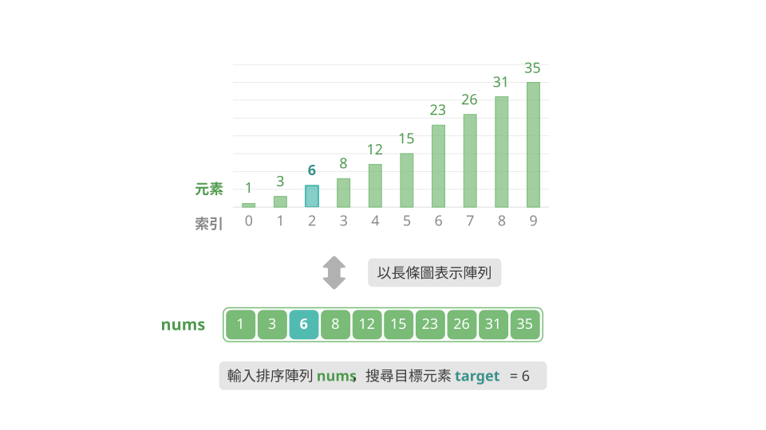
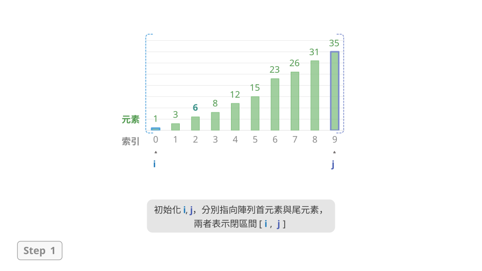
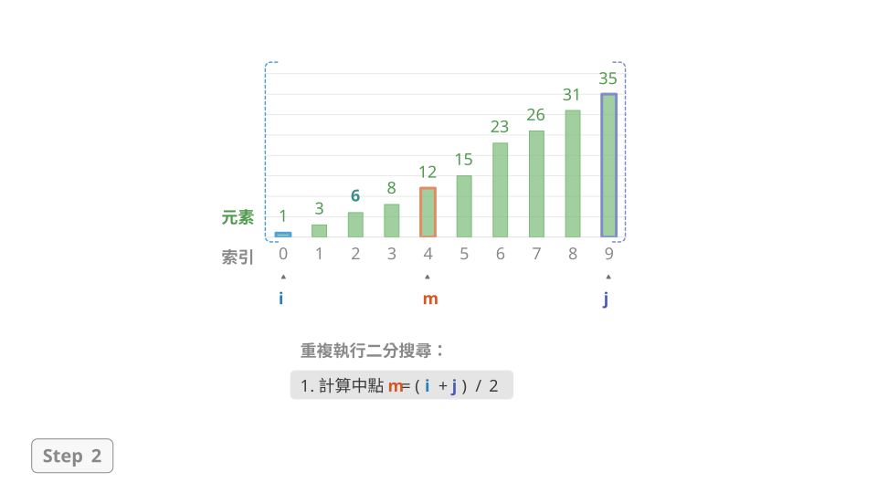
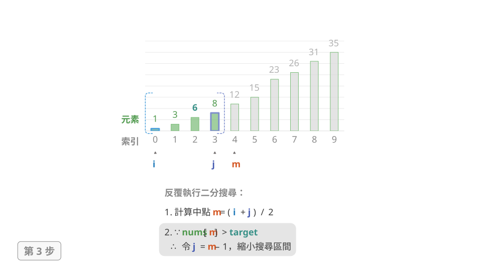
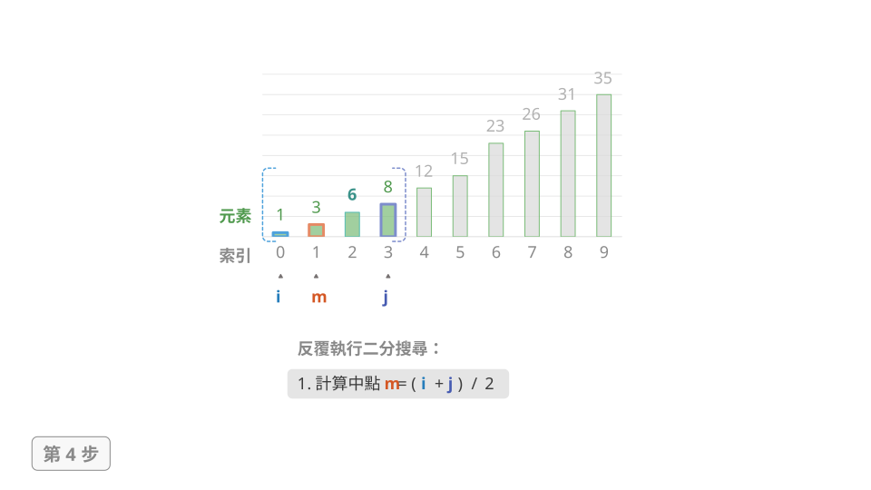
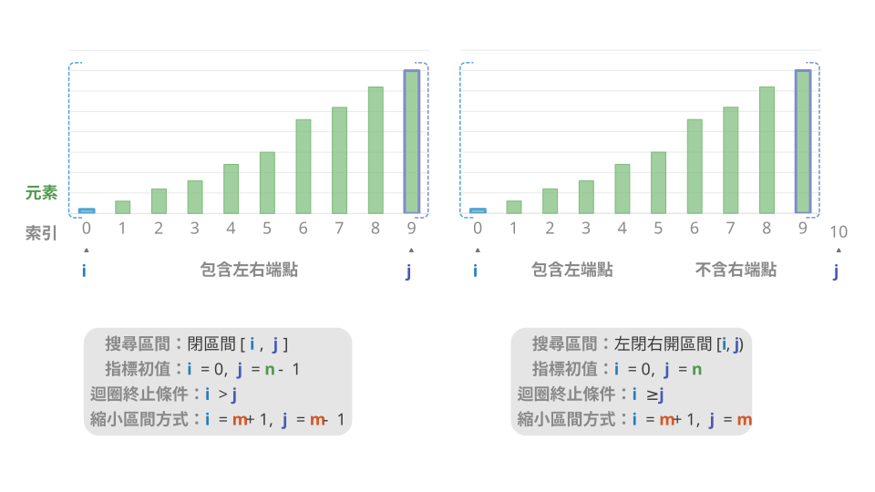

# 10.1 &nbsp; 二分搜尋

<u>二分搜尋（binary search）</u>是一種採用分治策略的高效率搜尋演算法。它利用資料已排序的特性，每一輪將搜尋範圍縮小一半，直到找到目標元素或搜尋區間為空為止。

!!! question

    給定長度為 $n$ 的陣列 `nums`，其中的元素由小到大排列，且互不重複。請找出元素 `target` 在陣列中的索引並回傳。若陣列不含該元素，則回傳 $-1$。圖 10-1 是一個範例。

{ class="animation-figure" }

<p align="center"> 圖 10-1 &nbsp; 二分搜尋的範例資料 </p>

如圖 10-2 所示，先設定兩個指標 $i = 0$ 和 $j = n - 1$，分別指向陣列的首、末元素，界定搜尋區間 $[0, n - 1]$。中括號表示閉區間，也就是兩個端點都包含在區間內。

接著反覆執行以下兩個步驟。

1. 計算中點索引 $m = \lfloor {(i + j) / 2} \rfloor$，其中 $\lfloor \: \rfloor$ 表示向下取整。
2. 比較 `nums[m]` 和 `target`，依兩者的大小關係分成以下三種情況。
    1. 若 `nums[m] < target`，則 `target` 只可能在區間 $[m + 1, j]$ 內，因此令 $i = m + 1$。
    2. 若 `nums[m] > target`，則 `target` 只可能在區間 $[i, m - 1]$ 內，因此令 $j = m - 1$。
    3. 若 `nums[m] = target`，表示已找到 `target`，因此回傳索引 $m$。

若陣列不含目標元素，搜尋區間最後會縮小為空區間，此時回傳 $-1$。

=== "<1>"
    { class="animation-figure" }

=== "<2>"
    { class="animation-figure" }

=== "<3>"
    { class="animation-figure" }

=== "<4>"
    { class="animation-figure" }

=== "<5>"
    { class="animation-figure" }

=== "<6>"
    { class="animation-figure" }

=== "<7>"
    { class="animation-figure" }

<p align="center"> 圖 10-2 &nbsp; 二分搜尋的步驟 </p>

由於 $i$ 和 $j$ 都是 `int` 型別，**兩者的和 $i + j$ 可能超出 `int` 型別能表示的範圍**。為了避免整數溢位，通常會用公式 $m = \lfloor {i + (j - i) / 2} \rfloor$ 計算中點。

程式碼如下：

=== "Python"

    ```python title="binary_search.py"
    def binary_search(nums: list[int], target: int) -> int:
        """二分搜尋（閉區間）"""
        # 將閉區間設為 [0, n-1]，i 和 j 分別指向陣列的首、末元素
        i, j = 0, len(nums) - 1
        # 當搜尋區間為空（i > j）時，結束迴圈
        while i <= j:
            # Python 整數的大小只受記憶體容量限制，無須擔心整數溢位
            m = (i + j) // 2  # 計算中點索引 m
            if nums[m] < target:
                i = m + 1  # 此時 target 若存在，必在區間 [m+1, j] 內
            elif nums[m] > target:
                j = m - 1  # 此時 target 若存在，必在區間 [i, m-1] 內
            else:
                return m  # 找到目標元素，回傳其索引
        return -1  # 找不到目標元素，回傳 -1
    ```

=== "C++"

    ```cpp title="binary_search.cpp"
    /* 二分搜尋（閉區間） */
    int binarySearch(vector<int> &nums, int target) {
        // 將閉區間設為 [0, n-1]，i 和 j 分別指向陣列的首、末元素
        int i = 0, j = nums.size() - 1;
        // 當搜尋區間為空（i > j）時，結束迴圈
        while (i <= j) {
            int m = i + (j - i) / 2; // 計算中點索引 m
            if (nums[m] < target)    // 此時 target 若存在，必在區間 [m+1, j] 內
                i = m + 1;
            else if (nums[m] > target) // 此時 target 若存在，必在區間 [i, m-1] 內
                j = m - 1;
            else // 找到目標元素，回傳其索引
                return m;
        }
        // 找不到目標元素，回傳 -1
        return -1;
    }
    ```

=== "Java"

    ```java title="binary_search.java"
    /* 二分搜尋（閉區間） */
    int binarySearch(int[] nums, int target) {
        // 將閉區間設為 [0, n-1]，i 和 j 分別指向陣列的首、末元素
        int i = 0, j = nums.length - 1;
        // 當搜尋區間為空（i > j）時，結束迴圈
        while (i <= j) {
            int m = i + (j - i) / 2; // 計算中點索引 m
            if (nums[m] < target) // 此時 target 若存在，必在區間 [m+1, j] 內
                i = m + 1;
            else if (nums[m] > target) // 此時 target 若存在，必在區間 [i, m-1] 內
                j = m - 1;
            else // 找到目標元素，回傳其索引
                return m;
        }
        // 找不到目標元素，回傳 -1
        return -1;
    }
    ```

=== "C#"

    ```csharp title="binary_search.cs"
    /* 二分搜尋（閉區間） */
    int BinarySearch(int[] nums, int target) {
        // 將閉區間設為 [0, n-1]，i 和 j 分別指向陣列的首、末元素
        int i = 0, j = nums.Length - 1;
        // 當搜尋區間為空（i > j）時，結束迴圈
        while (i <= j) {
            int m = i + (j - i) / 2;   // 計算中點索引 m
            if (nums[m] < target)      // 此時 target 若存在，必在區間 [m+1, j] 內
                i = m + 1;
            else if (nums[m] > target) // 此時 target 若存在，必在區間 [i, m-1] 內
                j = m - 1;
            else                       // 找到目標元素，回傳其索引
                return m;
        }
        // 找不到目標元素，回傳 -1
        return -1;
    }
    ```

=== "Go"

    ```go title="binary_search.go"
    /* 二分搜尋（閉區間） */
    func binarySearch(nums []int, target int) int {
        // 將閉區間設為 [0, n-1]，i 和 j 分別指向陣列的首、末元素
        i, j := 0, len(nums)-1
        // 當搜尋區間為空（i > j）時，結束迴圈
        for i <= j {
            m := i + (j-i)/2      // 計算中點索引 m
            if nums[m] < target { // 此時 target 若存在，必在區間 [m+1, j] 內
                i = m + 1
            } else if nums[m] > target { // 此時 target 若存在，必在區間 [i, m-1] 內
                j = m - 1
            } else { // 找到目標元素，回傳其索引
                return m
            }
        }
        // 找不到目標元素，回傳 -1
        return -1
    }
    ```

=== "Swift"

    ```swift title="binary_search.swift"
    /* 二分搜尋（閉區間） */
    func binarySearch(nums: [Int], target: Int) -> Int {
        // 將閉區間設為 [0, n-1]，i 和 j 分別指向陣列的首、末元素
        var i = nums.startIndex
        var j = nums.endIndex - 1
        // 當搜尋區間為空（i > j）時，結束迴圈
        while i <= j {
            let m = i + (j - i) / 2 // 計算中點索引 m
            if nums[m] < target { // 此時 target 若存在，必在區間 [m+1, j] 內
                i = m + 1
            } else if nums[m] > target { // 此時 target 若存在，必在區間 [i, m-1] 內
                j = m - 1
            } else { // 找到目標元素，回傳其索引
                return m
            }
        }
        // 找不到目標元素，回傳 -1
        return -1
    }
    ```

=== "JS"

    ```javascript title="binary_search.js"
    /* 二分搜尋（閉區間） */
    function binarySearch(nums, target) {
        // 將閉區間設為 [0, n-1]，i 和 j 分別指向陣列的首、末元素
        let i = 0,
            j = nums.length - 1;
        // 當搜尋區間為空（i > j）時，結束迴圈
        while (i <= j) {
            // 計算中點索引 m，以 parseInt() 向下取整
            const m = parseInt(i + (j - i) / 2);
            if (nums[m] < target)
                // 此時 target 若存在，必在區間 [m+1, j] 內
                i = m + 1;
            else if (nums[m] > target)
                // 此時 target 若存在，必在區間 [i, m-1] 內
                j = m - 1;
            else return m; // 找到目標元素，回傳其索引
        }
        // 找不到目標元素，回傳 -1
        return -1;
    }
    ```

=== "TS"

    ```typescript title="binary_search.ts"
    /* 二分搜尋（閉區間） */
    function binarySearch(nums: number[], target: number): number {
        // 將閉區間設為 [0, n-1]，i 和 j 分別指向陣列的首、末元素
        let i = 0,
            j = nums.length - 1;
        // 當搜尋區間為空（i > j）時，結束迴圈
        while (i <= j) {
            // 計算中點索引 m
            const m = Math.floor(i + (j - i) / 2);
            if (nums[m] < target) {
                // 此時 target 若存在，必在區間 [m+1, j] 內
                i = m + 1;
            } else if (nums[m] > target) {
                // 此時 target 若存在，必在區間 [i, m-1] 內
                j = m - 1;
            } else {
                // 找到目標元素，回傳其索引
                return m;
            }
        }
        return -1; // 找不到目標元素，回傳 -1
    }
    ```

=== "Dart"

    ```dart title="binary_search.dart"
    /* 二分搜尋（閉區間） */
    int binarySearch(List<int> nums, int target) {
      // 將閉區間設為 [0, n-1]，i 和 j 分別指向陣列的首、末元素
      int i = 0, j = nums.length - 1;
      // 當搜尋區間為空（i > j）時，結束迴圈
      while (i <= j) {
        int m = i + (j - i) ~/ 2; // 計算中點索引 m
        if (nums[m] < target) {
          // 此時 target 若存在，必在區間 [m+1, j] 內
          i = m + 1;
        } else if (nums[m] > target) {
          // 此時 target 若存在，必在區間 [i, m-1] 內
          j = m - 1;
        } else {
          // 找到目標元素，回傳其索引
          return m;
        }
      }
      // 找不到目標元素，回傳 -1
      return -1;
    }
    ```

=== "Rust"

    ```rust title="binary_search.rs"
    /* 二分搜尋（閉區間） */
    fn binary_search(nums: &[i32], target: i32) -> i32 {
        // 將閉區間設為 [0, n-1]，i 和 j 分別指向陣列的首、末元素
        let mut i = 0;
        let mut j = nums.len() as i32 - 1;
        // 當搜尋區間為空（i > j）時，結束迴圈
        while i <= j {
            let m = i + (j - i) / 2; // 計算中點索引 m
            if nums[m as usize] < target {
                // 此時 target 若存在，必在區間 [m+1, j] 內
                i = m + 1;
            } else if nums[m as usize] > target {
                // 此時 target 若存在，必在區間 [i, m-1] 內
                j = m - 1;
            } else {
                // 找到目標元素，回傳其索引
                return m;
            }
        }
        // 找不到目標元素，回傳 -1
        return -1;
    }
    ```

=== "C"

    ```c title="binary_search.c"
    /* 二分搜尋（閉區間） */
    int binarySearch(int *nums, int len, int target) {
        // 將閉區間設為 [0, n-1]，i 和 j 分別指向陣列的首、末元素
        int i = 0, j = len - 1;
        // 當搜尋區間為空（i > j）時，結束迴圈
        while (i <= j) {
            int m = i + (j - i) / 2; // 計算中點索引 m
            if (nums[m] < target)    // 此時 target 若存在，必在區間 [m+1, j] 內
                i = m + 1;
            else if (nums[m] > target) // 此時 target 若存在，必在區間 [i, m-1] 內
                j = m - 1;
            else // 找到目標元素，回傳其索引
                return m;
        }
        // 找不到目標元素，回傳 -1
        return -1;
    }
    ```

=== "Kotlin"

    ```kotlin title="binary_search.kt"
    /* 二分搜尋（閉區間） */
    fun binarySearch(nums: IntArray, target: Int): Int {
        // 將閉區間設為 [0, n-1]，i 和 j 分別指向陣列的首、末元素
        var i = 0
        var j = nums.size - 1
        // 當搜尋區間為空（i > j）時，結束迴圈
        while (i <= j) {
            val m = i + (j - i) / 2 // 計算中點索引 m
            if (nums[m] < target) // 此時 target 若存在，必在區間 [m+1, j] 內
                i = m + 1
            else if (nums[m] > target) // 此時 target 若存在，必在區間 [i, m-1] 內
                j = m - 1
            else  // 找到目標元素，回傳其索引
                return m
        }
        // 找不到目標元素，回傳 -1
        return -1
    }
    ```

=== "Ruby"

    ```ruby title="binary_search.rb"
    ### 二分搜尋（閉區間） ###
    def binary_search(nums, target)
      # 將閉區間設為 [0, n-1]，i 和 j 分別指向陣列的首、末元素
      i, j = 0, nums.length - 1

      # 當搜尋區間為空（i > j）時，結束迴圈
      while i <= j
        # Ruby 整數的大小只受記憶體容量限制，無須擔心整數溢位
        m = (i + j) / 2   # 計算中點索引 m
      
        if nums[m] < target
          i = m + 1 # 此時 target 若存在，必在區間 [m+1, j] 內
        elsif nums[m] > target
          j = m - 1 # 此時 target 若存在，必在區間 [i, m-1] 內
        else
          return m  # 找到目標元素，回傳其索引
        end
      end

      -1  # 找不到目標元素，回傳 -1
    end
    ```

??? pythontutor "執行視覺化示範"

    <div style="height: 549px; width: 100%;"><iframe class="pythontutor-iframe" title="執行視覺化示範" src="https://pythontutor.com/iframe-embed.html#code=def%20binary_search%28nums%3A%20list%5Bint%5D,%20target%3A%20int%29%20-%3E%20int%3A%0A%20%20%20%20%22%22%22%E4%BA%8C%E5%88%86%E6%90%9C%E5%B0%8B%EF%BC%88%E9%96%89%E5%8D%80%E9%96%93%EF%BC%89%22%22%22%0A%20%20%20%20%23%20%E5%B0%87%E9%96%89%E5%8D%80%E9%96%93%E8%A8%AD%E7%82%BA%20%5B0,%20n-1%5D%EF%BC%8Ci%20%E5%92%8C%20j%20%E5%88%86%E5%88%A5%E6%8C%87%E5%90%91%E9%99%A3%E5%88%97%E7%9A%84%E9%A6%96%E3%80%81%E6%9C%AB%E5%85%83%E7%B4%A0%0A%20%20%20%20i,%20j%20%3D%200,%20len%28nums%29%20-%201%0A%20%20%20%20%23%20%E7%95%B6%E6%90%9C%E5%B0%8B%E5%8D%80%E9%96%93%E7%82%BA%E7%A9%BA%EF%BC%88i%20%3E%20j%EF%BC%89%E6%99%82%EF%BC%8C%E7%B5%90%E6%9D%9F%E8%BF%B4%E5%9C%88%0A%20%20%20%20while%20i%20%3C%3D%20j%3A%0A%20%20%20%20%20%20%20%20%23%20Python%20%E6%95%B4%E6%95%B8%E7%9A%84%E5%A4%A7%E5%B0%8F%E5%8F%AA%E5%8F%97%E8%A8%98%E6%86%B6%E9%AB%94%E5%AE%B9%E9%87%8F%E9%99%90%E5%88%B6%EF%BC%8C%E7%84%A1%E9%A0%88%E6%93%94%E5%BF%83%E6%95%B4%E6%95%B8%E6%BA%A2%E4%BD%8D%0A%20%20%20%20%20%20%20%20m%20%3D%20%28i%20%2B%20j%29%20//%202%20%20%23%20%E8%A8%88%E7%AE%97%E4%B8%AD%E9%BB%9E%E7%B4%A2%E5%BC%95%20m%0A%20%20%20%20%20%20%20%20if%20nums%5Bm%5D%20%3C%20target%3A%0A%20%20%20%20%20%20%20%20%20%20%20%20i%20%3D%20m%20%2B%201%20%20%23%20%E6%AD%A4%E6%99%82%20target%20%E8%8B%A5%E5%AD%98%E5%9C%A8%EF%BC%8C%E5%BF%85%E5%9C%A8%E5%8D%80%E9%96%93%20%5Bm%2B1,%20j%5D%20%E5%85%A7%0A%20%20%20%20%20%20%20%20elif%20nums%5Bm%5D%20%3E%20target%3A%0A%20%20%20%20%20%20%20%20%20%20%20%20j%20%3D%20m%20-%201%20%20%23%20%E6%AD%A4%E6%99%82%20target%20%E8%8B%A5%E5%AD%98%E5%9C%A8%EF%BC%8C%E5%BF%85%E5%9C%A8%E5%8D%80%E9%96%93%20%5Bi,%20m-1%5D%20%E5%85%A7%0A%20%20%20%20%20%20%20%20else%3A%0A%20%20%20%20%20%20%20%20%20%20%20%20return%20m%20%20%23%20%E6%89%BE%E5%88%B0%E7%9B%AE%E6%A8%99%E5%85%83%E7%B4%A0%EF%BC%8C%E5%9B%9E%E5%82%B3%E5%85%B6%E7%B4%A2%E5%BC%95%0A%20%20%20%20return%20-1%20%20%23%20%E6%89%BE%E4%B8%8D%E5%88%B0%E7%9B%AE%E6%A8%99%E5%85%83%E7%B4%A0%EF%BC%8C%E5%9B%9E%E5%82%B3%20-1%0A%0A%0A%22%22%22Driver%20Code%22%22%22%0Aif%20__name__%20%3D%3D%20%22__main__%22%3A%0A%20%20%20%20target%20%3D%206%0A%20%20%20%20nums%20%3D%20%5B1,%203,%206,%208,%2012,%2015,%2023,%2026,%2031,%2035%5D%0A%0A%20%20%20%20%23%20%E4%BA%8C%E5%88%86%E6%90%9C%E5%B0%8B%EF%BC%88%E9%96%89%E5%8D%80%E9%96%93%EF%BC%89%0A%20%20%20%20index%20%3D%20binary_search%28nums,%20target%29%0A%20%20%20%20print%28%22%E7%9B%AE%E6%A8%99%E5%85%83%E7%B4%A0%206%20%E7%9A%84%E7%B4%A2%E5%BC%95%20%3D%20%22,%20index%29&codeDivHeight=472&codeDivWidth=350&cumulative=false&curInstr=5&heapPrimitives=nevernest&origin=opt-frontend.js&py=311&rawInputLstJSON=%5B%5D&textReferences=false"> </iframe></div>
    <div style="margin-top: 5px;"><a href="https://pythontutor.com/iframe-embed.html#code=def%20binary_search%28nums%3A%20list%5Bint%5D,%20target%3A%20int%29%20-%3E%20int%3A%0A%20%20%20%20%22%22%22%E4%BA%8C%E5%88%86%E6%90%9C%E5%B0%8B%EF%BC%88%E9%96%89%E5%8D%80%E9%96%93%EF%BC%89%22%22%22%0A%20%20%20%20%23%20%E5%B0%87%E9%96%89%E5%8D%80%E9%96%93%E8%A8%AD%E7%82%BA%20%5B0,%20n-1%5D%EF%BC%8Ci%20%E5%92%8C%20j%20%E5%88%86%E5%88%A5%E6%8C%87%E5%90%91%E9%99%A3%E5%88%97%E7%9A%84%E9%A6%96%E3%80%81%E6%9C%AB%E5%85%83%E7%B4%A0%0A%20%20%20%20i,%20j%20%3D%200,%20len%28nums%29%20-%201%0A%20%20%20%20%23%20%E7%95%B6%E6%90%9C%E5%B0%8B%E5%8D%80%E9%96%93%E7%82%BA%E7%A9%BA%EF%BC%88i%20%3E%20j%EF%BC%89%E6%99%82%EF%BC%8C%E7%B5%90%E6%9D%9F%E8%BF%B4%E5%9C%88%0A%20%20%20%20while%20i%20%3C%3D%20j%3A%0A%20%20%20%20%20%20%20%20%23%20Python%20%E6%95%B4%E6%95%B8%E7%9A%84%E5%A4%A7%E5%B0%8F%E5%8F%AA%E5%8F%97%E8%A8%98%E6%86%B6%E9%AB%94%E5%AE%B9%E9%87%8F%E9%99%90%E5%88%B6%EF%BC%8C%E7%84%A1%E9%A0%88%E6%93%94%E5%BF%83%E6%95%B4%E6%95%B8%E6%BA%A2%E4%BD%8D%0A%20%20%20%20%20%20%20%20m%20%3D%20%28i%20%2B%20j%29%20//%202%20%20%23%20%E8%A8%88%E7%AE%97%E4%B8%AD%E9%BB%9E%E7%B4%A2%E5%BC%95%20m%0A%20%20%20%20%20%20%20%20if%20nums%5Bm%5D%20%3C%20target%3A%0A%20%20%20%20%20%20%20%20%20%20%20%20i%20%3D%20m%20%2B%201%20%20%23%20%E6%AD%A4%E6%99%82%20target%20%E8%8B%A5%E5%AD%98%E5%9C%A8%EF%BC%8C%E5%BF%85%E5%9C%A8%E5%8D%80%E9%96%93%20%5Bm%2B1,%20j%5D%20%E5%85%A7%0A%20%20%20%20%20%20%20%20elif%20nums%5Bm%5D%20%3E%20target%3A%0A%20%20%20%20%20%20%20%20%20%20%20%20j%20%3D%20m%20-%201%20%20%23%20%E6%AD%A4%E6%99%82%20target%20%E8%8B%A5%E5%AD%98%E5%9C%A8%EF%BC%8C%E5%BF%85%E5%9C%A8%E5%8D%80%E9%96%93%20%5Bi,%20m-1%5D%20%E5%85%A7%0A%20%20%20%20%20%20%20%20else%3A%0A%20%20%20%20%20%20%20%20%20%20%20%20return%20m%20%20%23%20%E6%89%BE%E5%88%B0%E7%9B%AE%E6%A8%99%E5%85%83%E7%B4%A0%EF%BC%8C%E5%9B%9E%E5%82%B3%E5%85%B6%E7%B4%A2%E5%BC%95%0A%20%20%20%20return%20-1%20%20%23%20%E6%89%BE%E4%B8%8D%E5%88%B0%E7%9B%AE%E6%A8%99%E5%85%83%E7%B4%A0%EF%BC%8C%E5%9B%9E%E5%82%B3%20-1%0A%0A%0A%22%22%22Driver%20Code%22%22%22%0Aif%20__name__%20%3D%3D%20%22__main__%22%3A%0A%20%20%20%20target%20%3D%206%0A%20%20%20%20nums%20%3D%20%5B1,%203,%206,%208,%2012,%2015,%2023,%2026,%2031,%2035%5D%0A%0A%20%20%20%20%23%20%E4%BA%8C%E5%88%86%E6%90%9C%E5%B0%8B%EF%BC%88%E9%96%89%E5%8D%80%E9%96%93%EF%BC%89%0A%20%20%20%20index%20%3D%20binary_search%28nums,%20target%29%0A%20%20%20%20print%28%22%E7%9B%AE%E6%A8%99%E5%85%83%E7%B4%A0%206%20%E7%9A%84%E7%B4%A2%E5%BC%95%20%3D%20%22,%20index%29&codeDivHeight=800&codeDivWidth=600&cumulative=false&curInstr=5&heapPrimitives=nevernest&origin=opt-frontend.js&py=311&rawInputLstJSON=%5B%5D&textReferences=false" target="_blank" rel="noopener noreferrer">全螢幕觀看 ></a></div>

**時間複雜度為 $O(\log n)$**：在二分搜尋的迴圈中，每一輪都將區間縮小一半，因此迴圈執行次數為 $\log_2 n$。

**空間複雜度為 $O(1)$**：指標 $i$ 和 $j$ 只占用固定大小的空間。

## 10.1.1 &nbsp; 區間的表示方式

除了前述的閉區間，另一種常見的表示方式是「左閉右開」區間，記為 $[0, n)$，包含左端點，但不含右端點。採用這種表示方式時，區間 $[i, j)$ 在 $i = j$ 時為空。

採用這種區間表示法，也能實作出功能相同的二分搜尋演算法：

=== "Python"

    ```python title="binary_search.py"
    def binary_search_lcro(nums: list[int], target: int) -> int:
        """二分搜尋（左閉右開區間）"""
        # 將左閉右開區間設為 [0, n)，i 指向陣列的首元素，j 指向末元素的下一個位置
        i, j = 0, len(nums)
        # 當搜尋區間為空（i = j）時，結束迴圈
        while i < j:
            m = (i + j) // 2  # 計算中點索引 m
            if nums[m] < target:
                i = m + 1  # 此時 target 若存在，必在區間 [m+1, j) 內
            elif nums[m] > target:
                j = m  # 此時 target 若存在，必在區間 [i, m) 內
            else:
                return m  # 找到目標元素，回傳其索引
        return -1  # 找不到目標元素，回傳 -1
    ```

=== "C++"

    ```cpp title="binary_search.cpp"
    /* 二分搜尋（左閉右開區間） */
    int binarySearchLCRO(vector<int> &nums, int target) {
        // 將左閉右開區間設為 [0, n)，i 指向陣列的首元素，j 指向末元素的下一個位置
        int i = 0, j = nums.size();
        // 當搜尋區間為空（i = j）時，結束迴圈
        while (i < j) {
            int m = i + (j - i) / 2; // 計算中點索引 m
            if (nums[m] < target)    // 此時 target 若存在，必在區間 [m+1, j) 內
                i = m + 1;
            else if (nums[m] > target) // 此時 target 若存在，必在區間 [i, m) 內
                j = m;
            else // 找到目標元素，回傳其索引
                return m;
        }
        // 找不到目標元素，回傳 -1
        return -1;
    }
    ```

=== "Java"

    ```java title="binary_search.java"
    /* 二分搜尋（左閉右開區間） */
    int binarySearchLCRO(int[] nums, int target) {
        // 將左閉右開區間設為 [0, n)，i 指向陣列的首元素，j 指向末元素的下一個位置
        int i = 0, j = nums.length;
        // 當搜尋區間為空（i = j）時，結束迴圈
        while (i < j) {
            int m = i + (j - i) / 2; // 計算中點索引 m
            if (nums[m] < target) // 此時 target 若存在，必在區間 [m+1, j) 內
                i = m + 1;
            else if (nums[m] > target) // 此時 target 若存在，必在區間 [i, m) 內
                j = m;
            else // 找到目標元素，回傳其索引
                return m;
        }
        // 找不到目標元素，回傳 -1
        return -1;
    }
    ```

=== "C#"

    ```csharp title="binary_search.cs"
    /* 二分搜尋（左閉右開區間） */
    int BinarySearchLCRO(int[] nums, int target) {
        // 將左閉右開區間設為 [0, n)，i 指向陣列的首元素，j 指向末元素的下一個位置
        int i = 0, j = nums.Length;
        // 當搜尋區間為空（i = j）時，結束迴圈
        while (i < j) {
            int m = i + (j - i) / 2;   // 計算中點索引 m
            if (nums[m] < target)      // 此時 target 若存在，必在區間 [m+1, j) 內
                i = m + 1;
            else if (nums[m] > target) // 此時 target 若存在，必在區間 [i, m) 內
                j = m;
            else                       // 找到目標元素，回傳其索引
                return m;
        }
        // 找不到目標元素，回傳 -1
        return -1;
    }
    ```

=== "Go"

    ```go title="binary_search.go"
    /* 二分搜尋（左閉右開區間） */
    func binarySearchLCRO(nums []int, target int) int {
        // 將左閉右開區間設為 [0, n)，i 指向陣列的首元素，j 指向末元素的下一個位置
        i, j := 0, len(nums)
        // 當搜尋區間為空（i = j）時，結束迴圈
        for i < j {
            m := i + (j-i)/2      // 計算中點索引 m
            if nums[m] < target { // 此時 target 若存在，必在區間 [m+1, j) 內
                i = m + 1
            } else if nums[m] > target { // 此時 target 若存在，必在區間 [i, m) 內
                j = m
            } else { // 找到目標元素，回傳其索引
                return m
            }
        }
        // 找不到目標元素，回傳 -1
        return -1
    }
    ```

=== "Swift"

    ```swift title="binary_search.swift"
    /* 二分搜尋（左閉右開區間） */
    func binarySearchLCRO(nums: [Int], target: Int) -> Int {
        // 將左閉右開區間設為 [0, n)，i 指向陣列的首元素，j 指向末元素的下一個位置
        var i = nums.startIndex
        var j = nums.endIndex
        // 當搜尋區間為空（i = j）時，結束迴圈
        while i < j {
            let m = i + (j - i) / 2 // 計算中點索引 m
            if nums[m] < target { // 此時 target 若存在，必在區間 [m+1, j) 內
                i = m + 1
            } else if nums[m] > target { // 此時 target 若存在，必在區間 [i, m) 內
                j = m
            } else { // 找到目標元素，回傳其索引
                return m
            }
        }
        // 找不到目標元素，回傳 -1
        return -1
    }
    ```

=== "JS"

    ```javascript title="binary_search.js"
    /* 二分搜尋（左閉右開區間） */
    function binarySearchLCRO(nums, target) {
        // 將左閉右開區間設為 [0, n)，i 指向陣列的首元素，j 指向末元素的下一個位置
        let i = 0,
            j = nums.length;
        // 當搜尋區間為空（i = j）時，結束迴圈
        while (i < j) {
            // 計算中點索引 m，以 parseInt() 向下取整
            const m = parseInt(i + (j - i) / 2);
            if (nums[m] < target)
                // 此時 target 若存在，必在區間 [m+1, j) 內
                i = m + 1;
            else if (nums[m] > target)
                // 此時 target 若存在，必在區間 [i, m) 內
                j = m;
            // 找到目標元素，回傳其索引
            else return m;
        }
        // 找不到目標元素，回傳 -1
        return -1;
    }
    ```

=== "TS"

    ```typescript title="binary_search.ts"
    /* 二分搜尋（左閉右開區間） */
    function binarySearchLCRO(nums: number[], target: number): number {
        // 將左閉右開區間設為 [0, n)，i 指向陣列的首元素，j 指向末元素的下一個位置
        let i = 0,
            j = nums.length;
        // 當搜尋區間為空（i = j）時，結束迴圈
        while (i < j) {
            // 計算中點索引 m
            const m = Math.floor(i + (j - i) / 2);
            if (nums[m] < target) {
                // 此時 target 若存在，必在區間 [m+1, j) 內
                i = m + 1;
            } else if (nums[m] > target) {
                // 此時 target 若存在，必在區間 [i, m) 內
                j = m;
            } else {
                // 找到目標元素，回傳其索引
                return m;
            }
        }
        return -1; // 找不到目標元素，回傳 -1
    }
    ```

=== "Dart"

    ```dart title="binary_search.dart"
    /* 二分搜尋（左閉右開區間） */
    int binarySearchLCRO(List<int> nums, int target) {
      // 將左閉右開區間設為 [0, n)，i 指向陣列的首元素，j 指向末元素的下一個位置
      int i = 0, j = nums.length;
      // 當搜尋區間為空（i = j）時，結束迴圈
      while (i < j) {
        int m = i + (j - i) ~/ 2; // 計算中點索引 m
        if (nums[m] < target) {
          // 此時 target 若存在，必在區間 [m+1, j) 內
          i = m + 1;
        } else if (nums[m] > target) {
          // 此時 target 若存在，必在區間 [i, m) 內
          j = m;
        } else {
          // 找到目標元素，回傳其索引
          return m;
        }
      }
      // 找不到目標元素，回傳 -1
      return -1;
    }
    ```

=== "Rust"

    ```rust title="binary_search.rs"
    /* 二分搜尋（左閉右開區間） */
    fn binary_search_lcro(nums: &[i32], target: i32) -> i32 {
        // 將左閉右開區間設為 [0, n)，i 指向陣列的首元素，j 指向末元素的下一個位置
        let mut i = 0;
        let mut j = nums.len() as i32;
        // 當搜尋區間為空（i = j）時，結束迴圈
        while i < j {
            let m = i + (j - i) / 2; // 計算中點索引 m
            if nums[m as usize] < target {
                // 此時 target 若存在，必在區間 [m+1, j) 內
                i = m + 1;
            } else if nums[m as usize] > target {
                // 此時 target 若存在，必在區間 [i, m) 內
                j = m;
            } else {
                // 找到目標元素，回傳其索引
                return m;
            }
        }
        // 找不到目標元素，回傳 -1
        return -1;
    }
    ```

=== "C"

    ```c title="binary_search.c"
    /* 二分搜尋（左閉右開區間） */
    int binarySearchLCRO(int *nums, int len, int target) {
        // 將左閉右開區間設為 [0, n)，i 指向陣列的首元素，j 指向末元素的下一個位置
        int i = 0, j = len;
        // 當搜尋區間為空（i = j）時，結束迴圈
        while (i < j) {
            int m = i + (j - i) / 2; // 計算中點索引 m
            if (nums[m] < target)    // 此時 target 若存在，必在區間 [m+1, j) 內
                i = m + 1;
            else if (nums[m] > target) // 此時 target 若存在，必在區間 [i, m) 內
                j = m;
            else // 找到目標元素，回傳其索引
                return m;
        }
        // 找不到目標元素，回傳 -1
        return -1;
    }
    ```

=== "Kotlin"

    ```kotlin title="binary_search.kt"
    /* 二分搜尋（左閉右開區間） */
    fun binarySearchLCRO(nums: IntArray, target: Int): Int {
        // 將左閉右開區間設為 [0, n)，i 指向陣列的首元素，j 指向末元素的下一個位置
        var i = 0
        var j = nums.size
        // 當搜尋區間為空（i = j）時，結束迴圈
        while (i < j) {
            val m = i + (j - i) / 2 // 計算中點索引 m
            if (nums[m] < target) // 此時 target 若存在，必在區間 [m+1, j) 內
                i = m + 1
            else if (nums[m] > target) // 此時 target 若存在，必在區間 [i, m) 內
                j = m
            else  // 找到目標元素，回傳其索引
                return m
        }
        // 找不到目標元素，回傳 -1
        return -1
    }
    ```

=== "Ruby"

    ```ruby title="binary_search.rb"
    ### 二分搜尋（左閉右開區間） ###
    def binary_search_lcro(nums, target)
      # 將左閉右開區間設為 [0, n)，i 指向陣列的首元素，j 指向末元素的下一個位置
      i, j = 0, nums.length

      # 當搜尋區間為空（i = j）時，結束迴圈
      while i < j
        # 計算中點索引 m
        m = (i + j) / 2

        if nums[m] < target
          i = m + 1 # 此時 target 若存在，必在區間 [m+1, j) 內
        elsif nums[m] > target
          j = m # 此時 target 若存在，必在區間 [i, m) 內
        else
          return m  # 找到目標元素，回傳其索引
        end
      end

      -1  # 找不到目標元素，回傳 -1
    end
    ```

??? pythontutor "執行視覺化示範"

    <div style="height: 549px; width: 100%;"><iframe class="pythontutor-iframe" title="執行視覺化示範" src="https://pythontutor.com/iframe-embed.html#code=def%20binary_search_lcro%28nums%3A%20list%5Bint%5D,%20target%3A%20int%29%20-%3E%20int%3A%0A%20%20%20%20%22%22%22%E4%BA%8C%E5%88%86%E6%90%9C%E5%B0%8B%EF%BC%88%E5%B7%A6%E9%96%89%E5%8F%B3%E9%96%8B%E5%8D%80%E9%96%93%EF%BC%89%22%22%22%0A%20%20%20%20%23%20%E5%B0%87%E5%B7%A6%E9%96%89%E5%8F%B3%E9%96%8B%E5%8D%80%E9%96%93%E8%A8%AD%E7%82%BA%20%5B0,%20n%29%EF%BC%8Ci%20%E6%8C%87%E5%90%91%E9%99%A3%E5%88%97%E7%9A%84%E9%A6%96%E5%85%83%E7%B4%A0%EF%BC%8Cj%20%E6%8C%87%E5%90%91%E6%9C%AB%E5%85%83%E7%B4%A0%E7%9A%84%E4%B8%8B%E4%B8%80%E5%80%8B%E4%BD%8D%E7%BD%AE%0A%20%20%20%20i,%20j%20%3D%200,%20len%28nums%29%0A%20%20%20%20%23%20%E7%95%B6%E6%90%9C%E5%B0%8B%E5%8D%80%E9%96%93%E7%82%BA%E7%A9%BA%EF%BC%88i%20%3D%20j%EF%BC%89%E6%99%82%EF%BC%8C%E7%B5%90%E6%9D%9F%E8%BF%B4%E5%9C%88%0A%20%20%20%20while%20i%20%3C%20j%3A%0A%20%20%20%20%20%20%20%20m%20%3D%20%28i%20%2B%20j%29%20//%202%20%20%23%20%E8%A8%88%E7%AE%97%E4%B8%AD%E9%BB%9E%E7%B4%A2%E5%BC%95%20m%0A%20%20%20%20%20%20%20%20if%20nums%5Bm%5D%20%3C%20target%3A%0A%20%20%20%20%20%20%20%20%20%20%20%20i%20%3D%20m%20%2B%201%20%20%23%20%E6%AD%A4%E6%99%82%20target%20%E8%8B%A5%E5%AD%98%E5%9C%A8%EF%BC%8C%E5%BF%85%E5%9C%A8%E5%8D%80%E9%96%93%20%5Bm%2B1,%20j%29%20%E5%85%A7%0A%20%20%20%20%20%20%20%20elif%20nums%5Bm%5D%20%3E%20target%3A%0A%20%20%20%20%20%20%20%20%20%20%20%20j%20%3D%20m%20%20%23%20%E6%AD%A4%E6%99%82%20target%20%E8%8B%A5%E5%AD%98%E5%9C%A8%EF%BC%8C%E5%BF%85%E5%9C%A8%E5%8D%80%E9%96%93%20%5Bi,%20m%29%20%E5%85%A7%0A%20%20%20%20%20%20%20%20else%3A%0A%20%20%20%20%20%20%20%20%20%20%20%20return%20m%20%20%23%20%E6%89%BE%E5%88%B0%E7%9B%AE%E6%A8%99%E5%85%83%E7%B4%A0%EF%BC%8C%E5%9B%9E%E5%82%B3%E5%85%B6%E7%B4%A2%E5%BC%95%0A%20%20%20%20return%20-1%20%20%23%20%E6%89%BE%E4%B8%8D%E5%88%B0%E7%9B%AE%E6%A8%99%E5%85%83%E7%B4%A0%EF%BC%8C%E5%9B%9E%E5%82%B3%20-1%0A%0A%0A%22%22%22Driver%20Code%22%22%22%0Aif%20__name__%20%3D%3D%20%22__main__%22%3A%0A%20%20%20%20target%20%3D%206%0A%20%20%20%20nums%20%3D%20%5B1,%203,%206,%208,%2012,%2015,%2023,%2026,%2031,%2035%5D%0A%0A%20%20%20%20%23%20%E4%BA%8C%E5%88%86%E6%90%9C%E5%B0%8B%EF%BC%88%E5%B7%A6%E9%96%89%E5%8F%B3%E9%96%8B%E5%8D%80%E9%96%93%EF%BC%89%0A%20%20%20%20index%20%3D%20binary_search_lcro%28nums,%20target%29%0A%20%20%20%20print%28%22%E7%9B%AE%E6%A8%99%E5%85%83%E7%B4%A0%206%20%E7%9A%84%E7%B4%A2%E5%BC%95%20%3D%20%22,%20index%29&codeDivHeight=472&codeDivWidth=350&cumulative=false&curInstr=5&heapPrimitives=nevernest&origin=opt-frontend.js&py=311&rawInputLstJSON=%5B%5D&textReferences=false"> </iframe></div>
    <div style="margin-top: 5px;"><a href="https://pythontutor.com/iframe-embed.html#code=def%20binary_search_lcro%28nums%3A%20list%5Bint%5D,%20target%3A%20int%29%20-%3E%20int%3A%0A%20%20%20%20%22%22%22%E4%BA%8C%E5%88%86%E6%90%9C%E5%B0%8B%EF%BC%88%E5%B7%A6%E9%96%89%E5%8F%B3%E9%96%8B%E5%8D%80%E9%96%93%EF%BC%89%22%22%22%0A%20%20%20%20%23%20%E5%B0%87%E5%B7%A6%E9%96%89%E5%8F%B3%E9%96%8B%E5%8D%80%E9%96%93%E8%A8%AD%E7%82%BA%20%5B0,%20n%29%EF%BC%8Ci%20%E6%8C%87%E5%90%91%E9%99%A3%E5%88%97%E7%9A%84%E9%A6%96%E5%85%83%E7%B4%A0%EF%BC%8Cj%20%E6%8C%87%E5%90%91%E6%9C%AB%E5%85%83%E7%B4%A0%E7%9A%84%E4%B8%8B%E4%B8%80%E5%80%8B%E4%BD%8D%E7%BD%AE%0A%20%20%20%20i,%20j%20%3D%200,%20len%28nums%29%0A%20%20%20%20%23%20%E7%95%B6%E6%90%9C%E5%B0%8B%E5%8D%80%E9%96%93%E7%82%BA%E7%A9%BA%EF%BC%88i%20%3D%20j%EF%BC%89%E6%99%82%EF%BC%8C%E7%B5%90%E6%9D%9F%E8%BF%B4%E5%9C%88%0A%20%20%20%20while%20i%20%3C%20j%3A%0A%20%20%20%20%20%20%20%20m%20%3D%20%28i%20%2B%20j%29%20//%202%20%20%23%20%E8%A8%88%E7%AE%97%E4%B8%AD%E9%BB%9E%E7%B4%A2%E5%BC%95%20m%0A%20%20%20%20%20%20%20%20if%20nums%5Bm%5D%20%3C%20target%3A%0A%20%20%20%20%20%20%20%20%20%20%20%20i%20%3D%20m%20%2B%201%20%20%23%20%E6%AD%A4%E6%99%82%20target%20%E8%8B%A5%E5%AD%98%E5%9C%A8%EF%BC%8C%E5%BF%85%E5%9C%A8%E5%8D%80%E9%96%93%20%5Bm%2B1,%20j%29%20%E5%85%A7%0A%20%20%20%20%20%20%20%20elif%20nums%5Bm%5D%20%3E%20target%3A%0A%20%20%20%20%20%20%20%20%20%20%20%20j%20%3D%20m%20%20%23%20%E6%AD%A4%E6%99%82%20target%20%E8%8B%A5%E5%AD%98%E5%9C%A8%EF%BC%8C%E5%BF%85%E5%9C%A8%E5%8D%80%E9%96%93%20%5Bi,%20m%29%20%E5%85%A7%0A%20%20%20%20%20%20%20%20else%3A%0A%20%20%20%20%20%20%20%20%20%20%20%20return%20m%20%20%23%20%E6%89%BE%E5%88%B0%E7%9B%AE%E6%A8%99%E5%85%83%E7%B4%A0%EF%BC%8C%E5%9B%9E%E5%82%B3%E5%85%B6%E7%B4%A2%E5%BC%95%0A%20%20%20%20return%20-1%20%20%23%20%E6%89%BE%E4%B8%8D%E5%88%B0%E7%9B%AE%E6%A8%99%E5%85%83%E7%B4%A0%EF%BC%8C%E5%9B%9E%E5%82%B3%20-1%0A%0A%0A%22%22%22Driver%20Code%22%22%22%0Aif%20__name__%20%3D%3D%20%22__main__%22%3A%0A%20%20%20%20target%20%3D%206%0A%20%20%20%20nums%20%3D%20%5B1,%203,%206,%208,%2012,%2015,%2023,%2026,%2031,%2035%5D%0A%0A%20%20%20%20%23%20%E4%BA%8C%E5%88%86%E6%90%9C%E5%B0%8B%EF%BC%88%E5%B7%A6%E9%96%89%E5%8F%B3%E9%96%8B%E5%8D%80%E9%96%93%EF%BC%89%0A%20%20%20%20index%20%3D%20binary_search_lcro%28nums,%20target%29%0A%20%20%20%20print%28%22%E7%9B%AE%E6%A8%99%E5%85%83%E7%B4%A0%206%20%E7%9A%84%E7%B4%A2%E5%BC%95%20%3D%20%22,%20index%29&codeDivHeight=800&codeDivWidth=600&cumulative=false&curInstr=5&heapPrimitives=nevernest&origin=opt-frontend.js&py=311&rawInputLstJSON=%5B%5D&textReferences=false" target="_blank" rel="noopener noreferrer">全螢幕觀看 ></a></div>

如圖 10-3 所示，二分搜尋採用不同的區間表示方式時，指標初值、迴圈條件和縮小區間的方式都不同。

閉區間包含左右兩個端點，因此透過指標 $i$ 和 $j$ 從兩側縮小區間的操作是對稱的。這種寫法比較不容易出錯，**因此一般建議採用閉區間的寫法**。

{ class="animation-figure" }

<p align="center"> 圖 10-3 &nbsp; 兩種區間定義 </p>

## 10.1.2 &nbsp; 優點與限制

二分搜尋在時間和空間兩方面都有良好的表現。

- 二分搜尋的時間效率高。資料量大時，對數級的時間複雜度有明顯優勢。例如，當資料量為 $n = 2^{20}$ 時，循序搜尋需要執行 $2^{20} = 1048576$ 輪迴圈，二分搜尋只需執行 $\log_2 2^{20} = 20$ 輪。
- 二分搜尋不需要額外空間。相較於雜湊搜尋等需要額外空間的演算法，二分搜尋更節省空間。

不過，二分搜尋也有適用上的限制，主要原因如下。

- 二分搜尋只適用於已排序的資料。若輸入資料尚未排序，特地為二分搜尋做排序並不划算，因為排序演算法的時間複雜度通常為 $O(n \log n)$，比循序搜尋和二分搜尋都高。若經常插入元素，每次都得把元素插在特定位置才能維持陣列順序，時間複雜度為 $O(n)$，成本也很高。
- 二分搜尋只適用於陣列。二分搜尋需要跳到不相鄰的位置存取元素，而在鏈結串列中進行這種存取的效率較低，因此不適用於鏈結串列或以鏈結串列實作的資料結構。
- 資料量小時，循序搜尋的效能更好。循序搜尋每一輪只需做 1 次判斷，二分搜尋則需要做 1 次加法、1 次除法、1 至 3 次判斷，以及 1 次加法或減法，共 4 至 6 個基本操作。因此，當資料量 $n$ 較小時，循序搜尋反而比較快。
