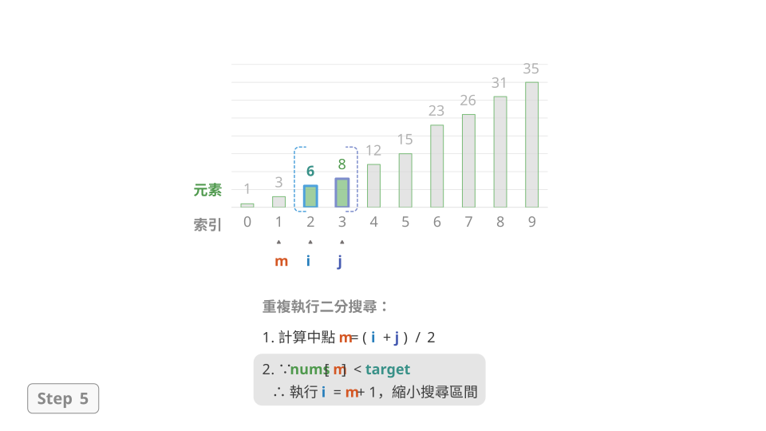
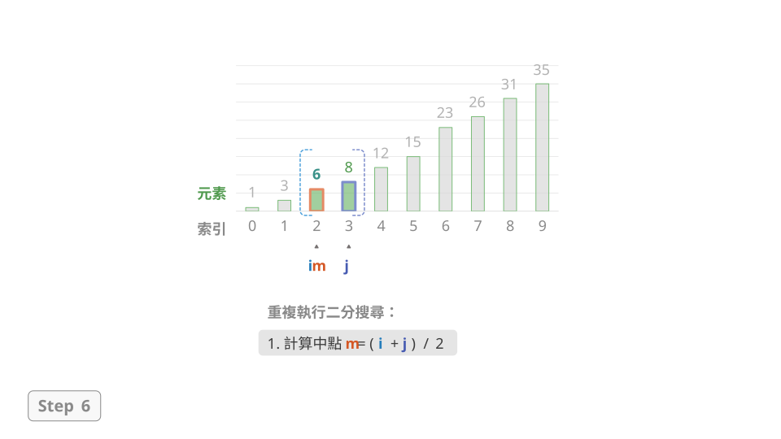
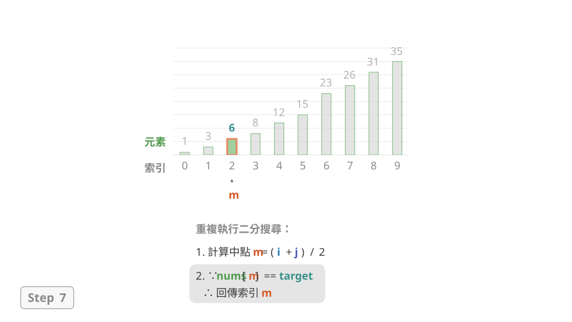

# 二分搜尋

<u>二分搜尋（binary search）</u>是一種採用分治策略的高效率搜尋演算法。它利用資料已排序的特性，每一輪將搜尋範圍縮小一半，直到找到目標元素或搜尋區間為空為止。

!!! question

    給定長度為 $n$ 的陣列 `nums`，其中的元素由小到大排列，且互不重複。請找出元素 `target` 在陣列中的索引並回傳。若陣列不含該元素，則回傳 $-1$。下圖是一個範例。


如下圖所示，先設定兩個指標 $i = 0$ 和 $j = n - 1$，分別指向陣列的首、末元素，界定搜尋區間 $[0, n - 1]$。中括號表示閉區間，也就是兩個端點都包含在區間內。

接著反覆執行以下兩個步驟。

1. 計算中點索引 $m = \lfloor {(i + j) / 2} \rfloor$，其中 $\lfloor \: \rfloor$ 表示向下取整。
2. 比較 `nums[m]` 和 `target`，依兩者的大小關係分成以下三種情況。
    1. 若 `nums[m] < target`，則 `target` 只可能在區間 $[m + 1, j]$ 內，因此令 $i = m + 1$。
    2. 若 `nums[m] > target`，則 `target` 只可能在區間 $[i, m - 1]$ 內，因此令 $j = m - 1$。
    3. 若 `nums[m] = target`，表示已找到 `target`，因此回傳索引 $m$。

若陣列不含目標元素，搜尋區間最後會縮小為空區間，此時回傳 $-1$。

=== "<1>"
    

=== "<2>"
    

=== "<3>"
    

=== "<4>"
    

=== "<5>"
    

=== "<6>"
    

=== "<7>"
    

由於 $i$ 和 $j$ 都是 `int` 型別，**兩者的和 $i + j$ 可能超出 `int` 型別能表示的範圍**。為了避免整數溢位，通常會用公式 $m = \lfloor {i + (j - i) / 2} \rfloor$ 計算中點。

程式碼如下：

```src
[file]{binary_search}-[class]{}-[func]{binary_search}
```

**時間複雜度為 $O(\log n)$**：在二分搜尋的迴圈中，每一輪都將區間縮小一半，因此迴圈執行次數為 $\log_2 n$。

**空間複雜度為 $O(1)$**：指標 $i$ 和 $j$ 只占用固定大小的空間。

## 區間的表示方式

除了前述的閉區間，另一種常見的表示方式是「左閉右開」區間，記為 $[0, n)$，包含左端點，但不含右端點。採用這種表示方式時，區間 $[i, j)$ 在 $i = j$ 時為空。

採用這種區間表示法，也能實作出功能相同的二分搜尋演算法：

```src
[file]{binary_search}-[class]{}-[func]{binary_search_lcro}
```

如下圖所示，二分搜尋採用不同的區間表示方式時，指標初值、迴圈條件和縮小區間的方式都不同。

閉區間包含左右兩個端點，因此透過指標 $i$ 和 $j$ 從兩側縮小區間的操作是對稱的。這種寫法比較不容易出錯，**因此一般建議採用閉區間的寫法**。


## 優點與限制

二分搜尋在時間和空間兩方面都有良好的表現。

- 二分搜尋的時間效率高。資料量大時，對數級的時間複雜度有明顯優勢。例如，當資料量為 $n = 2^{20}$ 時，循序搜尋需要執行 $2^{20} = 1048576$ 輪迴圈，二分搜尋只需執行 $\log_2 2^{20} = 20$ 輪。
- 二分搜尋不需要額外空間。相較於雜湊搜尋等需要額外空間的演算法，二分搜尋更節省空間。

不過，二分搜尋也有適用上的限制，主要原因如下。

- 二分搜尋只適用於已排序的資料。若輸入資料尚未排序，特地為二分搜尋做排序並不划算，因為排序演算法的時間複雜度通常為 $O(n \log n)$，比循序搜尋和二分搜尋都高。若經常插入元素，每次都得把元素插在特定位置才能維持陣列順序，時間複雜度為 $O(n)$，成本也很高。
- 二分搜尋只適用於陣列。二分搜尋需要跳到不相鄰的位置存取元素，而在鏈結串列中進行這種存取的效率較低，因此不適用於鏈結串列或以鏈結串列實作的資料結構。
- 資料量小時，循序搜尋的效能更好。循序搜尋每一輪只需做 1 次判斷，二分搜尋則需要做 1 次加法、1 次除法、1 至 3 次判斷，以及 1 次加法或減法，共 4 至 6 個基本操作。因此，當資料量 $n$ 較小時，循序搜尋反而比較快。
