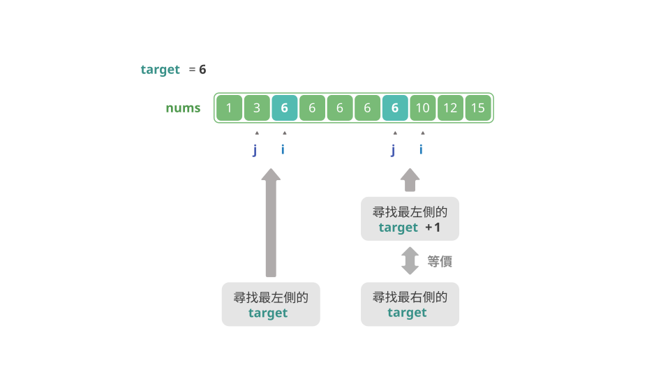

# 10.3 &nbsp; 用二分搜尋找邊界

## 10.3.1 &nbsp; 搜尋左界

!!! question

    給定長度為 $n$ 的排序陣列 `nums`，其中可能含有重複元素。請回傳陣列中最左邊的 `target` 的索引。若陣列不含該元素，則回傳 $-1$。

回想用二分搜尋找插入點的做法：搜尋結束後，$i$ 指向最左邊的 `target`。**因此，搜尋插入點其實就是在找最左邊的 `target` 的索引**。

可以利用搜尋插入點的函式來找左界。請留意，陣列中可能沒有 `target`，此時會出現下列兩種結果之一。

- 插入點的索引 $i$ 超出陣列範圍。
- 元素 `nums[i]` 不等於 `target`。

只要遇到上述任一種情況，直接回傳 $-1$ 即可。程式碼如下：

=== "Python"

    ```python title="binary_search_edge.py"
    def binary_search_left_edge(nums: list[int], target: int) -> int:
        """用二分搜尋找最左邊的 target"""
        # 等同於搜尋 target 的插入點
        i = binary_search_insertion(nums, target)
        # 找不到 target，回傳 -1
        if i == len(nums) or nums[i] != target:
            return -1
        # 找到 target，回傳索引 i
        return i
    ```

=== "C++"

    ```cpp title="binary_search_edge.cpp"
    /* 用二分搜尋找最左邊的 target */
    int binarySearchLeftEdge(vector<int> &nums, int target) {
        // 等同於搜尋 target 的插入點
        int i = binarySearchInsertion(nums, target);
        // 找不到 target，回傳 -1
        if (i == nums.size() || nums[i] != target) {
            return -1;
        }
        // 找到 target，回傳索引 i
        return i;
    }
    ```

=== "Java"

    ```java title="binary_search_edge.java"
    /* 用二分搜尋找最左邊的 target */
    int binarySearchLeftEdge(int[] nums, int target) {
        // 等同於搜尋 target 的插入點
        int i = binary_search_insertion.binarySearchInsertion(nums, target);
        // 找不到 target，回傳 -1
        if (i == nums.length || nums[i] != target) {
            return -1;
        }
        // 找到 target，回傳索引 i
        return i;
    }
    ```

=== "C#"

    ```csharp title="binary_search_edge.cs"
    /* 用二分搜尋找最左邊的 target */
    int BinarySearchLeftEdge(int[] nums, int target) {
        // 等同於搜尋 target 的插入點
        int i = binary_search_insertion.BinarySearchInsertion(nums, target);
        // 找不到 target，回傳 -1
        if (i == nums.Length || nums[i] != target) {
            return -1;
        }
        // 找到 target，回傳索引 i
        return i;
    }
    ```

=== "Go"

    ```go title="binary_search_edge.go"
    /* 用二分搜尋找最左邊的 target */
    func binarySearchLeftEdge(nums []int, target int) int {
        // 等同於搜尋 target 的插入點
        i := binarySearchInsertion(nums, target)
        // 找不到 target，回傳 -1
        if i == len(nums) || nums[i] != target {
            return -1
        }
        // 找到 target，回傳索引 i
        return i
    }
    ```

=== "Swift"

    ```swift title="binary_search_edge.swift"
    /* 用二分搜尋找最左邊的 target */
    func binarySearchLeftEdge(nums: [Int], target: Int) -> Int {
        // 等同於搜尋 target 的插入點
        let i = binarySearchInsertion(nums: nums, target: target)
        // 找不到 target，回傳 -1
        if i == nums.endIndex || nums[i] != target {
            return -1
        }
        // 找到 target，回傳索引 i
        return i
    }
    ```

=== "JS"

    ```javascript title="binary_search_edge.js"
    /* 用二分搜尋找最左邊的 target */
    function binarySearchLeftEdge(nums, target) {
        // 等同於搜尋 target 的插入點
        const i = binarySearchInsertion(nums, target);
        // 找不到 target，回傳 -1
        if (i === nums.length || nums[i] !== target) {
            return -1;
        }
        // 找到 target，回傳索引 i
        return i;
    }
    ```

=== "TS"

    ```typescript title="binary_search_edge.ts"
    /* 用二分搜尋找最左邊的 target */
    function binarySearchLeftEdge(nums: Array<number>, target: number): number {
        // 等同於搜尋 target 的插入點
        const i = binarySearchInsertion(nums, target);
        // 找不到 target，回傳 -1
        if (i === nums.length || nums[i] !== target) {
            return -1;
        }
        // 找到 target，回傳索引 i
        return i;
    }
    ```

=== "Dart"

    ```dart title="binary_search_edge.dart"
    /* 用二分搜尋找最左邊的 target */
    int binarySearchLeftEdge(List<int> nums, int target) {
      // 等同於搜尋 target 的插入點
      int i = binarySearchInsertion(nums, target);
      // 找不到 target，回傳 -1
      if (i == nums.length || nums[i] != target) {
        return -1;
      }
      // 找到 target，回傳索引 i
      return i;
    }
    ```

=== "Rust"

    ```rust title="binary_search_edge.rs"
    /* 用二分搜尋找最左邊的 target */
    fn binary_search_left_edge(nums: &[i32], target: i32) -> i32 {
        // 等同於搜尋 target 的插入點
        let i = binary_search_insertion(nums, target);
        // 找不到 target，回傳 -1
        if i == nums.len() as i32 || nums[i as usize] != target {
            return -1;
        }
        // 找到 target，回傳索引 i
        i
    }
    ```

=== "C"

    ```c title="binary_search_edge.c"
    /* 用二分搜尋找最左邊的 target */
    int binarySearchLeftEdge(int *nums, int numSize, int target) {
        // 等同於搜尋 target 的插入點
        int i = binarySearchInsertion(nums, numSize, target);
        // 找不到 target，回傳 -1
        if (i == numSize || nums[i] != target) {
            return -1;
        }
        // 找到 target，回傳索引 i
        return i;
    }
    ```

=== "Kotlin"

    ```kotlin title="binary_search_edge.kt"
    /* 用二分搜尋找最左邊的 target */
    fun binarySearchLeftEdge(nums: IntArray, target: Int): Int {
        // 等同於搜尋 target 的插入點
        val i = binarySearchInsertion(nums, target)
        // 找不到 target，回傳 -1
        if (i == nums.size || nums[i] != target) {
            return -1
        }
        // 找到 target，回傳索引 i
        return i
    }
    ```

=== "Ruby"

    ```ruby title="binary_search_edge.rb"
    ### 用二分搜尋找最左邊的 target ###
    def binary_search_left_edge(nums, target)
      # 等同於搜尋 target 的插入點
      i = binary_search_insertion(nums, target)

      # 找不到 target，回傳 -1
      return -1 if i == nums.length || nums[i] != target

      i # 找到 target，回傳索引 i
    end
    ```

??? pythontutor "執行視覺化示範"

    <div style="height: 549px; width: 100%;"><iframe class="pythontutor-iframe" title="執行視覺化示範" src="https://pythontutor.com/iframe-embed.html#code=def%20binary_search_insertion%28nums%3A%20list%5Bint%5D,%20target%3A%20int%29%20-%3E%20int%3A%0A%20%20%20%20%22%22%22%E7%94%A8%E4%BA%8C%E5%88%86%E6%90%9C%E5%B0%8B%E6%89%BE%E6%8F%92%E5%85%A5%E9%BB%9E%EF%BC%88%E6%9C%89%E9%87%8D%E8%A4%87%E5%85%83%E7%B4%A0%EF%BC%89%22%22%22%0A%20%20%20%20i,%20j%20%3D%200,%20len%28nums%29%20-%201%20%20%23%20%E5%B0%87%E9%96%89%E5%8D%80%E9%96%93%E8%A8%AD%E7%82%BA%20%5B0,%20n-1%5D%0A%20%20%20%20while%20i%20%3C%3D%20j%3A%0A%20%20%20%20%20%20%20%20m%20%3D%20%28i%20%2B%20j%29%20//%202%20%20%23%20%E8%A8%88%E7%AE%97%E4%B8%AD%E9%BB%9E%E7%B4%A2%E5%BC%95%20m%0A%20%20%20%20%20%20%20%20if%20nums%5Bm%5D%20%3C%20target%3A%0A%20%20%20%20%20%20%20%20%20%20%20%20i%20%3D%20m%20%2B%201%20%20%23%20target%20%E8%8B%A5%E5%AD%98%E5%9C%A8%EF%BC%8C%E5%BF%85%E5%9C%A8%E5%8D%80%E9%96%93%20%5Bm%2B1,%20j%5D%20%E5%85%A7%0A%20%20%20%20%20%20%20%20elif%20nums%5Bm%5D%20%3E%20target%3A%0A%20%20%20%20%20%20%20%20%20%20%20%20j%20%3D%20m%20-%201%20%20%23%20target%20%E8%8B%A5%E5%AD%98%E5%9C%A8%EF%BC%8C%E5%BF%85%E5%9C%A8%E5%8D%80%E9%96%93%20%5Bi,%20m-1%5D%20%E5%85%A7%0A%20%20%20%20%20%20%20%20else%3A%0A%20%20%20%20%20%20%20%20%20%20%20%20j%20%3D%20m%20-%201%20%20%23%20%E7%AC%AC%E4%B8%80%E5%80%8B%E5%B0%8F%E6%96%BC%20target%20%E7%9A%84%E5%85%83%E7%B4%A0%E4%BD%8D%E6%96%BC%E5%8D%80%E9%96%93%20%5Bi,%20m-1%5D%20%E5%85%A7%0A%20%20%20%20%23%20%E5%9B%9E%E5%82%B3%E6%8F%92%E5%85%A5%E9%BB%9E%20i%0A%20%20%20%20return%20i%0A%0Adef%20binary_search_left_edge%28nums%3A%20list%5Bint%5D,%20target%3A%20int%29%20-%3E%20int%3A%0A%20%20%20%20%22%22%22%E7%94%A8%E4%BA%8C%E5%88%86%E6%90%9C%E5%B0%8B%E6%89%BE%E6%9C%80%E5%B7%A6%E9%82%8A%E7%9A%84%20target%22%22%22%0A%20%20%20%20%23%20%E7%AD%89%E5%90%8C%E6%96%BC%E6%90%9C%E5%B0%8B%20target%20%E7%9A%84%E6%8F%92%E5%85%A5%E9%BB%9E%0A%20%20%20%20i%20%3D%20binary_search_insertion%28nums,%20target%29%0A%20%20%20%20%23%20%E6%89%BE%E4%B8%8D%E5%88%B0%20target%EF%BC%8C%E5%9B%9E%E5%82%B3%20-1%0A%20%20%20%20if%20i%20%3D%3D%20len%28nums%29%20or%20nums%5Bi%5D%20%21%3D%20target%3A%0A%20%20%20%20%20%20%20%20return%20-1%0A%20%20%20%20%23%20%E6%89%BE%E5%88%B0%20target%EF%BC%8C%E5%9B%9E%E5%82%B3%E7%B4%A2%E5%BC%95%20i%0A%20%20%20%20return%20i%0A%0A%22%22%22Driver%20Code%22%22%22%0Aif%20__name__%20%3D%3D%20%22__main__%22%3A%0A%20%20%20%20%23%20%E5%90%AB%E6%9C%89%E9%87%8D%E8%A4%87%E5%85%83%E7%B4%A0%E7%9A%84%E9%99%A3%E5%88%97%0A%20%20%20%20nums%20%3D%20%5B1,%203,%206,%206,%206,%206,%206,%2010,%2012,%2015%5D%0A%20%20%20%20%23%20%E7%94%A8%E4%BA%8C%E5%88%86%E6%90%9C%E5%B0%8B%E6%89%BE%E5%B7%A6%E7%95%8C%E5%92%8C%E5%8F%B3%E7%95%8C%0A%20%20%20%20target%20%3D%206%0A%20%20%20%20index%20%3D%20binary_search_left_edge%28nums,%20target%29%0A%20%20%20%20print%28f%22%E6%9C%80%E5%B7%A6%E9%82%8A%E7%9A%84%E5%85%83%E7%B4%A0%20%7Btarget%7D%20%E7%9A%84%E7%B4%A2%E5%BC%95%E7%82%BA%20%7Bindex%7D%22%29&codeDivHeight=472&codeDivWidth=350&cumulative=false&curInstr=6&heapPrimitives=nevernest&origin=opt-frontend.js&py=311&rawInputLstJSON=%5B%5D&textReferences=false"> </iframe></div>
    <div style="margin-top: 5px;"><a href="https://pythontutor.com/iframe-embed.html#code=def%20binary_search_insertion%28nums%3A%20list%5Bint%5D,%20target%3A%20int%29%20-%3E%20int%3A%0A%20%20%20%20%22%22%22%E7%94%A8%E4%BA%8C%E5%88%86%E6%90%9C%E5%B0%8B%E6%89%BE%E6%8F%92%E5%85%A5%E9%BB%9E%EF%BC%88%E6%9C%89%E9%87%8D%E8%A4%87%E5%85%83%E7%B4%A0%EF%BC%89%22%22%22%0A%20%20%20%20i,%20j%20%3D%200,%20len%28nums%29%20-%201%20%20%23%20%E5%B0%87%E9%96%89%E5%8D%80%E9%96%93%E8%A8%AD%E7%82%BA%20%5B0,%20n-1%5D%0A%20%20%20%20while%20i%20%3C%3D%20j%3A%0A%20%20%20%20%20%20%20%20m%20%3D%20%28i%20%2B%20j%29%20//%202%20%20%23%20%E8%A8%88%E7%AE%97%E4%B8%AD%E9%BB%9E%E7%B4%A2%E5%BC%95%20m%0A%20%20%20%20%20%20%20%20if%20nums%5Bm%5D%20%3C%20target%3A%0A%20%20%20%20%20%20%20%20%20%20%20%20i%20%3D%20m%20%2B%201%20%20%23%20target%20%E8%8B%A5%E5%AD%98%E5%9C%A8%EF%BC%8C%E5%BF%85%E5%9C%A8%E5%8D%80%E9%96%93%20%5Bm%2B1,%20j%5D%20%E5%85%A7%0A%20%20%20%20%20%20%20%20elif%20nums%5Bm%5D%20%3E%20target%3A%0A%20%20%20%20%20%20%20%20%20%20%20%20j%20%3D%20m%20-%201%20%20%23%20target%20%E8%8B%A5%E5%AD%98%E5%9C%A8%EF%BC%8C%E5%BF%85%E5%9C%A8%E5%8D%80%E9%96%93%20%5Bi,%20m-1%5D%20%E5%85%A7%0A%20%20%20%20%20%20%20%20else%3A%0A%20%20%20%20%20%20%20%20%20%20%20%20j%20%3D%20m%20-%201%20%20%23%20%E7%AC%AC%E4%B8%80%E5%80%8B%E5%B0%8F%E6%96%BC%20target%20%E7%9A%84%E5%85%83%E7%B4%A0%E4%BD%8D%E6%96%BC%E5%8D%80%E9%96%93%20%5Bi,%20m-1%5D%20%E5%85%A7%0A%20%20%20%20%23%20%E5%9B%9E%E5%82%B3%E6%8F%92%E5%85%A5%E9%BB%9E%20i%0A%20%20%20%20return%20i%0A%0Adef%20binary_search_left_edge%28nums%3A%20list%5Bint%5D,%20target%3A%20int%29%20-%3E%20int%3A%0A%20%20%20%20%22%22%22%E7%94%A8%E4%BA%8C%E5%88%86%E6%90%9C%E5%B0%8B%E6%89%BE%E6%9C%80%E5%B7%A6%E9%82%8A%E7%9A%84%20target%22%22%22%0A%20%20%20%20%23%20%E7%AD%89%E5%90%8C%E6%96%BC%E6%90%9C%E5%B0%8B%20target%20%E7%9A%84%E6%8F%92%E5%85%A5%E9%BB%9E%0A%20%20%20%20i%20%3D%20binary_search_insertion%28nums,%20target%29%0A%20%20%20%20%23%20%E6%89%BE%E4%B8%8D%E5%88%B0%20target%EF%BC%8C%E5%9B%9E%E5%82%B3%20-1%0A%20%20%20%20if%20i%20%3D%3D%20len%28nums%29%20or%20nums%5Bi%5D%20%21%3D%20target%3A%0A%20%20%20%20%20%20%20%20return%20-1%0A%20%20%20%20%23%20%E6%89%BE%E5%88%B0%20target%EF%BC%8C%E5%9B%9E%E5%82%B3%E7%B4%A2%E5%BC%95%20i%0A%20%20%20%20return%20i%0A%0A%22%22%22Driver%20Code%22%22%22%0Aif%20__name__%20%3D%3D%20%22__main__%22%3A%0A%20%20%20%20%23%20%E5%90%AB%E6%9C%89%E9%87%8D%E8%A4%87%E5%85%83%E7%B4%A0%E7%9A%84%E9%99%A3%E5%88%97%0A%20%20%20%20nums%20%3D%20%5B1,%203,%206,%206,%206,%206,%206,%2010,%2012,%2015%5D%0A%20%20%20%20%23%20%E7%94%A8%E4%BA%8C%E5%88%86%E6%90%9C%E5%B0%8B%E6%89%BE%E5%B7%A6%E7%95%8C%E5%92%8C%E5%8F%B3%E7%95%8C%0A%20%20%20%20target%20%3D%206%0A%20%20%20%20index%20%3D%20binary_search_left_edge%28nums,%20target%29%0A%20%20%20%20print%28f%22%E6%9C%80%E5%B7%A6%E9%82%8A%E7%9A%84%E5%85%83%E7%B4%A0%20%7Btarget%7D%20%E7%9A%84%E7%B4%A2%E5%BC%95%E7%82%BA%20%7Bindex%7D%22%29&codeDivHeight=800&codeDivWidth=600&cumulative=false&curInstr=6&heapPrimitives=nevernest&origin=opt-frontend.js&py=311&rawInputLstJSON=%5B%5D&textReferences=false" target="_blank" rel="noopener noreferrer">全螢幕觀看 ></a></div>

## 10.3.2 &nbsp; 搜尋右界

要如何找出最右邊的 `target` 呢？最直接的做法是修改程式碼，改變 `nums[m] == target` 時移動指標、縮小區間的方式。此處省略程式碼，有興趣的讀者可以自行實作。

以下介紹兩種更巧妙的做法。

### 1. &nbsp; 沿用搜尋左界的做法

也可以利用搜尋最左元素的函式來找最右元素。做法是**把搜尋最右邊的 `target` 改為搜尋最左邊的 `target + 1` 的插入位置**。

如圖 10-7 所示，搜尋結束後，指標 $i$ 指向最左邊的 `target + 1`（若該元素存在），而 $j$ 指向最右邊的 `target`，**因此回傳 $j$ 即可**。

{ class="animation-figure" }

<p align="center"> 圖 10-7 &nbsp; 將搜尋右界轉為搜尋左界 </p>

請留意，函式回傳的插入點是 $i$，因此需要減去 $1$，才能得到 $j$：

=== "Python"

    ```python title="binary_search_edge.py"
    def binary_search_right_edge(nums: list[int], target: int) -> int:
        """用二分搜尋找最右邊的 target"""
        # 改為搜尋 target + 1 的最左插入位置
        i = binary_search_insertion(nums, target + 1)
        # j 指向最右邊的 target，i 指向第一個大於 target 的元素
        j = i - 1
        # 找不到 target，回傳 -1
        if j == -1 or nums[j] != target:
            return -1
        # 找到 target，回傳索引 j
        return j
    ```

=== "C++"

    ```cpp title="binary_search_edge.cpp"
    /* 用二分搜尋找最右邊的 target */
    int binarySearchRightEdge(vector<int> &nums, int target) {
        // 改為搜尋 target + 1 的最左插入位置
        int i = binarySearchInsertion(nums, target + 1);
        // j 指向最右邊的 target，i 指向第一個大於 target 的元素
        int j = i - 1;
        // 找不到 target，回傳 -1
        if (j == -1 || nums[j] != target) {
            return -1;
        }
        // 找到 target，回傳索引 j
        return j;
    }
    ```

=== "Java"

    ```java title="binary_search_edge.java"
    /* 用二分搜尋找最右邊的 target */
    int binarySearchRightEdge(int[] nums, int target) {
        // 改為搜尋 target + 1 的最左插入位置
        int i = binary_search_insertion.binarySearchInsertion(nums, target + 1);
        // j 指向最右邊的 target，i 指向第一個大於 target 的元素
        int j = i - 1;
        // 找不到 target，回傳 -1
        if (j == -1 || nums[j] != target) {
            return -1;
        }
        // 找到 target，回傳索引 j
        return j;
    }
    ```

=== "C#"

    ```csharp title="binary_search_edge.cs"
    /* 用二分搜尋找最右邊的 target */
    int BinarySearchRightEdge(int[] nums, int target) {
        // 改為搜尋 target + 1 的最左插入位置
        int i = binary_search_insertion.BinarySearchInsertion(nums, target + 1);
        // j 指向最右邊的 target，i 指向第一個大於 target 的元素
        int j = i - 1;
        // 找不到 target，回傳 -1
        if (j == -1 || nums[j] != target) {
            return -1;
        }
        // 找到 target，回傳索引 j
        return j;
    }
    ```

=== "Go"

    ```go title="binary_search_edge.go"
    /* 用二分搜尋找最右邊的 target */
    func binarySearchRightEdge(nums []int, target int) int {
        // 改為搜尋 target + 1 的最左插入位置
        i := binarySearchInsertion(nums, target+1)
        // j 指向最右邊的 target，i 指向第一個大於 target 的元素
        j := i - 1
        // 找不到 target，回傳 -1
        if j == -1 || nums[j] != target {
            return -1
        }
        // 找到 target，回傳索引 j
        return j
    }
    ```

=== "Swift"

    ```swift title="binary_search_edge.swift"
    /* 用二分搜尋找最右邊的 target */
    func binarySearchRightEdge(nums: [Int], target: Int) -> Int {
        // 改為搜尋 target + 1 的最左插入位置
        let i = binarySearchInsertion(nums: nums, target: target + 1)
        // j 指向最右邊的 target，i 指向第一個大於 target 的元素
        let j = i - 1
        // 找不到 target，回傳 -1
        if j == -1 || nums[j] != target {
            return -1
        }
        // 找到 target，回傳索引 j
        return j
    }
    ```

=== "JS"

    ```javascript title="binary_search_edge.js"
    /* 用二分搜尋找最右邊的 target */
    function binarySearchRightEdge(nums, target) {
        // 改為搜尋 target + 1 的最左插入位置
        const i = binarySearchInsertion(nums, target + 1);
        // j 指向最右邊的 target，i 指向第一個大於 target 的元素
        const j = i - 1;
        // 找不到 target，回傳 -1
        if (j === -1 || nums[j] !== target) {
            return -1;
        }
        // 找到 target，回傳索引 j
        return j;
    }
    ```

=== "TS"

    ```typescript title="binary_search_edge.ts"
    /* 用二分搜尋找最右邊的 target */
    function binarySearchRightEdge(nums: Array<number>, target: number): number {
        // 改為搜尋 target + 1 的最左插入位置
        const i = binarySearchInsertion(nums, target + 1);
        // j 指向最右邊的 target，i 指向第一個大於 target 的元素
        const j = i - 1;
        // 找不到 target，回傳 -1
        if (j === -1 || nums[j] !== target) {
            return -1;
        }
        // 找到 target，回傳索引 j
        return j;
    }
    ```

=== "Dart"

    ```dart title="binary_search_edge.dart"
    /* 用二分搜尋找最右邊的 target */
    int binarySearchRightEdge(List<int> nums, int target) {
      // 改為搜尋 target + 1 的最左插入位置
      int i = binarySearchInsertion(nums, target + 1);
      // j 指向最右邊的 target，i 指向第一個大於 target 的元素
      int j = i - 1;
      // 找不到 target，回傳 -1
      if (j == -1 || nums[j] != target) {
        return -1;
      }
      // 找到 target，回傳索引 j
      return j;
    }
    ```

=== "Rust"

    ```rust title="binary_search_edge.rs"
    /* 用二分搜尋找最右邊的 target */
    fn binary_search_right_edge(nums: &[i32], target: i32) -> i32 {
        // 改為搜尋 target + 1 的最左插入位置
        let i = binary_search_insertion(nums, target + 1);
        // j 指向最右邊的 target，i 指向第一個大於 target 的元素
        let j = i - 1;
        // 找不到 target，回傳 -1
        if j == -1 || nums[j as usize] != target {
            return -1;
        }
        // 找到 target，回傳索引 j
        j
    }
    ```

=== "C"

    ```c title="binary_search_edge.c"
    /* 用二分搜尋找最右邊的 target */
    int binarySearchRightEdge(int *nums, int numSize, int target) {
        // 改為搜尋 target + 1 的最左插入位置
        int i = binarySearchInsertion(nums, numSize, target + 1);
        // j 指向最右邊的 target，i 指向第一個大於 target 的元素
        int j = i - 1;
        // 找不到 target，回傳 -1
        if (j == -1 || nums[j] != target) {
            return -1;
        }
        // 找到 target，回傳索引 j
        return j;
    }
    ```

=== "Kotlin"

    ```kotlin title="binary_search_edge.kt"
    /* 用二分搜尋找最右邊的 target */
    fun binarySearchRightEdge(nums: IntArray, target: Int): Int {
        // 改為搜尋 target + 1 的最左插入位置
        val i = binarySearchInsertion(nums, target + 1)
        // j 指向最右邊的 target，i 指向第一個大於 target 的元素
        val j = i - 1
        // 找不到 target，回傳 -1
        if (j == -1 || nums[j] != target) {
            return -1
        }
        // 找到 target，回傳索引 j
        return j
    }
    ```

=== "Ruby"

    ```ruby title="binary_search_edge.rb"
    ### 用二分搜尋找最右邊的 target ###
    def binary_search_right_edge(nums, target)
      # 改為搜尋 target + 1 的最左插入位置
      i = binary_search_insertion(nums, target + 1)

      # j 指向最右邊的 target，i 指向第一個大於 target 的元素
      j = i - 1

      # 找不到 target，回傳 -1
      return -1 if j == -1 || nums[j] != target

      j # 找到 target，回傳索引 j
    end
    ```

??? pythontutor "執行視覺化示範"

    <div style="height: 549px; width: 100%;"><iframe class="pythontutor-iframe" title="執行視覺化示範" src="https://pythontutor.com/iframe-embed.html#code=def%20binary_search_insertion%28nums%3A%20list%5Bint%5D,%20target%3A%20int%29%20-%3E%20int%3A%0A%20%20%20%20%22%22%22%E7%94%A8%E4%BA%8C%E5%88%86%E6%90%9C%E5%B0%8B%E6%89%BE%E6%8F%92%E5%85%A5%E9%BB%9E%EF%BC%88%E6%9C%89%E9%87%8D%E8%A4%87%E5%85%83%E7%B4%A0%EF%BC%89%22%22%22%0A%20%20%20%20i,%20j%20%3D%200,%20len%28nums%29%20-%201%20%20%23%20%E5%B0%87%E9%96%89%E5%8D%80%E9%96%93%E8%A8%AD%E7%82%BA%20%5B0,%20n-1%5D%0A%20%20%20%20while%20i%20%3C%3D%20j%3A%0A%20%20%20%20%20%20%20%20m%20%3D%20%28i%20%2B%20j%29%20//%202%20%20%23%20%E8%A8%88%E7%AE%97%E4%B8%AD%E9%BB%9E%E7%B4%A2%E5%BC%95%20m%0A%20%20%20%20%20%20%20%20if%20nums%5Bm%5D%20%3C%20target%3A%0A%20%20%20%20%20%20%20%20%20%20%20%20i%20%3D%20m%20%2B%201%20%20%23%20target%20%E8%8B%A5%E5%AD%98%E5%9C%A8%EF%BC%8C%E5%BF%85%E5%9C%A8%E5%8D%80%E9%96%93%20%5Bm%2B1,%20j%5D%20%E5%85%A7%0A%20%20%20%20%20%20%20%20elif%20nums%5Bm%5D%20%3E%20target%3A%0A%20%20%20%20%20%20%20%20%20%20%20%20j%20%3D%20m%20-%201%20%20%23%20target%20%E8%8B%A5%E5%AD%98%E5%9C%A8%EF%BC%8C%E5%BF%85%E5%9C%A8%E5%8D%80%E9%96%93%20%5Bi,%20m-1%5D%20%E5%85%A7%0A%20%20%20%20%20%20%20%20else%3A%0A%20%20%20%20%20%20%20%20%20%20%20%20j%20%3D%20m%20-%201%20%20%23%20%E7%AC%AC%E4%B8%80%E5%80%8B%E5%B0%8F%E6%96%BC%20target%20%E7%9A%84%E5%85%83%E7%B4%A0%E4%BD%8D%E6%96%BC%E5%8D%80%E9%96%93%20%5Bi,%20m-1%5D%20%E5%85%A7%0A%20%20%20%20%23%20%E5%9B%9E%E5%82%B3%E6%8F%92%E5%85%A5%E9%BB%9E%20i%0A%20%20%20%20return%20i%0A%0Adef%20binary_search_right_edge%28nums%3A%20list%5Bint%5D,%20target%3A%20int%29%20-%3E%20int%3A%0A%20%20%20%20%22%22%22%E7%94%A8%E4%BA%8C%E5%88%86%E6%90%9C%E5%B0%8B%E6%89%BE%E6%9C%80%E5%8F%B3%E9%82%8A%E7%9A%84%20target%22%22%22%0A%20%20%20%20%23%20%E6%94%B9%E7%82%BA%E6%90%9C%E5%B0%8B%20target%20%2B%201%20%E7%9A%84%E6%9C%80%E5%B7%A6%E6%8F%92%E5%85%A5%E4%BD%8D%E7%BD%AE%0A%20%20%20%20i%20%3D%20binary_search_insertion%28nums,%20target%20%2B%201%29%0A%20%20%20%20%23%20j%20%E6%8C%87%E5%90%91%E6%9C%80%E5%8F%B3%E9%82%8A%E7%9A%84%20target%EF%BC%8Ci%20%E6%8C%87%E5%90%91%E7%AC%AC%E4%B8%80%E5%80%8B%E5%A4%A7%E6%96%BC%20target%20%E7%9A%84%E5%85%83%E7%B4%A0%0A%20%20%20%20j%20%3D%20i%20-%201%0A%20%20%20%20%23%20%E6%89%BE%E4%B8%8D%E5%88%B0%20target%EF%BC%8C%E5%9B%9E%E5%82%B3%20-1%0A%20%20%20%20if%20j%20%3D%3D%20-1%20or%20nums%5Bj%5D%20%21%3D%20target%3A%0A%20%20%20%20%20%20%20%20return%20-1%0A%20%20%20%20%23%20%E6%89%BE%E5%88%B0%20target%EF%BC%8C%E5%9B%9E%E5%82%B3%E7%B4%A2%E5%BC%95%20j%0A%20%20%20%20return%20j%0A%0A%22%22%22Driver%20Code%22%22%22%0Aif%20__name__%20%3D%3D%20%22__main__%22%3A%0A%20%20%20%20%23%20%E5%90%AB%E6%9C%89%E9%87%8D%E8%A4%87%E5%85%83%E7%B4%A0%E7%9A%84%E9%99%A3%E5%88%97%0A%20%20%20%20nums%20%3D%20%5B1,%203,%206,%206,%206,%206,%206,%2010,%2012,%2015%5D%0A%20%20%20%20%23%20%E7%94%A8%E4%BA%8C%E5%88%86%E6%90%9C%E5%B0%8B%E6%89%BE%E5%B7%A6%E7%95%8C%E5%92%8C%E5%8F%B3%E7%95%8C%0A%20%20%20%20target%20%3D%206%0A%20%20%20%20index%20%3D%20binary_search_right_edge%28nums,%20target%29%0A%20%20%20%20print%28f%22%E6%9C%80%E5%8F%B3%E9%82%8A%E7%9A%84%E5%85%83%E7%B4%A0%20%7Btarget%7D%20%E7%9A%84%E7%B4%A2%E5%BC%95%E7%82%BA%20%7Bindex%7D%22%29&codeDivHeight=472&codeDivWidth=350&cumulative=false&curInstr=6&heapPrimitives=nevernest&origin=opt-frontend.js&py=311&rawInputLstJSON=%5B%5D&textReferences=false"> </iframe></div>
    <div style="margin-top: 5px;"><a href="https://pythontutor.com/iframe-embed.html#code=def%20binary_search_insertion%28nums%3A%20list%5Bint%5D,%20target%3A%20int%29%20-%3E%20int%3A%0A%20%20%20%20%22%22%22%E7%94%A8%E4%BA%8C%E5%88%86%E6%90%9C%E5%B0%8B%E6%89%BE%E6%8F%92%E5%85%A5%E9%BB%9E%EF%BC%88%E6%9C%89%E9%87%8D%E8%A4%87%E5%85%83%E7%B4%A0%EF%BC%89%22%22%22%0A%20%20%20%20i,%20j%20%3D%200,%20len%28nums%29%20-%201%20%20%23%20%E5%B0%87%E9%96%89%E5%8D%80%E9%96%93%E8%A8%AD%E7%82%BA%20%5B0,%20n-1%5D%0A%20%20%20%20while%20i%20%3C%3D%20j%3A%0A%20%20%20%20%20%20%20%20m%20%3D%20%28i%20%2B%20j%29%20//%202%20%20%23%20%E8%A8%88%E7%AE%97%E4%B8%AD%E9%BB%9E%E7%B4%A2%E5%BC%95%20m%0A%20%20%20%20%20%20%20%20if%20nums%5Bm%5D%20%3C%20target%3A%0A%20%20%20%20%20%20%20%20%20%20%20%20i%20%3D%20m%20%2B%201%20%20%23%20target%20%E8%8B%A5%E5%AD%98%E5%9C%A8%EF%BC%8C%E5%BF%85%E5%9C%A8%E5%8D%80%E9%96%93%20%5Bm%2B1,%20j%5D%20%E5%85%A7%0A%20%20%20%20%20%20%20%20elif%20nums%5Bm%5D%20%3E%20target%3A%0A%20%20%20%20%20%20%20%20%20%20%20%20j%20%3D%20m%20-%201%20%20%23%20target%20%E8%8B%A5%E5%AD%98%E5%9C%A8%EF%BC%8C%E5%BF%85%E5%9C%A8%E5%8D%80%E9%96%93%20%5Bi,%20m-1%5D%20%E5%85%A7%0A%20%20%20%20%20%20%20%20else%3A%0A%20%20%20%20%20%20%20%20%20%20%20%20j%20%3D%20m%20-%201%20%20%23%20%E7%AC%AC%E4%B8%80%E5%80%8B%E5%B0%8F%E6%96%BC%20target%20%E7%9A%84%E5%85%83%E7%B4%A0%E4%BD%8D%E6%96%BC%E5%8D%80%E9%96%93%20%5Bi,%20m-1%5D%20%E5%85%A7%0A%20%20%20%20%23%20%E5%9B%9E%E5%82%B3%E6%8F%92%E5%85%A5%E9%BB%9E%20i%0A%20%20%20%20return%20i%0A%0Adef%20binary_search_right_edge%28nums%3A%20list%5Bint%5D,%20target%3A%20int%29%20-%3E%20int%3A%0A%20%20%20%20%22%22%22%E7%94%A8%E4%BA%8C%E5%88%86%E6%90%9C%E5%B0%8B%E6%89%BE%E6%9C%80%E5%8F%B3%E9%82%8A%E7%9A%84%20target%22%22%22%0A%20%20%20%20%23%20%E6%94%B9%E7%82%BA%E6%90%9C%E5%B0%8B%20target%20%2B%201%20%E7%9A%84%E6%9C%80%E5%B7%A6%E6%8F%92%E5%85%A5%E4%BD%8D%E7%BD%AE%0A%20%20%20%20i%20%3D%20binary_search_insertion%28nums,%20target%20%2B%201%29%0A%20%20%20%20%23%20j%20%E6%8C%87%E5%90%91%E6%9C%80%E5%8F%B3%E9%82%8A%E7%9A%84%20target%EF%BC%8Ci%20%E6%8C%87%E5%90%91%E7%AC%AC%E4%B8%80%E5%80%8B%E5%A4%A7%E6%96%BC%20target%20%E7%9A%84%E5%85%83%E7%B4%A0%0A%20%20%20%20j%20%3D%20i%20-%201%0A%20%20%20%20%23%20%E6%89%BE%E4%B8%8D%E5%88%B0%20target%EF%BC%8C%E5%9B%9E%E5%82%B3%20-1%0A%20%20%20%20if%20j%20%3D%3D%20-1%20or%20nums%5Bj%5D%20%21%3D%20target%3A%0A%20%20%20%20%20%20%20%20return%20-1%0A%20%20%20%20%23%20%E6%89%BE%E5%88%B0%20target%EF%BC%8C%E5%9B%9E%E5%82%B3%E7%B4%A2%E5%BC%95%20j%0A%20%20%20%20return%20j%0A%0A%22%22%22Driver%20Code%22%22%22%0Aif%20__name__%20%3D%3D%20%22__main__%22%3A%0A%20%20%20%20%23%20%E5%90%AB%E6%9C%89%E9%87%8D%E8%A4%87%E5%85%83%E7%B4%A0%E7%9A%84%E9%99%A3%E5%88%97%0A%20%20%20%20nums%20%3D%20%5B1,%203,%206,%206,%206,%206,%206,%2010,%2012,%2015%5D%0A%20%20%20%20%23%20%E7%94%A8%E4%BA%8C%E5%88%86%E6%90%9C%E5%B0%8B%E6%89%BE%E5%B7%A6%E7%95%8C%E5%92%8C%E5%8F%B3%E7%95%8C%0A%20%20%20%20target%20%3D%206%0A%20%20%20%20index%20%3D%20binary_search_right_edge%28nums,%20target%29%0A%20%20%20%20print%28f%22%E6%9C%80%E5%8F%B3%E9%82%8A%E7%9A%84%E5%85%83%E7%B4%A0%20%7Btarget%7D%20%E7%9A%84%E7%B4%A2%E5%BC%95%E7%82%BA%20%7Bindex%7D%22%29&codeDivHeight=800&codeDivWidth=600&cumulative=false&curInstr=6&heapPrimitives=nevernest&origin=opt-frontend.js&py=311&rawInputLstJSON=%5B%5D&textReferences=false" target="_blank" rel="noopener noreferrer">全螢幕觀看 ></a></div>

### 2. &nbsp; 改為搜尋元素

當陣列不含 `target` 時，搜尋結束後，$i$ 會指向第一個大於 `target` 的元素，$j$ 會指向最右邊小於 `target` 的元素。

因此，如圖 10-8 所示，可以選取一個不在陣列中的值作為搜尋目標，藉此找出左界或右界。

- 搜尋最左邊的 `target`：可以改為搜尋 `target - 0.5`，並回傳指標 $i$。
- 搜尋最右邊的 `target`：可以改為搜尋 `target + 0.5`，並回傳指標 $j$。

{ class="animation-figure" }

<p align="center"> 圖 10-8 &nbsp; 將搜尋邊界轉為搜尋元素 </p>

此處省略程式碼。實作時有兩點值得留意。

- 給定的陣列不含小數，因此不必處理元素等於搜尋目標的情況。
- 這個方法用到了小數，因此必須將函式中的變數 `target` 改為浮點數型別（Python 無須更動）。
