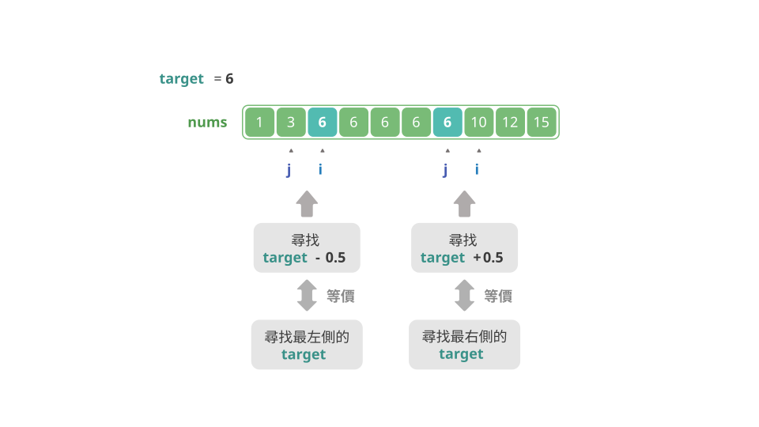

# 用二分搜尋找邊界

## 搜尋左界

!!! question

    給定長度為 $n$ 的排序陣列 `nums`，其中可能含有重複元素。請回傳陣列中最左邊的 `target` 的索引。若陣列不含該元素，則回傳 $-1$。

回想用二分搜尋找插入點的做法：搜尋結束後，$i$ 指向最左邊的 `target`。**因此，搜尋插入點其實就是在找最左邊的 `target` 的索引**。

可以利用搜尋插入點的函式來找左界。請留意，陣列中可能沒有 `target`，此時會出現下列兩種結果之一。

- 插入點的索引 $i$ 超出陣列範圍。
- 元素 `nums[i]` 不等於 `target`。

只要遇到上述任一種情況，直接回傳 $-1$ 即可。程式碼如下：

```src
[file]{binary_search_edge}-[class]{}-[func]{binary_search_left_edge}
```

## 搜尋右界

要如何找出最右邊的 `target` 呢？最直接的做法是修改程式碼，改變 `nums[m] == target` 時移動指標、縮小區間的方式。此處省略程式碼，有興趣的讀者可以自行實作。

以下介紹兩種更巧妙的做法。

### 沿用搜尋左界的做法

也可以利用搜尋最左元素的函式來找最右元素。做法是**把搜尋最右邊的 `target` 改為搜尋最左邊的 `target + 1` 的插入位置**。

如下圖所示，搜尋結束後，指標 $i$ 指向最左邊的 `target + 1`（若該元素存在），而 $j$ 指向最右邊的 `target`，**因此回傳 $j$ 即可**。


請留意，函式回傳的插入點是 $i$，因此需要減去 $1$，才能得到 $j$：

```src
[file]{binary_search_edge}-[class]{}-[func]{binary_search_right_edge}
```

### 改為搜尋元素

當陣列不含 `target` 時，搜尋結束後，$i$ 會指向第一個大於 `target` 的元素，$j$ 會指向最右邊小於 `target` 的元素。

因此，如下圖所示，可以選取一個不在陣列中的值作為搜尋目標，藉此找出左界或右界。

- 搜尋最左邊的 `target`：可以改為搜尋 `target - 0.5`，並回傳指標 $i$。
- 搜尋最右邊的 `target`：可以改為搜尋 `target + 0.5`，並回傳指標 $j$。



此處省略程式碼。實作時有兩點值得留意。

- 給定的陣列不含小數，因此不必處理元素等於搜尋目標的情況。
- 這個方法用到了小數，因此必須將函式中的變數 `target` 改為浮點數型別（Python 無須更動）。
