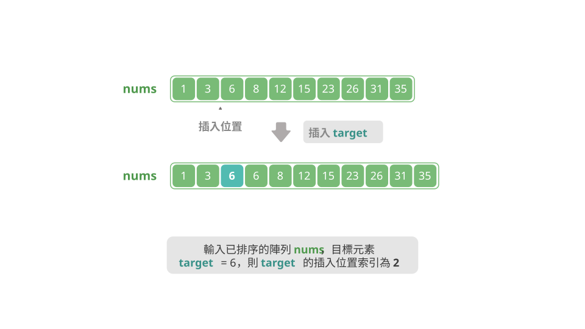
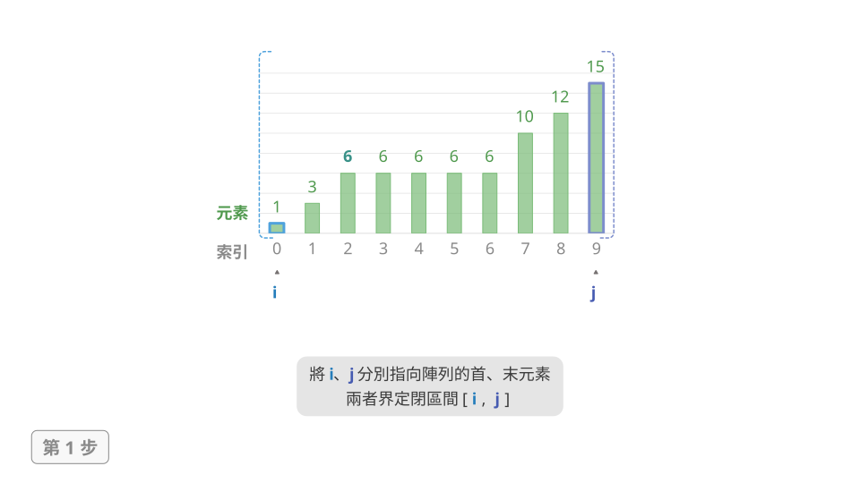
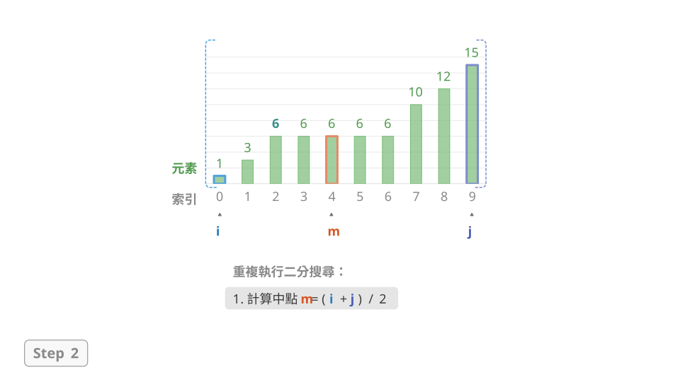
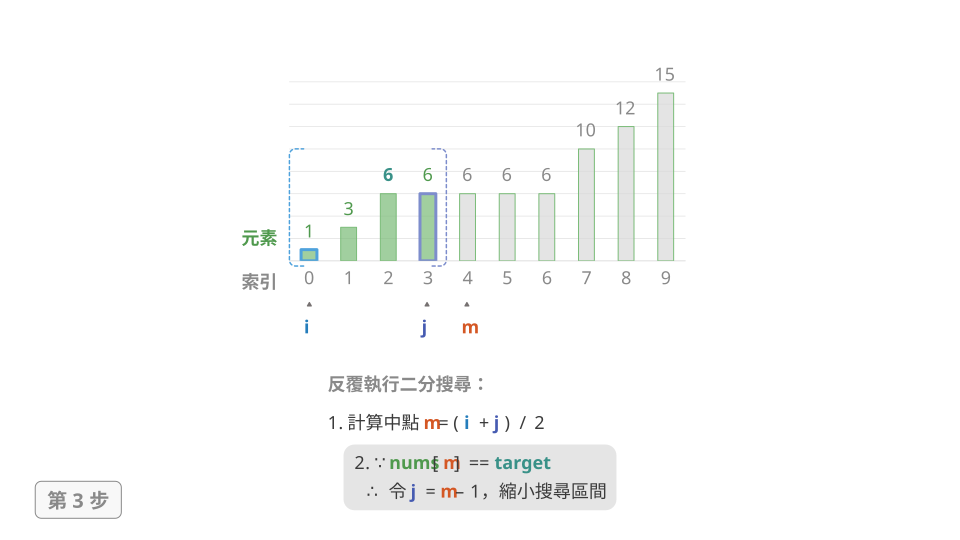
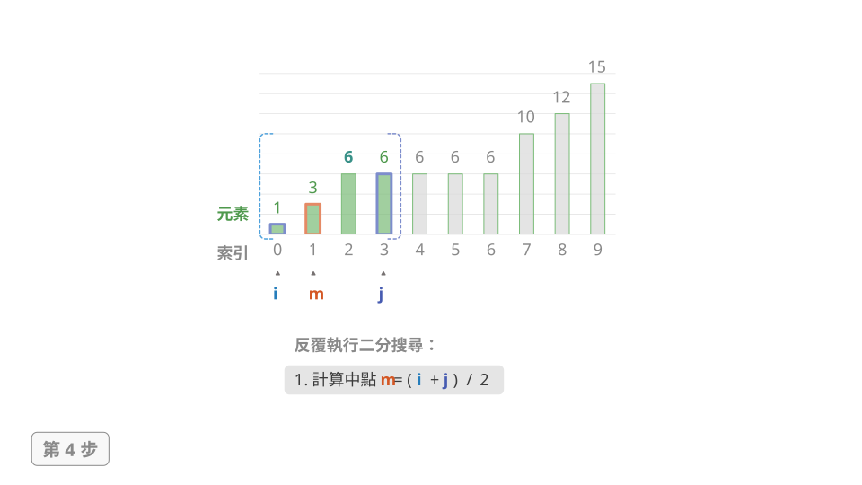
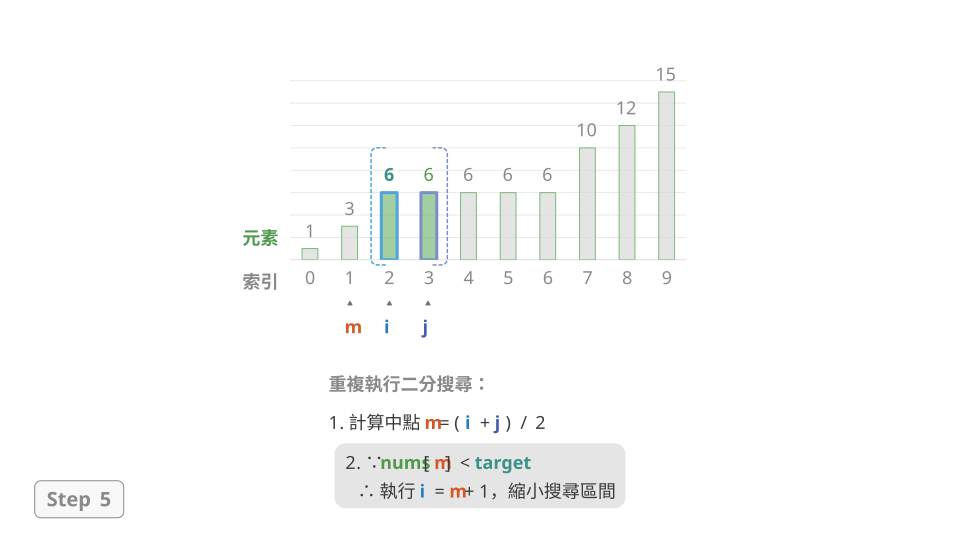
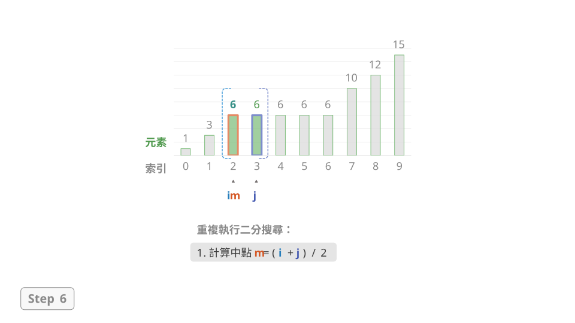

# 用二分搜尋找插入點

二分搜尋除了能找出目標元素，也能解決許多相關問題，例如找出目標元素的插入位置。

## 沒有重複元素的情況

!!! question

    給定長度為 $n$ 的排序陣列 `nums` 和一個元素 `target`，陣列中沒有重複元素。現在要將 `target` 插入陣列 `nums`，同時維持陣列的排列順序。若陣列中已有元素 `target`，則插在該元素的左側。請回傳插入後 `target` 在陣列中的索引。下圖是一個範例。



若要沿用上一節的二分搜尋程式碼，得先回答以下兩個問題。

**問題一**：陣列含有 `target` 時，插入點的索引是否就是該元素的索引？

題目要求把 `target` 插在相等元素的左側，因此新插入的 `target` 會占據原本 `target` 的位置。換句話說，**當陣列含有 `target` 時，插入點的索引就是原有 `target` 的索引**。

**問題二**：陣列中沒有 `target` 時，插入點對應哪個元素的索引？

再想一想二分搜尋的過程：當 `nums[m] < target` 時會移動 $i$，因此指標 $i$ 會逐步靠近大於或等於 `target` 的元素。同理，指標 $j$ 會逐步靠近小於或等於 `target` 的元素。

因此，二分搜尋結束時，$i$ 會指向第一個大於 `target` 的元素，$j$ 會指向最右邊小於 `target` 的元素。**由此可知，陣列不含 `target` 時，插入索引就是 $i$**。程式碼如下：

```src
[file]{binary_search_insertion}-[class]{}-[func]{binary_search_insertion_simple}
```

## 有重複元素的情況

!!! question

    沿用上一題的設定，但這次陣列中可能含有重複元素，其餘條件相同。

若陣列中有多個 `target`，一般的二分搜尋只能回傳其中一個 `target` 的索引，**無法判斷這個元素的左右兩側各還有幾個 `target`**。

題目要求將目標元素插在所有相等元素的最左側，**所以我們要找出陣列中最左邊的 `target` 的索引**。可以先試試下圖的做法。

1. 執行二分搜尋，找出任一個 `target` 的索引，記為 $k$。
2. 從索引 $k$ 開始，逐一往左走訪，找到最左邊的 `target` 時就回傳其索引。


這個方法可行，但用到了循序搜尋，因此時間複雜度為 $O(n)$。當陣列中有很多個 `target` 時，效率就會很低。

現在來調整二分搜尋的程式碼。如下圖所示，整體流程相同，每一輪都先計算中點索引 $m$，再比較 `target` 和 `nums[m]` 的大小。分成以下幾種情況。

- 若 `nums[m] < target` 或 `nums[m] > target`，表示還沒找到 `target`，因此沿用一般二分搜尋縮小區間的方式，**讓指標 $i$ 和 $j$ 逐步靠近 `target`**。
- 若 `nums[m] == target`，表示接下來要在區間 $[i, m - 1]$ 中尋找小於 `target` 的元素，因此令 $j = m - 1$ 來縮小區間，**讓指標 $j$ 逐步靠近小於 `target` 的元素**。

迴圈結束後，$i$ 指向最左邊的 `target`，$j$ 指向最右邊小於 `target` 的元素，**所以索引 $i$ 就是插入點**。

=== "<1>"
    

=== "<2>"
    

=== "<3>"
    

=== "<4>"
    

=== "<5>"
    

=== "<6>"
    

=== "<7>"
    

=== "<8>"
    

觀察下方程式碼，`nums[m] > target` 和 `nums[m] == target` 這兩個分支執行的操作相同，因此可以合併。

也可以像這裡一樣分開寫，判斷邏輯會更清楚，程式碼也更容易閱讀。

```src
[file]{binary_search_insertion}-[class]{}-[func]{binary_search_insertion}
```

!!! tip

    本節的程式碼都採用閉區間的寫法。有興趣的讀者可以自行實作左閉右開區間的版本。

概括來說，二分搜尋就是替指標 $i$ 和 $j$ 分別設定搜尋目標。目標可以是某個特定元素（例如 `target`），也可以是某個範圍內的元素（例如小於 `target` 的元素）。

隨著迴圈反覆將區間對半縮小，指標 $i$ 和 $j$ 會逐步逼近各自的目標。最後，它們會找到答案，或是在越過邊界後停止。
