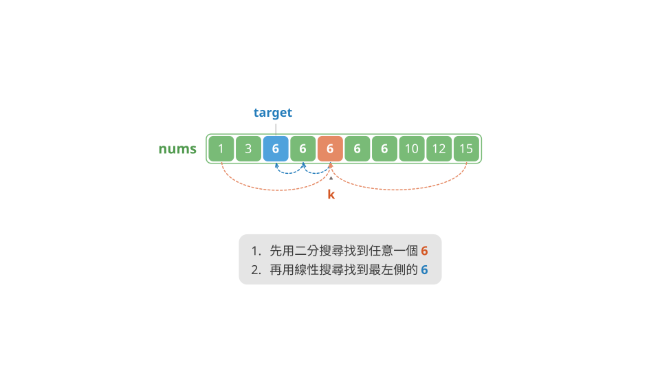
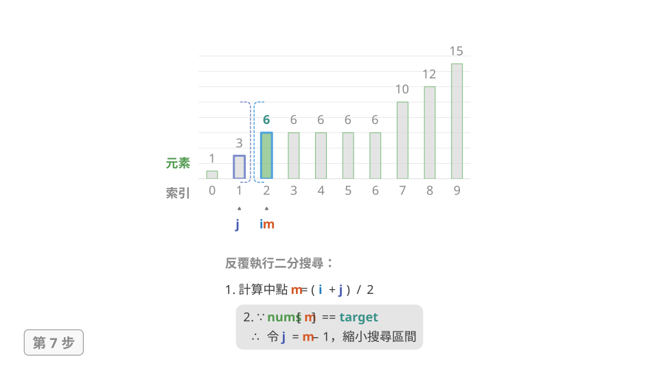
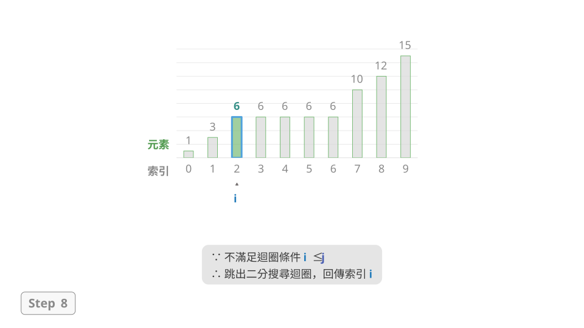

# 10.2 &nbsp; 用二分搜尋找插入點

二分搜尋除了能找出目標元素，也能解決許多相關問題，例如找出目標元素的插入位置。

## 10.2.1 &nbsp; 沒有重複元素的情況

!!! question

    給定長度為 $n$ 的排序陣列 `nums` 和一個元素 `target`，陣列中沒有重複元素。現在要將 `target` 插入陣列 `nums`，同時維持陣列的排列順序。若陣列中已有元素 `target`，則插在該元素的左側。請回傳插入後 `target` 在陣列中的索引。圖 10-4 是一個範例。

{ class="animation-figure" }

<p align="center"> 圖 10-4 &nbsp; 用二分搜尋找插入點的範例資料 </p>

若要沿用上一節的二分搜尋程式碼，得先回答以下兩個問題。

**問題一**：陣列含有 `target` 時，插入點的索引是否就是該元素的索引？

題目要求把 `target` 插在相等元素的左側，因此新插入的 `target` 會占據原本 `target` 的位置。換句話說，**當陣列含有 `target` 時，插入點的索引就是原有 `target` 的索引**。

**問題二**：陣列中沒有 `target` 時，插入點對應哪個元素的索引？

再想一想二分搜尋的過程：當 `nums[m] < target` 時會移動 $i$，因此指標 $i$ 會逐步靠近大於或等於 `target` 的元素。同理，指標 $j$ 會逐步靠近小於或等於 `target` 的元素。

因此，二分搜尋結束時，$i$ 會指向第一個大於 `target` 的元素，$j$ 會指向最右邊小於 `target` 的元素。**由此可知，陣列不含 `target` 時，插入索引就是 $i$**。程式碼如下：

=== "Python"

    ```python title="binary_search_insertion.py"
    def binary_search_insertion_simple(nums: list[int], target: int) -> int:
        """用二分搜尋找插入點（無重複元素）"""
        i, j = 0, len(nums) - 1  # 將閉區間設為 [0, n-1]
        while i <= j:
            m = (i + j) // 2  # 計算中點索引 m
            if nums[m] < target:
                i = m + 1  # target 若存在，必在區間 [m+1, j] 內
            elif nums[m] > target:
                j = m - 1  # target 若存在，必在區間 [i, m-1] 內
            else:
                return m  # 找到 target，回傳插入點 m
        # 找不到 target，回傳插入點 i
        return i
    ```

=== "C++"

    ```cpp title="binary_search_insertion.cpp"
    /* 用二分搜尋找插入點（無重複元素） */
    int binarySearchInsertionSimple(vector<int> &nums, int target) {
        int i = 0, j = nums.size() - 1; // 將閉區間設為 [0, n-1]
        while (i <= j) {
            int m = i + (j - i) / 2; // 計算中點索引 m
            if (nums[m] < target) {
                i = m + 1; // target 若存在，必在區間 [m+1, j] 內
            } else if (nums[m] > target) {
                j = m - 1; // target 若存在，必在區間 [i, m-1] 內
            } else {
                return m; // 找到 target，回傳插入點 m
            }
        }
        // 找不到 target，回傳插入點 i
        return i;
    }
    ```

=== "Java"

    ```java title="binary_search_insertion.java"
    /* 用二分搜尋找插入點（無重複元素） */
    int binarySearchInsertionSimple(int[] nums, int target) {
        int i = 0, j = nums.length - 1; // 將閉區間設為 [0, n-1]
        while (i <= j) {
            int m = i + (j - i) / 2; // 計算中點索引 m
            if (nums[m] < target) {
                i = m + 1; // target 若存在，必在區間 [m+1, j] 內
            } else if (nums[m] > target) {
                j = m - 1; // target 若存在，必在區間 [i, m-1] 內
            } else {
                return m; // 找到 target，回傳插入點 m
            }
        }
        // 找不到 target，回傳插入點 i
        return i;
    }
    ```

=== "C#"

    ```csharp title="binary_search_insertion.cs"
    /* 用二分搜尋找插入點（無重複元素） */
    int BinarySearchInsertionSimple(int[] nums, int target) {
        int i = 0, j = nums.Length - 1; // 將閉區間設為 [0, n-1]
        while (i <= j) {
            int m = i + (j - i) / 2; // 計算中點索引 m
            if (nums[m] < target) {
                i = m + 1; // target 若存在，必在區間 [m+1, j] 內
            } else if (nums[m] > target) {
                j = m - 1; // target 若存在，必在區間 [i, m-1] 內
            } else {
                return m; // 找到 target，回傳插入點 m
            }
        }
        // 找不到 target，回傳插入點 i
        return i;
    }
    ```

=== "Go"

    ```go title="binary_search_insertion.go"
    /* 用二分搜尋找插入點（無重複元素） */
    func binarySearchInsertionSimple(nums []int, target int) int {
        // 將閉區間設為 [0, n-1]
        i, j := 0, len(nums)-1
        for i <= j {
            // 計算中點索引 m
            m := i + (j-i)/2
            if nums[m] < target {
                // target 若存在，必在區間 [m+1, j] 內
                i = m + 1
            } else if nums[m] > target {
                // target 若存在，必在區間 [i, m-1] 內
                j = m - 1
            } else {
                // 找到 target，回傳插入點 m
                return m
            }
        }
        // 找不到 target，回傳插入點 i
        return i
    }
    ```

=== "Swift"

    ```swift title="binary_search_insertion.swift"
    /* 用二分搜尋找插入點（無重複元素） */
    func binarySearchInsertionSimple(nums: [Int], target: Int) -> Int {
        // 將閉區間設為 [0, n-1]
        var i = nums.startIndex
        var j = nums.endIndex - 1
        while i <= j {
            let m = i + (j - i) / 2 // 計算中點索引 m
            if nums[m] < target {
                i = m + 1 // target 若存在，必在區間 [m+1, j] 內
            } else if nums[m] > target {
                j = m - 1 // target 若存在，必在區間 [i, m-1] 內
            } else {
                return m // 找到 target，回傳插入點 m
            }
        }
        // 找不到 target，回傳插入點 i
        return i
    }
    ```

=== "JS"

    ```javascript title="binary_search_insertion.js"
    /* 用二分搜尋找插入點（無重複元素） */
    function binarySearchInsertionSimple(nums, target) {
        let i = 0,
            j = nums.length - 1; // 將閉區間設為 [0, n-1]
        while (i <= j) {
            const m = Math.floor(i + (j - i) / 2); // 計算中點索引 m，以 Math.floor() 向下取整
            if (nums[m] < target) {
                i = m + 1; // target 若存在，必在區間 [m+1, j] 內
            } else if (nums[m] > target) {
                j = m - 1; // target 若存在，必在區間 [i, m-1] 內
            } else {
                return m; // 找到 target，回傳插入點 m
            }
        }
        // 找不到 target，回傳插入點 i
        return i;
    }
    ```

=== "TS"

    ```typescript title="binary_search_insertion.ts"
    /* 用二分搜尋找插入點（無重複元素） */
    function binarySearchInsertionSimple(
        nums: Array<number>,
        target: number
    ): number {
        let i = 0,
            j = nums.length - 1; // 將閉區間設為 [0, n-1]
        while (i <= j) {
            const m = Math.floor(i + (j - i) / 2); // 計算中點索引 m，以 Math.floor() 向下取整
            if (nums[m] < target) {
                i = m + 1; // target 若存在，必在區間 [m+1, j] 內
            } else if (nums[m] > target) {
                j = m - 1; // target 若存在，必在區間 [i, m-1] 內
            } else {
                return m; // 找到 target，回傳插入點 m
            }
        }
        // 找不到 target，回傳插入點 i
        return i;
    }
    ```

=== "Dart"

    ```dart title="binary_search_insertion.dart"
    /* 用二分搜尋找插入點（無重複元素） */
    int binarySearchInsertionSimple(List<int> nums, int target) {
      int i = 0, j = nums.length - 1; // 將閉區間設為 [0, n-1]
      while (i <= j) {
        int m = i + (j - i) ~/ 2; // 計算中點索引 m
        if (nums[m] < target) {
          i = m + 1; // target 若存在，必在區間 [m+1, j] 內
        } else if (nums[m] > target) {
          j = m - 1; // target 若存在，必在區間 [i, m-1] 內
        } else {
          return m; // 找到 target，回傳插入點 m
        }
      }
      // 找不到 target，回傳插入點 i
      return i;
    }
    ```

=== "Rust"

    ```rust title="binary_search_insertion.rs"
    /* 用二分搜尋找插入點（無重複元素） */
    fn binary_search_insertion_simple(nums: &[i32], target: i32) -> i32 {
        let (mut i, mut j) = (0, nums.len() as i32 - 1); // 將閉區間設為 [0, n-1]
        while i <= j {
            let m = i + (j - i) / 2; // 計算中點索引 m
            if nums[m as usize] < target {
                i = m + 1; // target 若存在，必在區間 [m+1, j] 內
            } else if nums[m as usize] > target {
                j = m - 1; // target 若存在，必在區間 [i, m-1] 內
            } else {
                return m;
            }
        }
        // 找不到 target，回傳插入點 i
        i
    }
    ```

=== "C"

    ```c title="binary_search_insertion.c"
    /* 用二分搜尋找插入點（無重複元素） */
    int binarySearchInsertionSimple(int *nums, int numSize, int target) {
        int i = 0, j = numSize - 1; // 將閉區間設為 [0, n-1]
        while (i <= j) {
            int m = i + (j - i) / 2; // 計算中點索引 m
            if (nums[m] < target) {
                i = m + 1; // target 若存在，必在區間 [m+1, j] 內
            } else if (nums[m] > target) {
                j = m - 1; // target 若存在，必在區間 [i, m-1] 內
            } else {
                return m; // 找到 target，回傳插入點 m
            }
        }
        // 找不到 target，回傳插入點 i
        return i;
    }
    ```

=== "Kotlin"

    ```kotlin title="binary_search_insertion.kt"
    /* 用二分搜尋找插入點（無重複元素） */
    fun binarySearchInsertionSimple(nums: IntArray, target: Int): Int {
        var i = 0
        var j = nums.size - 1 // 將閉區間設為 [0, n-1]
        while (i <= j) {
            val m = i + (j - i) / 2 // 計算中點索引 m
            if (nums[m] < target) {
                i = m + 1 // target 若存在，必在區間 [m+1, j] 內
            } else if (nums[m] > target) {
                j = m - 1 // target 若存在，必在區間 [i, m-1] 內
            } else {
                return m // 找到 target，回傳插入點 m
            }
        }
        // 找不到 target，回傳插入點 i
        return i
    }
    ```

=== "Ruby"

    ```ruby title="binary_search_insertion.rb"
    ### 用二分搜尋找插入點（無重複元素） ###
    def binary_search_insertion_simple(nums, target)
      # 將閉區間設為 [0, n-1]
      i, j = 0, nums.length - 1

      while i <= j
        # 計算中點索引 m
        m = (i + j) / 2

        if nums[m] < target
          i = m + 1 # target 若存在，必在區間 [m+1, j] 內
        elsif nums[m] > target
          j = m - 1 # target 若存在，必在區間 [i, m-1] 內
        else
          return m  # 找到 target，回傳插入點 m
        end
      end

      i # 找不到 target，回傳插入點 i
    end
    ```

??? pythontutor "執行視覺化示範"

    <div style="height: 549px; width: 100%;"><iframe class="pythontutor-iframe" title="執行視覺化示範" src="https://pythontutor.com/iframe-embed.html#code=def%20binary_search_insertion_simple%28nums%3A%20list%5Bint%5D,%20target%3A%20int%29%20-%3E%20int%3A%0A%20%20%20%20%22%22%22%E7%94%A8%E4%BA%8C%E5%88%86%E6%90%9C%E5%B0%8B%E6%89%BE%E6%8F%92%E5%85%A5%E9%BB%9E%EF%BC%88%E7%84%A1%E9%87%8D%E8%A4%87%E5%85%83%E7%B4%A0%EF%BC%89%22%22%22%0A%20%20%20%20i,%20j%20%3D%200,%20len%28nums%29%20-%201%20%20%23%20%E5%B0%87%E9%96%89%E5%8D%80%E9%96%93%E8%A8%AD%E7%82%BA%20%5B0,%20n-1%5D%0A%20%20%20%20while%20i%20%3C%3D%20j%3A%0A%20%20%20%20%20%20%20%20m%20%3D%20%28i%20%2B%20j%29%20//%202%20%20%23%20%E8%A8%88%E7%AE%97%E4%B8%AD%E9%BB%9E%E7%B4%A2%E5%BC%95%20m%0A%20%20%20%20%20%20%20%20if%20nums%5Bm%5D%20%3C%20target%3A%0A%20%20%20%20%20%20%20%20%20%20%20%20i%20%3D%20m%20%2B%201%20%20%23%20target%20%E8%8B%A5%E5%AD%98%E5%9C%A8%EF%BC%8C%E5%BF%85%E5%9C%A8%E5%8D%80%E9%96%93%20%5Bm%2B1,%20j%5D%20%E5%85%A7%0A%20%20%20%20%20%20%20%20elif%20nums%5Bm%5D%20%3E%20target%3A%0A%20%20%20%20%20%20%20%20%20%20%20%20j%20%3D%20m%20-%201%20%20%23%20target%20%E8%8B%A5%E5%AD%98%E5%9C%A8%EF%BC%8C%E5%BF%85%E5%9C%A8%E5%8D%80%E9%96%93%20%5Bi,%20m-1%5D%20%E5%85%A7%0A%20%20%20%20%20%20%20%20else%3A%0A%20%20%20%20%20%20%20%20%20%20%20%20return%20m%20%20%23%20%E6%89%BE%E5%88%B0%20target%EF%BC%8C%E5%9B%9E%E5%82%B3%E6%8F%92%E5%85%A5%E9%BB%9E%20m%0A%20%20%20%20%23%20%E6%89%BE%E4%B8%8D%E5%88%B0%20target%EF%BC%8C%E5%9B%9E%E5%82%B3%E6%8F%92%E5%85%A5%E9%BB%9E%20i%0A%20%20%20%20return%20i%0A%0A%0A%22%22%22Driver%20Code%22%22%22%0Aif%20__name__%20%3D%3D%20%22__main__%22%3A%0A%20%20%20%20%23%20%E4%B8%8D%E5%90%AB%E9%87%8D%E8%A4%87%E5%85%83%E7%B4%A0%E7%9A%84%E9%99%A3%E5%88%97%0A%20%20%20%20nums%20%3D%20%5B1,%203,%206,%208,%2012,%2015,%2023,%2026,%2031,%2035%5D%0A%20%20%20%20%23%20%E7%94%A8%E4%BA%8C%E5%88%86%E6%90%9C%E5%B0%8B%E6%89%BE%E6%8F%92%E5%85%A5%E9%BB%9E%0A%20%20%20%20target%20%3D%206%0A%20%20%20%20index%20%3D%20binary_search_insertion_simple%28nums,%20target%29%0A%20%20%20%20print%28f%22%E5%85%83%E7%B4%A0%20%7Btarget%7D%20%E7%9A%84%E6%8F%92%E5%85%A5%E4%BD%8D%E7%BD%AE%E7%B4%A2%E5%BC%95%E7%82%BA%20%7Bindex%7D%22%29&codeDivHeight=472&codeDivWidth=350&cumulative=false&curInstr=5&heapPrimitives=nevernest&origin=opt-frontend.js&py=311&rawInputLstJSON=%5B%5D&textReferences=false"> </iframe></div>
    <div style="margin-top: 5px;"><a href="https://pythontutor.com/iframe-embed.html#code=def%20binary_search_insertion_simple%28nums%3A%20list%5Bint%5D,%20target%3A%20int%29%20-%3E%20int%3A%0A%20%20%20%20%22%22%22%E7%94%A8%E4%BA%8C%E5%88%86%E6%90%9C%E5%B0%8B%E6%89%BE%E6%8F%92%E5%85%A5%E9%BB%9E%EF%BC%88%E7%84%A1%E9%87%8D%E8%A4%87%E5%85%83%E7%B4%A0%EF%BC%89%22%22%22%0A%20%20%20%20i,%20j%20%3D%200,%20len%28nums%29%20-%201%20%20%23%20%E5%B0%87%E9%96%89%E5%8D%80%E9%96%93%E8%A8%AD%E7%82%BA%20%5B0,%20n-1%5D%0A%20%20%20%20while%20i%20%3C%3D%20j%3A%0A%20%20%20%20%20%20%20%20m%20%3D%20%28i%20%2B%20j%29%20//%202%20%20%23%20%E8%A8%88%E7%AE%97%E4%B8%AD%E9%BB%9E%E7%B4%A2%E5%BC%95%20m%0A%20%20%20%20%20%20%20%20if%20nums%5Bm%5D%20%3C%20target%3A%0A%20%20%20%20%20%20%20%20%20%20%20%20i%20%3D%20m%20%2B%201%20%20%23%20target%20%E8%8B%A5%E5%AD%98%E5%9C%A8%EF%BC%8C%E5%BF%85%E5%9C%A8%E5%8D%80%E9%96%93%20%5Bm%2B1,%20j%5D%20%E5%85%A7%0A%20%20%20%20%20%20%20%20elif%20nums%5Bm%5D%20%3E%20target%3A%0A%20%20%20%20%20%20%20%20%20%20%20%20j%20%3D%20m%20-%201%20%20%23%20target%20%E8%8B%A5%E5%AD%98%E5%9C%A8%EF%BC%8C%E5%BF%85%E5%9C%A8%E5%8D%80%E9%96%93%20%5Bi,%20m-1%5D%20%E5%85%A7%0A%20%20%20%20%20%20%20%20else%3A%0A%20%20%20%20%20%20%20%20%20%20%20%20return%20m%20%20%23%20%E6%89%BE%E5%88%B0%20target%EF%BC%8C%E5%9B%9E%E5%82%B3%E6%8F%92%E5%85%A5%E9%BB%9E%20m%0A%20%20%20%20%23%20%E6%89%BE%E4%B8%8D%E5%88%B0%20target%EF%BC%8C%E5%9B%9E%E5%82%B3%E6%8F%92%E5%85%A5%E9%BB%9E%20i%0A%20%20%20%20return%20i%0A%0A%0A%22%22%22Driver%20Code%22%22%22%0Aif%20__name__%20%3D%3D%20%22__main__%22%3A%0A%20%20%20%20%23%20%E4%B8%8D%E5%90%AB%E9%87%8D%E8%A4%87%E5%85%83%E7%B4%A0%E7%9A%84%E9%99%A3%E5%88%97%0A%20%20%20%20nums%20%3D%20%5B1,%203,%206,%208,%2012,%2015,%2023,%2026,%2031,%2035%5D%0A%20%20%20%20%23%20%E7%94%A8%E4%BA%8C%E5%88%86%E6%90%9C%E5%B0%8B%E6%89%BE%E6%8F%92%E5%85%A5%E9%BB%9E%0A%20%20%20%20target%20%3D%206%0A%20%20%20%20index%20%3D%20binary_search_insertion_simple%28nums,%20target%29%0A%20%20%20%20print%28f%22%E5%85%83%E7%B4%A0%20%7Btarget%7D%20%E7%9A%84%E6%8F%92%E5%85%A5%E4%BD%8D%E7%BD%AE%E7%B4%A2%E5%BC%95%E7%82%BA%20%7Bindex%7D%22%29&codeDivHeight=800&codeDivWidth=600&cumulative=false&curInstr=5&heapPrimitives=nevernest&origin=opt-frontend.js&py=311&rawInputLstJSON=%5B%5D&textReferences=false" target="_blank" rel="noopener noreferrer">全螢幕觀看 ></a></div>

## 10.2.2 &nbsp; 有重複元素的情況

!!! question

    沿用上一題的設定，但這次陣列中可能含有重複元素，其餘條件相同。

若陣列中有多個 `target`，一般的二分搜尋只能回傳其中一個 `target` 的索引，**無法判斷這個元素的左右兩側各還有幾個 `target`**。

題目要求將目標元素插在所有相等元素的最左側，**所以我們要找出陣列中最左邊的 `target` 的索引**。可以先試試圖 10-5 的做法。

1. 執行二分搜尋，找出任一個 `target` 的索引，記為 $k$。
2. 從索引 $k$ 開始，逐一往左走訪，找到最左邊的 `target` 時就回傳其索引。

{ class="animation-figure" }

<p align="center"> 圖 10-5 &nbsp; 用循序搜尋找重複元素的插入點 </p>

這個方法可行，但用到了循序搜尋，因此時間複雜度為 $O(n)$。當陣列中有很多個 `target` 時，效率就會很低。

現在來調整二分搜尋的程式碼。如圖 10-6 所示，整體流程相同，每一輪都先計算中點索引 $m$，再比較 `target` 和 `nums[m]` 的大小。分成以下幾種情況。

- 若 `nums[m] < target` 或 `nums[m] > target`，表示還沒找到 `target`，因此沿用一般二分搜尋縮小區間的方式，**讓指標 $i$ 和 $j$ 逐步靠近 `target`**。
- 若 `nums[m] == target`，表示接下來要在區間 $[i, m - 1]$ 中尋找小於 `target` 的元素，因此令 $j = m - 1$ 來縮小區間，**讓指標 $j$ 逐步靠近小於 `target` 的元素**。

迴圈結束後，$i$ 指向最左邊的 `target`，$j$ 指向最右邊小於 `target` 的元素，**所以索引 $i$ 就是插入點**。

=== "<1>"
    { class="animation-figure" }

=== "<2>"
    { class="animation-figure" }

=== "<3>"
    { class="animation-figure" }

=== "<4>"
    { class="animation-figure" }

=== "<5>"
    { class="animation-figure" }

=== "<6>"
    { class="animation-figure" }

=== "<7>"
    { class="animation-figure" }

=== "<8>"
    { class="animation-figure" }

<p align="center"> 圖 10-6 &nbsp; 用二分搜尋找重複元素插入點的步驟 </p>

觀察下方程式碼，`nums[m] > target` 和 `nums[m] == target` 這兩個分支執行的操作相同，因此可以合併。

也可以像這裡一樣分開寫，判斷邏輯會更清楚，程式碼也更容易閱讀。

=== "Python"

    ```python title="binary_search_insertion.py"
    def binary_search_insertion(nums: list[int], target: int) -> int:
        """用二分搜尋找插入點（有重複元素）"""
        i, j = 0, len(nums) - 1  # 將閉區間設為 [0, n-1]
        while i <= j:
            m = (i + j) // 2  # 計算中點索引 m
            if nums[m] < target:
                i = m + 1  # target 若存在，必在區間 [m+1, j] 內
            elif nums[m] > target:
                j = m - 1  # target 若存在，必在區間 [i, m-1] 內
            else:
                j = m - 1  # 最右邊小於 target 的元素位於區間 [i, m-1] 內
        # 回傳插入點 i
        return i
    ```

=== "C++"

    ```cpp title="binary_search_insertion.cpp"
    /* 用二分搜尋找插入點（有重複元素） */
    int binarySearchInsertion(vector<int> &nums, int target) {
        int i = 0, j = nums.size() - 1; // 將閉區間設為 [0, n-1]
        while (i <= j) {
            int m = i + (j - i) / 2; // 計算中點索引 m
            if (nums[m] < target) {
                i = m + 1; // target 若存在，必在區間 [m+1, j] 內
            } else if (nums[m] > target) {
                j = m - 1; // target 若存在，必在區間 [i, m-1] 內
            } else {
                j = m - 1; // 最右邊小於 target 的元素位於區間 [i, m-1] 內
            }
        }
        // 回傳插入點 i
        return i;
    }
    ```

=== "Java"

    ```java title="binary_search_insertion.java"
    /* 用二分搜尋找插入點（有重複元素） */
    int binarySearchInsertion(int[] nums, int target) {
        int i = 0, j = nums.length - 1; // 將閉區間設為 [0, n-1]
        while (i <= j) {
            int m = i + (j - i) / 2; // 計算中點索引 m
            if (nums[m] < target) {
                i = m + 1; // target 若存在，必在區間 [m+1, j] 內
            } else if (nums[m] > target) {
                j = m - 1; // target 若存在，必在區間 [i, m-1] 內
            } else {
                j = m - 1; // 最右邊小於 target 的元素位於區間 [i, m-1] 內
            }
        }
        // 回傳插入點 i
        return i;
    }
    ```

=== "C#"

    ```csharp title="binary_search_insertion.cs"
    /* 用二分搜尋找插入點（有重複元素） */
    int BinarySearchInsertion(int[] nums, int target) {
        int i = 0, j = nums.Length - 1; // 將閉區間設為 [0, n-1]
        while (i <= j) {
            int m = i + (j - i) / 2; // 計算中點索引 m
            if (nums[m] < target) {
                i = m + 1; // target 若存在，必在區間 [m+1, j] 內
            } else if (nums[m] > target) {
                j = m - 1; // target 若存在，必在區間 [i, m-1] 內
            } else {
                j = m - 1; // 最右邊小於 target 的元素位於區間 [i, m-1] 內
            }
        }
        // 回傳插入點 i
        return i;
    }
    ```

=== "Go"

    ```go title="binary_search_insertion.go"
    /* 用二分搜尋找插入點（有重複元素） */
    func binarySearchInsertion(nums []int, target int) int {
        // 將閉區間設為 [0, n-1]
        i, j := 0, len(nums)-1
        for i <= j {
            // 計算中點索引 m
            m := i + (j-i)/2
            if nums[m] < target {
                // target 若存在，必在區間 [m+1, j] 內
                i = m + 1
            } else if nums[m] > target {
                // target 若存在，必在區間 [i, m-1] 內
                j = m - 1
            } else {
                // 最右邊小於 target 的元素位於區間 [i, m-1] 內
                j = m - 1
            }
        }
        // 回傳插入點 i
        return i
    }
    ```

=== "Swift"

    ```swift title="binary_search_insertion.swift"
    /* 用二分搜尋找插入點（有重複元素） */
    func binarySearchInsertion(nums: [Int], target: Int) -> Int {
        // 將閉區間設為 [0, n-1]
        var i = nums.startIndex
        var j = nums.endIndex - 1
        while i <= j {
            let m = i + (j - i) / 2 // 計算中點索引 m
            if nums[m] < target {
                i = m + 1 // target 若存在，必在區間 [m+1, j] 內
            } else if nums[m] > target {
                j = m - 1 // target 若存在，必在區間 [i, m-1] 內
            } else {
                j = m - 1 // 最右邊小於 target 的元素位於區間 [i, m-1] 內
            }
        }
        // 回傳插入點 i
        return i
    }
    ```

=== "JS"

    ```javascript title="binary_search_insertion.js"
    /* 用二分搜尋找插入點（有重複元素） */
    function binarySearchInsertion(nums, target) {
        let i = 0,
            j = nums.length - 1; // 將閉區間設為 [0, n-1]
        while (i <= j) {
            const m = Math.floor(i + (j - i) / 2); // 計算中點索引 m，以 Math.floor() 向下取整
            if (nums[m] < target) {
                i = m + 1; // target 若存在，必在區間 [m+1, j] 內
            } else if (nums[m] > target) {
                j = m - 1; // target 若存在，必在區間 [i, m-1] 內
            } else {
                j = m - 1; // 最右邊小於 target 的元素位於區間 [i, m-1] 內
            }
        }
        // 回傳插入點 i
        return i;
    }
    ```

=== "TS"

    ```typescript title="binary_search_insertion.ts"
    /* 用二分搜尋找插入點（有重複元素） */
    function binarySearchInsertion(nums: Array<number>, target: number): number {
        let i = 0,
            j = nums.length - 1; // 將閉區間設為 [0, n-1]
        while (i <= j) {
            const m = Math.floor(i + (j - i) / 2); // 計算中點索引 m，以 Math.floor() 向下取整
            if (nums[m] < target) {
                i = m + 1; // target 若存在，必在區間 [m+1, j] 內
            } else if (nums[m] > target) {
                j = m - 1; // target 若存在，必在區間 [i, m-1] 內
            } else {
                j = m - 1; // 最右邊小於 target 的元素位於區間 [i, m-1] 內
            }
        }
        // 回傳插入點 i
        return i;
    }
    ```

=== "Dart"

    ```dart title="binary_search_insertion.dart"
    /* 用二分搜尋找插入點（有重複元素） */
    int binarySearchInsertion(List<int> nums, int target) {
      int i = 0, j = nums.length - 1; // 將閉區間設為 [0, n-1]
      while (i <= j) {
        int m = i + (j - i) ~/ 2; // 計算中點索引 m
        if (nums[m] < target) {
          i = m + 1; // target 若存在，必在區間 [m+1, j] 內
        } else if (nums[m] > target) {
          j = m - 1; // target 若存在，必在區間 [i, m-1] 內
        } else {
          j = m - 1; // 最右邊小於 target 的元素位於區間 [i, m-1] 內
        }
      }
      // 回傳插入點 i
      return i;
    }
    ```

=== "Rust"

    ```rust title="binary_search_insertion.rs"
    /* 用二分搜尋找插入點（有重複元素） */
    pub fn binary_search_insertion(nums: &[i32], target: i32) -> i32 {
        let (mut i, mut j) = (0, nums.len() as i32 - 1); // 將閉區間設為 [0, n-1]
        while i <= j {
            let m = i + (j - i) / 2; // 計算中點索引 m
            if nums[m as usize] < target {
                i = m + 1; // target 若存在，必在區間 [m+1, j] 內
            } else if nums[m as usize] > target {
                j = m - 1; // target 若存在，必在區間 [i, m-1] 內
            } else {
                j = m - 1; // 最右邊小於 target 的元素位於區間 [i, m-1] 內
            }
        }
        // 回傳插入點 i
        i
    }
    ```

=== "C"

    ```c title="binary_search_insertion.c"
    /* 用二分搜尋找插入點（有重複元素） */
    int binarySearchInsertion(int *nums, int numSize, int target) {
        int i = 0, j = numSize - 1; // 將閉區間設為 [0, n-1]
        while (i <= j) {
            int m = i + (j - i) / 2; // 計算中點索引 m
            if (nums[m] < target) {
                i = m + 1; // target 若存在，必在區間 [m+1, j] 內
            } else if (nums[m] > target) {
                j = m - 1; // target 若存在，必在區間 [i, m-1] 內
            } else {
                j = m - 1; // 最右邊小於 target 的元素位於區間 [i, m-1] 內
            }
        }
        // 回傳插入點 i
        return i;
    }
    ```

=== "Kotlin"

    ```kotlin title="binary_search_insertion.kt"
    /* 用二分搜尋找插入點（有重複元素） */
    fun binarySearchInsertion(nums: IntArray, target: Int): Int {
        var i = 0
        var j = nums.size - 1 // 將閉區間設為 [0, n-1]
        while (i <= j) {
            val m = i + (j - i) / 2 // 計算中點索引 m
            if (nums[m] < target) {
                i = m + 1 // target 若存在，必在區間 [m+1, j] 內
            } else if (nums[m] > target) {
                j = m - 1 // target 若存在，必在區間 [i, m-1] 內
            } else {
                j = m - 1 // 最右邊小於 target 的元素位於區間 [i, m-1] 內
            }
        }
        // 回傳插入點 i
        return i
    }
    ```

=== "Ruby"

    ```ruby title="binary_search_insertion.rb"
    ### 用二分搜尋找插入點（有重複元素） ###
    def binary_search_insertion(nums, target)
      # 將閉區間設為 [0, n-1]
      i, j = 0, nums.length - 1

      while i <= j
        # 計算中點索引 m
        m = (i + j) / 2

        if nums[m] < target
          i = m + 1 # target 若存在，必在區間 [m+1, j] 內
        elsif nums[m] > target
          j = m - 1 # target 若存在，必在區間 [i, m-1] 內
        else
          j = m - 1 # 最右邊小於 target 的元素位於區間 [i, m-1] 內
        end
      end

      i # 回傳插入點 i
    end
    ```

??? pythontutor "執行視覺化示範"

    <div style="height: 549px; width: 100%;"><iframe class="pythontutor-iframe" title="執行視覺化示範" src="https://pythontutor.com/iframe-embed.html#code=def%20binary_search_insertion%28nums%3A%20list%5Bint%5D,%20target%3A%20int%29%20-%3E%20int%3A%0A%20%20%20%20%22%22%22%E7%94%A8%E4%BA%8C%E5%88%86%E6%90%9C%E5%B0%8B%E6%89%BE%E6%8F%92%E5%85%A5%E9%BB%9E%EF%BC%88%E6%9C%89%E9%87%8D%E8%A4%87%E5%85%83%E7%B4%A0%EF%BC%89%22%22%22%0A%20%20%20%20i,%20j%20%3D%200,%20len%28nums%29%20-%201%20%20%23%20%E5%B0%87%E9%96%89%E5%8D%80%E9%96%93%E8%A8%AD%E7%82%BA%20%5B0,%20n-1%5D%0A%20%20%20%20while%20i%20%3C%3D%20j%3A%0A%20%20%20%20%20%20%20%20m%20%3D%20%28i%20%2B%20j%29%20//%202%20%20%23%20%E8%A8%88%E7%AE%97%E4%B8%AD%E9%BB%9E%E7%B4%A2%E5%BC%95%20m%0A%20%20%20%20%20%20%20%20if%20nums%5Bm%5D%20%3C%20target%3A%0A%20%20%20%20%20%20%20%20%20%20%20%20i%20%3D%20m%20%2B%201%20%20%23%20target%20%E8%8B%A5%E5%AD%98%E5%9C%A8%EF%BC%8C%E5%BF%85%E5%9C%A8%E5%8D%80%E9%96%93%20%5Bm%2B1,%20j%5D%20%E5%85%A7%0A%20%20%20%20%20%20%20%20elif%20nums%5Bm%5D%20%3E%20target%3A%0A%20%20%20%20%20%20%20%20%20%20%20%20j%20%3D%20m%20-%201%20%20%23%20target%20%E8%8B%A5%E5%AD%98%E5%9C%A8%EF%BC%8C%E5%BF%85%E5%9C%A8%E5%8D%80%E9%96%93%20%5Bi,%20m-1%5D%20%E5%85%A7%0A%20%20%20%20%20%20%20%20else%3A%0A%20%20%20%20%20%20%20%20%20%20%20%20j%20%3D%20m%20-%201%20%20%23%20%E7%AC%AC%E4%B8%80%E5%80%8B%E5%B0%8F%E6%96%BC%20target%20%E7%9A%84%E5%85%83%E7%B4%A0%E4%BD%8D%E6%96%BC%E5%8D%80%E9%96%93%20%5Bi,%20m-1%5D%20%E5%85%A7%0A%20%20%20%20%23%20%E5%9B%9E%E5%82%B3%E6%8F%92%E5%85%A5%E9%BB%9E%20i%0A%20%20%20%20return%20i%0A%0A%0A%22%22%22Driver%20Code%22%22%22%0Aif%20__name__%20%3D%3D%20%22__main__%22%3A%0A%20%20%20%20%23%20%E5%90%AB%E6%9C%89%E9%87%8D%E8%A4%87%E5%85%83%E7%B4%A0%E7%9A%84%E9%99%A3%E5%88%97%0A%20%20%20%20nums%20%3D%20%5B1,%203,%206,%206,%206,%206,%206,%2010,%2012,%2015%5D%0A%20%20%20%20%23%20%E7%94%A8%E4%BA%8C%E5%88%86%E6%90%9C%E5%B0%8B%E6%89%BE%E6%8F%92%E5%85%A5%E9%BB%9E%0A%20%20%20%20target%20%3D%206%0A%20%20%20%20index%20%3D%20binary_search_insertion%28nums,%20target%29%0A%20%20%20%20print%28f%22%E5%85%83%E7%B4%A0%20%7Btarget%7D%20%E7%9A%84%E6%8F%92%E5%85%A5%E4%BD%8D%E7%BD%AE%E7%B4%A2%E5%BC%95%E7%82%BA%20%7Bindex%7D%22%29&codeDivHeight=472&codeDivWidth=350&cumulative=false&curInstr=5&heapPrimitives=nevernest&origin=opt-frontend.js&py=311&rawInputLstJSON=%5B%5D&textReferences=false"> </iframe></div>
    <div style="margin-top: 5px;"><a href="https://pythontutor.com/iframe-embed.html#code=def%20binary_search_insertion%28nums%3A%20list%5Bint%5D,%20target%3A%20int%29%20-%3E%20int%3A%0A%20%20%20%20%22%22%22%E7%94%A8%E4%BA%8C%E5%88%86%E6%90%9C%E5%B0%8B%E6%89%BE%E6%8F%92%E5%85%A5%E9%BB%9E%EF%BC%88%E6%9C%89%E9%87%8D%E8%A4%87%E5%85%83%E7%B4%A0%EF%BC%89%22%22%22%0A%20%20%20%20i,%20j%20%3D%200,%20len%28nums%29%20-%201%20%20%23%20%E5%B0%87%E9%96%89%E5%8D%80%E9%96%93%E8%A8%AD%E7%82%BA%20%5B0,%20n-1%5D%0A%20%20%20%20while%20i%20%3C%3D%20j%3A%0A%20%20%20%20%20%20%20%20m%20%3D%20%28i%20%2B%20j%29%20//%202%20%20%23%20%E8%A8%88%E7%AE%97%E4%B8%AD%E9%BB%9E%E7%B4%A2%E5%BC%95%20m%0A%20%20%20%20%20%20%20%20if%20nums%5Bm%5D%20%3C%20target%3A%0A%20%20%20%20%20%20%20%20%20%20%20%20i%20%3D%20m%20%2B%201%20%20%23%20target%20%E8%8B%A5%E5%AD%98%E5%9C%A8%EF%BC%8C%E5%BF%85%E5%9C%A8%E5%8D%80%E9%96%93%20%5Bm%2B1,%20j%5D%20%E5%85%A7%0A%20%20%20%20%20%20%20%20elif%20nums%5Bm%5D%20%3E%20target%3A%0A%20%20%20%20%20%20%20%20%20%20%20%20j%20%3D%20m%20-%201%20%20%23%20target%20%E8%8B%A5%E5%AD%98%E5%9C%A8%EF%BC%8C%E5%BF%85%E5%9C%A8%E5%8D%80%E9%96%93%20%5Bi,%20m-1%5D%20%E5%85%A7%0A%20%20%20%20%20%20%20%20else%3A%0A%20%20%20%20%20%20%20%20%20%20%20%20j%20%3D%20m%20-%201%20%20%23%20%E7%AC%AC%E4%B8%80%E5%80%8B%E5%B0%8F%E6%96%BC%20target%20%E7%9A%84%E5%85%83%E7%B4%A0%E4%BD%8D%E6%96%BC%E5%8D%80%E9%96%93%20%5Bi,%20m-1%5D%20%E5%85%A7%0A%20%20%20%20%23%20%E5%9B%9E%E5%82%B3%E6%8F%92%E5%85%A5%E9%BB%9E%20i%0A%20%20%20%20return%20i%0A%0A%0A%22%22%22Driver%20Code%22%22%22%0Aif%20__name__%20%3D%3D%20%22__main__%22%3A%0A%20%20%20%20%23%20%E5%90%AB%E6%9C%89%E9%87%8D%E8%A4%87%E5%85%83%E7%B4%A0%E7%9A%84%E9%99%A3%E5%88%97%0A%20%20%20%20nums%20%3D%20%5B1,%203,%206,%206,%206,%206,%206,%2010,%2012,%2015%5D%0A%20%20%20%20%23%20%E7%94%A8%E4%BA%8C%E5%88%86%E6%90%9C%E5%B0%8B%E6%89%BE%E6%8F%92%E5%85%A5%E9%BB%9E%0A%20%20%20%20target%20%3D%206%0A%20%20%20%20index%20%3D%20binary_search_insertion%28nums,%20target%29%0A%20%20%20%20print%28f%22%E5%85%83%E7%B4%A0%20%7Btarget%7D%20%E7%9A%84%E6%8F%92%E5%85%A5%E4%BD%8D%E7%BD%AE%E7%B4%A2%E5%BC%95%E7%82%BA%20%7Bindex%7D%22%29&codeDivHeight=800&codeDivWidth=600&cumulative=false&curInstr=5&heapPrimitives=nevernest&origin=opt-frontend.js&py=311&rawInputLstJSON=%5B%5D&textReferences=false" target="_blank" rel="noopener noreferrer">全螢幕觀看 ></a></div>

!!! tip

    本節的程式碼都採用閉區間的寫法。有興趣的讀者可以自行實作左閉右開區間的版本。

概括來說，二分搜尋就是替指標 $i$ 和 $j$ 分別設定搜尋目標。目標可以是某個特定元素（例如 `target`），也可以是某個範圍內的元素（例如小於 `target` 的元素）。

隨著迴圈反覆將區間對半縮小，指標 $i$ 和 $j$ 會逐步逼近各自的目標。最後，它們會找到答案，或是在越過邊界後停止。
