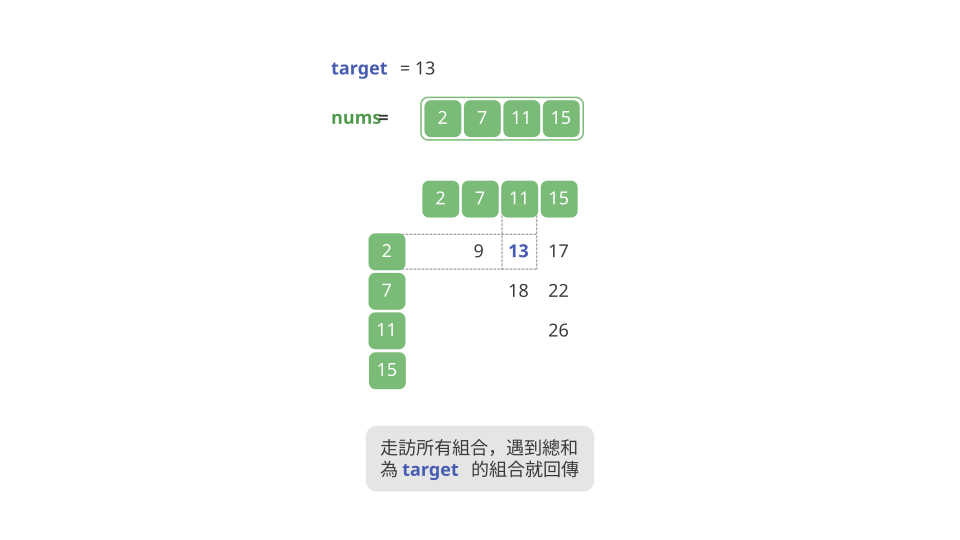
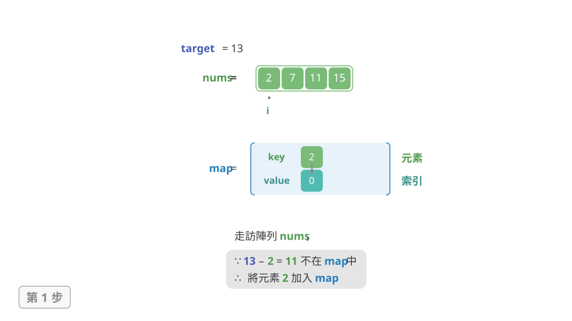
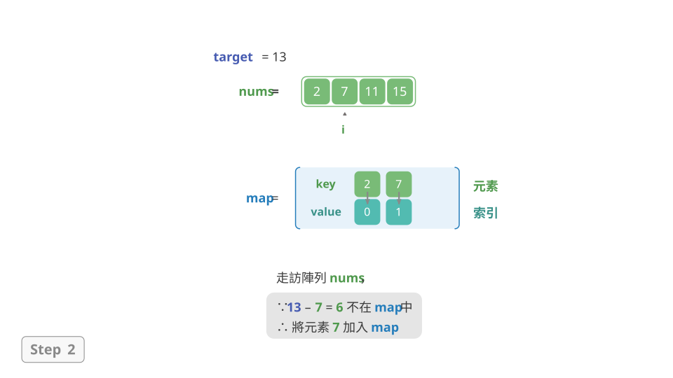
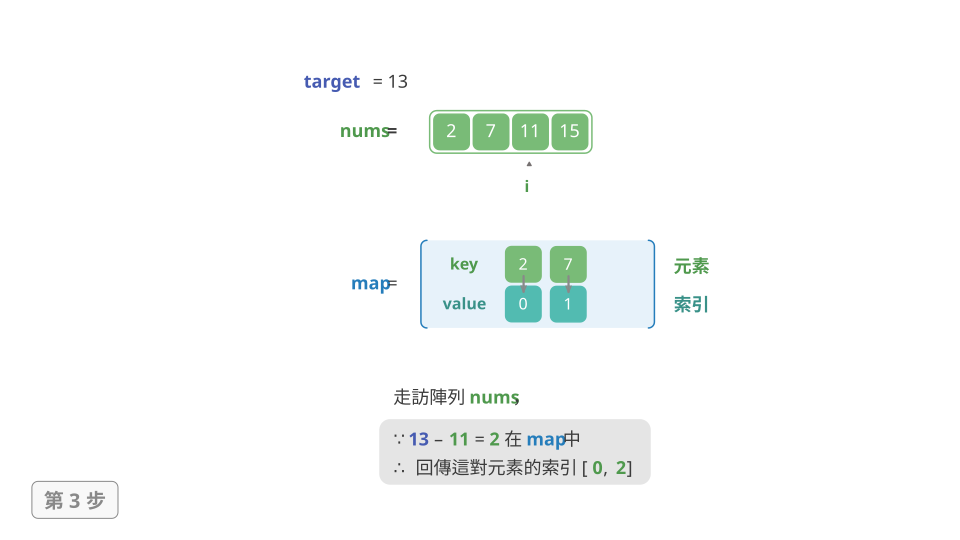

# 以雜湊搜尋提升效率

解演算法題時，**我們常以雜湊搜尋取代循序搜尋，藉此降低演算法的時間複雜度**。以下用一道題目說明這個做法。

!!! question

    給定整數陣列 `nums` 和目標值 `target`，請在陣列中找出兩個相加等於 `target` 的元素，並回傳它們的陣列索引。回傳任一組解即可。

## 循序搜尋：以時間換取空間

可以直接檢查所有可能的組合。如下圖所示，使用兩層迴圈，每次判斷兩個整數的和是否等於 `target`。如果相等，就回傳它們的索引。



程式碼如下：

```src
[file]{two_sum}-[class]{}-[func]{two_sum_brute_force}
```

這個方法的時間複雜度為 $O(n^2)$，空間複雜度為 $O(1)$。資料量大時，會相當耗時。

## 雜湊搜尋：以空間換取時間

可以利用雜湊表，以陣列元素為鍵，以元素的索引為值。用迴圈走訪陣列，每一輪執行下圖所示的步驟。

1. 檢查數字 `target - nums[i]` 是否在雜湊表中。如果在，就直接回傳這兩個元素的索引。
2. 將 `nums[i]` 和索引 `i` 作為一組鍵值對，加入雜湊表。

=== "<1>"
    

=== "<2>"
    

=== "<3>"
    

程式碼如下，只需使用一層迴圈：

```src
[file]{two_sum}-[class]{}-[func]{two_sum_hash_table}
```

這個方法透過雜湊搜尋，將時間複雜度從 $O(n^2)$ 降為 $O(n)$，大幅提升執行效率。

由於需要額外維護一個雜湊表，空間複雜度為 $O(n)$。**整體而言，這個方法在時間和空間效率之間取得較好的平衡，因此是本題的最佳解法**。
