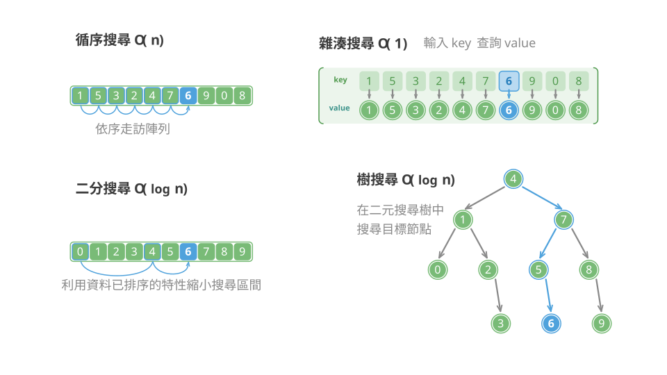

# 重新認識搜尋演算法

<u>搜尋演算法（searching algorithm）</u>用來在陣列、鏈結串列、樹或圖等資料結構中，找出一個或一組符合特定條件的元素。

依實作思路，搜尋演算法可以分成以下兩類。

- **走訪資料結構，找出目標元素**，例如走訪陣列、鏈結串列、樹或圖。
- **利用資料的組織方式或對資料已知的資訊，提高搜尋效率**，例如二分搜尋、雜湊搜尋和二元搜尋樹的搜尋。

前幾章已經介紹過這些做法，搜尋演算法對我們來說並不陌生。這一節要把這些方法放在一起，重新認識搜尋演算法。

## 暴力搜尋

暴力搜尋逐一走訪資料結構中的元素，藉此找出目標元素。

- 「循序搜尋」適用於陣列、鏈結串列等線性資料結構。它從資料結構的一端開始，逐一檢查元素，直到找到目標元素，或到達另一端仍未找到為止。
- 「廣度優先搜尋」和「深度優先搜尋」是走訪圖和樹的兩種策略。廣度優先搜尋從起始節點出發，一層一層地搜尋，由近而遠地走訪各個節點。深度優先搜尋則從起始節點出發，沿著一條路徑走到底，再回溯並嘗試其他路徑，直到走訪完整個資料結構。

暴力搜尋的優點是簡單且適用範圍廣，**無須事先處理資料，也無須使用額外的資料結構**。

不過，**這類演算法的時間複雜度為 $O(n)$**，其中 $n$ 是元素數量，因此資料量大時效能較差。

## 適應性搜尋

適應性搜尋利用資料本身的特性（例如資料已排序）來改善搜尋過程，更有效率地找出目標元素。

- 「二分搜尋」利用資料已排序的特性來提高搜尋效率，只適用於陣列。
- 「雜湊搜尋」以雜湊表中的鍵值對建立對應關係，用要搜尋的資料當作鍵，即可查到對應的目標資料。
- 「樹搜尋」在二元搜尋樹等特定的樹狀結構中，比較節點的值，快速排除不可能的節點，找出目標元素。

這類演算法的優點是效率高，**時間複雜度可達 $O(\log n)$，甚至是 $O(1)$**。

不過，**使用這些演算法通常需要先處理資料**。例如，二分搜尋需要先將陣列排序，雜湊搜尋和樹搜尋都需要額外的資料結構，維護這些結構也需要額外的時間和空間。

!!! tip

    適應性搜尋演算法也常稱為查找演算法，**主要用來在特定的資料結構中快速找出目標元素**。

## 如何選擇搜尋方法

對於一組大小為 $n$ 的資料，可以用循序搜尋、二分搜尋、樹搜尋或雜湊搜尋等方法找出目標元素。下圖說明各種方法的運作方式。

下表比較上述幾種方法的操作效率與特性。

 表 <id> &nbsp; 搜尋演算法的效率比較 

|              | 循序搜尋 | 二分搜尋           | 樹搜尋             | 雜湊搜尋        |
| ------------ | -------- | ------------------ | ------------------ | --------------- |
| 搜尋元素     | $O(n)$   | $O(\log n)$        | $O(\log n)$        | $O(1)$          |
| 插入元素     | $O(1)$   | $O(n)$             | $O(\log n)$        | $O(1)$          |
| 刪除元素     | $O(n)$   | $O(n)$             | $O(\log n)$        | $O(1)$          |
| 額外空間     | $O(1)$   | $O(1)$             | $O(n)$             | $O(n)$          |
| 資料前置處理   | /        | 排序 $O(n \log n)$ | 建立樹 $O(n \log n)$ | 建立雜湊表 $O(n)$ |
| 資料是否有序 | 無序     | 有序               | 有序               | 無序            |

選擇搜尋演算法時，還要考量資料量、搜尋效能需求，以及查詢與更新資料的頻率等因素。

**循序搜尋**

- 適用範圍廣，無須對資料做任何前置處理。若只需要查詢一次，其他三種方法光是前置處理所花的時間，就會比循序搜尋還長。
- 適合資料量小的情況，此時時間複雜度對效率的影響較小。
- 適合經常更新資料的情況，因為這個方法不需要為搜尋另外維護資料。

**二分搜尋**

- 適合資料量大的情況，效率穩定，最差時間複雜度為 $O(\log n)$。
- 由於陣列需要連續的記憶體空間，資料量不能過大。
- 不適合經常新增或刪除資料的情況，因為維持陣列的排列順序成本較高。

**雜湊搜尋**

- 適合對查詢效能要求很高的情況，平均時間複雜度為 $O(1)$。
- 不適合需要維持資料順序或進行範圍查詢的情況，因為雜湊表無法維持資料的排序。
- 效能很依賴雜湊函式和處理雜湊碰撞的策略，效能大幅下降的風險較高。
- 不適合資料量過大的情況，因為雜湊表需要額外的空間，才能盡量減少碰撞，維持良好的查詢效能。

**樹搜尋**

- 適合處理大量資料，因為樹的節點可以分散儲存在記憶體中。
- 適合需要維持資料順序或進行範圍查詢的情況。
- 持續新增或刪除節點可能使二元搜尋樹偏向一側，時間複雜度會退化為 $O(n)$。
- 若使用 AVL 樹或紅黑樹，各項操作都能穩定維持 $O(\log n)$ 的時間複雜度，但維持樹的平衡需要額外成本。
