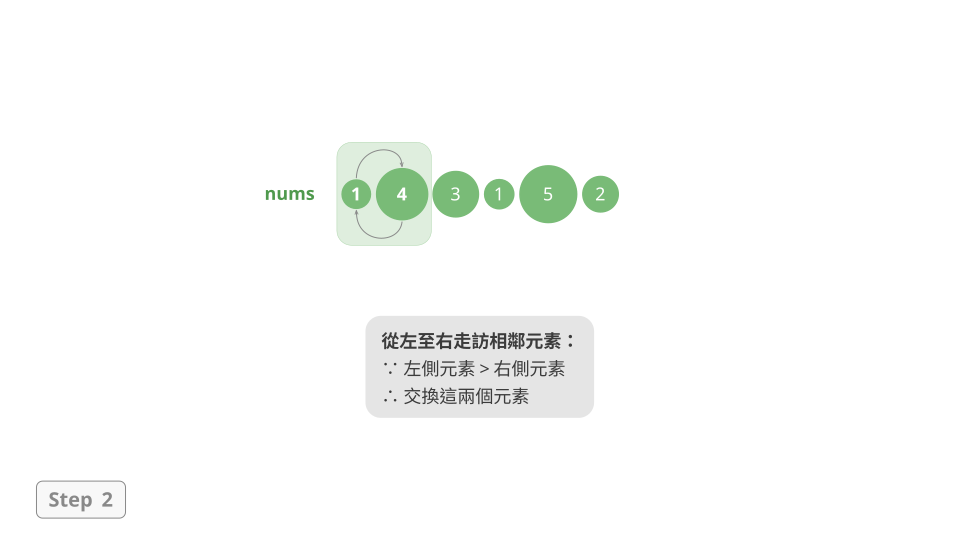
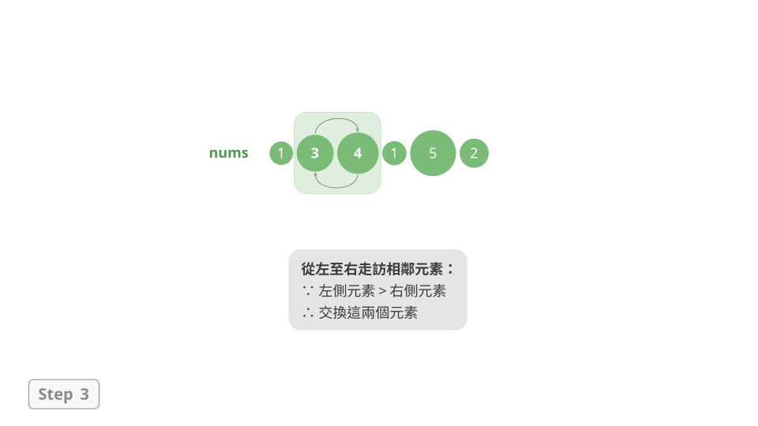

# 11.3 &nbsp; 氣泡排序

<u>氣泡排序（bubble sort）</u>透過反覆比較並交換相鄰元素來完成排序。這個過程就像氣泡從水底逐漸浮到水面，因此得名。

如圖 11-4 所示，我們可以用元素交換來模擬冒泡的過程。從陣列最左端向右走訪，依序比較相鄰元素的大小，如果「左側元素 > 右側元素」，就交換兩者。走訪結束後，最大元素就會移到陣列最右端。

=== "<1>"
    { class="animation-figure" }

=== "<2>"
    { class="animation-figure" }

=== "<3>"
    { class="animation-figure" }

=== "<4>"
    { class="animation-figure" }

=== "<5>"
    { class="animation-figure" }

=== "<6>"
    { class="animation-figure" }

=== "<7>"
    { class="animation-figure" }

<p align="center"> 圖 11-4 &nbsp; 用元素交換模擬冒泡 </p>

## 11.3.1 &nbsp; 演算法流程

假設陣列長度為 $n$，氣泡排序的步驟如圖 11-5 所示。

1. 首先，對 $n$ 個元素進行一輪「冒泡」，**透過交換將陣列的最大元素移到正確位置**。
2. 接著，對剩餘的 $n - 1$ 個元素進行一輪「冒泡」，**透過交換將第二大元素移到正確位置**。
3. 依此類推，經過 $n - 1$ 輪「冒泡」後，**前 $n - 1$ 大的元素都已透過交換移到正確位置**。
4. 只剩下一個元素，它必定是最小元素，無須再排，整個陣列就排好了。

{ class="animation-figure" }

<p align="center"> 圖 11-5 &nbsp; 氣泡排序流程 </p>

範例程式碼如下：

=== "Python"

    ```python title="bubble_sort.py"
    def bubble_sort(nums: list[int]):
        """氣泡排序"""
        n = len(nums)
        # 外層迴圈：尚未排序的區間為 [0, i]
        for i in range(n - 1, 0, -1):
            # 內層迴圈：逐次交換，將未排序區間 [0, i] 中的最大元素移到區間最右端
            for j in range(i):
                if nums[j] > nums[j + 1]:
                    # 交換 nums[j] 與 nums[j + 1]
                    nums[j], nums[j + 1] = nums[j + 1], nums[j]
    ```

=== "C++"

    ```cpp title="bubble_sort.cpp"
    /* 氣泡排序 */
    void bubbleSort(vector<int> &nums) {
        // 外層迴圈：尚未排序的區間為 [0, i]
        for (int i = nums.size() - 1; i > 0; i--) {
            // 內層迴圈：逐次交換，將未排序區間 [0, i] 中的最大元素移到區間最右端
            for (int j = 0; j < i; j++) {
                if (nums[j] > nums[j + 1]) {
                    // 交換 nums[j] 與 nums[j + 1]
                    // 這裡使用 std::swap() 函式
                    swap(nums[j], nums[j + 1]);
                }
            }
        }
    }
    ```

=== "Java"

    ```java title="bubble_sort.java"
    /* 氣泡排序 */
    void bubbleSort(int[] nums) {
        // 外層迴圈：尚未排序的區間為 [0, i]
        for (int i = nums.length - 1; i > 0; i--) {
            // 內層迴圈：逐次交換，將未排序區間 [0, i] 中的最大元素移到區間最右端
            for (int j = 0; j < i; j++) {
                if (nums[j] > nums[j + 1]) {
                    // 交換 nums[j] 與 nums[j + 1]
                    int tmp = nums[j];
                    nums[j] = nums[j + 1];
                    nums[j + 1] = tmp;
                }
            }
        }
    }
    ```

=== "C#"

    ```csharp title="bubble_sort.cs"
    /* 氣泡排序 */
    void BubbleSort(int[] nums) {
        // 外層迴圈：尚未排序的區間為 [0, i]
        for (int i = nums.Length - 1; i > 0; i--) {
            // 內層迴圈：逐次交換，將未排序區間 [0, i] 中的最大元素移到區間最右端
            for (int j = 0; j < i; j++) {
                if (nums[j] > nums[j + 1]) {
                    // 交換 nums[j] 與 nums[j + 1]
                    (nums[j + 1], nums[j]) = (nums[j], nums[j + 1]);
                }
            }
        }
    }
    ```

=== "Go"

    ```go title="bubble_sort.go"
    /* 氣泡排序 */
    func bubbleSort(nums []int) {
        // 外層迴圈：尚未排序的區間為 [0, i]
        for i := len(nums) - 1; i > 0; i-- {
            // 內層迴圈：逐次交換，將未排序區間 [0, i] 中的最大元素移到區間最右端
            for j := 0; j < i; j++ {
                if nums[j] > nums[j+1] {
                    // 交換 nums[j] 與 nums[j + 1]
                    nums[j], nums[j+1] = nums[j+1], nums[j]
                }
            }
        }
    }
    ```

=== "Swift"

    ```swift title="bubble_sort.swift"
    /* 氣泡排序 */
    func bubbleSort(nums: inout [Int]) {
        // 外層迴圈：尚未排序的區間為 [0, i]
        for i in nums.indices.dropFirst().reversed() {
            // 內層迴圈：逐次交換，將未排序區間 [0, i] 中的最大元素移到區間最右端
            for j in 0 ..< i {
                if nums[j] > nums[j + 1] {
                    // 交換 nums[j] 與 nums[j + 1]
                    nums.swapAt(j, j + 1)
                }
            }
        }
    }
    ```

=== "JS"

    ```javascript title="bubble_sort.js"
    /* 氣泡排序 */
    function bubbleSort(nums) {
        // 外層迴圈：尚未排序的區間為 [0, i]
        for (let i = nums.length - 1; i > 0; i--) {
            // 內層迴圈：逐次交換，將未排序區間 [0, i] 中的最大元素移到區間最右端
            for (let j = 0; j < i; j++) {
                if (nums[j] > nums[j + 1]) {
                    // 交換 nums[j] 與 nums[j + 1]
                    let tmp = nums[j];
                    nums[j] = nums[j + 1];
                    nums[j + 1] = tmp;
                }
            }
        }
    }
    ```

=== "TS"

    ```typescript title="bubble_sort.ts"
    /* 氣泡排序 */
    function bubbleSort(nums: number[]): void {
        // 外層迴圈：尚未排序的區間為 [0, i]
        for (let i = nums.length - 1; i > 0; i--) {
            // 內層迴圈：逐次交換，將未排序區間 [0, i] 中的最大元素移到區間最右端
            for (let j = 0; j < i; j++) {
                if (nums[j] > nums[j + 1]) {
                    // 交換 nums[j] 與 nums[j + 1]
                    let tmp = nums[j];
                    nums[j] = nums[j + 1];
                    nums[j + 1] = tmp;
                }
            }
        }
    }
    ```

=== "Dart"

    ```dart title="bubble_sort.dart"
    /* 氣泡排序 */
    void bubbleSort(List<int> nums) {
      // 外層迴圈：尚未排序的區間為 [0, i]
      for (int i = nums.length - 1; i > 0; i--) {
        // 內層迴圈：逐次交換，將未排序區間 [0, i] 中的最大元素移到區間最右端
        for (int j = 0; j < i; j++) {
          if (nums[j] > nums[j + 1]) {
            // 交換 nums[j] 與 nums[j + 1]
            int tmp = nums[j];
            nums[j] = nums[j + 1];
            nums[j + 1] = tmp;
          }
        }
      }
    }
    ```

=== "Rust"

    ```rust title="bubble_sort.rs"
    /* 氣泡排序 */
    fn bubble_sort(nums: &mut [i32]) {
        // 外層迴圈：尚未排序的區間為 [0, i]
        for i in (1..nums.len()).rev() {
            // 內層迴圈：逐次交換，將未排序區間 [0, i] 中的最大元素移到區間最右端
            for j in 0..i {
                if nums[j] > nums[j + 1] {
                    // 交換 nums[j] 與 nums[j + 1]
                    nums.swap(j, j + 1);
                }
            }
        }
    }
    ```

=== "C"

    ```c title="bubble_sort.c"
    /* 氣泡排序 */
    void bubbleSort(int nums[], int size) {
        // 外層迴圈：尚未排序的區間為 [0, i]
        for (int i = size - 1; i > 0; i--) {
            // 內層迴圈：逐次交換，將未排序區間 [0, i] 中的最大元素移到區間最右端
            for (int j = 0; j < i; j++) {
                if (nums[j] > nums[j + 1]) {
                    int temp = nums[j];
                    nums[j] = nums[j + 1];
                    nums[j + 1] = temp;
                }
            }
        }
    }
    ```

=== "Kotlin"

    ```kotlin title="bubble_sort.kt"
    /* 氣泡排序 */
    fun bubbleSort(nums: IntArray) {
        // 外層迴圈：尚未排序的區間為 [0, i]
        for (i in nums.size - 1 downTo 1) {
            // 內層迴圈：逐次交換，將未排序區間 [0, i] 中的最大元素移到區間最右端
            for (j in 0..<i) {
                if (nums[j] > nums[j + 1]) {
                    // 交換 nums[j] 與 nums[j + 1]
                    val temp = nums[j]
                    nums[j] = nums[j + 1]
                    nums[j + 1] = temp
                }
            }
        }
    }
    ```

=== "Ruby"

    ```ruby title="bubble_sort.rb"
    ### 氣泡排序 ###
    def bubble_sort(nums)
      n = nums.length
      # 外層迴圈：尚未排序的區間為 [0, i]
      for i in (n - 1).downto(1)
        # 內層迴圈：逐次交換，將未排序區間 [0, i] 中的最大元素移到區間最右端
        for j in 0...i
          if nums[j] > nums[j + 1]
            # 交換 nums[j] 與 nums[j + 1]
            nums[j], nums[j + 1] = nums[j + 1], nums[j]
          end
        end
      end
    end
    ```

??? pythontutor "執行視覺化示範"

    <div style="height: 477px; width: 100%;"><iframe class="pythontutor-iframe" title="執行視覺化示範" src="https://pythontutor.com/iframe-embed.html#code=def%20bubble_sort%28nums%3A%20list%5Bint%5D%29%3A%0A%20%20%20%20%22%22%22%E6%B0%A3%E6%B3%A1%E6%8E%92%E5%BA%8F%22%22%22%0A%20%20%20%20n%20%3D%20len%28nums%29%0A%20%20%20%20%23%20%E5%A4%96%E5%B1%A4%E8%BF%B4%E5%9C%88%EF%BC%9A%E5%B0%9A%E6%9C%AA%E6%8E%92%E5%BA%8F%E7%9A%84%E5%8D%80%E9%96%93%E7%82%BA%20%5B0,%20i%5D%0A%20%20%20%20for%20i%20in%20range%28n%20-%201,%200,%20-1%29%3A%0A%20%20%20%20%20%20%20%20%23%20%E5%85%A7%E5%B1%A4%E8%BF%B4%E5%9C%88%EF%BC%9A%E9%80%90%E6%AC%A1%E4%BA%A4%E6%8F%9B%EF%BC%8C%E5%B0%87%E6%9C%AA%E6%8E%92%E5%BA%8F%E5%8D%80%E9%96%93%20%5B0,%20i%5D%20%E4%B8%AD%E7%9A%84%E6%9C%80%E5%A4%A7%E5%85%83%E7%B4%A0%E7%A7%BB%E5%88%B0%E5%8D%80%E9%96%93%E6%9C%80%E5%8F%B3%E7%AB%AF%0A%20%20%20%20%20%20%20%20for%20j%20in%20range%28i%29%3A%0A%20%20%20%20%20%20%20%20%20%20%20%20if%20nums%5Bj%5D%20%3E%20nums%5Bj%20%2B%201%5D%3A%0A%20%20%20%20%20%20%20%20%20%20%20%20%20%20%20%20%23%20%E4%BA%A4%E6%8F%9B%20nums%5Bj%5D%20%E8%88%87%20nums%5Bj%20%2B%201%5D%0A%20%20%20%20%20%20%20%20%20%20%20%20%20%20%20%20nums%5Bj%5D,%20nums%5Bj%20%2B%201%5D%20%3D%20nums%5Bj%20%2B%201%5D,%20nums%5Bj%5D%0A%0A%22%22%22Driver%20Code%22%22%22%0Aif%20__name__%20%3D%3D%20%22__main__%22%3A%0A%20%20%20%20nums%20%3D%20%5B4,%201,%203,%201,%205,%202%5D%0A%20%20%20%20bubble_sort%28nums%29%0A%20%20%20%20print%28%22%E6%B0%A3%E6%B3%A1%E6%8E%92%E5%BA%8F%E5%AE%8C%E6%88%90%E5%BE%8C%20nums%20%3D%22,%20nums%29&codeDivHeight=472&codeDivWidth=350&cumulative=false&curInstr=4&heapPrimitives=nevernest&origin=opt-frontend.js&py=311&rawInputLstJSON=%5B%5D&textReferences=false"> </iframe></div>
    <div style="margin-top: 5px;"><a href="https://pythontutor.com/iframe-embed.html#code=def%20bubble_sort%28nums%3A%20list%5Bint%5D%29%3A%0A%20%20%20%20%22%22%22%E6%B0%A3%E6%B3%A1%E6%8E%92%E5%BA%8F%22%22%22%0A%20%20%20%20n%20%3D%20len%28nums%29%0A%20%20%20%20%23%20%E5%A4%96%E5%B1%A4%E8%BF%B4%E5%9C%88%EF%BC%9A%E5%B0%9A%E6%9C%AA%E6%8E%92%E5%BA%8F%E7%9A%84%E5%8D%80%E9%96%93%E7%82%BA%20%5B0,%20i%5D%0A%20%20%20%20for%20i%20in%20range%28n%20-%201,%200,%20-1%29%3A%0A%20%20%20%20%20%20%20%20%23%20%E5%85%A7%E5%B1%A4%E8%BF%B4%E5%9C%88%EF%BC%9A%E9%80%90%E6%AC%A1%E4%BA%A4%E6%8F%9B%EF%BC%8C%E5%B0%87%E6%9C%AA%E6%8E%92%E5%BA%8F%E5%8D%80%E9%96%93%20%5B0,%20i%5D%20%E4%B8%AD%E7%9A%84%E6%9C%80%E5%A4%A7%E5%85%83%E7%B4%A0%E7%A7%BB%E5%88%B0%E5%8D%80%E9%96%93%E6%9C%80%E5%8F%B3%E7%AB%AF%0A%20%20%20%20%20%20%20%20for%20j%20in%20range%28i%29%3A%0A%20%20%20%20%20%20%20%20%20%20%20%20if%20nums%5Bj%5D%20%3E%20nums%5Bj%20%2B%201%5D%3A%0A%20%20%20%20%20%20%20%20%20%20%20%20%20%20%20%20%23%20%E4%BA%A4%E6%8F%9B%20nums%5Bj%5D%20%E8%88%87%20nums%5Bj%20%2B%201%5D%0A%20%20%20%20%20%20%20%20%20%20%20%20%20%20%20%20nums%5Bj%5D,%20nums%5Bj%20%2B%201%5D%20%3D%20nums%5Bj%20%2B%201%5D,%20nums%5Bj%5D%0A%0A%22%22%22Driver%20Code%22%22%22%0Aif%20__name__%20%3D%3D%20%22__main__%22%3A%0A%20%20%20%20nums%20%3D%20%5B4,%201,%203,%201,%205,%202%5D%0A%20%20%20%20bubble_sort%28nums%29%0A%20%20%20%20print%28%22%E6%B0%A3%E6%B3%A1%E6%8E%92%E5%BA%8F%E5%AE%8C%E6%88%90%E5%BE%8C%20nums%20%3D%22,%20nums%29&codeDivHeight=800&codeDivWidth=600&cumulative=false&curInstr=4&heapPrimitives=nevernest&origin=opt-frontend.js&py=311&rawInputLstJSON=%5B%5D&textReferences=false" target="_blank" rel="noopener noreferrer">全螢幕觀看 ></a></div>

## 11.3.2 &nbsp; 提升效率

如果某一輪「冒泡」全程都沒有交換，表示陣列已經排好，可以直接回傳結果。因此，我們可以用旗標 `flag` 記錄本輪是否發生交換，只要發現整輪都沒有交換，就立即回傳。

最佳化後，氣泡排序的最差與平均時間複雜度仍為 $O(n^2)$。當輸入陣列已完全排好時，可以達到最佳時間複雜度 $O(n)$。

=== "Python"

    ```python title="bubble_sort.py"
    def bubble_sort_with_flag(nums: list[int]):
        """氣泡排序（以旗標最佳化）"""
        n = len(nums)
        # 外層迴圈：尚未排序的區間為 [0, i]
        for i in range(n - 1, 0, -1):
            flag = False  # 初始化旗標
            # 內層迴圈：逐次交換，將未排序區間 [0, i] 中的最大元素移到區間最右端
            for j in range(i):
                if nums[j] > nums[j + 1]:
                    # 交換 nums[j] 與 nums[j + 1]
                    nums[j], nums[j + 1] = nums[j + 1], nums[j]
                    flag = True  # 記錄本輪曾交換元素
            if not flag:
                break  # 這一輪「冒泡」未交換任何元素，直接跳出迴圈
    ```

=== "C++"

    ```cpp title="bubble_sort.cpp"
    /* 氣泡排序（以旗標最佳化）*/
    void bubbleSortWithFlag(vector<int> &nums) {
        // 外層迴圈：尚未排序的區間為 [0, i]
        for (int i = nums.size() - 1; i > 0; i--) {
            bool flag = false; // 初始化旗標
            // 內層迴圈：逐次交換，將未排序區間 [0, i] 中的最大元素移到區間最右端
            for (int j = 0; j < i; j++) {
                if (nums[j] > nums[j + 1]) {
                    // 交換 nums[j] 與 nums[j + 1]
                    // 這裡使用 std::swap() 函式
                    swap(nums[j], nums[j + 1]);
                    flag = true; // 記錄本輪曾交換元素
                }
            }
            if (!flag)
                break; // 這一輪「冒泡」未交換任何元素，直接跳出迴圈
        }
    }
    ```

=== "Java"

    ```java title="bubble_sort.java"
    /* 氣泡排序（以旗標最佳化） */
    void bubbleSortWithFlag(int[] nums) {
        // 外層迴圈：尚未排序的區間為 [0, i]
        for (int i = nums.length - 1; i > 0; i--) {
            boolean flag = false; // 初始化旗標
            // 內層迴圈：逐次交換，將未排序區間 [0, i] 中的最大元素移到區間最右端
            for (int j = 0; j < i; j++) {
                if (nums[j] > nums[j + 1]) {
                    // 交換 nums[j] 與 nums[j + 1]
                    int tmp = nums[j];
                    nums[j] = nums[j + 1];
                    nums[j + 1] = tmp;
                    flag = true; // 記錄本輪曾交換元素
                }
            }
            if (!flag)
                break; // 這一輪「冒泡」未交換任何元素，直接跳出迴圈
        }
    }
    ```

=== "C#"

    ```csharp title="bubble_sort.cs"
    /* 氣泡排序（以旗標最佳化）*/
    void BubbleSortWithFlag(int[] nums) {
        // 外層迴圈：尚未排序的區間為 [0, i]
        for (int i = nums.Length - 1; i > 0; i--) {
            bool flag = false; // 初始化旗標
            // 內層迴圈：逐次交換，將未排序區間 [0, i] 中的最大元素移到區間最右端
            for (int j = 0; j < i; j++) {
                if (nums[j] > nums[j + 1]) {
                    // 交換 nums[j] 與 nums[j + 1]
                    (nums[j + 1], nums[j]) = (nums[j], nums[j + 1]);
                    flag = true;  // 記錄本輪曾交換元素
                }
            }
            if (!flag) break;     // 這一輪「冒泡」未交換任何元素，直接跳出迴圈
        }
    }
    ```

=== "Go"

    ```go title="bubble_sort.go"
    /* 氣泡排序（以旗標最佳化）*/
    func bubbleSortWithFlag(nums []int) {
        // 外層迴圈：尚未排序的區間為 [0, i]
        for i := len(nums) - 1; i > 0; i-- {
            flag := false // 初始化旗標
            // 內層迴圈：逐次交換，將未排序區間 [0, i] 中的最大元素移到區間最右端
            for j := 0; j < i; j++ {
                if nums[j] > nums[j+1] {
                    // 交換 nums[j] 與 nums[j + 1]
                    nums[j], nums[j+1] = nums[j+1], nums[j]
                    flag = true // 記錄本輪曾交換元素
                }
            }
            if flag == false { // 這一輪「冒泡」未交換任何元素，直接跳出迴圈
                break
            }
        }
    }
    ```

=== "Swift"

    ```swift title="bubble_sort.swift"
    /* 氣泡排序（以旗標最佳化）*/
    func bubbleSortWithFlag(nums: inout [Int]) {
        // 外層迴圈：尚未排序的區間為 [0, i]
        for i in nums.indices.dropFirst().reversed() {
            var flag = false // 初始化旗標
            for j in 0 ..< i {
                if nums[j] > nums[j + 1] {
                    // 交換 nums[j] 與 nums[j + 1]
                    nums.swapAt(j, j + 1)
                    flag = true // 記錄本輪曾交換元素
                }
            }
            if !flag { // 這一輪「冒泡」未交換任何元素，直接跳出迴圈
                break
            }
        }
    }
    ```

=== "JS"

    ```javascript title="bubble_sort.js"
    /* 氣泡排序（以旗標最佳化）*/
    function bubbleSortWithFlag(nums) {
        // 外層迴圈：尚未排序的區間為 [0, i]
        for (let i = nums.length - 1; i > 0; i--) {
            let flag = false; // 初始化旗標
            // 內層迴圈：逐次交換，將未排序區間 [0, i] 中的最大元素移到區間最右端
            for (let j = 0; j < i; j++) {
                if (nums[j] > nums[j + 1]) {
                    // 交換 nums[j] 與 nums[j + 1]
                    let tmp = nums[j];
                    nums[j] = nums[j + 1];
                    nums[j + 1] = tmp;
                    flag = true; // 記錄本輪曾交換元素
                }
            }
            if (!flag) break; // 這一輪「冒泡」未交換任何元素，直接跳出迴圈
        }
    }
    ```

=== "TS"

    ```typescript title="bubble_sort.ts"
    /* 氣泡排序（以旗標最佳化）*/
    function bubbleSortWithFlag(nums: number[]): void {
        // 外層迴圈：尚未排序的區間為 [0, i]
        for (let i = nums.length - 1; i > 0; i--) {
            let flag = false; // 初始化旗標
            // 內層迴圈：逐次交換，將未排序區間 [0, i] 中的最大元素移到區間最右端
            for (let j = 0; j < i; j++) {
                if (nums[j] > nums[j + 1]) {
                    // 交換 nums[j] 與 nums[j + 1]
                    let tmp = nums[j];
                    nums[j] = nums[j + 1];
                    nums[j + 1] = tmp;
                    flag = true; // 記錄本輪曾交換元素
                }
            }
            if (!flag) break; // 這一輪「冒泡」未交換任何元素，直接跳出迴圈
        }
    }
    ```

=== "Dart"

    ```dart title="bubble_sort.dart"
    /* 氣泡排序（以旗標最佳化）*/
    void bubbleSortWithFlag(List<int> nums) {
      // 外層迴圈：尚未排序的區間為 [0, i]
      for (int i = nums.length - 1; i > 0; i--) {
        bool flag = false; // 初始化旗標
        // 內層迴圈：逐次交換，將未排序區間 [0, i] 中的最大元素移到區間最右端
        for (int j = 0; j < i; j++) {
          if (nums[j] > nums[j + 1]) {
            // 交換 nums[j] 與 nums[j + 1]
            int tmp = nums[j];
            nums[j] = nums[j + 1];
            nums[j + 1] = tmp;
            flag = true; // 記錄本輪曾交換元素
          }
        }
        if (!flag) break; // 這一輪「冒泡」未交換任何元素，直接跳出迴圈
      }
    }
    ```

=== "Rust"

    ```rust title="bubble_sort.rs"
    /* 氣泡排序（以旗標最佳化） */
    fn bubble_sort_with_flag(nums: &mut [i32]) {
        // 外層迴圈：尚未排序的區間為 [0, i]
        for i in (1..nums.len()).rev() {
            let mut flag = false; // 初始化旗標
            // 內層迴圈：逐次交換，將未排序區間 [0, i] 中的最大元素移到區間最右端
            for j in 0..i {
                if nums[j] > nums[j + 1] {
                    // 交換 nums[j] 與 nums[j + 1]
                    nums.swap(j, j + 1);
                    flag = true; // 記錄本輪曾交換元素
                }
            }
            if !flag {
                break; // 這一輪「冒泡」未交換任何元素，直接跳出迴圈
            };
        }
    }
    ```

=== "C"

    ```c title="bubble_sort.c"
    /* 氣泡排序（以旗標最佳化）*/
    void bubbleSortWithFlag(int nums[], int size) {
        // 外層迴圈：尚未排序的區間為 [0, i]
        for (int i = size - 1; i > 0; i--) {
            bool flag = false;
            // 內層迴圈：逐次交換，將未排序區間 [0, i] 中的最大元素移到區間最右端
            for (int j = 0; j < i; j++) {
                if (nums[j] > nums[j + 1]) {
                    int temp = nums[j];
                    nums[j] = nums[j + 1];
                    nums[j + 1] = temp;
                    flag = true;
                }
            }
            if (!flag)
                break;
        }
    }
    ```

=== "Kotlin"

    ```kotlin title="bubble_sort.kt"
    /* 氣泡排序（以旗標最佳化） */
    fun bubbleSortWithFlag(nums: IntArray) {
        // 外層迴圈：尚未排序的區間為 [0, i]
        for (i in nums.size - 1 downTo 1) {
            var flag = false // 初始化旗標
            // 內層迴圈：逐次交換，將未排序區間 [0, i] 中的最大元素移到區間最右端
            for (j in 0..<i) {
                if (nums[j] > nums[j + 1]) {
                    // 交換 nums[j] 與 nums[j + 1]
                    val temp = nums[j]
                    nums[j] = nums[j + 1]
                    nums[j + 1] = temp
                    flag = true // 記錄本輪曾交換元素
                }
            }
            if (!flag) break // 這一輪「冒泡」未交換任何元素，直接跳出迴圈
        }
    }
    ```

=== "Ruby"

    ```ruby title="bubble_sort.rb"
    ### 氣泡排序（以旗標最佳化）###
    def bubble_sort_with_flag(nums)
      n = nums.length
      # 外層迴圈：尚未排序的區間為 [0, i]
      for i in (n - 1).downto(1)
        flag = false # 初始化旗標

        # 內層迴圈：逐次交換，將未排序區間 [0, i] 中的最大元素移到區間最右端
        for j in 0...i
          if nums[j] > nums[j + 1]
            # 交換 nums[j] 與 nums[j + 1]
            nums[j], nums[j + 1] = nums[j + 1], nums[j]
            flag = true # 記錄本輪曾交換元素
          end
        end

        break unless flag # 這一輪「冒泡」未交換任何元素，直接跳出迴圈
      end
    end
    ```

??? pythontutor "執行視覺化示範"

    <div style="height: 549px; width: 100%;"><iframe class="pythontutor-iframe" title="執行視覺化示範" src="https://pythontutor.com/iframe-embed.html#code=def%20bubble_sort_with_flag%28nums%3A%20list%5Bint%5D%29%3A%0A%20%20%20%20%22%22%22%E6%B0%A3%E6%B3%A1%E6%8E%92%E5%BA%8F%EF%BC%88%E4%BB%A5%E6%97%97%E6%A8%99%E6%9C%80%E4%BD%B3%E5%8C%96%EF%BC%89%22%22%22%0A%20%20%20%20n%20%3D%20len%28nums%29%0A%20%20%20%20%23%20%E5%A4%96%E5%B1%A4%E8%BF%B4%E5%9C%88%EF%BC%9A%E5%B0%9A%E6%9C%AA%E6%8E%92%E5%BA%8F%E7%9A%84%E5%8D%80%E9%96%93%E7%82%BA%20%5B0,%20i%5D%0A%20%20%20%20for%20i%20in%20range%28n%20-%201,%200,%20-1%29%3A%0A%20%20%20%20%20%20%20%20flag%20%3D%20False%20%20%23%20%E5%88%9D%E5%A7%8B%E5%8C%96%E6%97%97%E6%A8%99%0A%20%20%20%20%20%20%20%20%23%20%E5%85%A7%E5%B1%A4%E8%BF%B4%E5%9C%88%EF%BC%9A%E9%80%90%E6%AC%A1%E4%BA%A4%E6%8F%9B%EF%BC%8C%E5%B0%87%E6%9C%AA%E6%8E%92%E5%BA%8F%E5%8D%80%E9%96%93%20%5B0,%20i%5D%20%E4%B8%AD%E7%9A%84%E6%9C%80%E5%A4%A7%E5%85%83%E7%B4%A0%E7%A7%BB%E5%88%B0%E5%8D%80%E9%96%93%E6%9C%80%E5%8F%B3%E7%AB%AF%0A%20%20%20%20%20%20%20%20for%20j%20in%20range%28i%29%3A%0A%20%20%20%20%20%20%20%20%20%20%20%20if%20nums%5Bj%5D%20%3E%20nums%5Bj%20%2B%201%5D%3A%0A%20%20%20%20%20%20%20%20%20%20%20%20%20%20%20%20%23%20%E4%BA%A4%E6%8F%9B%20nums%5Bj%5D%20%E8%88%87%20nums%5Bj%20%2B%201%5D%0A%20%20%20%20%20%20%20%20%20%20%20%20%20%20%20%20nums%5Bj%5D,%20nums%5Bj%20%2B%201%5D%20%3D%20nums%5Bj%20%2B%201%5D,%20nums%5Bj%5D%0A%20%20%20%20%20%20%20%20%20%20%20%20%20%20%20%20flag%20%3D%20True%20%20%23%20%E8%A8%98%E9%8C%84%E6%9C%AC%E8%BC%AA%E6%9B%BE%E4%BA%A4%E6%8F%9B%E5%85%83%E7%B4%A0%0A%20%20%20%20%20%20%20%20if%20not%20flag%3A%0A%20%20%20%20%20%20%20%20%20%20%20%20break%20%20%23%20%E9%80%99%E4%B8%80%E8%BC%AA%E3%80%8C%E5%86%92%E6%B3%A1%E3%80%8D%E6%9C%AA%E4%BA%A4%E6%8F%9B%E4%BB%BB%E4%BD%95%E5%85%83%E7%B4%A0%EF%BC%8C%E7%9B%B4%E6%8E%A5%E8%B7%B3%E5%87%BA%E8%BF%B4%E5%9C%88%0A%0A%22%22%22Driver%20Code%22%22%22%0Aif%20__name__%20%3D%3D%20%22__main__%22%3A%0A%20%20%20%20nums%20%3D%20%5B4,%201,%203,%201,%205,%202%5D%0A%20%20%20%20bubble_sort_with_flag%28nums%29%0A%20%20%20%20print%28%22%E6%B0%A3%E6%B3%A1%E6%8E%92%E5%BA%8F%E5%AE%8C%E6%88%90%E5%BE%8C%20nums%20%3D%22,%20nums%29&codeDivHeight=472&codeDivWidth=350&cumulative=false&curInstr=4&heapPrimitives=nevernest&origin=opt-frontend.js&py=311&rawInputLstJSON=%5B%5D&textReferences=false"> </iframe></div>
    <div style="margin-top: 5px;"><a href="https://pythontutor.com/iframe-embed.html#code=def%20bubble_sort_with_flag%28nums%3A%20list%5Bint%5D%29%3A%0A%20%20%20%20%22%22%22%E6%B0%A3%E6%B3%A1%E6%8E%92%E5%BA%8F%EF%BC%88%E4%BB%A5%E6%97%97%E6%A8%99%E6%9C%80%E4%BD%B3%E5%8C%96%EF%BC%89%22%22%22%0A%20%20%20%20n%20%3D%20len%28nums%29%0A%20%20%20%20%23%20%E5%A4%96%E5%B1%A4%E8%BF%B4%E5%9C%88%EF%BC%9A%E5%B0%9A%E6%9C%AA%E6%8E%92%E5%BA%8F%E7%9A%84%E5%8D%80%E9%96%93%E7%82%BA%20%5B0,%20i%5D%0A%20%20%20%20for%20i%20in%20range%28n%20-%201,%200,%20-1%29%3A%0A%20%20%20%20%20%20%20%20flag%20%3D%20False%20%20%23%20%E5%88%9D%E5%A7%8B%E5%8C%96%E6%97%97%E6%A8%99%0A%20%20%20%20%20%20%20%20%23%20%E5%85%A7%E5%B1%A4%E8%BF%B4%E5%9C%88%EF%BC%9A%E9%80%90%E6%AC%A1%E4%BA%A4%E6%8F%9B%EF%BC%8C%E5%B0%87%E6%9C%AA%E6%8E%92%E5%BA%8F%E5%8D%80%E9%96%93%20%5B0,%20i%5D%20%E4%B8%AD%E7%9A%84%E6%9C%80%E5%A4%A7%E5%85%83%E7%B4%A0%E7%A7%BB%E5%88%B0%E5%8D%80%E9%96%93%E6%9C%80%E5%8F%B3%E7%AB%AF%0A%20%20%20%20%20%20%20%20for%20j%20in%20range%28i%29%3A%0A%20%20%20%20%20%20%20%20%20%20%20%20if%20nums%5Bj%5D%20%3E%20nums%5Bj%20%2B%201%5D%3A%0A%20%20%20%20%20%20%20%20%20%20%20%20%20%20%20%20%23%20%E4%BA%A4%E6%8F%9B%20nums%5Bj%5D%20%E8%88%87%20nums%5Bj%20%2B%201%5D%0A%20%20%20%20%20%20%20%20%20%20%20%20%20%20%20%20nums%5Bj%5D,%20nums%5Bj%20%2B%201%5D%20%3D%20nums%5Bj%20%2B%201%5D,%20nums%5Bj%5D%0A%20%20%20%20%20%20%20%20%20%20%20%20%20%20%20%20flag%20%3D%20True%20%20%23%20%E8%A8%98%E9%8C%84%E6%9C%AC%E8%BC%AA%E6%9B%BE%E4%BA%A4%E6%8F%9B%E5%85%83%E7%B4%A0%0A%20%20%20%20%20%20%20%20if%20not%20flag%3A%0A%20%20%20%20%20%20%20%20%20%20%20%20break%20%20%23%20%E9%80%99%E4%B8%80%E8%BC%AA%E3%80%8C%E5%86%92%E6%B3%A1%E3%80%8D%E6%9C%AA%E4%BA%A4%E6%8F%9B%E4%BB%BB%E4%BD%95%E5%85%83%E7%B4%A0%EF%BC%8C%E7%9B%B4%E6%8E%A5%E8%B7%B3%E5%87%BA%E8%BF%B4%E5%9C%88%0A%0A%22%22%22Driver%20Code%22%22%22%0Aif%20__name__%20%3D%3D%20%22__main__%22%3A%0A%20%20%20%20nums%20%3D%20%5B4,%201,%203,%201,%205,%202%5D%0A%20%20%20%20bubble_sort_with_flag%28nums%29%0A%20%20%20%20print%28%22%E6%B0%A3%E6%B3%A1%E6%8E%92%E5%BA%8F%E5%AE%8C%E6%88%90%E5%BE%8C%20nums%20%3D%22,%20nums%29&codeDivHeight=800&codeDivWidth=600&cumulative=false&curInstr=4&heapPrimitives=nevernest&origin=opt-frontend.js&py=311&rawInputLstJSON=%5B%5D&textReferences=false" target="_blank" rel="noopener noreferrer">全螢幕觀看 ></a></div>

## 11.3.3 &nbsp; 演算法特性

- **時間複雜度為 $O(n^2)$、具調適性的排序**：每輪「冒泡」需要走訪的陣列長度依序為 $n - 1$、$n - 2$、$\dots$、$2$、$1$，總和為 $(n - 1) n / 2$。加入 `flag` 這項最佳化後，最佳時間複雜度可達 $O(n)$。
- **空間複雜度為 $O(1)$、原地排序**：指標 $i$ 和 $j$ 只占用常數大小的額外空間。
- **穩定排序**：「冒泡」過程中遇到相等元素時，不會交換兩者。
