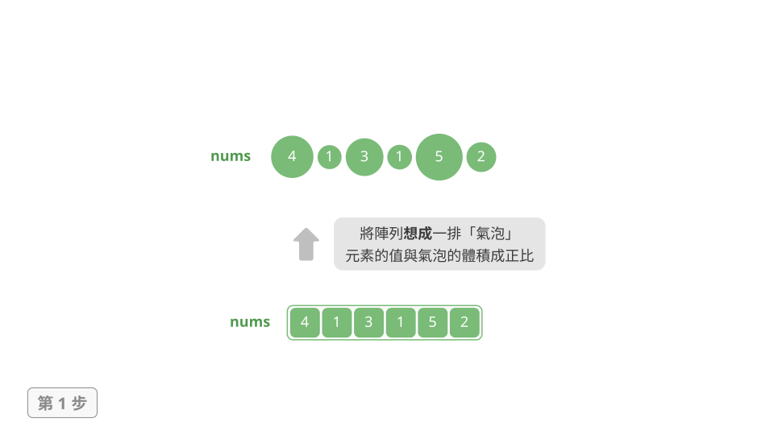
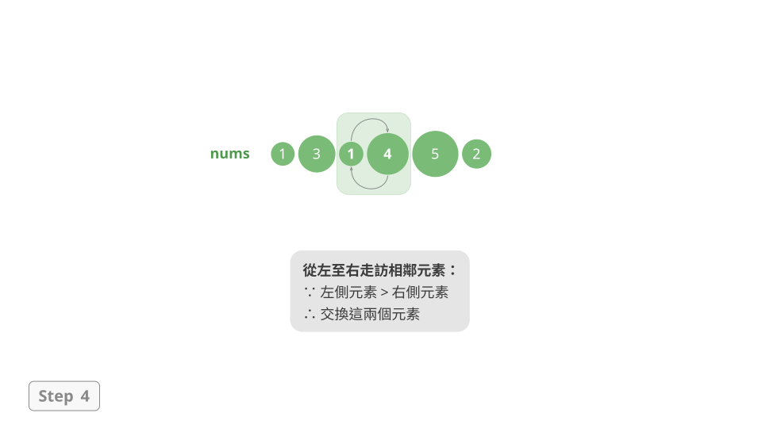
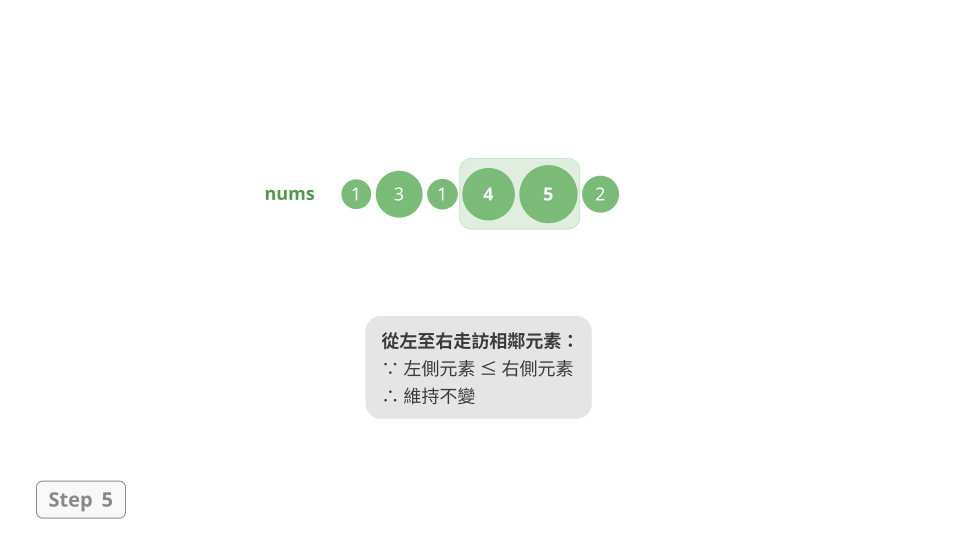
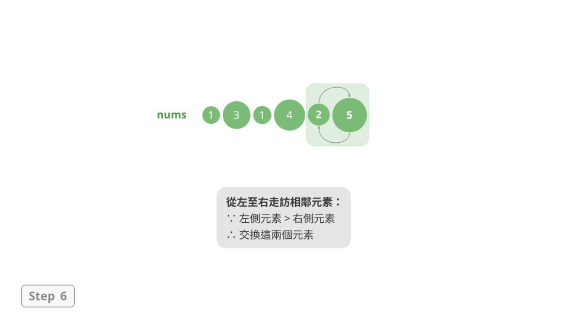
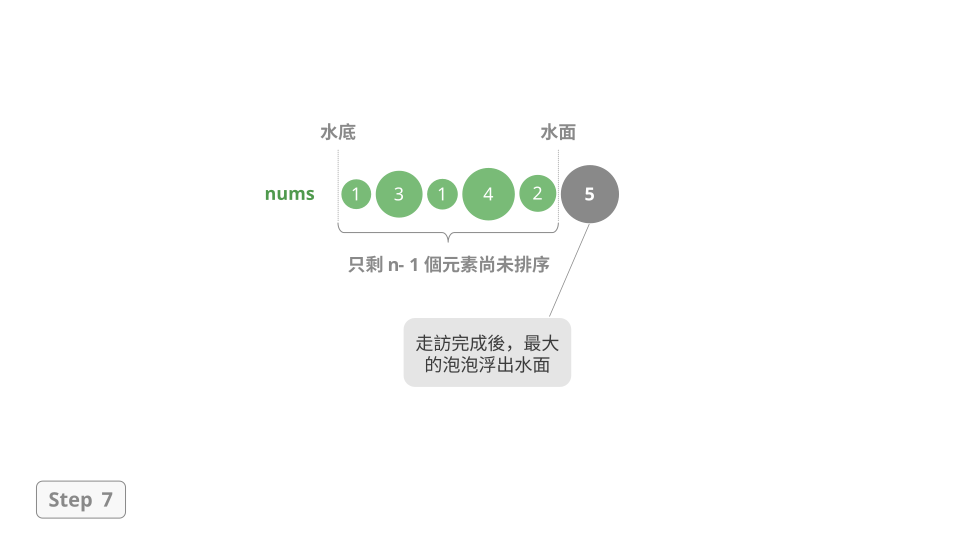
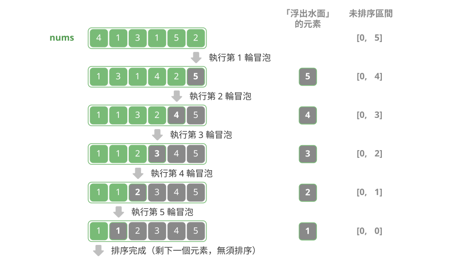

# 氣泡排序

<u>氣泡排序（bubble sort）</u>透過反覆比較並交換相鄰元素來完成排序。這個過程就像氣泡從水底逐漸浮到水面，因此得名。

如下圖所示，我們可以用元素交換來模擬冒泡的過程。從陣列最左端向右走訪，依序比較相鄰元素的大小，如果「左側元素 > 右側元素」，就交換兩者。走訪結束後，最大元素就會移到陣列最右端。

=== "<1>"
    

=== "<2>"
    

=== "<3>"
    

=== "<4>"
    

=== "<5>"
    

=== "<6>"
    

=== "<7>"
    

## 演算法流程

假設陣列長度為 $n$，氣泡排序的步驟如下圖所示。

1. 首先，對 $n$ 個元素進行一輪「冒泡」，**透過交換將陣列的最大元素移到正確位置**。
2. 接著，對剩餘的 $n - 1$ 個元素進行一輪「冒泡」，**透過交換將第二大元素移到正確位置**。
3. 依此類推，經過 $n - 1$ 輪「冒泡」後，**前 $n - 1$ 大的元素都已透過交換移到正確位置**。
4. 只剩下一個元素，它必定是最小元素，無須再排，整個陣列就排好了。



範例程式碼如下：

```src
[file]{bubble_sort}-[class]{}-[func]{bubble_sort}
```

## 提升效率

如果某一輪「冒泡」全程都沒有交換，表示陣列已經排好，可以直接回傳結果。因此，我們可以用旗標 `flag` 記錄本輪是否發生交換，只要發現整輪都沒有交換，就立即回傳。

最佳化後，氣泡排序的最差與平均時間複雜度仍為 $O(n^2)$。當輸入陣列已完全排好時，可以達到最佳時間複雜度 $O(n)$。

```src
[file]{bubble_sort}-[class]{}-[func]{bubble_sort_with_flag}
```

## 演算法特性

- **時間複雜度為 $O(n^2)$、具調適性的排序**：每輪「冒泡」需要走訪的陣列長度依序為 $n - 1$、$n - 2$、$\dots$、$2$、$1$，總和為 $(n - 1) n / 2$。加入 `flag` 這項最佳化後，最佳時間複雜度可達 $O(n)$。
- **空間複雜度為 $O(1)$、原地排序**：指標 $i$ 和 $j$ 只占用常數大小的額外空間。
- **穩定排序**：「冒泡」過程中遇到相等元素時，不會交換兩者。
