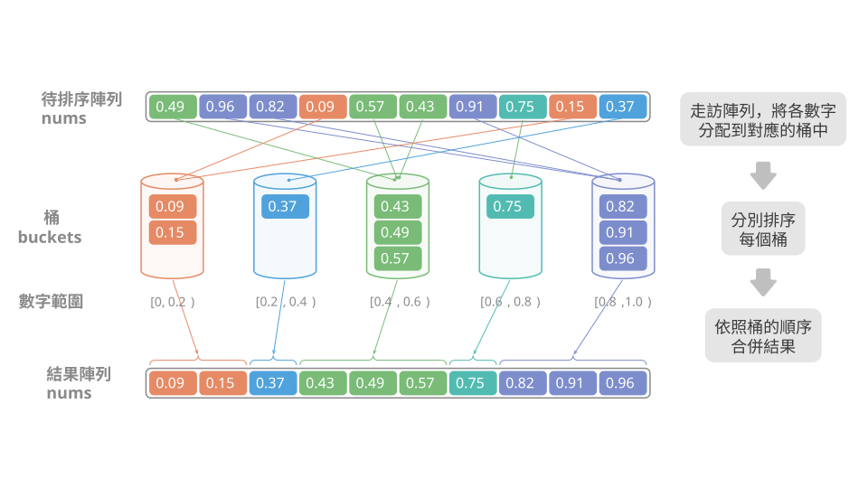
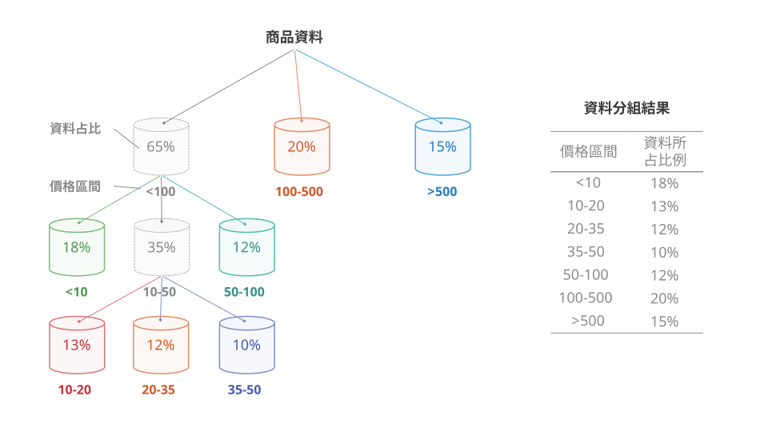
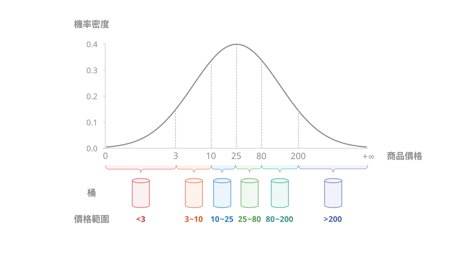

# 桶排序

前面幾種排序演算法都「以比較為基礎」，透過比較元素的大小來決定順序。這類排序演算法在最差情況下的時間複雜度下界為 $\Omega(n \log n)$。接下來介紹幾種「不以比較為基礎的排序演算法」，它們的時間複雜度可以達到線性。

<u>桶排序（bucket sort）</u>是分治策略的典型應用。我們依數值大小設置一系列桶，讓每個桶對應一段資料範圍，將資料平均分到各桶中。接著分別將各桶內的元素排序，最後依桶的順序合併所有資料。

## 演算法流程

考慮一個長度為 $n$ 的陣列，元素都是 $[0, 1)$ 範圍內的浮點數。桶排序的流程如下圖所示。

1. 初始化 $k$ 個桶，將 $n$ 個元素分配到 $k$ 個桶中。
2. 分別將每個桶內的元素排序（這裡使用程式語言內建的排序函式）。
3. 依桶所代表的數值範圍，由小到大合併結果。



程式碼如下：

```src
[file]{bucket_sort}-[class]{}-[func]{bucket_sort}
```

## 演算法特性

桶排序適合處理大量資料。例如，輸入中有 100 萬個元素，系統的記憶體空間有限，無法一次載入全部資料。這時可以將資料分成 1000 個桶，分別將每個桶內的資料排序，最後再合併結果。

- **時間複雜度為 $O(n + k)$**：假設元素平均分布在各桶中，每個桶就有 $\frac{n}{k}$ 個元素。若排序一個桶需要 $O(\frac{n}{k} \log\frac{n}{k})$ 時間，排序所有桶就需要 $O(n \log\frac{n}{k})$ 時間。**當桶數 $k$ 較大時，時間複雜度會趨近 $O(n)$**。合併結果時須走訪所有桶和元素，耗時 $O(n + k)$。最差情況下，所有資料都分到同一個桶，排序該桶需要 $O(n^2)$ 時間。
- **空間複雜度為 $O(n + k)$、非原地排序**：需要額外空間存放 $k$ 個桶及總計 $n$ 個元素。
- 桶排序是否穩定，取決於桶內使用的排序演算法是否穩定。

## 如何將元素平均分到各桶

桶排序的時間複雜度理論上可達 $O(n)$，**關鍵在於讓各桶分到的元素數量均衡**。實際資料往往不是均勻分布的。例如，我們想依價格範圍，將淘寶上的所有商品平均分到 10 個桶中，但商品價格分布不均，低於 100 元的商品很多，高於 1000 元的卻很少。若將價格範圍等分成 10 個區間，各桶的商品數量就會相差很大。

為了平均分配，我們可以先大致設定分界，將資料粗分成 3 個桶。**分配完成後，再將商品較多的桶細分成 3 個桶，反覆進行，直到各桶的元素數量大致相等**。

如下圖所示，這個方法相當於建立一棵遞迴樹，目標是讓各葉節點的值盡量均衡。每輪不一定要分成 3 個桶，可以依資料特徵選擇適當的分法。



如果事先知道商品價格的機率分布，**就能根據這個分布設定各桶的價格分界**。資料分布不一定要另外統計，也可以依資料特徵選擇合適的機率模型來近似。

如下圖所示，假設商品價格服從常態分布，就能據此設定合理的價格區間，將商品平均分到各桶中。


