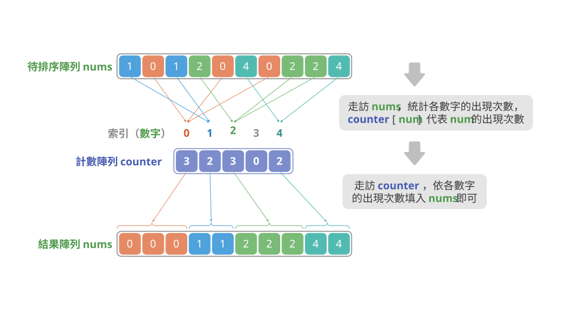
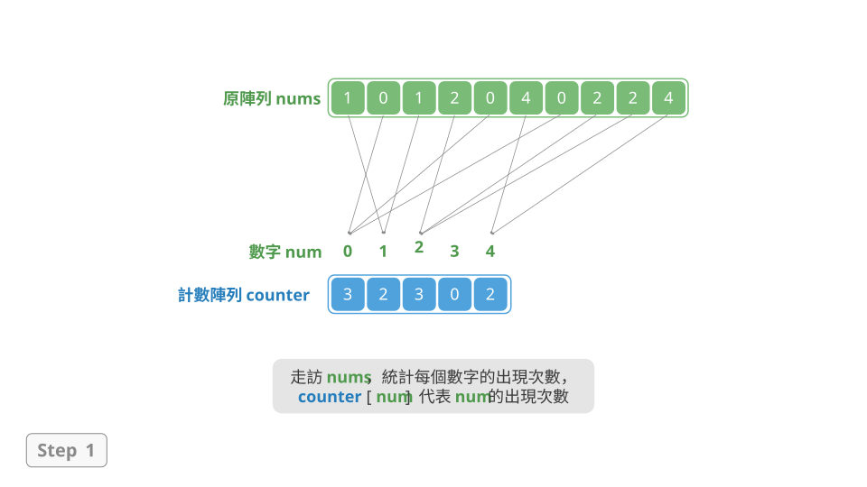
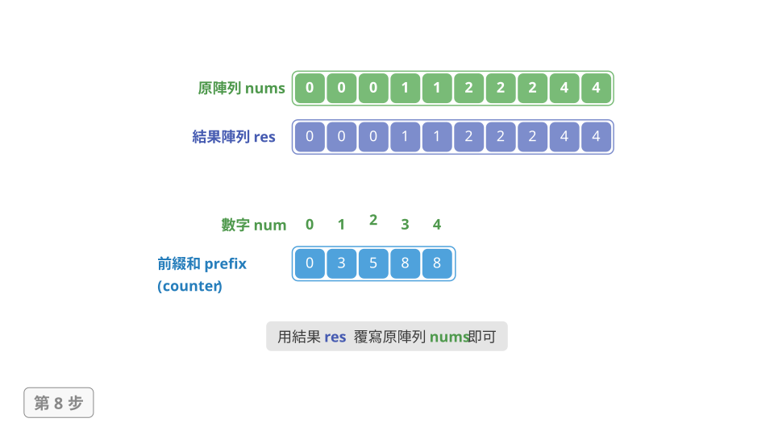

# 11.9 &nbsp; 計數排序

<u>計數排序（counting sort）</u>藉由統計各元素出現的次數來排序，通常用於整數陣列。

## 11.9.1 &nbsp; 簡易實作

先看一個簡單的例子。給定一個長度為 $n$ 的陣列 `nums`，其中的元素都是「非負整數」。計數排序的完整流程如圖 11-16 所示。

1. 走訪陣列，找出其中最大的數字，記為 $m$，然後建立長度為 $m + 1$ 的輔助陣列 `counter`。
2. **利用 `counter` 統計 `nums` 中各數字出現的次數**，其中 `counter[num]` 對應數字 `num` 的出現次數。統計方式很簡單：走訪 `nums`，設目前的數字為 `num`，每輪將 `counter[num]` 加上 $1$ 即可。
3. **由於 `counter` 的索引本來就依序排列，相當於所有數字都已排好**。接著只要走訪 `counter`，按數值由小到大，依各數字出現的次數填入 `nums` 即可。

{ class="animation-figure" }

<p align="center"> 圖 11-16 &nbsp; 計數排序流程 </p>

程式碼如下：

=== "Python"

    ```python title="counting_sort.py"
    def counting_sort_naive(nums: list[int]):
        """計數排序"""
        # 簡易實作，無法用來將物件排序
        # 1. 找出陣列中的最大元素 m
        m = max(nums)
        # 2. 統計各數字出現的次數
        # counter[num] 代表 num 出現的次數
        counter = [0] * (m + 1)
        for num in nums:
            counter[num] += 1
        # 3. 走訪 counter，將各元素填入原陣列 nums
        i = 0
        for num in range(m + 1):
            for _ in range(counter[num]):
                nums[i] = num
                i += 1
    ```

=== "C++"

    ```cpp title="counting_sort.cpp"
    /* 計數排序 */
    // 簡易實作，無法用來將物件排序
    void countingSortNaive(vector<int> &nums) {
        // 1. 找出陣列中的最大元素 m
        int m = 0;
        for (int num : nums) {
            m = max(m, num);
        }
        // 2. 統計各數字出現的次數
        // counter[num] 代表 num 出現的次數
        vector<int> counter(m + 1, 0);
        for (int num : nums) {
            counter[num]++;
        }
        // 3. 走訪 counter，將各元素填入原陣列 nums
        int i = 0;
        for (int num = 0; num < m + 1; num++) {
            for (int j = 0; j < counter[num]; j++, i++) {
                nums[i] = num;
            }
        }
    }
    ```

=== "Java"

    ```java title="counting_sort.java"
    /* 計數排序 */
    // 簡易實作，無法用來將物件排序
    void countingSortNaive(int[] nums) {
        // 1. 找出陣列中的最大元素 m
        int m = 0;
        for (int num : nums) {
            m = Math.max(m, num);
        }
        // 2. 統計各數字出現的次數
        // counter[num] 代表 num 出現的次數
        int[] counter = new int[m + 1];
        for (int num : nums) {
            counter[num]++;
        }
        // 3. 走訪 counter，將各元素填入原陣列 nums
        int i = 0;
        for (int num = 0; num < m + 1; num++) {
            for (int j = 0; j < counter[num]; j++, i++) {
                nums[i] = num;
            }
        }
    }
    ```

=== "C#"

    ```csharp title="counting_sort.cs"
    /* 計數排序 */
    // 簡易實作，無法用來將物件排序
    void CountingSortNaive(int[] nums) {
        // 1. 找出陣列中的最大元素 m
        int m = 0;
        foreach (int num in nums) {
            m = Math.Max(m, num);
        }
        // 2. 統計各數字出現的次數
        // counter[num] 代表 num 出現的次數
        int[] counter = new int[m + 1];
        foreach (int num in nums) {
            counter[num]++;
        }
        // 3. 走訪 counter，將各元素填入原陣列 nums
        int i = 0;
        for (int num = 0; num < m + 1; num++) {
            for (int j = 0; j < counter[num]; j++, i++) {
                nums[i] = num;
            }
        }
    }
    ```

=== "Go"

    ```go title="counting_sort.go"
    /* 計數排序 */
    // 簡易實作，無法用來將物件排序
    func countingSortNaive(nums []int) {
        // 1. 找出陣列中的最大元素 m
        m := 0
        for _, num := range nums {
            if num > m {
                m = num
            }
        }
        // 2. 統計各數字出現的次數
        // counter[num] 代表 num 出現的次數
        counter := make([]int, m+1)
        for _, num := range nums {
            counter[num]++
        }
        // 3. 走訪 counter，將各元素填入原陣列 nums
        for i, num := 0, 0; num < m+1; num++ {
            for j := 0; j < counter[num]; j++ {
                nums[i] = num
                i++
            }
        }
    }
    ```

=== "Swift"

    ```swift title="counting_sort.swift"
    /* 計數排序 */
    // 簡易實作，無法用來將物件排序
    func countingSortNaive(nums: inout [Int]) {
        // 1. 找出陣列中的最大元素 m
        let m = nums.max()!
        // 2. 統計各數字出現的次數
        // counter[num] 代表 num 出現的次數
        var counter = Array(repeating: 0, count: m + 1)
        for num in nums {
            counter[num] += 1
        }
        // 3. 走訪 counter，將各元素填入原陣列 nums
        var i = 0
        for num in 0 ..< m + 1 {
            for _ in 0 ..< counter[num] {
                nums[i] = num
                i += 1
            }
        }
    }
    ```

=== "JS"

    ```javascript title="counting_sort.js"
    /* 計數排序 */
    // 簡易實作，無法用來將物件排序
    function countingSortNaive(nums) {
        // 1. 找出陣列中的最大元素 m
        let m = Math.max(...nums);
        // 2. 統計各數字出現的次數
        // counter[num] 代表 num 出現的次數
        const counter = new Array(m + 1).fill(0);
        for (const num of nums) {
            counter[num]++;
        }
        // 3. 走訪 counter，將各元素填入原陣列 nums
        let i = 0;
        for (let num = 0; num < m + 1; num++) {
            for (let j = 0; j < counter[num]; j++, i++) {
                nums[i] = num;
            }
        }
    }
    ```

=== "TS"

    ```typescript title="counting_sort.ts"
    /* 計數排序 */
    // 簡易實作，無法用來將物件排序
    function countingSortNaive(nums: number[]): void {
        // 1. 找出陣列中的最大元素 m
        let m: number = Math.max(...nums);
        // 2. 統計各數字出現的次數
        // counter[num] 代表 num 出現的次數
        const counter: number[] = new Array<number>(m + 1).fill(0);
        for (const num of nums) {
            counter[num]++;
        }
        // 3. 走訪 counter，將各元素填入原陣列 nums
        let i = 0;
        for (let num = 0; num < m + 1; num++) {
            for (let j = 0; j < counter[num]; j++, i++) {
                nums[i] = num;
            }
        }
    }
    ```

=== "Dart"

    ```dart title="counting_sort.dart"
    /* 計數排序 */
    // 簡易實作，無法用來將物件排序
    void countingSortNaive(List<int> nums) {
      // 1. 找出陣列中的最大元素 m
      int m = 0;
      for (int _num in nums) {
        m = max(m, _num);
      }
      // 2. 統計各數字出現的次數
      // counter[_num] 代表 _num 出現的次數
      List<int> counter = List.filled(m + 1, 0);
      for (int _num in nums) {
        counter[_num]++;
      }
      // 3. 走訪 counter，將各元素填入原陣列 nums
      int i = 0;
      for (int _num = 0; _num < m + 1; _num++) {
        for (int j = 0; j < counter[_num]; j++, i++) {
          nums[i] = _num;
        }
      }
    }
    ```

=== "Rust"

    ```rust title="counting_sort.rs"
    /* 計數排序 */
    // 簡易實作，無法用來將物件排序
    fn counting_sort_naive(nums: &mut [i32]) {
        // 1. 找出陣列中的最大元素 m
        let m = *nums.iter().max().unwrap();
        // 2. 統計各數字出現的次數
        // counter[num] 代表 num 出現的次數
        let mut counter = vec![0; m as usize + 1];
        for &num in nums.iter() {
            counter[num as usize] += 1;
        }
        // 3. 走訪 counter，將各元素填入原陣列 nums
        let mut i = 0;
        for num in 0..m + 1 {
            for _ in 0..counter[num as usize] {
                nums[i] = num;
                i += 1;
            }
        }
    }
    ```

=== "C"

    ```c title="counting_sort.c"
    /* 計數排序 */
    // 簡易實作，無法用來將物件排序
    void countingSortNaive(int nums[], int size) {
        // 1. 找出陣列中的最大元素 m
        int m = 0;
        for (int i = 0; i < size; i++) {
            if (nums[i] > m) {
                m = nums[i];
            }
        }
        // 2. 統計各數字出現的次數
        // counter[num] 代表 num 出現的次數
        int *counter = calloc(m + 1, sizeof(int));
        for (int i = 0; i < size; i++) {
            counter[nums[i]]++;
        }
        // 3. 走訪 counter，將各元素填入原陣列 nums
        int i = 0;
        for (int num = 0; num < m + 1; num++) {
            for (int j = 0; j < counter[num]; j++, i++) {
                nums[i] = num;
            }
        }
        // 4. 釋放記憶體
        free(counter);
    }
    ```

=== "Kotlin"

    ```kotlin title="counting_sort.kt"
    /* 計數排序 */
    // 簡易實作，無法用來將物件排序
    fun countingSortNaive(nums: IntArray) {
        // 1. 找出陣列中的最大元素 m
        var m = 0
        for (num in nums) {
            m = max(m, num)
        }
        // 2. 統計各數字出現的次數
        // counter[num] 代表 num 出現的次數
        val counter = IntArray(m + 1)
        for (num in nums) {
            counter[num]++
        }
        // 3. 走訪 counter，將各元素填入原陣列 nums
        var i = 0
        for (num in 0..<m + 1) {
            var j = 0
            while (j < counter[num]) {
                nums[i] = num
                j++
                i++
            }
        }
    }
    ```

=== "Ruby"

    ```ruby title="counting_sort.rb"
    ### 計數排序 ###
    def counting_sort_naive(nums)
      # 簡易實作，無法用來將物件排序
      # 1. 找出陣列中的最大元素 m
      m = 0
      nums.each { |num| m = [m, num].max }
      # 2. 統計各數字出現的次數
      # counter[num] 代表 num 出現的次數
      counter = Array.new(m + 1, 0)
      nums.each { |num| counter[num] += 1 }
      # 3. 走訪 counter，將各元素填入原陣列 nums
      i = 0
      for num in 0...(m + 1)
        (0...counter[num]).each do
          nums[i] = num
          i += 1
        end
      end
    end
    ```

??? pythontutor "執行視覺化示範"

    <div style="height: 549px; width: 100%;"><iframe class="pythontutor-iframe" title="執行視覺化示範" src="https://pythontutor.com/iframe-embed.html#code=def%20counting_sort_naive%28nums%3A%20list%5Bint%5D%29%3A%0A%20%20%20%20%22%22%22%E8%A8%88%E6%95%B8%E6%8E%92%E5%BA%8F%22%22%22%0A%20%20%20%20%23%20%E7%B0%A1%E6%98%93%E5%AF%A6%E4%BD%9C%EF%BC%8C%E7%84%A1%E6%B3%95%E7%94%A8%E4%BE%86%E5%B0%87%E7%89%A9%E4%BB%B6%E6%8E%92%E5%BA%8F%0A%20%20%20%20%23%201.%20%E6%89%BE%E5%87%BA%E9%99%A3%E5%88%97%E4%B8%AD%E7%9A%84%E6%9C%80%E5%A4%A7%E5%85%83%E7%B4%A0%20m%0A%20%20%20%20m%20%3D%200%0A%20%20%20%20for%20num%20in%20nums%3A%0A%20%20%20%20%20%20%20%20m%20%3D%20max%28m,%20num%29%0A%20%20%20%20%23%202.%20%E7%B5%B1%E8%A8%88%E5%90%84%E6%95%B8%E5%AD%97%E5%87%BA%E7%8F%BE%E7%9A%84%E6%AC%A1%E6%95%B8%0A%20%20%20%20%23%20counter%5Bnum%5D%20%E4%BB%A3%E8%A1%A8%20num%20%E5%87%BA%E7%8F%BE%E7%9A%84%E6%AC%A1%E6%95%B8%0A%20%20%20%20counter%20%3D%20%5B0%5D%20%2A%20%28m%20%2B%201%29%0A%20%20%20%20for%20num%20in%20nums%3A%0A%20%20%20%20%20%20%20%20counter%5Bnum%5D%20%2B%3D%201%0A%20%20%20%20%23%203.%20%E8%B5%B0%E8%A8%AA%20counter%EF%BC%8C%E5%B0%87%E5%90%84%E5%85%83%E7%B4%A0%E5%A1%AB%E5%85%A5%E5%8E%9F%E9%99%A3%E5%88%97%20nums%0A%20%20%20%20i%20%3D%200%0A%20%20%20%20for%20num%20in%20range%28m%20%2B%201%29%3A%0A%20%20%20%20%20%20%20%20for%20_%20in%20range%28counter%5Bnum%5D%29%3A%0A%20%20%20%20%20%20%20%20%20%20%20%20nums%5Bi%5D%20%3D%20num%0A%20%20%20%20%20%20%20%20%20%20%20%20i%20%2B%3D%201%0A%0A%22%22%22Driver%20Code%22%22%22%0Aif%20__name__%20%3D%3D%20%22__main__%22%3A%0A%20%20%20%20nums%20%3D%20%5B1,%200,%201,%202,%200,%204,%200,%202,%202,%204%5D%0A%20%20%20%20counting_sort_naive%28nums%29%0A%20%20%20%20print%28f%22%E8%A8%88%E6%95%B8%E6%8E%92%E5%BA%8F%EF%BC%88%E7%84%A1%E6%B3%95%E5%B0%87%E7%89%A9%E4%BB%B6%E6%8E%92%E5%BA%8F%EF%BC%89%E5%AE%8C%E6%88%90%E5%BE%8C%20nums%20%3D%20%7Bnums%7D%22%29&codeDivHeight=472&codeDivWidth=350&cumulative=false&curInstr=4&heapPrimitives=nevernest&origin=opt-frontend.js&py=311&rawInputLstJSON=%5B%5D&textReferences=false"> </iframe></div>
    <div style="margin-top: 5px;"><a href="https://pythontutor.com/iframe-embed.html#code=def%20counting_sort_naive%28nums%3A%20list%5Bint%5D%29%3A%0A%20%20%20%20%22%22%22%E8%A8%88%E6%95%B8%E6%8E%92%E5%BA%8F%22%22%22%0A%20%20%20%20%23%20%E7%B0%A1%E6%98%93%E5%AF%A6%E4%BD%9C%EF%BC%8C%E7%84%A1%E6%B3%95%E7%94%A8%E4%BE%86%E5%B0%87%E7%89%A9%E4%BB%B6%E6%8E%92%E5%BA%8F%0A%20%20%20%20%23%201.%20%E6%89%BE%E5%87%BA%E9%99%A3%E5%88%97%E4%B8%AD%E7%9A%84%E6%9C%80%E5%A4%A7%E5%85%83%E7%B4%A0%20m%0A%20%20%20%20m%20%3D%200%0A%20%20%20%20for%20num%20in%20nums%3A%0A%20%20%20%20%20%20%20%20m%20%3D%20max%28m,%20num%29%0A%20%20%20%20%23%202.%20%E7%B5%B1%E8%A8%88%E5%90%84%E6%95%B8%E5%AD%97%E5%87%BA%E7%8F%BE%E7%9A%84%E6%AC%A1%E6%95%B8%0A%20%20%20%20%23%20counter%5Bnum%5D%20%E4%BB%A3%E8%A1%A8%20num%20%E5%87%BA%E7%8F%BE%E7%9A%84%E6%AC%A1%E6%95%B8%0A%20%20%20%20counter%20%3D%20%5B0%5D%20%2A%20%28m%20%2B%201%29%0A%20%20%20%20for%20num%20in%20nums%3A%0A%20%20%20%20%20%20%20%20counter%5Bnum%5D%20%2B%3D%201%0A%20%20%20%20%23%203.%20%E8%B5%B0%E8%A8%AA%20counter%EF%BC%8C%E5%B0%87%E5%90%84%E5%85%83%E7%B4%A0%E5%A1%AB%E5%85%A5%E5%8E%9F%E9%99%A3%E5%88%97%20nums%0A%20%20%20%20i%20%3D%200%0A%20%20%20%20for%20num%20in%20range%28m%20%2B%201%29%3A%0A%20%20%20%20%20%20%20%20for%20_%20in%20range%28counter%5Bnum%5D%29%3A%0A%20%20%20%20%20%20%20%20%20%20%20%20nums%5Bi%5D%20%3D%20num%0A%20%20%20%20%20%20%20%20%20%20%20%20i%20%2B%3D%201%0A%0A%22%22%22Driver%20Code%22%22%22%0Aif%20__name__%20%3D%3D%20%22__main__%22%3A%0A%20%20%20%20nums%20%3D%20%5B1,%200,%201,%202,%200,%204,%200,%202,%202,%204%5D%0A%20%20%20%20counting_sort_naive%28nums%29%0A%20%20%20%20print%28f%22%E8%A8%88%E6%95%B8%E6%8E%92%E5%BA%8F%EF%BC%88%E7%84%A1%E6%B3%95%E5%B0%87%E7%89%A9%E4%BB%B6%E6%8E%92%E5%BA%8F%EF%BC%89%E5%AE%8C%E6%88%90%E5%BE%8C%20nums%20%3D%20%7Bnums%7D%22%29&codeDivHeight=800&codeDivWidth=600&cumulative=false&curInstr=4&heapPrimitives=nevernest&origin=opt-frontend.js&py=311&rawInputLstJSON=%5B%5D&textReferences=false" target="_blank" rel="noopener noreferrer">全螢幕觀看 ></a></div>

!!! note "計數排序與桶排序的關係"

    從桶排序的角度來看，可以將計數陣列 `counter` 的每個索引視為一個桶。統計出現次數，就相當於將每個元素分到對應的桶中。因此，計數排序可以看作桶排序用於整數資料時的一種特例。

## 11.9.2 &nbsp; 完整實作

你可能已經注意到，**如果輸入資料是物件，上述步驟 `3.` 就不適用了**。假設輸入的是商品物件，我們想依商品價格（類別的成員變數）排列這些商品，但上述演算法只能產生排好序的價格。

那麼，如何得到原始資料的排序結果呢？先計算 `counter` 的「前綴和」。顧名思義，索引 `i` 處的前綴和 `prefix[i]` 等於陣列中前 `i + 1` 個元素的總和：

$$
\text{prefix}[i] = \sum_{j=0}^i \text{counter[j]}
$$

**前綴和有明確的意義：`prefix[num] - 1` 代表元素 `num` 在結果陣列 `res` 中最後一次出現的索引**。有了這項資訊，就知道每個元素該放在結果陣列的哪個位置。接著反向走訪原陣列 `nums` 的每個元素 `num`，在每次迭代中執行以下兩步。

1. 將 `num` 填入陣列 `res` 中索引為 `prefix[num] - 1` 的位置。
2. 將前綴和 `prefix[num]` 減去 $1$，便能得到下次放置 `num` 時所需的索引。

走訪結束後，陣列 `res` 中的元素都已排好，最後用 `res` 覆寫原陣列 `nums` 即可。圖 11-17 呈現計數排序的完整流程。

=== "<1>"
    { class="animation-figure" }

=== "<2>"
    { class="animation-figure" }

=== "<3>"
    { class="animation-figure" }

=== "<4>"
    { class="animation-figure" }

=== "<5>"
    { class="animation-figure" }

=== "<6>"
    { class="animation-figure" }

=== "<7>"
    { class="animation-figure" }

=== "<8>"
    { class="animation-figure" }

<p align="center"> 圖 11-17 &nbsp; 計數排序的步驟 </p>

計數排序的實作程式碼如下：

=== "Python"

    ```python title="counting_sort.py"
    def counting_sort(nums: list[int]):
        """計數排序"""
        # 完整實作，可將物件排序，且屬於穩定排序
        # 1. 找出陣列中的最大元素 m
        m = max(nums)
        # 2. 統計各數字出現的次數
        # counter[num] 代表 num 出現的次數
        counter = [0] * (m + 1)
        for num in nums:
            counter[num] += 1
        # 3. 計算 counter 的前綴和，將「出現次數」轉為「結尾索引」
        # 也就是說，counter[num]-1 是 num 在 res 中最後一次出現的索引
        for i in range(m):
            counter[i + 1] += counter[i]
        # 4. 反向走訪 nums，將各元素填入結果陣列 res
        # 初始化陣列 res，用來記錄結果
        n = len(nums)
        res = [0] * n
        for i in range(n - 1, -1, -1):
            num = nums[i]
            res[counter[num] - 1] = num  # 將 num 放到對應索引的位置
            counter[num] -= 1  # 將前綴和減 1，取得下次放置 num 時所需的索引
        # 用結果陣列 res 覆寫原陣列 nums
        for i in range(n):
            nums[i] = res[i]
    ```

=== "C++"

    ```cpp title="counting_sort.cpp"
    /* 計數排序 */
    // 完整實作，可將物件排序，且屬於穩定排序
    void countingSort(vector<int> &nums) {
        // 1. 找出陣列中的最大元素 m
        int m = 0;
        for (int num : nums) {
            m = max(m, num);
        }
        // 2. 統計各數字出現的次數
        // counter[num] 代表 num 出現的次數
        vector<int> counter(m + 1, 0);
        for (int num : nums) {
            counter[num]++;
        }
        // 3. 計算 counter 的前綴和，將「出現次數」轉為「結尾索引」
        // 也就是說，counter[num]-1 是 num 在 res 中最後一次出現的索引
        for (int i = 0; i < m; i++) {
            counter[i + 1] += counter[i];
        }
        // 4. 反向走訪 nums，將各元素填入結果陣列 res
        // 初始化陣列 res，用來記錄結果
        int n = nums.size();
        vector<int> res(n);
        for (int i = n - 1; i >= 0; i--) {
            int num = nums[i];
            res[counter[num] - 1] = num; // 將 num 放到對應索引的位置
            counter[num]--;              // 將前綴和減 1，取得下次放置 num 時所需的索引
        }
        // 用結果陣列 res 覆寫原陣列 nums
        nums = res;
    }
    ```

=== "Java"

    ```java title="counting_sort.java"
    /* 計數排序 */
    // 完整實作，可將物件排序，且屬於穩定排序
    void countingSort(int[] nums) {
        // 1. 找出陣列中的最大元素 m
        int m = 0;
        for (int num : nums) {
            m = Math.max(m, num);
        }
        // 2. 統計各數字出現的次數
        // counter[num] 代表 num 出現的次數
        int[] counter = new int[m + 1];
        for (int num : nums) {
            counter[num]++;
        }
        // 3. 計算 counter 的前綴和，將「出現次數」轉為「結尾索引」
        // 也就是說，counter[num]-1 是 num 在 res 中最後一次出現的索引
        for (int i = 0; i < m; i++) {
            counter[i + 1] += counter[i];
        }
        // 4. 反向走訪 nums，將各元素填入結果陣列 res
        // 初始化陣列 res，用來記錄結果
        int n = nums.length;
        int[] res = new int[n];
        for (int i = n - 1; i >= 0; i--) {
            int num = nums[i];
            res[counter[num] - 1] = num; // 將 num 放到對應索引的位置
            counter[num]--; // 將前綴和減 1，取得下次放置 num 時所需的索引
        }
        // 用結果陣列 res 覆寫原陣列 nums
        for (int i = 0; i < n; i++) {
            nums[i] = res[i];
        }
    }
    ```

=== "C#"

    ```csharp title="counting_sort.cs"
    /* 計數排序 */
    // 完整實作，可將物件排序，且屬於穩定排序
    void CountingSort(int[] nums) {
        // 1. 找出陣列中的最大元素 m
        int m = 0;
        foreach (int num in nums) {
            m = Math.Max(m, num);
        }
        // 2. 統計各數字出現的次數
        // counter[num] 代表 num 出現的次數
        int[] counter = new int[m + 1];
        foreach (int num in nums) {
            counter[num]++;
        }
        // 3. 計算 counter 的前綴和，將「出現次數」轉為「結尾索引」
        // 也就是說，counter[num]-1 是 num 在 res 中最後一次出現的索引
        for (int i = 0; i < m; i++) {
            counter[i + 1] += counter[i];
        }
        // 4. 反向走訪 nums，將各元素填入結果陣列 res
        // 初始化陣列 res，用來記錄結果
        int n = nums.Length;
        int[] res = new int[n];
        for (int i = n - 1; i >= 0; i--) {
            int num = nums[i];
            res[counter[num] - 1] = num; // 將 num 放到對應索引的位置
            counter[num]--; // 將前綴和減 1，取得下次放置 num 時所需的索引
        }
        // 用結果陣列 res 覆寫原陣列 nums
        for (int i = 0; i < n; i++) {
            nums[i] = res[i];
        }
    }
    ```

=== "Go"

    ```go title="counting_sort.go"
    /* 計數排序 */
    // 完整實作，可將物件排序，且屬於穩定排序
    func countingSort(nums []int) {
        // 1. 找出陣列中的最大元素 m
        m := 0
        for _, num := range nums {
            if num > m {
                m = num
            }
        }
        // 2. 統計各數字出現的次數
        // counter[num] 代表 num 出現的次數
        counter := make([]int, m+1)
        for _, num := range nums {
            counter[num]++
        }
        // 3. 計算 counter 的前綴和，將「出現次數」轉為「結尾索引」
        // 也就是說，counter[num]-1 是 num 在 res 中最後一次出現的索引
        for i := 0; i < m; i++ {
            counter[i+1] += counter[i]
        }
        // 4. 反向走訪 nums，將各元素填入結果陣列 res
        // 初始化陣列 res，用來記錄結果
        n := len(nums)
        res := make([]int, n)
        for i := n - 1; i >= 0; i-- {
            num := nums[i]
            // 將 num 放到對應索引的位置
            res[counter[num]-1] = num
            // 將前綴和減 1，取得下次放置 num 時所需的索引
            counter[num]--
        }
        // 用結果陣列 res 覆寫原陣列 nums
        copy(nums, res)
    }
    ```

=== "Swift"

    ```swift title="counting_sort.swift"
    /* 計數排序 */
    // 完整實作，可將物件排序，且屬於穩定排序
    func countingSort(nums: inout [Int]) {
        // 1. 找出陣列中的最大元素 m
        let m = nums.max()!
        // 2. 統計各數字出現的次數
        // counter[num] 代表 num 出現的次數
        var counter = Array(repeating: 0, count: m + 1)
        for num in nums {
            counter[num] += 1
        }
        // 3. 計算 counter 的前綴和，將「出現次數」轉為「結尾索引」
        // 也就是說，counter[num]-1 是 num 在 res 中最後一次出現的索引
        for i in 0 ..< m {
            counter[i + 1] += counter[i]
        }
        // 4. 反向走訪 nums，將各元素填入結果陣列 res
        // 初始化陣列 res，用來記錄結果
        var res = Array(repeating: 0, count: nums.count)
        for i in nums.indices.reversed() {
            let num = nums[i]
            res[counter[num] - 1] = num // 將 num 放到對應索引的位置
            counter[num] -= 1 // 將前綴和減 1，取得下次放置 num 時所需的索引
        }
        // 用結果陣列 res 覆寫原陣列 nums
        for i in nums.indices {
            nums[i] = res[i]
        }
    }
    ```

=== "JS"

    ```javascript title="counting_sort.js"
    /* 計數排序 */
    // 完整實作，可將物件排序，且屬於穩定排序
    function countingSort(nums) {
        // 1. 找出陣列中的最大元素 m
        let m = Math.max(...nums);
        // 2. 統計各數字出現的次數
        // counter[num] 代表 num 出現的次數
        const counter = new Array(m + 1).fill(0);
        for (const num of nums) {
            counter[num]++;
        }
        // 3. 計算 counter 的前綴和，將「出現次數」轉為「結尾索引」
        // 也就是說，counter[num]-1 是 num 在 res 中最後一次出現的索引
        for (let i = 0; i < m; i++) {
            counter[i + 1] += counter[i];
        }
        // 4. 反向走訪 nums，將各元素填入結果陣列 res
        // 初始化陣列 res，用來記錄結果
        const n = nums.length;
        const res = new Array(n);
        for (let i = n - 1; i >= 0; i--) {
            const num = nums[i];
            res[counter[num] - 1] = num; // 將 num 放到對應索引的位置
            counter[num]--; // 將前綴和減 1，取得下次放置 num 時所需的索引
        }
        // 用結果陣列 res 覆寫原陣列 nums
        for (let i = 0; i < n; i++) {
            nums[i] = res[i];
        }
    }
    ```

=== "TS"

    ```typescript title="counting_sort.ts"
    /* 計數排序 */
    // 完整實作，可將物件排序，且屬於穩定排序
    function countingSort(nums: number[]): void {
        // 1. 找出陣列中的最大元素 m
        let m: number = Math.max(...nums);
        // 2. 統計各數字出現的次數
        // counter[num] 代表 num 出現的次數
        const counter: number[] = new Array<number>(m + 1).fill(0);
        for (const num of nums) {
            counter[num]++;
        }
        // 3. 計算 counter 的前綴和，將「出現次數」轉為「結尾索引」
        // 也就是說，counter[num]-1 是 num 在 res 中最後一次出現的索引
        for (let i = 0; i < m; i++) {
            counter[i + 1] += counter[i];
        }
        // 4. 反向走訪 nums，將各元素填入結果陣列 res
        // 初始化陣列 res，用來記錄結果
        const n = nums.length;
        const res: number[] = new Array<number>(n);
        for (let i = n - 1; i >= 0; i--) {
            const num = nums[i];
            res[counter[num] - 1] = num; // 將 num 放到對應索引的位置
            counter[num]--; // 將前綴和減 1，取得下次放置 num 時所需的索引
        }
        // 用結果陣列 res 覆寫原陣列 nums
        for (let i = 0; i < n; i++) {
            nums[i] = res[i];
        }
    }
    ```

=== "Dart"

    ```dart title="counting_sort.dart"
    /* 計數排序 */
    // 完整實作，可將物件排序，且屬於穩定排序
    void countingSort(List<int> nums) {
      // 1. 找出陣列中的最大元素 m
      int m = 0;
      for (int _num in nums) {
        m = max(m, _num);
      }
      // 2. 統計各數字出現的次數
      // counter[_num] 代表 _num 出現的次數
      List<int> counter = List.filled(m + 1, 0);
      for (int _num in nums) {
        counter[_num]++;
      }
      // 3. 計算 counter 的前綴和，將「出現次數」轉為「結尾索引」
      // 也就是說，counter[_num]-1 是 _num 在 res 中最後一次出現的索引
      for (int i = 0; i < m; i++) {
        counter[i + 1] += counter[i];
      }
      // 4. 反向走訪 nums，將各元素填入結果陣列 res
      // 初始化陣列 res，用來記錄結果
      int n = nums.length;
      List<int> res = List.filled(n, 0);
      for (int i = n - 1; i >= 0; i--) {
        int _num = nums[i];
        res[counter[_num] - 1] = _num; // 將 _num 放到對應索引的位置
        counter[_num]--; // 將前綴和減 1，取得下次放置 _num 時所需的索引
      }
      // 用結果陣列 res 覆寫原陣列 nums
      nums.setAll(0, res);
    }
    ```

=== "Rust"

    ```rust title="counting_sort.rs"
    /* 計數排序 */
    // 完整實作，可將物件排序，且屬於穩定排序
    fn counting_sort(nums: &mut [i32]) {
        // 1. 找出陣列中的最大元素 m
        let m = *nums.iter().max().unwrap() as usize;
        // 2. 統計各數字出現的次數
        // counter[num] 代表 num 出現的次數
        let mut counter = vec![0; m + 1];
        for &num in nums.iter() {
            counter[num as usize] += 1;
        }
        // 3. 計算 counter 的前綴和，將「出現次數」轉為「結尾索引」
        // 也就是說，counter[num]-1 是 num 在 res 中最後一次出現的索引
        for i in 0..m {
            counter[i + 1] += counter[i];
        }
        // 4. 反向走訪 nums，將各元素填入結果陣列 res
        // 初始化陣列 res，用來記錄結果
        let n = nums.len();
        let mut res = vec![0; n];
        for i in (0..n).rev() {
            let num = nums[i];
            res[counter[num as usize] - 1] = num; // 將 num 放到對應索引的位置
            counter[num as usize] -= 1; // 將前綴和減 1，取得下次放置 num 時所需的索引
        }
        // 用結果陣列 res 覆寫原陣列 nums
        nums.copy_from_slice(&res)
    }
    ```

=== "C"

    ```c title="counting_sort.c"
    /* 計數排序 */
    // 完整實作，可將物件排序，且屬於穩定排序
    void countingSort(int nums[], int size) {
        // 1. 找出陣列中的最大元素 m
        int m = 0;
        for (int i = 0; i < size; i++) {
            if (nums[i] > m) {
                m = nums[i];
            }
        }
        // 2. 統計各數字出現的次數
        // counter[num] 代表 num 出現的次數
        int *counter = calloc(m + 1, sizeof(int));
        for (int i = 0; i < size; i++) {
            counter[nums[i]]++;
        }
        // 3. 計算 counter 的前綴和，將「出現次數」轉為「結尾索引」
        // 也就是說，counter[num]-1 是 num 在 res 中最後一次出現的索引
        for (int i = 0; i < m; i++) {
            counter[i + 1] += counter[i];
        }
        // 4. 反向走訪 nums，將各元素填入結果陣列 res
        // 初始化陣列 res，用來記錄結果
        int *res = malloc(sizeof(int) * size);
        for (int i = size - 1; i >= 0; i--) {
            int num = nums[i];
            res[counter[num] - 1] = num; // 將 num 放到對應索引的位置
            counter[num]--;              // 將前綴和減 1，取得下次放置 num 時所需的索引
        }
        // 用結果陣列 res 覆寫原陣列 nums
        memcpy(nums, res, size * sizeof(int));
        // 5. 釋放記憶體
        free(res);
        free(counter);
    }
    ```

=== "Kotlin"

    ```kotlin title="counting_sort.kt"
    /* 計數排序 */
    // 完整實作，可將物件排序，且屬於穩定排序
    fun countingSort(nums: IntArray) {
        // 1. 找出陣列中的最大元素 m
        var m = 0
        for (num in nums) {
            m = max(m, num)
        }
        // 2. 統計各數字出現的次數
        // counter[num] 代表 num 出現的次數
        val counter = IntArray(m + 1)
        for (num in nums) {
            counter[num]++
        }
        // 3. 計算 counter 的前綴和，將「出現次數」轉為「結尾索引」
        // 也就是說，counter[num]-1 是 num 在 res 中最後一次出現的索引
        for (i in 0..<m) {
            counter[i + 1] += counter[i]
        }
        // 4. 反向走訪 nums，將各元素填入結果陣列 res
        // 初始化陣列 res，用來記錄結果
        val n = nums.size
        val res = IntArray(n)
        for (i in n - 1 downTo 0) {
            val num = nums[i]
            res[counter[num] - 1] = num // 將 num 放到對應索引的位置
            counter[num]-- // 將前綴和減 1，取得下次放置 num 時所需的索引
        }
        // 用結果陣列 res 覆寫原陣列 nums
        for (i in 0..<n) {
            nums[i] = res[i]
        }
    }
    ```

=== "Ruby"

    ```ruby title="counting_sort.rb"
    ### 計數排序 ###
    def counting_sort(nums)
      # 完整實作，可將物件排序，且屬於穩定排序
      # 1. 找出陣列中的最大元素 m
      m = nums.max
      # 2. 統計各數字出現的次數
      # counter[num] 代表 num 出現的次數
      counter = Array.new(m + 1, 0)
      nums.each { |num| counter[num] += 1 }
      # 3. 計算 counter 的前綴和，將「出現次數」轉為「結尾索引」
      # 也就是說，counter[num]-1 是 num 在 res 中最後一次出現的索引
      (0...m).each { |i| counter[i + 1] += counter[i] }
      # 4. 反向走訪 nums，將各元素填入結果陣列 res
      # 初始化陣列 res，用來記錄結果
      n = nums.length
      res = Array.new(n, 0)
      (n - 1).downto(0).each do |i|
        num = nums[i]
        res[counter[num] - 1] = num # 將 num 放到對應索引的位置
        counter[num] -= 1 # 將前綴和減 1，取得下次放置 num 時所需的索引
      end
      # 用結果陣列 res 覆寫原陣列 nums
      (0...n).each { |i| nums[i] = res[i] }
    end
    ```

??? pythontutor "執行視覺化示範"

    <div style="height: 549px; width: 100%;"><iframe class="pythontutor-iframe" title="執行視覺化示範" src="https://pythontutor.com/iframe-embed.html#code=def%20counting_sort%28nums%3A%20list%5Bint%5D%29%3A%0A%20%20%20%20%22%22%22%E8%A8%88%E6%95%B8%E6%8E%92%E5%BA%8F%22%22%22%0A%20%20%20%20%23%20%E5%AE%8C%E6%95%B4%E5%AF%A6%E4%BD%9C%EF%BC%8C%E5%8F%AF%E5%B0%87%E7%89%A9%E4%BB%B6%E6%8E%92%E5%BA%8F%EF%BC%8C%E4%B8%94%E5%B1%AC%E6%96%BC%E7%A9%A9%E5%AE%9A%E6%8E%92%E5%BA%8F%0A%20%20%20%20%23%201.%20%E6%89%BE%E5%87%BA%E9%99%A3%E5%88%97%E4%B8%AD%E7%9A%84%E6%9C%80%E5%A4%A7%E5%85%83%E7%B4%A0%20m%0A%20%20%20%20m%20%3D%20max%28nums%29%0A%20%20%20%20%23%202.%20%E7%B5%B1%E8%A8%88%E5%90%84%E6%95%B8%E5%AD%97%E5%87%BA%E7%8F%BE%E7%9A%84%E6%AC%A1%E6%95%B8%0A%20%20%20%20%23%20counter%5Bnum%5D%20%E4%BB%A3%E8%A1%A8%20num%20%E5%87%BA%E7%8F%BE%E7%9A%84%E6%AC%A1%E6%95%B8%0A%20%20%20%20counter%20%3D%20%5B0%5D%20%2A%20%28m%20%2B%201%29%0A%20%20%20%20for%20num%20in%20nums%3A%0A%20%20%20%20%20%20%20%20counter%5Bnum%5D%20%2B%3D%201%0A%20%20%20%20%23%203.%20%E8%A8%88%E7%AE%97%20counter%20%E7%9A%84%E5%89%8D%E7%B6%B4%E5%92%8C%EF%BC%8C%E5%B0%87%E3%80%8C%E5%87%BA%E7%8F%BE%E6%AC%A1%E6%95%B8%E3%80%8D%E8%BD%89%E7%82%BA%E3%80%8C%E7%B5%90%E5%B0%BE%E7%B4%A2%E5%BC%95%E3%80%8D%0A%20%20%20%20%23%20%E4%B9%9F%E5%B0%B1%E6%98%AF%E8%AA%AA%EF%BC%8Ccounter%5Bnum%5D-1%20%E6%98%AF%20num%20%E5%9C%A8%20res%20%E4%B8%AD%E6%9C%80%E5%BE%8C%E4%B8%80%E6%AC%A1%E5%87%BA%E7%8F%BE%E7%9A%84%E7%B4%A2%E5%BC%95%0A%20%20%20%20for%20i%20in%20range%28m%29%3A%0A%20%20%20%20%20%20%20%20counter%5Bi%20%2B%201%5D%20%2B%3D%20counter%5Bi%5D%0A%20%20%20%20%23%204.%20%E5%8F%8D%E5%90%91%E8%B5%B0%E8%A8%AA%20nums%EF%BC%8C%E5%B0%87%E5%90%84%E5%85%83%E7%B4%A0%E5%A1%AB%E5%85%A5%E7%B5%90%E6%9E%9C%E9%99%A3%E5%88%97%20res%0A%20%20%20%20%23%20%E5%88%9D%E5%A7%8B%E5%8C%96%E9%99%A3%E5%88%97%20res%EF%BC%8C%E7%94%A8%E4%BE%86%E8%A8%98%E9%8C%84%E7%B5%90%E6%9E%9C%0A%20%20%20%20n%20%3D%20len%28nums%29%0A%20%20%20%20res%20%3D%20%5B0%5D%20%2A%20n%0A%20%20%20%20for%20i%20in%20range%28n%20-%201,%20-1,%20-1%29%3A%0A%20%20%20%20%20%20%20%20num%20%3D%20nums%5Bi%5D%0A%20%20%20%20%20%20%20%20res%5Bcounter%5Bnum%5D%20-%201%5D%20%3D%20num%20%20%23%20%E5%B0%87%20num%20%E6%94%BE%E5%88%B0%E5%B0%8D%E6%87%89%E7%B4%A2%E5%BC%95%E7%9A%84%E4%BD%8D%E7%BD%AE%0A%20%20%20%20%20%20%20%20counter%5Bnum%5D%20-%3D%201%20%20%23%20%E5%B0%87%E5%89%8D%E7%B6%B4%E5%92%8C%E6%B8%9B%201%EF%BC%8C%E5%8F%96%E5%BE%97%E4%B8%8B%E6%AC%A1%E6%94%BE%E7%BD%AE%20num%20%E6%99%82%E6%89%80%E9%9C%80%E7%9A%84%E7%B4%A2%E5%BC%95%0A%20%20%20%20%23%20%E7%94%A8%E7%B5%90%E6%9E%9C%E9%99%A3%E5%88%97%20res%20%E8%A6%86%E5%AF%AB%E5%8E%9F%E9%99%A3%E5%88%97%20nums%0A%20%20%20%20for%20i%20in%20range%28n%29%3A%0A%20%20%20%20%20%20%20%20nums%5Bi%5D%20%3D%20res%5Bi%5D%0A%0A%22%22%22Driver%20Code%22%22%22%0Aif%20__name__%20%3D%3D%20%22__main__%22%3A%0A%20%20%20%20nums%20%3D%20%5B1,%200,%201,%202,%200,%204,%200,%202,%202,%204%5D%0A%20%20%20%20counting_sort%28nums%29%0A%20%20%20%20print%28f%22%E8%A8%88%E6%95%B8%E6%8E%92%E5%BA%8F%E5%AE%8C%E6%88%90%E5%BE%8C%20nums%20%3D%20%7Bnums%7D%22%29&codeDivHeight=472&codeDivWidth=350&cumulative=false&curInstr=4&heapPrimitives=nevernest&origin=opt-frontend.js&py=311&rawInputLstJSON=%5B%5D&textReferences=false"> </iframe></div>
    <div style="margin-top: 5px;"><a href="https://pythontutor.com/iframe-embed.html#code=def%20counting_sort%28nums%3A%20list%5Bint%5D%29%3A%0A%20%20%20%20%22%22%22%E8%A8%88%E6%95%B8%E6%8E%92%E5%BA%8F%22%22%22%0A%20%20%20%20%23%20%E5%AE%8C%E6%95%B4%E5%AF%A6%E4%BD%9C%EF%BC%8C%E5%8F%AF%E5%B0%87%E7%89%A9%E4%BB%B6%E6%8E%92%E5%BA%8F%EF%BC%8C%E4%B8%94%E5%B1%AC%E6%96%BC%E7%A9%A9%E5%AE%9A%E6%8E%92%E5%BA%8F%0A%20%20%20%20%23%201.%20%E6%89%BE%E5%87%BA%E9%99%A3%E5%88%97%E4%B8%AD%E7%9A%84%E6%9C%80%E5%A4%A7%E5%85%83%E7%B4%A0%20m%0A%20%20%20%20m%20%3D%20max%28nums%29%0A%20%20%20%20%23%202.%20%E7%B5%B1%E8%A8%88%E5%90%84%E6%95%B8%E5%AD%97%E5%87%BA%E7%8F%BE%E7%9A%84%E6%AC%A1%E6%95%B8%0A%20%20%20%20%23%20counter%5Bnum%5D%20%E4%BB%A3%E8%A1%A8%20num%20%E5%87%BA%E7%8F%BE%E7%9A%84%E6%AC%A1%E6%95%B8%0A%20%20%20%20counter%20%3D%20%5B0%5D%20%2A%20%28m%20%2B%201%29%0A%20%20%20%20for%20num%20in%20nums%3A%0A%20%20%20%20%20%20%20%20counter%5Bnum%5D%20%2B%3D%201%0A%20%20%20%20%23%203.%20%E8%A8%88%E7%AE%97%20counter%20%E7%9A%84%E5%89%8D%E7%B6%B4%E5%92%8C%EF%BC%8C%E5%B0%87%E3%80%8C%E5%87%BA%E7%8F%BE%E6%AC%A1%E6%95%B8%E3%80%8D%E8%BD%89%E7%82%BA%E3%80%8C%E7%B5%90%E5%B0%BE%E7%B4%A2%E5%BC%95%E3%80%8D%0A%20%20%20%20%23%20%E4%B9%9F%E5%B0%B1%E6%98%AF%E8%AA%AA%EF%BC%8Ccounter%5Bnum%5D-1%20%E6%98%AF%20num%20%E5%9C%A8%20res%20%E4%B8%AD%E6%9C%80%E5%BE%8C%E4%B8%80%E6%AC%A1%E5%87%BA%E7%8F%BE%E7%9A%84%E7%B4%A2%E5%BC%95%0A%20%20%20%20for%20i%20in%20range%28m%29%3A%0A%20%20%20%20%20%20%20%20counter%5Bi%20%2B%201%5D%20%2B%3D%20counter%5Bi%5D%0A%20%20%20%20%23%204.%20%E5%8F%8D%E5%90%91%E8%B5%B0%E8%A8%AA%20nums%EF%BC%8C%E5%B0%87%E5%90%84%E5%85%83%E7%B4%A0%E5%A1%AB%E5%85%A5%E7%B5%90%E6%9E%9C%E9%99%A3%E5%88%97%20res%0A%20%20%20%20%23%20%E5%88%9D%E5%A7%8B%E5%8C%96%E9%99%A3%E5%88%97%20res%EF%BC%8C%E7%94%A8%E4%BE%86%E8%A8%98%E9%8C%84%E7%B5%90%E6%9E%9C%0A%20%20%20%20n%20%3D%20len%28nums%29%0A%20%20%20%20res%20%3D%20%5B0%5D%20%2A%20n%0A%20%20%20%20for%20i%20in%20range%28n%20-%201,%20-1,%20-1%29%3A%0A%20%20%20%20%20%20%20%20num%20%3D%20nums%5Bi%5D%0A%20%20%20%20%20%20%20%20res%5Bcounter%5Bnum%5D%20-%201%5D%20%3D%20num%20%20%23%20%E5%B0%87%20num%20%E6%94%BE%E5%88%B0%E5%B0%8D%E6%87%89%E7%B4%A2%E5%BC%95%E7%9A%84%E4%BD%8D%E7%BD%AE%0A%20%20%20%20%20%20%20%20counter%5Bnum%5D%20-%3D%201%20%20%23%20%E5%B0%87%E5%89%8D%E7%B6%B4%E5%92%8C%E6%B8%9B%201%EF%BC%8C%E5%8F%96%E5%BE%97%E4%B8%8B%E6%AC%A1%E6%94%BE%E7%BD%AE%20num%20%E6%99%82%E6%89%80%E9%9C%80%E7%9A%84%E7%B4%A2%E5%BC%95%0A%20%20%20%20%23%20%E7%94%A8%E7%B5%90%E6%9E%9C%E9%99%A3%E5%88%97%20res%20%E8%A6%86%E5%AF%AB%E5%8E%9F%E9%99%A3%E5%88%97%20nums%0A%20%20%20%20for%20i%20in%20range%28n%29%3A%0A%20%20%20%20%20%20%20%20nums%5Bi%5D%20%3D%20res%5Bi%5D%0A%0A%22%22%22Driver%20Code%22%22%22%0Aif%20__name__%20%3D%3D%20%22__main__%22%3A%0A%20%20%20%20nums%20%3D%20%5B1,%200,%201,%202,%200,%204,%200,%202,%202,%204%5D%0A%20%20%20%20counting_sort%28nums%29%0A%20%20%20%20print%28f%22%E8%A8%88%E6%95%B8%E6%8E%92%E5%BA%8F%E5%AE%8C%E6%88%90%E5%BE%8C%20nums%20%3D%20%7Bnums%7D%22%29&codeDivHeight=800&codeDivWidth=600&cumulative=false&curInstr=4&heapPrimitives=nevernest&origin=opt-frontend.js&py=311&rawInputLstJSON=%5B%5D&textReferences=false" target="_blank" rel="noopener noreferrer">全螢幕觀看 ></a></div>

## 11.9.3 &nbsp; 演算法特性

- **時間複雜度為 $O(n + m)$、不具調適性的排序**：走訪 `nums` 與走訪 `counter` 都需要線性時間。一般情況下 $n \gg m$，因此時間複雜度趨近 $O(n)$。
- **空間複雜度為 $O(n + m)$、非原地排序**：使用陣列 `res` 與 `counter`，長度分別為 $n$ 與 $m$。
- **穩定排序**：由於元素從右向左填入 `res`，反向走訪 `nums` 就能維持相等元素的相對順序，達成穩定排序。其實，正向走訪 `nums` 也能得到按大小排好的結果，但這樣的排序不穩定。

## 11.9.4 &nbsp; 使用限制

讀到這裡，你也許覺得計數排序很巧妙，只靠統計次數就能有效率地完成排序。不過，使用計數排序必須滿足較嚴格的條件。

**計數排序只適用於非負整數**。若要用於其他型別的資料，必須能將資料轉為非負整數，且轉換過程要維持元素間的大小關係。例如，若整數陣列含有負數，可以先將所有數字加上同一個常數，使它們都成為正數，排序完成後再轉換回去。

**計數排序適合資料量大、取值範圍小的情況**。以上述範例為例，$m$ 不能太大，否則會占用過多空間。當 $n \ll m$ 時，計數排序需要 $O(m)$ 時間，甚至可能比 $O(n \log n)$ 的排序演算法還慢。
