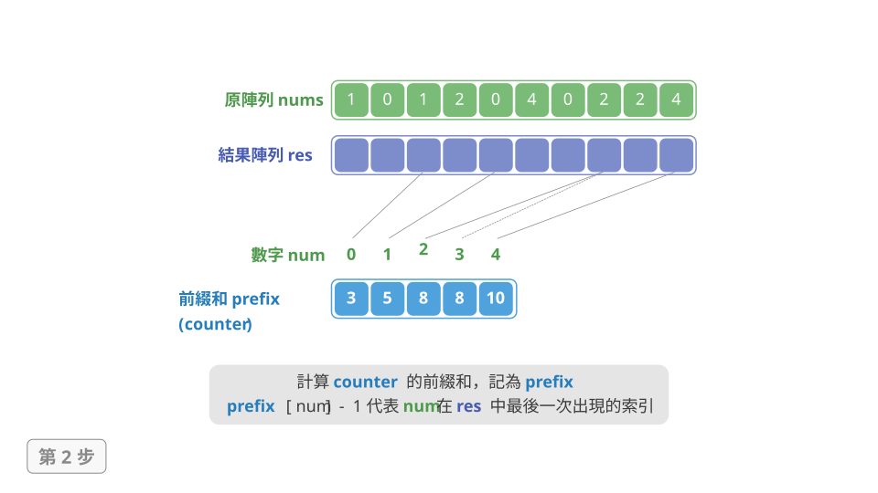
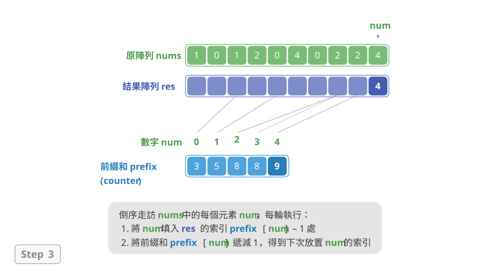
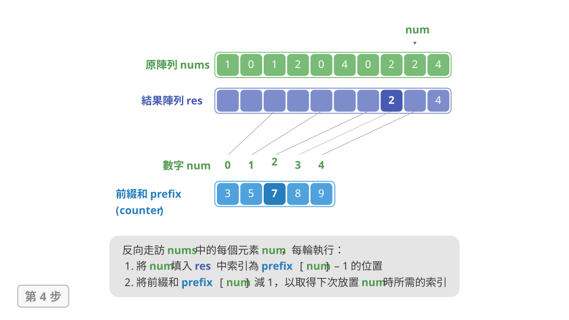
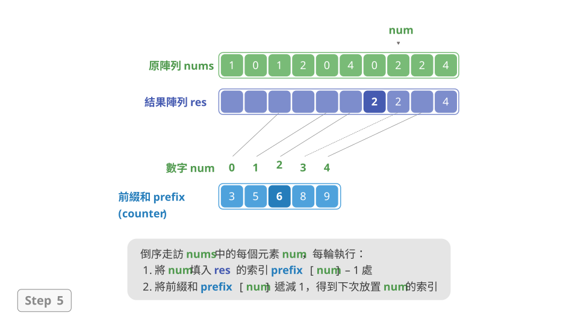
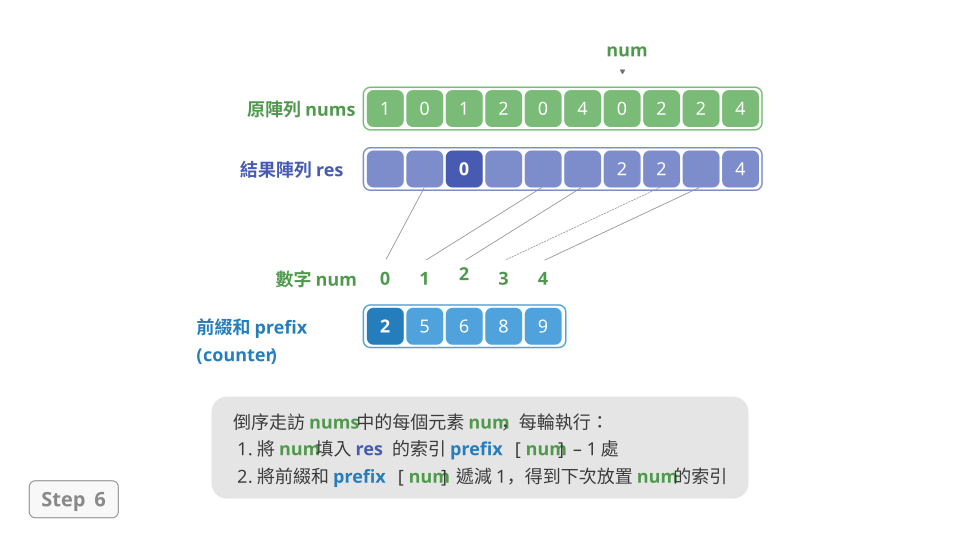
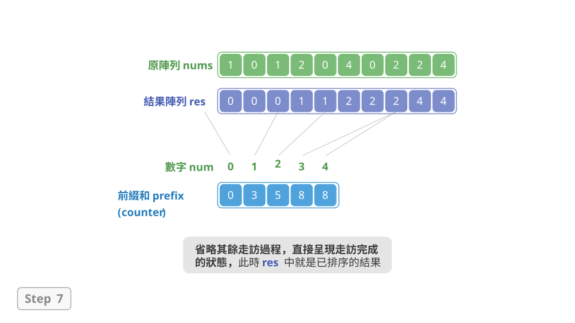

# 計數排序

<u>計數排序（counting sort）</u>藉由統計各元素出現的次數來排序，通常用於整數陣列。

## 簡易實作

先看一個簡單的例子。給定一個長度為 $n$ 的陣列 `nums`，其中的元素都是「非負整數」。計數排序的完整流程如下圖所示。

1. 走訪陣列，找出其中最大的數字，記為 $m$，然後建立長度為 $m + 1$ 的輔助陣列 `counter`。
2. **利用 `counter` 統計 `nums` 中各數字出現的次數**，其中 `counter[num]` 對應數字 `num` 的出現次數。統計方式很簡單：走訪 `nums`，設目前的數字為 `num`，每輪將 `counter[num]` 加上 $1$ 即可。
3. **由於 `counter` 的索引本來就依序排列，相當於所有數字都已排好**。接著只要走訪 `counter`，按數值由小到大，依各數字出現的次數填入 `nums` 即可。


程式碼如下：

```src
[file]{counting_sort}-[class]{}-[func]{counting_sort_naive}
```

!!! note "計數排序與桶排序的關係"

    從桶排序的角度來看，可以將計數陣列 `counter` 的每個索引視為一個桶。統計出現次數，就相當於將每個元素分到對應的桶中。因此，計數排序可以看作桶排序用於整數資料時的一種特例。

## 完整實作

你可能已經注意到，**如果輸入資料是物件，上述步驟 `3.` 就不適用了**。假設輸入的是商品物件，我們想依商品價格（類別的成員變數）排列這些商品，但上述演算法只能產生排好序的價格。

那麼，如何得到原始資料的排序結果呢？先計算 `counter` 的「前綴和」。顧名思義，索引 `i` 處的前綴和 `prefix[i]` 等於陣列中前 `i` 個元素的總和：

$$
\text{prefix}[i] = \sum_{j=0}^i \text{counter[j]}
$$

**前綴和有明確的意義：`prefix[num] - 1` 代表元素 `num` 在結果陣列 `res` 中最後一次出現的索引**。有了這項資訊，就知道每個元素該放在結果陣列的哪個位置。接著反向走訪原陣列 `nums` 的每個元素 `num`，在每次迭代中執行以下兩步。

1. 將 `num` 填入陣列 `res` 中索引為 `prefix[num] - 1` 的位置。
2. 將前綴和 `prefix[num]` 減去 $1$，便能得到下次放置 `num` 時所需的索引。

走訪結束後，陣列 `res` 中的元素都已排好，最後用 `res` 覆寫原陣列 `nums` 即可。下圖呈現計數排序的完整流程。

=== "<1>"
    

=== "<2>"
    

=== "<3>"
    

=== "<4>"
    

=== "<5>"
    

=== "<6>"
    

=== "<7>"
    

=== "<8>"
    

計數排序的實作程式碼如下：

```src
[file]{counting_sort}-[class]{}-[func]{counting_sort}
```

## 演算法特性

- **時間複雜度為 $O(n + m)$、不具調適性的排序**：走訪 `nums` 與走訪 `counter` 都需要線性時間。一般情況下 $n \gg m$，因此時間複雜度趨近 $O(n)$。
- **空間複雜度為 $O(n + m)$、非原地排序**：使用陣列 `res` 與 `counter`，長度分別為 $n$ 與 $m$。
- **穩定排序**：由於元素從右向左填入 `res`，反向走訪 `nums` 就能維持相等元素的相對順序，達成穩定排序。其實，正向走訪 `nums` 也能得到按大小排好的結果，但這樣的排序不穩定。

## 使用限制

讀到這裡，你也許覺得計數排序很巧妙，只靠統計次數就能有效率地完成排序。不過，使用計數排序必須滿足較嚴格的條件。

**計數排序只適用於非負整數**。若要用於其他型別的資料，必須能將資料轉為非負整數，且轉換過程要維持元素間的大小關係。例如，若整數陣列含有負數，可以先將所有數字加上同一個常數，使它們都成為正數，排序完成後再轉換回去。

**計數排序適合資料量大、取值範圍小的情況**。以上述範例為例，$m$ 不能太大，否則會占用過多空間。當 $n \ll m$ 時，計數排序需要 $O(m)$ 時間，甚至可能比 $O(n \log n)$ 的排序演算法還慢。
