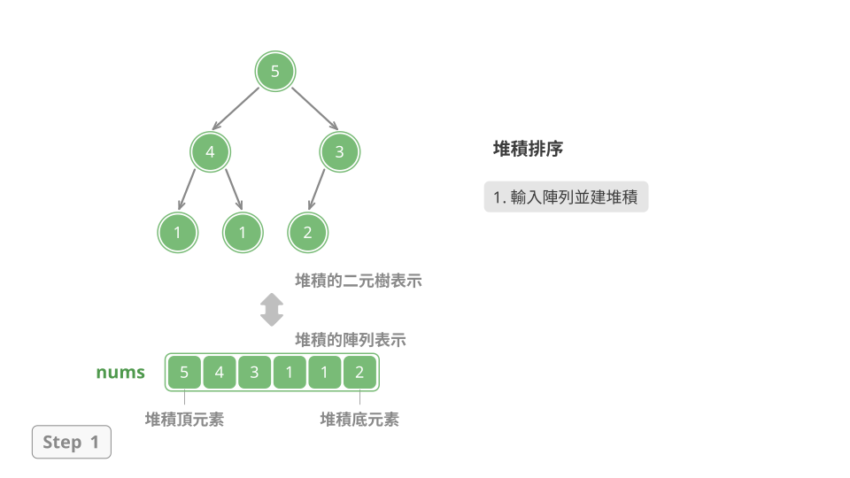
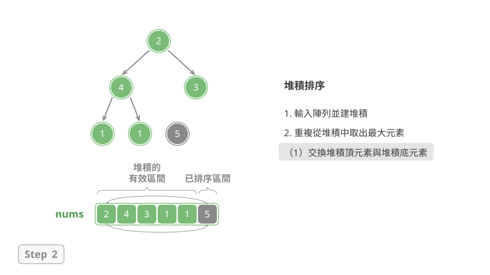
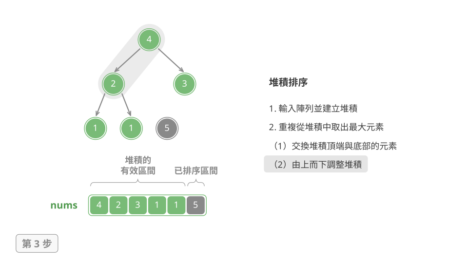
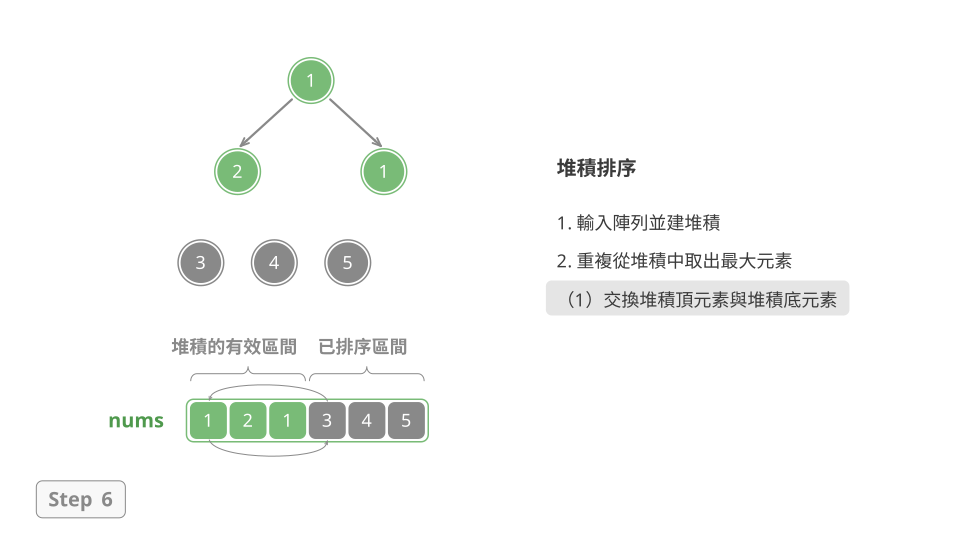
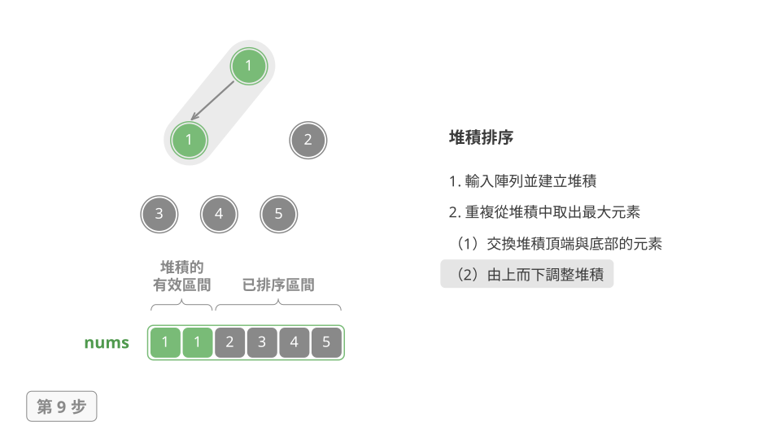

# 堆積排序

!!! tip

    閱讀本節前，請先讀完「堆積」一章。

<u>堆積排序（heap sort）</u>是一種以堆積資料結構實作的高效率排序演算法。我們可以利用先前學過的「建立堆積」與「取出堆積頂端元素」兩項操作來實作堆積排序。

1. 輸入陣列並建立最小堆積，此時最小元素位於頂端。
2. 反覆取出堆積頂端的元素，依序記錄取出的值，就能得到由小到大排列的序列。

這個方法雖然可行，卻需要額外的陣列來存放取出的元素，較浪費空間。實務上，我們通常採用更簡潔的做法。

## 演算法流程

假設陣列長度為 $n$，堆積排序的流程如下圖所示。

1. 輸入陣列並建立最大堆積。完成後，最大元素位於頂端。
2. 交換堆積頂端的元素（第一個元素）與底部的元素（最後一個元素）。交換後，堆積長度減少 $1$，已排序的元素數量增加 $1$。
3. 從堆積頂端開始，由上而下調整堆積（sift down）。調整完成後，堆積便恢復原有的性質。
4. 重複執行第 `2.` 步與第 `3.` 步。經過 $n - 1$ 輪，就能完成陣列排序。

!!! tip

    其實，取出堆積頂端元素的操作也包含第 `2.` 步與第 `3.` 步，只是多了一個移除元素的步驟。

=== "<1>"
    

=== "<2>"
    

=== "<3>"
    

=== "<4>"
    

=== "<5>"
    

=== "<6>"
    

=== "<7>"
    

=== "<8>"
    

=== "<9>"
    

=== "<10>"
    

=== "<11>"
    

=== "<12>"
    

實作時，我們沿用「堆積」一章中由上而下調整堆積的 `sift_down()` 函式。每取出一個最大元素，堆積長度就會縮短，因此需要為 `sift_down()` 函式新增長度參數 $n$，指定堆積目前的有效長度。程式碼如下：

```src
[file]{heap_sort}-[class]{}-[func]{heap_sort}
```

## 演算法特性

- **時間複雜度為 $O(n \log n)$、不具調適性的排序**：建立堆積需要 $O(n)$ 時間。每次從堆積中取出最大元素的時間複雜度為 $O(\log n)$，共執行 $n - 1$ 輪。
- **空間複雜度為 $O(1)$、原地排序**：幾個指標變數占用 $O(1)$ 空間。交換元素和調整堆積都直接在原陣列上進行。
- **不穩定排序**：交換堆積頂端與底部的元素時，相等元素的相對順序可能改變。
