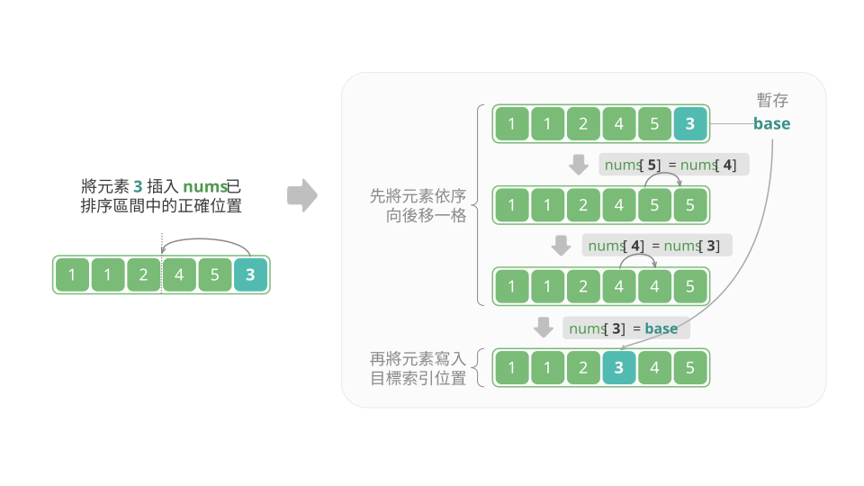

# 插入排序

<u>插入排序（insertion sort）</u>是一種簡單的排序演算法，做法很像用手整理一副撲克牌。

我們從未排序區間選出一個基準元素，依序與左側已排序區間中的元素比較大小，再將它插到正確的位置。

下圖呈現在陣列中插入元素的過程。假設基準元素為 `base`，我們要將目標索引到 `base` 之間的所有元素向右移一格，再將 `base` 寫入目標索引的位置。



## 演算法流程

插入排序的完整流程如下圖所示。

1. 一開始，陣列中的第 1 個元素本身就已排好。
2. 選取陣列的第 2 個元素作為 `base`，插入正確位置後，**陣列的前 2 個元素便已排好**。
3. 選取第 3 個元素作為 `base`，插入正確位置後，**陣列的前 3 個元素便已排好**。
4. 依此類推，最後一輪選取最後一個元素作為 `base`，插入正確位置後，**所有元素便已排好**。


範例程式碼如下：

```src
[file]{insertion_sort}-[class]{}-[func]{insertion_sort}
```

## 演算法特性

- **時間複雜度為 $O(n^2)$、具調適性的排序**：在最差情況下，各次插入操作分別需要執行 $n - 1$、$n-2$、$\dots$、$2$、$1$ 次迴圈，總和為 $(n - 1) n / 2$，因此時間複雜度為 $O(n^2)$。遇到已排好的資料時，插入操作會提早結束。當輸入陣列完全有序時，插入排序達到最佳時間複雜度 $O(n)$。
- **空間複雜度為 $O(1)$、原地排序**：指標 $i$ 和 $j$ 只占用常數大小的額外空間。
- **穩定排序**：插入時，我們會將元素放在與它相等的元素右側，因此不會改變它們的先後順序。

## 插入排序的優勢

插入排序的時間複雜度為 $O(n^2)$，接下來要學的快速排序則為 $O(n \log n)$。雖然插入排序的時間複雜度較高，**但資料量小時，插入排序通常更快**。

這和線性搜尋、二分搜尋各自適用的情況類似。快速排序這類 $O(n \log n)$ 的演算法採用分治策略，往往需要較多次基本運算。資料量小時，$n^2$ 與 $n \log n$ 的數值相近，複雜度的影響較小，反而是每輪基本運算的次數決定了效率。

事實上，許多程式語言（例如 Java）的內建排序函式也會用到插入排序。大致做法是：對較長的陣列採用快速排序等分治演算法，對較短的陣列則直接使用插入排序。

雖然氣泡排序、選擇排序與插入排序的時間複雜度都是 $O(n^2)$，但在實務上，**插入排序比氣泡排序與選擇排序常用得多**，主要原因如下。

- 氣泡排序靠交換元素來排序，每次交換需要一個暫存變數，涉及 3 次基本操作。插入排序透過指派數值來移動元素，每次只需 1 次基本操作。因此，**氣泡排序的運算成本通常高於插入排序**。
- 無論輸入為何，選擇排序的時間複雜度都是 $O(n^2)$。**若輸入資料已部分排好，插入排序通常比選擇排序更有效率**。
- 選擇排序不穩定，無法用於多層次排序。
