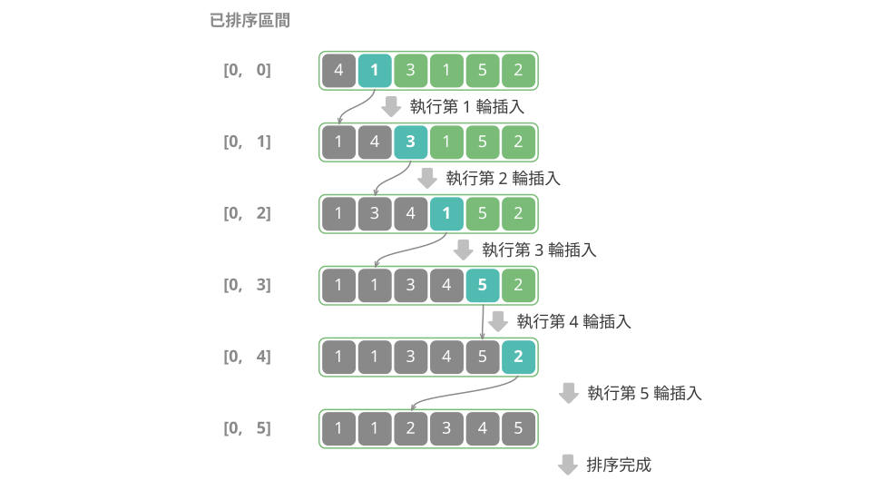

# 11.4 &nbsp; 插入排序

<u>插入排序（insertion sort）</u>是一種簡單的排序演算法，做法很像用手整理一副撲克牌。

我們從未排序區間選出一個基準元素，依序與左側已排序區間中的元素比較大小，再將它插到正確的位置。

圖 11-6 呈現在陣列中插入元素的過程。假設基準元素為 `base`，我們要將目標索引到 `base` 之間的所有元素向右移一格，再將 `base` 寫入目標索引的位置。

{ class="animation-figure" }

<p align="center"> 圖 11-6 &nbsp; 一次插入操作 </p>

## 11.4.1 &nbsp; 演算法流程

插入排序的完整流程如圖 11-7 所示。

1. 一開始，陣列中的第 1 個元素本身就已排好。
2. 選取陣列的第 2 個元素作為 `base`，插入正確位置後，**陣列的前 2 個元素便已排好**。
3. 選取第 3 個元素作為 `base`，插入正確位置後，**陣列的前 3 個元素便已排好**。
4. 依此類推，最後一輪選取最後一個元素作為 `base`，插入正確位置後，**所有元素便已排好**。

{ class="animation-figure" }

<p align="center"> 圖 11-7 &nbsp; 插入排序流程 </p>

範例程式碼如下：

=== "Python"

    ```python title="insertion_sort.py"
    def insertion_sort(nums: list[int]):
        """插入排序"""
        # 外層迴圈：已排序的區間為 [0, i-1]
        for i in range(1, len(nums)):
            base = nums[i]
            j = i - 1
            # 內層迴圈：將 base 插入已排序區間 [0, i-1] 中的正確位置
            while j >= 0 and nums[j] > base:
                nums[j + 1] = nums[j]  # 將 nums[j] 向右移動一格
                j -= 1
            nums[j + 1] = base  # 將 base 寫入正確位置
    ```

=== "C++"

    ```cpp title="insertion_sort.cpp"
    /* 插入排序 */
    void insertionSort(vector<int> &nums) {
        // 外層迴圈：已排序的區間為 [0, i-1]
        for (int i = 1; i < nums.size(); i++) {
            int base = nums[i], j = i - 1;
            // 內層迴圈：將 base 插入已排序區間 [0, i-1] 中的正確位置
            while (j >= 0 && nums[j] > base) {
                nums[j + 1] = nums[j]; // 將 nums[j] 向右移動一格
                j--;
            }
            nums[j + 1] = base; // 將 base 寫入正確位置
        }
    }
    ```

=== "Java"

    ```java title="insertion_sort.java"
    /* 插入排序 */
    void insertionSort(int[] nums) {
        // 外層迴圈：已排序的區間為 [0, i-1]
        for (int i = 1; i < nums.length; i++) {
            int base = nums[i], j = i - 1;
            // 內層迴圈：將 base 插入已排序區間 [0, i-1] 中的正確位置
            while (j >= 0 && nums[j] > base) {
                nums[j + 1] = nums[j]; // 將 nums[j] 向右移動一格
                j--;
            }
            nums[j + 1] = base;        // 將 base 寫入正確位置
        }
    }
    ```

=== "C#"

    ```csharp title="insertion_sort.cs"
    /* 插入排序 */
    void InsertionSort(int[] nums) {
        // 外層迴圈：已排序的區間為 [0, i-1]
        for (int i = 1; i < nums.Length; i++) {
            int bas = nums[i], j = i - 1;
            // 內層迴圈：將 base 插入已排序區間 [0, i-1] 中的正確位置
            while (j >= 0 && nums[j] > bas) {
                nums[j + 1] = nums[j]; // 將 nums[j] 向右移動一格
                j--;
            }
            nums[j + 1] = bas;         // 將 base 寫入正確位置
        }
    }
    ```

=== "Go"

    ```go title="insertion_sort.go"
    /* 插入排序 */
    func insertionSort(nums []int) {
        // 外層迴圈：已排序的區間為 [0, i-1]
        for i := 1; i < len(nums); i++ {
            base := nums[i]
            j := i - 1
            // 內層迴圈：將 base 插入已排序區間 [0, i-1] 中的正確位置
            for j >= 0 && nums[j] > base {
                nums[j+1] = nums[j] // 將 nums[j] 向右移動一格
                j--
            }
            nums[j+1] = base // 將 base 寫入正確位置
        }
    }
    ```

=== "Swift"

    ```swift title="insertion_sort.swift"
    /* 插入排序 */
    func insertionSort(nums: inout [Int]) {
        // 外層迴圈：已排序的區間為 [0, i-1]
        for i in nums.indices.dropFirst() {
            let base = nums[i]
            var j = i - 1
            // 內層迴圈：將 base 插入已排序區間 [0, i-1] 中的正確位置
            while j >= 0, nums[j] > base {
                nums[j + 1] = nums[j] // 將 nums[j] 向右移動一格
                j -= 1
            }
            nums[j + 1] = base // 將 base 寫入正確位置
        }
    }
    ```

=== "JS"

    ```javascript title="insertion_sort.js"
    /* 插入排序 */
    function insertionSort(nums) {
        // 外層迴圈：已排序的區間為 [0, i-1]
        for (let i = 1; i < nums.length; i++) {
            let base = nums[i],
                j = i - 1;
            // 內層迴圈：將 base 插入已排序區間 [0, i-1] 中的正確位置
            while (j >= 0 && nums[j] > base) {
                nums[j + 1] = nums[j]; // 將 nums[j] 向右移動一格
                j--;
            }
            nums[j + 1] = base; // 將 base 寫入正確位置
        }
    }
    ```

=== "TS"

    ```typescript title="insertion_sort.ts"
    /* 插入排序 */
    function insertionSort(nums: number[]): void {
        // 外層迴圈：已排序的區間為 [0, i-1]
        for (let i = 1; i < nums.length; i++) {
            const base = nums[i];
            let j = i - 1;
            // 內層迴圈：將 base 插入已排序區間 [0, i-1] 中的正確位置
            while (j >= 0 && nums[j] > base) {
                nums[j + 1] = nums[j]; // 將 nums[j] 向右移動一格
                j--;
            }
            nums[j + 1] = base; // 將 base 寫入正確位置
        }
    }
    ```

=== "Dart"

    ```dart title="insertion_sort.dart"
    /* 插入排序 */
    void insertionSort(List<int> nums) {
      // 外層迴圈：已排序的區間為 [0, i-1]
      for (int i = 1; i < nums.length; i++) {
        int base = nums[i], j = i - 1;
        // 內層迴圈：將 base 插入已排序區間 [0, i-1] 中的正確位置
        while (j >= 0 && nums[j] > base) {
          nums[j + 1] = nums[j]; // 將 nums[j] 向右移動一格
          j--;
        }
        nums[j + 1] = base; // 將 base 寫入正確位置
      }
    }
    ```

=== "Rust"

    ```rust title="insertion_sort.rs"
    /* 插入排序 */
    fn insertion_sort(nums: &mut [i32]) {
        // 外層迴圈：已排序的區間為 [0, i-1]
        for i in 1..nums.len() {
            let (base, mut j) = (nums[i], (i - 1) as i32);
            // 內層迴圈：將 base 插入已排序區間 [0, i-1] 中的正確位置
            while j >= 0 && nums[j as usize] > base {
                nums[(j + 1) as usize] = nums[j as usize]; // 將 nums[j] 向右移動一格
                j -= 1;
            }
            nums[(j + 1) as usize] = base; // 將 base 寫入正確位置
        }
    }
    ```

=== "C"

    ```c title="insertion_sort.c"
    /* 插入排序 */
    void insertionSort(int nums[], int size) {
        // 外層迴圈：已排序的區間為 [0, i-1]
        for (int i = 1; i < size; i++) {
            int base = nums[i], j = i - 1;
            // 內層迴圈：將 base 插入已排序區間 [0, i-1] 中的正確位置
            while (j >= 0 && nums[j] > base) {
                // 將 nums[j] 向右移動一格
                nums[j + 1] = nums[j];
                j--;
            }
            // 將 base 寫入正確位置
            nums[j + 1] = base;
        }
    }
    ```

=== "Kotlin"

    ```kotlin title="insertion_sort.kt"
    /* 插入排序 */
    fun insertionSort(nums: IntArray) {
        //外層迴圈：每輪結束後，已排序的元素數依序為 1, 2, ..., n
        for (i in nums.indices) {
            val base = nums[i]
            var j = i - 1
            // 內層迴圈：將 base 插入已排序區間 [0, i-1] 中的正確位置
            while (j >= 0 && nums[j] > base) {
                nums[j + 1] = nums[j] // 將 nums[j] 向右移動一格
                j--
            }
            nums[j + 1] = base        // 將 base 寫入正確位置
        }
    }
    ```

=== "Ruby"

    ```ruby title="insertion_sort.rb"
    ### 插入排序 ###
    def insertion_sort(nums)
      n = nums.length
      # 外層迴圈：已排序的區間為 [0, i-1]
      for i in 1...n
        base = nums[i]
        j = i - 1
        # 內層迴圈：將 base 插入已排序區間 [0, i-1] 中的正確位置
        while j >= 0 && nums[j] > base
          nums[j + 1] = nums[j] # 將 nums[j] 向右移動一格
          j -= 1
        end
        nums[j + 1] = base # 將 base 寫入正確位置
      end
    end
    ```

??? pythontutor "執行視覺化示範"

    <div style="height: 513px; width: 100%;"><iframe class="pythontutor-iframe" title="執行視覺化示範" src="https://pythontutor.com/iframe-embed.html#code=def%20insertion_sort%28nums%3A%20list%5Bint%5D%29%3A%0A%20%20%20%20%22%22%22%E6%8F%92%E5%85%A5%E6%8E%92%E5%BA%8F%22%22%22%0A%20%20%20%20%23%20%E5%A4%96%E5%B1%A4%E8%BF%B4%E5%9C%88%EF%BC%9A%E5%B7%B2%E6%8E%92%E5%BA%8F%E7%9A%84%E5%8D%80%E9%96%93%E7%82%BA%20%5B0,%20i-1%5D%0A%20%20%20%20for%20i%20in%20range%281,%20len%28nums%29%29%3A%0A%20%20%20%20%20%20%20%20base%20%3D%20nums%5Bi%5D%0A%20%20%20%20%20%20%20%20j%20%3D%20i%20-%201%0A%20%20%20%20%20%20%20%20%23%20%E5%85%A7%E5%B1%A4%E8%BF%B4%E5%9C%88%EF%BC%9A%E5%B0%87%20base%20%E6%8F%92%E5%85%A5%E5%B7%B2%E6%8E%92%E5%BA%8F%E5%8D%80%E9%96%93%20%5B0,%20i-1%5D%20%E4%B8%AD%E7%9A%84%E6%AD%A3%E7%A2%BA%E4%BD%8D%E7%BD%AE%0A%20%20%20%20%20%20%20%20while%20j%20%3E%3D%200%20and%20nums%5Bj%5D%20%3E%20base%3A%0A%20%20%20%20%20%20%20%20%20%20%20%20nums%5Bj%20%2B%201%5D%20%3D%20nums%5Bj%5D%20%20%23%20%E5%B0%87%20nums%5Bj%5D%20%E5%90%91%E5%8F%B3%E7%A7%BB%E5%8B%95%E4%B8%80%E6%A0%BC%0A%20%20%20%20%20%20%20%20%20%20%20%20j%20-%3D%201%0A%20%20%20%20%20%20%20%20nums%5Bj%20%2B%201%5D%20%3D%20base%20%20%23%20%E5%B0%87%20base%20%E5%AF%AB%E5%85%A5%E6%AD%A3%E7%A2%BA%E4%BD%8D%E7%BD%AE%0A%0A%0A%22%22%22Driver%20Code%22%22%22%0Aif%20__name__%20%3D%3D%20%22__main__%22%3A%0A%20%20%20%20nums%20%3D%20%5B4,%201,%203,%201,%205,%202%5D%0A%20%20%20%20insertion_sort%28nums%29%0A%20%20%20%20print%28%22%E6%8F%92%E5%85%A5%E6%8E%92%E5%BA%8F%E5%AE%8C%E6%88%90%E5%BE%8C%20nums%20%3D%22,%20nums%29&codeDivHeight=472&codeDivWidth=350&cumulative=false&curInstr=4&heapPrimitives=nevernest&origin=opt-frontend.js&py=311&rawInputLstJSON=%5B%5D&textReferences=false"> </iframe></div>
    <div style="margin-top: 5px;"><a href="https://pythontutor.com/iframe-embed.html#code=def%20insertion_sort%28nums%3A%20list%5Bint%5D%29%3A%0A%20%20%20%20%22%22%22%E6%8F%92%E5%85%A5%E6%8E%92%E5%BA%8F%22%22%22%0A%20%20%20%20%23%20%E5%A4%96%E5%B1%A4%E8%BF%B4%E5%9C%88%EF%BC%9A%E5%B7%B2%E6%8E%92%E5%BA%8F%E7%9A%84%E5%8D%80%E9%96%93%E7%82%BA%20%5B0,%20i-1%5D%0A%20%20%20%20for%20i%20in%20range%281,%20len%28nums%29%29%3A%0A%20%20%20%20%20%20%20%20base%20%3D%20nums%5Bi%5D%0A%20%20%20%20%20%20%20%20j%20%3D%20i%20-%201%0A%20%20%20%20%20%20%20%20%23%20%E5%85%A7%E5%B1%A4%E8%BF%B4%E5%9C%88%EF%BC%9A%E5%B0%87%20base%20%E6%8F%92%E5%85%A5%E5%B7%B2%E6%8E%92%E5%BA%8F%E5%8D%80%E9%96%93%20%5B0,%20i-1%5D%20%E4%B8%AD%E7%9A%84%E6%AD%A3%E7%A2%BA%E4%BD%8D%E7%BD%AE%0A%20%20%20%20%20%20%20%20while%20j%20%3E%3D%200%20and%20nums%5Bj%5D%20%3E%20base%3A%0A%20%20%20%20%20%20%20%20%20%20%20%20nums%5Bj%20%2B%201%5D%20%3D%20nums%5Bj%5D%20%20%23%20%E5%B0%87%20nums%5Bj%5D%20%E5%90%91%E5%8F%B3%E7%A7%BB%E5%8B%95%E4%B8%80%E6%A0%BC%0A%20%20%20%20%20%20%20%20%20%20%20%20j%20-%3D%201%0A%20%20%20%20%20%20%20%20nums%5Bj%20%2B%201%5D%20%3D%20base%20%20%23%20%E5%B0%87%20base%20%E5%AF%AB%E5%85%A5%E6%AD%A3%E7%A2%BA%E4%BD%8D%E7%BD%AE%0A%0A%0A%22%22%22Driver%20Code%22%22%22%0Aif%20__name__%20%3D%3D%20%22__main__%22%3A%0A%20%20%20%20nums%20%3D%20%5B4,%201,%203,%201,%205,%202%5D%0A%20%20%20%20insertion_sort%28nums%29%0A%20%20%20%20print%28%22%E6%8F%92%E5%85%A5%E6%8E%92%E5%BA%8F%E5%AE%8C%E6%88%90%E5%BE%8C%20nums%20%3D%22,%20nums%29&codeDivHeight=800&codeDivWidth=600&cumulative=false&curInstr=4&heapPrimitives=nevernest&origin=opt-frontend.js&py=311&rawInputLstJSON=%5B%5D&textReferences=false" target="_blank" rel="noopener noreferrer">全螢幕觀看 ></a></div>

## 11.4.2 &nbsp; 演算法特性

- **時間複雜度為 $O(n^2)$、具調適性的排序**：在最差情況下，各次插入操作分別需要執行 $n - 1$、$n-2$、$\dots$、$2$、$1$ 次迴圈，總和為 $(n - 1) n / 2$，因此時間複雜度為 $O(n^2)$。遇到已排好的資料時，插入操作會提早結束。當輸入陣列完全有序時，插入排序達到最佳時間複雜度 $O(n)$。
- **空間複雜度為 $O(1)$、原地排序**：指標 $i$ 和 $j$ 只占用常數大小的額外空間。
- **穩定排序**：插入時，我們會將元素放在與它相等的元素右側，因此不會改變它們的先後順序。

## 11.4.3 &nbsp; 插入排序的優勢

插入排序的時間複雜度為 $O(n^2)$，接下來要學的快速排序則為 $O(n \log n)$。雖然插入排序的時間複雜度較高，**但資料量小時，插入排序通常更快**。

這和線性搜尋、二分搜尋各自適用的情況類似。快速排序這類 $O(n \log n)$ 的演算法採用分治策略，往往需要較多次基本運算。資料量小時，$n^2$ 與 $n \log n$ 的數值相近，複雜度的影響較小，反而是每輪基本運算的次數決定了效率。

事實上，許多程式語言（例如 Java）的內建排序函式也會用到插入排序。大致做法是：對較長的陣列採用快速排序等分治演算法，對較短的陣列則直接使用插入排序。

雖然氣泡排序、選擇排序與插入排序的時間複雜度都是 $O(n^2)$，但在實務上，**插入排序比氣泡排序與選擇排序常用得多**，主要原因如下。

- 氣泡排序靠交換元素來排序，每次交換需要一個暫存變數，涉及 3 次基本操作。插入排序透過指派數值來移動元素，每次只需 1 次基本操作。因此，**氣泡排序的運算成本通常高於插入排序**。
- 無論輸入為何，選擇排序的時間複雜度都是 $O(n^2)$。**若輸入資料已部分排好，插入排序通常比選擇排序更有效率**。
- 選擇排序不穩定，無法用於多層次排序。
