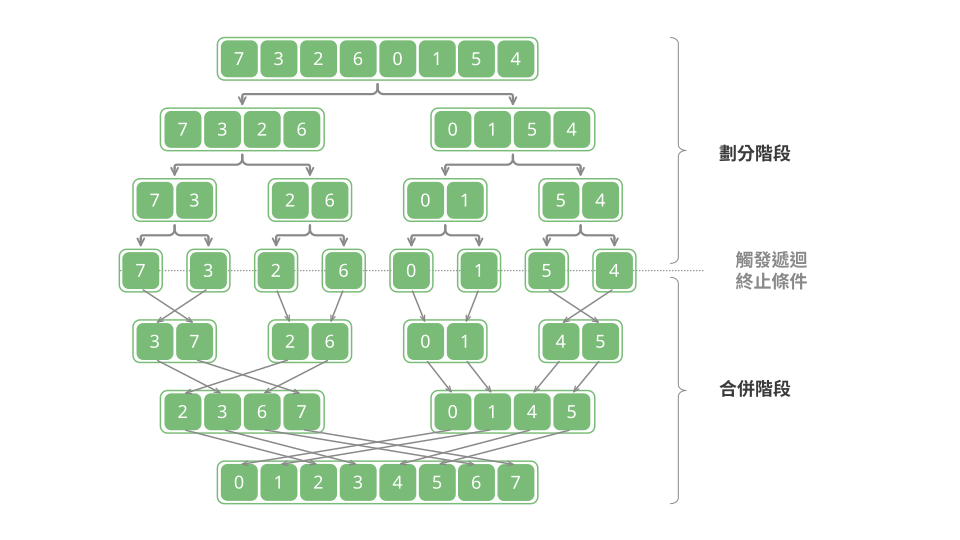
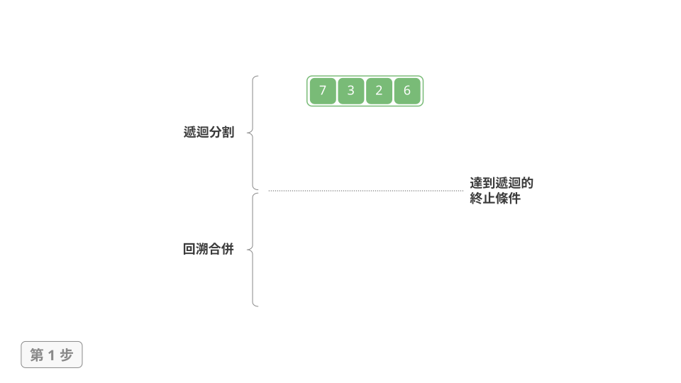
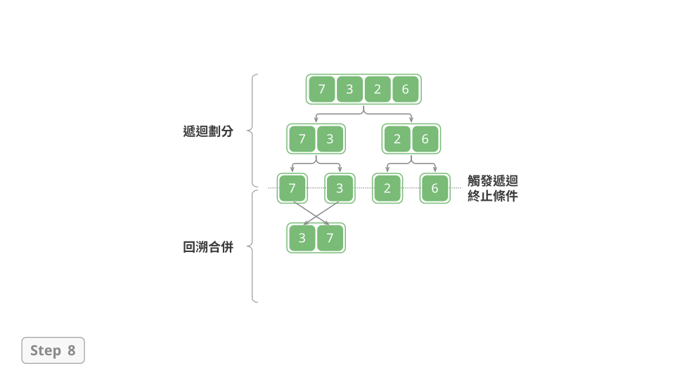
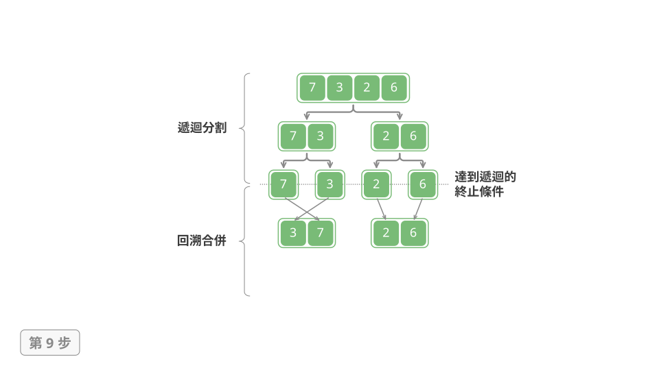

# 合併排序

<u>合併排序（merge sort）</u>採用分治策略，分為下圖所示的「分割」與「合併」兩個階段。

1. **分割階段**：以遞迴方式反覆從中點分割陣列，將長陣列的排序問題轉為短陣列的排序問題。
2. **合併階段**：子陣列長度為 1 時停止分割，開始合併。將左、右兩個較短的已排序陣列合併成一個較長的已排序陣列，重複直到完成排序。



## 演算法流程

如下圖所示，「分割階段」由上而下遞迴地將每個陣列從中點切成兩個子陣列。

1. 計算陣列的中點 `mid`，再遞迴分割左子陣列（區間 `[left, mid]`）與右子陣列（區間 `[mid + 1, right]`）。
2. 遞迴執行步驟 `1.`，直到子陣列區間的長度為 1 時停止。

「合併階段」由下而上，將左、右子陣列合併成一個已排序陣列。請留意，合併是從長度為 1 的子陣列開始，因此每次參與合併的子陣列都已排好。

=== "<1>"
    

=== "<2>"
    

=== "<3>"
    

=== "<4>"
    

=== "<5>"
    

=== "<6>"
    

=== "<7>"
    

=== "<8>"
    

=== "<9>"
    

=== "<10>"
    

仔細觀察會發現，合併排序的遞迴順序與二元樹的後序走訪相同。

- **後序走訪**：先遞迴走訪左子樹，再遞迴走訪右子樹，最後處理根節點。
- **合併排序**：先遞迴處理左子陣列，再遞迴處理右子陣列，最後合併兩者。

合併排序的實作如下。請留意，`nums` 中待合併的區間為 `[left, right]`，`tmp` 中對應的區間則為 `[0, right - left]`。

```src
[file]{merge_sort}-[class]{}-[func]{merge_sort}
```

## 演算法特性

- **時間複雜度為 $O(n \log n)$、不具調適性的排序**：分割後會形成高度為 $\log n$ 的遞迴樹，每一層合併所需的操作總數為 $n$，因此整體時間複雜度為 $O(n \log n)$。
- **空間複雜度為 $O(n)$、非原地排序**：遞迴深度為 $\log n$，需要 $O(\log n)$ 的呼叫堆疊空間。合併時需要輔助陣列，另占用 $O(n)$ 空間。
- **穩定排序**：合併時，相等元素的先後順序維持不變。

## 鏈結串列排序

要將鏈結串列排序時，合併排序比其他排序演算法更有優勢，**它能將鏈結串列排序的空間複雜度降到 $O(1)$**。

- **分割階段**：可改用「迭代」來分割鏈結串列，省去「遞迴」所需的呼叫堆疊空間。
- **合併階段**：在鏈結串列中，新增與刪除節點只需改變參照（指標）。因此，將兩個較短的已排序鏈結串列合併成一個較長的已排序鏈結串列時，無須額外建立串列。

實作細節較為複雜，有興趣的讀者可以參閱相關資料。
