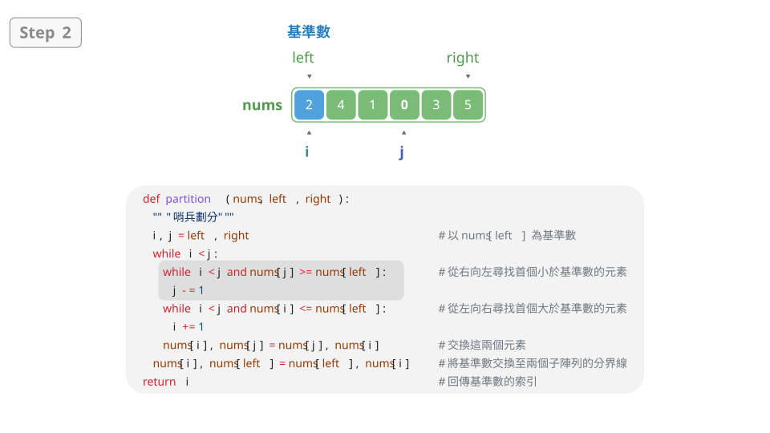
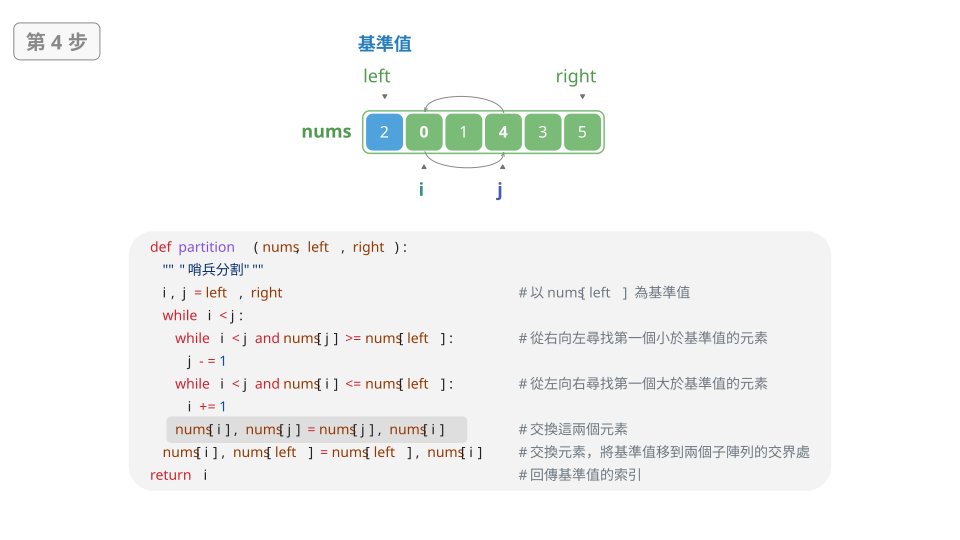
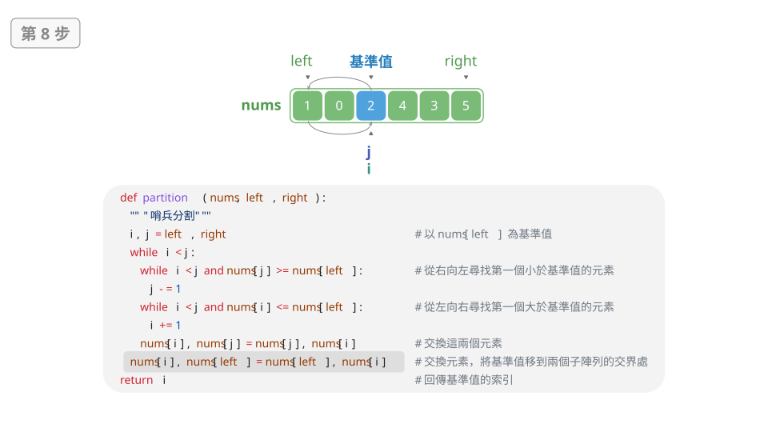

# 快速排序

<u>快速排序（quick sort）</u>是一種採用分治策略的排序演算法，執行效率高，應用也很廣。

快速排序的核心操作是「哨兵分割」：從陣列選一個元素作為「基準值」，將所有小於基準值的元素移到它的左側，大於基準值的元素移到它的右側。哨兵分割的流程如下圖所示。

1. 選取陣列最左端的元素作為基準值，並設定兩個指標 `i` 和 `j`，分別指向陣列的兩端。
2. 設定迴圈，每輪由 `i` 找出第一個大於基準值的元素，`j` 找出第一個小於基準值的元素，再交換兩者。
3. 重複步驟 `2.`，直到 `i` 與 `j` 相遇。最後將基準值換到兩個子陣列的交界處。

=== "<1>"
    

=== "<2>"
    

=== "<3>"
    

=== "<4>"
    

=== "<5>"
    

=== "<6>"
    

=== "<7>"
    

=== "<8>"
    

=== "<9>"
    

完成哨兵分割後，原陣列分成左子陣列、基準值與右子陣列三部分，並滿足「左子陣列的任一元素 $\leq$ 基準值 $\leq$ 右子陣列的任一元素」。因此，接下來只需分別將兩個子陣列排序。

!!! note "快速排序的分治策略"

    哨兵分割將一個較長陣列的排序問題，化為兩個較短陣列的排序問題。

```src
[file]{quick_sort}-[class]{quick_sort}-[func]{partition}
```

## 演算法流程

快速排序的完整流程如下圖所示。

1. 首先，對原陣列執行一次「哨兵分割」，得到尚未排序的左、右子陣列。
2. 接著，對左、右子陣列分別遞迴執行「哨兵分割」。
3. 持續遞迴，直到子陣列長度為 1 時終止，即可完成整個陣列的排序。


```src
[file]{quick_sort}-[class]{quick_sort}-[func]{quick_sort}
```

## 演算法特性

- **時間複雜度為 $O(n \log n)$、不具調適性的排序**：平均而言，哨兵分割的遞迴層數為 $\log n$，每層執行迴圈的總次數為 $n$，共需 $O(n \log n)$ 時間。在最差情況下，每輪哨兵分割都將長度為 $n$ 的陣列分成長度為 $0$ 與 $n - 1$ 的兩個子陣列。此時遞迴層數達到 $n$，每層的迴圈次數為 $n$，共需 $O(n^2)$ 時間。
- **空間複雜度為 $O(n)$、原地排序**：當輸入陣列完全反向排列時，遞迴深度達到最差情況 $n$，呼叫堆疊占用 $O(n)$ 空間。排序直接在原陣列上進行，無須額外的陣列。
- **不穩定排序**：在哨兵分割的最後一步，基準值可能會被換到與它相等的元素右側。

## 快速排序為什麼快

從名稱就能看出，快速排序在效率上應有一定的優勢。雖然它的平均時間複雜度與「合併排序」和「堆積排序」相同，但實際上通常更快，主要原因如下。

- **出現最差情況的機率很低**：雖然快速排序的最差時間複雜度為 $O(n^2)$，執行時間不像合併排序那麼穩定，但絕大多數情況下，都能以 $O(n \log n)$ 的時間複雜度執行。
- **快取使用效率高**：執行哨兵分割時，系統可以將整個子陣列載入快取，存取元素的效率較高。「堆積排序」等演算法則需要跳著存取不同位置的元素，沒有這項特性。
- **複雜度的常數係數小**：在上述三種演算法中，快速排序所需的比較、指派與交換等操作總數最少。這與「插入排序」比「氣泡排序」更快的原因相似。

## 基準值的選擇與最佳化

**對某些輸入而言，快速排序的效率可能下降**。以完全反向排列的陣列為例，由於我們選取最左端元素作為基準值，哨兵分割後，它會被換到陣列最右端，使左子陣列長度為 $n - 1$，右子陣列長度為 $0$。若如此遞迴下去，每次分割都有一個子陣列長度為 $0$，分治策略失去效果，快速排序便退化成近似「氣泡排序」的形式。

為了盡量避免這種情況，**我們可以改進哨兵分割選取基準值的方式**。例如，隨機選取一個元素作為基準值。不過，如果運氣不好，每次都選到不理想的基準值，效率仍可能不如預期。

請留意，程式語言通常產生的是「虛擬亂數」。如果針對虛擬亂數序列設計特定測試案例，快速排序的效率仍可能下降。

我們還可以從陣列中選出三個候選元素（通常是首端、尾端與中點的元素），**取三者的中位數作為基準值**。這樣就更有機會選到既不太大也不太小的基準值。也可以增加候選元素的數量，讓演算法更不易受輸入影響。採用這種方法後，時間複雜度退化到 $O(n^2)$ 的機率會大幅降低。

範例程式碼如下：

```src
[file]{quick_sort}-[class]{quick_sort_median}-[func]{partition}
```

## 遞迴深度最佳化

**對某些輸入而言，快速排序可能占用較多空間**。以完全排好的輸入陣列為例，假設目前子陣列長度為 $m$，每輪哨兵分割都會產生長度為 $0$ 的左子陣列與長度為 $m - 1$ 的右子陣列。這表示每深入一層遞迴，問題規模只減少一個元素，遞迴樹的高度會達到 $n - 1$，呼叫堆疊需要 $O(n)$ 空間。

為避免呼叫堆疊不斷增長，每輪哨兵分割後可以比較兩個子陣列的長度，**只對較短的子陣列遞迴**。較短子陣列的長度不會超過 $n / 2$，因此遞迴深度不會超過 $\log n$，最差空間複雜度也就能降到 $O(\log n)$。程式碼如下：

```src
[file]{quick_sort}-[class]{quick_sort_tail_call}-[func]{quick_sort}
```
