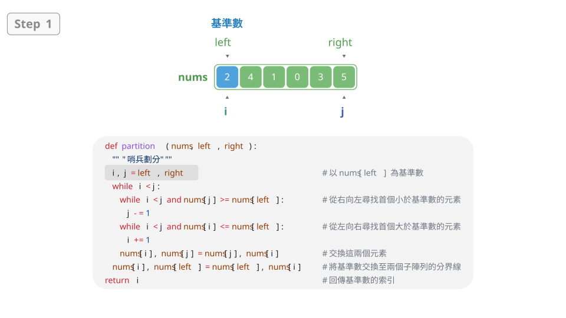
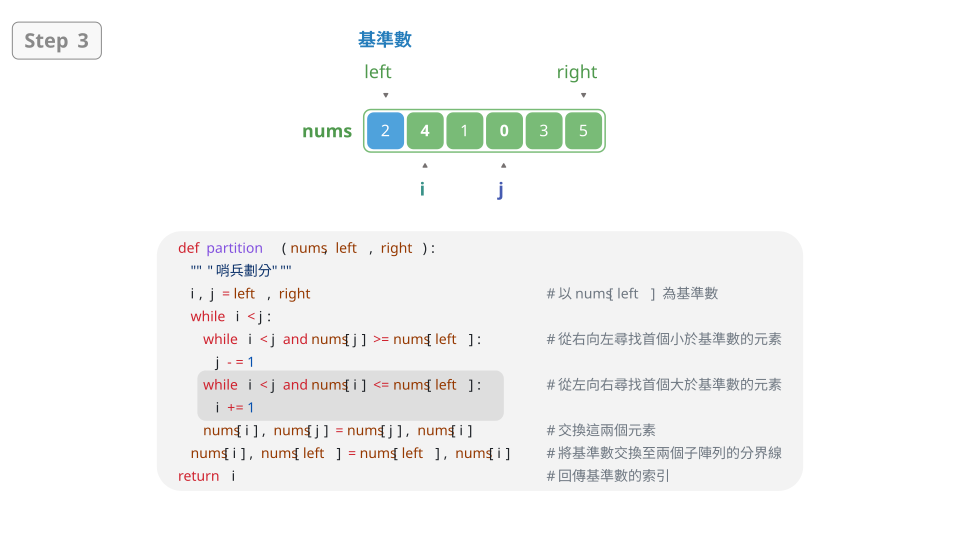
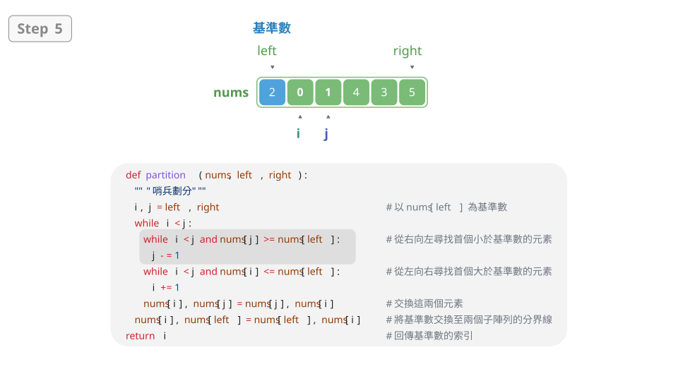
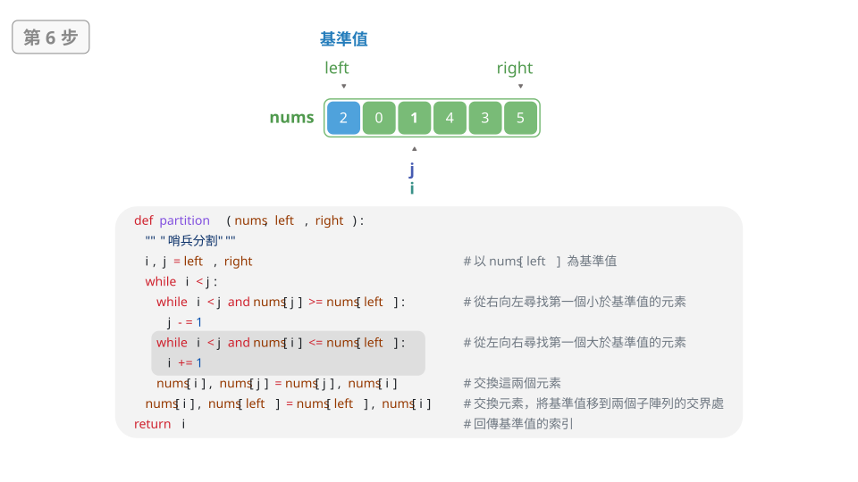
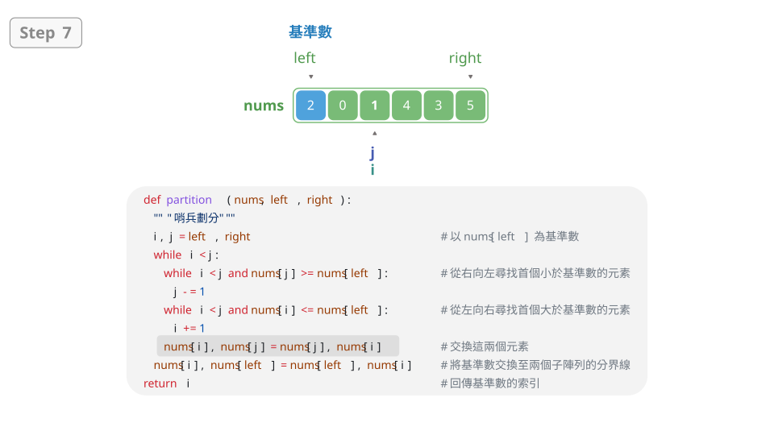
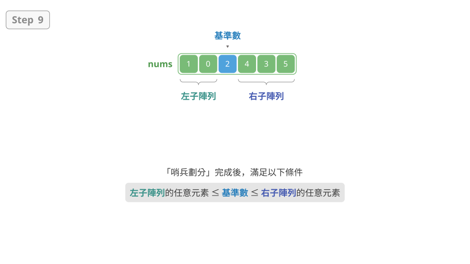
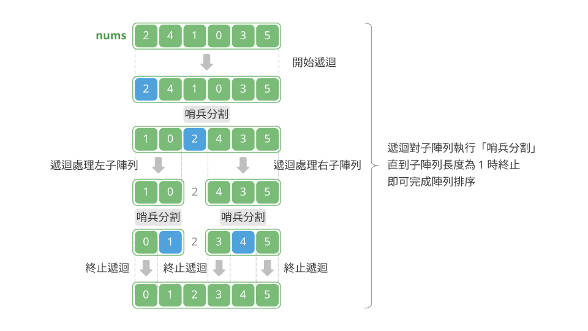

# 11.5 &nbsp; 快速排序

<u>快速排序（quick sort）</u>是一種採用分治策略的排序演算法，執行效率高，應用也很廣。

快速排序的核心操作是「哨兵分割」：從陣列選一個元素作為「基準值」，將所有小於基準值的元素移到它的左側，大於基準值的元素移到它的右側。哨兵分割的流程如圖 11-8 所示。

1. 選取陣列最左端的元素作為基準值，並設定兩個指標 `i` 和 `j`，分別指向陣列的兩端。
2. 設定迴圈，每輪由 `i` 找出第一個大於基準值的元素，`j` 找出第一個小於基準值的元素，再交換兩者。
3. 重複步驟 `2.`，直到 `i` 與 `j` 相遇。最後將基準值換到兩個子陣列的交界處。

=== "<1>"
    { class="animation-figure" }

=== "<2>"
    { class="animation-figure" }

=== "<3>"
    { class="animation-figure" }

=== "<4>"
    { class="animation-figure" }

=== "<5>"
    { class="animation-figure" }

=== "<6>"
    { class="animation-figure" }

=== "<7>"
    { class="animation-figure" }

=== "<8>"
    { class="animation-figure" }

=== "<9>"
    { class="animation-figure" }

<p align="center"> 圖 11-8 &nbsp; 哨兵分割的步驟 </p>

完成哨兵分割後，原陣列分成左子陣列、基準值與右子陣列三部分，並滿足「左子陣列的任一元素 $\leq$ 基準值 $\leq$ 右子陣列的任一元素」。因此，接下來只需分別將兩個子陣列排序。

!!! note "快速排序的分治策略"

    哨兵分割將一個較長陣列的排序問題，化為兩個較短陣列的排序問題。

=== "Python"

    ```python title="quick_sort.py"
    def partition(self, nums: list[int], left: int, right: int) -> int:
        """哨兵分割"""
        # 以 nums[left] 為基準值
        i, j = left, right
        while i < j:
            while i < j and nums[j] >= nums[left]:
                j -= 1  # 從右向左尋找第一個小於基準值的元素
            while i < j and nums[i] <= nums[left]:
                i += 1  # 從左向右尋找第一個大於基準值的元素
            # 交換元素
            nums[i], nums[j] = nums[j], nums[i]
        # 交換元素，將基準值移到兩個子陣列的交界處
        nums[i], nums[left] = nums[left], nums[i]
        return i  # 回傳基準值的索引
    ```

=== "C++"

    ```cpp title="quick_sort.cpp"
    /* 哨兵分割 */
    int partition(vector<int> &nums, int left, int right) {
        // 以 nums[left] 為基準值
        int i = left, j = right;
        while (i < j) {
            while (i < j && nums[j] >= nums[left])
                j--;                // 從右向左尋找第一個小於基準值的元素
            while (i < j && nums[i] <= nums[left])
                i++;                // 從左向右尋找第一個大於基準值的元素
            swap(nums[i], nums[j]); // 交換這兩個元素
        }
        swap(nums[i], nums[left]);  // 交換元素，將基準值移到兩個子陣列的交界處
        return i;                   // 回傳基準值的索引
    }
    ```

=== "Java"

    ```java title="quick_sort.java"
    /* 交換元素 */
    void swap(int[] nums, int i, int j) {
        int tmp = nums[i];
        nums[i] = nums[j];
        nums[j] = tmp;
    }

    /* 哨兵分割 */
    int partition(int[] nums, int left, int right) {
        // 以 nums[left] 為基準值
        int i = left, j = right;
        while (i < j) {
            while (i < j && nums[j] >= nums[left])
                j--;          // 從右向左尋找第一個小於基準值的元素
            while (i < j && nums[i] <= nums[left])
                i++;          // 從左向右尋找第一個大於基準值的元素
            swap(nums, i, j); // 交換這兩個元素
        }
        swap(nums, i, left);  // 交換元素，將基準值移到兩個子陣列的交界處
        return i;             // 回傳基準值的索引
    }
    ```

=== "C#"

    ```csharp title="quick_sort.cs"
    /* 交換元素 */
    void Swap(int[] nums, int i, int j) {
        (nums[j], nums[i]) = (nums[i], nums[j]);
    }

    /* 哨兵分割 */
    int Partition(int[] nums, int left, int right) {
        // 以 nums[left] 為基準值
        int i = left, j = right;
        while (i < j) {
            while (i < j && nums[j] >= nums[left])
                j--;          // 從右向左尋找第一個小於基準值的元素
            while (i < j && nums[i] <= nums[left])
                i++;          // 從左向右尋找第一個大於基準值的元素
            Swap(nums, i, j); // 交換這兩個元素
        }
        Swap(nums, i, left);  // 交換元素，將基準值移到兩個子陣列的交界處
        return i;             // 回傳基準值的索引
    }
    ```

=== "Go"

    ```go title="quick_sort.go"
    /* 哨兵分割 */
    func (q *quickSort) partition(nums []int, left, right int) int {
        // 以 nums[left] 為基準值
        i, j := left, right
        for i < j {
            for i < j && nums[j] >= nums[left] {
                j-- // 從右向左尋找第一個小於基準值的元素
            }
            for i < j && nums[i] <= nums[left] {
                i++ // 從左向右尋找第一個大於基準值的元素
            }
            // 交換元素
            nums[i], nums[j] = nums[j], nums[i]
        }
        // 交換元素，將基準值移到兩個子陣列的交界處
        nums[i], nums[left] = nums[left], nums[i]
        return i // 回傳基準值的索引
    }
    ```

=== "Swift"

    ```swift title="quick_sort.swift"
    /* 哨兵分割 */
    func partition(nums: inout [Int], left: Int, right: Int) -> Int {
        // 以 nums[left] 為基準值
        var i = left
        var j = right
        while i < j {
            while i < j, nums[j] >= nums[left] {
                j -= 1 // 從右向左尋找第一個小於基準值的元素
            }
            while i < j, nums[i] <= nums[left] {
                i += 1 // 從左向右尋找第一個大於基準值的元素
            }
            nums.swapAt(i, j) // 交換這兩個元素
        }
        nums.swapAt(i, left) // 交換元素，將基準值移到兩個子陣列的交界處
        return i // 回傳基準值的索引
    }
    ```

=== "JS"

    ```javascript title="quick_sort.js"
    /* 交換元素 */
    swap(nums, i, j) {
        let tmp = nums[i];
        nums[i] = nums[j];
        nums[j] = tmp;
    }

    /* 哨兵分割 */
    partition(nums, left, right) {
        // 以 nums[left] 為基準值
        let i = left,
            j = right;
        while (i < j) {
            while (i < j && nums[j] >= nums[left]) {
                j -= 1; // 從右向左尋找第一個小於基準值的元素
            }
            while (i < j && nums[i] <= nums[left]) {
                i += 1; // 從左向右尋找第一個大於基準值的元素
            }
            // 交換元素
            this.swap(nums, i, j); // 交換這兩個元素
        }
        this.swap(nums, i, left); // 交換元素，將基準值移到兩個子陣列的交界處
        return i; // 回傳基準值的索引
    }
    ```

=== "TS"

    ```typescript title="quick_sort.ts"
    /* 交換元素 */
    swap(nums: number[], i: number, j: number): void {
        let tmp = nums[i];
        nums[i] = nums[j];
        nums[j] = tmp;
    }

    /* 哨兵分割 */
    partition(nums: number[], left: number, right: number): number {
        // 以 nums[left] 為基準值
        let i = left,
            j = right;
        while (i < j) {
            while (i < j && nums[j] >= nums[left]) {
                j -= 1; // 從右向左尋找第一個小於基準值的元素
            }
            while (i < j && nums[i] <= nums[left]) {
                i += 1; // 從左向右尋找第一個大於基準值的元素
            }
            // 交換元素
            this.swap(nums, i, j); // 交換這兩個元素
        }
        this.swap(nums, i, left); // 交換元素，將基準值移到兩個子陣列的交界處
        return i; // 回傳基準值的索引
    }
    ```

=== "Dart"

    ```dart title="quick_sort.dart"
    /* 交換元素 */
    void _swap(List<int> nums, int i, int j) {
      int tmp = nums[i];
      nums[i] = nums[j];
      nums[j] = tmp;
    }

    /* 哨兵分割 */
    int _partition(List<int> nums, int left, int right) {
      // 以 nums[left] 為基準值
      int i = left, j = right;
      while (i < j) {
        while (i < j && nums[j] >= nums[left]) j--; // 從右向左尋找第一個小於基準值的元素
        while (i < j && nums[i] <= nums[left]) i++; // 從左向右尋找第一個大於基準值的元素
        _swap(nums, i, j); // 交換這兩個元素
      }
      _swap(nums, i, left); // 交換元素，將基準值移到兩個子陣列的交界處
      return i; // 回傳基準值的索引
    }
    ```

=== "Rust"

    ```rust title="quick_sort.rs"
    /* 哨兵分割 */
    fn partition(nums: &mut [i32], left: usize, right: usize) -> usize {
        // 以 nums[left] 為基準值
        let (mut i, mut j) = (left, right);
        while i < j {
            while i < j && nums[j] >= nums[left] {
                j -= 1; // 從右向左尋找第一個小於基準值的元素
            }
            while i < j && nums[i] <= nums[left] {
                i += 1; // 從左向右尋找第一個大於基準值的元素
            }
            nums.swap(i, j); // 交換這兩個元素
        }
        nums.swap(i, left); // 交換元素，將基準值移到兩個子陣列的交界處
        i // 回傳基準值的索引
    }
    ```

=== "C"

    ```c title="quick_sort.c"
    /* 交換元素 */
    void swap(int nums[], int i, int j) {
        int tmp = nums[i];
        nums[i] = nums[j];
        nums[j] = tmp;
    }

    /* 哨兵分割 */
    int partition(int nums[], int left, int right) {
        // 以 nums[left] 為基準值
        int i = left, j = right;
        while (i < j) {
            while (i < j && nums[j] >= nums[left]) {
                j--; // 從右向左尋找第一個小於基準值的元素
            }
            while (i < j && nums[i] <= nums[left]) {
                i++; // 從左向右尋找第一個大於基準值的元素
            }
            // 交換這兩個元素
            swap(nums, i, j);
        }
        // 交換元素，將基準值移到兩個子陣列的交界處
        swap(nums, i, left);
        // 回傳基準值的索引
        return i;
    }
    ```

=== "Kotlin"

    ```kotlin title="quick_sort.kt"
    /* 交換元素 */
    fun swap(nums: IntArray, i: Int, j: Int) {
        val temp = nums[i]
        nums[i] = nums[j]
        nums[j] = temp
    }

    /* 哨兵分割 */
    fun partition(nums: IntArray, left: Int, right: Int): Int {
        // 以 nums[left] 為基準值
        var i = left
        var j = right
        while (i < j) {
            while (i < j && nums[j] >= nums[left])
                j--           // 從右向左尋找第一個小於基準值的元素
            while (i < j && nums[i] <= nums[left])
                i++           // 從左向右尋找第一個大於基準值的元素
            swap(nums, i, j)  // 交換這兩個元素
        }
        swap(nums, i, left)   // 交換元素，將基準值移到兩個子陣列的交界處
        return i              // 回傳基準值的索引
    }
    ```

=== "Ruby"

    ```ruby title="quick_sort.rb"
    ### 哨兵分割 ###
    def partition(nums, left, right)
      # 以 nums[left] 為基準值
      i, j = left, right
      while i < j
        while i < j && nums[j] >= nums[left]
          j -= 1 # 從右向左尋找第一個小於基準值的元素
        end
        while i < j && nums[i] <= nums[left]
          i += 1 # 從左向右尋找第一個大於基準值的元素
        end
        # 交換元素
        nums[i], nums[j] = nums[j], nums[i]
      end
      # 交換元素，將基準值移到兩個子陣列的交界處
      nums[i], nums[left] = nums[left], nums[i]
      i # 回傳基準值的索引
    end
    ```

??? pythontutor "執行視覺化示範"

    <div style="height: 549px; width: 100%;"><iframe class="pythontutor-iframe" title="執行視覺化示範" src="https://pythontutor.com/iframe-embed.html#code=def%20partition%28nums%3A%20list%5Bint%5D,%20left%3A%20int,%20right%3A%20int%29%20-%3E%20int%3A%0A%20%20%20%20%22%22%22%E5%93%A8%E5%85%B5%E5%88%86%E5%89%B2%22%22%22%0A%20%20%20%20%23%20%E4%BB%A5%20nums%5Bleft%5D%20%E7%82%BA%E5%9F%BA%E6%BA%96%E5%80%BC%0A%20%20%20%20i,%20j%20%3D%20left,%20right%0A%20%20%20%20while%20i%20%3C%20j%3A%0A%20%20%20%20%20%20%20%20while%20i%20%3C%20j%20and%20nums%5Bj%5D%20%3E%3D%20nums%5Bleft%5D%3A%0A%20%20%20%20%20%20%20%20%20%20%20%20j%20-%3D%201%20%20%23%20%E5%BE%9E%E5%8F%B3%E5%90%91%E5%B7%A6%E5%B0%8B%E6%89%BE%E7%AC%AC%E4%B8%80%E5%80%8B%E5%B0%8F%E6%96%BC%E5%9F%BA%E6%BA%96%E5%80%BC%E7%9A%84%E5%85%83%E7%B4%A0%0A%20%20%20%20%20%20%20%20while%20i%20%3C%20j%20and%20nums%5Bi%5D%20%3C%3D%20nums%5Bleft%5D%3A%0A%20%20%20%20%20%20%20%20%20%20%20%20i%20%2B%3D%201%20%20%23%20%E5%BE%9E%E5%B7%A6%E5%90%91%E5%8F%B3%E5%B0%8B%E6%89%BE%E7%AC%AC%E4%B8%80%E5%80%8B%E5%A4%A7%E6%96%BC%E5%9F%BA%E6%BA%96%E5%80%BC%E7%9A%84%E5%85%83%E7%B4%A0%0A%20%20%20%20%20%20%20%20%23%20%E4%BA%A4%E6%8F%9B%E5%85%83%E7%B4%A0%0A%20%20%20%20%20%20%20%20nums%5Bi%5D,%20nums%5Bj%5D%20%3D%20nums%5Bj%5D,%20nums%5Bi%5D%0A%20%20%20%20%23%20%E4%BA%A4%E6%8F%9B%E5%85%83%E7%B4%A0%EF%BC%8C%E5%B0%87%E5%9F%BA%E6%BA%96%E5%80%BC%E7%A7%BB%E5%88%B0%E5%85%A9%E5%80%8B%E5%AD%90%E9%99%A3%E5%88%97%E7%9A%84%E4%BA%A4%E7%95%8C%E8%99%95%0A%20%20%20%20nums%5Bi%5D,%20nums%5Bleft%5D%20%3D%20nums%5Bleft%5D,%20nums%5Bi%5D%0A%20%20%20%20return%20i%20%20%23%20%E5%9B%9E%E5%82%B3%E5%9F%BA%E6%BA%96%E5%80%BC%E7%9A%84%E7%B4%A2%E5%BC%95%0A%0A%0A%22%22%22Driver%20Code%22%22%22%0Aif%20__name__%20%3D%3D%20%22__main__%22%3A%0A%20%20%20%20nums%20%3D%20%5B2,%204,%201,%200,%203,%205%5D%0A%20%20%20%20partition%28nums,%200,%20len%28nums%29%20-%201%29%0A%20%20%20%20print%28%22%E5%93%A8%E5%85%B5%E5%88%86%E5%89%B2%E5%AE%8C%E6%88%90%E5%BE%8C%20nums%20%3D%22,%20nums%29&codeDivHeight=472&codeDivWidth=350&cumulative=false&curInstr=4&heapPrimitives=nevernest&origin=opt-frontend.js&py=311&rawInputLstJSON=%5B%5D&textReferences=false"> </iframe></div>
    <div style="margin-top: 5px;"><a href="https://pythontutor.com/iframe-embed.html#code=def%20partition%28nums%3A%20list%5Bint%5D,%20left%3A%20int,%20right%3A%20int%29%20-%3E%20int%3A%0A%20%20%20%20%22%22%22%E5%93%A8%E5%85%B5%E5%88%86%E5%89%B2%22%22%22%0A%20%20%20%20%23%20%E4%BB%A5%20nums%5Bleft%5D%20%E7%82%BA%E5%9F%BA%E6%BA%96%E5%80%BC%0A%20%20%20%20i,%20j%20%3D%20left,%20right%0A%20%20%20%20while%20i%20%3C%20j%3A%0A%20%20%20%20%20%20%20%20while%20i%20%3C%20j%20and%20nums%5Bj%5D%20%3E%3D%20nums%5Bleft%5D%3A%0A%20%20%20%20%20%20%20%20%20%20%20%20j%20-%3D%201%20%20%23%20%E5%BE%9E%E5%8F%B3%E5%90%91%E5%B7%A6%E5%B0%8B%E6%89%BE%E7%AC%AC%E4%B8%80%E5%80%8B%E5%B0%8F%E6%96%BC%E5%9F%BA%E6%BA%96%E5%80%BC%E7%9A%84%E5%85%83%E7%B4%A0%0A%20%20%20%20%20%20%20%20while%20i%20%3C%20j%20and%20nums%5Bi%5D%20%3C%3D%20nums%5Bleft%5D%3A%0A%20%20%20%20%20%20%20%20%20%20%20%20i%20%2B%3D%201%20%20%23%20%E5%BE%9E%E5%B7%A6%E5%90%91%E5%8F%B3%E5%B0%8B%E6%89%BE%E7%AC%AC%E4%B8%80%E5%80%8B%E5%A4%A7%E6%96%BC%E5%9F%BA%E6%BA%96%E5%80%BC%E7%9A%84%E5%85%83%E7%B4%A0%0A%20%20%20%20%20%20%20%20%23%20%E4%BA%A4%E6%8F%9B%E5%85%83%E7%B4%A0%0A%20%20%20%20%20%20%20%20nums%5Bi%5D,%20nums%5Bj%5D%20%3D%20nums%5Bj%5D,%20nums%5Bi%5D%0A%20%20%20%20%23%20%E4%BA%A4%E6%8F%9B%E5%85%83%E7%B4%A0%EF%BC%8C%E5%B0%87%E5%9F%BA%E6%BA%96%E5%80%BC%E7%A7%BB%E5%88%B0%E5%85%A9%E5%80%8B%E5%AD%90%E9%99%A3%E5%88%97%E7%9A%84%E4%BA%A4%E7%95%8C%E8%99%95%0A%20%20%20%20nums%5Bi%5D,%20nums%5Bleft%5D%20%3D%20nums%5Bleft%5D,%20nums%5Bi%5D%0A%20%20%20%20return%20i%20%20%23%20%E5%9B%9E%E5%82%B3%E5%9F%BA%E6%BA%96%E5%80%BC%E7%9A%84%E7%B4%A2%E5%BC%95%0A%0A%0A%22%22%22Driver%20Code%22%22%22%0Aif%20__name__%20%3D%3D%20%22__main__%22%3A%0A%20%20%20%20nums%20%3D%20%5B2,%204,%201,%200,%203,%205%5D%0A%20%20%20%20partition%28nums,%200,%20len%28nums%29%20-%201%29%0A%20%20%20%20print%28%22%E5%93%A8%E5%85%B5%E5%88%86%E5%89%B2%E5%AE%8C%E6%88%90%E5%BE%8C%20nums%20%3D%22,%20nums%29&codeDivHeight=800&codeDivWidth=600&cumulative=false&curInstr=4&heapPrimitives=nevernest&origin=opt-frontend.js&py=311&rawInputLstJSON=%5B%5D&textReferences=false" target="_blank" rel="noopener noreferrer">全螢幕觀看 ></a></div>

## 11.5.1 &nbsp; 演算法流程

快速排序的完整流程如圖 11-9 所示。

1. 首先，對原陣列執行一次「哨兵分割」，得到尚未排序的左、右子陣列。
2. 接著，對左、右子陣列分別遞迴執行「哨兵分割」。
3. 持續遞迴，直到子陣列長度為 1 時終止，即可完成整個陣列的排序。

{ class="animation-figure" }

<p align="center"> 圖 11-9 &nbsp; 快速排序流程 </p>

=== "Python"

    ```python title="quick_sort.py"
    def quick_sort(self, nums: list[int], left: int, right: int):
        """快速排序"""
        # 子陣列長度為 1 時終止遞迴
        if left >= right:
            return
        # 哨兵分割
        pivot = self.partition(nums, left, right)
        # 遞迴處理左、右子陣列
        self.quick_sort(nums, left, pivot - 1)
        self.quick_sort(nums, pivot + 1, right)
    ```

=== "C++"

    ```cpp title="quick_sort.cpp"
    /* 快速排序 */
    void quickSort(vector<int> &nums, int left, int right) {
        // 子陣列長度為 1 時終止遞迴
        if (left >= right)
            return;
        // 哨兵分割
        int pivot = partition(nums, left, right);
        // 遞迴處理左、右子陣列
        quickSort(nums, left, pivot - 1);
        quickSort(nums, pivot + 1, right);
    }
    ```

=== "Java"

    ```java title="quick_sort.java"
    /* 快速排序 */
    void quickSort(int[] nums, int left, int right) {
        // 子陣列長度為 1 時終止遞迴
        if (left >= right)
            return;
        // 哨兵分割
        int pivot = partition(nums, left, right);
        // 遞迴處理左、右子陣列
        quickSort(nums, left, pivot - 1);
        quickSort(nums, pivot + 1, right);
    }
    ```

=== "C#"

    ```csharp title="quick_sort.cs"
    /* 快速排序 */
    void QuickSort(int[] nums, int left, int right) {
        // 子陣列長度為 1 時終止遞迴
        if (left >= right)
            return;
        // 哨兵分割
        int pivot = Partition(nums, left, right);
        // 遞迴處理左、右子陣列
        QuickSort(nums, left, pivot - 1);
        QuickSort(nums, pivot + 1, right);
    }
    ```

=== "Go"

    ```go title="quick_sort.go"
    /* 快速排序 */
    func (q *quickSort) quickSort(nums []int, left, right int) {
        // 子陣列長度為 1 時終止遞迴
        if left >= right {
            return
        }
        // 哨兵分割
        pivot := q.partition(nums, left, right)
        // 遞迴處理左、右子陣列
        q.quickSort(nums, left, pivot-1)
        q.quickSort(nums, pivot+1, right)
    }
    ```

=== "Swift"

    ```swift title="quick_sort.swift"
    /* 快速排序 */
    func quickSort(nums: inout [Int], left: Int, right: Int) {
        // 子陣列長度為 1 時終止遞迴
        if left >= right {
            return
        }
        // 哨兵分割
        let pivot = partition(nums: &nums, left: left, right: right)
        // 遞迴處理左、右子陣列
        quickSort(nums: &nums, left: left, right: pivot - 1)
        quickSort(nums: &nums, left: pivot + 1, right: right)
    }
    ```

=== "JS"

    ```javascript title="quick_sort.js"
    /* 快速排序 */
    quickSort(nums, left, right) {
        // 子陣列長度為 1 時終止遞迴
        if (left >= right) return;
        // 哨兵分割
        const pivot = this.partition(nums, left, right);
        // 遞迴處理左、右子陣列
        this.quickSort(nums, left, pivot - 1);
        this.quickSort(nums, pivot + 1, right);
    }
    ```

=== "TS"

    ```typescript title="quick_sort.ts"
    /* 快速排序 */
    quickSort(nums: number[], left: number, right: number): void {
        // 子陣列長度為 1 時終止遞迴
        if (left >= right) {
            return;
        }
        // 哨兵分割
        const pivot = this.partition(nums, left, right);
        // 遞迴處理左、右子陣列
        this.quickSort(nums, left, pivot - 1);
        this.quickSort(nums, pivot + 1, right);
    }
    ```

=== "Dart"

    ```dart title="quick_sort.dart"
    /* 快速排序 */
    void quickSort(List<int> nums, int left, int right) {
      // 子陣列長度為 1 時終止遞迴
      if (left >= right) return;
      // 哨兵分割
      int pivot = _partition(nums, left, right);
      // 遞迴處理左、右子陣列
      quickSort(nums, left, pivot - 1);
      quickSort(nums, pivot + 1, right);
    }
    ```

=== "Rust"

    ```rust title="quick_sort.rs"
    /* 快速排序 */
    pub fn quick_sort(left: i32, right: i32, nums: &mut [i32]) {
        // 子陣列長度為 1 時終止遞迴
        if left >= right {
            return;
        }
        // 哨兵分割
        let pivot = Self::partition(nums, left as usize, right as usize) as i32;
        // 遞迴處理左、右子陣列
        Self::quick_sort(left, pivot - 1, nums);
        Self::quick_sort(pivot + 1, right, nums);
    }
    ```

=== "C"

    ```c title="quick_sort.c"
    /* 快速排序 */
    void quickSort(int nums[], int left, int right) {
        // 子陣列長度為 1 時終止遞迴
        if (left >= right) {
            return;
        }
        // 哨兵分割
        int pivot = partition(nums, left, right);
        // 遞迴處理左、右子陣列
        quickSort(nums, left, pivot - 1);
        quickSort(nums, pivot + 1, right);
    }
    ```

=== "Kotlin"

    ```kotlin title="quick_sort.kt"
    /* 快速排序 */
    fun quickSort(nums: IntArray, left: Int, right: Int) {
        // 子陣列長度為 1 時終止遞迴
        if (left >= right) return
        // 哨兵分割
        val pivot = partition(nums, left, right)
        // 遞迴處理左、右子陣列
        quickSort(nums, left, pivot - 1)
        quickSort(nums, pivot + 1, right)
    }
    ```

=== "Ruby"

    ```ruby title="quick_sort.rb"
    ### 快速排序類別 ###
    def quick_sort(nums, left, right)
      # 子陣列長度不等於 1 時繼續遞迴
      if left < right
        # 哨兵分割
        pivot = partition(nums, left, right)
        # 遞迴處理左、右子陣列
        quick_sort(nums, left, pivot - 1)
        quick_sort(nums, pivot + 1, right)
      end
      nums
    end
    ```

??? pythontutor "執行視覺化示範"

    <div style="height: 549px; width: 100%;"><iframe class="pythontutor-iframe" title="執行視覺化示範" src="https://pythontutor.com/iframe-embed.html#code=def%20partition%28nums%3A%20list%5Bint%5D,%20left%3A%20int,%20right%3A%20int%29%20-%3E%20int%3A%0A%20%20%20%20%22%22%22%E5%93%A8%E5%85%B5%E5%88%86%E5%89%B2%22%22%22%0A%20%20%20%20%23%20%E4%BB%A5%20nums%5Bleft%5D%20%E7%82%BA%E5%9F%BA%E6%BA%96%E5%80%BC%0A%20%20%20%20i,%20j%20%3D%20left,%20right%0A%20%20%20%20while%20i%20%3C%20j%3A%0A%20%20%20%20%20%20%20%20while%20i%20%3C%20j%20and%20nums%5Bj%5D%20%3E%3D%20nums%5Bleft%5D%3A%0A%20%20%20%20%20%20%20%20%20%20%20%20j%20-%3D%201%20%20%23%20%E5%BE%9E%E5%8F%B3%E5%90%91%E5%B7%A6%E5%B0%8B%E6%89%BE%E7%AC%AC%E4%B8%80%E5%80%8B%E5%B0%8F%E6%96%BC%E5%9F%BA%E6%BA%96%E5%80%BC%E7%9A%84%E5%85%83%E7%B4%A0%0A%20%20%20%20%20%20%20%20while%20i%20%3C%20j%20and%20nums%5Bi%5D%20%3C%3D%20nums%5Bleft%5D%3A%0A%20%20%20%20%20%20%20%20%20%20%20%20i%20%2B%3D%201%20%20%23%20%E5%BE%9E%E5%B7%A6%E5%90%91%E5%8F%B3%E5%B0%8B%E6%89%BE%E7%AC%AC%E4%B8%80%E5%80%8B%E5%A4%A7%E6%96%BC%E5%9F%BA%E6%BA%96%E5%80%BC%E7%9A%84%E5%85%83%E7%B4%A0%0A%20%20%20%20%20%20%20%20%23%20%E4%BA%A4%E6%8F%9B%E5%85%83%E7%B4%A0%0A%20%20%20%20%20%20%20%20nums%5Bi%5D,%20nums%5Bj%5D%20%3D%20nums%5Bj%5D,%20nums%5Bi%5D%0A%20%20%20%20%23%20%E4%BA%A4%E6%8F%9B%E5%85%83%E7%B4%A0%EF%BC%8C%E5%B0%87%E5%9F%BA%E6%BA%96%E5%80%BC%E7%A7%BB%E5%88%B0%E5%85%A9%E5%80%8B%E5%AD%90%E9%99%A3%E5%88%97%E7%9A%84%E4%BA%A4%E7%95%8C%E8%99%95%0A%20%20%20%20nums%5Bi%5D,%20nums%5Bleft%5D%20%3D%20nums%5Bleft%5D,%20nums%5Bi%5D%0A%20%20%20%20return%20i%20%20%23%20%E5%9B%9E%E5%82%B3%E5%9F%BA%E6%BA%96%E5%80%BC%E7%9A%84%E7%B4%A2%E5%BC%95%0A%0Adef%20quick_sort%28nums%3A%20list%5Bint%5D,%20left%3A%20int,%20right%3A%20int%29%3A%0A%20%20%20%20%22%22%22%E5%BF%AB%E9%80%9F%E6%8E%92%E5%BA%8F%22%22%22%0A%20%20%20%20%23%20%E5%AD%90%E9%99%A3%E5%88%97%E9%95%B7%E5%BA%A6%E7%82%BA%201%20%E6%99%82%E7%B5%82%E6%AD%A2%E9%81%9E%E8%BF%B4%0A%20%20%20%20if%20left%20%3E%3D%20right%3A%0A%20%20%20%20%20%20%20%20return%0A%20%20%20%20%23%20%E5%93%A8%E5%85%B5%E5%88%86%E5%89%B2%0A%20%20%20%20pivot%20%3D%20partition%28nums,%20left,%20right%29%0A%20%20%20%20%23%20%E9%81%9E%E8%BF%B4%E8%99%95%E7%90%86%E5%B7%A6%E3%80%81%E5%8F%B3%E5%AD%90%E9%99%A3%E5%88%97%0A%20%20%20%20quick_sort%28nums,%20left,%20pivot%20-%201%29%0A%20%20%20%20quick_sort%28nums,%20pivot%20%2B%201,%20right%29%0A%0A%0A%22%22%22Driver%20Code%22%22%22%0Aif%20__name__%20%3D%3D%20%22__main__%22%3A%0A%20%20%20%20%23%20%E5%BF%AB%E9%80%9F%E6%8E%92%E5%BA%8F%0A%20%20%20%20nums%20%3D%20%5B2,%204,%201,%200,%203,%205%5D%0A%20%20%20%20quick_sort%28nums,%200,%20len%28nums%29%20-%201%29%0A%20%20%20%20print%28%22%E5%BF%AB%E9%80%9F%E6%8E%92%E5%BA%8F%E5%AE%8C%E6%88%90%E5%BE%8C%20nums%20%3D%22,%20nums%29&codeDivHeight=472&codeDivWidth=350&cumulative=false&curInstr=5&heapPrimitives=nevernest&origin=opt-frontend.js&py=311&rawInputLstJSON=%5B%5D&textReferences=false"> </iframe></div>
    <div style="margin-top: 5px;"><a href="https://pythontutor.com/iframe-embed.html#code=def%20partition%28nums%3A%20list%5Bint%5D,%20left%3A%20int,%20right%3A%20int%29%20-%3E%20int%3A%0A%20%20%20%20%22%22%22%E5%93%A8%E5%85%B5%E5%88%86%E5%89%B2%22%22%22%0A%20%20%20%20%23%20%E4%BB%A5%20nums%5Bleft%5D%20%E7%82%BA%E5%9F%BA%E6%BA%96%E5%80%BC%0A%20%20%20%20i,%20j%20%3D%20left,%20right%0A%20%20%20%20while%20i%20%3C%20j%3A%0A%20%20%20%20%20%20%20%20while%20i%20%3C%20j%20and%20nums%5Bj%5D%20%3E%3D%20nums%5Bleft%5D%3A%0A%20%20%20%20%20%20%20%20%20%20%20%20j%20-%3D%201%20%20%23%20%E5%BE%9E%E5%8F%B3%E5%90%91%E5%B7%A6%E5%B0%8B%E6%89%BE%E7%AC%AC%E4%B8%80%E5%80%8B%E5%B0%8F%E6%96%BC%E5%9F%BA%E6%BA%96%E5%80%BC%E7%9A%84%E5%85%83%E7%B4%A0%0A%20%20%20%20%20%20%20%20while%20i%20%3C%20j%20and%20nums%5Bi%5D%20%3C%3D%20nums%5Bleft%5D%3A%0A%20%20%20%20%20%20%20%20%20%20%20%20i%20%2B%3D%201%20%20%23%20%E5%BE%9E%E5%B7%A6%E5%90%91%E5%8F%B3%E5%B0%8B%E6%89%BE%E7%AC%AC%E4%B8%80%E5%80%8B%E5%A4%A7%E6%96%BC%E5%9F%BA%E6%BA%96%E5%80%BC%E7%9A%84%E5%85%83%E7%B4%A0%0A%20%20%20%20%20%20%20%20%23%20%E4%BA%A4%E6%8F%9B%E5%85%83%E7%B4%A0%0A%20%20%20%20%20%20%20%20nums%5Bi%5D,%20nums%5Bj%5D%20%3D%20nums%5Bj%5D,%20nums%5Bi%5D%0A%20%20%20%20%23%20%E4%BA%A4%E6%8F%9B%E5%85%83%E7%B4%A0%EF%BC%8C%E5%B0%87%E5%9F%BA%E6%BA%96%E5%80%BC%E7%A7%BB%E5%88%B0%E5%85%A9%E5%80%8B%E5%AD%90%E9%99%A3%E5%88%97%E7%9A%84%E4%BA%A4%E7%95%8C%E8%99%95%0A%20%20%20%20nums%5Bi%5D,%20nums%5Bleft%5D%20%3D%20nums%5Bleft%5D,%20nums%5Bi%5D%0A%20%20%20%20return%20i%20%20%23%20%E5%9B%9E%E5%82%B3%E5%9F%BA%E6%BA%96%E5%80%BC%E7%9A%84%E7%B4%A2%E5%BC%95%0A%0Adef%20quick_sort%28nums%3A%20list%5Bint%5D,%20left%3A%20int,%20right%3A%20int%29%3A%0A%20%20%20%20%22%22%22%E5%BF%AB%E9%80%9F%E6%8E%92%E5%BA%8F%22%22%22%0A%20%20%20%20%23%20%E5%AD%90%E9%99%A3%E5%88%97%E9%95%B7%E5%BA%A6%E7%82%BA%201%20%E6%99%82%E7%B5%82%E6%AD%A2%E9%81%9E%E8%BF%B4%0A%20%20%20%20if%20left%20%3E%3D%20right%3A%0A%20%20%20%20%20%20%20%20return%0A%20%20%20%20%23%20%E5%93%A8%E5%85%B5%E5%88%86%E5%89%B2%0A%20%20%20%20pivot%20%3D%20partition%28nums,%20left,%20right%29%0A%20%20%20%20%23%20%E9%81%9E%E8%BF%B4%E8%99%95%E7%90%86%E5%B7%A6%E3%80%81%E5%8F%B3%E5%AD%90%E9%99%A3%E5%88%97%0A%20%20%20%20quick_sort%28nums,%20left,%20pivot%20-%201%29%0A%20%20%20%20quick_sort%28nums,%20pivot%20%2B%201,%20right%29%0A%0A%0A%22%22%22Driver%20Code%22%22%22%0Aif%20__name__%20%3D%3D%20%22__main__%22%3A%0A%20%20%20%20%23%20%E5%BF%AB%E9%80%9F%E6%8E%92%E5%BA%8F%0A%20%20%20%20nums%20%3D%20%5B2,%204,%201,%200,%203,%205%5D%0A%20%20%20%20quick_sort%28nums,%200,%20len%28nums%29%20-%201%29%0A%20%20%20%20print%28%22%E5%BF%AB%E9%80%9F%E6%8E%92%E5%BA%8F%E5%AE%8C%E6%88%90%E5%BE%8C%20nums%20%3D%22,%20nums%29&codeDivHeight=800&codeDivWidth=600&cumulative=false&curInstr=5&heapPrimitives=nevernest&origin=opt-frontend.js&py=311&rawInputLstJSON=%5B%5D&textReferences=false" target="_blank" rel="noopener noreferrer">全螢幕觀看 ></a></div>

## 11.5.2 &nbsp; 演算法特性

- **時間複雜度為 $O(n \log n)$、不具調適性的排序**：平均而言，哨兵分割的遞迴層數為 $\log n$，每層執行迴圈的總次數為 $n$，共需 $O(n \log n)$ 時間。在最差情況下，每輪哨兵分割都將長度為 $n$ 的陣列分成長度為 $0$ 與 $n - 1$ 的兩個子陣列。此時遞迴層數達到 $n$，每層的迴圈次數為 $n$，共需 $O(n^2)$ 時間。
- **空間複雜度為 $O(n)$、原地排序**：當輸入陣列完全反向排列時，遞迴深度達到最差情況 $n$，呼叫堆疊占用 $O(n)$ 空間。排序直接在原陣列上進行，無須額外的陣列。
- **不穩定排序**：在哨兵分割的最後一步，基準值可能會被換到與它相等的元素右側。

## 11.5.3 &nbsp; 快速排序為什麼快

從名稱就能看出，快速排序在效率上應有一定的優勢。雖然它的平均時間複雜度與「合併排序」和「堆積排序」相同，但實際上通常更快，主要原因如下。

- **出現最差情況的機率很低**：雖然快速排序的最差時間複雜度為 $O(n^2)$，執行時間不像合併排序那麼穩定，但絕大多數情況下，都能以 $O(n \log n)$ 的時間複雜度執行。
- **快取使用效率高**：執行哨兵分割時，系統可以將整個子陣列載入快取，存取元素的效率較高。「堆積排序」等演算法則需要跳著存取不同位置的元素，沒有這項特性。
- **複雜度的常數係數小**：在上述三種演算法中，快速排序所需的比較、指派與交換等操作總數最少。這與「插入排序」比「氣泡排序」更快的原因相似。

## 11.5.4 &nbsp; 基準值的選擇與最佳化

**對某些輸入而言，快速排序的效率可能下降**。以完全反向排列的陣列為例，由於我們選取最左端元素作為基準值，哨兵分割後，它會被換到陣列最右端，使左子陣列長度為 $n - 1$，右子陣列長度為 $0$。若如此遞迴下去，每次分割都有一個子陣列長度為 $0$，分治策略失去效果，快速排序便退化成近似「氣泡排序」的形式。

為了盡量避免這種情況，**我們可以改進哨兵分割選取基準值的方式**。例如，隨機選取一個元素作為基準值。不過，如果運氣不好，每次都選到不理想的基準值，效率仍可能不如預期。

請留意，程式語言通常產生的是「虛擬亂數」。如果針對虛擬亂數序列設計特定測試案例，快速排序的效率仍可能下降。

我們還可以從陣列中選出三個候選元素（通常是首端、尾端與中點的元素），**取三者的中位數作為基準值**。這樣就更有機會選到既不太大也不太小的基準值。也可以增加候選元素的數量，讓演算法更不易受輸入影響。採用這種方法後，時間複雜度退化到 $O(n^2)$ 的機率會大幅降低。

範例程式碼如下：

=== "Python"

    ```python title="quick_sort.py"
    def median_three(self, nums: list[int], left: int, mid: int, right: int) -> int:
        """取三個候選元素的中位數"""
        l, m, r = nums[left], nums[mid], nums[right]
        if (l <= m <= r) or (r <= m <= l):
            return mid  # m 介於 l 和 r 之間
        if (m <= l <= r) or (r <= l <= m):
            return left  # l 介於 m 和 r 之間
        return right

    def partition(self, nums: list[int], left: int, right: int) -> int:
        """哨兵分割（三數取中）"""
        # 以 nums[left] 為基準值
        med = self.median_three(nums, left, (left + right) // 2, right)
        # 將中位數與陣列最左端的元素交換
        nums[left], nums[med] = nums[med], nums[left]
        # 以 nums[left] 為基準值
        i, j = left, right
        while i < j:
            while i < j and nums[j] >= nums[left]:
                j -= 1  # 從右向左尋找第一個小於基準值的元素
            while i < j and nums[i] <= nums[left]:
                i += 1  # 從左向右尋找第一個大於基準值的元素
            # 交換元素
            nums[i], nums[j] = nums[j], nums[i]
        # 交換元素，將基準值移到兩個子陣列的交界處
        nums[i], nums[left] = nums[left], nums[i]
        return i  # 回傳基準值的索引
    ```

=== "C++"

    ```cpp title="quick_sort.cpp"
    /* 取三個候選元素的中位數 */
    int medianThree(vector<int> &nums, int left, int mid, int right) {
        int l = nums[left], m = nums[mid], r = nums[right];
        if ((l <= m && m <= r) || (r <= m && m <= l))
            return mid; // m 介於 l 和 r 之間
        if ((m <= l && l <= r) || (r <= l && l <= m))
            return left; // l 介於 m 和 r 之間
        return right;
    }

    /* 哨兵分割（三數取中） */
    int partition(vector<int> &nums, int left, int right) {
        // 取三個候選元素的中位數
        int med = medianThree(nums, left, (left + right) / 2, right);
        // 將中位數與陣列最左端的元素交換
        swap(nums[left], nums[med]);
        // 以 nums[left] 為基準值
        int i = left, j = right;
        while (i < j) {
            while (i < j && nums[j] >= nums[left])
                j--;                // 從右向左尋找第一個小於基準值的元素
            while (i < j && nums[i] <= nums[left])
                i++;                // 從左向右尋找第一個大於基準值的元素
            swap(nums[i], nums[j]); // 交換這兩個元素
        }
        swap(nums[i], nums[left]);  // 交換元素，將基準值移到兩個子陣列的交界處
        return i;                   // 回傳基準值的索引
    }
    ```

=== "Java"

    ```java title="quick_sort.java"
    /* 取三個候選元素的中位數 */
    int medianThree(int[] nums, int left, int mid, int right) {
        int l = nums[left], m = nums[mid], r = nums[right];
        if ((l <= m && m <= r) || (r <= m && m <= l))
            return mid; // m 介於 l 和 r 之間
        if ((m <= l && l <= r) || (r <= l && l <= m))
            return left; // l 介於 m 和 r 之間
        return right;
    }

    /* 哨兵分割（三數取中） */
    int partition(int[] nums, int left, int right) {
        // 取三個候選元素的中位數
        int med = medianThree(nums, left, (left + right) / 2, right);
        // 將中位數與陣列最左端的元素交換
        swap(nums, left, med);
        // 以 nums[left] 為基準值
        int i = left, j = right;
        while (i < j) {
            while (i < j && nums[j] >= nums[left])
                j--;          // 從右向左尋找第一個小於基準值的元素
            while (i < j && nums[i] <= nums[left])
                i++;          // 從左向右尋找第一個大於基準值的元素
            swap(nums, i, j); // 交換這兩個元素
        }
        swap(nums, i, left);  // 交換元素，將基準值移到兩個子陣列的交界處
        return i;             // 回傳基準值的索引
    }
    ```

=== "C#"

    ```csharp title="quick_sort.cs"
    /* 取三個候選元素的中位數 */
    int MedianThree(int[] nums, int left, int mid, int right) {
        int l = nums[left], m = nums[mid], r = nums[right];
        if ((l <= m && m <= r) || (r <= m && m <= l))
            return mid; // m 介於 l 和 r 之間
        if ((m <= l && l <= r) || (r <= l && l <= m))
            return left; // l 介於 m 和 r 之間
        return right;
    }

    /* 哨兵分割（三數取中） */
    int Partition(int[] nums, int left, int right) {
        // 取三個候選元素的中位數
        int med = MedianThree(nums, left, (left + right) / 2, right);
        // 將中位數與陣列最左端的元素交換
        Swap(nums, left, med);
        // 以 nums[left] 為基準值
        int i = left, j = right;
        while (i < j) {
            while (i < j && nums[j] >= nums[left])
                j--;          // 從右向左尋找第一個小於基準值的元素
            while (i < j && nums[i] <= nums[left])
                i++;          // 從左向右尋找第一個大於基準值的元素
            Swap(nums, i, j); // 交換這兩個元素
        }
        Swap(nums, i, left);  // 交換元素，將基準值移到兩個子陣列的交界處
        return i;             // 回傳基準值的索引
    }
    ```

=== "Go"

    ```go title="quick_sort.go"
    /* 取三個候選元素的中位數 */
    func (q *quickSortMedian) medianThree(nums []int, left, mid, right int) int {
        l, m, r := nums[left], nums[mid], nums[right]
        if (l <= m && m <= r) || (r <= m && m <= l) {
            return mid // m 介於 l 和 r 之間
        }
        if (m <= l && l <= r) || (r <= l && l <= m) {
            return left // l 介於 m 和 r 之間
        }
        return right
    }

    /* 哨兵分割（三數取中）*/
    func (q *quickSortMedian) partition(nums []int, left, right int) int {
        // 以 nums[left] 為基準值
        med := q.medianThree(nums, left, (left+right)/2, right)
        // 將中位數與陣列最左端的元素交換
        nums[left], nums[med] = nums[med], nums[left]
        // 以 nums[left] 為基準值
        i, j := left, right
        for i < j {
            for i < j && nums[j] >= nums[left] {
                j-- //從右向左尋找第一個小於基準值的元素
            }
            for i < j && nums[i] <= nums[left] {
                i++ //從左向右尋找第一個大於基準值的元素
            }
            //交換元素
            nums[i], nums[j] = nums[j], nums[i]
        }
        //交換元素，將基準值移到兩個子陣列的交界處
        nums[i], nums[left] = nums[left], nums[i]
        return i //回傳基準值的索引
    }
    ```

=== "Swift"

    ```swift title="quick_sort.swift"
    /* 取三個候選元素的中位數 */
    func medianThree(nums: [Int], left: Int, mid: Int, right: Int) -> Int {
        let l = nums[left]
        let m = nums[mid]
        let r = nums[right]
        if (l <= m && m <= r) || (r <= m && m <= l) {
            return mid // m 介於 l 和 r 之間
        }
        if (m <= l && l <= r) || (r <= l && l <= m) {
            return left // l 介於 m 和 r 之間
        }
        return right
    }

    /* 哨兵分割（三數取中） */
    func partitionMedian(nums: inout [Int], left: Int, right: Int) -> Int {
        // 取三個候選元素的中位數
        let med = medianThree(nums: nums, left: left, mid: left + (right - left) / 2, right: right)
        // 將中位數與陣列最左端的元素交換
        nums.swapAt(left, med)
        return partition(nums: &nums, left: left, right: right)
    }
    ```

=== "JS"

    ```javascript title="quick_sort.js"
    /* 取三個候選元素的中位數 */
    medianThree(nums, left, mid, right) {
        let l = nums[left],
            m = nums[mid],
            r = nums[right];
        // m 介於 l 和 r 之間
        if ((l <= m && m <= r) || (r <= m && m <= l)) return mid;
        // l 介於 m 和 r 之間
        if ((m <= l && l <= r) || (r <= l && l <= m)) return left;
        return right;
    }

    /* 哨兵分割（三數取中） */
    partition(nums, left, right) {
        // 取三個候選元素的中位數
        let med = this.medianThree(
            nums,
            left,
            Math.floor((left + right) / 2),
            right
        );
        // 將中位數與陣列最左端的元素交換
        this.swap(nums, left, med);
        // 以 nums[left] 為基準值
        let i = left,
            j = right;
        while (i < j) {
            while (i < j && nums[j] >= nums[left]) j--; // 從右向左尋找第一個小於基準值的元素
            while (i < j && nums[i] <= nums[left]) i++; // 從左向右尋找第一個大於基準值的元素
            this.swap(nums, i, j); // 交換這兩個元素
        }
        this.swap(nums, i, left); // 交換元素，將基準值移到兩個子陣列的交界處
        return i; // 回傳基準值的索引
    }
    ```

=== "TS"

    ```typescript title="quick_sort.ts"
    /* 取三個候選元素的中位數 */
    medianThree(
        nums: number[],
        left: number,
        mid: number,
        right: number
    ): number {
        let l = nums[left],
            m = nums[mid],
            r = nums[right];
        // m 介於 l 和 r 之間
        if ((l <= m && m <= r) || (r <= m && m <= l)) return mid;
        // l 介於 m 和 r 之間
        if ((m <= l && l <= r) || (r <= l && l <= m)) return left;
        return right;
    }

    /* 哨兵分割（三數取中） */
    partition(nums: number[], left: number, right: number): number {
        // 取三個候選元素的中位數
        let med = this.medianThree(
            nums,
            left,
            Math.floor((left + right) / 2),
            right
        );
        // 將中位數與陣列最左端的元素交換
        this.swap(nums, left, med);
        // 以 nums[left] 為基準值
        let i = left,
            j = right;
        while (i < j) {
            while (i < j && nums[j] >= nums[left]) {
                j--; // 從右向左尋找第一個小於基準值的元素
            }
            while (i < j && nums[i] <= nums[left]) {
                i++; // 從左向右尋找第一個大於基準值的元素
            }
            this.swap(nums, i, j); // 交換這兩個元素
        }
        this.swap(nums, i, left); // 交換元素，將基準值移到兩個子陣列的交界處
        return i; // 回傳基準值的索引
    }
    ```

=== "Dart"

    ```dart title="quick_sort.dart"
    /* 取三個候選元素的中位數 */
    int _medianThree(List<int> nums, int left, int mid, int right) {
      int l = nums[left], m = nums[mid], r = nums[right];
      if ((l <= m && m <= r) || (r <= m && m <= l))
        return mid; // m 介於 l 和 r 之間
      if ((m <= l && l <= r) || (r <= l && l <= m))
        return left; // l 介於 m 和 r 之間
      return right;
    }

    /* 哨兵分割（三數取中） */
    int _partition(List<int> nums, int left, int right) {
      // 取三個候選元素的中位數
      int med = _medianThree(nums, left, (left + right) ~/ 2, right);
      // 將中位數與陣列最左端的元素交換
      _swap(nums, left, med);
      // 以 nums[left] 為基準值
      int i = left, j = right;
      while (i < j) {
        while (i < j && nums[j] >= nums[left]) j--; // 從右向左尋找第一個小於基準值的元素
        while (i < j && nums[i] <= nums[left]) i++; // 從左向右尋找第一個大於基準值的元素
        _swap(nums, i, j); // 交換這兩個元素
      }
      _swap(nums, i, left); // 交換元素，將基準值移到兩個子陣列的交界處
      return i; // 回傳基準值的索引
    }
    ```

=== "Rust"

    ```rust title="quick_sort.rs"
    /* 取三個候選元素的中位數 */
    fn median_three(nums: &mut [i32], left: usize, mid: usize, right: usize) -> usize {
        let (l, m, r) = (nums[left], nums[mid], nums[right]);
        if (l <= m && m <= r) || (r <= m && m <= l) {
            return mid; // m 介於 l 和 r 之間
        }
        if (m <= l && l <= r) || (r <= l && l <= m) {
            return left; // l 介於 m 和 r 之間
        }
        right
    }

    /* 哨兵分割（三數取中） */
    fn partition(nums: &mut [i32], left: usize, right: usize) -> usize {
        // 取三個候選元素的中位數
        let med = Self::median_three(nums, left, (left + right) / 2, right);
        // 將中位數與陣列最左端的元素交換
        nums.swap(left, med);
        // 以 nums[left] 為基準值
        let (mut i, mut j) = (left, right);
        while i < j {
            while i < j && nums[j] >= nums[left] {
                j -= 1; // 從右向左尋找第一個小於基準值的元素
            }
            while i < j && nums[i] <= nums[left] {
                i += 1; // 從左向右尋找第一個大於基準值的元素
            }
            nums.swap(i, j); // 交換這兩個元素
        }
        nums.swap(i, left); // 交換元素，將基準值移到兩個子陣列的交界處
        i // 回傳基準值的索引
    }
    ```

=== "C"

    ```c title="quick_sort.c"
    /* 取三個候選元素的中位數 */
    int medianThree(int nums[], int left, int mid, int right) {
        int l = nums[left], m = nums[mid], r = nums[right];
        if ((l <= m && m <= r) || (r <= m && m <= l))
            return mid; // m 介於 l 和 r 之間
        if ((m <= l && l <= r) || (r <= l && l <= m))
            return left; // l 介於 m 和 r 之間
        return right;
    }

    /* 哨兵分割（三數取中） */
    int partitionMedian(int nums[], int left, int right) {
        // 取三個候選元素的中位數
        int med = medianThree(nums, left, (left + right) / 2, right);
        // 將中位數與陣列最左端的元素交換
        swap(nums, left, med);
        // 以 nums[left] 為基準值
        int i = left, j = right;
        while (i < j) {
            while (i < j && nums[j] >= nums[left])
                j--; // 從右向左尋找第一個小於基準值的元素
            while (i < j && nums[i] <= nums[left])
                i++;          // 從左向右尋找第一個大於基準值的元素
            swap(nums, i, j); // 交換這兩個元素
        }
        swap(nums, i, left); // 交換元素，將基準值移到兩個子陣列的交界處
        return i;            // 回傳基準值的索引
    }
    ```

=== "Kotlin"

    ```kotlin title="quick_sort.kt"
    /* 取三個候選元素的中位數 */
    fun medianThree(nums: IntArray, left: Int, mid: Int, right: Int): Int {
        val l = nums[left]
        val m = nums[mid]
        val r = nums[right]
        if ((m in l..r) || (m in r..l))
            return mid  // m 介於 l 和 r 之間
        if ((l in m..r) || (l in r..m))
            return left // l 介於 m 和 r 之間
        return right
    }

    /* 哨兵分割（三數取中） */
    fun partitionMedian(nums: IntArray, left: Int, right: Int): Int {
        // 取三個候選元素的中位數
        val med = medianThree(nums, left, (left + right) / 2, right)
        // 將中位數與陣列最左端的元素交換
        swap(nums, left, med)
        // 以 nums[left] 為基準值
        var i = left
        var j = right
        while (i < j) {
            while (i < j && nums[j] >= nums[left])
                j--                      // 從右向左尋找第一個小於基準值的元素
            while (i < j && nums[i] <= nums[left])
                i++                      // 從左向右尋找第一個大於基準值的元素
            swap(nums, i, j)             // 交換這兩個元素
        }
        swap(nums, i, left)              // 交換元素，將基準值移到兩個子陣列的交界處
        return i                         // 回傳基準值的索引
    }
    ```

=== "Ruby"

    ```ruby title="quick_sort.rb"
    ### 取三個候選元素的中位數 ###
    def median_three(nums, left, mid, right)
      # 取三個候選元素的中位數
      _l, _m, _r = nums[left], nums[mid], nums[right]
      # m 介於 l 和 r 之間
      return mid if (_l <= _m && _m <= _r) || (_r <= _m && _m <= _l)
      # l 介於 m 和 r 之間
      return left if (_m <= _l && _l <= _r) || (_r <= _l && _l <= _m)
      return right
    end

    ### 哨兵分割（三數取中）###
    def partition(nums, left, right)
      ### 以 nums[left] 為基準值
      med = median_three(nums, left, (left + right) / 2, right)
      # 將中位數與陣列最左端的元素交換
      nums[left], nums[med] = nums[med], nums[left]
      i, j = left, right
      while i < j
        while i < j && nums[j] >= nums[left]
          j -= 1 # 從右向左尋找第一個小於基準值的元素
        end
        while i < j && nums[i] <= nums[left]
          i += 1 # 從左向右尋找第一個大於基準值的元素
        end
        # 交換元素
        nums[i], nums[j] = nums[j], nums[i]
      end
      # 交換元素，將基準值移到兩個子陣列的交界處
      nums[i], nums[left] = nums[left], nums[i]
      i # 回傳基準值的索引
    end
    ```

??? pythontutor "執行視覺化示範"

    <div style="height: 549px; width: 100%;"><iframe class="pythontutor-iframe" title="執行視覺化示範" src="https://pythontutor.com/iframe-embed.html#code=def%20median_three%28nums%3A%20list%5Bint%5D,%20left%3A%20int,%20mid%3A%20int,%20right%3A%20int%29%20-%3E%20int%3A%0A%20%20%20%20%22%22%22%E5%8F%96%E4%B8%89%E5%80%8B%E5%80%99%E9%81%B8%E5%85%83%E7%B4%A0%E7%9A%84%E4%B8%AD%E4%BD%8D%E6%95%B8%22%22%22%0A%20%20%20%20l,%20m,%20r%20%3D%20nums%5Bleft%5D,%20nums%5Bmid%5D,%20nums%5Bright%5D%0A%20%20%20%20if%20%28l%20%3C%3D%20m%20%3C%3D%20r%29%20or%20%28r%20%3C%3D%20m%20%3C%3D%20l%29%3A%0A%20%20%20%20%20%20%20%20return%20mid%20%20%23%20m%20%E4%BB%8B%E6%96%BC%20l%20%E5%92%8C%20r%20%E4%B9%8B%E9%96%93%0A%20%20%20%20if%20%28m%20%3C%3D%20l%20%3C%3D%20r%29%20or%20%28r%20%3C%3D%20l%20%3C%3D%20m%29%3A%0A%20%20%20%20%20%20%20%20return%20left%20%20%23%20l%20%E4%BB%8B%E6%96%BC%20m%20%E5%92%8C%20r%20%E4%B9%8B%E9%96%93%0A%20%20%20%20return%20right%0A%0Adef%20partition%28nums%3A%20list%5Bint%5D,%20left%3A%20int,%20right%3A%20int%29%20-%3E%20int%3A%0A%20%20%20%20%22%22%22%E5%93%A8%E5%85%B5%E5%88%86%E5%89%B2%EF%BC%88%E4%B8%89%E6%95%B8%E5%8F%96%E4%B8%AD%EF%BC%89%22%22%22%0A%20%20%20%20%23%20%E4%BB%A5%20nums%5Bleft%5D%20%E7%82%BA%E5%9F%BA%E6%BA%96%E5%80%BC%0A%20%20%20%20med%20%3D%20median_three%28nums,%20left,%20%28left%20%2B%20right%29%20//%202,%20right%29%0A%20%20%20%20%23%20%E5%B0%87%E4%B8%AD%E4%BD%8D%E6%95%B8%E8%88%87%E9%99%A3%E5%88%97%E6%9C%80%E5%B7%A6%E7%AB%AF%E7%9A%84%E5%85%83%E7%B4%A0%E4%BA%A4%E6%8F%9B%0A%20%20%20%20nums%5Bleft%5D,%20nums%5Bmed%5D%20%3D%20nums%5Bmed%5D,%20nums%5Bleft%5D%0A%20%20%20%20%23%20%E4%BB%A5%20nums%5Bleft%5D%20%E7%82%BA%E5%9F%BA%E6%BA%96%E5%80%BC%0A%20%20%20%20i,%20j%20%3D%20left,%20right%0A%20%20%20%20while%20i%20%3C%20j%3A%0A%20%20%20%20%20%20%20%20while%20i%20%3C%20j%20and%20nums%5Bj%5D%20%3E%3D%20nums%5Bleft%5D%3A%0A%20%20%20%20%20%20%20%20%20%20%20%20j%20-%3D%201%20%20%23%20%E5%BE%9E%E5%8F%B3%E5%90%91%E5%B7%A6%E5%B0%8B%E6%89%BE%E7%AC%AC%E4%B8%80%E5%80%8B%E5%B0%8F%E6%96%BC%E5%9F%BA%E6%BA%96%E5%80%BC%E7%9A%84%E5%85%83%E7%B4%A0%0A%20%20%20%20%20%20%20%20while%20i%20%3C%20j%20and%20nums%5Bi%5D%20%3C%3D%20nums%5Bleft%5D%3A%0A%20%20%20%20%20%20%20%20%20%20%20%20i%20%2B%3D%201%20%20%23%20%E5%BE%9E%E5%B7%A6%E5%90%91%E5%8F%B3%E5%B0%8B%E6%89%BE%E7%AC%AC%E4%B8%80%E5%80%8B%E5%A4%A7%E6%96%BC%E5%9F%BA%E6%BA%96%E5%80%BC%E7%9A%84%E5%85%83%E7%B4%A0%0A%20%20%20%20%20%20%20%20%23%20%E4%BA%A4%E6%8F%9B%E5%85%83%E7%B4%A0%0A%20%20%20%20%20%20%20%20nums%5Bi%5D,%20nums%5Bj%5D%20%3D%20nums%5Bj%5D,%20nums%5Bi%5D%0A%20%20%20%20%23%20%E4%BA%A4%E6%8F%9B%E5%85%83%E7%B4%A0%EF%BC%8C%E5%B0%87%E5%9F%BA%E6%BA%96%E5%80%BC%E7%A7%BB%E5%88%B0%E5%85%A9%E5%80%8B%E5%AD%90%E9%99%A3%E5%88%97%E7%9A%84%E4%BA%A4%E7%95%8C%E8%99%95%0A%20%20%20%20nums%5Bi%5D,%20nums%5Bleft%5D%20%3D%20nums%5Bleft%5D,%20nums%5Bi%5D%0A%20%20%20%20return%20i%20%20%23%20%E5%9B%9E%E5%82%B3%E5%9F%BA%E6%BA%96%E5%80%BC%E7%9A%84%E7%B4%A2%E5%BC%95%0A%0A%0A%22%22%22Driver%20Code%22%22%22%0Aif%20__name__%20%3D%3D%20%22__main__%22%3A%0A%20%20%20%20%23%20%E4%BB%A5%E4%B8%AD%E4%BD%8D%E6%95%B8%E4%BD%9C%E7%82%BA%E5%9F%BA%E6%BA%96%E5%80%BC%E7%9A%84%E6%9C%80%E4%BD%B3%E5%8C%96%0A%20%20%20%20nums%20%3D%20%5B2,%204,%201,%200,%203,%205%5D%0A%20%20%20%20partition%28nums,%200,%20len%28nums%29%20-%201%29%0A%20%20%20%20print%28%22%E5%93%A8%E5%85%B5%E5%88%86%E5%89%B2%EF%BC%88%E4%BB%A5%E4%B8%AD%E4%BD%8D%E6%95%B8%E4%BD%9C%E7%82%BA%E5%9F%BA%E6%BA%96%E5%80%BC%E7%9A%84%E6%9C%80%E4%BD%B3%E5%8C%96%EF%BC%89%E5%AE%8C%E6%88%90%E5%BE%8C%20nums%20%3D%22,%20nums%29&codeDivHeight=472&codeDivWidth=350&cumulative=false&curInstr=5&heapPrimitives=nevernest&origin=opt-frontend.js&py=311&rawInputLstJSON=%5B%5D&textReferences=false"> </iframe></div>
    <div style="margin-top: 5px;"><a href="https://pythontutor.com/iframe-embed.html#code=def%20median_three%28nums%3A%20list%5Bint%5D,%20left%3A%20int,%20mid%3A%20int,%20right%3A%20int%29%20-%3E%20int%3A%0A%20%20%20%20%22%22%22%E5%8F%96%E4%B8%89%E5%80%8B%E5%80%99%E9%81%B8%E5%85%83%E7%B4%A0%E7%9A%84%E4%B8%AD%E4%BD%8D%E6%95%B8%22%22%22%0A%20%20%20%20l,%20m,%20r%20%3D%20nums%5Bleft%5D,%20nums%5Bmid%5D,%20nums%5Bright%5D%0A%20%20%20%20if%20%28l%20%3C%3D%20m%20%3C%3D%20r%29%20or%20%28r%20%3C%3D%20m%20%3C%3D%20l%29%3A%0A%20%20%20%20%20%20%20%20return%20mid%20%20%23%20m%20%E4%BB%8B%E6%96%BC%20l%20%E5%92%8C%20r%20%E4%B9%8B%E9%96%93%0A%20%20%20%20if%20%28m%20%3C%3D%20l%20%3C%3D%20r%29%20or%20%28r%20%3C%3D%20l%20%3C%3D%20m%29%3A%0A%20%20%20%20%20%20%20%20return%20left%20%20%23%20l%20%E4%BB%8B%E6%96%BC%20m%20%E5%92%8C%20r%20%E4%B9%8B%E9%96%93%0A%20%20%20%20return%20right%0A%0Adef%20partition%28nums%3A%20list%5Bint%5D,%20left%3A%20int,%20right%3A%20int%29%20-%3E%20int%3A%0A%20%20%20%20%22%22%22%E5%93%A8%E5%85%B5%E5%88%86%E5%89%B2%EF%BC%88%E4%B8%89%E6%95%B8%E5%8F%96%E4%B8%AD%EF%BC%89%22%22%22%0A%20%20%20%20%23%20%E4%BB%A5%20nums%5Bleft%5D%20%E7%82%BA%E5%9F%BA%E6%BA%96%E5%80%BC%0A%20%20%20%20med%20%3D%20median_three%28nums,%20left,%20%28left%20%2B%20right%29%20//%202,%20right%29%0A%20%20%20%20%23%20%E5%B0%87%E4%B8%AD%E4%BD%8D%E6%95%B8%E8%88%87%E9%99%A3%E5%88%97%E6%9C%80%E5%B7%A6%E7%AB%AF%E7%9A%84%E5%85%83%E7%B4%A0%E4%BA%A4%E6%8F%9B%0A%20%20%20%20nums%5Bleft%5D,%20nums%5Bmed%5D%20%3D%20nums%5Bmed%5D,%20nums%5Bleft%5D%0A%20%20%20%20%23%20%E4%BB%A5%20nums%5Bleft%5D%20%E7%82%BA%E5%9F%BA%E6%BA%96%E5%80%BC%0A%20%20%20%20i,%20j%20%3D%20left,%20right%0A%20%20%20%20while%20i%20%3C%20j%3A%0A%20%20%20%20%20%20%20%20while%20i%20%3C%20j%20and%20nums%5Bj%5D%20%3E%3D%20nums%5Bleft%5D%3A%0A%20%20%20%20%20%20%20%20%20%20%20%20j%20-%3D%201%20%20%23%20%E5%BE%9E%E5%8F%B3%E5%90%91%E5%B7%A6%E5%B0%8B%E6%89%BE%E7%AC%AC%E4%B8%80%E5%80%8B%E5%B0%8F%E6%96%BC%E5%9F%BA%E6%BA%96%E5%80%BC%E7%9A%84%E5%85%83%E7%B4%A0%0A%20%20%20%20%20%20%20%20while%20i%20%3C%20j%20and%20nums%5Bi%5D%20%3C%3D%20nums%5Bleft%5D%3A%0A%20%20%20%20%20%20%20%20%20%20%20%20i%20%2B%3D%201%20%20%23%20%E5%BE%9E%E5%B7%A6%E5%90%91%E5%8F%B3%E5%B0%8B%E6%89%BE%E7%AC%AC%E4%B8%80%E5%80%8B%E5%A4%A7%E6%96%BC%E5%9F%BA%E6%BA%96%E5%80%BC%E7%9A%84%E5%85%83%E7%B4%A0%0A%20%20%20%20%20%20%20%20%23%20%E4%BA%A4%E6%8F%9B%E5%85%83%E7%B4%A0%0A%20%20%20%20%20%20%20%20nums%5Bi%5D,%20nums%5Bj%5D%20%3D%20nums%5Bj%5D,%20nums%5Bi%5D%0A%20%20%20%20%23%20%E4%BA%A4%E6%8F%9B%E5%85%83%E7%B4%A0%EF%BC%8C%E5%B0%87%E5%9F%BA%E6%BA%96%E5%80%BC%E7%A7%BB%E5%88%B0%E5%85%A9%E5%80%8B%E5%AD%90%E9%99%A3%E5%88%97%E7%9A%84%E4%BA%A4%E7%95%8C%E8%99%95%0A%20%20%20%20nums%5Bi%5D,%20nums%5Bleft%5D%20%3D%20nums%5Bleft%5D,%20nums%5Bi%5D%0A%20%20%20%20return%20i%20%20%23%20%E5%9B%9E%E5%82%B3%E5%9F%BA%E6%BA%96%E5%80%BC%E7%9A%84%E7%B4%A2%E5%BC%95%0A%0A%0A%22%22%22Driver%20Code%22%22%22%0Aif%20__name__%20%3D%3D%20%22__main__%22%3A%0A%20%20%20%20%23%20%E4%BB%A5%E4%B8%AD%E4%BD%8D%E6%95%B8%E4%BD%9C%E7%82%BA%E5%9F%BA%E6%BA%96%E5%80%BC%E7%9A%84%E6%9C%80%E4%BD%B3%E5%8C%96%0A%20%20%20%20nums%20%3D%20%5B2,%204,%201,%200,%203,%205%5D%0A%20%20%20%20partition%28nums,%200,%20len%28nums%29%20-%201%29%0A%20%20%20%20print%28%22%E5%93%A8%E5%85%B5%E5%88%86%E5%89%B2%EF%BC%88%E4%BB%A5%E4%B8%AD%E4%BD%8D%E6%95%B8%E4%BD%9C%E7%82%BA%E5%9F%BA%E6%BA%96%E5%80%BC%E7%9A%84%E6%9C%80%E4%BD%B3%E5%8C%96%EF%BC%89%E5%AE%8C%E6%88%90%E5%BE%8C%20nums%20%3D%22,%20nums%29&codeDivHeight=800&codeDivWidth=600&cumulative=false&curInstr=5&heapPrimitives=nevernest&origin=opt-frontend.js&py=311&rawInputLstJSON=%5B%5D&textReferences=false" target="_blank" rel="noopener noreferrer">全螢幕觀看 ></a></div>

## 11.5.5 &nbsp; 遞迴深度最佳化

**對某些輸入而言，快速排序可能占用較多空間**。以完全排好的輸入陣列為例，假設目前子陣列長度為 $m$，每輪哨兵分割都會產生長度為 $0$ 的左子陣列與長度為 $m - 1$ 的右子陣列。這表示每深入一層遞迴，問題規模只減少一個元素，遞迴樹的高度會達到 $n - 1$，呼叫堆疊需要 $O(n)$ 空間。

為避免呼叫堆疊不斷增長，每輪哨兵分割後可以比較兩個子陣列的長度，**只對較短的子陣列遞迴**。較短子陣列的長度不會超過 $n / 2$，因此遞迴深度不會超過 $\log n$，最差空間複雜度也就能降到 $O(\log n)$。程式碼如下：

=== "Python"

    ```python title="quick_sort.py"
    def quick_sort(self, nums: list[int], left: int, right: int):
        """快速排序（遞迴深度最佳化）"""
        # 子陣列長度為 1 時終止
        while left < right:
            # 執行哨兵分割
            pivot = self.partition(nums, left, right)
            # 對兩個子陣列中較短的一個執行快速排序
            if pivot - left < right - pivot:
                self.quick_sort(nums, left, pivot - 1)  # 遞迴排序左子陣列
                left = pivot + 1  # 剩餘的未排序區間為 [pivot + 1, right]
            else:
                self.quick_sort(nums, pivot + 1, right)  # 遞迴排序右子陣列
                right = pivot - 1  # 剩餘的未排序區間為 [left, pivot - 1]
    ```

=== "C++"

    ```cpp title="quick_sort.cpp"
    /* 快速排序（遞迴深度最佳化） */
    void quickSort(vector<int> &nums, int left, int right) {
        // 子陣列長度為 1 時終止
        while (left < right) {
            // 執行哨兵分割
            int pivot = partition(nums, left, right);
            // 對兩個子陣列中較短的一個執行快速排序
            if (pivot - left < right - pivot) {
                quickSort(nums, left, pivot - 1); // 遞迴排序左子陣列
                left = pivot + 1;                 // 剩餘的未排序區間為 [pivot + 1, right]
            } else {
                quickSort(nums, pivot + 1, right); // 遞迴排序右子陣列
                right = pivot - 1;                 // 剩餘的未排序區間為 [left, pivot - 1]
            }
        }
    }
    ```

=== "Java"

    ```java title="quick_sort.java"
    /* 快速排序（遞迴深度最佳化） */
    void quickSort(int[] nums, int left, int right) {
        // 子陣列長度為 1 時終止
        while (left < right) {
            // 執行哨兵分割
            int pivot = partition(nums, left, right);
            // 對兩個子陣列中較短的一個執行快速排序
            if (pivot - left < right - pivot) {
                quickSort(nums, left, pivot - 1); // 遞迴排序左子陣列
                left = pivot + 1; // 剩餘的未排序區間為 [pivot + 1, right]
            } else {
                quickSort(nums, pivot + 1, right); // 遞迴排序右子陣列
                right = pivot - 1; // 剩餘的未排序區間為 [left, pivot - 1]
            }
        }
    }
    ```

=== "C#"

    ```csharp title="quick_sort.cs"
    /* 快速排序（遞迴深度最佳化） */
    void QuickSort(int[] nums, int left, int right) {
        // 子陣列長度為 1 時終止
        while (left < right) {
            // 執行哨兵分割
            int pivot = Partition(nums, left, right);
            // 對兩個子陣列中較短的一個執行快速排序
            if (pivot - left < right - pivot) {
                QuickSort(nums, left, pivot - 1);  // 遞迴排序左子陣列
                left = pivot + 1;  // 剩餘的未排序區間為 [pivot + 1, right]
            } else {
                QuickSort(nums, pivot + 1, right); // 遞迴排序右子陣列
                right = pivot - 1; // 剩餘的未排序區間為 [left, pivot - 1]
            }
        }
    }
    ```

=== "Go"

    ```go title="quick_sort.go"
    /* 快速排序（遞迴深度最佳化）*/
    func (q *quickSortTailCall) quickSort(nums []int, left, right int) {
        // 子陣列長度為 1 時終止
        for left < right {
            // 執行哨兵分割
            pivot := q.partition(nums, left, right)
            // 對兩個子陣列中較短的一個執行快速排序
            if pivot-left < right-pivot {
                q.quickSort(nums, left, pivot-1) // 遞迴排序左子陣列
                left = pivot + 1                 // 剩餘的未排序區間為 [pivot + 1, right]
            } else {
                q.quickSort(nums, pivot+1, right) // 遞迴排序右子陣列
                right = pivot - 1                 // 剩餘的未排序區間為 [left, pivot - 1]
            }
        }
    }
    ```

=== "Swift"

    ```swift title="quick_sort.swift"
    /* 快速排序（遞迴深度最佳化） */
    func quickSortTailCall(nums: inout [Int], left: Int, right: Int) {
        var left = left
        var right = right
        // 子陣列長度為 1 時終止
        while left < right {
            // 執行哨兵分割
            let pivot = partition(nums: &nums, left: left, right: right)
            // 對兩個子陣列中較短的一個執行快速排序
            if (pivot - left) < (right - pivot) {
                quickSortTailCall(nums: &nums, left: left, right: pivot - 1) // 遞迴排序左子陣列
                left = pivot + 1 // 剩餘的未排序區間為 [pivot + 1, right]
            } else {
                quickSortTailCall(nums: &nums, left: pivot + 1, right: right) // 遞迴排序右子陣列
                right = pivot - 1 // 剩餘的未排序區間為 [left, pivot - 1]
            }
        }
    }
    ```

=== "JS"

    ```javascript title="quick_sort.js"
    /* 快速排序（遞迴深度最佳化） */
    quickSort(nums, left, right) {
        // 子陣列長度為 1 時終止
        while (left < right) {
            // 執行哨兵分割
            let pivot = this.partition(nums, left, right);
            // 對兩個子陣列中較短的一個執行快速排序
            if (pivot - left < right - pivot) {
                this.quickSort(nums, left, pivot - 1); // 遞迴排序左子陣列
                left = pivot + 1; // 剩餘的未排序區間為 [pivot + 1, right]
            } else {
                this.quickSort(nums, pivot + 1, right); // 遞迴排序右子陣列
                right = pivot - 1; // 剩餘的未排序區間為 [left, pivot - 1]
            }
        }
    }
    ```

=== "TS"

    ```typescript title="quick_sort.ts"
    /* 快速排序（遞迴深度最佳化） */
    quickSort(nums: number[], left: number, right: number): void {
        // 子陣列長度為 1 時終止
        while (left < right) {
            // 執行哨兵分割
            let pivot = this.partition(nums, left, right);
            // 對兩個子陣列中較短的一個執行快速排序
            if (pivot - left < right - pivot) {
                this.quickSort(nums, left, pivot - 1); // 遞迴排序左子陣列
                left = pivot + 1; // 剩餘的未排序區間為 [pivot + 1, right]
            } else {
                this.quickSort(nums, pivot + 1, right); // 遞迴排序右子陣列
                right = pivot - 1; // 剩餘的未排序區間為 [left, pivot - 1]
            }
        }
    }
    ```

=== "Dart"

    ```dart title="quick_sort.dart"
    /* 快速排序（遞迴深度最佳化） */
    void quickSort(List<int> nums, int left, int right) {
      // 子陣列長度為 1 時終止
      while (left < right) {
        // 執行哨兵分割
        int pivot = _partition(nums, left, right);
        // 對兩個子陣列中較短的一個執行快速排序
        if (pivot - left < right - pivot) {
          quickSort(nums, left, pivot - 1); // 遞迴排序左子陣列
          left = pivot + 1; // 剩餘的未排序區間為 [pivot + 1, right]
        } else {
          quickSort(nums, pivot + 1, right); // 遞迴排序右子陣列
          right = pivot - 1; // 剩餘的未排序區間為 [left, pivot - 1]
        }
      }
    }
    ```

=== "Rust"

    ```rust title="quick_sort.rs"
    /* 快速排序（遞迴深度最佳化） */
    pub fn quick_sort(mut left: i32, mut right: i32, nums: &mut [i32]) {
        // 子陣列長度為 1 時終止
        while left < right {
            // 執行哨兵分割
            let pivot = Self::partition(nums, left as usize, right as usize) as i32;
            // 對兩個子陣列中較短的一個執行快速排序
            if pivot - left < right - pivot {
                Self::quick_sort(left, pivot - 1, nums); // 遞迴排序左子陣列
                left = pivot + 1; // 剩餘的未排序區間為 [pivot + 1, right]
            } else {
                Self::quick_sort(pivot + 1, right, nums); // 遞迴排序右子陣列
                right = pivot - 1; // 剩餘的未排序區間為 [left, pivot - 1]
            }
        }
    }
    ```

=== "C"

    ```c title="quick_sort.c"
    /* 快速排序（遞迴深度最佳化） */
    void quickSortTailCall(int nums[], int left, int right) {
        // 子陣列長度為 1 時終止
        while (left < right) {
            // 執行哨兵分割
            int pivot = partition(nums, left, right);
            // 對兩個子陣列中較短的一個執行快速排序
            if (pivot - left < right - pivot) {
                // 遞迴排序左子陣列
                quickSortTailCall(nums, left, pivot - 1);
                // 剩餘的未排序區間為 [pivot + 1, right]
                left = pivot + 1;
            } else {
                // 遞迴排序右子陣列
                quickSortTailCall(nums, pivot + 1, right);
                // 剩餘的未排序區間為 [left, pivot - 1]
                right = pivot - 1;
            }
        }
    }
    ```

=== "Kotlin"

    ```kotlin title="quick_sort.kt"
    /* 快速排序（遞迴深度最佳化） */
    fun quickSortTailCall(nums: IntArray, left: Int, right: Int) {
        // 子陣列長度為 1 時終止
        var l = left
        var r = right
        while (l < r) {
            // 執行哨兵分割
            val pivot = partition(nums, l, r)
            // 對兩個子陣列中較短的一個執行快速排序
            if (pivot - l < r - pivot) {
                quickSort(nums, l, pivot - 1) // 遞迴排序左子陣列
                l = pivot + 1 // 剩餘的未排序區間為 [pivot + 1, right]
            } else {
                quickSort(nums, pivot + 1, r) // 遞迴排序右子陣列
                r = pivot - 1 // 剩餘的未排序區間為 [left, pivot - 1]
            }
        }
    }
    ```

=== "Ruby"

    ```ruby title="quick_sort.rb"
    ### 快速排序（遞迴深度最佳化）###
    def quick_sort(nums, left, right)
      # 子陣列長度不等於 1 時繼續遞迴
      while left < right
        # 哨兵分割
        pivot = partition(nums, left, right)
        # 對兩個子陣列中較短的一個執行快速排序
        if pivot - left < right - pivot
          quick_sort(nums, left, pivot - 1)
          left = pivot + 1 # 剩餘的未排序區間為 [pivot + 1, right]
        else
          quick_sort(nums, pivot + 1, right)
          right = pivot - 1 # 剩餘的未排序區間為 [left, pivot - 1]
        end
      end
    end
    ```

??? pythontutor "執行視覺化示範"

    <div style="height: 549px; width: 100%;"><iframe class="pythontutor-iframe" title="執行視覺化示範" src="https://pythontutor.com/iframe-embed.html#code=def%20partition%28nums%3A%20list%5Bint%5D,%20left%3A%20int,%20right%3A%20int%29%20-%3E%20int%3A%0A%20%20%20%20%22%22%22%E5%93%A8%E5%85%B5%E5%88%86%E5%89%B2%22%22%22%0A%20%20%20%20%23%20%E4%BB%A5%20nums%5Bleft%5D%20%E7%82%BA%E5%9F%BA%E6%BA%96%E5%80%BC%0A%20%20%20%20i,%20j%20%3D%20left,%20right%0A%20%20%20%20while%20i%20%3C%20j%3A%0A%20%20%20%20%20%20%20%20while%20i%20%3C%20j%20and%20nums%5Bj%5D%20%3E%3D%20nums%5Bleft%5D%3A%0A%20%20%20%20%20%20%20%20%20%20%20%20j%20-%3D%201%20%20%23%20%E5%BE%9E%E5%8F%B3%E5%90%91%E5%B7%A6%E5%B0%8B%E6%89%BE%E7%AC%AC%E4%B8%80%E5%80%8B%E5%B0%8F%E6%96%BC%E5%9F%BA%E6%BA%96%E5%80%BC%E7%9A%84%E5%85%83%E7%B4%A0%0A%20%20%20%20%20%20%20%20while%20i%20%3C%20j%20and%20nums%5Bi%5D%20%3C%3D%20nums%5Bleft%5D%3A%0A%20%20%20%20%20%20%20%20%20%20%20%20i%20%2B%3D%201%20%20%23%20%E5%BE%9E%E5%B7%A6%E5%90%91%E5%8F%B3%E5%B0%8B%E6%89%BE%E7%AC%AC%E4%B8%80%E5%80%8B%E5%A4%A7%E6%96%BC%E5%9F%BA%E6%BA%96%E5%80%BC%E7%9A%84%E5%85%83%E7%B4%A0%0A%20%20%20%20%20%20%20%20%23%20%E4%BA%A4%E6%8F%9B%E5%85%83%E7%B4%A0%0A%20%20%20%20%20%20%20%20nums%5Bi%5D,%20nums%5Bj%5D%20%3D%20nums%5Bj%5D,%20nums%5Bi%5D%0A%20%20%20%20%23%20%E4%BA%A4%E6%8F%9B%E5%85%83%E7%B4%A0%EF%BC%8C%E5%B0%87%E5%9F%BA%E6%BA%96%E5%80%BC%E7%A7%BB%E5%88%B0%E5%85%A9%E5%80%8B%E5%AD%90%E9%99%A3%E5%88%97%E7%9A%84%E4%BA%A4%E7%95%8C%E8%99%95%0A%20%20%20%20nums%5Bi%5D,%20nums%5Bleft%5D%20%3D%20nums%5Bleft%5D,%20nums%5Bi%5D%0A%20%20%20%20return%20i%20%20%23%20%E5%9B%9E%E5%82%B3%E5%9F%BA%E6%BA%96%E5%80%BC%E7%9A%84%E7%B4%A2%E5%BC%95%0A%0Adef%20quick_sort%28nums%3A%20list%5Bint%5D,%20left%3A%20int,%20right%3A%20int%29%3A%0A%20%20%20%20%22%22%22%E5%BF%AB%E9%80%9F%E6%8E%92%E5%BA%8F%EF%BC%88%E5%B0%BE%E7%AB%AF%E9%81%9E%E8%BF%B4%E6%9C%80%E4%BD%B3%E5%8C%96%EF%BC%89%22%22%22%0A%20%20%20%20%23%20%E5%AD%90%E9%99%A3%E5%88%97%E9%95%B7%E5%BA%A6%E7%82%BA%201%20%E6%99%82%E7%B5%82%E6%AD%A2%0A%20%20%20%20while%20left%20%3C%20right%3A%0A%20%20%20%20%20%20%20%20%23%20%E5%9F%B7%E8%A1%8C%E5%93%A8%E5%85%B5%E5%88%86%E5%89%B2%0A%20%20%20%20%20%20%20%20pivot%20%3D%20partition%28nums,%20left,%20right%29%0A%20%20%20%20%20%20%20%20%23%20%E5%B0%8D%E5%85%A9%E5%80%8B%E5%AD%90%E9%99%A3%E5%88%97%E4%B8%AD%E8%BC%83%E7%9F%AD%E7%9A%84%E4%B8%80%E5%80%8B%E5%9F%B7%E8%A1%8C%E5%BF%AB%E9%80%9F%E6%8E%92%E5%BA%8F%0A%20%20%20%20%20%20%20%20if%20pivot%20-%20left%20%3C%20right%20-%20pivot%3A%0A%20%20%20%20%20%20%20%20%20%20%20%20quick_sort%28nums,%20left,%20pivot%20-%201%29%20%20%23%20%E9%81%9E%E8%BF%B4%E6%8E%92%E5%BA%8F%E5%B7%A6%E5%AD%90%E9%99%A3%E5%88%97%0A%20%20%20%20%20%20%20%20%20%20%20%20left%20%3D%20pivot%20%2B%201%20%20%23%20%E5%89%A9%E9%A4%98%E7%9A%84%E6%9C%AA%E6%8E%92%E5%BA%8F%E5%8D%80%E9%96%93%E7%82%BA%20%5Bpivot%20%2B%201,%20right%5D%0A%20%20%20%20%20%20%20%20else%3A%0A%20%20%20%20%20%20%20%20%20%20%20%20quick_sort%28nums,%20pivot%20%2B%201,%20right%29%20%20%23%20%E9%81%9E%E8%BF%B4%E6%8E%92%E5%BA%8F%E5%8F%B3%E5%AD%90%E9%99%A3%E5%88%97%0A%20%20%20%20%20%20%20%20%20%20%20%20right%20%3D%20pivot%20-%201%20%20%23%20%E5%89%A9%E9%A4%98%E7%9A%84%E6%9C%AA%E6%8E%92%E5%BA%8F%E5%8D%80%E9%96%93%E7%82%BA%20%5Bleft,%20pivot%20-%201%5D%0A%0A%22%22%22Driver%20Code%22%22%22%0Aif%20__name__%20%3D%3D%20%22__main__%22%3A%0A%20%20%20%20%23%20%E5%BF%AB%E9%80%9F%E6%8E%92%E5%BA%8F%EF%BC%88%E5%B0%BE%E7%AB%AF%E9%81%9E%E8%BF%B4%E6%9C%80%E4%BD%B3%E5%8C%96%EF%BC%89%0A%20%20%20%20nums%20%3D%20%5B2,%204,%201,%200,%203,%205%5D%0A%20%20%20%20quick_sort%28nums,%200,%20len%28nums%29%20-%201%29%0A%20%20%20%20print%28%22%E5%BF%AB%E9%80%9F%E6%8E%92%E5%BA%8F%EF%BC%88%E5%B0%BE%E7%AB%AF%E9%81%9E%E8%BF%B4%E6%9C%80%E4%BD%B3%E5%8C%96%EF%BC%89%E5%AE%8C%E6%88%90%E5%BE%8C%20nums%20%3D%22,%20nums%29&codeDivHeight=472&codeDivWidth=350&cumulative=false&curInstr=5&heapPrimitives=nevernest&origin=opt-frontend.js&py=311&rawInputLstJSON=%5B%5D&textReferences=false"> </iframe></div>
    <div style="margin-top: 5px;"><a href="https://pythontutor.com/iframe-embed.html#code=def%20partition%28nums%3A%20list%5Bint%5D,%20left%3A%20int,%20right%3A%20int%29%20-%3E%20int%3A%0A%20%20%20%20%22%22%22%E5%93%A8%E5%85%B5%E5%88%86%E5%89%B2%22%22%22%0A%20%20%20%20%23%20%E4%BB%A5%20nums%5Bleft%5D%20%E7%82%BA%E5%9F%BA%E6%BA%96%E5%80%BC%0A%20%20%20%20i,%20j%20%3D%20left,%20right%0A%20%20%20%20while%20i%20%3C%20j%3A%0A%20%20%20%20%20%20%20%20while%20i%20%3C%20j%20and%20nums%5Bj%5D%20%3E%3D%20nums%5Bleft%5D%3A%0A%20%20%20%20%20%20%20%20%20%20%20%20j%20-%3D%201%20%20%23%20%E5%BE%9E%E5%8F%B3%E5%90%91%E5%B7%A6%E5%B0%8B%E6%89%BE%E7%AC%AC%E4%B8%80%E5%80%8B%E5%B0%8F%E6%96%BC%E5%9F%BA%E6%BA%96%E5%80%BC%E7%9A%84%E5%85%83%E7%B4%A0%0A%20%20%20%20%20%20%20%20while%20i%20%3C%20j%20and%20nums%5Bi%5D%20%3C%3D%20nums%5Bleft%5D%3A%0A%20%20%20%20%20%20%20%20%20%20%20%20i%20%2B%3D%201%20%20%23%20%E5%BE%9E%E5%B7%A6%E5%90%91%E5%8F%B3%E5%B0%8B%E6%89%BE%E7%AC%AC%E4%B8%80%E5%80%8B%E5%A4%A7%E6%96%BC%E5%9F%BA%E6%BA%96%E5%80%BC%E7%9A%84%E5%85%83%E7%B4%A0%0A%20%20%20%20%20%20%20%20%23%20%E4%BA%A4%E6%8F%9B%E5%85%83%E7%B4%A0%0A%20%20%20%20%20%20%20%20nums%5Bi%5D,%20nums%5Bj%5D%20%3D%20nums%5Bj%5D,%20nums%5Bi%5D%0A%20%20%20%20%23%20%E4%BA%A4%E6%8F%9B%E5%85%83%E7%B4%A0%EF%BC%8C%E5%B0%87%E5%9F%BA%E6%BA%96%E5%80%BC%E7%A7%BB%E5%88%B0%E5%85%A9%E5%80%8B%E5%AD%90%E9%99%A3%E5%88%97%E7%9A%84%E4%BA%A4%E7%95%8C%E8%99%95%0A%20%20%20%20nums%5Bi%5D,%20nums%5Bleft%5D%20%3D%20nums%5Bleft%5D,%20nums%5Bi%5D%0A%20%20%20%20return%20i%20%20%23%20%E5%9B%9E%E5%82%B3%E5%9F%BA%E6%BA%96%E5%80%BC%E7%9A%84%E7%B4%A2%E5%BC%95%0A%0Adef%20quick_sort%28nums%3A%20list%5Bint%5D,%20left%3A%20int,%20right%3A%20int%29%3A%0A%20%20%20%20%22%22%22%E5%BF%AB%E9%80%9F%E6%8E%92%E5%BA%8F%EF%BC%88%E5%B0%BE%E7%AB%AF%E9%81%9E%E8%BF%B4%E6%9C%80%E4%BD%B3%E5%8C%96%EF%BC%89%22%22%22%0A%20%20%20%20%23%20%E5%AD%90%E9%99%A3%E5%88%97%E9%95%B7%E5%BA%A6%E7%82%BA%201%20%E6%99%82%E7%B5%82%E6%AD%A2%0A%20%20%20%20while%20left%20%3C%20right%3A%0A%20%20%20%20%20%20%20%20%23%20%E5%9F%B7%E8%A1%8C%E5%93%A8%E5%85%B5%E5%88%86%E5%89%B2%0A%20%20%20%20%20%20%20%20pivot%20%3D%20partition%28nums,%20left,%20right%29%0A%20%20%20%20%20%20%20%20%23%20%E5%B0%8D%E5%85%A9%E5%80%8B%E5%AD%90%E9%99%A3%E5%88%97%E4%B8%AD%E8%BC%83%E7%9F%AD%E7%9A%84%E4%B8%80%E5%80%8B%E5%9F%B7%E8%A1%8C%E5%BF%AB%E9%80%9F%E6%8E%92%E5%BA%8F%0A%20%20%20%20%20%20%20%20if%20pivot%20-%20left%20%3C%20right%20-%20pivot%3A%0A%20%20%20%20%20%20%20%20%20%20%20%20quick_sort%28nums,%20left,%20pivot%20-%201%29%20%20%23%20%E9%81%9E%E8%BF%B4%E6%8E%92%E5%BA%8F%E5%B7%A6%E5%AD%90%E9%99%A3%E5%88%97%0A%20%20%20%20%20%20%20%20%20%20%20%20left%20%3D%20pivot%20%2B%201%20%20%23%20%E5%89%A9%E9%A4%98%E7%9A%84%E6%9C%AA%E6%8E%92%E5%BA%8F%E5%8D%80%E9%96%93%E7%82%BA%20%5Bpivot%20%2B%201,%20right%5D%0A%20%20%20%20%20%20%20%20else%3A%0A%20%20%20%20%20%20%20%20%20%20%20%20quick_sort%28nums,%20pivot%20%2B%201,%20right%29%20%20%23%20%E9%81%9E%E8%BF%B4%E6%8E%92%E5%BA%8F%E5%8F%B3%E5%AD%90%E9%99%A3%E5%88%97%0A%20%20%20%20%20%20%20%20%20%20%20%20right%20%3D%20pivot%20-%201%20%20%23%20%E5%89%A9%E9%A4%98%E7%9A%84%E6%9C%AA%E6%8E%92%E5%BA%8F%E5%8D%80%E9%96%93%E7%82%BA%20%5Bleft,%20pivot%20-%201%5D%0A%0A%22%22%22Driver%20Code%22%22%22%0Aif%20__name__%20%3D%3D%20%22__main__%22%3A%0A%20%20%20%20%23%20%E5%BF%AB%E9%80%9F%E6%8E%92%E5%BA%8F%EF%BC%88%E5%B0%BE%E7%AB%AF%E9%81%9E%E8%BF%B4%E6%9C%80%E4%BD%B3%E5%8C%96%EF%BC%89%0A%20%20%20%20nums%20%3D%20%5B2,%204,%201,%200,%203,%205%5D%0A%20%20%20%20quick_sort%28nums,%200,%20len%28nums%29%20-%201%29%0A%20%20%20%20print%28%22%E5%BF%AB%E9%80%9F%E6%8E%92%E5%BA%8F%EF%BC%88%E5%B0%BE%E7%AB%AF%E9%81%9E%E8%BF%B4%E6%9C%80%E4%BD%B3%E5%8C%96%EF%BC%89%E5%AE%8C%E6%88%90%E5%BE%8C%20nums%20%3D%22,%20nums%29&codeDivHeight=800&codeDivWidth=600&cumulative=false&curInstr=5&heapPrimitives=nevernest&origin=opt-frontend.js&py=311&rawInputLstJSON=%5B%5D&textReferences=false" target="_blank" rel="noopener noreferrer">全螢幕觀看 ></a></div>
