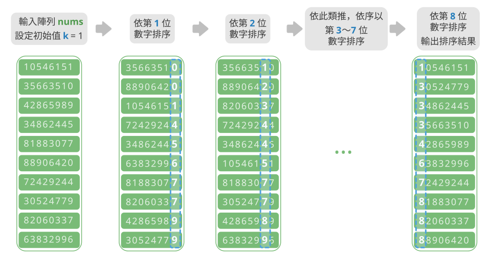

# 11.10 &nbsp; 基數排序

上一節介紹的計數排序適合資料量 $n$ 大、取值範圍 $m$ 小的情況。假設要將 $n = 10^6$ 個學號排序，每個學號都是 $8$ 位數，取值範圍 $m = 10^8$ 就會非常大。若使用計數排序，必須配置大量記憶體空間，使用基數排序則能避免這個問題。

<u>基數排序（radix sort）</u>和計數排序的核心想法相同，都透過統計個數來排序。在此基礎上，基數排序利用不同數位之間的位值關係，逐位進行排序，得到最終結果。

## 11.10.1 &nbsp; 演算法流程

以學號為例，假設最低位為第 $1$ 位，最高位為第 $8$ 位，基數排序的流程如圖 11-18 所示。

1. 設定數位索引的初始值 $k = 1$。
2. 依學號的第 $k$ 位執行「計數排序」。完成後，資料會依第 $k$ 位的數字由小到大排列。
3. 將 $k$ 增加 $1$，再回到步驟 `2.` 繼續迭代，直到所有數位都處理完畢。

{ class="animation-figure" }

<p align="center"> 圖 11-18 &nbsp; 基數排序流程 </p>

接下來看程式如何實作。對一個 $d$ 進位的數 $x$，可以用下列公式取得它的第 $k$ 位數字 $x_k$：

$$
x_k = \lfloor\frac{x}{d^{k-1}}\rfloor \bmod d
$$

其中，$\lfloor a \rfloor$ 表示將浮點數 $a$ 向下取整，$\bmod \: d$ 表示對 $d$ 取模（求餘數）。在學號的例子中，$d = 10$ 且 $k \in [1, 8]$。

此外，我們還要稍微修改計數排序的程式碼，使它能依數字的第 $k$ 位排序：

=== "Python"

    ```python title="radix_sort.py"
    def digit(num: int, exp: int) -> int:
        """取得元素 num 的第 k 位數字，其中 exp = 10^(k-1)"""
        # 傳入 exp 而非 k，可避免在此重複執行成本較高的次方運算
        return (num // exp) % 10

    def counting_sort_digit(nums: list[int], exp: int):
        """計數排序（依 nums 中各元素的第 k 位數字排序）"""
        # 十進位的每個數位介於 0~9 之間，因此需要長度為 10 的桶陣列
        counter = [0] * 10
        n = len(nums)
        # 統計 0~9 各數字出現的次數
        for i in range(n):
            d = digit(nums[i], exp)  # 取得 nums[i] 的第 k 位數字，記為 d
            counter[d] += 1  # 統計數字 d 出現的次數
        # 計算前綴和，將「出現次數」轉為「陣列索引」
        for i in range(1, 10):
            counter[i] += counter[i - 1]
        # 反向走訪，依桶內的統計結果將各元素填入 res
        res = [0] * n
        for i in range(n - 1, -1, -1):
            d = digit(nums[i], exp)
            j = counter[d] - 1  # 取得 d 在陣列中的索引 j
            res[j] = nums[i]  # 將目前的元素填入索引 j 的位置
            counter[d] -= 1  # 將 d 的數量減 1
        # 用結果覆寫原陣列 nums
        for i in range(n):
            nums[i] = res[i]

    def radix_sort(nums: list[int]):
        """基數排序"""
        # 取得陣列中的最大元素，用來判斷最多有幾位數
        m = max(nums)
        # 依序從最低位走訪到最高位
        exp = 1
        while exp <= m:
            # 依陣列元素的第 k 位數字執行計數排序
            # k = 1 -> exp = 1
            # k = 2 -> exp = 10
            # 即 exp = 10^(k-1)
            counting_sort_digit(nums, exp)
            exp *= 10
    ```

=== "C++"

    ```cpp title="radix_sort.cpp"
    /* 取得元素 num 的第 k 位數字，其中 exp = 10^(k-1) */
    int digit(int num, int exp) {
        // 傳入 exp 而非 k，可避免在此重複執行成本較高的次方運算
        return (num / exp) % 10;
    }

    /* 計數排序（依 nums 中各元素的第 k 位數字排序） */
    void countingSortDigit(vector<int> &nums, int exp) {
        // 十進位的每個數位介於 0~9 之間，因此需要長度為 10 的桶陣列
        vector<int> counter(10, 0);
        int n = nums.size();
        // 統計 0~9 各數字出現的次數
        for (int i = 0; i < n; i++) {
            int d = digit(nums[i], exp); // 取得 nums[i] 的第 k 位數字，記為 d
            counter[d]++;                // 統計數字 d 出現的次數
        }
        // 計算前綴和，將「出現次數」轉為「陣列索引」
        for (int i = 1; i < 10; i++) {
            counter[i] += counter[i - 1];
        }
        // 反向走訪，依桶內的統計結果將各元素填入 res
        vector<int> res(n, 0);
        for (int i = n - 1; i >= 0; i--) {
            int d = digit(nums[i], exp);
            int j = counter[d] - 1; // 取得 d 在陣列中的索引 j
            res[j] = nums[i];       // 將目前的元素填入索引 j 的位置
            counter[d]--;           // 將 d 的數量減 1
        }
        // 用結果覆寫原陣列 nums
        for (int i = 0; i < n; i++)
            nums[i] = res[i];
    }

    /* 基數排序 */
    void radixSort(vector<int> &nums) {
        // 取得陣列中的最大元素，用來判斷最多有幾位數
        int m = *max_element(nums.begin(), nums.end());
        // 依序從最低位走訪到最高位
        for (int exp = 1; exp <= m; exp *= 10)
            // 依陣列元素的第 k 位數字執行計數排序
            // k = 1 -> exp = 1
            // k = 2 -> exp = 10
            // 即 exp = 10^(k-1)
            countingSortDigit(nums, exp);
    }
    ```

=== "Java"

    ```java title="radix_sort.java"
    /* 取得元素 num 的第 k 位數字，其中 exp = 10^(k-1) */
    int digit(int num, int exp) {
        // 傳入 exp 而非 k，可避免在此重複執行成本較高的次方運算
        return (num / exp) % 10;
    }

    /* 計數排序（依 nums 中各元素的第 k 位數字排序） */
    void countingSortDigit(int[] nums, int exp) {
        // 十進位的每個數位介於 0~9 之間，因此需要長度為 10 的桶陣列
        int[] counter = new int[10];
        int n = nums.length;
        // 統計 0~9 各數字出現的次數
        for (int i = 0; i < n; i++) {
            int d = digit(nums[i], exp); // 取得 nums[i] 的第 k 位數字，記為 d
            counter[d]++;                // 統計數字 d 出現的次數
        }
        // 計算前綴和，將「出現次數」轉為「陣列索引」
        for (int i = 1; i < 10; i++) {
            counter[i] += counter[i - 1];
        }
        // 反向走訪，依桶內的統計結果將各元素填入 res
        int[] res = new int[n];
        for (int i = n - 1; i >= 0; i--) {
            int d = digit(nums[i], exp);
            int j = counter[d] - 1; // 取得 d 在陣列中的索引 j
            res[j] = nums[i];       // 將目前的元素填入索引 j 的位置
            counter[d]--;           // 將 d 的數量減 1
        }
        // 用結果覆寫原陣列 nums
        for (int i = 0; i < n; i++)
            nums[i] = res[i];
    }

    /* 基數排序 */
    void radixSort(int[] nums) {
        // 取得陣列中的最大元素，用來判斷最多有幾位數
        int m = Integer.MIN_VALUE;
        for (int num : nums)
            if (num > m)
                m = num;
        // 依序從最低位走訪到最高位
        for (int exp = 1; exp <= m; exp *= 10) {
            // 依陣列元素的第 k 位數字執行計數排序
            // k = 1 -> exp = 1
            // k = 2 -> exp = 10
            // 即 exp = 10^(k-1)
            countingSortDigit(nums, exp);
        }
    }
    ```

=== "C#"

    ```csharp title="radix_sort.cs"
    /* 取得元素 num 的第 k 位數字，其中 exp = 10^(k-1) */
    int Digit(int num, int exp) {
        // 傳入 exp 而非 k，可避免在此重複執行成本較高的次方運算
        return (num / exp) % 10;
    }

    /* 計數排序（依 nums 中各元素的第 k 位數字排序） */
    void CountingSortDigit(int[] nums, int exp) {
        // 十進位的每個數位介於 0~9 之間，因此需要長度為 10 的桶陣列
        int[] counter = new int[10];
        int n = nums.Length;
        // 統計 0~9 各數字出現的次數
        for (int i = 0; i < n; i++) {
            int d = Digit(nums[i], exp); // 取得 nums[i] 的第 k 位數字，記為 d
            counter[d]++;                // 統計數字 d 出現的次數
        }
        // 計算前綴和，將「出現次數」轉為「陣列索引」
        for (int i = 1; i < 10; i++) {
            counter[i] += counter[i - 1];
        }
        // 反向走訪，依桶內的統計結果將各元素填入 res
        int[] res = new int[n];
        for (int i = n - 1; i >= 0; i--) {
            int d = Digit(nums[i], exp);
            int j = counter[d] - 1; // 取得 d 在陣列中的索引 j
            res[j] = nums[i];       // 將目前的元素填入索引 j 的位置
            counter[d]--;           // 將 d 的數量減 1
        }
        // 用結果覆寫原陣列 nums
        for (int i = 0; i < n; i++) {
            nums[i] = res[i];
        }
    }

    /* 基數排序 */
    void RadixSort(int[] nums) {
        // 取得陣列中的最大元素，用來判斷最多有幾位數
        int m = int.MinValue;
        foreach (int num in nums) {
            if (num > m) m = num;
        }
        // 依序從最低位走訪到最高位
        for (int exp = 1; exp <= m; exp *= 10) {
            // 依陣列元素的第 k 位數字執行計數排序
            // k = 1 -> exp = 1
            // k = 2 -> exp = 10
            // 即 exp = 10^(k-1)
            CountingSortDigit(nums, exp);
        }
    }
    ```

=== "Go"

    ```go title="radix_sort.go"
    /* 取得元素 num 的第 k 位數字，其中 exp = 10^(k-1) */
    func digit(num, exp int) int {
        // 傳入 exp 而非 k，可避免在此重複執行成本較高的次方運算
        return (num / exp) % 10
    }

    /* 計數排序（依 nums 中各元素的第 k 位數字排序） */
    func countingSortDigit(nums []int, exp int) {
        // 十進位的每個數位介於 0~9 之間，因此需要長度為 10 的桶陣列
        counter := make([]int, 10)
        n := len(nums)
        // 統計 0~9 各數字出現的次數
        for i := 0; i < n; i++ {
            d := digit(nums[i], exp) // 取得 nums[i] 的第 k 位數字，記為 d
            counter[d]++             // 統計數字 d 出現的次數
        }
        // 計算前綴和，將「出現次數」轉為「陣列索引」
        for i := 1; i < 10; i++ {
            counter[i] += counter[i-1]
        }
        // 反向走訪，依桶內的統計結果將各元素填入 res
        res := make([]int, n)
        for i := n - 1; i >= 0; i-- {
            d := digit(nums[i], exp)
            j := counter[d] - 1 // 取得 d 在陣列中的索引 j
            res[j] = nums[i]    // 將目前的元素填入索引 j 的位置
            counter[d]--        // 將 d 的數量減 1
        }
        // 用結果覆寫原陣列 nums
        for i := 0; i < n; i++ {
            nums[i] = res[i]
        }
    }

    /* 基數排序 */
    func radixSort(nums []int) {
        // 取得陣列中的最大元素，用來判斷最多有幾位數
        max := math.MinInt
        for _, num := range nums {
            if num > max {
                max = num
            }
        }
        // 依序從最低位走訪到最高位
        for exp := 1; max >= exp; exp *= 10 {
            // 依陣列元素的第 k 位數字執行計數排序
            // k = 1 -> exp = 1
            // k = 2 -> exp = 10
            // 即 exp = 10^(k-1)
            countingSortDigit(nums, exp)
        }
    }
    ```

=== "Swift"

    ```swift title="radix_sort.swift"
    /* 取得元素 num 的第 k 位數字，其中 exp = 10^(k-1) */
    func digit(num: Int, exp: Int) -> Int {
        // 傳入 exp 而非 k，可避免在此重複執行成本較高的次方運算
        (num / exp) % 10
    }

    /* 計數排序（依 nums 中各元素的第 k 位數字排序） */
    func countingSortDigit(nums: inout [Int], exp: Int) {
        // 十進位的每個數位介於 0~9 之間，因此需要長度為 10 的桶陣列
        var counter = Array(repeating: 0, count: 10)
        // 統計 0~9 各數字出現的次數
        for i in nums.indices {
            let d = digit(num: nums[i], exp: exp) // 取得 nums[i] 的第 k 位數字，記為 d
            counter[d] += 1 // 統計數字 d 出現的次數
        }
        // 計算前綴和，將「出現次數」轉為「陣列索引」
        for i in 1 ..< 10 {
            counter[i] += counter[i - 1]
        }
        // 反向走訪，依桶內的統計結果將各元素填入 res
        var res = Array(repeating: 0, count: nums.count)
        for i in nums.indices.reversed() {
            let d = digit(num: nums[i], exp: exp)
            let j = counter[d] - 1 // 取得 d 在陣列中的索引 j
            res[j] = nums[i] // 將目前的元素填入索引 j 的位置
            counter[d] -= 1 // 將 d 的數量減 1
        }
        // 用結果覆寫原陣列 nums
        for i in nums.indices {
            nums[i] = res[i]
        }
    }

    /* 基數排序 */
    func radixSort(nums: inout [Int]) {
        // 取得陣列中的最大元素，用來判斷最多有幾位數
        var m = Int.min
        for num in nums {
            if num > m {
                m = num
            }
        }
        // 依序從最低位走訪到最高位
        for exp in sequence(first: 1, next: { m >= ($0 * 10) ? $0 * 10 : nil }) {
            // 依陣列元素的第 k 位數字執行計數排序
            // k = 1 -> exp = 1
            // k = 2 -> exp = 10
            // 即 exp = 10^(k-1)
            countingSortDigit(nums: &nums, exp: exp)
        }
    }
    ```

=== "JS"

    ```javascript title="radix_sort.js"
    /* 取得元素 num 的第 k 位數字，其中 exp = 10^(k-1) */
    function digit(num, exp) {
        // 傳入 exp 而非 k，可避免在此重複執行成本較高的次方運算
        return Math.floor(num / exp) % 10;
    }

    /* 計數排序（依 nums 中各元素的第 k 位數字排序） */
    function countingSortDigit(nums, exp) {
        // 十進位的每個數位介於 0~9 之間，因此需要長度為 10 的桶陣列
        const counter = new Array(10).fill(0);
        const n = nums.length;
        // 統計 0~9 各數字出現的次數
        for (let i = 0; i < n; i++) {
            const d = digit(nums[i], exp); // 取得 nums[i] 的第 k 位數字，記為 d
            counter[d]++; // 統計數字 d 出現的次數
        }
        // 計算前綴和，將「出現次數」轉為「陣列索引」
        for (let i = 1; i < 10; i++) {
            counter[i] += counter[i - 1];
        }
        // 反向走訪，依桶內的統計結果將各元素填入 res
        const res = new Array(n).fill(0);
        for (let i = n - 1; i >= 0; i--) {
            const d = digit(nums[i], exp);
            const j = counter[d] - 1; // 取得 d 在陣列中的索引 j
            res[j] = nums[i]; // 將目前的元素填入索引 j 的位置
            counter[d]--; // 將 d 的數量減 1
        }
        // 用結果覆寫原陣列 nums
        for (let i = 0; i < n; i++) {
            nums[i] = res[i];
        }
    }

    /* 基數排序 */
    function radixSort(nums) {
        // 取得陣列中的最大元素，用來判斷最多有幾位數
        let m = Math.max(... nums);
        // 依序從最低位走訪到最高位
        for (let exp = 1; exp <= m; exp *= 10) {
            // 依陣列元素的第 k 位數字執行計數排序
            // k = 1 -> exp = 1
            // k = 2 -> exp = 10
            // 即 exp = 10^(k-1)
            countingSortDigit(nums, exp);
        }
    }
    ```

=== "TS"

    ```typescript title="radix_sort.ts"
    /* 取得元素 num 的第 k 位數字，其中 exp = 10^(k-1) */
    function digit(num: number, exp: number): number {
        // 傳入 exp 而非 k，可避免在此重複執行成本較高的次方運算
        return Math.floor(num / exp) % 10;
    }

    /* 計數排序（依 nums 中各元素的第 k 位數字排序） */
    function countingSortDigit(nums: number[], exp: number): void {
        // 十進位的每個數位介於 0~9 之間，因此需要長度為 10 的桶陣列
        const counter = new Array(10).fill(0);
        const n = nums.length;
        // 統計 0~9 各數字出現的次數
        for (let i = 0; i < n; i++) {
            const d = digit(nums[i], exp); // 取得 nums[i] 的第 k 位數字，記為 d
            counter[d]++; // 統計數字 d 出現的次數
        }
        // 計算前綴和，將「出現次數」轉為「陣列索引」
        for (let i = 1; i < 10; i++) {
            counter[i] += counter[i - 1];
        }
        // 反向走訪，依桶內的統計結果將各元素填入 res
        const res = new Array(n).fill(0);
        for (let i = n - 1; i >= 0; i--) {
            const d = digit(nums[i], exp);
            const j = counter[d] - 1; // 取得 d 在陣列中的索引 j
            res[j] = nums[i]; // 將目前的元素填入索引 j 的位置
            counter[d]--; // 將 d 的數量減 1
        }
        // 用結果覆寫原陣列 nums
        for (let i = 0; i < n; i++) {
            nums[i] = res[i];
        }
    }

    /* 基數排序 */
    function radixSort(nums: number[]): void {
        // 取得陣列中的最大元素，用來判斷最多有幾位數
        let m: number = Math.max(... nums);
        // 依序從最低位走訪到最高位
        for (let exp = 1; exp <= m; exp *= 10) {
            // 依陣列元素的第 k 位數字執行計數排序
            // k = 1 -> exp = 1
            // k = 2 -> exp = 10
            // 即 exp = 10^(k-1)
            countingSortDigit(nums, exp);
        }
    }
    ```

=== "Dart"

    ```dart title="radix_sort.dart"
    /* 取得元素 _num 的第 k 位數字，其中 exp = 10^(k-1) */
    int digit(int _num, int exp) {
      // 傳入 exp 而非 k，可避免在此重複執行成本較高的次方運算
      return (_num ~/ exp) % 10;
    }

    /* 計數排序（依 nums 中各元素的第 k 位數字排序） */
    void countingSortDigit(List<int> nums, int exp) {
      // 十進位的每個數位介於 0~9 之間，因此需要長度為 10 的桶陣列
      List<int> counter = List<int>.filled(10, 0);
      int n = nums.length;
      // 統計 0~9 各數字出現的次數
      for (int i = 0; i < n; i++) {
        int d = digit(nums[i], exp); // 取得 nums[i] 的第 k 位數字，記為 d
        counter[d]++; // 統計數字 d 出現的次數
      }
      // 計算前綴和，將「出現次數」轉為「陣列索引」
      for (int i = 1; i < 10; i++) {
        counter[i] += counter[i - 1];
      }
      // 反向走訪，依桶內的統計結果將各元素填入 res
      List<int> res = List<int>.filled(n, 0);
      for (int i = n - 1; i >= 0; i--) {
        int d = digit(nums[i], exp);
        int j = counter[d] - 1; // 取得 d 在陣列中的索引 j
        res[j] = nums[i]; // 將目前的元素填入索引 j 的位置
        counter[d]--; // 將 d 的數量減 1
      }
      // 用結果覆寫原陣列 nums
      for (int i = 0; i < n; i++) nums[i] = res[i];
    }

    /* 基數排序 */
    void radixSort(List<int> nums) {
      // 取得陣列中的最大元素，用來判斷最多有幾位數
      // Dart 中的 int 長度為 64 位元
      int m = -1 << 63;
      for (int _num in nums) if (_num > m) m = _num;
      // 依序從最低位走訪到最高位
      for (int exp = 1; exp <= m; exp *= 10)
        // 依陣列元素的第 k 位數字執行計數排序
        // k = 1 -> exp = 1
        // k = 2 -> exp = 10
        // 即 exp = 10^(k-1)
        countingSortDigit(nums, exp);
    }
    ```

=== "Rust"

    ```rust title="radix_sort.rs"
    /* 取得元素 num 的第 k 位數字，其中 exp = 10^(k-1) */
    fn digit(num: i32, exp: i32) -> usize {
        // 傳入 exp 而非 k，可避免在此重複執行成本較高的次方運算
        return ((num / exp) % 10) as usize;
    }

    /* 計數排序（依 nums 中各元素的第 k 位數字排序） */
    fn counting_sort_digit(nums: &mut [i32], exp: i32) {
        // 十進位的每個數位介於 0~9 之間，因此需要長度為 10 的桶陣列
        let mut counter = [0; 10];
        let n = nums.len();
        // 統計 0~9 各數字出現的次數
        for i in 0..n {
            let d = digit(nums[i], exp); // 取得 nums[i] 的第 k 位數字，記為 d
            counter[d] += 1; // 統計數字 d 出現的次數
        }
        // 計算前綴和，將「出現次數」轉為「陣列索引」
        for i in 1..10 {
            counter[i] += counter[i - 1];
        }
        // 反向走訪，依桶內的統計結果將各元素填入 res
        let mut res = vec![0; n];
        for i in (0..n).rev() {
            let d = digit(nums[i], exp);
            let j = counter[d] - 1; // 取得 d 在陣列中的索引 j
            res[j] = nums[i]; // 將目前的元素填入索引 j 的位置
            counter[d] -= 1; // 將 d 的數量減 1
        }
        // 用結果覆寫原陣列 nums
        nums.copy_from_slice(&res);
    }

    /* 基數排序 */
    fn radix_sort(nums: &mut [i32]) {
        // 取得陣列中的最大元素，用來判斷最多有幾位數
        let m = *nums.into_iter().max().unwrap();
        // 依序從最低位走訪到最高位
        let mut exp = 1;
        while exp <= m {
            counting_sort_digit(nums, exp);
            exp *= 10;
        }
    }
    ```

=== "C"

    ```c title="radix_sort.c"
    /* 取得元素 num 的第 k 位數字，其中 exp = 10^(k-1) */
    int digit(int num, int exp) {
        // 傳入 exp 而非 k，可避免在此重複執行成本較高的次方運算
        return (num / exp) % 10;
    }

    /* 計數排序（依 nums 中各元素的第 k 位數字排序） */
    void countingSortDigit(int nums[], int size, int exp) {
        // 十進位的每個數位介於 0~9 之間，因此需要長度為 10 的桶陣列
        int *counter = (int *)malloc((sizeof(int) * 10));
        memset(counter, 0, sizeof(int) * 10); // 初始值設為 0，以便後續釋放記憶體
        // 統計 0~9 各數字出現的次數
        for (int i = 0; i < size; i++) {
            // 取得 nums[i] 的第 k 位數字，記為 d
            int d = digit(nums[i], exp);
            // 統計數字 d 出現的次數
            counter[d]++;
        }
        // 計算前綴和，將「出現次數」轉為「陣列索引」
        for (int i = 1; i < 10; i++) {
            counter[i] += counter[i - 1];
        }
        // 反向走訪，依桶內的統計結果將各元素填入 res
        int *res = (int *)malloc(sizeof(int) * size);
        for (int i = size - 1; i >= 0; i--) {
            int d = digit(nums[i], exp);
            int j = counter[d] - 1; // 取得 d 在陣列中的索引 j
            res[j] = nums[i];       // 將目前的元素填入索引 j 的位置
            counter[d]--;           // 將 d 的數量減 1
        }
        // 用結果覆寫原陣列 nums
        for (int i = 0; i < size; i++) {
            nums[i] = res[i];
        }
        // 釋放記憶體
        free(res);
        free(counter);
    }

    /* 基數排序 */
    void radixSort(int nums[], int size) {
        // 取得陣列中的最大元素，用來判斷最多有幾位數
        int max = INT32_MIN;
        for (int i = 0; i < size; i++) {
            if (nums[i] > max) {
                max = nums[i];
            }
        }
        // 依序從最低位走訪到最高位
        for (int exp = 1; max >= exp; exp *= 10)
            // 依陣列元素的第 k 位數字執行計數排序
            // k = 1 -> exp = 1
            // k = 2 -> exp = 10
            // 即 exp = 10^(k-1)
            countingSortDigit(nums, size, exp);
    }
    ```

=== "Kotlin"

    ```kotlin title="radix_sort.kt"
    /* 取得元素 num 的第 k 位數字，其中 exp = 10^(k-1) */
    fun digit(num: Int, exp: Int): Int {
        // 傳入 exp 而非 k，可避免在此重複執行成本較高的次方運算
        return (num / exp) % 10
    }

    /* 計數排序（依 nums 中各元素的第 k 位數字排序） */
    fun countingSortDigit(nums: IntArray, exp: Int) {
        // 十進位的每個數位介於 0~9 之間，因此需要長度為 10 的桶陣列
        val counter = IntArray(10)
        val n = nums.size
        // 統計 0~9 各數字出現的次數
        for (i in 0..<n) {
            val d = digit(nums[i], exp) // 取得 nums[i] 的第 k 位數字，記為 d
            counter[d]++                // 統計數字 d 出現的次數
        }
        // 計算前綴和，將「出現次數」轉為「陣列索引」
        for (i in 1..9) {
            counter[i] += counter[i - 1]
        }
        // 反向走訪，依桶內的統計結果將各元素填入 res
        val res = IntArray(n)
        for (i in n - 1 downTo 0) {
            val d = digit(nums[i], exp)
            val j = counter[d] - 1 // 取得 d 在陣列中的索引 j
            res[j] = nums[i]       // 將目前的元素填入索引 j 的位置
            counter[d]--           // 將 d 的數量減 1
        }
        // 用結果覆寫原陣列 nums
        for (i in 0..<n)
            nums[i] = res[i]
    }

    /* 基數排序 */
    fun radixSort(nums: IntArray) {
        // 取得陣列中的最大元素，用來判斷最多有幾位數
        var m = Int.MIN_VALUE
        for (num in nums) if (num > m) m = num
        var exp = 1
        // 依序從最低位走訪到最高位
        while (exp <= m) {
            // 依陣列元素的第 k 位數字執行計數排序
            // k = 1 -> exp = 1
            // k = 2 -> exp = 10
            // 即 exp = 10^(k-1)
            countingSortDigit(nums, exp)
            exp *= 10
        }
    }
    ```

=== "Ruby"

    ```ruby title="radix_sort.rb"
    ### 取得元素 num 的第 k 位數字，其中 exp = 10^(k-1) ###
    def digit(num, exp)
      # 傳入 exp 而非 k，可避免在此重複執行成本較高的次方運算
      (num / exp) % 10
    end

    ### 計數排序（依 nums 中各元素的第 k 位數字排序）###
    def counting_sort_digit(nums, exp)
      # 十進位的每個數位介於 0~9 之間，因此需要長度為 10 的桶陣列
      counter = Array.new(10, 0)
      n = nums.length
      # 統計 0~9 各數字出現的次數
      for i in 0...n
        d = digit(nums[i], exp) # 取得 nums[i] 的第 k 位數字，記為 d
        counter[d] += 1 # 統計數字 d 出現的次數
      end
      # 計算前綴和，將「出現次數」轉為「陣列索引」
      (1...10).each { |i| counter[i] += counter[i - 1] }
      # 反向走訪，依桶內的統計結果將各元素填入 res
      res = Array.new(n, 0)
      for i in (n - 1).downto(0)
        d = digit(nums[i], exp)
        j = counter[d] - 1 # 取得 d 在陣列中的索引 j
        res[j] = nums[i] # 將目前的元素填入索引 j 的位置
        counter[d] -= 1 # 將 d 的數量減 1
      end
      # 用結果覆寫原陣列 nums
      (0...n).each { |i| nums[i] = res[i] }
    end

    ### 基數排序 ###
    def radix_sort(nums)
      # 取得陣列中的最大元素，用來判斷最多有幾位數
      m = nums.max
      # 依序從最低位走訪到最高位
      exp = 1
      while exp <= m
        # 依陣列元素的第 k 位數字執行計數排序
        # k = 1 -> exp = 1
        # k = 2 -> exp = 10
        # 即 exp = 10^(k-1)
        counting_sort_digit(nums, exp)
        exp *= 10
      end
    end
    ```

??? pythontutor "執行視覺化示範"

    <div style="height: 549px; width: 100%;"><iframe class="pythontutor-iframe" title="執行視覺化示範" src="https://pythontutor.com/iframe-embed.html#code=def%20digit%28num%3A%20int,%20exp%3A%20int%29%20-%3E%20int%3A%0A%20%20%20%20%22%22%22%E5%8F%96%E5%BE%97%E5%85%83%E7%B4%A0%20num%20%E7%9A%84%E7%AC%AC%20k%20%E4%BD%8D%E6%95%B8%E5%AD%97%EF%BC%8C%E5%85%B6%E4%B8%AD%20exp%20%3D%2010%5E%28k-1%29%22%22%22%0A%20%20%20%20%23%20%E5%82%B3%E5%85%A5%20exp%20%E8%80%8C%E9%9D%9E%20k%EF%BC%8C%E5%8F%AF%E9%81%BF%E5%85%8D%E5%9C%A8%E6%AD%A4%E9%87%8D%E8%A4%87%E5%9F%B7%E8%A1%8C%E6%88%90%E6%9C%AC%E8%BC%83%E9%AB%98%E7%9A%84%E6%AC%A1%E6%96%B9%E9%81%8B%E7%AE%97%0A%20%20%20%20return%20%28num%20//%20exp%29%20%25%2010%0A%0Adef%20counting_sort_digit%28nums%3A%20list%5Bint%5D,%20exp%3A%20int%29%3A%0A%20%20%20%20%22%22%22%E8%A8%88%E6%95%B8%E6%8E%92%E5%BA%8F%EF%BC%88%E4%BE%9D%20nums%20%E4%B8%AD%E5%90%84%E5%85%83%E7%B4%A0%E7%9A%84%E7%AC%AC%20k%20%E4%BD%8D%E6%95%B8%E5%AD%97%E6%8E%92%E5%BA%8F%EF%BC%89%22%22%22%0A%20%20%20%20%23%20%E5%8D%81%E9%80%B2%E4%BD%8D%E7%9A%84%E6%AF%8F%E5%80%8B%E6%95%B8%E4%BD%8D%E4%BB%8B%E6%96%BC%200~9%20%E4%B9%8B%E9%96%93%EF%BC%8C%E5%9B%A0%E6%AD%A4%E9%9C%80%E8%A6%81%E9%95%B7%E5%BA%A6%E7%82%BA%2010%20%E7%9A%84%E6%A1%B6%E9%99%A3%E5%88%97%0A%20%20%20%20counter%20%3D%20%5B0%5D%20%2A%2010%0A%20%20%20%20n%20%3D%20len%28nums%29%0A%20%20%20%20%23%20%E7%B5%B1%E8%A8%88%200~9%20%E5%90%84%E6%95%B8%E5%AD%97%E5%87%BA%E7%8F%BE%E7%9A%84%E6%AC%A1%E6%95%B8%0A%20%20%20%20for%20i%20in%20range%28n%29%3A%0A%20%20%20%20%20%20%20%20d%20%3D%20digit%28nums%5Bi%5D,%20exp%29%20%20%23%20%E5%8F%96%E5%BE%97%20nums%5Bi%5D%20%E7%9A%84%E7%AC%AC%20k%20%E4%BD%8D%E6%95%B8%E5%AD%97%EF%BC%8C%E8%A8%98%E7%82%BA%20d%0A%20%20%20%20%20%20%20%20counter%5Bd%5D%20%2B%3D%201%20%20%23%20%E7%B5%B1%E8%A8%88%E6%95%B8%E5%AD%97%20d%20%E5%87%BA%E7%8F%BE%E7%9A%84%E6%AC%A1%E6%95%B8%0A%20%20%20%20%23%20%E8%A8%88%E7%AE%97%E5%89%8D%E7%B6%B4%E5%92%8C%EF%BC%8C%E5%B0%87%E3%80%8C%E5%87%BA%E7%8F%BE%E6%AC%A1%E6%95%B8%E3%80%8D%E8%BD%89%E7%82%BA%E3%80%8C%E9%99%A3%E5%88%97%E7%B4%A2%E5%BC%95%E3%80%8D%0A%20%20%20%20for%20i%20in%20range%281,%2010%29%3A%0A%20%20%20%20%20%20%20%20counter%5Bi%5D%20%2B%3D%20counter%5Bi%20-%201%5D%0A%20%20%20%20%23%20%E5%8F%8D%E5%90%91%E8%B5%B0%E8%A8%AA%EF%BC%8C%E4%BE%9D%E6%A1%B6%E5%85%A7%E7%9A%84%E7%B5%B1%E8%A8%88%E7%B5%90%E6%9E%9C%E5%B0%87%E5%90%84%E5%85%83%E7%B4%A0%E5%A1%AB%E5%85%A5%20res%0A%20%20%20%20res%20%3D%20%5B0%5D%20%2A%20n%0A%20%20%20%20for%20i%20in%20range%28n%20-%201,%20-1,%20-1%29%3A%0A%20%20%20%20%20%20%20%20d%20%3D%20digit%28nums%5Bi%5D,%20exp%29%0A%20%20%20%20%20%20%20%20j%20%3D%20counter%5Bd%5D%20-%201%20%20%23%20%E5%8F%96%E5%BE%97%20d%20%E5%9C%A8%E9%99%A3%E5%88%97%E4%B8%AD%E7%9A%84%E7%B4%A2%E5%BC%95%20j%0A%20%20%20%20%20%20%20%20res%5Bj%5D%20%3D%20nums%5Bi%5D%20%20%23%20%E5%B0%87%E7%9B%AE%E5%89%8D%E7%9A%84%E5%85%83%E7%B4%A0%E5%A1%AB%E5%85%A5%E7%B4%A2%E5%BC%95%20j%20%E7%9A%84%E4%BD%8D%E7%BD%AE%0A%20%20%20%20%20%20%20%20counter%5Bd%5D%20-%3D%201%20%20%23%20%E5%B0%87%20d%20%E7%9A%84%E6%95%B8%E9%87%8F%E6%B8%9B%201%0A%20%20%20%20%23%20%E7%94%A8%E7%B5%90%E6%9E%9C%E8%A6%86%E5%AF%AB%E5%8E%9F%E9%99%A3%E5%88%97%20nums%0A%20%20%20%20for%20i%20in%20range%28n%29%3A%0A%20%20%20%20%20%20%20%20nums%5Bi%5D%20%3D%20res%5Bi%5D%0A%0Adef%20radix_sort%28nums%3A%20list%5Bint%5D%29%3A%0A%20%20%20%20%22%22%22%E5%9F%BA%E6%95%B8%E6%8E%92%E5%BA%8F%22%22%22%0A%20%20%20%20%23%20%E5%8F%96%E5%BE%97%E9%99%A3%E5%88%97%E4%B8%AD%E7%9A%84%E6%9C%80%E5%A4%A7%E5%85%83%E7%B4%A0%EF%BC%8C%E7%94%A8%E4%BE%86%E5%88%A4%E6%96%B7%E6%9C%80%E5%A4%9A%E6%9C%89%E5%B9%BE%E4%BD%8D%E6%95%B8%0A%20%20%20%20m%20%3D%20max%28nums%29%0A%20%20%20%20%23%20%E4%BE%9D%E5%BA%8F%E5%BE%9E%E6%9C%80%E4%BD%8E%E4%BD%8D%E8%B5%B0%E8%A8%AA%E5%88%B0%E6%9C%80%E9%AB%98%E4%BD%8D%0A%20%20%20%20exp%20%3D%201%0A%20%20%20%20while%20exp%20%3C%3D%20m%3A%0A%20%20%20%20%20%20%20%20%23%20%E4%BE%9D%E9%99%A3%E5%88%97%E5%85%83%E7%B4%A0%E7%9A%84%E7%AC%AC%20k%20%E4%BD%8D%E6%95%B8%E5%AD%97%E5%9F%B7%E8%A1%8C%E8%A8%88%E6%95%B8%E6%8E%92%E5%BA%8F%0A%20%20%20%20%20%20%20%20%23%20k%20%3D%201%20-%3E%20exp%20%3D%201%0A%20%20%20%20%20%20%20%20%23%20k%20%3D%202%20-%3E%20exp%20%3D%2010%0A%20%20%20%20%20%20%20%20%23%20%E5%8D%B3%20exp%20%3D%2010%5E%28k-1%29%0A%20%20%20%20%20%20%20%20counting_sort_digit%28nums,%20exp%29%0A%20%20%20%20%20%20%20%20exp%20%2A%3D%2010%0A%0A%22%22%22Driver%20Code%22%22%22%0Aif%20__name__%20%3D%3D%20%22__main__%22%3A%0A%20%20%20%20%23%20%E5%9F%BA%E6%95%B8%E6%8E%92%E5%BA%8F%0A%20%20%20%20nums%20%3D%20%5B%0A%20%20%20%20%20%20%20%20105,%0A%20%20%20%20%20%20%20%20356,%0A%20%20%20%20%20%20%20%20428,%0A%20%20%20%20%20%20%20%20348,%0A%20%20%20%20%20%20%20%20818,%0A%20%20%20%20%5D%0A%20%20%20%20radix_sort%28nums%29%0A%20%20%20%20print%28%22%E5%9F%BA%E6%95%B8%E6%8E%92%E5%BA%8F%E5%AE%8C%E6%88%90%E5%BE%8C%20nums%20%3D%22,%20nums%29&codeDivHeight=472&codeDivWidth=350&cumulative=false&curInstr=6&heapPrimitives=nevernest&origin=opt-frontend.js&py=311&rawInputLstJSON=%5B%5D&textReferences=false"> </iframe></div>
    <div style="margin-top: 5px;"><a href="https://pythontutor.com/iframe-embed.html#code=def%20digit%28num%3A%20int,%20exp%3A%20int%29%20-%3E%20int%3A%0A%20%20%20%20%22%22%22%E5%8F%96%E5%BE%97%E5%85%83%E7%B4%A0%20num%20%E7%9A%84%E7%AC%AC%20k%20%E4%BD%8D%E6%95%B8%E5%AD%97%EF%BC%8C%E5%85%B6%E4%B8%AD%20exp%20%3D%2010%5E%28k-1%29%22%22%22%0A%20%20%20%20%23%20%E5%82%B3%E5%85%A5%20exp%20%E8%80%8C%E9%9D%9E%20k%EF%BC%8C%E5%8F%AF%E9%81%BF%E5%85%8D%E5%9C%A8%E6%AD%A4%E9%87%8D%E8%A4%87%E5%9F%B7%E8%A1%8C%E6%88%90%E6%9C%AC%E8%BC%83%E9%AB%98%E7%9A%84%E6%AC%A1%E6%96%B9%E9%81%8B%E7%AE%97%0A%20%20%20%20return%20%28num%20//%20exp%29%20%25%2010%0A%0Adef%20counting_sort_digit%28nums%3A%20list%5Bint%5D,%20exp%3A%20int%29%3A%0A%20%20%20%20%22%22%22%E8%A8%88%E6%95%B8%E6%8E%92%E5%BA%8F%EF%BC%88%E4%BE%9D%20nums%20%E4%B8%AD%E5%90%84%E5%85%83%E7%B4%A0%E7%9A%84%E7%AC%AC%20k%20%E4%BD%8D%E6%95%B8%E5%AD%97%E6%8E%92%E5%BA%8F%EF%BC%89%22%22%22%0A%20%20%20%20%23%20%E5%8D%81%E9%80%B2%E4%BD%8D%E7%9A%84%E6%AF%8F%E5%80%8B%E6%95%B8%E4%BD%8D%E4%BB%8B%E6%96%BC%200~9%20%E4%B9%8B%E9%96%93%EF%BC%8C%E5%9B%A0%E6%AD%A4%E9%9C%80%E8%A6%81%E9%95%B7%E5%BA%A6%E7%82%BA%2010%20%E7%9A%84%E6%A1%B6%E9%99%A3%E5%88%97%0A%20%20%20%20counter%20%3D%20%5B0%5D%20%2A%2010%0A%20%20%20%20n%20%3D%20len%28nums%29%0A%20%20%20%20%23%20%E7%B5%B1%E8%A8%88%200~9%20%E5%90%84%E6%95%B8%E5%AD%97%E5%87%BA%E7%8F%BE%E7%9A%84%E6%AC%A1%E6%95%B8%0A%20%20%20%20for%20i%20in%20range%28n%29%3A%0A%20%20%20%20%20%20%20%20d%20%3D%20digit%28nums%5Bi%5D,%20exp%29%20%20%23%20%E5%8F%96%E5%BE%97%20nums%5Bi%5D%20%E7%9A%84%E7%AC%AC%20k%20%E4%BD%8D%E6%95%B8%E5%AD%97%EF%BC%8C%E8%A8%98%E7%82%BA%20d%0A%20%20%20%20%20%20%20%20counter%5Bd%5D%20%2B%3D%201%20%20%23%20%E7%B5%B1%E8%A8%88%E6%95%B8%E5%AD%97%20d%20%E5%87%BA%E7%8F%BE%E7%9A%84%E6%AC%A1%E6%95%B8%0A%20%20%20%20%23%20%E8%A8%88%E7%AE%97%E5%89%8D%E7%B6%B4%E5%92%8C%EF%BC%8C%E5%B0%87%E3%80%8C%E5%87%BA%E7%8F%BE%E6%AC%A1%E6%95%B8%E3%80%8D%E8%BD%89%E7%82%BA%E3%80%8C%E9%99%A3%E5%88%97%E7%B4%A2%E5%BC%95%E3%80%8D%0A%20%20%20%20for%20i%20in%20range%281,%2010%29%3A%0A%20%20%20%20%20%20%20%20counter%5Bi%5D%20%2B%3D%20counter%5Bi%20-%201%5D%0A%20%20%20%20%23%20%E5%8F%8D%E5%90%91%E8%B5%B0%E8%A8%AA%EF%BC%8C%E4%BE%9D%E6%A1%B6%E5%85%A7%E7%9A%84%E7%B5%B1%E8%A8%88%E7%B5%90%E6%9E%9C%E5%B0%87%E5%90%84%E5%85%83%E7%B4%A0%E5%A1%AB%E5%85%A5%20res%0A%20%20%20%20res%20%3D%20%5B0%5D%20%2A%20n%0A%20%20%20%20for%20i%20in%20range%28n%20-%201,%20-1,%20-1%29%3A%0A%20%20%20%20%20%20%20%20d%20%3D%20digit%28nums%5Bi%5D,%20exp%29%0A%20%20%20%20%20%20%20%20j%20%3D%20counter%5Bd%5D%20-%201%20%20%23%20%E5%8F%96%E5%BE%97%20d%20%E5%9C%A8%E9%99%A3%E5%88%97%E4%B8%AD%E7%9A%84%E7%B4%A2%E5%BC%95%20j%0A%20%20%20%20%20%20%20%20res%5Bj%5D%20%3D%20nums%5Bi%5D%20%20%23%20%E5%B0%87%E7%9B%AE%E5%89%8D%E7%9A%84%E5%85%83%E7%B4%A0%E5%A1%AB%E5%85%A5%E7%B4%A2%E5%BC%95%20j%20%E7%9A%84%E4%BD%8D%E7%BD%AE%0A%20%20%20%20%20%20%20%20counter%5Bd%5D%20-%3D%201%20%20%23%20%E5%B0%87%20d%20%E7%9A%84%E6%95%B8%E9%87%8F%E6%B8%9B%201%0A%20%20%20%20%23%20%E7%94%A8%E7%B5%90%E6%9E%9C%E8%A6%86%E5%AF%AB%E5%8E%9F%E9%99%A3%E5%88%97%20nums%0A%20%20%20%20for%20i%20in%20range%28n%29%3A%0A%20%20%20%20%20%20%20%20nums%5Bi%5D%20%3D%20res%5Bi%5D%0A%0Adef%20radix_sort%28nums%3A%20list%5Bint%5D%29%3A%0A%20%20%20%20%22%22%22%E5%9F%BA%E6%95%B8%E6%8E%92%E5%BA%8F%22%22%22%0A%20%20%20%20%23%20%E5%8F%96%E5%BE%97%E9%99%A3%E5%88%97%E4%B8%AD%E7%9A%84%E6%9C%80%E5%A4%A7%E5%85%83%E7%B4%A0%EF%BC%8C%E7%94%A8%E4%BE%86%E5%88%A4%E6%96%B7%E6%9C%80%E5%A4%9A%E6%9C%89%E5%B9%BE%E4%BD%8D%E6%95%B8%0A%20%20%20%20m%20%3D%20max%28nums%29%0A%20%20%20%20%23%20%E4%BE%9D%E5%BA%8F%E5%BE%9E%E6%9C%80%E4%BD%8E%E4%BD%8D%E8%B5%B0%E8%A8%AA%E5%88%B0%E6%9C%80%E9%AB%98%E4%BD%8D%0A%20%20%20%20exp%20%3D%201%0A%20%20%20%20while%20exp%20%3C%3D%20m%3A%0A%20%20%20%20%20%20%20%20%23%20%E4%BE%9D%E9%99%A3%E5%88%97%E5%85%83%E7%B4%A0%E7%9A%84%E7%AC%AC%20k%20%E4%BD%8D%E6%95%B8%E5%AD%97%E5%9F%B7%E8%A1%8C%E8%A8%88%E6%95%B8%E6%8E%92%E5%BA%8F%0A%20%20%20%20%20%20%20%20%23%20k%20%3D%201%20-%3E%20exp%20%3D%201%0A%20%20%20%20%20%20%20%20%23%20k%20%3D%202%20-%3E%20exp%20%3D%2010%0A%20%20%20%20%20%20%20%20%23%20%E5%8D%B3%20exp%20%3D%2010%5E%28k-1%29%0A%20%20%20%20%20%20%20%20counting_sort_digit%28nums,%20exp%29%0A%20%20%20%20%20%20%20%20exp%20%2A%3D%2010%0A%0A%22%22%22Driver%20Code%22%22%22%0Aif%20__name__%20%3D%3D%20%22__main__%22%3A%0A%20%20%20%20%23%20%E5%9F%BA%E6%95%B8%E6%8E%92%E5%BA%8F%0A%20%20%20%20nums%20%3D%20%5B%0A%20%20%20%20%20%20%20%20105,%0A%20%20%20%20%20%20%20%20356,%0A%20%20%20%20%20%20%20%20428,%0A%20%20%20%20%20%20%20%20348,%0A%20%20%20%20%20%20%20%20818,%0A%20%20%20%20%5D%0A%20%20%20%20radix_sort%28nums%29%0A%20%20%20%20print%28%22%E5%9F%BA%E6%95%B8%E6%8E%92%E5%BA%8F%E5%AE%8C%E6%88%90%E5%BE%8C%20nums%20%3D%22,%20nums%29&codeDivHeight=800&codeDivWidth=600&cumulative=false&curInstr=6&heapPrimitives=nevernest&origin=opt-frontend.js&py=311&rawInputLstJSON=%5B%5D&textReferences=false" target="_blank" rel="noopener noreferrer">全螢幕觀看 ></a></div>

!!! question "為什麼從最低位開始排序？"

    連續執行多輪排序時，後一輪的排序結果優先於前一輪。舉例來說，如果第一輪的排序結果為 $a < b$，第二輪的排序結果為 $a > b$，就以第二輪的結果為準。由於比較數值時高位優先於低位，因此應先排低位，再排高位。

## 11.10.2 &nbsp; 演算法特性

相較於計數排序，基數排序適用於數值範圍較大的情況，**但資料必須能以固定位數表示，且位數不能太大**。例如，浮點數不適合用基數排序，因為位數 $k$ 太大，可能導致時間複雜度 $O(nk) \gg O(n^2)$。

- **時間複雜度為 $O(nk)$、不具調適性的排序**：假設資料量為 $n$，資料採 $d$ 進位，最大位數為 $k$。對一個數位執行計數排序需要 $O(n + d)$ 時間，處理全部 $k$ 個數位共需 $O((n + d)k)$ 時間。通常 $d$ 與 $k$ 都較小，因此時間複雜度趨近 $O(n)$。
- **空間複雜度為 $O(n + d)$、非原地排序**：基數排序與計數排序相同，需要陣列 `res` 與 `counter`，長度分別為 $n$ 與 $d$。
- **穩定排序**：若每輪的計數排序穩定，基數排序也穩定。若計數排序不穩定，基數排序便無法保證得到正確結果。
