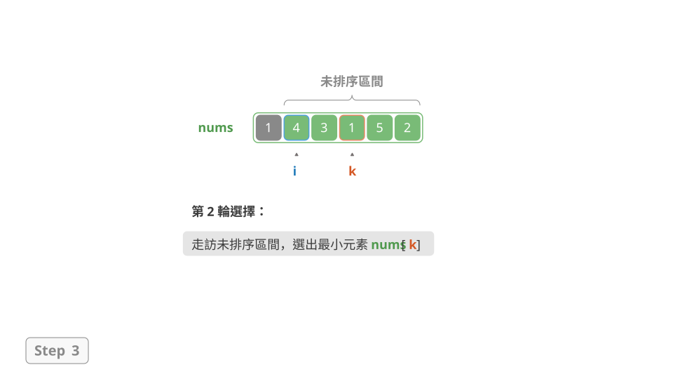
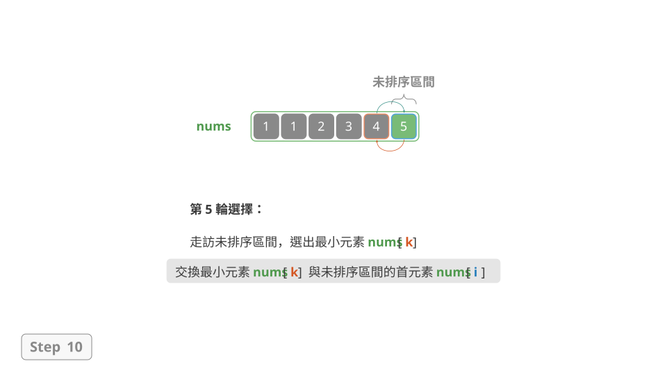

# 選擇排序

<u>選擇排序（selection sort）</u>的工作原理非常簡單：開啟一個迴圈，每輪從未排序區間選擇最小的元素，將其放到已排序區間的末尾。

設陣列的長度為 $n$ ，選擇排序的演算法流程如下圖所示。

1. 初始狀態下，所有元素未排序，即未排序（索引）區間為 $[0, n-1]$ 。
2. 選取區間 $[0, n-1]$ 中的最小元素，將其與索引 $0$ 處的元素交換。完成後，陣列前 1 個元素已排序。
3. 選取區間 $[1, n-1]$ 中的最小元素，將其與索引 $1$ 處的元素交換。完成後，陣列前 2 個元素已排序。
4. 以此類推。經過 $n - 1$ 輪選擇與交換後，陣列前 $n - 1$ 個元素已排序。
5. 僅剩的一個元素必定是最大元素，無須排序，因此陣列排序完成。

=== "<1>"
    

=== "<2>"
    

=== "<3>"
    

=== "<4>"
    

=== "<5>"
    

=== "<6>"
    

=== "<7>"
    

=== "<8>"
    

=== "<9>"
    

=== "<10>"
    

=== "<11>"
    
<!-- figure-reading:start group:chapter_sorting/selection_sort.assets/selection_sort -->

[選擇排序：完整圖解](selection_sort.assets/selection_sort.a11y.markdown)

<!-- figure-reading:end -->

在程式碼中，我們用 $k$ 來記錄未排序區間內的最小元素：

```src
[file]{selection_sort}-[class]{}-[func]{selection_sort}
```

## 演算法特性

- **時間複雜度為 $O(n^2)$、非自適應排序**：外迴圈共 $n - 1$ 輪，第一輪內迴圈執行 $n - 1$ 次，最後一輪執行 $1$ 次，即各輪內迴圈分別執行 $n - 1$、$n - 2$、$\dots$、$2$、$1$ 次，求和為 $\frac{n(n - 1)}{2}$ 。
- **空間複雜度為 $O(1)$、原地排序**：指標 $i$ 和 $j$ 使用常數大小的額外空間。
- **非穩定排序**：如下圖所示，元素 `nums[i]` 有可能被交換至與其相等的元素的右邊，導致兩者的相對順序發生改變。


<!-- figure-reading:start group:chapter_sorting/selection_sort.assets/selection_sort_instability -->

[選擇排序中的跨位置交換：完整圖解](selection_sort.assets/selection_sort_instability.a11y.markdown)

<!-- figure-reading:end -->
