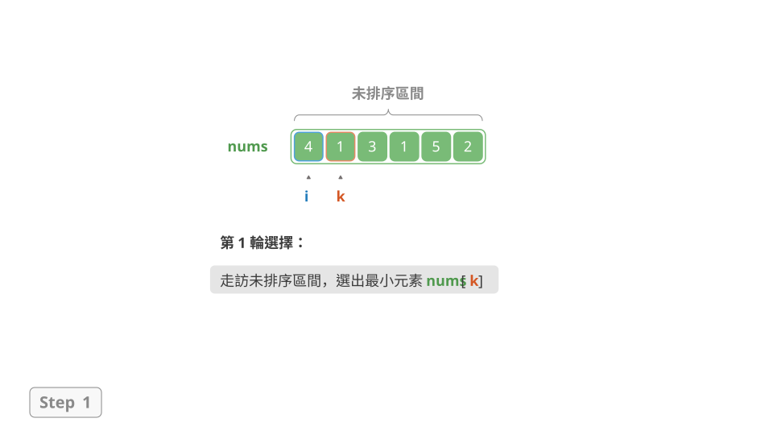
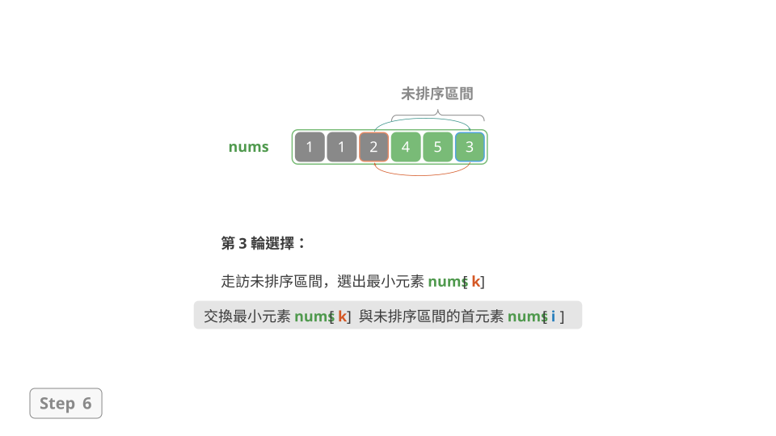
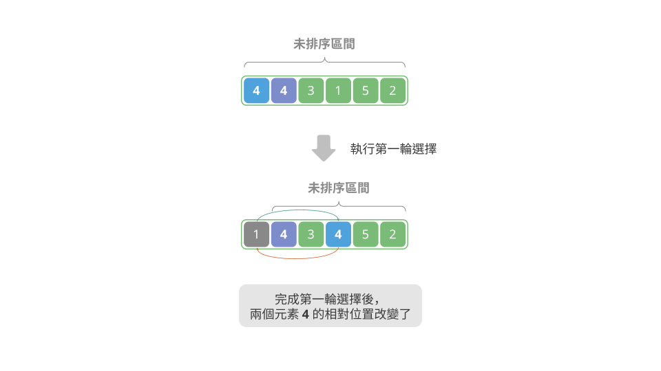

# 選擇排序

<u>選擇排序（selection sort）</u>的做法很簡單：執行迴圈，每輪從未排序區間選出最小元素，放到已排序區間的尾端。

假設陣列長度為 $n$，選擇排序的流程如下圖所示。

1. 一開始所有元素都尚未排序，也就是說，未排序的索引區間為 $[0, n-1]$。
2. 選取區間 $[0, n-1]$ 中的最小元素，與索引 $0$ 的元素交換。完成後，陣列的第 1 個元素已排好。
3. 選取區間 $[1, n-1]$ 中的最小元素，與索引 $1$ 的元素交換。完成後，陣列的前 2 個元素已排好。
4. 依此類推。經過 $n - 1$ 輪選擇與交換，陣列的前 $n - 1$ 個元素都已排好。
5. 只剩最後一個元素，它必定是最大元素，無須再排，整個陣列就排好了。

=== "<1>"
    

=== "<2>"
    

=== "<3>"
    

=== "<4>"
    

=== "<5>"
    

=== "<6>"
    

=== "<7>"
    

=== "<8>"
    

=== "<9>"
    

=== "<10>"
    

=== "<11>"
    

在程式中，我們用 $k$ 記錄未排序區間中最小元素的位置：

```src
[file]{selection_sort}-[class]{}-[func]{selection_sort}
```

## 演算法特性

- **時間複雜度為 $O(n^2)$、不具調適性的排序**：外層迴圈共執行 $n - 1$ 輪。內層迴圈在第一輪執行 $n - 1$ 次，最後一輪執行 $1$ 次。各輪內層迴圈的執行次數依序為 $n - 1$、$n - 2$、$\dots$、$2$、$1$，總和為 $\frac{n(n - 1)}{2}$。
- **空間複雜度為 $O(1)$、原地排序**：指標 $i$ 和 $j$ 只占用常數大小的額外空間。
- **不穩定排序**：如下圖所示，元素 `nums[i]` 可能被換到另一個與它相等的元素右側，使兩者的相對順序改變。


