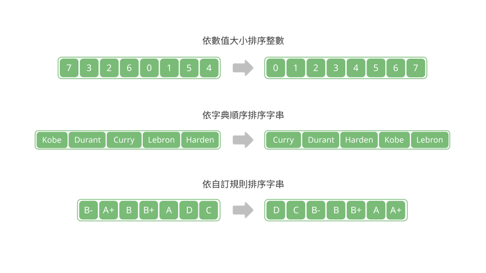

# 排序演算法

<u>排序演算法（sorting algorithm）</u>用於將一組資料依指定順序排列。資料排好後，通常更容易有效率地搜尋、分析與處理，因此排序演算法的應用相當廣泛。

如下圖所示，排序的資料型別可以是整數、浮點數、字元或字串等。可依需求訂定排序規則，例如依數值大小、依字元的 ASCII 碼順序，或採用自訂規則。



## 評估指標

**執行效率**：我們希望排序演算法的時間複雜度盡量低，實際執行的操作次數也盡量少（使時間複雜度中的常數項較小）。資料量大時，執行效率尤其重要。

**原地性**：顧名思義，<u>原地排序</u>直接在原陣列上操作，無須另設輔助陣列，因此可以節省記憶體。一般而言，原地排序搬移資料的次數較少，執行速度也較快。

**穩定性**：使用<u>穩定排序</u>時，排序完成後，陣列中相等元素的相對順序維持不變。

在多層次排序中，穩定排序是必要條件。假設我們有一張儲存學生資料的表格，第一欄是姓名，第二欄是年齡。在這種情況下，<u>不穩定排序</u>可能會破壞輸入資料原本的順序：

```shell
# 輸入資料已按姓名排好
# (name, age)
  ('A', 19)
  ('B', 18)
  ('C', 21)
  ('D', 19)
  ('E', 23)

# 假設用不穩定的排序演算法依年齡將串列排序，
# 結果中 ('D', 19) 與 ('A', 19) 的相對位置改變，
# 原本依姓名排列的順序遭到破壞
  ('B', 18)
  ('D', 19)
  ('A', 19)
  ('C', 21)
  ('E', 23)
```

**調適性**：<u>具調適性的排序</u>能利用輸入資料現有的順序來減少運算量，提升時間效率。這類演算法的最佳時間複雜度通常優於平均時間複雜度。

**是否以比較為基礎**：<u>以比較為基礎的排序</u>使用比較運算子（$<$、$=$、$>$）判斷元素間的相對順序，藉此將整個陣列排序。其最差時間複雜度的下界為 $\Omega(n \log n)$。<u>不以比較為基礎的排序</u>則不使用比較運算子，時間複雜度可達 $O(n)$，但適用範圍較窄。

## 理想的排序演算法

**執行快速、原地、穩定、具調適性，而且適用範圍廣**。目前還沒有發現能兼具以上所有特性的排序演算法。因此，選擇排序演算法時，須依資料的特徵與問題的需求來決定。

接下來，我們將學習各種排序演算法，並根據上述指標分析各自的優缺點。
