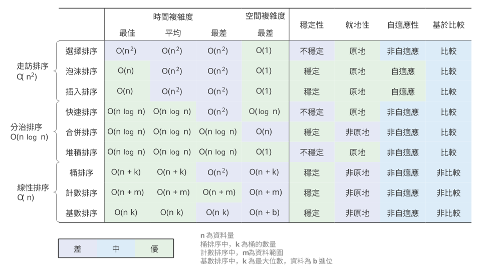

# 11.11 &nbsp; 小結

### 1. &nbsp; 重點回顧

- 氣泡排序藉由交換相鄰元素來排序。加入旗標後，只要確認陣列已排好，就能提早回傳，使最佳時間複雜度降到 $O(n)$。
- 插入排序每輪將未排序區間中的元素插入已排序區間的正確位置，直到完成排序。雖然時間複雜度為 $O(n^2)$，但基本操作較少，因此很常用於資料量小的排序工作。
- 快速排序透過哨兵分割來排序。若每次都選到最差的基準值，時間複雜度會退化到 $O(n^2)$。選取中位數或隨機選取元素作為基準值，都能降低退化的機率。優先遞迴處理較短的子區間，能有效降低遞迴深度，將空間複雜度降到 $O(\log n)$。
- 合併排序的分割與合併兩個階段，是分治策略的典型應用。用合併排序處理陣列時，需要建立輔助陣列，空間複雜度為 $O(n)$。若用來處理鏈結串列，空間複雜度則可降到 $O(1)$。
- 桶排序分成三步：將資料分桶、在各桶內排序，再合併結果。它同樣採用分治策略，適合處理大量資料，關鍵在於讓各桶分到的資料量均衡。
- 計數排序是桶排序的一種特例，藉由統計各數值出現的次數來排序。它適合資料量大、取值範圍有限的情況，並要求資料能轉為正整數。
- 基數排序逐位處理數字來完成排序，要求資料能表示為固定位數的數字。
- 我們希望排序演算法具有效率高、穩定、原地、具調適性等優點。然而，如同其他資料結構與演算法，沒有一種排序演算法能同時滿足所有條件。實際應用時，應依資料的特性選擇合適的排序演算法。
- 圖 11-19 比較常見排序演算法的效率、穩定性、原地性與調適性等特性。

{ class="animation-figure" }

 圖 11-19 &nbsp; 排序演算法比較 

### 2. &nbsp; Q & A

**Q**：什麼情況下必須使用穩定排序？

實務上，常需要依物件的某項屬性排序。例如，學生有姓名與身高兩項屬性，我們希望進行多層次排序：先依姓名排序，得到 `(A, 180) (B, 185) (C, 170) (D, 170)`，再依身高排序。若排序演算法不穩定，就可能得到 `(D, 170) (C, 170) (A, 180) (B, 185)`。

可以看到，學生 D 和 C 的位置互換，破壞了原本的姓名順序，這並非我們想要的結果。

**Q**：哨兵分割時，「從右向左找」和「從左向右找」的順序可以互換嗎？

不行。以最左端的元素為基準值時，必須先「從右向左找」，再「從左向右找」。這個結論可能有點違反直覺，讓我們看看原因。

哨兵分割 `partition()` 的最後一步是交換 `nums[left]` 與 `nums[i]`。交換後，基準值左側的元素都 `<=` 基準值，**因此在最後一次交換前，必須滿足 `nums[left] >= nums[i]`**。假設先「從左向右找」，若沒有找到大於基準值的元素，**就會在 `i == j` 時跳出迴圈，此時可能有 `nums[j] == nums[i] > nums[left]`**。換句話說，最後的交換可能將一個大於基準值的元素移到陣列最左端，導致哨兵分割失敗。

例如，給定陣列 `[0, 0, 0, 0, 1]`，若先「從左向右找」，哨兵分割後會得到 `[1, 0, 0, 0, 0]`，這個結果並不正確。

再想一想，若選擇 `nums[right]` 作為基準值，情況就正好相反，必須先「從左向右找」。

**Q**：快速排序最佳化遞迴深度時，為什麼選較短的陣列就能確保遞迴深度不超過 $\log n$？

遞迴深度是指目前尚未回傳的遞迴呼叫數量。每輪哨兵分割都將原陣列分為兩個子陣列。最佳化遞迴深度後，向下遞迴處理的子陣列長度最多是原陣列的一半。假設每次都遇到剛好一半長的最差情況，最後的遞迴深度就是 $\log n$。

回顧原本的快速排序，遞迴可能連續處理較長的陣列，最差情況下長度依序為 $n$、$n - 1$、$\dots$、$2$、$1$，遞迴深度為 $n$。最佳化遞迴深度能避免這種情況。

**Q**：陣列中所有元素都相等時，快速排序的時間複雜度是 $O(n^2)$ 嗎？該如何處理這種退化情況？

是的。這時可考慮用哨兵分割將陣列分成小於、等於、大於基準值的三部分，只對小於和大於基準值的兩部分繼續遞迴。採用這種做法時，若輸入陣列的元素全都相等，只需做一輪哨兵分割就能完成排序。

**Q**：桶排序的最差時間複雜度為什麼是 $O(n^2)$？

最差情況下，所有元素都分到同一個桶。若使用 $O(n^2)$ 演算法將這些元素排序，時間複雜度就是 $O(n^2)$。
