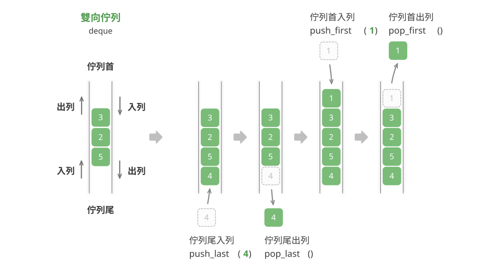
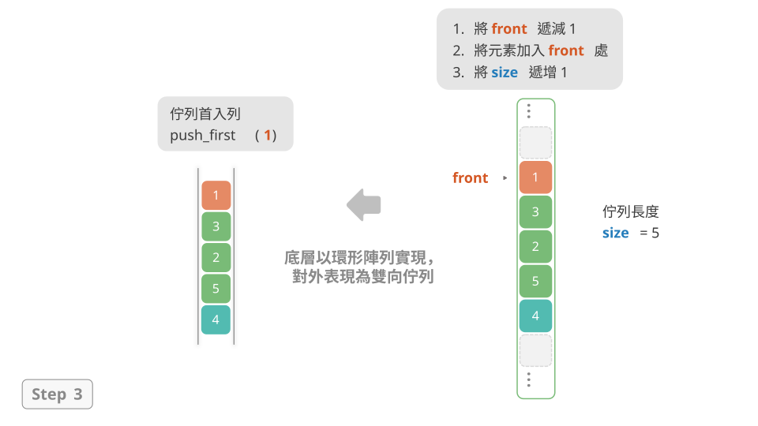
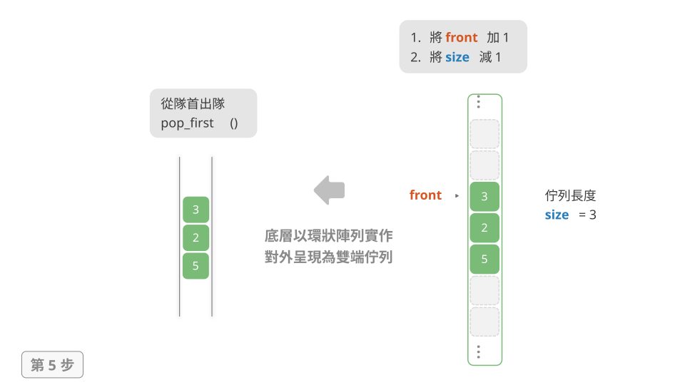

# 5.3 &nbsp; 雙端佇列

在一般佇列中，只能從隊首刪除元素、從隊尾加入元素。如圖 5-7 所示，<u>雙端佇列（double-ended queue）</u>的操作更有彈性，無論是隊首還是隊尾，都能加入或刪除元素。

{ class="animation-figure" }

<p align="center"> 圖 5-7 &nbsp; 雙端佇列的操作 </p>

## 5.3.1 &nbsp; 雙端佇列的常用操作

表 5-3 列出雙端佇列的常用操作，實際使用的方法名稱依程式語言而異。

<p align="center"> 表 5-3 &nbsp; 雙端佇列的操作效率 </p>

<div class="center-table" markdown>

| 方法名稱         | 說明             | 時間複雜度 |
| -------------- | ---------------- | ---------- |
| `push_first()` | 將元素加到隊首 | $O(1)$     |
| `push_last()`  | 將元素加到隊尾 | $O(1)$     |
| `pop_first()`  | 刪除隊首元素     | $O(1)$     |
| `pop_last()`   | 刪除隊尾元素     | $O(1)$     |
| `peek_first()` | 讀取隊首元素     | $O(1)$     |
| `peek_last()`  | 讀取隊尾元素     | $O(1)$     |

</div>

同樣地，我們可以直接使用程式語言提供的雙端佇列類別：

=== "Python"

    ```python title="deque.py"
    from collections import deque

    # 初始化雙端佇列
    deq: deque[int] = deque()

    # 將元素加入雙端佇列
    deq.append(2)  # 加到隊尾
    deq.append(5)
    deq.append(4)
    deq.appendleft(3)  # 加到隊首
    deq.appendleft(1)

    # 讀取隊首與隊尾元素
    front: int = deq[0]  # 隊首元素
    rear: int = deq[-1]  # 隊尾元素

    # 從雙端佇列取出元素
    pop_front: int = deq.popleft()  # 從隊首取出元素
    pop_rear: int = deq.pop()  # 從隊尾取出元素

    # 取得雙端佇列長度
    size: int = len(deq)

    # 判斷雙端佇列是否為空
    is_empty: bool = len(deq) == 0
    ```

=== "C++"

    ```cpp title="deque.cpp"
    /* 初始化雙端佇列 */
    deque<int> deque;

    /* 將元素加入雙端佇列 */
    deque.push_back(2); // 加到隊尾
    deque.push_back(5);
    deque.push_back(4);
    deque.push_front(3); // 加到隊首
    deque.push_front(1);

    /* 讀取隊首與隊尾元素 */
    int front = deque.front(); // 隊首元素
    int back = deque.back(); // 隊尾元素

    /* 從雙端佇列移除元素 */
    deque.pop_front(); // 移除隊首元素
    deque.pop_back(); // 移除隊尾元素

    /* 取得雙端佇列長度 */
    int size = deque.size();

    /* 判斷雙端佇列是否為空 */
    bool empty = deque.empty();
    ```

=== "Java"

    ```java title="deque.java"
    /* 初始化雙端佇列 */
    Deque<Integer> deque = new LinkedList<>();

    /* 將元素加入雙端佇列 */
    deque.offerLast(2); // 加到隊尾
    deque.offerLast(5);
    deque.offerLast(4);
    deque.offerFirst(3); // 加到隊首
    deque.offerFirst(1);

    /* 讀取隊首與隊尾元素 */
    int peekFirst = deque.peekFirst(); // 隊首元素
    int peekLast = deque.peekLast(); // 隊尾元素

    /* 從雙端佇列取出元素 */
    int popFirst = deque.pollFirst(); // 從隊首取出元素
    int popLast = deque.pollLast(); // 從隊尾取出元素

    /* 取得雙端佇列長度 */
    int size = deque.size();

    /* 判斷雙端佇列是否為空 */
    boolean isEmpty = deque.isEmpty();
    ```

=== "C#"

    ```csharp title="deque.cs"
    /* 初始化雙端佇列 */
    // 在 C# 中，可用鏈結串列 LinkedList 當作雙端佇列
    LinkedList<int> deque = new();

    /* 將元素加入雙端佇列 */
    deque.AddLast(2);   // 加到隊尾
    deque.AddLast(5);
    deque.AddLast(4);
    deque.AddFirst(3);  // 加到隊首
    deque.AddFirst(1);

    /* 讀取隊首與隊尾元素 */
    int? peekFirst = deque.First?.Value;  // 隊首元素
    int? peekLast = deque.Last?.Value;    // 隊尾元素

    /* 從雙端佇列取出元素 */
    deque.RemoveFirst();  // 移除隊首元素
    deque.RemoveLast();   // 移除隊尾元素

    /* 取得雙端佇列長度 */
    int size = deque.Count;

    /* 判斷雙端佇列是否為空 */
    bool isEmpty = deque.Count == 0;
    ```

=== "Go"

    ```go title="deque_test.go"
    /* 初始化雙端佇列 */
    // 在 Go 中，可用 list 套件的鏈結串列當作雙端佇列
    deque := list.New()

    /* 將元素加入雙端佇列 */
    deque.PushBack(2) // 加到隊尾
    deque.PushBack(5)
    deque.PushBack(4)
    deque.PushFront(3) // 加到隊首
    deque.PushFront(1)

    /* 讀取隊首與隊尾元素 */
    front := deque.Front() // 隊首節點
    rear := deque.Back() // 隊尾節點

    /* 從雙端佇列取出元素 */
    deque.Remove(front) // 從隊首取出元素
    deque.Remove(rear) // 從隊尾取出元素

    /* 取得雙端佇列長度 */
    size := deque.Len()

    /* 判斷雙端佇列是否為空 */
    isEmpty := deque.Len() == 0
    ```

=== "Swift"

    ```swift title="deque.swift"
    /* 初始化雙端佇列 */
    // Swift 沒有內建雙端佇列類別，可以用 Array 當作雙端佇列
    var deque: [Int] = []

    /* 將元素加入雙端佇列 */
    deque.append(2) // 加到隊尾
    deque.append(5)
    deque.append(4)
    deque.insert(3, at: 0) // 加到隊首
    deque.insert(1, at: 0)

    /* 讀取隊首與隊尾元素 */
    let peekFirst = deque.first! // 隊首元素
    let peekLast = deque.last! // 隊尾元素

    /* 從雙端佇列取出元素 */
    // 用 Array 模擬時，removeFirst 的時間複雜度為 O(n)
    let popFirst = deque.removeFirst() // 從隊首取出元素
    let popLast = deque.removeLast() // 從隊尾取出元素

    /* 取得雙端佇列長度 */
    let size = deque.count

    /* 判斷雙端佇列是否為空 */
    let isEmpty = deque.isEmpty
    ```

=== "JS"

    ```javascript title="deque.js"
    /* 初始化雙端佇列 */
    // JavaScript 沒有內建雙端佇列，只能用 Array 來模擬
    const deque = [];

    /* 將元素加入雙端佇列 */
    deque.push(2);
    deque.push(5);
    deque.push(4);
    // 請注意，底層使用陣列，因此 unshift() 方法的時間複雜度為 O(n)
    deque.unshift(3);
    deque.unshift(1);

    /* 讀取隊首與隊尾元素 */
    const peekFirst = deque[0];
    const peekLast = deque[deque.length - 1];

    /* 從雙端佇列取出元素 */
    // 請注意，底層使用陣列，因此 shift() 方法的時間複雜度為 O(n)
    const popFront = deque.shift();
    const popBack = deque.pop();

    /* 取得雙端佇列長度 */
    const size = deque.length;

    /* 判斷雙端佇列是否為空 */
    const isEmpty = size === 0;
    ```

=== "TS"

    ```typescript title="deque.ts"
    /* 初始化雙端佇列 */
    // TypeScript 沒有內建雙端佇列，只能用 Array 來模擬
    const deque: number[] = [];

    /* 將元素加入雙端佇列 */
    deque.push(2);
    deque.push(5);
    deque.push(4);
    // 請注意，底層使用陣列，因此 unshift() 方法的時間複雜度為 O(n)
    deque.unshift(3);
    deque.unshift(1);

    /* 讀取隊首與隊尾元素 */
    const peekFirst: number = deque[0];
    const peekLast: number = deque[deque.length - 1];

    /* 從雙端佇列取出元素 */
    // 請注意，底層使用陣列，因此 shift() 方法的時間複雜度為 O(n)
    const popFront: number = deque.shift() as number;
    const popBack: number = deque.pop() as number;

    /* 取得雙端佇列長度 */
    const size: number = deque.length;

    /* 判斷雙端佇列是否為空 */
    const isEmpty: boolean = size === 0;
    ```

=== "Dart"

    ```dart title="deque.dart"
    /* 初始化雙端佇列 */
    // 在 Dart 中，Queue 定義為雙端佇列
    final Queue<int> deque = Queue();

    /* 將元素加入雙端佇列 */
    deque.addLast(2); // 加到隊尾
    deque.addLast(5);
    deque.addLast(4);
    deque.addFirst(3); // 加到隊首
    deque.addFirst(1);

    /* 讀取隊首與隊尾元素 */
    final int peekFirst = deque.first; // 隊首元素
    final int peekLast = deque.last; // 隊尾元素

    /* 從雙端佇列取出元素 */
    final int popFirst = deque.removeFirst(); // 從隊首取出元素
    final int popLast = deque.removeLast(); // 從隊尾取出元素

    /* 取得雙端佇列長度 */
    final int size = deque.length;

    /* 判斷雙端佇列是否為空 */
    final bool isEmpty = deque.isEmpty;
    ```

=== "Rust"

    ```rust title="deque.rs"
    // 初始化雙端佇列
    let mut deque: VecDeque<i32> = VecDeque::new();

    /* 將元素加入雙端佇列 */
    deque.push_back(2); // 加到隊尾
    deque.push_back(5);
    deque.push_back(4);
    deque.push_front(3); // 加到隊首
    deque.push_front(1);

    // 讀取隊首與隊尾元素
    let peek_first = deque.front().unwrap(); // 隊首元素
    let peek_last = deque.back().unwrap(); // 隊尾元素

    // 從雙端佇列取出元素
    let pop_first = deque.pop_front().unwrap(); // 從隊首取出元素
    let pop_last = deque.pop_back().unwrap(); // 從隊尾取出元素

    // 取得雙端佇列長度
    let size = deque.len();

    // 判斷雙端佇列是否為空
    let is_empty = deque.is_empty();
    ```

=== "C"

    ```c title="deque.c"
    // C 沒有內建雙端佇列
    ```

=== "Kotlin"

    ```kotlin title="deque.kt"
    /* 初始化雙端佇列 */
    val deque = LinkedList<Int>()

    /* 將元素加入雙端佇列 */
    deque.offerLast(2) // 加到隊尾
    deque.offerLast(5)
    deque.offerLast(4)
    deque.offerFirst(3) // 加到隊首
    deque.offerFirst(1)

    /* 讀取隊首與隊尾元素 */
    val peekFirst = deque.peekFirst() // 隊首元素
    val peekLast = deque.peekLast() // 隊尾元素

    /* 從雙端佇列取出元素 */
    val popFirst = deque.pollFirst() // 從隊首取出元素
    val popLast = deque.pollLast() // 從隊尾取出元素

    /* 取得雙端佇列長度 */
    val size = deque.size

    /* 判斷雙端佇列是否為空 */
    val isEmpty = deque.isEmpty()
    ```

=== "Ruby"

    ```ruby title="deque.rb"
    # 初始化雙端佇列
    # Ruby 沒有內建雙端佇列，只能用 Array 來模擬
    deque = []

    # 將元素加入雙端佇列
    deque << 2
    deque << 5
    deque << 4
    # 請注意，Array 是陣列，因此 Array#unshift 的時間複雜度為 O(n)
    deque.unshift(3)
    deque.unshift(1)

    # 讀取隊首與隊尾元素
    peek_first = deque.first
    peek_last = deque.last

    # 從雙端佇列取出元素
    # 請注意，Array 是陣列，因此 Array#shift 的時間複雜度為 O(n)
    pop_front = deque.shift
    pop_back = deque.pop

    # 取得雙端佇列長度
    size = deque.length

    # 判斷雙端佇列是否為空
    is_empty = size.zero?
    ```

??? pythontutor "執行視覺化示範"

    <div style="height: 549px; width: 100%;"><iframe class="pythontutor-iframe" title="執行視覺化示範" src="https://pythontutor.com/iframe-embed.html#code=from%20collections%20import%20deque%0A%0A%22%22%22Driver%20Code%22%22%22%0Aif%20__name__%20%3D%3D%20%22__main__%22%3A%0A%20%20%20%20%23%20%E5%88%9D%E5%A7%8B%E5%8C%96%E9%9B%99%E7%AB%AF%E4%BD%87%E5%88%97%0A%20%20%20%20deq%20%3D%20deque%28%29%0A%0A%20%20%20%20%23%20%E5%B0%87%E5%85%83%E7%B4%A0%E5%8A%A0%E5%85%A5%E4%BD%87%E5%88%97%0A%20%20%20%20deq.append%282%29%20%20%23%20%E5%8A%A0%E5%85%A5%E9%9A%8A%E5%B0%BE%0A%20%20%20%20deq.append%285%29%0A%20%20%20%20deq.append%284%29%0A%20%20%20%20deq.appendleft%283%29%20%20%23%20%E5%8A%A0%E5%85%A5%E9%9A%8A%E9%A6%96%0A%20%20%20%20deq.appendleft%281%29%0A%20%20%20%20print%28%22%E9%9B%99%E7%AB%AF%E4%BD%87%E5%88%97%20deque%20%3D%22,%20deq%29%0A%0A%20%20%20%20%23%20%E8%AE%80%E5%8F%96%E5%85%83%E7%B4%A0%0A%20%20%20%20front%20%3D%20deq%5B0%5D%20%20%23%20%E9%9A%8A%E9%A6%96%E5%85%83%E7%B4%A0%0A%20%20%20%20print%28%22%E9%9A%8A%E9%A6%96%E5%85%83%E7%B4%A0%20front%20%3D%22,%20front%29%0A%20%20%20%20rear%20%3D%20deq%5B-1%5D%20%20%23%20%E9%9A%8A%E5%B0%BE%E5%85%83%E7%B4%A0%0A%20%20%20%20print%28%22%E9%9A%8A%E5%B0%BE%E5%85%83%E7%B4%A0%20rear%20%3D%22,%20rear%29%0A%0A%20%20%20%20%23%20%E5%BE%9E%E4%BD%87%E5%88%97%E5%8F%96%E5%87%BA%E5%85%83%E7%B4%A0%0A%20%20%20%20pop_front%20%3D%20deq.popleft%28%29%20%20%23%20%E5%8F%96%E5%87%BA%E9%9A%8A%E9%A6%96%E5%85%83%E7%B4%A0%0A%20%20%20%20print%28%22%E5%BE%9E%E9%9A%8A%E9%A6%96%E5%8F%96%E5%87%BA%E7%9A%84%E5%85%83%E7%B4%A0%20%20pop_front%20%3D%22,%20pop_front%29%0A%20%20%20%20print%28%22%E5%BE%9E%E9%9A%8A%E9%A6%96%E5%8F%96%E5%87%BA%E5%85%83%E7%B4%A0%E5%BE%8C%20deque%20%3D%22,%20deq%29%0A%20%20%20%20pop_rear%20%3D%20deq.pop%28%29%20%20%23%20%E5%8F%96%E5%87%BA%E9%9A%8A%E5%B0%BE%E5%85%83%E7%B4%A0%0A%20%20%20%20print%28%22%E5%BE%9E%E9%9A%8A%E5%B0%BE%E5%8F%96%E5%87%BA%E7%9A%84%E5%85%83%E7%B4%A0%20%20pop_rear%20%3D%22,%20pop_rear%29%0A%20%20%20%20print%28%22%E5%BE%9E%E9%9A%8A%E5%B0%BE%E5%8F%96%E5%87%BA%E5%85%83%E7%B4%A0%E5%BE%8C%20deque%20%3D%22,%20deq%29%0A%0A%20%20%20%20%23%20%E5%8F%96%E5%BE%97%E9%9B%99%E7%AB%AF%E4%BD%87%E5%88%97%E7%9A%84%E9%95%B7%E5%BA%A6%0A%20%20%20%20size%20%3D%20len%28deq%29%0A%20%20%20%20print%28%22%E9%9B%99%E7%AB%AF%E4%BD%87%E5%88%97%E9%95%B7%E5%BA%A6%20size%20%3D%22,%20size%29%0A%0A%20%20%20%20%23%20%E5%88%A4%E6%96%B7%E9%9B%99%E7%AB%AF%E4%BD%87%E5%88%97%E6%98%AF%E5%90%A6%E7%82%BA%E7%A9%BA%0A%20%20%20%20is_empty%20%3D%20len%28deq%29%20%3D%3D%200%0A%20%20%20%20print%28%22%E9%9B%99%E7%AB%AF%E4%BD%87%E5%88%97%E6%98%AF%E5%90%A6%E7%82%BA%E7%A9%BA%20%3D%22,%20is_empty%29&codeDivHeight=472&codeDivWidth=350&cumulative=false&curInstr=3&heapPrimitives=nevernest&origin=opt-frontend.js&py=311&rawInputLstJSON=%5B%5D&textReferences=false"> </iframe></div>
    <div style="margin-top: 5px;"><a href="https://pythontutor.com/iframe-embed.html#code=from%20collections%20import%20deque%0A%0A%22%22%22Driver%20Code%22%22%22%0Aif%20__name__%20%3D%3D%20%22__main__%22%3A%0A%20%20%20%20%23%20%E5%88%9D%E5%A7%8B%E5%8C%96%E9%9B%99%E7%AB%AF%E4%BD%87%E5%88%97%0A%20%20%20%20deq%20%3D%20deque%28%29%0A%0A%20%20%20%20%23%20%E5%B0%87%E5%85%83%E7%B4%A0%E5%8A%A0%E5%85%A5%E4%BD%87%E5%88%97%0A%20%20%20%20deq.append%282%29%20%20%23%20%E5%8A%A0%E5%85%A5%E9%9A%8A%E5%B0%BE%0A%20%20%20%20deq.append%285%29%0A%20%20%20%20deq.append%284%29%0A%20%20%20%20deq.appendleft%283%29%20%20%23%20%E5%8A%A0%E5%85%A5%E9%9A%8A%E9%A6%96%0A%20%20%20%20deq.appendleft%281%29%0A%20%20%20%20print%28%22%E9%9B%99%E7%AB%AF%E4%BD%87%E5%88%97%20deque%20%3D%22,%20deq%29%0A%0A%20%20%20%20%23%20%E8%AE%80%E5%8F%96%E5%85%83%E7%B4%A0%0A%20%20%20%20front%20%3D%20deq%5B0%5D%20%20%23%20%E9%9A%8A%E9%A6%96%E5%85%83%E7%B4%A0%0A%20%20%20%20print%28%22%E9%9A%8A%E9%A6%96%E5%85%83%E7%B4%A0%20front%20%3D%22,%20front%29%0A%20%20%20%20rear%20%3D%20deq%5B-1%5D%20%20%23%20%E9%9A%8A%E5%B0%BE%E5%85%83%E7%B4%A0%0A%20%20%20%20print%28%22%E9%9A%8A%E5%B0%BE%E5%85%83%E7%B4%A0%20rear%20%3D%22,%20rear%29%0A%0A%20%20%20%20%23%20%E5%BE%9E%E4%BD%87%E5%88%97%E5%8F%96%E5%87%BA%E5%85%83%E7%B4%A0%0A%20%20%20%20pop_front%20%3D%20deq.popleft%28%29%20%20%23%20%E5%8F%96%E5%87%BA%E9%9A%8A%E9%A6%96%E5%85%83%E7%B4%A0%0A%20%20%20%20print%28%22%E5%BE%9E%E9%9A%8A%E9%A6%96%E5%8F%96%E5%87%BA%E7%9A%84%E5%85%83%E7%B4%A0%20%20pop_front%20%3D%22,%20pop_front%29%0A%20%20%20%20print%28%22%E5%BE%9E%E9%9A%8A%E9%A6%96%E5%8F%96%E5%87%BA%E5%85%83%E7%B4%A0%E5%BE%8C%20deque%20%3D%22,%20deq%29%0A%20%20%20%20pop_rear%20%3D%20deq.pop%28%29%20%20%23%20%E5%8F%96%E5%87%BA%E9%9A%8A%E5%B0%BE%E5%85%83%E7%B4%A0%0A%20%20%20%20print%28%22%E5%BE%9E%E9%9A%8A%E5%B0%BE%E5%8F%96%E5%87%BA%E7%9A%84%E5%85%83%E7%B4%A0%20%20pop_rear%20%3D%22,%20pop_rear%29%0A%20%20%20%20print%28%22%E5%BE%9E%E9%9A%8A%E5%B0%BE%E5%8F%96%E5%87%BA%E5%85%83%E7%B4%A0%E5%BE%8C%20deque%20%3D%22,%20deq%29%0A%0A%20%20%20%20%23%20%E5%8F%96%E5%BE%97%E9%9B%99%E7%AB%AF%E4%BD%87%E5%88%97%E7%9A%84%E9%95%B7%E5%BA%A6%0A%20%20%20%20size%20%3D%20len%28deq%29%0A%20%20%20%20print%28%22%E9%9B%99%E7%AB%AF%E4%BD%87%E5%88%97%E9%95%B7%E5%BA%A6%20size%20%3D%22,%20size%29%0A%0A%20%20%20%20%23%20%E5%88%A4%E6%96%B7%E9%9B%99%E7%AB%AF%E4%BD%87%E5%88%97%E6%98%AF%E5%90%A6%E7%82%BA%E7%A9%BA%0A%20%20%20%20is_empty%20%3D%20len%28deq%29%20%3D%3D%200%0A%20%20%20%20print%28%22%E9%9B%99%E7%AB%AF%E4%BD%87%E5%88%97%E6%98%AF%E5%90%A6%E7%82%BA%E7%A9%BA%20%3D%22,%20is_empty%29&codeDivHeight=800&codeDivWidth=600&cumulative=false&curInstr=3&heapPrimitives=nevernest&origin=opt-frontend.js&py=311&rawInputLstJSON=%5B%5D&textReferences=false" target="_blank" rel="noopener noreferrer">全螢幕觀看 ></a></div>

## 5.3.2 &nbsp; 雙端佇列的實作 *

雙端佇列和一般佇列的實作方式類似，都可以選用鏈結串列或陣列作為底層資料結構。

### 1. &nbsp; 以雙向鏈結串列實作

上一節用一般的單向鏈結串列實作佇列，因為這種串列很容易刪除頭節點（對應出隊），也很容易在尾節點後面接上新節點（對應入隊）。

雙端佇列的隊首和隊尾都能入隊和出隊。換句話說，除了原本的操作，還要能從相反的一端執行對應的操作。為此，我們選用「雙向鏈結串列」作為雙端佇列的底層資料結構。

如圖 5-8 所示，將雙向鏈結串列的頭節點和尾節點分別當作隊首和隊尾，並在兩端都實作新增和刪除節點的功能。

=== "<1>"
    { class="animation-figure" }

=== "<2>"
    { class="animation-figure" }

=== "<3>"
    { class="animation-figure" }

=== "<4>"
    { class="animation-figure" }

=== "<5>"
    { class="animation-figure" }

<p align="center"> 圖 5-8 &nbsp; 以鏈結串列實作雙端佇列的入隊與出隊 </p>

實作程式碼如下：

=== "Python"

    ```python title="linkedlist_deque.py"
    class ListNode:
        """雙向鏈結串列的節點"""

        def __init__(self, val: int):
            """初始化方法"""
            self.val: int = val
            self.next: ListNode | None = None  # 指向下一個節點的參照
            self.prev: ListNode | None = None  # 指向上一個節點的參照

    class LinkedListDeque:
        """以雙向鏈結串列實作雙端佇列"""

        def __init__(self):
            """初始化方法"""
            self._front: ListNode | None = None  # _front 指向首節點
            self._rear: ListNode | None = None  # _rear 指向尾節點
            self._size: int = 0  # 雙端佇列長度

        def size(self) -> int:
            """取得雙端佇列長度"""
            return self._size

        def is_empty(self) -> bool:
            """判斷雙端佇列是否為空"""
            return self._size == 0

        def push(self, num: int, is_front: bool):
            """加入元素"""
            node = ListNode(num)
            # 若鏈結串列為空，讓 _front 和 _rear 都指向 node
            if self.is_empty():
                self._front = self._rear = node
            # 從隊首加入元素
            elif is_front:
                # 將 node 加到鏈結串列的開頭
                self._front.prev = node
                node.next = self._front
                self._front = node  # 更新首節點
            # 從隊尾加入元素
            else:
                # 將 node 加到鏈結串列的末端
                self._rear.next = node
                node.prev = self._rear
                self._rear = node  # 更新尾節點
            self._size += 1  # 將雙端佇列長度加 1

        def push_first(self, num: int):
            """從隊首加入元素"""
            self.push(num, True)

        def push_last(self, num: int):
            """從隊尾加入元素"""
            self.push(num, False)

        def pop(self, is_front: bool) -> int:
            """取出元素"""
            if self.is_empty():
                raise IndexError("雙端佇列為空")
            # 佇列長度為 1 時，首尾兩端指向同一個節點
            if self._size == 1:
                val: int = self._front.val
                self._front = None
                self._rear = None
            # 從隊首取出元素
            elif is_front:
                val: int = self._front.val  # 暫存首節點的值
                # 移除首節點
                fnext: ListNode | None = self._front.next
                fnext.prev = None
                self._front.next = None
                self._front = fnext  # 更新首節點
            # 從隊尾取出元素
            else:
                val: int = self._rear.val  # 暫存尾節點的值
                # 移除尾節點
                rprev: ListNode | None = self._rear.prev
                rprev.next = None
                self._rear.prev = None
                self._rear = rprev  # 更新尾節點
            self._size -= 1  # 將雙端佇列長度減 1
            return val

        def pop_first(self) -> int:
            """從隊首取出元素"""
            return self.pop(True)

        def pop_last(self) -> int:
            """從隊尾取出元素"""
            return self.pop(False)

        def peek_first(self) -> int:
            """讀取隊首元素"""
            if self.is_empty():
                raise IndexError("雙端佇列為空")
            return self._front.val

        def peek_last(self) -> int:
            """讀取隊尾元素"""
            if self.is_empty():
                raise IndexError("雙端佇列為空")
            return self._rear.val

        def to_array(self) -> list[int]:
            """回傳串列以便輸出"""
            node = self._front
            res = [0] * self.size()
            for i in range(self.size()):
                res[i] = node.val
                node = node.next
            return res
    ```

=== "C++"

    ```cpp title="linkedlist_deque.cpp"
    /* 雙向鏈結串列的節點 */
    struct DoublyListNode {
        int val;              // 節點值
        DoublyListNode *next; // 指向下一個節點的指標
        DoublyListNode *prev; // 指向上一個節點的指標
        DoublyListNode(int val) : val(val), prev(nullptr), next(nullptr) {
        }
    };

    /* 以雙向鏈結串列實作雙端佇列 */
    class LinkedListDeque {
      private:
        DoublyListNode *front, *rear; // front 指向首節點，rear 指向尾節點
        int queSize = 0;              // 雙端佇列長度

      public:
        /* 建構子 */
        LinkedListDeque() : front(nullptr), rear(nullptr) {
        }

        /* 解構子 */
        ~LinkedListDeque() {
            // 走訪鏈結串列，逐一刪除節點並釋放記憶體
            DoublyListNode *pre, *cur = front;
            while (cur != nullptr) {
                pre = cur;
                cur = cur->next;
                delete pre;
            }
        }

        /* 取得雙端佇列長度 */
        int size() {
            return queSize;
        }

        /* 判斷雙端佇列是否為空 */
        bool isEmpty() {
            return size() == 0;
        }

        /* 加入元素 */
        void push(int num, bool isFront) {
            DoublyListNode *node = new DoublyListNode(num);
            // 若鏈結串列為空，讓 front 和 rear 都指向 node
            if (isEmpty())
                front = rear = node;
            // 從隊首加入元素
            else if (isFront) {
                // 將 node 加到鏈結串列的開頭
                front->prev = node;
                node->next = front;
                front = node; // 更新首節點
            // 從隊尾加入元素
            } else {
                // 將 node 加到鏈結串列的末端
                rear->next = node;
                node->prev = rear;
                rear = node; // 更新尾節點
            }
            queSize++; // 將雙端佇列長度加 1
        }

        /* 從隊首加入元素 */
        void pushFirst(int num) {
            push(num, true);
        }

        /* 從隊尾加入元素 */
        void pushLast(int num) {
            push(num, false);
        }

        /* 取出元素 */
        int pop(bool isFront) {
            if (isEmpty())
                throw out_of_range("雙端佇列為空");
            int val;
            // 佇列長度為 1 時，首尾兩端指向同一個節點
            if (queSize == 1) {
                val = front->val;
                delete front; // 兩者指向同一個節點，只需釋放一次
                front = nullptr;
                rear = nullptr;
            }
            // 從隊首取出元素
            else if (isFront) {
                val = front->val; // 暫存首節點的值
                // 移除首節點
                DoublyListNode *fNext = front->next;
                fNext->prev = nullptr;
                front->next = nullptr;
                delete front;
                front = fNext; // 更新首節點
            // 從隊尾取出元素
            } else {
                val = rear->val; // 暫存尾節點的值
                // 移除尾節點
                DoublyListNode *rPrev = rear->prev;
                rPrev->next = nullptr;
                rear->prev = nullptr;
                delete rear;
                rear = rPrev; // 更新尾節點
            }
            queSize--; // 將雙端佇列長度減 1
            return val;
        }

        /* 從隊首取出元素 */
        int popFirst() {
            return pop(true);
        }

        /* 從隊尾取出元素 */
        int popLast() {
            return pop(false);
        }

        /* 讀取隊首元素 */
        int peekFirst() {
            if (isEmpty())
                throw out_of_range("雙端佇列為空");
            return front->val;
        }

        /* 讀取隊尾元素 */
        int peekLast() {
            if (isEmpty())
                throw out_of_range("雙端佇列為空");
            return rear->val;
        }

        /* 回傳 vector 以便輸出 */
        vector<int> toVector() {
            DoublyListNode *node = front;
            vector<int> res(size());
            for (int i = 0; i < res.size(); i++) {
                res[i] = node->val;
                node = node->next;
            }
            return res;
        }
    };
    ```

=== "Java"

    ```java title="linkedlist_deque.java"
    /* 雙向鏈結串列的節點 */
    class ListNode {
        int val; // 節點值
        ListNode next; // 指向下一個節點的參照
        ListNode prev; // 指向上一個節點的參照

        ListNode(int val) {
            this.val = val;
            prev = next = null;
        }
    }

    /* 以雙向鏈結串列實作雙端佇列 */
    class LinkedListDeque {
        private ListNode front, rear; // front 指向首節點，rear 指向尾節點
        private int queSize = 0; // 雙端佇列長度

        public LinkedListDeque() {
            front = rear = null;
        }

        /* 取得雙端佇列長度 */
        public int size() {
            return queSize;
        }

        /* 判斷雙端佇列是否為空 */
        public boolean isEmpty() {
            return size() == 0;
        }

        /* 加入元素 */
        private void push(int num, boolean isFront) {
            ListNode node = new ListNode(num);
            // 若鏈結串列為空，讓 front 和 rear 都指向 node
            if (isEmpty())
                front = rear = node;
            // 從隊首加入元素
            else if (isFront) {
                // 將 node 加到鏈結串列的開頭
                front.prev = node;
                node.next = front;
                front = node; // 更新首節點
            // 從隊尾加入元素
            } else {
                // 將 node 加到鏈結串列的末端
                rear.next = node;
                node.prev = rear;
                rear = node; // 更新尾節點
            }
            queSize++; // 將雙端佇列長度加 1
        }

        /* 從隊首加入元素 */
        public void pushFirst(int num) {
            push(num, true);
        }

        /* 從隊尾加入元素 */
        public void pushLast(int num) {
            push(num, false);
        }

        /* 取出元素 */
        private int pop(boolean isFront) {
            if (isEmpty())
                throw new IndexOutOfBoundsException();
            int val;
            // 佇列長度為 1 時，首尾兩端指向同一個節點
            if (queSize == 1) {
                val = front.val;
                front = null;
                rear = null;
            }
            // 從隊首取出元素
            else if (isFront) {
                val = front.val; // 暫存首節點的值
                // 移除首節點
                ListNode fNext = front.next;
                fNext.prev = null;
                front.next = null;
                front = fNext; // 更新首節點
            // 從隊尾取出元素
            } else {
                val = rear.val; // 暫存尾節點的值
                // 移除尾節點
                ListNode rPrev = rear.prev;
                rPrev.next = null;
                rear.prev = null;
                rear = rPrev; // 更新尾節點
            }
            queSize--; // 將雙端佇列長度減 1
            return val;
        }

        /* 從隊首取出元素 */
        public int popFirst() {
            return pop(true);
        }

        /* 從隊尾取出元素 */
        public int popLast() {
            return pop(false);
        }

        /* 讀取隊首元素 */
        public int peekFirst() {
            if (isEmpty())
                throw new IndexOutOfBoundsException();
            return front.val;
        }

        /* 讀取隊尾元素 */
        public int peekLast() {
            if (isEmpty())
                throw new IndexOutOfBoundsException();
            return rear.val;
        }

        /* 回傳陣列以便輸出 */
        public int[] toArray() {
            ListNode node = front;
            int[] res = new int[size()];
            for (int i = 0; i < res.length; i++) {
                res[i] = node.val;
                node = node.next;
            }
            return res;
        }
    }
    ```

=== "C#"

    ```csharp title="linkedlist_deque.cs"
    /* 雙向鏈結串列的節點 */
    class ListNode(int val) {
        public int val = val;       // 節點值
        public ListNode? next = null; // 指向下一個節點的參照
        public ListNode? prev = null; // 指向上一個節點的參照
    }

    /* 以雙向鏈結串列實作雙端佇列 */
    class LinkedListDeque {
        ListNode? front, rear; // front 指向首節點，rear 指向尾節點
        int queSize = 0;      // 雙端佇列長度

        public LinkedListDeque() {
            front = null;
            rear = null;
        }

        /* 取得雙端佇列長度 */
        public int Size() {
            return queSize;
        }

        /* 判斷雙端佇列是否為空 */
        public bool IsEmpty() {
            return Size() == 0;
        }

        /* 加入元素 */
        void Push(int num, bool isFront) {
            ListNode node = new(num);
            // 若鏈結串列為空，讓 front 和 rear 都指向 node
            if (IsEmpty()) {
                front = node;
                rear = node;
            }
            // 從隊首加入元素
            else if (isFront) {
                // 將 node 加到鏈結串列的開頭
                front!.prev = node;
                node.next = front;
                front = node; // 更新首節點                           
            }
            // 從隊尾加入元素
            else {
                // 將 node 加到鏈結串列的末端
                rear!.next = node;
                node.prev = rear;
                rear = node;  // 更新尾節點
            }

            queSize++; // 將雙端佇列長度加 1
        }

        /* 從隊首加入元素 */
        public void PushFirst(int num) {
            Push(num, true);
        }

        /* 從隊尾加入元素 */
        public void PushLast(int num) {
            Push(num, false);
        }

        /* 取出元素 */
        int? Pop(bool isFront) {
            if (IsEmpty())
                throw new Exception();
            int? val;
            // 佇列長度為 1 時，首尾兩端指向同一個節點
            if (queSize == 1) {
                val = front!.val;
                front = null;
                rear = null;
            }
            // 從隊首取出元素
            else if (isFront) {
                val = front!.val; // 暫存首節點的值
                // 移除首節點
                ListNode? fNext = front?.next;
                fNext!.prev = null;
                front.next = null;
                front = fNext;   // 更新首節點
            }
            // 從隊尾取出元素
            else {
                val = rear!.val;  // 暫存尾節點的值
                // 移除尾節點
                ListNode? rPrev = rear?.prev;
                rPrev!.next = null;
                rear.prev = null;
                rear = rPrev;    // 更新尾節點
            }

            queSize--; // 將雙端佇列長度減 1
            return val;
        }

        /* 從隊首取出元素 */
        public int? PopFirst() {
            return Pop(true);
        }

        /* 從隊尾取出元素 */
        public int? PopLast() {
            return Pop(false);
        }

        /* 讀取隊首元素 */
        public int? PeekFirst() {
            if (IsEmpty())
                throw new Exception();
            return front?.val;
        }

        /* 讀取隊尾元素 */
        public int? PeekLast() {
            if (IsEmpty())
                throw new Exception();
            return rear?.val;
        }

        /* 回傳陣列以便輸出 */
        public int?[] ToArray() {
            ListNode? node = front;
            int?[] res = new int?[Size()];
            for (int i = 0; i < res.Length; i++) {
                res[i] = node?.val;
                node = node?.next;
            }

            return res;
        }
    }
    ```

=== "Go"

    ```go title="linkedlist_deque.go"
    /* 以雙向鏈結串列實作雙端佇列 */
    type linkedListDeque struct {
        // 使用標準函式庫的 list 套件
        data *list.List
    }

    /* 初始化雙端佇列 */
    func newLinkedListDeque() *linkedListDeque {
        return &linkedListDeque{
            data: list.New(),
        }
    }

    /* 從隊首加入元素 */
    func (s *linkedListDeque) pushFirst(value any) {
        s.data.PushFront(value)
    }

    /* 從隊尾加入元素 */
    func (s *linkedListDeque) pushLast(value any) {
        s.data.PushBack(value)
    }

    /* 從隊首取出元素 */
    func (s *linkedListDeque) popFirst() any {
        if s.isEmpty() {
            return nil
        }
        e := s.data.Front()
        s.data.Remove(e)
        return e.Value
    }

    /* 從隊尾取出元素 */
    func (s *linkedListDeque) popLast() any {
        if s.isEmpty() {
            return nil
        }
        e := s.data.Back()
        s.data.Remove(e)
        return e.Value
    }

    /* 讀取隊首元素 */
    func (s *linkedListDeque) peekFirst() any {
        if s.isEmpty() {
            return nil
        }
        e := s.data.Front()
        return e.Value
    }

    /* 讀取隊尾元素 */
    func (s *linkedListDeque) peekLast() any {
        if s.isEmpty() {
            return nil
        }
        e := s.data.Back()
        return e.Value
    }

    /* 取得雙端佇列長度 */
    func (s *linkedListDeque) size() int {
        return s.data.Len()
    }

    /* 判斷雙端佇列是否為空 */
    func (s *linkedListDeque) isEmpty() bool {
        return s.data.Len() == 0
    }

    /* 回傳 list.List 的指標以便輸出 */
    func (s *linkedListDeque) toList() *list.List {
        return s.data
    }
    ```

=== "Swift"

    ```swift title="linkedlist_deque.swift"
    /* 雙向鏈結串列的節點 */
    class ListNode {
        var val: Int // 節點值
        var next: ListNode? // 指向下一個節點的參照
        weak var prev: ListNode? // 指向上一個節點的弱參照

        init(val: Int) {
            self.val = val
        }
    }

    /* 以雙向鏈結串列實作雙端佇列 */
    class LinkedListDeque {
        private var front: ListNode? // front 指向首節點
        private var rear: ListNode? // rear 指向尾節點
        private var _size: Int // 雙端佇列長度

        init() {
            _size = 0
        }

        /* 取得雙端佇列長度 */
        func size() -> Int {
            _size
        }

        /* 判斷雙端佇列是否為空 */
        func isEmpty() -> Bool {
            size() == 0
        }

        /* 加入元素 */
        private func push(num: Int, isFront: Bool) {
            let node = ListNode(val: num)
            // 若鏈結串列為空，讓 front 和 rear 都指向 node
            if isEmpty() {
                front = node
                rear = node
            }
            // 從隊首加入元素
            else if isFront {
                // 將 node 加到鏈結串列的開頭
                front?.prev = node
                node.next = front
                front = node // 更新首節點
            }
            // 從隊尾加入元素
            else {
                // 將 node 加到鏈結串列的末端
                rear?.next = node
                node.prev = rear
                rear = node // 更新尾節點
            }
            _size += 1 // 將雙端佇列長度加 1
        }

        /* 從隊首加入元素 */
        func pushFirst(num: Int) {
            push(num: num, isFront: true)
        }

        /* 從隊尾加入元素 */
        func pushLast(num: Int) {
            push(num: num, isFront: false)
        }

        /* 取出元素 */
        private func pop(isFront: Bool) -> Int {
            if isEmpty() {
                fatalError("雙端佇列為空")
            }
            let val: Int
            // 佇列長度為 1 時，首尾兩端指向同一個節點
            if _size == 1 {
                val = front!.val
                front = nil
                rear = nil
            }
            // 從隊首取出元素
            else if isFront {
                val = front!.val // 暫存首節點的值
                // 移除首節點
                let fNext = front?.next
                fNext?.prev = nil
                front?.next = nil
                front = fNext // 更新首節點
            }
            // 從隊尾取出元素
            else {
                val = rear!.val // 暫存尾節點的值
                // 移除尾節點
                let rPrev = rear?.prev
                rPrev?.next = nil
                rear?.prev = nil
                rear = rPrev // 更新尾節點
            }
            _size -= 1 // 將雙端佇列長度減 1
            return val
        }

        /* 從隊首取出元素 */
        func popFirst() -> Int {
            pop(isFront: true)
        }

        /* 從隊尾取出元素 */
        func popLast() -> Int {
            pop(isFront: false)
        }

        /* 讀取隊首元素 */
        func peekFirst() -> Int {
            if isEmpty() {
                fatalError("雙端佇列為空")
            }
            return front!.val
        }

        /* 讀取隊尾元素 */
        func peekLast() -> Int {
            if isEmpty() {
                fatalError("雙端佇列為空")
            }
            return rear!.val
        }

        /* 回傳陣列以便輸出 */
        func toArray() -> [Int] {
            var node = front
            var res = Array(repeating: 0, count: size())
            for i in res.indices {
                res[i] = node!.val
                node = node?.next
            }
            return res
        }
    }
    ```

=== "JS"

    ```javascript title="linkedlist_deque.js"
    /* 雙向鏈結串列的節點 */
    class ListNode {
        prev; // 指向上一個節點的參照
        next; // 指向下一個節點的參照
        val; // 節點值

        constructor(val) {
            this.val = val;
            this.next = null;
            this.prev = null;
        }
    }

    /* 以雙向鏈結串列實作雙端佇列 */
    class LinkedListDeque {
        #front; // #front 指向首節點
        #rear; // #rear 指向尾節點
        #queSize; // 雙端佇列長度

        constructor() {
            this.#front = null;
            this.#rear = null;
            this.#queSize = 0;
        }

        /* 從隊尾加入元素 */
        pushLast(val) {
            const node = new ListNode(val);
            // 若鏈結串列為空，讓 #front 和 #rear 都指向 node
            if (this.#queSize === 0) {
                this.#front = node;
                this.#rear = node;
            } else {
                // 將 node 加到鏈結串列的末端
                this.#rear.next = node;
                node.prev = this.#rear;
                this.#rear = node; // 更新尾節點
            }
            this.#queSize++;
        }

        /* 從隊首加入元素 */
        pushFirst(val) {
            const node = new ListNode(val);
            // 若鏈結串列為空，讓 #front 和 #rear 都指向 node
            if (this.#queSize === 0) {
                this.#front = node;
                this.#rear = node;
            } else {
                // 將 node 加到鏈結串列的開頭
                this.#front.prev = node;
                node.next = this.#front;
                this.#front = node; // 更新首節點
            }
            this.#queSize++;
        }

        /* 從隊尾取出元素 */
        popLast() {
            if (this.#queSize === 0) {
                return null;
            }
            const value = this.#rear.val; // 暫存尾節點的值
            // 佇列長度為 1 時，首尾兩端指向同一個節點
            if (this.#queSize === 1) {
                this.#front = null;
                this.#rear = null;
            }
            // 移除尾節點
            else {
                let temp = this.#rear.prev;
                temp.next = null;
                this.#rear.prev = null;
                this.#rear = temp; // 更新尾節點
            }
            this.#queSize--;
            return value;
        }

        /* 從隊首取出元素 */
        popFirst() {
            if (this.#queSize === 0) {
                return null;
            }
            const value = this.#front.val; // 暫存首節點的值
            // 佇列長度為 1 時，首尾兩端指向同一個節點
            if (this.#queSize === 1) {
                this.#front = null;
                this.#rear = null;
            }
            // 移除首節點
            else {
                let temp = this.#front.next;
                temp.prev = null;
                this.#front.next = null;
                this.#front = temp; // 更新首節點
            }
            this.#queSize--;
            return value;
        }

        /* 讀取隊尾元素 */
        peekLast() {
            return this.#queSize === 0 ? null : this.#rear.val;
        }

        /* 讀取隊首元素 */
        peekFirst() {
            return this.#queSize === 0 ? null : this.#front.val;
        }

        /* 取得雙端佇列長度 */
        size() {
            return this.#queSize;
        }

        /* 判斷雙端佇列是否為空 */
        isEmpty() {
            return this.#queSize === 0;
        }

        /* 輸出雙端佇列內容 */
        print() {
            const arr = [];
            let temp = this.#front;
            while (temp !== null) {
                arr.push(temp.val);
                temp = temp.next;
            }
            console.log('[' + arr.join(', ') + ']');
        }
    }
    ```

=== "TS"

    ```typescript title="linkedlist_deque.ts"
    /* 雙向鏈結串列的節點 */
    class ListNode {
        prev: ListNode | null; // 指向上一個節點的參照
        next: ListNode | null; // 指向下一個節點的參照
        val: number; // 節點值

        constructor(val: number) {
            this.val = val;
            this.next = null;
            this.prev = null;
        }
    }

    /* 以雙向鏈結串列實作雙端佇列 */
    class LinkedListDeque {
        private front: ListNode; // front 指向首節點
        private rear: ListNode; // rear 指向尾節點
        private queSize: number; // 雙端佇列長度

        constructor() {
            this.front = null;
            this.rear = null;
            this.queSize = 0;
        }

        /* 從隊尾加入元素 */
        pushLast(val: number): void {
            const node: ListNode = new ListNode(val);
            // 若鏈結串列為空，讓 front 和 rear 都指向 node
            if (this.queSize === 0) {
                this.front = node;
                this.rear = node;
            } else {
                // 將 node 加到鏈結串列的末端
                this.rear.next = node;
                node.prev = this.rear;
                this.rear = node; // 更新尾節點
            }
            this.queSize++;
        }

        /* 從隊首加入元素 */
        pushFirst(val: number): void {
            const node: ListNode = new ListNode(val);
            // 若鏈結串列為空，讓 front 和 rear 都指向 node
            if (this.queSize === 0) {
                this.front = node;
                this.rear = node;
            } else {
                // 將 node 加到鏈結串列的開頭
                this.front.prev = node;
                node.next = this.front;
                this.front = node; // 更新首節點
            }
            this.queSize++;
        }

        /* 從隊尾取出元素 */
        popLast(): number {
            if (this.queSize === 0) {
                return null;
            }
            const value: number = this.rear!.val; // 暫存尾節點的值
            // 佇列長度為 1 時，首尾兩端指向同一個節點
            if (this.queSize === 1) {
                this.front = null;
                this.rear = null;
            }
            // 移除尾節點
            else {
                let temp: ListNode = this.rear!.prev;
                temp!.next = null;
                this.rear!.prev = null;
                this.rear = temp; // 更新尾節點
            }
            this.queSize--;
            return value;
        }

        /* 從隊首取出元素 */
        popFirst(): number {
            if (this.queSize === 0) {
                return null;
            }
            const value: number = this.front.val; // 暫存首節點的值
            // 佇列長度為 1 時，首尾兩端指向同一個節點
            if (this.queSize === 1) {
                this.front = null;
                this.rear = null;
            }
            // 移除首節點
            else {
                let temp: ListNode = this.front!.next;
                temp!.prev = null;
                this.front!.next = null;
                this.front = temp; // 更新首節點
            }
            this.queSize--;
            return value;
        }

        /* 讀取隊尾元素 */
        peekLast(): number {
            return this.queSize === 0 ? null : this.rear.val;
        }

        /* 讀取隊首元素 */
        peekFirst(): number {
            return this.queSize === 0 ? null : this.front.val;
        }

        /* 取得雙端佇列長度 */
        size(): number {
            return this.queSize;
        }

        /* 判斷雙端佇列是否為空 */
        isEmpty(): boolean {
            return this.queSize === 0;
        }

        /* 輸出雙端佇列內容 */
        print(): void {
            const arr: number[] = [];
            let temp: ListNode = this.front;
            while (temp !== null) {
                arr.push(temp.val);
                temp = temp.next;
            }
            console.log('[' + arr.join(', ') + ']');
        }
    }
    ```

=== "Dart"

    ```dart title="linkedlist_deque.dart"
    /* 雙向鏈結串列的節點 */
    class ListNode {
      int val; // 節點值
      ListNode? next; // 指向下一個節點的參照
      ListNode? prev; // 指向上一個節點的參照

      ListNode(this.val, {this.next, this.prev});
    }

    /* 以雙向鏈結串列實作雙端佇列 */
    class LinkedListDeque {
      late ListNode? _front; // _front 指向首節點
      late ListNode? _rear; // _rear 指向尾節點
      int _queSize = 0; // 雙端佇列長度

      LinkedListDeque() {
        this._front = null;
        this._rear = null;
      }

      /* 取得雙端佇列長度 */
      int size() {
        return this._queSize;
      }

      /* 判斷雙端佇列是否為空 */
      bool isEmpty() {
        return size() == 0;
      }

      /* 加入元素 */
      void push(int _num, bool isFront) {
        final ListNode node = ListNode(_num);
        if (isEmpty()) {
          // 若鏈結串列為空，讓 _front 和 _rear 都指向 node
          _front = _rear = node;
        } else if (isFront) {
          // 從隊首加入元素
          // 將 node 加到鏈結串列的開頭
          _front!.prev = node;
          node.next = _front;
          _front = node; // 更新首節點
        } else {
          // 從隊尾加入元素
          // 將 node 加到鏈結串列的末端
          _rear!.next = node;
          node.prev = _rear;
          _rear = node; // 更新尾節點
        }
        _queSize++; // 將雙端佇列長度加 1
      }

      /* 從隊首加入元素 */
      void pushFirst(int _num) {
        push(_num, true);
      }

      /* 從隊尾加入元素 */
      void pushLast(int _num) {
        push(_num, false);
      }

      /* 取出元素 */
      int? pop(bool isFront) {
        // 若佇列為空，直接回傳 null
        if (isEmpty()) {
          return null;
        }
        final int val;
        // 佇列長度為 1 時，首尾兩端指向同一個節點
        if (_queSize == 1) {
          val = _front!.val;
          _front = null;
          _rear = null;
        }
        // 從隊首取出元素
        else if (isFront) {
          val = _front!.val; // 暫存首節點的值
          // 移除首節點
          ListNode? fNext = _front!.next;
          fNext!.prev = null;
          _front!.next = null;
          _front = fNext; // 更新首節點
        // 從隊尾取出元素
        } else {
          val = _rear!.val; // 暫存尾節點的值
          // 移除尾節點
          ListNode? rPrev = _rear!.prev;
          rPrev!.next = null;
          _rear!.prev = null;
          _rear = rPrev; // 更新尾節點
        }
        _queSize--; // 將雙端佇列長度減 1
        return val;
      }

      /* 從隊首取出元素 */
      int? popFirst() {
        return pop(true);
      }

      /* 從隊尾取出元素 */
      int? popLast() {
        return pop(false);
      }

      /* 讀取隊首元素 */
      int? peekFirst() {
        return _front?.val;
      }

      /* 讀取隊尾元素 */
      int? peekLast() {
        return _rear?.val;
      }

      /* 回傳 List 以便輸出 */
      List<int> toArray() {
        ListNode? node = _front;
        final List<int> res = [];
        for (int i = 0; i < _queSize; i++) {
          res.add(node!.val);
          node = node.next;
        }
        return res;
      }
    }
    ```

=== "Rust"

    ```rust title="linkedlist_deque.rs"
    /* 雙向鏈結串列的節點 */
    pub struct ListNode<T> {
        pub val: T,                                 // 節點值
        pub next: Option<Rc<RefCell<ListNode<T>>>>, // 指向下一個節點的智慧指標
        pub prev: Option<Rc<RefCell<ListNode<T>>>>, // 指向上一個節點的智慧指標
    }

    impl<T> ListNode<T> {
        pub fn new(val: T) -> Rc<RefCell<ListNode<T>>> {
            Rc::new(RefCell::new(ListNode {
                val,
                next: None,
                prev: None,
            }))
        }
    }

    /* 以雙向鏈結串列實作雙端佇列 */
    #[allow(dead_code)]
    pub struct LinkedListDeque<T> {
        front: Option<Rc<RefCell<ListNode<T>>>>, // front 指向首節點
        rear: Option<Rc<RefCell<ListNode<T>>>>,  // rear 指向尾節點
        que_size: usize,                         // 雙端佇列長度
    }

    impl<T: Copy> LinkedListDeque<T> {
        pub fn new() -> Self {
            Self {
                front: None,
                rear: None,
                que_size: 0,
            }
        }

        /* 取得雙端佇列長度 */
        pub fn size(&self) -> usize {
            return self.que_size;
        }

        /* 判斷雙端佇列是否為空 */
        pub fn is_empty(&self) -> bool {
            return self.que_size == 0;
        }

        /* 加入元素 */
        fn push(&mut self, num: T, is_front: bool) {
            let node = ListNode::new(num);
            // 從隊首加入元素
            if is_front {
                match self.front.take() {
                    // 若鏈結串列為空，讓 front 和 rear 都指向 node
                    None => {
                        self.rear = Some(node.clone());
                        self.front = Some(node);
                    }
                    // 將 node 加到鏈結串列的開頭
                    Some(old_front) => {
                        old_front.borrow_mut().prev = Some(node.clone());
                        node.borrow_mut().next = Some(old_front);
                        self.front = Some(node); // 更新首節點
                    }
                }
            }
            // 從隊尾加入元素
            else {
                match self.rear.take() {
                    // 若鏈結串列為空，讓 front 和 rear 都指向 node
                    None => {
                        self.front = Some(node.clone());
                        self.rear = Some(node);
                    }
                    // 將 node 加到鏈結串列的末端
                    Some(old_rear) => {
                        old_rear.borrow_mut().next = Some(node.clone());
                        node.borrow_mut().prev = Some(old_rear);
                        self.rear = Some(node); // 更新尾節點
                    }
                }
            }
            self.que_size += 1; // 將雙端佇列長度加 1
        }

        /* 從隊首加入元素 */
        pub fn push_first(&mut self, num: T) {
            self.push(num, true);
        }

        /* 從隊尾加入元素 */
        pub fn push_last(&mut self, num: T) {
            self.push(num, false);
        }

        /* 取出元素 */
        fn pop(&mut self, is_front: bool) -> Option<T> {
            // 若佇列為空，直接回傳 None
            if self.is_empty() {
                return None;
            };
            // 從隊首取出元素
            if is_front {
                self.front.take().map(|old_front| {
                    match old_front.borrow_mut().next.take() {
                        Some(new_front) => {
                            new_front.borrow_mut().prev.take();
                            self.front = Some(new_front); // 更新首節點
                        }
                        None => {
                            self.rear.take();
                        }
                    }
                    self.que_size -= 1; // 將雙端佇列長度減 1
                    old_front.borrow().val
                })
            }
            // 從隊尾取出元素
            else {
                self.rear.take().map(|old_rear| {
                    match old_rear.borrow_mut().prev.take() {
                        Some(new_rear) => {
                            new_rear.borrow_mut().next.take();
                            self.rear = Some(new_rear); // 更新尾節點
                        }
                        None => {
                            self.front.take();
                        }
                    }
                    self.que_size -= 1; // 將雙端佇列長度減 1
                    old_rear.borrow().val
                })
            }
        }

        /* 從隊首取出元素 */
        pub fn pop_first(&mut self) -> Option<T> {
            return self.pop(true);
        }

        /* 從隊尾取出元素 */
        pub fn pop_last(&mut self) -> Option<T> {
            return self.pop(false);
        }

        /* 取得隊首節點的參照 */
        pub fn peek_first(&self) -> Option<&Rc<RefCell<ListNode<T>>>> {
            self.front.as_ref()
        }

        /* 取得隊尾節點的參照 */
        pub fn peek_last(&self) -> Option<&Rc<RefCell<ListNode<T>>>> {
            self.rear.as_ref()
        }

        /* 回傳 Vec 以便輸出 */
        pub fn to_array(&self, head: Option<&Rc<RefCell<ListNode<T>>>>) -> Vec<T> {
            let mut res: Vec<T> = Vec::new();
            fn recur<T: Copy>(cur: Option<&Rc<RefCell<ListNode<T>>>>, res: &mut Vec<T>) {
                if let Some(cur) = cur {
                    res.push(cur.borrow().val);
                    recur(cur.borrow().next.as_ref(), res);
                }
            }

            recur(head, &mut res);
            res
        }
    }
    ```

=== "C"

    ```c title="linkedlist_deque.c"
    /* 雙向鏈結串列的節點 */
    typedef struct DoublyListNode {
        int val;                     // 節點值
        struct DoublyListNode *next; // 下一個節點
        struct DoublyListNode *prev; // 上一個節點
    } DoublyListNode;

    /* 建立雙向鏈結串列節點 */
    DoublyListNode *newDoublyListNode(int num) {
        DoublyListNode *new = (DoublyListNode *)malloc(sizeof(DoublyListNode));
        new->val = num;
        new->next = NULL;
        new->prev = NULL;
        return new;
    }

    /* 釋放雙向鏈結串列節點的記憶體 */
    void delDoublyListNode(DoublyListNode *node) {
        free(node);
    }

    /* 以雙向鏈結串列實作雙端佇列 */
    typedef struct {
        DoublyListNode *front, *rear; // front 指向首節點，rear 指向尾節點
        int queSize;                  // 雙端佇列長度
    } LinkedListDeque;

    /* 建立雙端佇列 */
    LinkedListDeque *newLinkedListDeque() {
        LinkedListDeque *deque = (LinkedListDeque *)malloc(sizeof(LinkedListDeque));
        deque->front = NULL;
        deque->rear = NULL;
        deque->queSize = 0;
        return deque;
    }

    /* 釋放雙端佇列的記憶體 */
    void delLinkedListdeque(LinkedListDeque *deque) {
        // 釋放所有節點
        for (int i = 0; i < deque->queSize && deque->front != NULL; i++) {
            DoublyListNode *tmp = deque->front;
            deque->front = deque->front->next;
            free(tmp);
        }
        // 釋放 deque 結構體
        free(deque);
    }

    /* 取得雙端佇列長度 */
    int size(LinkedListDeque *deque) {
        return deque->queSize;
    }

    /* 判斷雙端佇列是否為空 */
    bool empty(LinkedListDeque *deque) {
        return (size(deque) == 0);
    }

    /* 從指定的一端加入元素 */
    void push(LinkedListDeque *deque, int num, bool isFront) {
        DoublyListNode *node = newDoublyListNode(num);
        // 若鏈結串列為空，讓 front 和 rear 都指向 node
        if (empty(deque)) {
            deque->front = deque->rear = node;
        }
        // 從隊首加入元素
        else if (isFront) {
            // 將 node 加到鏈結串列的開頭
            deque->front->prev = node;
            node->next = deque->front;
            deque->front = node; // 更新首節點
        }
        // 從隊尾加入元素
        else {
            // 將 node 加到鏈結串列的末端
            deque->rear->next = node;
            node->prev = deque->rear;
            deque->rear = node;
        }
        deque->queSize++; // 將雙端佇列長度加 1
    }

    /* 從隊首加入元素 */
    void pushFirst(LinkedListDeque *deque, int num) {
        push(deque, num, true);
    }

    /* 從隊尾加入元素 */
    void pushLast(LinkedListDeque *deque, int num) {
        push(deque, num, false);
    }

    /* 讀取隊首元素 */
    int peekFirst(LinkedListDeque *deque) {
        assert(size(deque) && deque->front);
        return deque->front->val;
    }

    /* 讀取隊尾元素 */
    int peekLast(LinkedListDeque *deque) {
        assert(size(deque) && deque->rear);
        return deque->rear->val;
    }

    /* 從指定的一端取出元素 */
    int pop(LinkedListDeque *deque, bool isFront) {
        if (empty(deque))
            return -1;
        int val;
        // 佇列長度為 1 時，首尾兩端指向同一個節點
        if (deque->queSize == 1) {
            val = deque->front->val;
            delDoublyListNode(deque->front); // 兩者指向同一個節點，只需釋放一次
            deque->front = NULL;
            deque->rear = NULL;
        }
        // 從隊首取出元素
        else if (isFront) {
            val = peekFirst(deque); // 暫存首節點的值
            DoublyListNode *fNext = deque->front->next;
            fNext->prev = NULL;
            deque->front->next = NULL;
            delDoublyListNode(deque->front);
            deque->front = fNext; // 更新首節點
        }
        // 從隊尾取出元素
        else {
            val = peekLast(deque); // 暫存尾節點的值
            DoublyListNode *rPrev = deque->rear->prev;
            rPrev->next = NULL;
            deque->rear->prev = NULL;
            delDoublyListNode(deque->rear);
            deque->rear = rPrev; // 更新尾節點
        }
        deque->queSize--; // 將雙端佇列長度減 1
        return val;
    }

    /* 從隊首取出元素 */
    int popFirst(LinkedListDeque *deque) {
        return pop(deque, true);
    }

    /* 從隊尾取出元素 */
    int popLast(LinkedListDeque *deque) {
        return pop(deque, false);
    }

    /* 輸出雙端佇列內容 */
    void printLinkedListDeque(LinkedListDeque *deque) {
        int *arr = malloc(sizeof(int) * deque->queSize);
        // 將鏈結串列的資料複製到陣列中
        int i;
        DoublyListNode *node;
        for (i = 0, node = deque->front; i < deque->queSize; i++) {
            arr[i] = node->val;
            node = node->next;
        }
        printArray(arr, deque->queSize);
        free(arr);
    }
    ```

=== "Kotlin"

    ```kotlin title="linkedlist_deque.kt"
    /* 雙向鏈結串列的節點 */
    class ListNode(var _val: Int) {
        // 節點值
        var next: ListNode? = null // 指向下一個節點的參照
        var prev: ListNode? = null // 指向上一個節點的參照
    }

    /* 以雙向鏈結串列實作雙端佇列 */
    class LinkedListDeque {
        private var front: ListNode? = null // front 指向首節點
        private var rear: ListNode? = null // rear 指向尾節點
        private var queSize: Int = 0 // 雙端佇列長度

        /* 取得雙端佇列長度 */
        fun size(): Int {
            return queSize
        }

        /* 判斷雙端佇列是否為空 */
        fun isEmpty(): Boolean {
            return size() == 0
        }

        /* 加入元素 */
        fun push(num: Int, isFront: Boolean) {
            val node = ListNode(num)
            // 若鏈結串列為空，讓 front 和 rear 都指向 node
            if (isEmpty()) {
                rear = node
                front = rear
                // 從隊首加入元素
            } else if (isFront) {
                // 將 node 加到鏈結串列的開頭
                front?.prev = node
                node.next = front
                front = node // 更新首節點
                // 從隊尾加入元素
            } else {
                // 將 node 加到鏈結串列的末端
                rear?.next = node
                node.prev = rear
                rear = node // 更新尾節點
            }
            queSize++ // 將雙端佇列長度加 1
        }

        /* 從隊首加入元素 */
        fun pushFirst(num: Int) {
            push(num, true)
        }

        /* 從隊尾加入元素 */
        fun pushLast(num: Int) {
            push(num, false)
        }

        /* 取出元素 */
        fun pop(isFront: Boolean): Int {
            if (isEmpty()) 
                throw IndexOutOfBoundsException()
            val _val: Int
            // 佇列長度為 1 時，首尾兩端指向同一個節點
            if (queSize == 1) {
                _val = front!!._val
                front = null
                rear = null
            }
            // 從隊首取出元素
            else if (isFront) {
                _val = front!!._val // 暫存首節點的值
                // 移除首節點
                val fNext = front!!.next
                fNext!!.prev = null
                front!!.next = null
                front = fNext // 更新首節點
                // 從隊尾取出元素
            } else {
                _val = rear!!._val // 暫存尾節點的值
                // 移除尾節點
                val rPrev = rear!!.prev
                rPrev!!.next = null
                rear!!.prev = null
                rear = rPrev // 更新尾節點
            }
            queSize-- // 將雙端佇列長度減 1
            return _val
        }

        /* 從隊首取出元素 */
        fun popFirst(): Int {
            return pop(true)
        }

        /* 從隊尾取出元素 */
        fun popLast(): Int {
            return pop(false)
        }

        /* 讀取隊首元素 */
        fun peekFirst(): Int {
            if (isEmpty()) throw IndexOutOfBoundsException()
            return front!!._val
        }

        /* 讀取隊尾元素 */
        fun peekLast(): Int {
            if (isEmpty()) throw IndexOutOfBoundsException()
            return rear!!._val
        }

        /* 回傳陣列以便輸出 */
        fun toArray(): IntArray {
            var node = front
            val res = IntArray(size())
            for (i in res.indices) {
                res[i] = node!!._val
                node = node.next
            }
            return res
        }
    }
    ```

=== "Ruby"

    ```ruby title="linkedlist_deque.rb"
    ### 雙向鏈結串列的節點 ###
    class ListNode
      attr_accessor :val
      attr_accessor :next # 指向下一個節點的參照
      attr_accessor :prev # 指向上一個節點的參照

      ### 初始化方法 ###
      def initialize(val)
        @val = val
      end
    end

    ### 以雙向鏈結串列實作雙端佇列 ###
    class LinkedListDeque
      ### 取得雙端佇列長度 ###
      attr_reader :size

      ### 初始化方法 ###
      def initialize
        @front = nil  # @front 指向首節點
        @rear = nil   # @rear 指向尾節點
        @size = 0     # 雙端佇列長度
      end

      ### 判斷雙端佇列是否為空 ###
      def is_empty?
        size.zero?
      end

      ### 加入元素 ###
      def push(num, is_front)
        node = ListNode.new(num)
        # 若鏈結串列為空，讓 @front 和 @rear 都指向 node
        if is_empty?
          @front = @rear = node
        # 從隊首加入元素
        elsif is_front
          # 將 node 加到鏈結串列的開頭
          @front.prev = node
          node.next = @front
          @front = node # 更新首節點
        # 從隊尾加入元素
        else
          # 將 node 加到鏈結串列的末端
          @rear.next = node
          node.prev = @rear
          @rear = node # 更新尾節點
        end
        @size += 1 # 將雙端佇列長度加 1
      end

      ### 從隊首加入元素 ###
      def push_first(num)
        push(num, true)
      end

      ### 從隊尾加入元素 ###
      def push_last(num)
        push(num, false)
      end

      ### 取出元素 ###
      def pop(is_front)
        raise IndexError, '雙端佇列為空' if is_empty?

        # 佇列長度為 1 時，首尾兩端指向同一個節點
        if @size == 1
          val = @front.val
          @front = nil
          @rear = nil
        # 從隊首取出元素
        elsif is_front
          val = @front.val # 暫存首節點的值
          # 移除首節點
          fnext = @front.next
          fnext.prev = nil
          @front.next = nil
          @front = fnext # 更新首節點
        # 從隊尾取出元素
        else
          val = @rear.val # 暫存尾節點的值
          # 移除尾節點
          rprev = @rear.prev
          rprev.next = nil
          @rear.prev = nil
          @rear = rprev # 更新尾節點
        end
        @size -= 1 # 將雙端佇列長度減 1

        val
      end

      ### 從隊首取出元素 ###
      def pop_first
        pop(true)
      end

      ### 從隊尾取出元素 ###
      def pop_last
        pop(false)
      end

      ### 讀取隊首元素 ###
      def peek_first
        raise IndexError, '雙端佇列為空' if is_empty?

        @front.val
      end

      ### 讀取隊尾元素 ###
      def peek_last
        raise IndexError, '雙端佇列為空' if is_empty?

        @rear.val
      end

      ### 回傳陣列以便輸出 ###
      def to_array
        node = @front
        res = Array.new(size, 0)
        for i in 0...size
          res[i] = node.val
          node = node.next
        end
        res
      end
    end
    ```

### 2. &nbsp; 以陣列實作

如圖 5-9 所示，和用陣列實作一般佇列類似，我們也可以用環狀陣列實作雙端佇列。

=== "<1>"
    { class="animation-figure" }

=== "<2>"
    { class="animation-figure" }

=== "<3>"
    { class="animation-figure" }

=== "<4>"
    { class="animation-figure" }

=== "<5>"
    { class="animation-figure" }

<p align="center"> 圖 5-9 &nbsp; 以陣列實作雙端佇列的入隊與出隊 </p>

只需在一般佇列的實作中，加入「從隊首入隊」和「從隊尾出隊」這兩個方法：

=== "Python"

    ```python title="array_deque.py"
    class ArrayDeque:
        """以環狀陣列實作雙端佇列"""

        def __init__(self, capacity: int):
            """初始化方法"""
            self._nums: list[int] = [0] * capacity
            self._front: int = 0
            self._size: int = 0

        def capacity(self) -> int:
            """取得雙端佇列容量"""
            return len(self._nums)

        def size(self) -> int:
            """取得雙端佇列長度"""
            return self._size

        def is_empty(self) -> bool:
            """判斷雙端佇列是否為空"""
            return self._size == 0

        def index(self, i: int) -> int:
            """計算環狀陣列的索引"""
            # 取餘數，讓陣列的首尾相接
            # 當 i 超過陣列末端時，繞回開頭
            # 當 i 越過陣列開頭時，繞回末端
            return (i + self.capacity()) % self.capacity()

        def push_first(self, num: int):
            """從隊首加入元素"""
            if self._size == self.capacity():
                print("雙端佇列已滿")
                return
            # 將隊首索引往左移一格
            # 取餘數，讓 _front 越過陣列開頭時繞回末端
            self._front = self.index(self._front - 1)
            # 將 num 加到隊首
            self._nums[self._front] = num
            self._size += 1

        def push_last(self, num: int):
            """從隊尾加入元素"""
            if self._size == self.capacity():
                print("雙端佇列已滿")
                return
            # 計算下一次從隊尾寫入的位置 rear（隊尾索引 + 1）
            rear = self.index(self._front + self._size)
            # 將 num 加到隊尾
            self._nums[rear] = num
            self._size += 1

        def pop_first(self) -> int:
            """從隊首取出元素"""
            num = self.peek_first()
            # 將隊首索引往後移一格
            self._front = self.index(self._front + 1)
            self._size -= 1
            return num

        def pop_last(self) -> int:
            """從隊尾取出元素"""
            num = self.peek_last()
            self._size -= 1
            return num

        def peek_first(self) -> int:
            """讀取隊首元素"""
            if self.is_empty():
                raise IndexError("雙端佇列為空")
            return self._nums[self._front]

        def peek_last(self) -> int:
            """讀取隊尾元素"""
            if self.is_empty():
                raise IndexError("雙端佇列為空")
            # 計算隊尾元素的索引
            last = self.index(self._front + self._size - 1)
            return self._nums[last]

        def to_array(self) -> list[int]:
            """回傳串列以便輸出"""
            # 只轉換雙端佇列中實際存放的元素
            res = []
            for i in range(self._size):
                res.append(self._nums[self.index(self._front + i)])
            return res
    ```

=== "C++"

    ```cpp title="array_deque.cpp"
    /* 以環狀陣列實作雙端佇列 */
    class ArrayDeque {
      private:
        vector<int> nums; // 存放雙端佇列元素的陣列
        int front;        // 隊首索引，記錄隊首元素在陣列中的位置
        int queSize;      // 雙端佇列長度

      public:
        /* 建構子 */
        ArrayDeque(int capacity) {
            nums.resize(capacity);
            front = queSize = 0;
        }

        /* 取得雙端佇列容量 */
        int capacity() {
            return nums.size();
        }

        /* 取得雙端佇列長度 */
        int size() {
            return queSize;
        }

        /* 判斷雙端佇列是否為空 */
        bool isEmpty() {
            return queSize == 0;
        }

        /* 計算環狀陣列的索引 */
        int index(int i) {
            // 取餘數，讓陣列的首尾相接
            // 當 i 超過陣列末端時，繞回開頭
            // 當 i 越過陣列開頭時，繞回末端
            return (i + capacity()) % capacity();
        }

        /* 從隊首加入元素 */
        void pushFirst(int num) {
            if (queSize == capacity()) {
                cout << "雙端佇列已滿" << endl;
                return;
            }
            // 將隊首索引往左移一格
            // 取餘數，讓 front 越過陣列開頭時繞回末端
            front = index(front - 1);
            // 將 num 加到隊首
            nums[front] = num;
            queSize++;
        }

        /* 從隊尾加入元素 */
        void pushLast(int num) {
            if (queSize == capacity()) {
                cout << "雙端佇列已滿" << endl;
                return;
            }
            // 計算下一次從隊尾寫入的位置 rear（隊尾索引 + 1）
            int rear = index(front + queSize);
            // 將 num 加到隊尾
            nums[rear] = num;
            queSize++;
        }

        /* 從隊首取出元素 */
        int popFirst() {
            int num = peekFirst();
            // 將隊首索引往後移一格
            front = index(front + 1);
            queSize--;
            return num;
        }

        /* 從隊尾取出元素 */
        int popLast() {
            int num = peekLast();
            queSize--;
            return num;
        }

        /* 讀取隊首元素 */
        int peekFirst() {
            if (isEmpty())
                throw out_of_range("雙端佇列為空");
            return nums[front];
        }

        /* 讀取隊尾元素 */
        int peekLast() {
            if (isEmpty())
                throw out_of_range("雙端佇列為空");
            // 計算隊尾元素的索引
            int last = index(front + queSize - 1);
            return nums[last];
        }

        /* 回傳 vector 以便輸出 */
        vector<int> toVector() {
            // 只轉換雙端佇列中實際存放的元素
            vector<int> res(queSize);
            for (int i = 0, j = front; i < queSize; i++, j++) {
                res[i] = nums[index(j)];
            }
            return res;
        }
    };
    ```

=== "Java"

    ```java title="array_deque.java"
    /* 以環狀陣列實作雙端佇列 */
    class ArrayDeque {
        private int[] nums; // 存放雙端佇列元素的陣列
        private int front; // 隊首索引，記錄隊首元素在陣列中的位置
        private int queSize; // 雙端佇列長度

        /* 建構子 */
        public ArrayDeque(int capacity) {
            this.nums = new int[capacity];
            front = queSize = 0;
        }

        /* 取得雙端佇列容量 */
        public int capacity() {
            return nums.length;
        }

        /* 取得雙端佇列長度 */
        public int size() {
            return queSize;
        }

        /* 判斷雙端佇列是否為空 */
        public boolean isEmpty() {
            return queSize == 0;
        }

        /* 計算環狀陣列的索引 */
        private int index(int i) {
            // 取餘數，讓陣列的首尾相接
            // 當 i 超過陣列末端時，繞回開頭
            // 當 i 越過陣列開頭時，繞回末端
            return (i + capacity()) % capacity();
        }

        /* 從隊首加入元素 */
        public void pushFirst(int num) {
            if (queSize == capacity()) {
                System.out.println("雙端佇列已滿");
                return;
            }
            // 將隊首索引往左移一格
            // 取餘數，讓 front 越過陣列開頭時繞回末端
            front = index(front - 1);
            // 將 num 加到隊首
            nums[front] = num;
            queSize++;
        }

        /* 從隊尾加入元素 */
        public void pushLast(int num) {
            if (queSize == capacity()) {
                System.out.println("雙端佇列已滿");
                return;
            }
            // 計算下一次從隊尾寫入的位置 rear（隊尾索引 + 1）
            int rear = index(front + queSize);
            // 將 num 加到隊尾
            nums[rear] = num;
            queSize++;
        }

        /* 從隊首取出元素 */
        public int popFirst() {
            int num = peekFirst();
            // 將隊首索引往後移一格
            front = index(front + 1);
            queSize--;
            return num;
        }

        /* 從隊尾取出元素 */
        public int popLast() {
            int num = peekLast();
            queSize--;
            return num;
        }

        /* 讀取隊首元素 */
        public int peekFirst() {
            if (isEmpty())
                throw new IndexOutOfBoundsException();
            return nums[front];
        }

        /* 讀取隊尾元素 */
        public int peekLast() {
            if (isEmpty())
                throw new IndexOutOfBoundsException();
            // 計算隊尾元素的索引
            int last = index(front + queSize - 1);
            return nums[last];
        }

        /* 回傳陣列以便輸出 */
        public int[] toArray() {
            // 只轉換雙端佇列中實際存放的元素
            int[] res = new int[queSize];
            for (int i = 0, j = front; i < queSize; i++, j++) {
                res[i] = nums[index(j)];
            }
            return res;
        }
    }
    ```

=== "C#"

    ```csharp title="array_deque.cs"
    /* 以環狀陣列實作雙端佇列 */
    class ArrayDeque {
        int[] nums;  // 存放雙端佇列元素的陣列
        int front;   // 隊首索引，記錄隊首元素在陣列中的位置
        int queSize; // 雙端佇列長度

        /* 建構子 */
        public ArrayDeque(int capacity) {
            nums = new int[capacity];
            front = queSize = 0;
        }

        /* 取得雙端佇列容量 */
        int Capacity() {
            return nums.Length;
        }

        /* 取得雙端佇列長度 */
        public int Size() {
            return queSize;
        }

        /* 判斷雙端佇列是否為空 */
        public bool IsEmpty() {
            return queSize == 0;
        }

        /* 計算環狀陣列的索引 */
        int Index(int i) {
            // 取餘數，讓陣列的首尾相接
            // 當 i 超過陣列末端時，繞回開頭
            // 當 i 越過陣列開頭時，繞回末端
            return (i + Capacity()) % Capacity();
        }

        /* 從隊首加入元素 */
        public void PushFirst(int num) {
            if (queSize == Capacity()) {
                Console.WriteLine("雙端佇列已滿");
                return;
            }
            // 將隊首索引往左移一格
            // 取餘數，讓 front 越過陣列開頭時繞回末端
            front = Index(front - 1);
            // 將 num 加到隊首
            nums[front] = num;
            queSize++;
        }

        /* 從隊尾加入元素 */
        public void PushLast(int num) {
            if (queSize == Capacity()) {
                Console.WriteLine("雙端佇列已滿");
                return;
            }
            // 計算下一次從隊尾寫入的位置 rear（隊尾索引 + 1）
            int rear = Index(front + queSize);
            // 將 num 加到隊尾
            nums[rear] = num;
            queSize++;
        }

        /* 從隊首取出元素 */
        public int PopFirst() {
            int num = PeekFirst();
            // 將隊首索引往後移一格
            front = Index(front + 1);
            queSize--;
            return num;
        }

        /* 從隊尾取出元素 */
        public int PopLast() {
            int num = PeekLast();
            queSize--;
            return num;
        }

        /* 讀取隊首元素 */
        public int PeekFirst() {
            if (IsEmpty()) {
                throw new InvalidOperationException();
            }
            return nums[front];
        }

        /* 讀取隊尾元素 */
        public int PeekLast() {
            if (IsEmpty()) {
                throw new InvalidOperationException();
            }
            // 計算隊尾元素的索引
            int last = Index(front + queSize - 1);
            return nums[last];
        }

        /* 回傳陣列以便輸出 */
        public int[] ToArray() {
            // 只轉換雙端佇列中實際存放的元素
            int[] res = new int[queSize];
            for (int i = 0, j = front; i < queSize; i++, j++) {
                res[i] = nums[Index(j)];
            }
            return res;
        }
    }
    ```

=== "Go"

    ```go title="array_deque.go"
    /* 以環狀陣列實作雙端佇列 */
    type arrayDeque struct {
        nums        []int // 存放雙端佇列元素的陣列
        front       int   // 隊首索引，記錄隊首元素在陣列中的位置
        queSize     int   // 雙端佇列長度
        queCapacity int   // 佇列容量（最多能容納的元素個數）
    }

    /* 初始化雙端佇列 */
    func newArrayDeque(queCapacity int) *arrayDeque {
        return &arrayDeque{
            nums:        make([]int, queCapacity),
            queCapacity: queCapacity,
            front:       0,
            queSize:     0,
        }
    }

    /* 取得雙端佇列長度 */
    func (q *arrayDeque) size() int {
        return q.queSize
    }

    /* 判斷雙端佇列是否為空 */
    func (q *arrayDeque) isEmpty() bool {
        return q.queSize == 0
    }

    /* 計算環狀陣列的索引 */
    func (q *arrayDeque) index(i int) int {
        // 取餘數，讓陣列的首尾相接
        // 當 i 超過陣列末端時，繞回開頭
        // 當 i 越過陣列開頭時，繞回末端
        return (i + q.queCapacity) % q.queCapacity
    }

    /* 從隊首加入元素 */
    func (q *arrayDeque) pushFirst(num int) {
        if q.queSize == q.queCapacity {
            fmt.Println("雙端佇列已滿")
            return
        }
        // 將隊首索引往左移一格
        // 取餘數，讓 front 越過陣列開頭時繞回末端
        q.front = q.index(q.front - 1)
        // 將 num 加到隊首
        q.nums[q.front] = num
        q.queSize++
    }

    /* 從隊尾加入元素 */
    func (q *arrayDeque) pushLast(num int) {
        if q.queSize == q.queCapacity {
            fmt.Println("雙端佇列已滿")
            return
        }
        // 計算下一次從隊尾寫入的位置 rear（隊尾索引 + 1）
        rear := q.index(q.front + q.queSize)
        // 將 num 加到隊尾
        q.nums[rear] = num
        q.queSize++
    }

    /* 從隊首取出元素 */
    func (q *arrayDeque) popFirst() any {
        num := q.peekFirst()
        if num == nil {
            return nil
        }
        // 將隊首索引往後移一格
        q.front = q.index(q.front + 1)
        q.queSize--
        return num
    }

    /* 從隊尾取出元素 */
    func (q *arrayDeque) popLast() any {
        num := q.peekLast()
        if num == nil {
            return nil
        }
        q.queSize--
        return num
    }

    /* 讀取隊首元素 */
    func (q *arrayDeque) peekFirst() any {
        if q.isEmpty() {
            return nil
        }
        return q.nums[q.front]
    }

    /* 讀取隊尾元素 */
    func (q *arrayDeque) peekLast() any {
        if q.isEmpty() {
            return nil
        }
        // 計算隊尾元素的索引
        last := q.index(q.front + q.queSize - 1)
        return q.nums[last]
    }

    /* 回傳切片以便輸出 */
    func (q *arrayDeque) toSlice() []int {
        // 只轉換雙端佇列中實際存放的元素
        res := make([]int, q.queSize)
        for i, j := 0, q.front; i < q.queSize; i++ {
            res[i] = q.nums[q.index(j)]
            j++
        }
        return res
    }
    ```

=== "Swift"

    ```swift title="array_deque.swift"
    /* 以環狀陣列實作雙端佇列 */
    class ArrayDeque {
        private var nums: [Int] // 存放雙端佇列元素的陣列
        private var front: Int // 隊首索引，記錄隊首元素在陣列中的位置
        private var _size: Int // 雙端佇列長度

        /* 初始化方法 */
        init(capacity: Int) {
            nums = Array(repeating: 0, count: capacity)
            front = 0
            _size = 0
        }

        /* 取得雙端佇列容量 */
        func capacity() -> Int {
            nums.count
        }

        /* 取得雙端佇列長度 */
        func size() -> Int {
            _size
        }

        /* 判斷雙端佇列是否為空 */
        func isEmpty() -> Bool {
            size() == 0
        }

        /* 計算環狀陣列的索引 */
        private func index(i: Int) -> Int {
            // 取餘數，讓陣列的首尾相接
            // 當 i 超過陣列末端時，繞回開頭
            // 當 i 越過陣列開頭時，繞回末端
            (i + capacity()) % capacity()
        }

        /* 從隊首加入元素 */
        func pushFirst(num: Int) {
            if size() == capacity() {
                print("雙端佇列已滿")
                return
            }
            // 將隊首索引往左移一格
            // 取餘數，讓 front 越過陣列開頭時繞回末端
            front = index(i: front - 1)
            // 將 num 加到隊首
            nums[front] = num
            _size += 1
        }

        /* 從隊尾加入元素 */
        func pushLast(num: Int) {
            if size() == capacity() {
                print("雙端佇列已滿")
                return
            }
            // 計算下一次從隊尾寫入的位置 rear（隊尾索引 + 1）
            let rear = index(i: front + size())
            // 將 num 加到隊尾
            nums[rear] = num
            _size += 1
        }

        /* 從隊首取出元素 */
        func popFirst() -> Int {
            let num = peekFirst()
            // 將隊首索引往後移一格
            front = index(i: front + 1)
            _size -= 1
            return num
        }

        /* 從隊尾取出元素 */
        func popLast() -> Int {
            let num = peekLast()
            _size -= 1
            return num
        }

        /* 讀取隊首元素 */
        func peekFirst() -> Int {
            if isEmpty() {
                fatalError("雙端佇列為空")
            }
            return nums[front]
        }

        /* 讀取隊尾元素 */
        func peekLast() -> Int {
            if isEmpty() {
                fatalError("雙端佇列為空")
            }
            // 計算隊尾元素的索引
            let last = index(i: front + size() - 1)
            return nums[last]
        }

        /* 回傳陣列以便輸出 */
        func toArray() -> [Int] {
            // 只轉換雙端佇列中實際存放的元素
            (front ..< front + size()).map { nums[index(i: $0)] }
        }
    }
    ```

=== "JS"

    ```javascript title="array_deque.js"
    /* 以環狀陣列實作雙端佇列 */
    class ArrayDeque {
        #nums; // 存放雙端佇列元素的陣列
        #front; // 隊首索引，記錄隊首元素在陣列中的位置
        #queSize; // 雙端佇列長度

        /* 建構子 */
        constructor(capacity) {
            this.#nums = new Array(capacity);
            this.#front = 0;
            this.#queSize = 0;
        }

        /* 取得雙端佇列容量 */
        capacity() {
            return this.#nums.length;
        }

        /* 取得雙端佇列長度 */
        size() {
            return this.#queSize;
        }

        /* 判斷雙端佇列是否為空 */
        isEmpty() {
            return this.#queSize === 0;
        }

        /* 計算環狀陣列的索引 */
        index(i) {
            // 取餘數，讓陣列的首尾相接
            // 當 i 超過陣列末端時，繞回開頭
            // 當 i 越過陣列開頭時，繞回末端
            return (i + this.capacity()) % this.capacity();
        }

        /* 從隊首加入元素 */
        pushFirst(num) {
            if (this.#queSize === this.capacity()) {
                console.log('雙端佇列已滿');
                return;
            }
            // 將隊首索引往左移一格
            // 取餘數，讓 #front 越過陣列開頭時繞回末端
            this.#front = this.index(this.#front - 1);
            // 將 num 加到隊首
            this.#nums[this.#front] = num;
            this.#queSize++;
        }

        /* 從隊尾加入元素 */
        pushLast(num) {
            if (this.#queSize === this.capacity()) {
                console.log('雙端佇列已滿');
                return;
            }
            // 計算下一次從隊尾寫入的位置 rear（隊尾索引 + 1）
            const rear = this.index(this.#front + this.#queSize);
            // 將 num 加到隊尾
            this.#nums[rear] = num;
            this.#queSize++;
        }

        /* 從隊首取出元素 */
        popFirst() {
            const num = this.peekFirst();
            // 將隊首索引往後移一格
            this.#front = this.index(this.#front + 1);
            this.#queSize--;
            return num;
        }

        /* 從隊尾取出元素 */
        popLast() {
            const num = this.peekLast();
            this.#queSize--;
            return num;
        }

        /* 讀取隊首元素 */
        peekFirst() {
            if (this.isEmpty()) throw new Error('The Deque Is Empty.');
            return this.#nums[this.#front];
        }

        /* 讀取隊尾元素 */
        peekLast() {
            if (this.isEmpty()) throw new Error('The Deque Is Empty.');
            // 計算隊尾元素的索引
            const last = this.index(this.#front + this.#queSize - 1);
            return this.#nums[last];
        }

        /* 回傳陣列以便輸出 */
        toArray() {
            // 只轉換雙端佇列中實際存放的元素
            const res = [];
            for (let i = 0, j = this.#front; i < this.#queSize; i++, j++) {
                res[i] = this.#nums[this.index(j)];
            }
            return res;
        }
    }
    ```

=== "TS"

    ```typescript title="array_deque.ts"
    /* 以環狀陣列實作雙端佇列 */
    class ArrayDeque {
        private nums: number[]; // 存放雙端佇列元素的陣列
        private front: number; // 隊首索引，記錄隊首元素在陣列中的位置
        private queSize: number; // 雙端佇列長度

        /* 建構子 */
        constructor(capacity: number) {
            this.nums = new Array(capacity);
            this.front = 0;
            this.queSize = 0;
        }

        /* 取得雙端佇列容量 */
        capacity(): number {
            return this.nums.length;
        }

        /* 取得雙端佇列長度 */
        size(): number {
            return this.queSize;
        }

        /* 判斷雙端佇列是否為空 */
        isEmpty(): boolean {
            return this.queSize === 0;
        }

        /* 計算環狀陣列的索引 */
        index(i: number): number {
            // 取餘數，讓陣列的首尾相接
            // 當 i 超過陣列末端時，繞回開頭
            // 當 i 越過陣列開頭時，繞回末端
            return (i + this.capacity()) % this.capacity();
        }

        /* 從隊首加入元素 */
        pushFirst(num: number): void {
            if (this.queSize === this.capacity()) {
                console.log('雙端佇列已滿');
                return;
            }
            // 將隊首索引往左移一格
            // 取餘數，讓 front 越過陣列開頭時繞回末端
            this.front = this.index(this.front - 1);
            // 將 num 加到隊首
            this.nums[this.front] = num;
            this.queSize++;
        }

        /* 從隊尾加入元素 */
        pushLast(num: number): void {
            if (this.queSize === this.capacity()) {
                console.log('雙端佇列已滿');
                return;
            }
            // 計算下一次從隊尾寫入的位置 rear（隊尾索引 + 1）
            const rear: number = this.index(this.front + this.queSize);
            // 將 num 加到隊尾
            this.nums[rear] = num;
            this.queSize++;
        }

        /* 從隊首取出元素 */
        popFirst(): number {
            const num: number = this.peekFirst();
            // 將隊首索引往後移一格
            this.front = this.index(this.front + 1);
            this.queSize--;
            return num;
        }

        /* 從隊尾取出元素 */
        popLast(): number {
            const num: number = this.peekLast();
            this.queSize--;
            return num;
        }

        /* 讀取隊首元素 */
        peekFirst(): number {
            if (this.isEmpty()) throw new Error('The Deque Is Empty.');
            return this.nums[this.front];
        }

        /* 讀取隊尾元素 */
        peekLast(): number {
            if (this.isEmpty()) throw new Error('The Deque Is Empty.');
            // 計算隊尾元素的索引
            const last = this.index(this.front + this.queSize - 1);
            return this.nums[last];
        }

        /* 回傳陣列以便輸出 */
        toArray(): number[] {
            // 只轉換雙端佇列中實際存放的元素
            const res: number[] = [];
            for (let i = 0, j = this.front; i < this.queSize; i++, j++) {
                res[i] = this.nums[this.index(j)];
            }
            return res;
        }
    }
    ```

=== "Dart"

    ```dart title="array_deque.dart"
    /* 以環狀陣列實作雙端佇列 */
    class ArrayDeque {
      late List<int> _nums; // 存放雙端佇列元素的陣列
      late int _front; // 隊首索引，記錄隊首元素在陣列中的位置
      late int _queSize; // 雙端佇列長度

      /* 建構子 */
      ArrayDeque(int capacity) {
        this._nums = List.filled(capacity, 0);
        this._front = this._queSize = 0;
      }

      /* 取得雙端佇列容量 */
      int capacity() {
        return _nums.length;
      }

      /* 取得雙端佇列長度 */
      int size() {
        return _queSize;
      }

      /* 判斷雙端佇列是否為空 */
      bool isEmpty() {
        return _queSize == 0;
      }

      /* 計算環狀陣列的索引 */
      int index(int i) {
        // 取餘數，讓陣列的首尾相接
        // 當 i 超過陣列末端時，繞回開頭
        // 當 i 越過陣列開頭時，繞回末端
        return (i + capacity()) % capacity();
      }

      /* 從隊首加入元素 */
      void pushFirst(int _num) {
        if (_queSize == capacity()) {
          throw Exception("雙端佇列已滿");
        }
        // 將隊首索引往左移一格
        // 取餘數，讓 _front 越過陣列開頭時繞回末端
        _front = index(_front - 1);
        // 將 _num 加到隊首
        _nums[_front] = _num;
        _queSize++;
      }

      /* 從隊尾加入元素 */
      void pushLast(int _num) {
        if (_queSize == capacity()) {
          throw Exception("雙端佇列已滿");
        }
        // 計算下一次從隊尾寫入的位置 rear（隊尾索引 + 1）
        int rear = index(_front + _queSize);
        // 將 _num 加到隊尾
        _nums[rear] = _num;
        _queSize++;
      }

      /* 從隊首取出元素 */
      int popFirst() {
        int _num = peekFirst();
        // 將隊首索引往右移一格
        _front = index(_front + 1);
        _queSize--;
        return _num;
      }

      /* 從隊尾取出元素 */
      int popLast() {
        int _num = peekLast();
        _queSize--;
        return _num;
      }

      /* 讀取隊首元素 */
      int peekFirst() {
        if (isEmpty()) {
          throw Exception("雙端佇列為空");
        }
        return _nums[_front];
      }

      /* 讀取隊尾元素 */
      int peekLast() {
        if (isEmpty()) {
          throw Exception("雙端佇列為空");
        }
        // 計算隊尾元素的索引
        int last = index(_front + _queSize - 1);
        return _nums[last];
      }

      /* 回傳 List 以便輸出 */
      List<int> toArray() {
        // 只轉換雙端佇列中實際存放的元素
        List<int> res = List.filled(_queSize, 0);
        for (int i = 0, j = _front; i < _queSize; i++, j++) {
          res[i] = _nums[index(j)];
        }
        return res;
      }
    }
    ```

=== "Rust"

    ```rust title="array_deque.rs"
    /* 以環狀陣列實作雙端佇列 */
    struct ArrayDeque<T> {
        nums: Vec<T>,    // 存放雙端佇列元素的陣列
        front: usize,    // 隊首索引，記錄隊首元素在陣列中的位置
        que_size: usize, // 雙端佇列長度
    }

    impl<T: Copy + Default> ArrayDeque<T> {
        /* 建立新實例 */
        pub fn new(capacity: usize) -> Self {
            Self {
                nums: vec![T::default(); capacity],
                front: 0,
                que_size: 0,
            }
        }

        /* 取得雙端佇列容量 */
        pub fn capacity(&self) -> usize {
            self.nums.len()
        }

        /* 取得雙端佇列長度 */
        pub fn size(&self) -> usize {
            self.que_size
        }

        /* 判斷雙端佇列是否為空 */
        pub fn is_empty(&self) -> bool {
            self.que_size == 0
        }

        /* 計算環狀陣列的索引 */
        fn index(&self, i: i32) -> usize {
            // 取餘數，讓陣列的首尾相接
            // 當 i 超過陣列末端時，繞回開頭
            // 當 i 越過陣列開頭時，繞回末端
            ((i + self.capacity() as i32) % self.capacity() as i32) as usize
        }

        /* 從隊首加入元素 */
        pub fn push_first(&mut self, num: T) {
            if self.que_size == self.capacity() {
                println!("雙端佇列已滿");
                return;
            }
            // 將隊首索引往左移一格
            // 取餘數，讓 front 越過陣列開頭時繞回末端
            self.front = self.index(self.front as i32 - 1);
            // 將 num 加到隊首
            self.nums[self.front] = num;
            self.que_size += 1;
        }

        /* 從隊尾加入元素 */
        pub fn push_last(&mut self, num: T) {
            if self.que_size == self.capacity() {
                println!("雙端佇列已滿");
                return;
            }
            // 計算下一次從隊尾寫入的位置 rear（隊尾索引 + 1）
            let rear = self.index(self.front as i32 + self.que_size as i32);
            // 將 num 加到隊尾
            self.nums[rear] = num;
            self.que_size += 1;
        }

        /* 從隊首取出元素 */
        fn pop_first(&mut self) -> T {
            let num = self.peek_first();
            // 將隊首索引往後移一格
            self.front = self.index(self.front as i32 + 1);
            self.que_size -= 1;
            num
        }

        /* 從隊尾取出元素 */
        fn pop_last(&mut self) -> T {
            let num = self.peek_last();
            self.que_size -= 1;
            num
        }

        /* 讀取隊首元素 */
        fn peek_first(&self) -> T {
            if self.is_empty() {
                panic!("雙端佇列為空")
            };
            self.nums[self.front]
        }

        /* 讀取隊尾元素 */
        fn peek_last(&self) -> T {
            if self.is_empty() {
                panic!("雙端佇列為空")
            };
            // 計算隊尾元素的索引
            let last = self.index(self.front as i32 + self.que_size as i32 - 1);
            self.nums[last]
        }

        /* 回傳 Vec 以便輸出 */
        fn to_array(&self) -> Vec<T> {
            // 只轉換雙端佇列中實際存放的元素
            let mut res = vec![T::default(); self.que_size];
            let mut j = self.front;
            for i in 0..self.que_size {
                res[i] = self.nums[self.index(j as i32)];
                j += 1;
            }
            res
        }
    }
    ```

=== "C"

    ```c title="array_deque.c"
    /* 以環狀陣列實作雙端佇列 */
    typedef struct {
        int *nums;       // 存放雙端佇列元素的陣列
        int front;       // 隊首索引，記錄隊首元素在陣列中的位置
        int queSize;     // 雙向佇列中的元素個數
        int queCapacity; // 雙端佇列容量
    } ArrayDeque;

    /* 建立雙端佇列 */
    ArrayDeque *newArrayDeque(int capacity) {
        ArrayDeque *deque = (ArrayDeque *)malloc(sizeof(ArrayDeque));
        // 初始化陣列
        deque->queCapacity = capacity;
        deque->nums = (int *)malloc(sizeof(int) * deque->queCapacity);
        deque->front = deque->queSize = 0;
        return deque;
    }

    /* 釋放雙端佇列的記憶體 */
    void delArrayDeque(ArrayDeque *deque) {
        free(deque->nums);
        free(deque);
    }

    /* 取得雙端佇列容量 */
    int capacity(ArrayDeque *deque) {
        return deque->queCapacity;
    }

    /* 取得雙端佇列長度 */
    int size(ArrayDeque *deque) {
        return deque->queSize;
    }

    /* 判斷雙端佇列是否為空 */
    bool empty(ArrayDeque *deque) {
        return deque->queSize == 0;
    }

    /* 計算環狀陣列的索引 */
    int dequeIndex(ArrayDeque *deque, int i) {
        // 取餘數，讓陣列的首尾相接
        // 當 i 超過陣列末端時，繞回開頭
        // 當 i 越過陣列開頭時，繞回末端
        return ((i + capacity(deque)) % capacity(deque));
    }

    /* 從隊首加入元素 */
    void pushFirst(ArrayDeque *deque, int num) {
        if (deque->queSize == capacity(deque)) {
            printf("雙端佇列已滿\r\n");
            return;
        }
        // 將隊首索引往左移一格
        // 取餘數，讓 front 越過陣列開頭時繞回末端
        deque->front = dequeIndex(deque, deque->front - 1);
        // 將 num 加到隊首
        deque->nums[deque->front] = num;
        deque->queSize++;
    }

    /* 從隊尾加入元素 */
    void pushLast(ArrayDeque *deque, int num) {
        if (deque->queSize == capacity(deque)) {
            printf("雙端佇列已滿\r\n");
            return;
        }
        // 計算下一次從隊尾寫入的位置 rear（隊尾索引 + 1）
        int rear = dequeIndex(deque, deque->front + deque->queSize);
        // 將 num 加到隊尾
        deque->nums[rear] = num;
        deque->queSize++;
    }

    /* 讀取隊首元素 */
    int peekFirst(ArrayDeque *deque) {
        // 雙端佇列為空時，無法讀取元素
        assert(empty(deque) == 0);
        return deque->nums[deque->front];
    }

    /* 讀取隊尾元素 */
    int peekLast(ArrayDeque *deque) {
        // 雙端佇列為空時，無法讀取元素
        assert(empty(deque) == 0);
        int last = dequeIndex(deque, deque->front + deque->queSize - 1);
        return deque->nums[last];
    }

    /* 從隊首取出元素 */
    int popFirst(ArrayDeque *deque) {
        int num = peekFirst(deque);
        // 將隊首索引往後移一格
        deque->front = dequeIndex(deque, deque->front + 1);
        deque->queSize--;
        return num;
    }

    /* 從隊尾取出元素 */
    int popLast(ArrayDeque *deque) {
        int num = peekLast(deque);
        deque->queSize--;
        return num;
    }

    /* 回傳陣列以便輸出 */
    int *toArray(ArrayDeque *deque, int *queSize) {
        *queSize = deque->queSize;
        int *res = (int *)calloc(deque->queSize, sizeof(int));
        int j = deque->front;
        for (int i = 0; i < deque->queSize; i++) {
            res[i] = deque->nums[j % deque->queCapacity];
            j++;
        }
        return res;
    }
    ```

=== "Kotlin"

    ```kotlin title="array_deque.kt"
    /* 建構子 */
    class ArrayDeque(capacity: Int) {
        private var nums: IntArray = IntArray(capacity) // 存放雙端佇列元素的陣列
        private var front: Int = 0 // 隊首索引，記錄隊首元素在陣列中的位置
        private var queSize: Int = 0 // 雙端佇列長度

        /* 取得雙端佇列容量 */
        fun capacity(): Int {
            return nums.size
        }

        /* 取得雙端佇列長度 */
        fun size(): Int {
            return queSize
        }

        /* 判斷雙端佇列是否為空 */
        fun isEmpty(): Boolean {
            return queSize == 0
        }

        /* 計算環狀陣列的索引 */
        private fun index(i: Int): Int {
            // 取餘數，讓陣列的首尾相接
            // 當 i 超過陣列末端時，繞回開頭
            // 當 i 越過陣列開頭時，繞回末端
            return (i + capacity()) % capacity()
        }

        /* 從隊首加入元素 */
        fun pushFirst(num: Int) {
            if (queSize == capacity()) {
                println("雙端佇列已滿")
                return
            }
            // 將隊首索引往左移一格
            // 取餘數，讓 front 越過陣列開頭時繞回末端
            front = index(front - 1)
            // 將 num 加到隊首
            nums[front] = num
            queSize++
        }

        /* 從隊尾加入元素 */
        fun pushLast(num: Int) {
            if (queSize == capacity()) {
                println("雙端佇列已滿")
                return
            }
            // 計算下一次從隊尾寫入的位置 rear（隊尾索引 + 1）
            val rear = index(front + queSize)
            // 將 num 加到隊尾
            nums[rear] = num
            queSize++
        }

        /* 從隊首取出元素 */
        fun popFirst(): Int {
            val num = peekFirst()
            // 將隊首索引往後移一格
            front = index(front + 1)
            queSize--
            return num
        }

        /* 從隊尾取出元素 */
        fun popLast(): Int {
            val num = peekLast()
            queSize--
            return num
        }

        /* 讀取隊首元素 */
        fun peekFirst(): Int {
            if (isEmpty()) throw IndexOutOfBoundsException()
            return nums[front]
        }

        /* 讀取隊尾元素 */
        fun peekLast(): Int {
            if (isEmpty()) throw IndexOutOfBoundsException()
            // 計算隊尾元素的索引
            val last = index(front + queSize - 1)
            return nums[last]
        }

        /* 回傳陣列以便輸出 */
        fun toArray(): IntArray {
            // 只轉換雙端佇列中實際存放的元素
            val res = IntArray(queSize)
            var i = 0
            var j = front
            while (i < queSize) {
                res[i] = nums[index(j)]
                i++
                j++
            }
            return res
        }
    }
    ```

=== "Ruby"

    ```ruby title="array_deque.rb"
    ### 以環狀陣列實作雙端佇列 ###
    class ArrayDeque
      ### 取得雙端佇列長度 ###
      attr_reader :size

      ### 初始化方法 ###
      def initialize(capacity)
        @nums = Array.new(capacity, 0)
        @front = 0
        @size = 0
      end

      ### 取得雙端佇列容量 ###
      def capacity
        @nums.length
      end

      ### 判斷雙端佇列是否為空 ###
      def is_empty?
        size.zero?
      end

      ### 從隊首加入元素 ###
      def push_first(num)
        if size == capacity
          puts '雙端佇列已滿'
          return
        end

        # 將隊首索引往左移一格
        # 取餘數，讓 @front 越過陣列開頭時繞回末端
        @front = index(@front - 1)
        # 將 num 加到隊首
        @nums[@front] = num
        @size += 1
      end

      ### 從隊尾加入元素 ###
      def push_last(num)
        if size == capacity
          puts '雙端佇列已滿'
          return
        end

        # 計算下一次從隊尾寫入的位置 rear（隊尾索引 + 1）
        rear = index(@front + size)
        # 將 num 加到隊尾
        @nums[rear] = num
        @size += 1
      end

      ### 從隊首取出元素 ###
      def pop_first
        num = peek_first
        # 將隊首索引往後移一格
        @front = index(@front + 1)
        @size -= 1
        num
      end

      ### 從隊尾取出元素 ###
      def pop_last
        num = peek_last
        @size -= 1
        num
      end

      ### 讀取隊首元素 ###
      def peek_first
        raise IndexError, '雙端佇列為空' if is_empty?

        @nums[@front]
      end

      ### 讀取隊尾元素 ###
      def peek_last
        raise IndexError, '雙端佇列為空' if is_empty?

        # 計算隊尾元素的索引
        last = index(@front + size - 1)
        @nums[last]
      end

      ### 回傳陣列以便輸出 ###
      def to_array
        # 只轉換雙端佇列中實際存放的元素
        res = []
        for i in 0...size
          res << @nums[index(@front + i)]
        end
        res
      end

      private

      ### 計算環狀陣列的索引 ###
      def index(i)
        # 取餘數，讓陣列的首尾相接
        # 當 i 超過陣列末端時，繞回開頭
        # 當 i 越過陣列開頭時，繞回末端
        (i + capacity) % capacity
      end
    end
    ```

## 5.3.3 &nbsp; 雙端佇列的應用

雙端佇列兼具堆疊和佇列的操作方式，**因此凡是堆疊或佇列能做到的應用，雙端佇列都能實現，而且用法更靈活**。

軟體的「復原」功能通常用堆疊實作。系統用 `push` 將每次修改推入堆疊，再用 `pop` 取出修改紀錄來執行復原。不過，系統資源有限，軟體通常會限制可復原的步數（例如只保留 $50$ 步）。當堆疊長度超過 $50$ 時，就得刪除堆疊底端（隊首）的紀錄。**堆疊並未提供這項操作，這時就需要改用雙端佇列**。復原的核心邏輯仍然遵循堆疊的先進後出原則，使用雙端佇列則能更靈活地支援這類額外操作。
