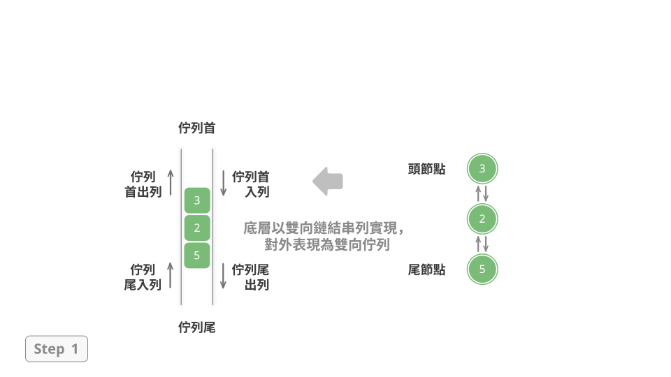
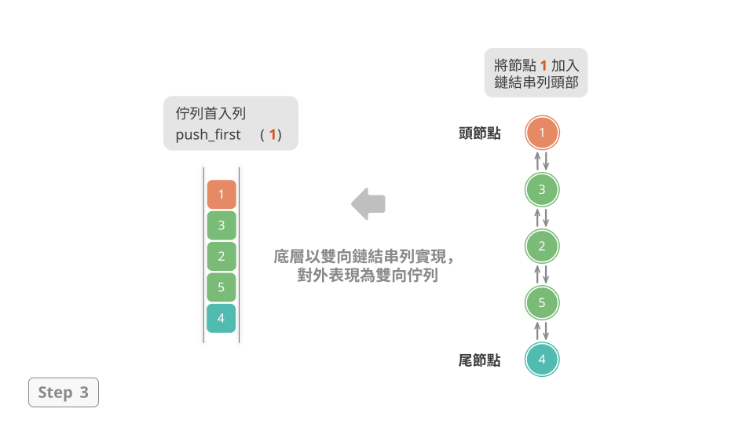
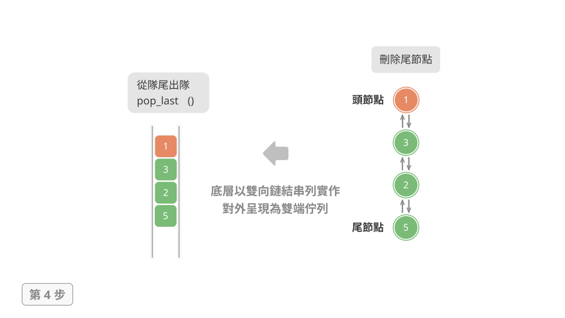
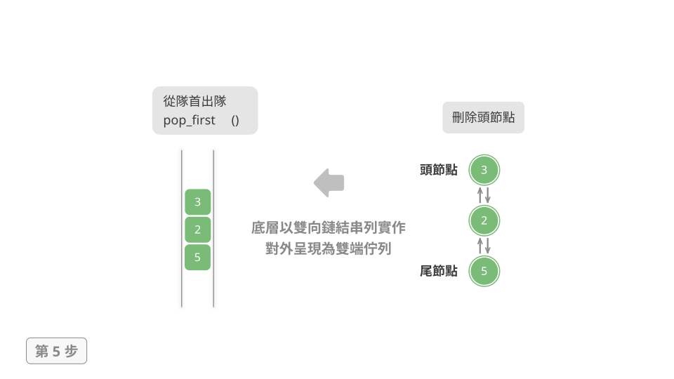
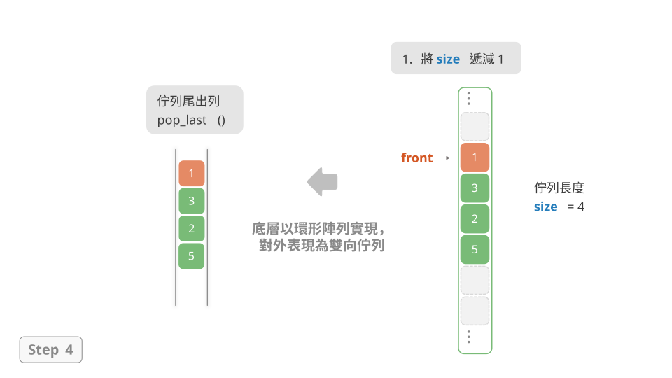

# 雙端佇列

在一般佇列中，只能從隊首刪除元素、從隊尾加入元素。如下圖所示，<u>雙端佇列（double-ended queue）</u>的操作更有彈性，無論是隊首還是隊尾，都能加入或刪除元素。


## 雙端佇列的常用操作

下表列出雙端佇列的常用操作，實際使用的方法名稱依程式語言而異。

<p align="center"> 表 <id> &nbsp; 雙端佇列的操作效率 </p>

| 方法名稱         | 說明             | 時間複雜度 |
| -------------- | ---------------- | ---------- |
| `push_first()` | 將元素加到隊首 | $O(1)$     |
| `push_last()`  | 將元素加到隊尾 | $O(1)$     |
| `pop_first()`  | 刪除隊首元素     | $O(1)$     |
| `pop_last()`   | 刪除隊尾元素     | $O(1)$     |
| `peek_first()` | 讀取隊首元素     | $O(1)$     |
| `peek_last()`  | 讀取隊尾元素     | $O(1)$     |

同樣地，我們可以直接使用程式語言提供的雙端佇列類別：

```snippet
deque_operations
```

??? pythontutor "執行視覺化示範"

    @tutor deque_operations_tutor

## 雙端佇列的實作 *

雙端佇列和一般佇列的實作方式類似，都可以選用鏈結串列或陣列作為底層資料結構。

### 以雙向鏈結串列實作

上一節用一般的單向鏈結串列實作佇列，因為這種串列很容易刪除頭節點（對應出隊），也很容易在尾節點後面接上新節點（對應入隊）。

雙端佇列的隊首和隊尾都能入隊和出隊。換句話說，除了原本的操作，還要能從相反的一端執行對應的操作。為此，我們選用「雙向鏈結串列」作為雙端佇列的底層資料結構。

如下圖所示，將雙向鏈結串列的頭節點和尾節點分別當作隊首和隊尾，並在兩端都實作新增和刪除節點的功能。

=== "<1>"
    

=== "<2>"
    

=== "<3>"
    

=== "<4>"
    

=== "<5>"
    

實作程式碼如下：

```src
[file]{linkedlist_deque}-[class]{linked_list_deque}-[func]{}
```

### 以陣列實作

如下圖所示，和用陣列實作一般佇列類似，我們也可以用環狀陣列實作雙端佇列。

=== "<1>"
    

=== "<2>"
    

=== "<3>"
    

=== "<4>"
    

=== "<5>"
    

只需在一般佇列的實作中，加入「從隊首入隊」和「從隊尾出隊」這兩個方法：

```src
[file]{array_deque}-[class]{array_deque}-[func]{}
```

## 雙端佇列的應用

雙端佇列兼具堆疊和佇列的操作方式，**因此凡是堆疊或佇列能做到的應用，雙端佇列都能實現，而且用法更靈活**。

軟體的「復原」功能通常用堆疊實作。系統用 `push` 將每次修改推入堆疊，再用 `pop` 取出修改紀錄來執行復原。不過，系統資源有限，軟體通常會限制可復原的步數（例如只保留 $50$ 步）。當堆疊長度超過 $50$ 時，就得刪除堆疊底端（隊首）的紀錄。**堆疊並未提供這項操作，這時就需要改用雙端佇列**。復原的核心邏輯仍然遵循堆疊的先進後出原則，使用雙端佇列則能更靈活地支援這類額外操作。
