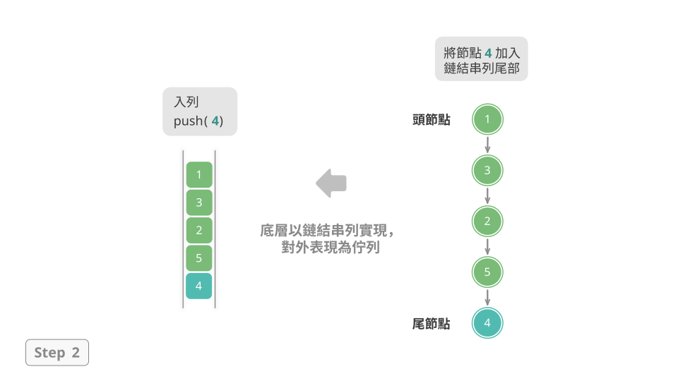
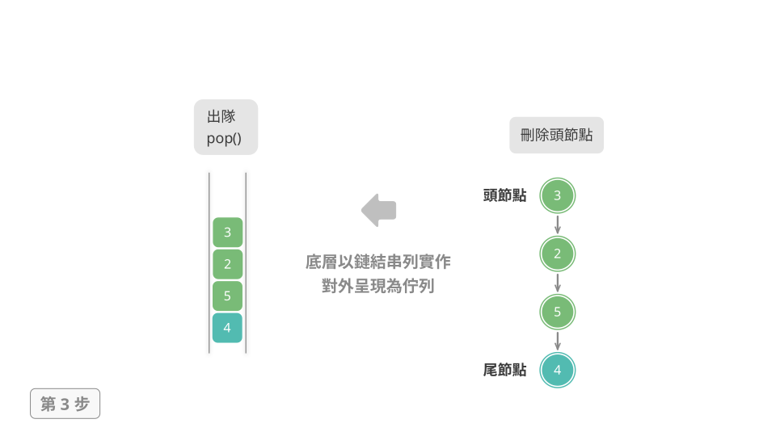
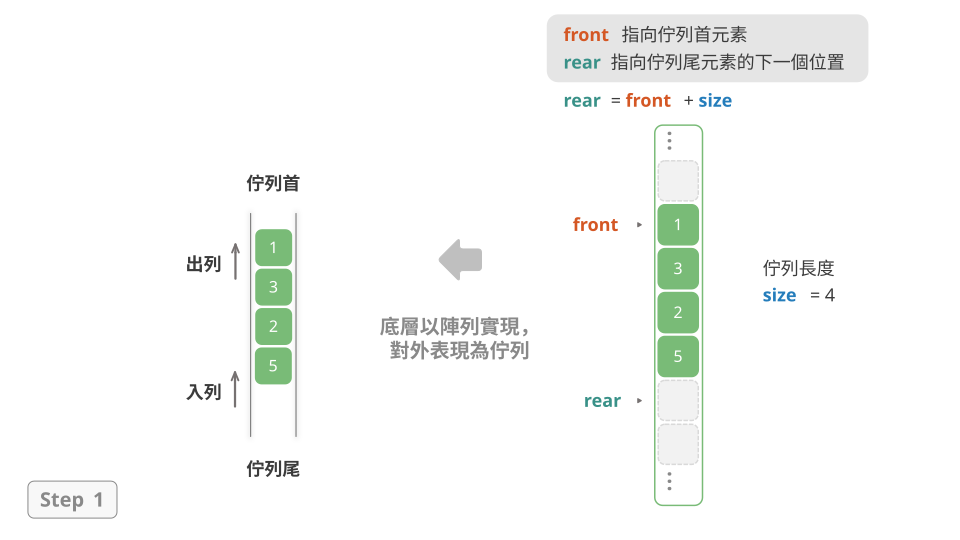
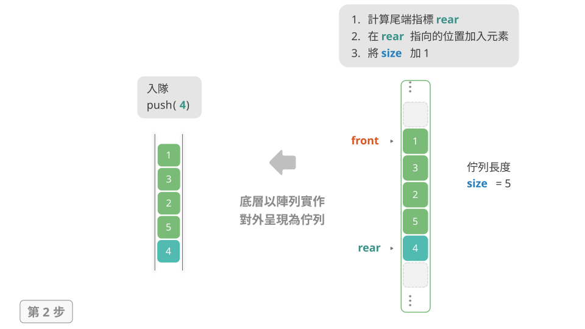

# 5.2 &nbsp; 佇列

<u>佇列（queue）</u>是一種遵循先進先出原則的線性資料結構。它模擬日常生活中排隊的情形：後來的人陸續排到隊伍尾端，排在隊伍前端的人則依序離開。

如圖 5-4 所示，佇列的前端稱為「隊首」，尾端稱為「隊尾」。把元素加到隊尾稱為「入隊」，移除隊首元素則稱為「出隊」。

{ class="animation-figure" }

<p align="center"> 圖 5-4 &nbsp; 佇列的先進先出原則 </p>

## 5.2.1 &nbsp; 佇列的常用操作

表 5-2 列出佇列的常用操作。不同程式語言使用的方法名稱可能不同，這裡採用與堆疊相同的命名方式。

<p align="center"> 表 5-2 &nbsp; 佇列的操作效率 </p>

<div class="center-table" markdown>

| 方法名稱   | 說明                         | 時間複雜度 |
| -------- | ---------------------------- | ---------- |
| `push()` | 讓元素入隊，也就是將元素加到隊尾 | $O(1)$     |
| `pop()`  | 讓隊首元素出隊                 | $O(1)$     |
| `peek()` | 讀取隊首元素                 | $O(1)$     |

</div>

我們可以直接使用程式語言提供的佇列類別：

=== "Python"

    ```python title="queue.py"
    from collections import deque

    # 初始化佇列
    # 在 Python 中，通常用雙端佇列類別 deque 當作一般佇列
    # 雖然 queue.Queue() 能建立專用佇列類別的實例，但用起來較不方便，因此不建議使用
    que: deque[int] = deque()

    # 將元素加入佇列
    que.append(1)
    que.append(3)
    que.append(2)
    que.append(5)
    que.append(4)

    # 讀取隊首元素
    front: int = que[0]

    # 從佇列取出元素
    pop: int = que.popleft()

    # 取得佇列長度
    size: int = len(que)

    # 判斷佇列是否為空
    is_empty: bool = len(que) == 0
    ```

=== "C++"

    ```cpp title="queue.cpp"
    /* 初始化佇列 */
    queue<int> queue;

    /* 將元素加入佇列 */
    queue.push(1);
    queue.push(3);
    queue.push(2);
    queue.push(5);
    queue.push(4);

    /* 讀取隊首元素 */
    int front = queue.front();

    /* 從佇列移除元素 */
    queue.pop();

    /* 取得佇列長度 */
    int size = queue.size();

    /* 判斷佇列是否為空 */
    bool empty = queue.empty();
    ```

=== "Java"

    ```java title="queue.java"
    /* 初始化佇列 */
    Queue<Integer> queue = new LinkedList<>();

    /* 將元素加入佇列 */
    queue.offer(1);
    queue.offer(3);
    queue.offer(2);
    queue.offer(5);
    queue.offer(4);

    /* 讀取隊首元素 */
    int peek = queue.peek();

    /* 從佇列取出元素 */
    int pop = queue.poll();

    /* 取得佇列長度 */
    int size = queue.size();

    /* 判斷佇列是否為空 */
    boolean isEmpty = queue.isEmpty();
    ```

=== "C#"

    ```csharp title="queue.cs"
    /* 初始化佇列 */
    Queue<int> queue = new();

    /* 將元素加入佇列 */
    queue.Enqueue(1);
    queue.Enqueue(3);
    queue.Enqueue(2);
    queue.Enqueue(5);
    queue.Enqueue(4);

    /* 讀取隊首元素 */
    int peek = queue.Peek();

    /* 從佇列取出元素 */
    int pop = queue.Dequeue();

    /* 取得佇列長度 */
    int size = queue.Count;

    /* 判斷佇列是否為空 */
    bool isEmpty = queue.Count == 0;
    ```

=== "Go"

    ```go title="queue_test.go"
    /* 初始化佇列 */
    // 在 Go 中，可用 list 套件的鏈結串列當作佇列
    queue := list.New()

    /* 將元素加入佇列 */
    queue.PushBack(1)
    queue.PushBack(3)
    queue.PushBack(2)
    queue.PushBack(5)
    queue.PushBack(4)

    /* 取得隊首節點 */
    peek := queue.Front()

    /* 從佇列取出元素 */
    pop := queue.Front()
    queue.Remove(pop)

    /* 取得佇列長度 */
    size := queue.Len()

    /* 判斷佇列是否為空 */
    isEmpty := queue.Len() == 0
    ```

=== "Swift"

    ```swift title="queue.swift"
    /* 初始化佇列 */
    // Swift 沒有內建佇列類別，可以用 Array 當作佇列
    var queue: [Int] = []

    /* 將元素加入佇列 */
    queue.append(1)
    queue.append(3)
    queue.append(2)
    queue.append(5)
    queue.append(4)

    /* 讀取隊首元素 */
    let peek = queue.first!

    /* 從佇列取出元素 */
    // 用 Array 模擬時，removeFirst 的時間複雜度為 O(n)
    let pop = queue.removeFirst()

    /* 取得佇列長度 */
    let size = queue.count

    /* 判斷佇列是否為空 */
    let isEmpty = queue.isEmpty
    ```

=== "JS"

    ```javascript title="queue.js"
    /* 初始化佇列 */
    // JavaScript 沒有內建佇列，可以用 Array 當作佇列
    const queue = [];

    /* 將元素加入佇列 */
    queue.push(1);
    queue.push(3);
    queue.push(2);
    queue.push(5);
    queue.push(4);

    /* 讀取隊首元素 */
    const peek = queue[0];

    /* 從佇列取出元素 */
    // 底層使用陣列，因此 shift() 方法的時間複雜度為 O(n)
    const pop = queue.shift();

    /* 取得佇列長度 */
    const size = queue.length;

    /* 判斷佇列是否為空 */
    const isEmpty = queue.length === 0;
    ```

=== "TS"

    ```typescript title="queue.ts"
    /* 初始化佇列 */
    // TypeScript 沒有內建佇列，可以用 Array 當作佇列
    const queue: number[] = [];

    /* 將元素加入佇列 */
    queue.push(1);
    queue.push(3);
    queue.push(2);
    queue.push(5);
    queue.push(4);

    /* 讀取隊首元素 */
    const peek = queue[0];

    /* 從佇列取出元素 */
    // 底層使用陣列，因此 shift() 方法的時間複雜度為 O(n)
    const pop = queue.shift();

    /* 取得佇列長度 */
    const size = queue.length;

    /* 判斷佇列是否為空 */
    const isEmpty = queue.length === 0;
    ```

=== "Dart"

    ```dart title="queue.dart"
    /* 初始化佇列 */
    // 在 Dart 中，通常用雙端佇列類別 Queue 當作一般佇列
    final Queue<int> queue = Queue();

    /* 將元素加入佇列 */
    queue.add(1);
    queue.add(3);
    queue.add(2);
    queue.add(5);
    queue.add(4);

    /* 讀取隊首元素 */
    final int peek = queue.first;

    /* 從佇列取出元素 */
    final int pop = queue.removeFirst();

    /* 取得佇列長度 */
    final int size = queue.length;

    /* 判斷佇列是否為空 */
    final bool isEmpty = queue.isEmpty;
    ```

=== "Rust"

    ```rust title="queue.rs"
    // 初始化佇列
    // 在 Rust 中，通常用雙端佇列 VecDeque 當作一般佇列
    let mut queue: VecDeque<i32> = VecDeque::new();

    // 將元素加入佇列
    queue.push_back(1);
    queue.push_back(3);
    queue.push_back(2);
    queue.push_back(5);
    queue.push_back(4);

    // 讀取隊首元素
    let peek = queue.front().unwrap();

    // 從佇列取出元素
    let pop = queue.pop_front().unwrap();

    // 取得佇列長度
    let size = queue.len();

    // 判斷佇列是否為空
    let is_empty = queue.is_empty();
    ```

=== "C"

    ```c title="queue.c"
    // C 沒有內建佇列
    ```

=== "Kotlin"

    ```kotlin title="queue.kt"
    /* 初始化佇列 */
    val queue = LinkedList<Int>()

    /* 將元素加入佇列 */
    queue.offer(1)
    queue.offer(3)
    queue.offer(2)
    queue.offer(5)
    queue.offer(4)

    /* 讀取隊首元素 */
    val peek = queue.peek()

    /* 從佇列取出元素 */
    val pop = queue.poll()

    /* 取得佇列長度 */
    val size = queue.size

    /* 判斷佇列是否為空 */
    val isEmpty = queue.isEmpty()
    ```

=== "Ruby"

    ```ruby title="queue.rb"
    # 初始化佇列
    # Ruby 內建的佇列（Thread::Queue）沒有 peek 方法，也沒有走訪元素的方法，可以用 Array 當作佇列
    queue = []

    # 將元素加入佇列
    queue.push(1)
    queue.push(3)
    queue.push(2)
    queue.push(5)
    queue.push(4)

    # 讀取隊首元素
    peek = queue.first

    # 從佇列取出元素
    # 請注意，Array 是陣列，因此 Array#shift 的時間複雜度為 O(n)
    pop = queue.shift

    # 取得佇列長度
    size = queue.length

    # 判斷佇列是否為空
    is_empty = queue.empty?
    ```

??? pythontutor "執行視覺化示範"

    <div style="height: 549px; width: 100%;"><iframe class="pythontutor-iframe" title="執行視覺化示範" src="https://pythontutor.com/iframe-embed.html#code=from%20collections%20import%20deque%0A%0A%22%22%22Driver%20Code%22%22%22%0Aif%20__name__%20%3D%3D%20%22__main__%22%3A%0A%20%20%20%20%23%20%E5%88%9D%E5%A7%8B%E5%8C%96%E4%BD%87%E5%88%97%0A%20%20%20%20%23%20%E5%9C%A8%20Python%20%E4%B8%AD%EF%BC%8C%E9%80%9A%E5%B8%B8%E6%8A%8A%E9%9B%99%E7%AB%AF%E4%BD%87%E5%88%97%E9%A1%9E%E5%88%A5%20deque%20%E7%95%B6%E4%BD%9C%E4%BD%87%E5%88%97%E4%BD%BF%E7%94%A8%0A%20%20%20%20%23%20%E9%9B%96%E7%84%B6%E5%8F%AF%E4%BB%A5%E7%94%A8%20queue.Queue%28%29%20%E5%BB%BA%E7%AB%8B%E5%B0%88%E7%94%A8%E7%9A%84%E4%BD%87%E5%88%97%EF%BC%8C%E4%BD%BF%E7%94%A8%E8%B5%B7%E4%BE%86%E5%8D%BB%E4%B8%8D%E5%A4%AA%E6%96%B9%E4%BE%BF%0A%20%20%20%20que%20%3D%20deque%28%29%0A%0A%20%20%20%20%23%20%E5%B0%87%E5%85%83%E7%B4%A0%E5%8A%A0%E5%85%A5%E4%BD%87%E5%88%97%0A%20%20%20%20que.append%281%29%0A%20%20%20%20que.append%283%29%0A%20%20%20%20que.append%282%29%0A%20%20%20%20que.append%285%29%0A%20%20%20%20que.append%284%29%0A%20%20%20%20print%28%22%E4%BD%87%E5%88%97%20que%20%3D%22,%20que%29%0A%0A%20%20%20%20%23%20%E8%AE%80%E5%8F%96%E9%9A%8A%E9%A6%96%E5%85%83%E7%B4%A0%0A%20%20%20%20front%20%3D%20que%5B0%5D%0A%20%20%20%20print%28%22%E9%9A%8A%E9%A6%96%E5%85%83%E7%B4%A0%20front%20%3D%22,%20front%29%0A%0A%20%20%20%20%23%20%E5%BE%9E%E4%BD%87%E5%88%97%E5%8F%96%E5%87%BA%E5%85%83%E7%B4%A0%0A%20%20%20%20pop%20%3D%20que.popleft%28%29%0A%20%20%20%20print%28%22%E5%8F%96%E5%87%BA%E7%9A%84%E5%85%83%E7%B4%A0%20pop%20%3D%22,%20pop%29%0A%20%20%20%20print%28%22%E5%8F%96%E5%87%BA%E5%85%83%E7%B4%A0%E5%BE%8C%20que%20%3D%22,%20que%29%0A%0A%20%20%20%20%23%20%E5%8F%96%E5%BE%97%E4%BD%87%E5%88%97%E7%9A%84%E9%95%B7%E5%BA%A6%0A%20%20%20%20size%20%3D%20len%28que%29%0A%20%20%20%20print%28%22%E4%BD%87%E5%88%97%E9%95%B7%E5%BA%A6%20size%20%3D%22,%20size%29%0A%0A%20%20%20%20%23%20%E5%88%A4%E6%96%B7%E4%BD%87%E5%88%97%E6%98%AF%E5%90%A6%E7%82%BA%E7%A9%BA%0A%20%20%20%20is_empty%20%3D%20len%28que%29%20%3D%3D%200%0A%20%20%20%20print%28%22%E4%BD%87%E5%88%97%E6%98%AF%E5%90%A6%E7%82%BA%E7%A9%BA%20%3D%22,%20is_empty%29&codeDivHeight=472&codeDivWidth=350&cumulative=false&curInstr=3&heapPrimitives=nevernest&origin=opt-frontend.js&py=311&rawInputLstJSON=%5B%5D&textReferences=false"> </iframe></div>
    <div style="margin-top: 5px;"><a href="https://pythontutor.com/iframe-embed.html#code=from%20collections%20import%20deque%0A%0A%22%22%22Driver%20Code%22%22%22%0Aif%20__name__%20%3D%3D%20%22__main__%22%3A%0A%20%20%20%20%23%20%E5%88%9D%E5%A7%8B%E5%8C%96%E4%BD%87%E5%88%97%0A%20%20%20%20%23%20%E5%9C%A8%20Python%20%E4%B8%AD%EF%BC%8C%E9%80%9A%E5%B8%B8%E6%8A%8A%E9%9B%99%E7%AB%AF%E4%BD%87%E5%88%97%E9%A1%9E%E5%88%A5%20deque%20%E7%95%B6%E4%BD%9C%E4%BD%87%E5%88%97%E4%BD%BF%E7%94%A8%0A%20%20%20%20%23%20%E9%9B%96%E7%84%B6%E5%8F%AF%E4%BB%A5%E7%94%A8%20queue.Queue%28%29%20%E5%BB%BA%E7%AB%8B%E5%B0%88%E7%94%A8%E7%9A%84%E4%BD%87%E5%88%97%EF%BC%8C%E4%BD%BF%E7%94%A8%E8%B5%B7%E4%BE%86%E5%8D%BB%E4%B8%8D%E5%A4%AA%E6%96%B9%E4%BE%BF%0A%20%20%20%20que%20%3D%20deque%28%29%0A%0A%20%20%20%20%23%20%E5%B0%87%E5%85%83%E7%B4%A0%E5%8A%A0%E5%85%A5%E4%BD%87%E5%88%97%0A%20%20%20%20que.append%281%29%0A%20%20%20%20que.append%283%29%0A%20%20%20%20que.append%282%29%0A%20%20%20%20que.append%285%29%0A%20%20%20%20que.append%284%29%0A%20%20%20%20print%28%22%E4%BD%87%E5%88%97%20que%20%3D%22,%20que%29%0A%0A%20%20%20%20%23%20%E8%AE%80%E5%8F%96%E9%9A%8A%E9%A6%96%E5%85%83%E7%B4%A0%0A%20%20%20%20front%20%3D%20que%5B0%5D%0A%20%20%20%20print%28%22%E9%9A%8A%E9%A6%96%E5%85%83%E7%B4%A0%20front%20%3D%22,%20front%29%0A%0A%20%20%20%20%23%20%E5%BE%9E%E4%BD%87%E5%88%97%E5%8F%96%E5%87%BA%E5%85%83%E7%B4%A0%0A%20%20%20%20pop%20%3D%20que.popleft%28%29%0A%20%20%20%20print%28%22%E5%8F%96%E5%87%BA%E7%9A%84%E5%85%83%E7%B4%A0%20pop%20%3D%22,%20pop%29%0A%20%20%20%20print%28%22%E5%8F%96%E5%87%BA%E5%85%83%E7%B4%A0%E5%BE%8C%20que%20%3D%22,%20que%29%0A%0A%20%20%20%20%23%20%E5%8F%96%E5%BE%97%E4%BD%87%E5%88%97%E7%9A%84%E9%95%B7%E5%BA%A6%0A%20%20%20%20size%20%3D%20len%28que%29%0A%20%20%20%20print%28%22%E4%BD%87%E5%88%97%E9%95%B7%E5%BA%A6%20size%20%3D%22,%20size%29%0A%0A%20%20%20%20%23%20%E5%88%A4%E6%96%B7%E4%BD%87%E5%88%97%E6%98%AF%E5%90%A6%E7%82%BA%E7%A9%BA%0A%20%20%20%20is_empty%20%3D%20len%28que%29%20%3D%3D%200%0A%20%20%20%20print%28%22%E4%BD%87%E5%88%97%E6%98%AF%E5%90%A6%E7%82%BA%E7%A9%BA%20%3D%22,%20is_empty%29&codeDivHeight=800&codeDivWidth=600&cumulative=false&curInstr=3&heapPrimitives=nevernest&origin=opt-frontend.js&py=311&rawInputLstJSON=%5B%5D&textReferences=false" target="_blank" rel="noopener noreferrer">全螢幕觀看 ></a></div>

## 5.2.2 &nbsp; 佇列的實作

要實作佇列，需要能從一端加入元素、從另一端刪除元素的資料結構。鏈結串列和陣列都符合這個條件。

### 1. &nbsp; 以鏈結串列實作

如圖 5-5 所示，可以將鏈結串列的「頭節點」當作「隊首」，將「尾節點」當作「隊尾」，並規定在隊尾只能加入節點，在隊首只能刪除節點。

=== "<1>"
    { class="animation-figure" }

=== "<2>"
    { class="animation-figure" }

=== "<3>"
    { class="animation-figure" }

<p align="center"> 圖 5-5 &nbsp; 以鏈結串列實作佇列的入隊與出隊 </p>

以下是用鏈結串列實作佇列的程式碼：

=== "Python"

    ```python title="linkedlist_queue.py"
    class LinkedListQueue:
        """以鏈結串列實作佇列"""

        def __init__(self):
            """初始化方法"""
            self._front: ListNode | None = None  # _front 指向首節點
            self._rear: ListNode | None = None  # _rear 指向尾節點
            self._size: int = 0

        def size(self) -> int:
            """取得佇列長度"""
            return self._size

        def is_empty(self) -> bool:
            """判斷佇列是否為空"""
            return self._size == 0

        def push(self, num: int):
            """入隊"""
            # 建立存有 num 的新節點，準備接到隊尾
            node = ListNode(num)
            # 若佇列為空，讓隊首與隊尾都指向新節點
            if self._front is None:
                self._front = node
                self._rear = node
            # 若佇列非空，將新節點接在尾節點之後
            else:
                self._rear.next = node
                self._rear = node
            self._size += 1

        def pop(self) -> int:
            """出隊"""
            num = self.peek()
            # 移除首節點
            self._front = self._front.next
            self._size -= 1
            return num

        def peek(self) -> int:
            """讀取隊首元素"""
            if self.is_empty():
                raise IndexError("佇列為空")
            return self._front.val

        def to_list(self) -> list[int]:
            """轉成串列以便輸出"""
            queue = []
            temp = self._front
            while temp:
                queue.append(temp.val)
                temp = temp.next
            return queue
    ```

=== "C++"

    ```cpp title="linkedlist_queue.cpp"
    /* 以鏈結串列實作佇列 */
    class LinkedListQueue {
      private:
        ListNode *front, *rear; // front 指向首節點，rear 指向尾節點
        int queSize;

      public:
        LinkedListQueue() {
            front = nullptr;
            rear = nullptr;
            queSize = 0;
        }

        ~LinkedListQueue() {
            // 走訪鏈結串列，逐一刪除節點並釋放記憶體
            freeMemoryLinkedList(front);
        }

        /* 取得佇列長度 */
        int size() {
            return queSize;
        }

        /* 判斷佇列是否為空 */
        bool isEmpty() {
            return queSize == 0;
        }

        /* 入隊 */
        void push(int num) {
            // 建立存有 num 的新節點，準備接到隊尾
            ListNode *node = new ListNode(num);
            // 若佇列為空，讓隊首與隊尾都指向新節點
            if (front == nullptr) {
                front = node;
                rear = node;
            }
            // 若佇列非空，將新節點接在尾節點之後
            else {
                rear->next = node;
                rear = node;
            }
            queSize++;
        }

        /* 出隊 */
        int pop() {
            int num = peek();
            // 移除首節點
            ListNode *tmp = front;
            front = front->next;
            // 釋放已移除節點的記憶體
            delete tmp;
            queSize--;
            return num;
        }

        /* 讀取隊首元素 */
        int peek() {
            if (size() == 0)
                throw out_of_range("佇列為空");
            return front->val;
        }

        /* 將鏈結串列轉成 vector 並回傳 */
        vector<int> toVector() {
            ListNode *node = front;
            vector<int> res(size());
            for (int i = 0; i < res.size(); i++) {
                res[i] = node->val;
                node = node->next;
            }
            return res;
        }
    };
    ```

=== "Java"

    ```java title="linkedlist_queue.java"
    /* 以鏈結串列實作佇列 */
    class LinkedListQueue {
        private ListNode front, rear; // front 指向首節點，rear 指向尾節點
        private int queSize = 0;

        public LinkedListQueue() {
            front = null;
            rear = null;
        }

        /* 取得佇列長度 */
        public int size() {
            return queSize;
        }

        /* 判斷佇列是否為空 */
        public boolean isEmpty() {
            return size() == 0;
        }

        /* 入隊 */
        public void push(int num) {
            // 建立存有 num 的新節點，準備接到隊尾
            ListNode node = new ListNode(num);
            // 若佇列為空，讓隊首與隊尾都指向新節點
            if (front == null) {
                front = node;
                rear = node;
            // 若佇列非空，將新節點接在尾節點之後
            } else {
                rear.next = node;
                rear = node;
            }
            queSize++;
        }

        /* 出隊 */
        public int pop() {
            int num = peek();
            // 移除首節點
            front = front.next;
            queSize--;
            return num;
        }

        /* 讀取隊首元素 */
        public int peek() {
            if (isEmpty())
                throw new IndexOutOfBoundsException();
            return front.val;
        }

        /* 將鏈結串列轉成陣列並回傳 */
        public int[] toArray() {
            ListNode node = front;
            int[] res = new int[size()];
            for (int i = 0; i < res.length; i++) {
                res[i] = node.val;
                node = node.next;
            }
            return res;
        }
    }
    ```

=== "C#"

    ```csharp title="linkedlist_queue.cs"
    /* 以鏈結串列實作佇列 */
    class LinkedListQueue {
        ListNode? front, rear;  // front 指向首節點，rear 指向尾節點 
        int queSize = 0;

        public LinkedListQueue() {
            front = null;
            rear = null;
        }

        /* 取得佇列長度 */
        public int Size() {
            return queSize;
        }

        /* 判斷佇列是否為空 */
        public bool IsEmpty() {
            return Size() == 0;
        }

        /* 入隊 */
        public void Push(int num) {
            // 建立存有 num 的新節點，準備接到隊尾
            ListNode node = new(num);
            // 若佇列為空，讓隊首與隊尾都指向新節點
            if (front == null) {
                front = node;
                rear = node;
                // 若佇列非空，將新節點接在尾節點之後
            } else if (rear != null) {
                rear.next = node;
                rear = node;
            }
            queSize++;
        }

        /* 出隊 */
        public int Pop() {
            int num = Peek();
            // 移除首節點
            front = front?.next;
            queSize--;
            return num;
        }

        /* 讀取隊首元素 */
        public int Peek() {
            if (IsEmpty())
                throw new Exception();
            return front!.val;
        }

        /* 將鏈結串列轉成陣列並回傳 */
        public int[] ToArray() {
            if (front == null)
                return [];

            ListNode? node = front;
            int[] res = new int[Size()];
            for (int i = 0; i < res.Length; i++) {
                res[i] = node!.val;
                node = node.next;
            }
            return res;
        }
    }
    ```

=== "Go"

    ```go title="linkedlist_queue.go"
    /* 以鏈結串列實作佇列 */
    type linkedListQueue struct {
        // 使用標準函式庫的 list 套件實作佇列
        data *list.List
    }

    /* 初始化佇列 */
    func newLinkedListQueue() *linkedListQueue {
        return &linkedListQueue{
            data: list.New(),
        }
    }

    /* 入隊 */
    func (s *linkedListQueue) push(value any) {
        s.data.PushBack(value)
    }

    /* 出隊 */
    func (s *linkedListQueue) pop() any {
        if s.isEmpty() {
            return nil
        }
        e := s.data.Front()
        s.data.Remove(e)
        return e.Value
    }

    /* 讀取隊首元素 */
    func (s *linkedListQueue) peek() any {
        if s.isEmpty() {
            return nil
        }
        e := s.data.Front()
        return e.Value
    }

    /* 取得佇列長度 */
    func (s *linkedListQueue) size() int {
        return s.data.Len()
    }

    /* 判斷佇列是否為空 */
    func (s *linkedListQueue) isEmpty() bool {
        return s.data.Len() == 0
    }

    /* 回傳 list.List 的指標以便輸出 */
    func (s *linkedListQueue) toList() *list.List {
        return s.data
    }
    ```

=== "Swift"

    ```swift title="linkedlist_queue.swift"
    /* 以鏈結串列實作佇列 */
    class LinkedListQueue {
        private var front: ListNode? // 首節點
        private var rear: ListNode? // 尾節點
        private var _size: Int

        init() {
            _size = 0
        }

        /* 取得佇列長度 */
        func size() -> Int {
            _size
        }

        /* 判斷佇列是否為空 */
        func isEmpty() -> Bool {
            size() == 0
        }

        /* 入隊 */
        func push(num: Int) {
            // 建立存有 num 的新節點，準備接到隊尾
            let node = ListNode(x: num)
            // 若佇列為空，讓隊首與隊尾都指向新節點
            if front == nil {
                front = node
                rear = node
            }
            // 若佇列非空，將新節點接在尾節點之後
            else {
                rear?.next = node
                rear = node
            }
            _size += 1
        }

        /* 出隊 */
        @discardableResult
        func pop() -> Int {
            let num = peek()
            // 移除首節點
            front = front?.next
            _size -= 1
            return num
        }

        /* 讀取隊首元素 */
        func peek() -> Int {
            if isEmpty() {
                fatalError("佇列為空")
            }
            return front!.val
        }

        /* 將鏈結串列轉成陣列並回傳 */
        func toArray() -> [Int] {
            var node = front
            var res = Array(repeating: 0, count: size())
            for i in res.indices {
                res[i] = node!.val
                node = node?.next
            }
            return res
        }
    }
    ```

=== "JS"

    ```javascript title="linkedlist_queue.js"
    /* 以鏈結串列實作佇列 */
    class LinkedListQueue {
        #front; // #front 指向首節點
        #rear; // #rear 指向尾節點
        #queSize = 0;

        constructor() {
            this.#front = null;
            this.#rear = null;
        }

        /* 取得佇列長度 */
        get size() {
            return this.#queSize;
        }

        /* 判斷佇列是否為空 */
        isEmpty() {
            return this.size === 0;
        }

        /* 入隊 */
        push(num) {
            // 建立存有 num 的新節點，準備接到隊尾
            const node = new ListNode(num);
            // 若佇列為空，讓隊首與隊尾都指向新節點
            if (!this.#front) {
                this.#front = node;
                this.#rear = node;
                // 若佇列非空，將新節點接在尾節點之後
            } else {
                this.#rear.next = node;
                this.#rear = node;
            }
            this.#queSize++;
        }

        /* 出隊 */
        pop() {
            const num = this.peek();
            // 移除首節點
            this.#front = this.#front.next;
            this.#queSize--;
            return num;
        }

        /* 讀取隊首元素 */
        peek() {
            if (this.size === 0) throw new Error('佇列為空');
            return this.#front.val;
        }

        /* 將鏈結串列轉成陣列並回傳 */
        toArray() {
            let node = this.#front;
            const res = new Array(this.size);
            for (let i = 0; i < res.length; i++) {
                res[i] = node.val;
                node = node.next;
            }
            return res;
        }
    }
    ```

=== "TS"

    ```typescript title="linkedlist_queue.ts"
    /* 以鏈結串列實作佇列 */
    class LinkedListQueue {
        private front: ListNode | null; // front 指向首節點
        private rear: ListNode | null; // rear 指向尾節點
        private queSize: number = 0;

        constructor() {
            this.front = null;
            this.rear = null;
        }

        /* 取得佇列長度 */
        get size(): number {
            return this.queSize;
        }

        /* 判斷佇列是否為空 */
        isEmpty(): boolean {
            return this.size === 0;
        }

        /* 入隊 */
        push(num: number): void {
            // 建立存有 num 的新節點，準備接到隊尾
            const node = new ListNode(num);
            // 若佇列為空，讓隊首與隊尾都指向新節點
            if (!this.front) {
                this.front = node;
                this.rear = node;
                // 若佇列非空，將新節點接在尾節點之後
            } else {
                this.rear!.next = node;
                this.rear = node;
            }
            this.queSize++;
        }

        /* 出隊 */
        pop(): number {
            const num = this.peek();
            if (!this.front) throw new Error('佇列為空');
            // 移除首節點
            this.front = this.front.next;
            this.queSize--;
            return num;
        }

        /* 讀取隊首元素 */
        peek(): number {
            if (this.size === 0) throw new Error('佇列為空');
            return this.front!.val;
        }

        /* 將鏈結串列轉成陣列並回傳 */
        toArray(): number[] {
            let node = this.front;
            const res = new Array<number>(this.size);
            for (let i = 0; i < res.length; i++) {
                res[i] = node!.val;
                node = node!.next;
            }
            return res;
        }
    }
    ```

=== "Dart"

    ```dart title="linkedlist_queue.dart"
    /* 以鏈結串列實作佇列 */
    class LinkedListQueue {
      ListNode? _front; // _front 指向首節點
      ListNode? _rear; // _rear 指向尾節點
      int _queSize = 0; // 佇列長度

      LinkedListQueue() {
        _front = null;
        _rear = null;
      }

      /* 取得佇列長度 */
      int size() {
        return _queSize;
      }

      /* 判斷佇列是否為空 */
      bool isEmpty() {
        return _queSize == 0;
      }

      /* 入隊 */
      void push(int _num) {
        // 建立存有 _num 的新節點，準備接到隊尾
        final node = ListNode(_num);
        // 若佇列為空，讓隊首與隊尾都指向新節點
        if (_front == null) {
          _front = node;
          _rear = node;
        } else {
          // 若佇列非空，將新節點接在尾節點之後
          _rear!.next = node;
          _rear = node;
        }
        _queSize++;
      }

      /* 出隊 */
      int pop() {
        final int _num = peek();
        // 移除首節點
        _front = _front!.next;
        _queSize--;
        return _num;
      }

      /* 讀取隊首元素 */
      int peek() {
        if (_queSize == 0) {
          throw Exception('佇列為空');
        }
        return _front!.val;
      }

      /* 將鏈結串列轉成 List 並回傳 */
      List<int> toArray() {
        ListNode? node = _front;
        final List<int> queue = [];
        while (node != null) {
          queue.add(node.val);
          node = node.next;
        }
        return queue;
      }
    }
    ```

=== "Rust"

    ```rust title="linkedlist_queue.rs"
    /* 以鏈結串列實作佇列 */
    #[allow(dead_code)]
    pub struct LinkedListQueue<T> {
        front: Option<Rc<RefCell<ListNode<T>>>>, // front 指向首節點
        rear: Option<Rc<RefCell<ListNode<T>>>>,  // rear 指向尾節點
        que_size: usize,                         // 佇列長度
    }

    impl<T: Copy> LinkedListQueue<T> {
        pub fn new() -> Self {
            Self {
                front: None,
                rear: None,
                que_size: 0,
            }
        }

        /* 取得佇列長度 */
        pub fn size(&self) -> usize {
            return self.que_size;
        }

        /* 判斷佇列是否為空 */
        pub fn is_empty(&self) -> bool {
            return self.que_size == 0;
        }

        /* 入隊 */
        pub fn push(&mut self, num: T) {
            // 建立存有 num 的新節點，準備接到隊尾
            let new_rear = ListNode::new(num);
            match self.rear.take() {
                // 若佇列非空，將新節點接在尾節點之後
                Some(old_rear) => {
                    old_rear.borrow_mut().next = Some(new_rear.clone());
                    self.rear = Some(new_rear);
                }
                // 若佇列為空，讓隊首與隊尾都指向新節點
                None => {
                    self.front = Some(new_rear.clone());
                    self.rear = Some(new_rear);
                }
            }
            self.que_size += 1;
        }

        /* 出隊 */
        pub fn pop(&mut self) -> Option<T> {
            self.front.take().map(|old_front| {
                match old_front.borrow_mut().next.take() {
                    Some(new_front) => {
                        self.front = Some(new_front);
                    }
                    None => {
                        self.rear.take();
                    }
                }
                self.que_size -= 1;
                old_front.borrow().val
            })
        }

        /* 取得隊首節點的參照 */
        pub fn peek(&self) -> Option<&Rc<RefCell<ListNode<T>>>> {
            self.front.as_ref()
        }

        /* 將鏈結串列轉成 Vec 並回傳 */
        pub fn to_array(&self, head: Option<&Rc<RefCell<ListNode<T>>>>) -> Vec<T> {
            let mut res: Vec<T> = Vec::new();

            fn recur<T: Copy>(cur: Option<&Rc<RefCell<ListNode<T>>>>, res: &mut Vec<T>) {
                if let Some(cur) = cur {
                    res.push(cur.borrow().val);
                    recur(cur.borrow().next.as_ref(), res);
                }
            }

            recur(head, &mut res);

            res
        }
    }
    ```

=== "C"

    ```c title="linkedlist_queue.c"
    /* 以鏈結串列實作佇列 */
    typedef struct {
        ListNode *front, *rear;
        int queSize;
    } LinkedListQueue;

    /* 建立佇列 */
    LinkedListQueue *newLinkedListQueue() {
        LinkedListQueue *queue = (LinkedListQueue *)malloc(sizeof(LinkedListQueue));
        queue->front = NULL;
        queue->rear = NULL;
        queue->queSize = 0;
        return queue;
    }

    /* 釋放佇列的記憶體 */
    void delLinkedListQueue(LinkedListQueue *queue) {
        // 釋放所有節點
        while (queue->front != NULL) {
            ListNode *tmp = queue->front;
            queue->front = queue->front->next;
            free(tmp);
        }
        // 釋放 queue 結構體
        free(queue);
    }

    /* 取得佇列長度 */
    int size(LinkedListQueue *queue) {
        return queue->queSize;
    }

    /* 判斷佇列是否為空 */
    bool empty(LinkedListQueue *queue) {
        return (size(queue) == 0);
    }

    /* 入隊 */
    void push(LinkedListQueue *queue, int num) {
        // 將 node 接在尾節點之後
        ListNode *node = newListNode(num);
        // 若佇列為空，讓隊首與隊尾都指向新節點
        if (queue->front == NULL) {
            queue->front = node;
            queue->rear = node;
        }
        // 若佇列非空，將新節點接在尾節點之後
        else {
            queue->rear->next = node;
            queue->rear = node;
        }
        queue->queSize++;
    }

    /* 讀取隊首元素 */
    int peek(LinkedListQueue *queue) {
        assert(size(queue) && queue->front);
        return queue->front->val;
    }

    /* 出隊 */
    int pop(LinkedListQueue *queue) {
        int num = peek(queue);
        ListNode *tmp = queue->front;
        queue->front = queue->front->next;
        free(tmp);
        queue->queSize--;
        return num;
    }

    /* 輸出佇列內容 */
    void printLinkedListQueue(LinkedListQueue *queue) {
        int *arr = malloc(sizeof(int) * queue->queSize);
        // 將鏈結串列的資料複製到陣列中
        int i;
        ListNode *node;
        for (i = 0, node = queue->front; i < queue->queSize; i++) {
            arr[i] = node->val;
            node = node->next;
        }
        printArray(arr, queue->queSize);
        free(arr);
    }
    ```

=== "Kotlin"

    ```kotlin title="linkedlist_queue.kt"
    /* 以鏈結串列實作佇列 */
    class LinkedListQueue(
        // front 指向首節點，rear 指向尾節點
        private var front: ListNode? = null,
        private var rear: ListNode? = null,
        private var queSize: Int = 0
    ) {

        /* 取得佇列長度 */
        fun size(): Int {
            return queSize
        }

        /* 判斷佇列是否為空 */
        fun isEmpty(): Boolean {
            return size() == 0
        }

        /* 入隊 */
        fun push(num: Int) {
            // 建立存有 num 的新節點，準備接到隊尾
            val node = ListNode(num)
            // 若佇列為空，讓隊首與隊尾都指向新節點
            if (front == null) {
                front = node
                rear = node
                // 若佇列非空，將新節點接在尾節點之後
            } else {
                rear?.next = node
                rear = node
            }
            queSize++
        }

        /* 出隊 */
        fun pop(): Int {
            val num = peek()
            // 移除首節點
            front = front?.next
            queSize--
            return num
        }

        /* 讀取隊首元素 */
        fun peek(): Int {
            if (isEmpty()) throw IndexOutOfBoundsException()
            return front!!._val
        }

        /* 將鏈結串列轉成陣列並回傳 */
        fun toArray(): IntArray {
            var node = front
            val res = IntArray(size())
            for (i in res.indices) {
                res[i] = node!!._val
                node = node.next
            }
            return res
        }
    }
    ```

=== "Ruby"

    ```ruby title="linkedlist_queue.rb"
    ### 以鏈結串列實作佇列 ###
    class LinkedListQueue
      ### 取得佇列長度 ###
      attr_reader :size

      ### 初始化方法 ###
      def initialize
        @front = nil  # @front 指向首節點
        @rear = nil   # @rear 指向尾節點
        @size = 0
      end

      ### 判斷佇列是否為空 ###
      def is_empty?
        @front.nil?
      end

      ### 入隊 ###
      def push(num)
        # 建立存有 num 的新節點，準備接到隊尾
        node = ListNode.new(num)

        # 若佇列為空，讓隊首與隊尾都指向新節點
        if @front.nil?
          @front = node
          @rear = node
        # 若佇列非空，將新節點接在尾節點之後
        else
          @rear.next = node
          @rear = node
        end

        @size += 1
      end

      ### 出隊 ###
      def pop
        num = peek
        # 移除首節點
        @front = @front.next
        @size -= 1
        num
      end

      ### 讀取隊首元素 ###
      def peek
        raise IndexError, '佇列為空' if is_empty?

        @front.val
      end

      ### 將鏈結串列轉成 Array 並回傳 ###
      def to_array
        queue = []
        temp = @front
        while temp
          queue << temp.val
          temp = temp.next
        end
        queue
      end
    end
    ```

??? pythontutor "執行視覺化示範"

    <div style="height: 549px; width: 100%;"><iframe class="pythontutor-iframe" title="執行視覺化示範" src="https://pythontutor.com/iframe-embed.html#code=class%20ListNode%3A%0A%20%20%22%22%22%E9%8F%88%E7%B5%90%E4%B8%B2%E5%88%97%E7%9A%84%E7%AF%80%E9%BB%9E%E9%A1%9E%E5%88%A5%22%22%22%0A%20%20def%20__init__%28self,%20val%3A%20int%29%3A%0A%20%20%20%20self.val%3A%20int%20%3D%20val%20%20%23%20%E7%AF%80%E9%BB%9E%E5%80%BC%0A%20%20%20%20self.next%3A%20ListNode%20%7C%20None%20%3D%20None%20%20%23%20%E6%8C%87%E5%90%91%E4%B8%8B%E4%B8%80%E5%80%8B%E7%AF%80%E9%BB%9E%E7%9A%84%E5%8F%83%E7%85%A7%0A%0A%0Aclass%20LinkedListQueue%3A%0A%20%20%22%22%22%E4%BB%A5%E9%8F%88%E7%B5%90%E4%B8%B2%E5%88%97%E5%AF%A6%E4%BD%9C%E4%BD%87%E5%88%97%22%22%22%0A%0A%20%20def%20__init__%28self%29%3A%0A%20%20%20%20%22%22%22%E5%88%9D%E5%A7%8B%E5%8C%96%E6%96%B9%E6%B3%95%22%22%22%0A%20%20%20%20self._front%3A%20ListNode%20%7C%20None%20%3D%20None%20%20%23%20_front%20%E6%8C%87%E5%90%91%E9%A6%96%E7%AF%80%E9%BB%9E%0A%20%20%20%20self._rear%3A%20ListNode%20%7C%20None%20%3D%20None%20%20%23%20_rear%20%E6%8C%87%E5%90%91%E5%B0%BE%E7%AF%80%E9%BB%9E%0A%20%20%20%20self._size%3A%20int%20%3D%200%0A%0A%20%20def%20size%28self%29%20-%3E%20int%3A%0A%20%20%20%20%22%22%22%E5%8F%96%E5%BE%97%E4%BD%87%E5%88%97%E9%95%B7%E5%BA%A6%22%22%22%0A%20%20%20%20return%20self._size%0A%0A%20%20def%20is_empty%28self%29%20-%3E%20bool%3A%0A%20%20%20%20%22%22%22%E5%88%A4%E6%96%B7%E4%BD%87%E5%88%97%E6%98%AF%E5%90%A6%E7%82%BA%E7%A9%BA%22%22%22%0A%20%20%20%20return%20not%20self._front%0A%0A%20%20def%20push%28self,%20num%3A%20int%29%3A%0A%20%20%20%20%22%22%22%E5%85%A5%E9%9A%8A%22%22%22%0A%20%20%20%20%23%20%E5%BB%BA%E7%AB%8B%E5%AD%98%E6%9C%89%20num%20%E7%9A%84%E6%96%B0%E7%AF%80%E9%BB%9E%EF%BC%8C%E6%BA%96%E5%82%99%E6%8E%A5%E5%88%B0%E9%9A%8A%E5%B0%BE%0A%20%20%20%20node%20%3D%20ListNode%28num%29%0A%20%20%20%20%23%20%E8%8B%A5%E4%BD%87%E5%88%97%E7%82%BA%E7%A9%BA%EF%BC%8C%E8%AE%93%E9%9A%8A%E9%A6%96%E8%88%87%E9%9A%8A%E5%B0%BE%E9%83%BD%E6%8C%87%E5%90%91%E6%96%B0%E7%AF%80%E9%BB%9E%0A%20%20%20%20if%20self._front%20is%20None%3A%0A%20%20%20%20%20%20self._front%20%3D%20node%0A%20%20%20%20%20%20self._rear%20%3D%20node%0A%20%20%20%20%23%20%E8%8B%A5%E4%BD%87%E5%88%97%E9%9D%9E%E7%A9%BA%EF%BC%8C%E5%B0%87%E6%96%B0%E7%AF%80%E9%BB%9E%E6%8E%A5%E5%9C%A8%E5%B0%BE%E7%AF%80%E9%BB%9E%E4%B9%8B%E5%BE%8C%0A%20%20%20%20else%3A%0A%20%20%20%20%20%20self._rear.next%20%3D%20node%0A%20%20%20%20%20%20self._rear%20%3D%20node%0A%20%20%20%20self._size%20%2B%3D%201%0A%0A%20%20def%20pop%28self%29%20-%3E%20int%3A%0A%20%20%20%20%22%22%22%E5%87%BA%E9%9A%8A%22%22%22%0A%20%20%20%20num%20%3D%20self.peek%28%29%0A%20%20%20%20%23%20%E7%A7%BB%E9%99%A4%E9%A6%96%E7%AF%80%E9%BB%9E%0A%20%20%20%20self._front%20%3D%20self._front.next%0A%20%20%20%20self._size%20-%3D%201%0A%20%20%20%20return%20num%0A%0A%20%20def%20peek%28self%29%20-%3E%20int%3A%0A%20%20%20%20%22%22%22%E8%AE%80%E5%8F%96%E9%9A%8A%E9%A6%96%E5%85%83%E7%B4%A0%22%22%22%0A%20%20%20%20if%20self.is_empty%28%29%3A%0A%20%20%20%20%20%20raise%20IndexError%28%22%E4%BD%87%E5%88%97%E7%82%BA%E7%A9%BA%22%29%0A%20%20%20%20return%20self._front.val%0A%0A%20%20def%20to_list%28self%29%20-%3E%20list%5Bint%5D%3A%0A%20%20%20%20%22%22%22%E8%BD%89%E6%88%90%E4%B8%B2%E5%88%97%E4%BB%A5%E4%BE%BF%E8%BC%B8%E5%87%BA%22%22%22%0A%20%20%20%20queue%20%3D%20%5B%5D%0A%20%20%20%20temp%20%3D%20self._front%0A%20%20%20%20while%20temp%3A%0A%20%20%20%20%20%20queue.append%28temp.val%29%0A%20%20%20%20%20%20temp%20%3D%20temp.next%0A%20%20%20%20return%20queue%0A%0A%0A%22%22%22Driver%20Code%22%22%22%0Aif%20__name__%20%3D%3D%20%22__main__%22%3A%0A%20%20%23%20%E5%88%9D%E5%A7%8B%E5%8C%96%E4%BD%87%E5%88%97%0A%20%20queue%20%3D%20LinkedListQueue%28%29%0A%0A%20%20%23%20%E5%B0%87%E5%85%83%E7%B4%A0%E5%8A%A0%E5%85%A5%E4%BD%87%E5%88%97%0A%20%20queue.push%281%29%0A%20%20queue.push%283%29%0A%20%20queue.push%282%29%0A%20%20queue.push%285%29%0A%20%20queue.push%284%29%0A%20%20print%28%22%E4%BD%87%E5%88%97%20queue%20%3D%22,%20queue.to_list%28%29%29%0A%0A%20%20%23%20%E8%AE%80%E5%8F%96%E9%9A%8A%E9%A6%96%E5%85%83%E7%B4%A0%0A%20%20peek%20%3D%20queue.peek%28%29%0A%20%20print%28%22%E9%9A%8A%E9%A6%96%E5%85%83%E7%B4%A0%20front%20%3D%22,%20peek%29%0A%0A%20%20%23%20%E5%BE%9E%E4%BD%87%E5%88%97%E5%8F%96%E5%87%BA%E5%85%83%E7%B4%A0%0A%20%20pop_front%20%3D%20queue.pop%28%29%0A%20%20print%28%22%E5%87%BA%E9%9A%8A%E5%85%83%E7%B4%A0%20pop%20%3D%22,%20pop_front%29%0A%20%20print%28%22%E5%87%BA%E9%9A%8A%E5%BE%8C%20queue%20%3D%22,%20queue.to_list%28%29%29%0A%0A%20%20%23%20%E5%8F%96%E5%BE%97%E4%BD%87%E5%88%97%E9%95%B7%E5%BA%A6%0A%20%20size%20%3D%20queue.size%28%29%0A%20%20print%28%22%E4%BD%87%E5%88%97%E9%95%B7%E5%BA%A6%20size%20%3D%22,%20size%29%0A%0A%20%20%23%20%E5%88%A4%E6%96%B7%E4%BD%87%E5%88%97%E6%98%AF%E5%90%A6%E7%82%BA%E7%A9%BA%0A%20%20is_empty%20%3D%20queue.is_empty%28%29%0A%20%20print%28%22%E4%BD%87%E5%88%97%E6%98%AF%E5%90%A6%E7%82%BA%E7%A9%BA%20%3D%22,%20is_empty%29&codeDivHeight=472&codeDivWidth=350&cumulative=false&curInstr=4&heapPrimitives=nevernest&origin=opt-frontend.js&py=311&rawInputLstJSON=%5B%5D&textReferences=false"> </iframe></div>
    <div style="margin-top: 5px;"><a href="https://pythontutor.com/iframe-embed.html#code=class%20ListNode%3A%0A%20%20%22%22%22%E9%8F%88%E7%B5%90%E4%B8%B2%E5%88%97%E7%9A%84%E7%AF%80%E9%BB%9E%E9%A1%9E%E5%88%A5%22%22%22%0A%20%20def%20__init__%28self,%20val%3A%20int%29%3A%0A%20%20%20%20self.val%3A%20int%20%3D%20val%20%20%23%20%E7%AF%80%E9%BB%9E%E5%80%BC%0A%20%20%20%20self.next%3A%20ListNode%20%7C%20None%20%3D%20None%20%20%23%20%E6%8C%87%E5%90%91%E4%B8%8B%E4%B8%80%E5%80%8B%E7%AF%80%E9%BB%9E%E7%9A%84%E5%8F%83%E7%85%A7%0A%0A%0Aclass%20LinkedListQueue%3A%0A%20%20%22%22%22%E4%BB%A5%E9%8F%88%E7%B5%90%E4%B8%B2%E5%88%97%E5%AF%A6%E4%BD%9C%E4%BD%87%E5%88%97%22%22%22%0A%0A%20%20def%20__init__%28self%29%3A%0A%20%20%20%20%22%22%22%E5%88%9D%E5%A7%8B%E5%8C%96%E6%96%B9%E6%B3%95%22%22%22%0A%20%20%20%20self._front%3A%20ListNode%20%7C%20None%20%3D%20None%20%20%23%20_front%20%E6%8C%87%E5%90%91%E9%A6%96%E7%AF%80%E9%BB%9E%0A%20%20%20%20self._rear%3A%20ListNode%20%7C%20None%20%3D%20None%20%20%23%20_rear%20%E6%8C%87%E5%90%91%E5%B0%BE%E7%AF%80%E9%BB%9E%0A%20%20%20%20self._size%3A%20int%20%3D%200%0A%0A%20%20def%20size%28self%29%20-%3E%20int%3A%0A%20%20%20%20%22%22%22%E5%8F%96%E5%BE%97%E4%BD%87%E5%88%97%E9%95%B7%E5%BA%A6%22%22%22%0A%20%20%20%20return%20self._size%0A%0A%20%20def%20is_empty%28self%29%20-%3E%20bool%3A%0A%20%20%20%20%22%22%22%E5%88%A4%E6%96%B7%E4%BD%87%E5%88%97%E6%98%AF%E5%90%A6%E7%82%BA%E7%A9%BA%22%22%22%0A%20%20%20%20return%20not%20self._front%0A%0A%20%20def%20push%28self,%20num%3A%20int%29%3A%0A%20%20%20%20%22%22%22%E5%85%A5%E9%9A%8A%22%22%22%0A%20%20%20%20%23%20%E5%BB%BA%E7%AB%8B%E5%AD%98%E6%9C%89%20num%20%E7%9A%84%E6%96%B0%E7%AF%80%E9%BB%9E%EF%BC%8C%E6%BA%96%E5%82%99%E6%8E%A5%E5%88%B0%E9%9A%8A%E5%B0%BE%0A%20%20%20%20node%20%3D%20ListNode%28num%29%0A%20%20%20%20%23%20%E8%8B%A5%E4%BD%87%E5%88%97%E7%82%BA%E7%A9%BA%EF%BC%8C%E8%AE%93%E9%9A%8A%E9%A6%96%E8%88%87%E9%9A%8A%E5%B0%BE%E9%83%BD%E6%8C%87%E5%90%91%E6%96%B0%E7%AF%80%E9%BB%9E%0A%20%20%20%20if%20self._front%20is%20None%3A%0A%20%20%20%20%20%20self._front%20%3D%20node%0A%20%20%20%20%20%20self._rear%20%3D%20node%0A%20%20%20%20%23%20%E8%8B%A5%E4%BD%87%E5%88%97%E9%9D%9E%E7%A9%BA%EF%BC%8C%E5%B0%87%E6%96%B0%E7%AF%80%E9%BB%9E%E6%8E%A5%E5%9C%A8%E5%B0%BE%E7%AF%80%E9%BB%9E%E4%B9%8B%E5%BE%8C%0A%20%20%20%20else%3A%0A%20%20%20%20%20%20self._rear.next%20%3D%20node%0A%20%20%20%20%20%20self._rear%20%3D%20node%0A%20%20%20%20self._size%20%2B%3D%201%0A%0A%20%20def%20pop%28self%29%20-%3E%20int%3A%0A%20%20%20%20%22%22%22%E5%87%BA%E9%9A%8A%22%22%22%0A%20%20%20%20num%20%3D%20self.peek%28%29%0A%20%20%20%20%23%20%E7%A7%BB%E9%99%A4%E9%A6%96%E7%AF%80%E9%BB%9E%0A%20%20%20%20self._front%20%3D%20self._front.next%0A%20%20%20%20self._size%20-%3D%201%0A%20%20%20%20return%20num%0A%0A%20%20def%20peek%28self%29%20-%3E%20int%3A%0A%20%20%20%20%22%22%22%E8%AE%80%E5%8F%96%E9%9A%8A%E9%A6%96%E5%85%83%E7%B4%A0%22%22%22%0A%20%20%20%20if%20self.is_empty%28%29%3A%0A%20%20%20%20%20%20raise%20IndexError%28%22%E4%BD%87%E5%88%97%E7%82%BA%E7%A9%BA%22%29%0A%20%20%20%20return%20self._front.val%0A%0A%20%20def%20to_list%28self%29%20-%3E%20list%5Bint%5D%3A%0A%20%20%20%20%22%22%22%E8%BD%89%E6%88%90%E4%B8%B2%E5%88%97%E4%BB%A5%E4%BE%BF%E8%BC%B8%E5%87%BA%22%22%22%0A%20%20%20%20queue%20%3D%20%5B%5D%0A%20%20%20%20temp%20%3D%20self._front%0A%20%20%20%20while%20temp%3A%0A%20%20%20%20%20%20queue.append%28temp.val%29%0A%20%20%20%20%20%20temp%20%3D%20temp.next%0A%20%20%20%20return%20queue%0A%0A%0A%22%22%22Driver%20Code%22%22%22%0Aif%20__name__%20%3D%3D%20%22__main__%22%3A%0A%20%20%23%20%E5%88%9D%E5%A7%8B%E5%8C%96%E4%BD%87%E5%88%97%0A%20%20queue%20%3D%20LinkedListQueue%28%29%0A%0A%20%20%23%20%E5%B0%87%E5%85%83%E7%B4%A0%E5%8A%A0%E5%85%A5%E4%BD%87%E5%88%97%0A%20%20queue.push%281%29%0A%20%20queue.push%283%29%0A%20%20queue.push%282%29%0A%20%20queue.push%285%29%0A%20%20queue.push%284%29%0A%20%20print%28%22%E4%BD%87%E5%88%97%20queue%20%3D%22,%20queue.to_list%28%29%29%0A%0A%20%20%23%20%E8%AE%80%E5%8F%96%E9%9A%8A%E9%A6%96%E5%85%83%E7%B4%A0%0A%20%20peek%20%3D%20queue.peek%28%29%0A%20%20print%28%22%E9%9A%8A%E9%A6%96%E5%85%83%E7%B4%A0%20front%20%3D%22,%20peek%29%0A%0A%20%20%23%20%E5%BE%9E%E4%BD%87%E5%88%97%E5%8F%96%E5%87%BA%E5%85%83%E7%B4%A0%0A%20%20pop_front%20%3D%20queue.pop%28%29%0A%20%20print%28%22%E5%87%BA%E9%9A%8A%E5%85%83%E7%B4%A0%20pop%20%3D%22,%20pop_front%29%0A%20%20print%28%22%E5%87%BA%E9%9A%8A%E5%BE%8C%20queue%20%3D%22,%20queue.to_list%28%29%29%0A%0A%20%20%23%20%E5%8F%96%E5%BE%97%E4%BD%87%E5%88%97%E9%95%B7%E5%BA%A6%0A%20%20size%20%3D%20queue.size%28%29%0A%20%20print%28%22%E4%BD%87%E5%88%97%E9%95%B7%E5%BA%A6%20size%20%3D%22,%20size%29%0A%0A%20%20%23%20%E5%88%A4%E6%96%B7%E4%BD%87%E5%88%97%E6%98%AF%E5%90%A6%E7%82%BA%E7%A9%BA%0A%20%20is_empty%20%3D%20queue.is_empty%28%29%0A%20%20print%28%22%E4%BD%87%E5%88%97%E6%98%AF%E5%90%A6%E7%82%BA%E7%A9%BA%20%3D%22,%20is_empty%29&codeDivHeight=800&codeDivWidth=600&cumulative=false&curInstr=4&heapPrimitives=nevernest&origin=opt-frontend.js&py=311&rawInputLstJSON=%5B%5D&textReferences=false" target="_blank" rel="noopener noreferrer">全螢幕觀看 ></a></div>

### 2. &nbsp; 以陣列實作

刪除陣列首元素的時間複雜度為 $O(n)$，會使出隊的效率較低。我們可以用以下方式解決這個問題。

用變數 `front` 記錄隊首元素的索引，再用變數 `size` 記錄佇列長度。定義 `rear = front + size`，依此公式算出的 `rear` 會指向隊尾元素的下一個位置。

依照這個設計，**陣列中存放佇列元素的有效範圍為 `[front, rear - 1]`**。各項操作的實作方式如圖 5-6 所示。

- 入隊：將輸入的元素寫入索引 `rear` 的位置，再將 `size` 加 1。
- 出隊：只需將 `front` 加 1，並將 `size` 減 1。

可見每次入隊或出隊的工作量都是固定的，時間複雜度都是 $O(1)$。

=== "<1>"
    { class="animation-figure" }

=== "<2>"
    { class="animation-figure" }

=== "<3>"
    { class="animation-figure" }

<p align="center"> 圖 5-6 &nbsp; 以陣列實作佇列的入隊與出隊 </p>

持續入隊、出隊會遇到一個問題：`front` 和 `rear` 不斷往右移，**一旦到達陣列尾端，就無法繼續往右移**。為了解決這個問題，可以將陣列想成首尾相接的「環狀陣列」。

在環狀陣列中，當 `front` 或 `rear` 越過陣列尾端時，要讓它直接繞回開頭，繼續往前走訪。這個循環規律可以用取餘數的方式實作，程式碼如下：

=== "Python"

    ```python title="array_queue.py"
    class ArrayQueue:
        """以環狀陣列實作佇列"""

        def __init__(self, size: int):
            """初始化方法"""
            self._nums: list[int] = [0] * size  # 存放佇列元素的陣列
            self._front: int = 0  # 隊首索引，記錄隊首元素在陣列中的位置
            self._size: int = 0  # 佇列長度

        def capacity(self) -> int:
            """取得佇列容量"""
            return len(self._nums)

        def size(self) -> int:
            """取得佇列長度"""
            return self._size

        def is_empty(self) -> bool:
            """判斷佇列是否為空"""
            return self._size == 0

        def push(self, num: int):
            """入隊"""
            if self._size == self.capacity():
                raise IndexError("佇列已滿")
            # 計算下一次從隊尾寫入的位置 rear（隊尾索引 + 1）
            # 取餘數，讓 rear 超過陣列末端時繞回開頭
            rear: int = (self._front + self._size) % self.capacity()
            # 將 num 加到隊尾
            self._nums[rear] = num
            self._size += 1

        def pop(self) -> int:
            """出隊"""
            num: int = self.peek()
            # 將隊首索引往後移一格，若超過陣列末端就繞回開頭
            self._front = (self._front + 1) % self.capacity()
            self._size -= 1
            return num

        def peek(self) -> int:
            """讀取隊首元素"""
            if self.is_empty():
                raise IndexError("佇列為空")
            return self._nums[self._front]

        def to_list(self) -> list[int]:
            """回傳串列以便輸出"""
            res = [0] * self.size()
            j: int = self._front
            for i in range(self.size()):
                res[i] = self._nums[(j % self.capacity())]
                j += 1
            return res
    ```

=== "C++"

    ```cpp title="array_queue.cpp"
    /* 以環狀陣列實作佇列 */
    class ArrayQueue {
      private:
        int *nums;       // 存放佇列元素的陣列
        int front;       // 隊首索引，記錄隊首元素在陣列中的位置
        int queSize;     // 佇列長度
        int queCapacity; // 佇列容量

      public:
        ArrayQueue(int capacity) {
            // 初始化陣列
            nums = new int[capacity];
            queCapacity = capacity;
            front = queSize = 0;
        }

        ~ArrayQueue() {
            delete[] nums;
        }

        /* 取得佇列容量 */
        int capacity() {
            return queCapacity;
        }

        /* 取得佇列長度 */
        int size() {
            return queSize;
        }

        /* 判斷佇列是否為空 */
        bool isEmpty() {
            return size() == 0;
        }

        /* 入隊 */
        void push(int num) {
            if (queSize == queCapacity) {
                cout << "佇列已滿" << endl;
                return;
            }
            // 計算下一次從隊尾寫入的位置 rear（隊尾索引 + 1）
            // 取餘數，讓 rear 超過陣列末端時繞回開頭
            int rear = (front + queSize) % queCapacity;
            // 將 num 加到隊尾
            nums[rear] = num;
            queSize++;
        }

        /* 出隊 */
        int pop() {
            int num = peek();
            // 將隊首索引往後移一格，若超過陣列末端就繞回開頭
            front = (front + 1) % queCapacity;
            queSize--;
            return num;
        }

        /* 讀取隊首元素 */
        int peek() {
            if (isEmpty())
                throw out_of_range("佇列為空");
            return nums[front];
        }

        /* 將陣列轉成 vector 並回傳 */
        vector<int> toVector() {
            // 只轉換佇列中實際存放的元素
            vector<int> arr(queSize);
            for (int i = 0, j = front; i < queSize; i++, j++) {
                arr[i] = nums[j % queCapacity];
            }
            return arr;
        }
    };
    ```

=== "Java"

    ```java title="array_queue.java"
    /* 以環狀陣列實作佇列 */
    class ArrayQueue {
        private int[] nums; // 存放佇列元素的陣列
        private int front; // 隊首索引，記錄隊首元素在陣列中的位置
        private int queSize; // 佇列長度

        public ArrayQueue(int capacity) {
            nums = new int[capacity];
            front = queSize = 0;
        }

        /* 取得佇列容量 */
        public int capacity() {
            return nums.length;
        }

        /* 取得佇列長度 */
        public int size() {
            return queSize;
        }

        /* 判斷佇列是否為空 */
        public boolean isEmpty() {
            return queSize == 0;
        }

        /* 入隊 */
        public void push(int num) {
            if (queSize == capacity()) {
                System.out.println("佇列已滿");
                return;
            }
            // 計算下一次從隊尾寫入的位置 rear（隊尾索引 + 1）
            // 取餘數，讓 rear 超過陣列末端時繞回開頭
            int rear = (front + queSize) % capacity();
            // 將 num 加到隊尾
            nums[rear] = num;
            queSize++;
        }

        /* 出隊 */
        public int pop() {
            int num = peek();
            // 將隊首索引往後移一格，若超過陣列末端就繞回開頭
            front = (front + 1) % capacity();
            queSize--;
            return num;
        }

        /* 讀取隊首元素 */
        public int peek() {
            if (isEmpty())
                throw new IndexOutOfBoundsException();
            return nums[front];
        }

        /* 回傳陣列 */
        public int[] toArray() {
            // 只轉換佇列中實際存放的元素
            int[] res = new int[queSize];
            for (int i = 0, j = front; i < queSize; i++, j++) {
                res[i] = nums[j % capacity()];
            }
            return res;
        }
    }
    ```

=== "C#"

    ```csharp title="array_queue.cs"
    /* 以環狀陣列實作佇列 */
    class ArrayQueue {
        int[] nums;  // 存放佇列元素的陣列
        int front;   // 隊首索引，記錄隊首元素在陣列中的位置
        int queSize; // 佇列長度

        public ArrayQueue(int capacity) {
            nums = new int[capacity];
            front = queSize = 0;
        }

        /* 取得佇列容量 */
        int Capacity() {
            return nums.Length;
        }

        /* 取得佇列長度 */
        public int Size() {
            return queSize;
        }

        /* 判斷佇列是否為空 */
        public bool IsEmpty() {
            return queSize == 0;
        }

        /* 入隊 */
        public void Push(int num) {
            if (queSize == Capacity()) {
                Console.WriteLine("佇列已滿");
                return;
            }
            // 計算下一次從隊尾寫入的位置 rear（隊尾索引 + 1）
            // 取餘數，讓 rear 超過陣列末端時繞回開頭
            int rear = (front + queSize) % Capacity();
            // 將 num 加到隊尾
            nums[rear] = num;
            queSize++;
        }

        /* 出隊 */
        public int Pop() {
            int num = Peek();
            // 將隊首索引往後移一格，若超過陣列末端就繞回開頭
            front = (front + 1) % Capacity();
            queSize--;
            return num;
        }

        /* 讀取隊首元素 */
        public int Peek() {
            if (IsEmpty())
                throw new Exception();
            return nums[front];
        }

        /* 回傳陣列 */
        public int[] ToArray() {
            // 只轉換佇列中實際存放的元素
            int[] res = new int[queSize];
            for (int i = 0, j = front; i < queSize; i++, j++) {
                res[i] = nums[j % this.Capacity()];
            }
            return res;
        }
    }
    ```

=== "Go"

    ```go title="array_queue.go"
    /* 以環狀陣列實作佇列 */
    type arrayQueue struct {
        nums        []int // 存放佇列元素的陣列
        front       int   // 隊首索引，記錄隊首元素在陣列中的位置
        queSize     int   // 佇列長度
        queCapacity int   // 佇列容量（最多能容納的元素個數）
    }

    /* 初始化佇列 */
    func newArrayQueue(queCapacity int) *arrayQueue {
        return &arrayQueue{
            nums:        make([]int, queCapacity),
            queCapacity: queCapacity,
            front:       0,
            queSize:     0,
        }
    }

    /* 取得佇列長度 */
    func (q *arrayQueue) size() int {
        return q.queSize
    }

    /* 判斷佇列是否為空 */
    func (q *arrayQueue) isEmpty() bool {
        return q.queSize == 0
    }

    /* 入隊 */
    func (q *arrayQueue) push(num int) {
        // queSize == queCapacity 時表示佇列已滿
        if q.queSize == q.queCapacity {
            return
        }
        // 計算下一次從隊尾寫入的位置 rear（隊尾索引 + 1）
        // 取餘數，讓 rear 超過陣列末端時繞回開頭
        rear := (q.front + q.queSize) % q.queCapacity
        // 將 num 加到隊尾
        q.nums[rear] = num
        q.queSize++
    }

    /* 出隊 */
    func (q *arrayQueue) pop() any {
        num := q.peek()
        if num == nil {
            return nil
        }

        // 將隊首索引往後移一格，若超過陣列末端就繞回開頭
        q.front = (q.front + 1) % q.queCapacity
        q.queSize--
        return num
    }

    /* 讀取隊首元素 */
    func (q *arrayQueue) peek() any {
        if q.isEmpty() {
            return nil
        }
        return q.nums[q.front]
    }

    /* 回傳切片以便輸出 */
    func (q *arrayQueue) toSlice() []int {
        rear := (q.front + q.queSize)
        if rear >= q.queCapacity {
            rear %= q.queCapacity
            return append(q.nums[q.front:], q.nums[:rear]...)
        }
        return q.nums[q.front:rear]
    }
    ```

=== "Swift"

    ```swift title="array_queue.swift"
    /* 以環狀陣列實作佇列 */
    class ArrayQueue {
        private var nums: [Int] // 存放佇列元素的陣列
        private var front: Int // 隊首索引，記錄隊首元素在陣列中的位置
        private var _size: Int // 佇列長度

        init(capacity: Int) {
            // 初始化陣列
            nums = Array(repeating: 0, count: capacity)
            front = 0
            _size = 0
        }

        /* 取得佇列容量 */
        func capacity() -> Int {
            nums.count
        }

        /* 取得佇列長度 */
        func size() -> Int {
            _size
        }

        /* 判斷佇列是否為空 */
        func isEmpty() -> Bool {
            size() == 0
        }

        /* 入隊 */
        func push(num: Int) {
            if size() == capacity() {
                print("佇列已滿")
                return
            }
            // 計算下一次從隊尾寫入的位置 rear（隊尾索引 + 1）
            // 取餘數，讓 rear 超過陣列末端時繞回開頭
            let rear = (front + size()) % capacity()
            // 將 num 加到隊尾
            nums[rear] = num
            _size += 1
        }

        /* 出隊 */
        @discardableResult
        func pop() -> Int {
            let num = peek()
            // 將隊首索引往後移一格，若超過陣列末端就繞回開頭
            front = (front + 1) % capacity()
            _size -= 1
            return num
        }

        /* 讀取隊首元素 */
        func peek() -> Int {
            if isEmpty() {
                fatalError("佇列為空")
            }
            return nums[front]
        }

        /* 回傳陣列 */
        func toArray() -> [Int] {
            // 只轉換佇列中實際存放的元素
            (front ..< front + size()).map { nums[$0 % capacity()] }
        }
    }
    ```

=== "JS"

    ```javascript title="array_queue.js"
    /* 以環狀陣列實作佇列 */
    class ArrayQueue {
        #nums; // 存放佇列元素的陣列
        #front = 0; // 隊首索引，記錄隊首元素在陣列中的位置
        #queSize = 0; // 佇列長度

        constructor(capacity) {
            this.#nums = new Array(capacity);
        }

        /* 取得佇列容量 */
        get capacity() {
            return this.#nums.length;
        }

        /* 取得佇列長度 */
        get size() {
            return this.#queSize;
        }

        /* 判斷佇列是否為空 */
        isEmpty() {
            return this.#queSize === 0;
        }

        /* 入隊 */
        push(num) {
            if (this.size === this.capacity) {
                console.log('佇列已滿');
                return;
            }
            // 計算下一次從隊尾寫入的位置 rear（隊尾索引 + 1）
            // 取餘數，讓 rear 超過陣列末端時繞回開頭
            const rear = (this.#front + this.size) % this.capacity;
            // 將 num 加到隊尾
            this.#nums[rear] = num;
            this.#queSize++;
        }

        /* 出隊 */
        pop() {
            const num = this.peek();
            // 將隊首索引往後移一格，若超過陣列末端就繞回開頭
            this.#front = (this.#front + 1) % this.capacity;
            this.#queSize--;
            return num;
        }

        /* 讀取隊首元素 */
        peek() {
            if (this.isEmpty()) throw new Error('佇列為空');
            return this.#nums[this.#front];
        }

        /* 回傳陣列 */
        toArray() {
            // 只轉換佇列中實際存放的元素
            const arr = new Array(this.size);
            for (let i = 0, j = this.#front; i < this.size; i++, j++) {
                arr[i] = this.#nums[j % this.capacity];
            }
            return arr;
        }
    }
    ```

=== "TS"

    ```typescript title="array_queue.ts"
    /* 以環狀陣列實作佇列 */
    class ArrayQueue {
        private nums: number[]; // 存放佇列元素的陣列
        private front: number; // 隊首索引，記錄隊首元素在陣列中的位置
        private queSize: number; // 佇列長度

        constructor(capacity: number) {
            this.nums = new Array(capacity);
            this.front = this.queSize = 0;
        }

        /* 取得佇列容量 */
        get capacity(): number {
            return this.nums.length;
        }

        /* 取得佇列長度 */
        get size(): number {
            return this.queSize;
        }

        /* 判斷佇列是否為空 */
        isEmpty(): boolean {
            return this.queSize === 0;
        }

        /* 入隊 */
        push(num: number): void {
            if (this.size === this.capacity) {
                console.log('佇列已滿');
                return;
            }
            // 計算下一次從隊尾寫入的位置 rear（隊尾索引 + 1）
            // 取餘數，讓 rear 超過陣列末端時繞回開頭
            const rear = (this.front + this.queSize) % this.capacity;
            // 將 num 加到隊尾
            this.nums[rear] = num;
            this.queSize++;
        }

        /* 出隊 */
        pop(): number {
            const num = this.peek();
            // 將隊首索引往後移一格，若超過陣列末端就繞回開頭
            this.front = (this.front + 1) % this.capacity;
            this.queSize--;
            return num;
        }

        /* 讀取隊首元素 */
        peek(): number {
            if (this.isEmpty()) throw new Error('佇列為空');
            return this.nums[this.front];
        }

        /* 回傳陣列 */
        toArray(): number[] {
            // 只轉換佇列中實際存放的元素
            const arr = new Array(this.size);
            for (let i = 0, j = this.front; i < this.size; i++, j++) {
                arr[i] = this.nums[j % this.capacity];
            }
            return arr;
        }
    }
    ```

=== "Dart"

    ```dart title="array_queue.dart"
    /* 以環狀陣列實作佇列 */
    class ArrayQueue {
      late List<int> _nums; // 存放佇列元素的陣列
      late int _front; // 隊首索引，記錄隊首元素在陣列中的位置
      late int _queSize; // 佇列長度

      ArrayQueue(int capacity) {
        _nums = List.filled(capacity, 0);
        _front = _queSize = 0;
      }

      /* 取得佇列容量 */
      int capaCity() {
        return _nums.length;
      }

      /* 取得佇列長度 */
      int size() {
        return _queSize;
      }

      /* 判斷佇列是否為空 */
      bool isEmpty() {
        return _queSize == 0;
      }

      /* 入隊 */
      void push(int _num) {
        if (_queSize == capaCity()) {
          throw Exception("佇列已滿");
        }
        // 計算下一次從隊尾寫入的位置 rear（隊尾索引 + 1）
        // 取餘數，讓 rear 超過陣列末端時繞回開頭
        int rear = (_front + _queSize) % capaCity();
        // 將 _num 加到隊尾
        _nums[rear] = _num;
        _queSize++;
      }

      /* 出隊 */
      int pop() {
        int _num = peek();
        // 將隊首索引往後移一格，若超過陣列末端就繞回開頭
        _front = (_front + 1) % capaCity();
        _queSize--;
        return _num;
      }

      /* 讀取隊首元素 */
      int peek() {
        if (isEmpty()) {
          throw Exception("佇列為空");
        }
        return _nums[_front];
      }

      /* 回傳 List */
      List<int> toArray() {
        // 只轉換佇列中實際存放的元素
        final List<int> res = List.filled(_queSize, 0);
        for (int i = 0, j = _front; i < _queSize; i++, j++) {
          res[i] = _nums[j % capaCity()];
        }
        return res;
      }
    }
    ```

=== "Rust"

    ```rust title="array_queue.rs"
    /* 以環狀陣列實作佇列 */
    struct ArrayQueue<T> {
        nums: Vec<T>,      // 存放佇列元素的陣列
        front: i32,        // 隊首索引，記錄隊首元素在陣列中的位置
        que_size: i32,     // 佇列長度
        que_capacity: i32, // 佇列容量
    }

    impl<T: Copy + Default> ArrayQueue<T> {
        /* 建立新實例 */
        fn new(capacity: i32) -> ArrayQueue<T> {
            ArrayQueue {
                nums: vec![T::default(); capacity as usize],
                front: 0,
                que_size: 0,
                que_capacity: capacity,
            }
        }

        /* 取得佇列容量 */
        fn capacity(&self) -> i32 {
            self.que_capacity
        }

        /* 取得佇列長度 */
        fn size(&self) -> i32 {
            self.que_size
        }

        /* 判斷佇列是否為空 */
        fn is_empty(&self) -> bool {
            self.que_size == 0
        }

        /* 入隊 */
        fn push(&mut self, num: T) {
            if self.que_size == self.capacity() {
                println!("佇列已滿");
                return;
            }
            // 計算下一次從隊尾寫入的位置 rear（隊尾索引 + 1）
            // 取餘數，讓 rear 超過陣列末端時繞回開頭
            let rear = (self.front + self.que_size) % self.que_capacity;
            // 將 num 加到隊尾
            self.nums[rear as usize] = num;
            self.que_size += 1;
        }

        /* 出隊 */
        fn pop(&mut self) -> T {
            let num = self.peek();
            // 將隊首索引往後移一格，若超過陣列末端就繞回開頭
            self.front = (self.front + 1) % self.que_capacity;
            self.que_size -= 1;
            num
        }

        /* 讀取隊首元素 */
        fn peek(&self) -> T {
            if self.is_empty() {
                panic!("index out of bounds");
            }
            self.nums[self.front as usize]
        }

        /* 回傳 Vec */
        fn to_vector(&self) -> Vec<T> {
            let cap = self.que_capacity;
            let mut j = self.front;
            let mut arr = vec![T::default(); cap as usize];
            for i in 0..self.que_size {
                arr[i as usize] = self.nums[(j % cap) as usize];
                j += 1;
            }
            arr
        }
    }
    ```

=== "C"

    ```c title="array_queue.c"
    /* 以環狀陣列實作佇列 */
    typedef struct {
        int *nums;       // 存放佇列元素的陣列
        int front;       // 隊首索引，記錄隊首元素在陣列中的位置
        int queSize;     // 佇列目前的元素個數
        int queCapacity; // 佇列容量
    } ArrayQueue;

    /* 建立佇列 */
    ArrayQueue *newArrayQueue(int capacity) {
        ArrayQueue *queue = (ArrayQueue *)malloc(sizeof(ArrayQueue));
        // 初始化陣列
        queue->queCapacity = capacity;
        queue->nums = (int *)malloc(sizeof(int) * queue->queCapacity);
        queue->front = queue->queSize = 0;
        return queue;
    }

    /* 釋放佇列的記憶體 */
    void delArrayQueue(ArrayQueue *queue) {
        free(queue->nums);
        free(queue);
    }

    /* 取得佇列容量 */
    int capacity(ArrayQueue *queue) {
        return queue->queCapacity;
    }

    /* 取得佇列長度 */
    int size(ArrayQueue *queue) {
        return queue->queSize;
    }

    /* 判斷佇列是否為空 */
    bool empty(ArrayQueue *queue) {
        return queue->queSize == 0;
    }

    /* 讀取隊首元素 */
    int peek(ArrayQueue *queue) {
        assert(size(queue) != 0);
        return queue->nums[queue->front];
    }

    /* 入隊 */
    void push(ArrayQueue *queue, int num) {
        if (size(queue) == capacity(queue)) {
            printf("佇列已滿\r\n");
            return;
        }
        // 計算下一次從隊尾寫入的位置 rear（隊尾索引 + 1）
        // 取餘數，讓 rear 超過陣列末端時繞回開頭
        int rear = (queue->front + queue->queSize) % queue->queCapacity;
        // 將 num 加到隊尾
        queue->nums[rear] = num;
        queue->queSize++;
    }

    /* 出隊 */
    int pop(ArrayQueue *queue) {
        int num = peek(queue);
        // 將隊首索引往後移一格，若超過陣列末端就繞回開頭
        queue->front = (queue->front + 1) % queue->queCapacity;
        queue->queSize--;
        return num;
    }

    /* 回傳陣列以便輸出 */
    int *toArray(ArrayQueue *queue, int *queSize) {
        *queSize = queue->queSize;
        int *res = (int *)calloc(queue->queSize, sizeof(int));
        int j = queue->front;
        for (int i = 0; i < queue->queSize; i++) {
            res[i] = queue->nums[j % queue->queCapacity];
            j++;
        }
        return res;
    }
    ```

=== "Kotlin"

    ```kotlin title="array_queue.kt"
    /* 以環狀陣列實作佇列 */
    class ArrayQueue(capacity: Int) {
        private val nums: IntArray = IntArray(capacity) // 存放佇列元素的陣列
        private var front: Int = 0 // 隊首索引，記錄隊首元素在陣列中的位置
        private var queSize: Int = 0 // 佇列長度

        /* 取得佇列容量 */
        fun capacity(): Int {
            return nums.size
        }

        /* 取得佇列長度 */
        fun size(): Int {
            return queSize
        }

        /* 判斷佇列是否為空 */
        fun isEmpty(): Boolean {
            return queSize == 0
        }

        /* 入隊 */
        fun push(num: Int) {
            if (queSize == capacity()) {
                println("佇列已滿")
                return
            }
            // 計算下一次從隊尾寫入的位置 rear（隊尾索引 + 1）
            // 取餘數，讓 rear 超過陣列末端時繞回開頭
            val rear = (front + queSize) % capacity()
            // 將 num 加到隊尾
            nums[rear] = num
            queSize++
        }

        /* 出隊 */
        fun pop(): Int {
            val num = peek()
            // 將隊首索引往後移一格，若超過陣列末端就繞回開頭
            front = (front + 1) % capacity()
            queSize--
            return num
        }

        /* 讀取隊首元素 */
        fun peek(): Int {
            if (isEmpty()) throw IndexOutOfBoundsException()
            return nums[front]
        }

        /* 回傳陣列 */
        fun toArray(): IntArray {
            // 只轉換佇列中實際存放的元素
            val res = IntArray(queSize)
            var i = 0
            var j = front
            while (i < queSize) {
                res[i] = nums[j % capacity()]
                i++
                j++
            }
            return res
        }
    }
    ```

=== "Ruby"

    ```ruby title="array_queue.rb"
    ### 以環狀陣列實作佇列 ###
    class ArrayQueue
      ### 取得佇列長度 ###
      attr_reader :size

      ### 初始化方法 ###
      def initialize(size)
        @nums = Array.new(size, 0) # 存放佇列元素的陣列
        @front = 0 # 隊首索引，記錄隊首元素在陣列中的位置
        @size = 0 # 佇列長度
      end

      ### 取得佇列容量 ###
      def capacity
        @nums.length
      end

      ### 判斷佇列是否為空 ###
      def is_empty?
        size.zero?
      end

      ### 入隊 ###
      def push(num)
        raise IndexError, '佇列已滿' if size == capacity

        # 計算下一次從隊尾寫入的位置 rear（隊尾索引 + 1）
        # 取餘數，讓 rear 超過陣列末端時繞回開頭
        rear = (@front + size) % capacity
        # 將 num 加到隊尾
        @nums[rear] = num
        @size += 1
      end

      ### 出隊 ###
      def pop
        num = peek
        # 將隊首索引往後移一格，若超過陣列末端就繞回開頭
        @front = (@front + 1) % capacity
        @size -= 1
        num
      end

      ### 讀取隊首元素 ###
      def peek
        raise IndexError, '佇列為空' if is_empty?

        @nums[@front]
      end

      ### 回傳陣列以便輸出 ###
      def to_array
        res = Array.new(size, 0)
        j = @front

        for i in 0...size
          res[i] = @nums[j % capacity]
          j += 1
        end

        res
      end
    end
    ```

??? pythontutor "執行視覺化示範"

    <div style="height: 549px; width: 100%;"><iframe class="pythontutor-iframe" title="執行視覺化示範" src="https://pythontutor.com/iframe-embed.html#code=class%20ArrayQueue%3A%0A%20%20%22%22%22%E4%BB%A5%E7%92%B0%E7%8B%80%E9%99%A3%E5%88%97%E5%AF%A6%E4%BD%9C%E4%BD%87%E5%88%97%22%22%22%0A%0A%20%20def%20__init__%28self,%20size%3A%20int%29%3A%0A%20%20%20%20%22%22%22%E5%88%9D%E5%A7%8B%E5%8C%96%E6%96%B9%E6%B3%95%22%22%22%0A%20%20%20%20self._nums%3A%20list%5Bint%5D%20%3D%20%5B0%5D%20%2A%20size%20%20%23%20%E5%AD%98%E6%94%BE%E4%BD%87%E5%88%97%E5%85%83%E7%B4%A0%E7%9A%84%E9%99%A3%E5%88%97%0A%20%20%20%20self._front%3A%20int%20%3D%200%20%20%23%20%E9%9A%8A%E9%A6%96%E7%B4%A2%E5%BC%95%EF%BC%8C%E8%A8%98%E9%8C%84%E9%9A%8A%E9%A6%96%E5%85%83%E7%B4%A0%E5%9C%A8%E9%99%A3%E5%88%97%E4%B8%AD%E7%9A%84%E4%BD%8D%E7%BD%AE%0A%20%20%20%20self._size%3A%20int%20%3D%200%20%20%23%20%E4%BD%87%E5%88%97%E9%95%B7%E5%BA%A6%0A%0A%20%20def%20capacity%28self%29%20-%3E%20int%3A%0A%20%20%20%20%22%22%22%E5%8F%96%E5%BE%97%E4%BD%87%E5%88%97%E5%AE%B9%E9%87%8F%22%22%22%0A%20%20%20%20return%20len%28self._nums%29%0A%0A%20%20def%20size%28self%29%20-%3E%20int%3A%0A%20%20%20%20%22%22%22%E5%8F%96%E5%BE%97%E4%BD%87%E5%88%97%E9%95%B7%E5%BA%A6%22%22%22%0A%20%20%20%20return%20self._size%0A%0A%20%20def%20is_empty%28self%29%20-%3E%20bool%3A%0A%20%20%20%20%22%22%22%E5%88%A4%E6%96%B7%E4%BD%87%E5%88%97%E6%98%AF%E5%90%A6%E7%82%BA%E7%A9%BA%22%22%22%0A%20%20%20%20return%20self._size%20%3D%3D%200%0A%0A%20%20def%20push%28self,%20num%3A%20int%29%3A%0A%20%20%20%20%22%22%22%E5%85%A5%E9%9A%8A%22%22%22%0A%20%20%20%20if%20self._size%20%3D%3D%20self.capacity%28%29%3A%0A%20%20%20%20%20%20raise%20IndexError%28%22%E4%BD%87%E5%88%97%E5%B7%B2%E6%BB%BF%22%29%0A%20%20%20%20%23%20%E8%A8%88%E7%AE%97%E4%B8%8B%E4%B8%80%E6%AC%A1%E5%BE%9E%E9%9A%8A%E5%B0%BE%E5%AF%AB%E5%85%A5%E7%9A%84%E4%BD%8D%E7%BD%AE%20rear%EF%BC%88%E9%9A%8A%E5%B0%BE%E7%B4%A2%E5%BC%95%20%2B%201%EF%BC%89%0A%20%20%20%20%23%20%E5%8F%96%E9%A4%98%E6%95%B8%EF%BC%8C%E8%AE%93%20rear%20%E8%B6%85%E9%81%8E%E9%99%A3%E5%88%97%E6%9C%AB%E7%AB%AF%E6%99%82%E7%B9%9E%E5%9B%9E%E9%96%8B%E9%A0%AD%0A%20%20%20%20rear%3A%20int%20%3D%20%28self._front%20%2B%20self._size%29%20%25%20self.capacity%28%29%0A%20%20%20%20%23%20%E5%B0%87%20num%20%E5%8A%A0%E5%88%B0%E9%9A%8A%E5%B0%BE%0A%20%20%20%20self._nums%5Brear%5D%20%3D%20num%0A%20%20%20%20self._size%20%2B%3D%201%0A%0A%20%20def%20pop%28self%29%20-%3E%20int%3A%0A%20%20%20%20%22%22%22%E5%87%BA%E9%9A%8A%22%22%22%0A%20%20%20%20num%3A%20int%20%3D%20self.peek%28%29%0A%20%20%20%20%23%20%E5%B0%87%E9%9A%8A%E9%A6%96%E7%B4%A2%E5%BC%95%E5%BE%80%E5%BE%8C%E7%A7%BB%E4%B8%80%E6%A0%BC%EF%BC%8C%E8%8B%A5%E8%B6%85%E9%81%8E%E9%99%A3%E5%88%97%E6%9C%AB%E7%AB%AF%E5%B0%B1%E7%B9%9E%E5%9B%9E%E9%96%8B%E9%A0%AD%0A%20%20%20%20self._front%20%3D%20%28self._front%20%2B%201%29%20%25%20self.capacity%28%29%0A%20%20%20%20self._size%20-%3D%201%0A%20%20%20%20return%20num%0A%0A%20%20def%20peek%28self%29%20-%3E%20int%3A%0A%20%20%20%20%22%22%22%E8%AE%80%E5%8F%96%E9%9A%8A%E9%A6%96%E5%85%83%E7%B4%A0%22%22%22%0A%20%20%20%20if%20self.is_empty%28%29%3A%0A%20%20%20%20%20%20raise%20IndexError%28%22%E4%BD%87%E5%88%97%E7%82%BA%E7%A9%BA%22%29%0A%20%20%20%20return%20self._nums%5Bself._front%5D%0A%0A%20%20def%20to_list%28self%29%20-%3E%20list%5Bint%5D%3A%0A%20%20%20%20%22%22%22%E5%9B%9E%E5%82%B3%E4%B8%B2%E5%88%97%E4%BB%A5%E4%BE%BF%E8%BC%B8%E5%87%BA%22%22%22%0A%20%20%20%20res%20%3D%20%5B0%5D%20%2A%20self.size%28%29%0A%20%20%20%20j%3A%20int%20%3D%20self._front%0A%20%20%20%20for%20i%20in%20range%28self.size%28%29%29%3A%0A%20%20%20%20%20%20res%5Bi%5D%20%3D%20self._nums%5B%28j%20%25%20self.capacity%28%29%29%5D%0A%20%20%20%20%20%20j%20%2B%3D%201%0A%20%20%20%20return%20res%0A%0A%0A%22%22%22Driver%20Code%22%22%22%0Aif%20__name__%20%3D%3D%20%22__main__%22%3A%0A%20%20%23%20%E5%88%9D%E5%A7%8B%E5%8C%96%E4%BD%87%E5%88%97%0A%20%20queue%20%3D%20ArrayQueue%2810%29%0A%0A%20%20%23%20%E5%B0%87%E5%85%83%E7%B4%A0%E5%8A%A0%E5%85%A5%E4%BD%87%E5%88%97%0A%20%20queue.push%281%29%0A%20%20queue.push%283%29%0A%20%20queue.push%282%29%0A%20%20queue.push%285%29%0A%20%20queue.push%284%29%0A%0A%20%20%23%20%E8%AE%80%E5%8F%96%E9%9A%8A%E9%A6%96%E5%85%83%E7%B4%A0%0A%20%20peek%20%3D%20queue.peek%28%29%0A%20%20print%28%22%E9%9A%8A%E9%A6%96%E5%85%83%E7%B4%A0%20peek%20%3D%22,%20peek%29%0A%0A%20%20%23%20%E5%BE%9E%E4%BD%87%E5%88%97%E5%8F%96%E5%87%BA%E5%85%83%E7%B4%A0%0A%20%20pop%20%3D%20queue.pop%28%29%0A%20%20print%28%22%E5%87%BA%E9%9A%8A%E5%85%83%E7%B4%A0%20pop%20%3D%22,%20pop%29%0A%0A%20%20%23%20%E5%8F%96%E5%BE%97%E4%BD%87%E5%88%97%E9%95%B7%E5%BA%A6%0A%20%20size%20%3D%20queue.size%28%29%0A%20%20print%28%22%E4%BD%87%E5%88%97%E9%95%B7%E5%BA%A6%20size%20%3D%22,%20size%29%0A%0A%20%20%23%20%E5%88%A4%E6%96%B7%E4%BD%87%E5%88%97%E6%98%AF%E5%90%A6%E7%82%BA%E7%A9%BA%0A%20%20is_empty%20%3D%20queue.is_empty%28%29%0A%20%20print%28%22%E4%BD%87%E5%88%97%E6%98%AF%E5%90%A6%E7%82%BA%E7%A9%BA%20%3D%22,%20is_empty%29&codeDivHeight=472&codeDivWidth=350&cumulative=false&curInstr=3&heapPrimitives=nevernest&origin=opt-frontend.js&py=311&rawInputLstJSON=%5B%5D&textReferences=false"> </iframe></div>
    <div style="margin-top: 5px;"><a href="https://pythontutor.com/iframe-embed.html#code=class%20ArrayQueue%3A%0A%20%20%22%22%22%E4%BB%A5%E7%92%B0%E7%8B%80%E9%99%A3%E5%88%97%E5%AF%A6%E4%BD%9C%E4%BD%87%E5%88%97%22%22%22%0A%0A%20%20def%20__init__%28self,%20size%3A%20int%29%3A%0A%20%20%20%20%22%22%22%E5%88%9D%E5%A7%8B%E5%8C%96%E6%96%B9%E6%B3%95%22%22%22%0A%20%20%20%20self._nums%3A%20list%5Bint%5D%20%3D%20%5B0%5D%20%2A%20size%20%20%23%20%E5%AD%98%E6%94%BE%E4%BD%87%E5%88%97%E5%85%83%E7%B4%A0%E7%9A%84%E9%99%A3%E5%88%97%0A%20%20%20%20self._front%3A%20int%20%3D%200%20%20%23%20%E9%9A%8A%E9%A6%96%E7%B4%A2%E5%BC%95%EF%BC%8C%E8%A8%98%E9%8C%84%E9%9A%8A%E9%A6%96%E5%85%83%E7%B4%A0%E5%9C%A8%E9%99%A3%E5%88%97%E4%B8%AD%E7%9A%84%E4%BD%8D%E7%BD%AE%0A%20%20%20%20self._size%3A%20int%20%3D%200%20%20%23%20%E4%BD%87%E5%88%97%E9%95%B7%E5%BA%A6%0A%0A%20%20def%20capacity%28self%29%20-%3E%20int%3A%0A%20%20%20%20%22%22%22%E5%8F%96%E5%BE%97%E4%BD%87%E5%88%97%E5%AE%B9%E9%87%8F%22%22%22%0A%20%20%20%20return%20len%28self._nums%29%0A%0A%20%20def%20size%28self%29%20-%3E%20int%3A%0A%20%20%20%20%22%22%22%E5%8F%96%E5%BE%97%E4%BD%87%E5%88%97%E9%95%B7%E5%BA%A6%22%22%22%0A%20%20%20%20return%20self._size%0A%0A%20%20def%20is_empty%28self%29%20-%3E%20bool%3A%0A%20%20%20%20%22%22%22%E5%88%A4%E6%96%B7%E4%BD%87%E5%88%97%E6%98%AF%E5%90%A6%E7%82%BA%E7%A9%BA%22%22%22%0A%20%20%20%20return%20self._size%20%3D%3D%200%0A%0A%20%20def%20push%28self,%20num%3A%20int%29%3A%0A%20%20%20%20%22%22%22%E5%85%A5%E9%9A%8A%22%22%22%0A%20%20%20%20if%20self._size%20%3D%3D%20self.capacity%28%29%3A%0A%20%20%20%20%20%20raise%20IndexError%28%22%E4%BD%87%E5%88%97%E5%B7%B2%E6%BB%BF%22%29%0A%20%20%20%20%23%20%E8%A8%88%E7%AE%97%E4%B8%8B%E4%B8%80%E6%AC%A1%E5%BE%9E%E9%9A%8A%E5%B0%BE%E5%AF%AB%E5%85%A5%E7%9A%84%E4%BD%8D%E7%BD%AE%20rear%EF%BC%88%E9%9A%8A%E5%B0%BE%E7%B4%A2%E5%BC%95%20%2B%201%EF%BC%89%0A%20%20%20%20%23%20%E5%8F%96%E9%A4%98%E6%95%B8%EF%BC%8C%E8%AE%93%20rear%20%E8%B6%85%E9%81%8E%E9%99%A3%E5%88%97%E6%9C%AB%E7%AB%AF%E6%99%82%E7%B9%9E%E5%9B%9E%E9%96%8B%E9%A0%AD%0A%20%20%20%20rear%3A%20int%20%3D%20%28self._front%20%2B%20self._size%29%20%25%20self.capacity%28%29%0A%20%20%20%20%23%20%E5%B0%87%20num%20%E5%8A%A0%E5%88%B0%E9%9A%8A%E5%B0%BE%0A%20%20%20%20self._nums%5Brear%5D%20%3D%20num%0A%20%20%20%20self._size%20%2B%3D%201%0A%0A%20%20def%20pop%28self%29%20-%3E%20int%3A%0A%20%20%20%20%22%22%22%E5%87%BA%E9%9A%8A%22%22%22%0A%20%20%20%20num%3A%20int%20%3D%20self.peek%28%29%0A%20%20%20%20%23%20%E5%B0%87%E9%9A%8A%E9%A6%96%E7%B4%A2%E5%BC%95%E5%BE%80%E5%BE%8C%E7%A7%BB%E4%B8%80%E6%A0%BC%EF%BC%8C%E8%8B%A5%E8%B6%85%E9%81%8E%E9%99%A3%E5%88%97%E6%9C%AB%E7%AB%AF%E5%B0%B1%E7%B9%9E%E5%9B%9E%E9%96%8B%E9%A0%AD%0A%20%20%20%20self._front%20%3D%20%28self._front%20%2B%201%29%20%25%20self.capacity%28%29%0A%20%20%20%20self._size%20-%3D%201%0A%20%20%20%20return%20num%0A%0A%20%20def%20peek%28self%29%20-%3E%20int%3A%0A%20%20%20%20%22%22%22%E8%AE%80%E5%8F%96%E9%9A%8A%E9%A6%96%E5%85%83%E7%B4%A0%22%22%22%0A%20%20%20%20if%20self.is_empty%28%29%3A%0A%20%20%20%20%20%20raise%20IndexError%28%22%E4%BD%87%E5%88%97%E7%82%BA%E7%A9%BA%22%29%0A%20%20%20%20return%20self._nums%5Bself._front%5D%0A%0A%20%20def%20to_list%28self%29%20-%3E%20list%5Bint%5D%3A%0A%20%20%20%20%22%22%22%E5%9B%9E%E5%82%B3%E4%B8%B2%E5%88%97%E4%BB%A5%E4%BE%BF%E8%BC%B8%E5%87%BA%22%22%22%0A%20%20%20%20res%20%3D%20%5B0%5D%20%2A%20self.size%28%29%0A%20%20%20%20j%3A%20int%20%3D%20self._front%0A%20%20%20%20for%20i%20in%20range%28self.size%28%29%29%3A%0A%20%20%20%20%20%20res%5Bi%5D%20%3D%20self._nums%5B%28j%20%25%20self.capacity%28%29%29%5D%0A%20%20%20%20%20%20j%20%2B%3D%201%0A%20%20%20%20return%20res%0A%0A%0A%22%22%22Driver%20Code%22%22%22%0Aif%20__name__%20%3D%3D%20%22__main__%22%3A%0A%20%20%23%20%E5%88%9D%E5%A7%8B%E5%8C%96%E4%BD%87%E5%88%97%0A%20%20queue%20%3D%20ArrayQueue%2810%29%0A%0A%20%20%23%20%E5%B0%87%E5%85%83%E7%B4%A0%E5%8A%A0%E5%85%A5%E4%BD%87%E5%88%97%0A%20%20queue.push%281%29%0A%20%20queue.push%283%29%0A%20%20queue.push%282%29%0A%20%20queue.push%285%29%0A%20%20queue.push%284%29%0A%0A%20%20%23%20%E8%AE%80%E5%8F%96%E9%9A%8A%E9%A6%96%E5%85%83%E7%B4%A0%0A%20%20peek%20%3D%20queue.peek%28%29%0A%20%20print%28%22%E9%9A%8A%E9%A6%96%E5%85%83%E7%B4%A0%20peek%20%3D%22,%20peek%29%0A%0A%20%20%23%20%E5%BE%9E%E4%BD%87%E5%88%97%E5%8F%96%E5%87%BA%E5%85%83%E7%B4%A0%0A%20%20pop%20%3D%20queue.pop%28%29%0A%20%20print%28%22%E5%87%BA%E9%9A%8A%E5%85%83%E7%B4%A0%20pop%20%3D%22,%20pop%29%0A%0A%20%20%23%20%E5%8F%96%E5%BE%97%E4%BD%87%E5%88%97%E9%95%B7%E5%BA%A6%0A%20%20size%20%3D%20queue.size%28%29%0A%20%20print%28%22%E4%BD%87%E5%88%97%E9%95%B7%E5%BA%A6%20size%20%3D%22,%20size%29%0A%0A%20%20%23%20%E5%88%A4%E6%96%B7%E4%BD%87%E5%88%97%E6%98%AF%E5%90%A6%E7%82%BA%E7%A9%BA%0A%20%20is_empty%20%3D%20queue.is_empty%28%29%0A%20%20print%28%22%E4%BD%87%E5%88%97%E6%98%AF%E5%90%A6%E7%82%BA%E7%A9%BA%20%3D%22,%20is_empty%29&codeDivHeight=800&codeDivWidth=600&cumulative=false&curInstr=3&heapPrimitives=nevernest&origin=opt-frontend.js&py=311&rawInputLstJSON=%5B%5D&textReferences=false" target="_blank" rel="noopener noreferrer">全螢幕觀看 ></a></div>

以上實作仍有一項限制：底層陣列的長度固定。解法並不困難，只要將陣列換成動態陣列，就能引入擴充容量的機制。有興趣的讀者可以試著自己實作。

比較這兩種實作，得到的結論和堆疊相同，這裡就不再重複說明。

## 5.2.3 &nbsp; 佇列的常見應用

- **淘寶訂單**。顧客下單後，訂單會加入佇列，系統再依序處理。雙十一購物節期間，大量訂單會在短時間內湧入，如何同時處理這麼多請求，是工程師要解決的重要問題。
- **各類待辦事項**。凡是需要「先來先處理」的場合，例如印表機的列印工作、餐廳等候出餐的訂單，都可以用佇列來維持處理順序。
