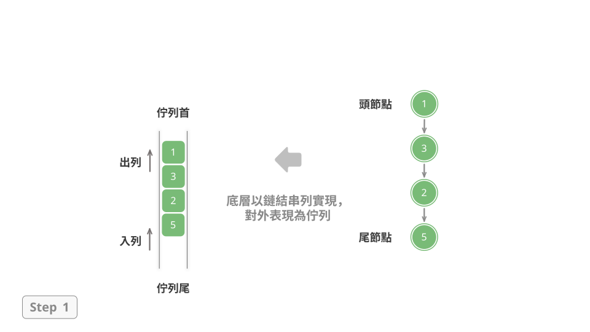
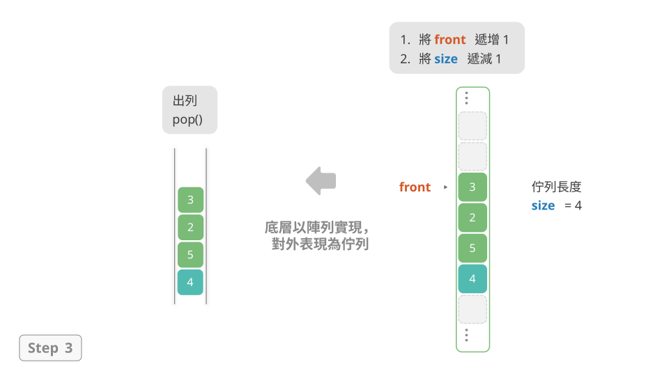

# 佇列

<u>佇列（queue）</u>是一種遵循先入先出規則的線性資料結構。顧名思義，佇列模擬了排隊現象，即新來的人不斷加入佇列尾部，而位於佇列頭部的人逐個離開。

如下圖所示，我們將佇列頭部稱為“佇列首”，尾部稱為“佇列尾”，將把元素加入列尾的操作稱為“入列”，刪除佇列首元素的操作稱為“出列”。


## 佇列常用操作

佇列的常見操作如下表所示。需要注意的是，不同程式語言的方法名稱可能會有所不同。我們在此採用與堆疊相同的方法命名。

<p align="center"> 表 <id> &nbsp; 佇列操作效率 </p>

| 方法名   | 描述                         | 時間複雜度 |
| -------- | ---------------------------- | ---------- |
| `push()` | 元素入列，即將元素新增至佇列尾 | $O(1)$     |
| `pop()`  | 佇列首元素出列                 | $O(1)$     |
| `peek()` | 訪問佇列首元素                 | $O(1)$     |

我們可以直接使用程式語言中現成的佇列類別：

```snippet
queue_operations
```

??? pythontutor "視覺化執行"

    @tutor queue_operations_tutor

## 佇列實現

為了實現佇列，我們需要一種資料結構，可以在一端新增元素，並在另一端刪除元素，鏈結串列和陣列都符合要求。

### 基於鏈結串列的實現

如下圖所示，我們可以將鏈結串列的“頭節點”和“尾節點”分別視為“佇列首”和“佇列尾”，規定佇列尾僅可新增節點，佇列首僅可刪除節點。

=== "<1>"
    

=== "<2>"
    

=== "<3>"
    

以下是用鏈結串列實現佇列的程式碼：

```src
[file]{linkedlist_queue}-[class]{linked_list_queue}-[func]{}
```

### 基於陣列的實現

在陣列中刪除首元素的時間複雜度為 $O(n)$ ，這會導致出列操作效率較低。然而，我們可以採用以下巧妙方法來避免這個問題。

我們可以使用一個變數 `front` 指向佇列首元素的索引，並維護一個變數 `size` 用於記錄佇列長度。定義 `rear = front + size` ，這個公式計算出的 `rear` 指向佇列尾元素之後的下一個位置。

基於此設計，**陣列中包含元素的有效區間為 `[front, rear - 1]`**，各種操作的實現方法如下圖所示。

- 入列操作：將輸入元素賦值給 `rear` 索引處，並將 `size` 增加 1 。
- 出列操作：只需將 `front` 增加 1 ，並將 `size` 減少 1 。

可以看到，入列和出列操作都只需進行一次操作，時間複雜度均為 $O(1)$ 。

=== "<1>"
    

=== "<2>"
    

=== "<3>"
    

你可能會發現一個問題：在不斷進行入列和出列的過程中，`front` 和 `rear` 都在向右移動，**當它們到達陣列尾部時就無法繼續移動了**。為了解決此問題，我們可以將陣列視為首尾相接的“環形陣列”。

對於環形陣列，我們需要讓 `front` 或 `rear` 在越過陣列尾部時，直接回到陣列頭部繼續走訪。這種週期性規律可以透過“取餘操作”來實現，程式碼如下所示：

```src
[file]{array_queue}-[class]{array_queue}-[func]{}
```

以上實現的佇列仍然具有侷限性：其長度不可變。然而，這個問題不難解決，我們可以將陣列替換為動態陣列，從而引入擴容機制。有興趣的讀者可以嘗試自行實現。

兩種實現的對比結論與堆疊一致，在此不再贅述。

## 佇列典型應用

- **淘寶訂單**。購物者下單後，訂單將加入佇列中，系統隨後會根據順序處理佇列中的訂單。在雙十一期間，短時間內會產生海量訂單，高併發成為工程師們需要重點攻克的問題。
- **各類待辦事項**。任何需要實現“先來後到”功能的場景，例如印表機的任務佇列、餐廳的出餐佇列等，佇列在這些場景中可以有效地維護處理順序。
