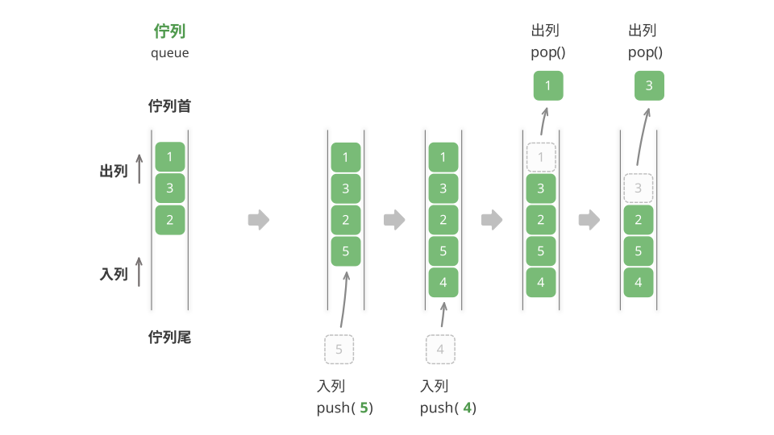

# 佇列

<u>佇列（queue）</u>是一種遵循先進先出原則的線性資料結構。它模擬日常生活中排隊的情形：後來的人陸續排到隊伍尾端，排在隊伍前端的人則依序離開。

如下圖所示，佇列的前端稱為「隊首」，尾端稱為「隊尾」。把元素加到隊尾稱為「入隊」，移除隊首元素則稱為「出隊」。



## 佇列的常用操作

下表列出佇列的常用操作。不同程式語言使用的方法名稱可能不同，這裡採用與堆疊相同的命名方式。

<p align="center"> 表 <id> &nbsp; 佇列的操作效率 </p>

| 方法名稱   | 說明                         | 時間複雜度 |
| -------- | ---------------------------- | ---------- |
| `push()` | 讓元素入隊，也就是將元素加到隊尾 | $O(1)$     |
| `pop()`  | 讓隊首元素出隊                 | $O(1)$     |
| `peek()` | 讀取隊首元素                 | $O(1)$     |

我們可以直接使用程式語言提供的佇列類別：

```snippet
queue_operations
```

??? pythontutor "執行視覺化示範"

    @tutor queue_operations_tutor

## 佇列的實作

要實作佇列，需要能從一端加入元素、從另一端刪除元素的資料結構。鏈結串列和陣列都符合這個條件。

### 以鏈結串列實作

如下圖所示，可以將鏈結串列的「頭節點」當作「隊首」，將「尾節點」當作「隊尾」，並規定在隊尾只能加入節點，在隊首只能刪除節點。

=== "<1>"
    

=== "<2>"
    

=== "<3>"
    

以下是用鏈結串列實作佇列的程式碼：

```src
[file]{linkedlist_queue}-[class]{linked_list_queue}-[func]{}
```

### 以陣列實作

刪除陣列首元素的時間複雜度為 $O(n)$，會使出隊的效率較低。我們可以用以下方式解決這個問題。

用變數 `front` 記錄隊首元素的索引，再用變數 `size` 記錄佇列長度。定義 `rear = front + size`，依此公式算出的 `rear` 會指向隊尾元素的下一個位置。

依照這個設計，**陣列中存放佇列元素的有效範圍為 `[front, rear - 1]`**。各項操作的實作方式如下圖所示。

- 入隊：將輸入的元素寫入索引 `rear` 的位置，再將 `size` 加 1。
- 出隊：只需將 `front` 加 1，並將 `size` 減 1。

可見每次入隊或出隊的工作量都是固定的，時間複雜度都是 $O(1)$。

=== "<1>"
    

=== "<2>"
    

=== "<3>"
    

持續入隊、出隊會遇到一個問題：`front` 和 `rear` 不斷往右移，**一旦到達陣列尾端，就無法繼續往右移**。為了解決這個問題，可以將陣列想成首尾相接的「環狀陣列」。

在環狀陣列中，當 `front` 或 `rear` 越過陣列尾端時，要讓它直接繞回開頭，繼續往前走訪。這個循環規律可以用取餘數的方式實作，程式碼如下：

```src
[file]{array_queue}-[class]{array_queue}-[func]{}
```

以上實作仍有一項限制：底層陣列的長度固定。解法並不困難，只要將陣列換成動態陣列，就能引入擴充容量的機制。有興趣的讀者可以試著自己實作。

比較這兩種實作，得到的結論和堆疊相同，這裡就不再重複說明。

## 佇列的常見應用

- **淘寶訂單**。顧客下單後，訂單會加入佇列，系統再依序處理。雙十一購物節期間，大量訂單會在短時間內湧入，如何同時處理這麼多請求，是工程師要解決的重要問題。
- **各類待辦事項**。凡是需要「先來先處理」的場合，例如印表機的列印工作、餐廳等候出餐的訂單，都可以用佇列來維持處理順序。
