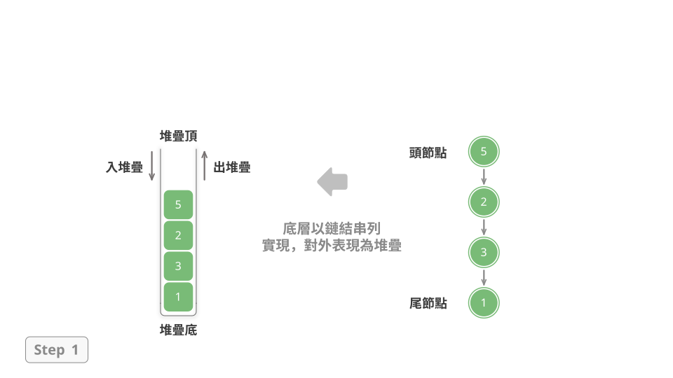
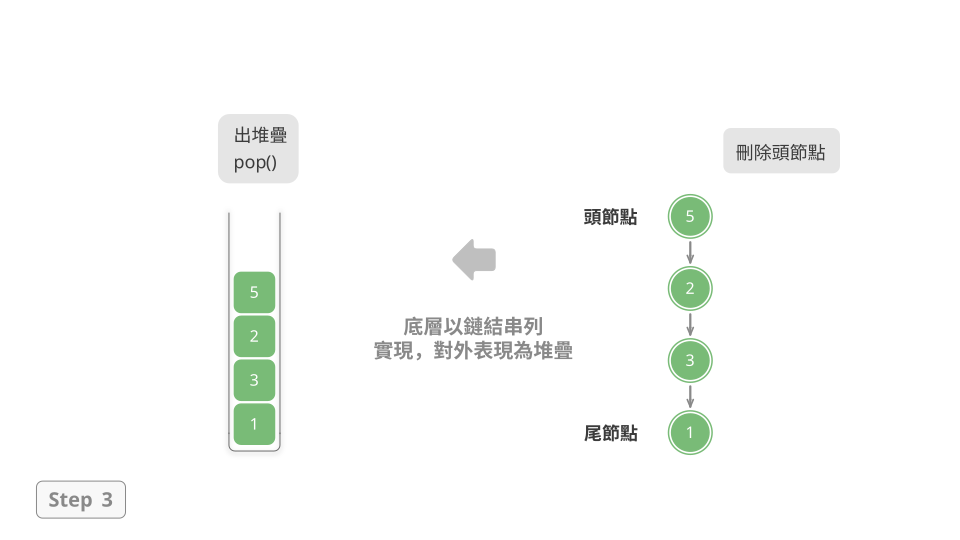
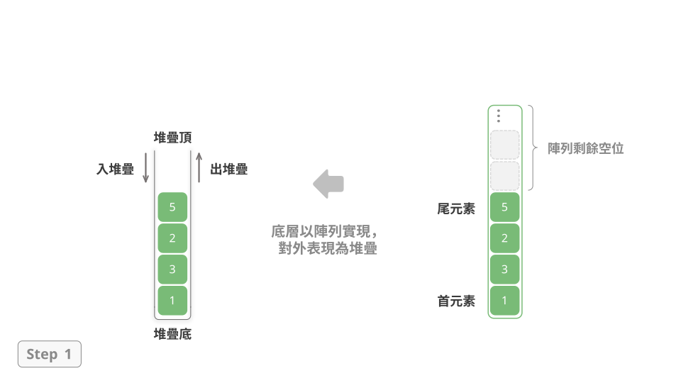
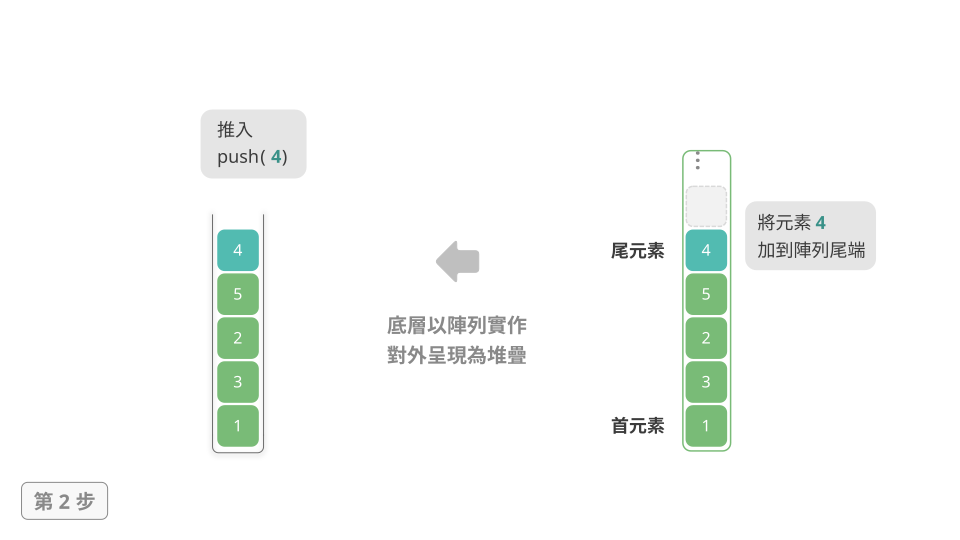
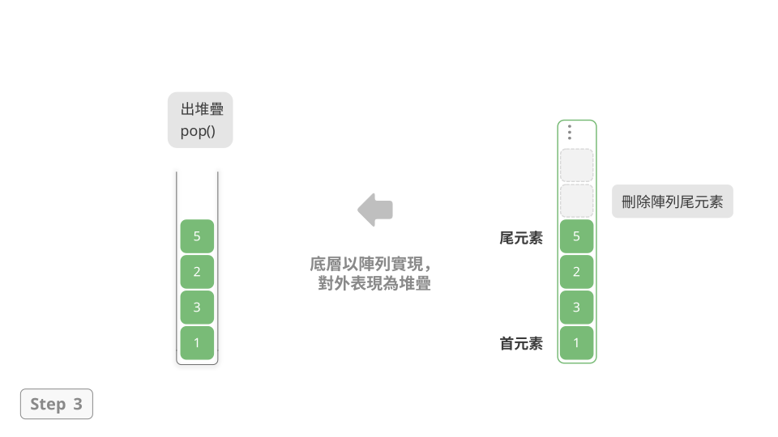

# 堆疊

<u>堆疊（stack）</u>是一種遵循先進後出原則的線性資料結構。

想像桌上有一疊盤子，每次只能移動一個。想拿到底下的盤子，就得先把上面的盤子一個個移開。將盤子換成整數、字元或物件等各種類型的元素，就得到了堆疊這種資料結構。

如下圖所示，元素疊起來的最上方稱為「堆疊頂端」，最下方稱為「堆疊底端」。在頂端加入元素稱為「推入」，移除頂端元素則稱為「彈出」。


## 堆疊的常用操作

下表列出堆疊的常用操作。方法名稱依程式語言而異，這裡以常見的 `push()`、`pop()` 和 `peek()` 為例。

<p align="center"> 表 <id> &nbsp; 堆疊的操作效率 </p>

| 方法     | 說明                   | 時間複雜度 |
| -------- | ---------------------- | ---------- |
| `push()` | 推入元素（加到堆疊頂端） | $O(1)$     |
| `pop()`  | 彈出堆疊頂端的元素           | $O(1)$     |
| `peek()` | 讀取堆疊頂端的元素           | $O(1)$     |

通常可以直接使用程式語言內建的堆疊類別。有些語言沒有專用的堆疊類別，這時可以把該語言提供的陣列或鏈結串列當作堆疊使用，在程式中只採用與堆疊有關的操作。

```snippet
stack_operations
```

??? pythontutor "執行視覺化示範"

    @tutor stack_operations_tutor

## 堆疊的實作

為了進一步瞭解堆疊的運作方式，我們來試著實作一個堆疊類別。

堆疊遵循先進後出的原則，因此只能在頂端加入或刪除元素。陣列和鏈結串列則可以在任意位置加入或刪除元素，**因此可以把堆疊看成操作受限的陣列或鏈結串列**。換句話說，只要隱藏陣列或鏈結串列中與堆疊無關的操作，對外提供的操作就能符合堆疊的特性。

### 以鏈結串列實作

用鏈結串列實作堆疊時，可以將頭節點當作堆疊頂端，將尾節點當作堆疊底端。

如下圖所示，推入元素時，只需在串列前端插入節點，這種做法稱為「頭插法」。彈出元素時，只需刪除串列的頭節點。

=== "<1>"
    

=== "<2>"
    

=== "<3>"
    

以下是用鏈結串列實作堆疊的範例程式碼：

```src
[file]{linkedlist_stack}-[class]{linked_list_stack}-[func]{}
```

### 以陣列實作

用陣列實作堆疊時，可以將陣列尾端當作堆疊頂端。如下圖所示，推入與彈出分別是在陣列尾端加入與刪除元素，時間複雜度都是 $O(1)$。

=== "<1>"
    

=== "<2>"
    

=== "<3>"
    

由於推入的元素可能持續增加，可以使用動態陣列，省去自行處理陣列容量擴充的工作。範例程式碼如下：

```src
[file]{array_stack}-[class]{array_stack}-[func]{}
```

## 兩種實作方式的比較

**支援的操作**

兩種實作都支援堆疊定義中的各項操作。陣列額外支援隨機存取，但這超出堆疊的定義範圍，因此通常用不到。

**時間效率**

以陣列實作時，推入和彈出都在預先配置好的連續記憶體空間中進行，記憶體存取具有良好的區域性，有利於利用快取，因此效率較高。不過，如果推入元素時超出陣列容量，就必須擴充容量，使這一次推入的時間複雜度變為 $O(n)$。

以鏈結串列實作時，擴充串列很有彈性，不會遇到陣列擴充容量時效率下降的問題。不過，推入元素時需要初始化節點物件並修改指標，因此效率相對較低。如果要推入的元素本身就是節點物件，就能省去初始化的步驟，提高效率。

綜合以上比較，如果推入和彈出的元素屬於基本資料型別，例如 `int` 或 `double`，就能得到以下結論。

- 以陣列實作的堆疊在擴充容量時效率會下降，但因為不常需要擴充，所以平均效率較高。
- 以鏈結串列實作的堆疊，執行效率較為穩定。

**空間效率**

初始化動態陣列時，系統會為它配置「初始容量」，這個容量可能超過實際需求。之後擴充容量時，通常會按固定倍數（例如 2 倍）擴充，新容量也可能超過實際需求。因此，**以陣列實作的堆疊可能會浪費部分空間**。

不過，鏈結串列的節點需要額外儲存指標，**因此每個節點占用的空間相對較大**。

由此可見，哪一種實作較省記憶體，仍要視實際情況而定。

## 堆疊的常見應用

- **瀏覽器的上一頁與下一頁、軟體的復原與重做**。每當我們開啟新網頁，瀏覽器就會將前一個網頁推入堆疊，這樣一來，按下「上一頁」就能回到前一頁。這個動作實際上就是從堆疊彈出網頁。要同時支援上一頁和下一頁，則需要搭配使用兩個堆疊。
- **程式的記憶體管理**。每次呼叫函式，系統都會在堆疊頂端加入一個堆疊框架，用來記錄這次函式呼叫的執行狀態。在遞迴函式中，逐層呼叫時會不斷推入堆疊框架，逐層回溯時則會依序彈出。
