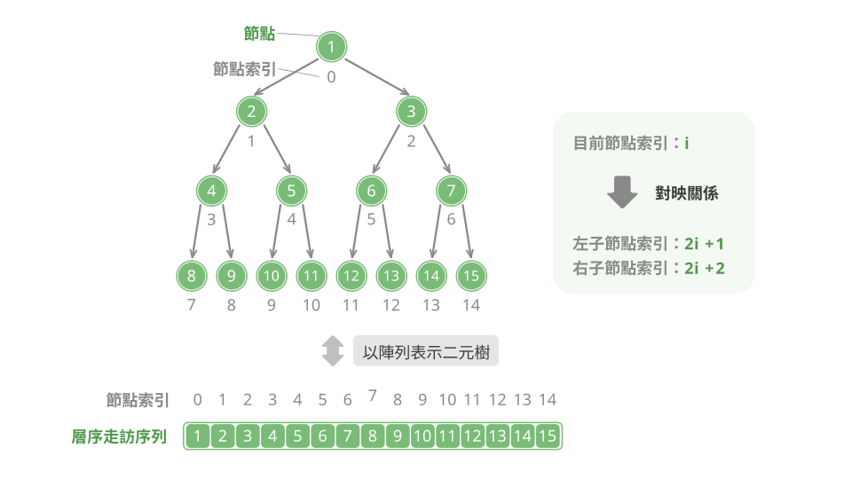
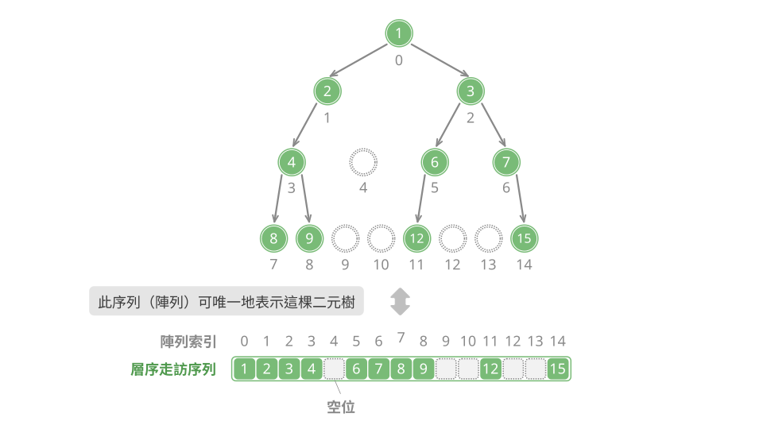

# 二元樹的陣列表示法

用鏈結串列表示二元樹時，資料儲存在節點 `TreeNode` 中，節點之間以指標相連。上一節介紹了這種表示法下二元樹的各項基本操作。

那麼，二元樹也能用陣列表示嗎？當然可以。

## 表示完美二元樹

先看一個簡單的例子。將完美二元樹的所有節點依層序走訪的順序存入陣列，每個節點就有唯一對應的陣列索引。

根據層序走訪的特性，可以推導出父節點與子節點索引之間的「對應公式」：**若某節點的索引為 $i$，則其左子節點的索引為 $2i + 1$，右子節點的索引為 $2i + 2$**。下圖顯示各節點索引之間的對應關係。



**對應公式的作用相當於鏈結串列中的節點參照（指標）**。給定陣列中的任一節點，都能利用公式存取它的左子節點或右子節點。

## 表示任意二元樹

完美二元樹是特例。一般二元樹的中間各層通常有許多 `None`。層序走訪序列不包含這些 `None`，因此無法單憑序列推知 `None` 的數量與位置。**也就是說，不同結構的二元樹可能有相同的層序走訪序列**。

下圖是一棵不完美的二元樹，前面介紹的陣列表示法在這裡已不適用。


為了解決這個問題，**我們可以在層序走訪序列中明確列出所有的 `None`**。如下圖所示，這樣就能用層序走訪序列唯一表示一棵二元樹。範例程式碼如下：

```snippet
tree_array_representation
```



**完全二元樹特別適合用陣列表示**。回想完全二元樹的定義，`None` 只會出現在最底層的右側，**因此所有的 `None` 都會集中在層序走訪序列的末端**。

因此，用陣列表示完全二元樹時，可以省去所有 `None`，儲存起來非常方便。下圖是一個例子。


以下程式碼以陣列實作二元樹，支援下列操作。

- 給定一個節點，取得其值、左子節點、右子節點或父節點。
- 取得前序、中序、後序與層序走訪的序列。

```src
[file]{array_binary_tree}-[class]{array_binary_tree}-[func]{}
```

## 優點與限制

以陣列表示二元樹有以下幾項優點。

- 陣列儲存在連續的記憶體空間中，能有效利用快取，因此存取與走訪的速度較快。
- 無須儲存指標，比較節省空間。
- 可以隨機存取節點。

不過，陣列表示法也有一些限制。

- 陣列需要連續的記憶體空間，因此不適合儲存資料量過大的樹。
- 新增或刪除節點都必須在陣列中插入或刪除元素，效率較低。
- 若二元樹中有大量的 `None`，實際節點資料在陣列中所占的比例就會偏低，空間利用率也較低。
