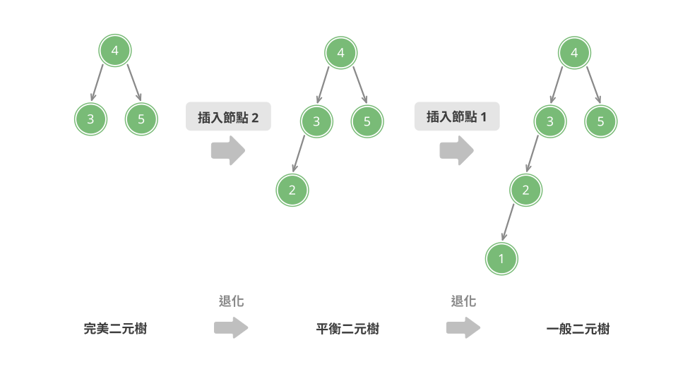
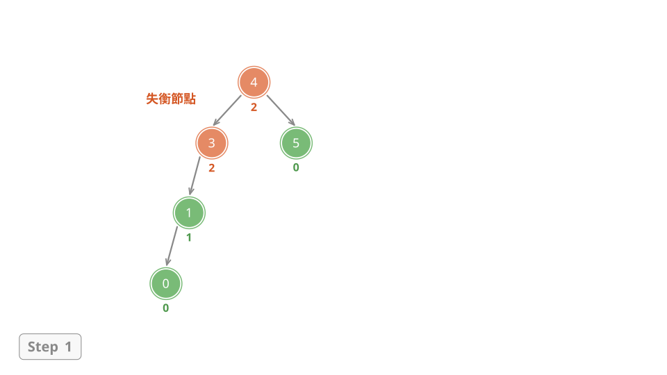
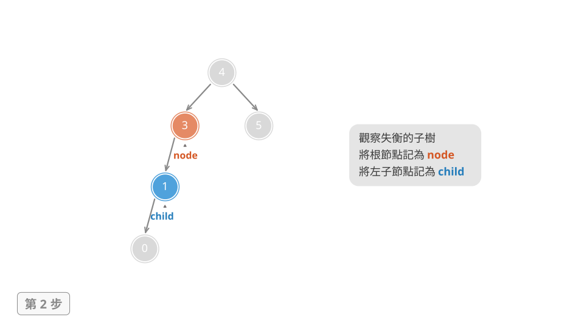
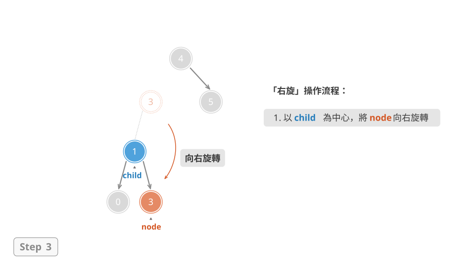
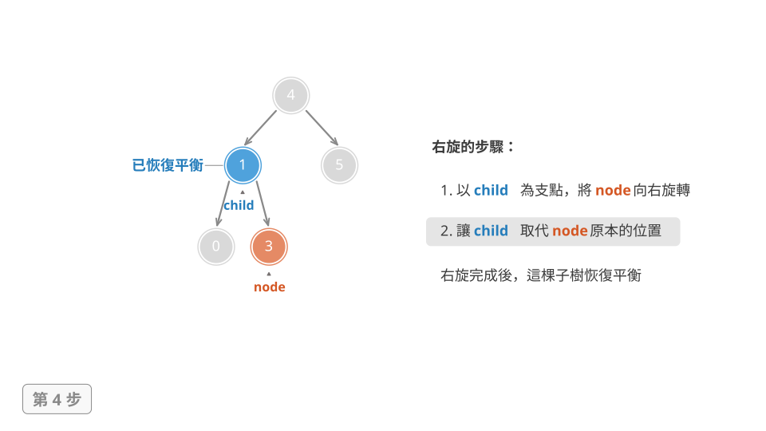
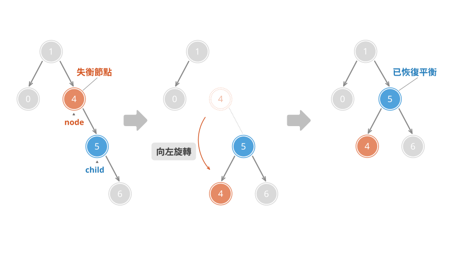
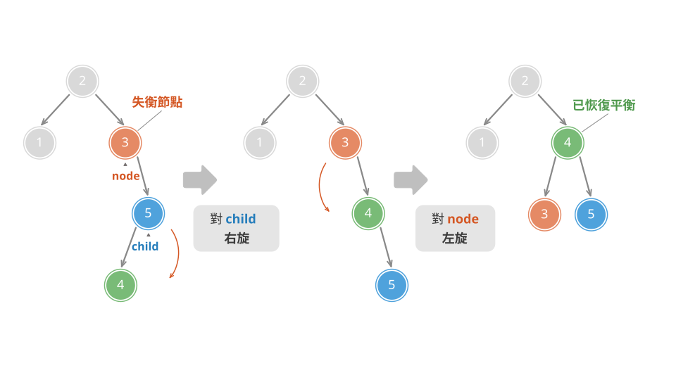
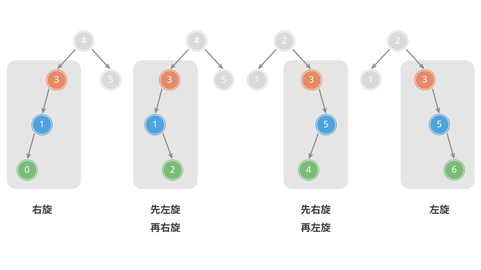

# AVL 樹 *

在〈二元搜尋樹〉一節中，我們提過，經過多次插入與刪除後，二元搜尋樹可能退化成鏈結串列。這時，各項操作的時間複雜度會從 $O(\log n)$ 變差為 $O(n)$。

如下圖所示，只要刪除兩個節點，這棵二元搜尋樹就會退化成鏈結串列。


再以下圖的完美二元樹為例，插入兩個節點後，樹會明顯向左傾斜，搜尋操作的時間複雜度也隨之變差。



1962 年，G. M. Adelson-Velsky 與 E. M. Landis 在論文〈An algorithm for the organization of information〉中提出 <u>AVL 樹</u>。論文詳述了一系列操作，可確保即使持續新增及刪除節點，AVL 樹也不會退化，讓各項操作的時間複雜度維持在 $O(\log n)$。換句話說，需要頻繁新增、刪除、查詢或修改資料時，AVL 樹能持續有效率地處理資料，因而很有應用價值。

## AVL 樹的常用術語

AVL 樹同時是二元搜尋樹和平衡二元樹，具備兩者的所有性質，因此是一種<u>平衡二元搜尋樹（balanced binary search tree）</u>。

### 節點高度

AVL 樹的操作需要取得節點高度，因此我們要在節點類別中加入變數 `height`：

```snippet
avl_tree_node
```

「節點高度」是從該節點到距離最遠的葉節點所經過的邊數。請留意，葉節點的高度為 $0$，空節點的高度為 $-1$。以下建立兩個輔助函式，分別用來取得與更新節點高度：

```src
[file]{avl_tree}-[class]{avl_tree}-[func]{update_height}
```

### 節點的平衡因子

節點的<u>平衡因子（balance factor）</u>定義為左子樹高度減去右子樹高度，並規定空節點的平衡因子為 $0$。為了方便後續使用，我們也將取得節點平衡因子的操作寫成函式：

```src
[file]{avl_tree}-[class]{avl_tree}-[func]{balance_factor}
```

!!! tip

    設平衡因子為 $f$，AVL 樹中的每個節點都滿足 $-1 \le f \le 1$。

## AVL 樹的旋轉

AVL 樹的特色在於「旋轉」操作。旋轉能讓失衡節點恢復平衡，同時保留二元樹的中序走訪序列。換句話說，**旋轉既能維持二元搜尋樹的性質，又能讓樹恢復為平衡二元樹**。

我們把平衡因子絕對值 $> 1$ 的節點稱為「失衡節點」。依失衡情況，可採用四種旋轉方式：右旋、左旋、先右旋再左旋、先左旋再右旋。以下逐一介紹。

### 右旋

下圖在節點下方標出平衡因子。由下往上看，第一個失衡節點是節點 3。我們只看以這個節點為根的子樹，將它的根記為 `node`，左子節點記為 `child`，然後進行右旋。右旋後，子樹恢復平衡，也保有二元搜尋樹的性質。

=== "<1>"
    

=== "<2>"
    

=== "<3>"
    

=== "<4>"
    

如下圖所示，若節點 `child` 有右子節點（記為 `grand_child`），右旋時還要多做一步：將 `grand_child` 接為 `node` 的左子節點。


「向右旋轉」描述的是樹形的變化，實際上要靠修改節點指標來完成，程式碼如下：

```src
[file]{avl_tree}-[class]{avl_tree}-[func]{right_rotate}
```

### 左旋

將上述失衡的二元樹左右對調，就需要進行下圖所示的左旋操作。



同理，如下圖所示，若節點 `child` 有左子節點（記為 `grand_child`），左旋時還要多做一步：將 `grand_child` 接為 `node` 的右子節點。


可以看出，**右旋和左旋的操作邏輯左右對稱，兩者所處理的失衡情況也左右對稱**。利用這項特性，只要把右旋程式碼中的所有 `left` 換成 `right`，並將所有 `right` 換成 `left`，就能得到左旋的程式碼：

```src
[file]{avl_tree}-[class]{avl_tree}-[func]{left_rotate}
```

### 先左旋再右旋

對於下圖的失衡節點 3，只做一次左旋或右旋都無法讓子樹恢復平衡。此時要先對 `child` 左旋，再對 `node` 右旋。


### 先右旋再左旋

下圖是上述失衡二元樹左右對調的情況，需要先對 `child` 右旋，再對 `node` 左旋。



### 如何選擇旋轉方式

下圖的四種失衡情況與前面的例子一一對應，依序應採用右旋、先左旋再右旋、先右旋再左旋、左旋。



如下表所示，觀察失衡節點與其較高一側子節點的平衡因子符號，就能判斷它屬於上圖的哪一種情況。

<p align="center"> 表 <id> &nbsp; 四種旋轉方式的選擇條件 </p>

| 失衡節點的平衡因子 | 子節點的平衡因子 | 應採用的旋轉方式 |
| ------------------ | ---------------- | ---------------- |
| $> 1$（左偏樹）   | $\geq 0$         | 右旋             |
| $> 1$（左偏樹）   | $<0$             | 先左旋再右旋     |
| $< -1$（右偏樹）  | $\leq 0$         | 左旋             |
| $< -1$（右偏樹）  | $>0$             | 先右旋再左旋     |

為了方便使用，我們將旋轉操作寫成一個函式。**透過這個函式，就能依不同的失衡情況進行旋轉，讓失衡節點恢復平衡**。程式碼如下：

```src
[file]{avl_tree}-[class]{avl_tree}-[func]{rotate}
```

## AVL 樹的常用操作

### 插入節點

在 AVL 樹中插入節點，主要步驟與二元搜尋樹相似。唯一的差別是插入後，從新節點到根節點的路徑上可能有多個節點失衡。因此，**我們必須從新節點開始，由下往上進行旋轉，讓所有失衡節點恢復平衡**。程式碼如下：

```src
[file]{avl_tree}-[class]{avl_tree}-[func]{insert_helper}
```

### 刪除節點

同理，刪除節點時，除了二元搜尋樹原有的刪除步驟，還需要由下往上進行旋轉，讓所有失衡節點恢復平衡。程式碼如下：

```src
[file]{avl_tree}-[class]{avl_tree}-[func]{remove_helper}
```

### 搜尋節點

AVL 樹的節點搜尋方式與二元搜尋樹相同，此處不再重述。

## AVL 樹的典型應用

- 組織與儲存大量資料，適用於經常搜尋、較少新增或刪除資料的情境。
- 建立資料庫的索引系統。
- 紅黑樹也是常見的平衡二元搜尋樹。相較於 AVL 樹，紅黑樹的平衡條件較寬鬆，插入和刪除節點時需要的旋轉次數較少，因此新增與刪除節點的平均效率較高。
