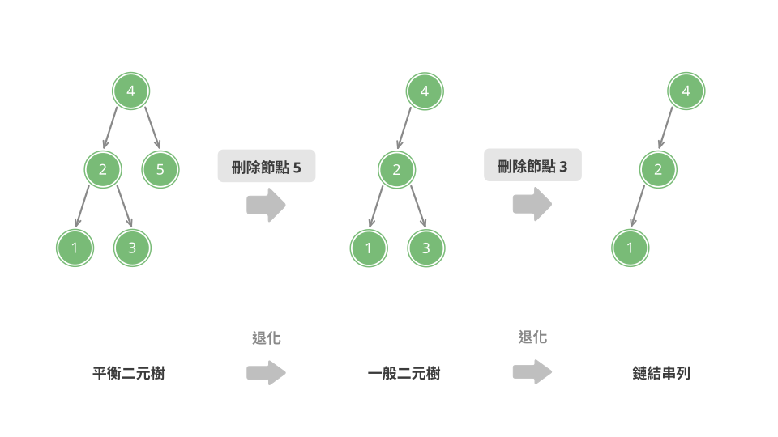
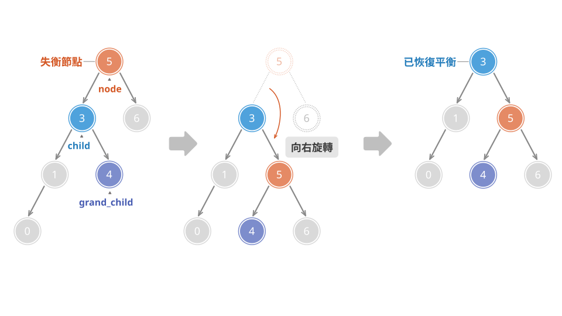
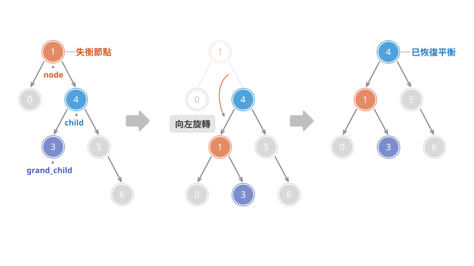
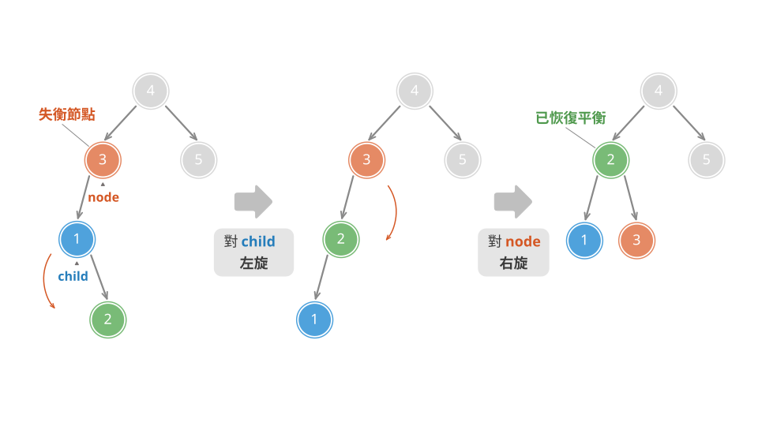

# 7.5 &nbsp; AVL 樹 *

在〈二元搜尋樹〉一節中，我們提過，經過多次插入與刪除後，二元搜尋樹可能退化成鏈結串列。這時，各項操作的時間複雜度會從 $O(\log n)$ 變差為 $O(n)$。

如圖 7-24 所示，只要刪除兩個節點，這棵二元搜尋樹就會退化成鏈結串列。

{ class="animation-figure" }

<p align="center"> 圖 7-24 &nbsp; AVL 樹在刪除節點後退化 </p>

再以圖 7-25 的完美二元樹為例，插入兩個節點後，樹會明顯向左傾斜，搜尋操作的時間複雜度也隨之變差。

{ class="animation-figure" }

<p align="center"> 圖 7-25 &nbsp; AVL 樹在插入節點後退化 </p>

1962 年，G. M. Adelson-Velsky 與 E. M. Landis 在論文〈An algorithm for the organization of information〉中提出 <u>AVL 樹</u>。論文詳述了一系列操作，可確保即使持續新增及刪除節點，AVL 樹也不會退化，讓各項操作的時間複雜度維持在 $O(\log n)$。換句話說，需要頻繁新增、刪除、查詢或修改資料時，AVL 樹能持續有效率地處理資料，因而很有應用價值。

## 7.5.1 &nbsp; AVL 樹的常用術語

AVL 樹同時是二元搜尋樹和平衡二元樹，具備兩者的所有性質，因此是一種<u>平衡二元搜尋樹（balanced binary search tree）</u>。

### 1. &nbsp; 節點高度

AVL 樹的操作需要取得節點高度，因此我們要在節點類別中加入變數 `height`：

=== "Python"

    ```python title=""
    class TreeNode:
        """AVL 樹節點類別"""
        def __init__(self, val: int):
            self.val: int = val                 # 節點值
            self.height: int = 0                # 節點高度
            self.left: TreeNode | None = None   # 左子節點的參照
            self.right: TreeNode | None = None  # 右子節點的參照
    ```

=== "C++"

    ```cpp title=""
    /* AVL 樹節點類別 */
    struct TreeNode {
        int val{};          // 節點值
        int height = 0;     // 節點高度
        TreeNode *left{};   // 左子節點
        TreeNode *right{};  // 右子節點
        TreeNode() = default;
        explicit TreeNode(int x) : val(x){}
    };
    ```

=== "Java"

    ```java title=""
    /* AVL 樹節點類別 */
    class TreeNode {
        public int val;        // 節點值
        public int height;     // 節點高度
        public TreeNode left;  // 左子節點
        public TreeNode right; // 右子節點
        public TreeNode(int x) { val = x; }
    }
    ```

=== "C#"

    ```csharp title=""
    /* AVL 樹節點類別 */
    class TreeNode(int? x) {
        public int? val = x;    // 節點值
        public int height;      // 節點高度
        public TreeNode? left;  // 左子節點的參照
        public TreeNode? right; // 右子節點的參照
    }
    ```

=== "Go"

    ```go title=""
    /* AVL 樹節點結構體 */
    type TreeNode struct {
        Val    int       // 節點值
        Height int       // 節點高度
        Left   *TreeNode // 左子節點的參照
        Right  *TreeNode // 右子節點的參照
    }
    ```

=== "Swift"

    ```swift title=""
    /* AVL 樹節點類別 */
    class TreeNode {
        var val: Int // 節點值
        var height: Int // 節點高度
        var left: TreeNode? // 左子節點
        var right: TreeNode? // 右子節點

        init(x: Int) {
            val = x
            height = 0
        }
    }
    ```

=== "JS"

    ```javascript title=""
    /* AVL 樹節點類別 */
    class TreeNode {
        val; // 節點值
        height; //節點高度
        left; // 左子節點指標
        right; // 右子節點指標
        constructor(val, left, right, height) {
            this.val = val === undefined ? 0 : val;
            this.height = height === undefined ? 0 : height;
            this.left = left === undefined ? null : left;
            this.right = right === undefined ? null : right;
        }
    }
    ```

=== "TS"

    ```typescript title=""
    /* AVL 樹節點類別 */
    class TreeNode {
        val: number;            // 節點值
        height: number;         // 節點高度
        left: TreeNode | null;  // 左子節點指標
        right: TreeNode | null; // 右子節點指標
        constructor(val?: number, height?: number, left?: TreeNode | null, right?: TreeNode | null) {
            this.val = val === undefined ? 0 : val;
            this.height = height === undefined ? 0 : height;
            this.left = left === undefined ? null : left;
            this.right = right === undefined ? null : right;
        }
    }
    ```

=== "Dart"

    ```dart title=""
    /* AVL 樹節點類別 */
    class TreeNode {
      int val;         // 節點值
      int height;      // 節點高度
      TreeNode? left;  // 左子節點
      TreeNode? right; // 右子節點
      TreeNode(this.val, [this.height = 0, this.left, this.right]);
    }
    ```

=== "Rust"

    ```rust title=""
    use std::rc::Rc;
    use std::cell::RefCell;

    /* AVL 樹節點結構體 */
    struct TreeNode {
        val: i32,                               // 節點值
        height: i32,                            // 節點高度
        left: Option<Rc<RefCell<TreeNode>>>,    // 左子節點
        right: Option<Rc<RefCell<TreeNode>>>,   // 右子節點
    }

    impl TreeNode {
        /* 建構方法 */
        fn new(val: i32) -> Rc<RefCell<Self>> {
            Rc::new(RefCell::new(Self {
                val,
                height: 0,
                left: None,
                right: None
            }))
        }
    }
    ```

=== "C"

    ```c title=""
    /* AVL 樹節點結構體 */
    typedef struct TreeNode {
        int val;
        int height;
        struct TreeNode *left;
        struct TreeNode *right;
    } TreeNode;

    /* 建構函式 */
    TreeNode *newTreeNode(int val) {
        TreeNode *node;

        node = (TreeNode *)malloc(sizeof(TreeNode));
        node->val = val;
        node->height = 0;
        node->left = NULL;
        node->right = NULL;
        return node;
    }
    ```

=== "Kotlin"

    ```kotlin title=""
    /* AVL 樹節點類別 */
    class TreeNode(val _val: Int) {  // 節點值
        var height: Int = 0          // 節點高度
        var left: TreeNode? = null   // 左子節點
        var right: TreeNode? = null  // 右子節點
    }
    ```

=== "Ruby"

    ```ruby title=""
    ### AVL 樹節點類別 ###
    class TreeNode
      attr_accessor :val    # 節點值
      attr_accessor :height # 節點高度
      attr_accessor :left   # 左子節點的參照
      attr_accessor :right  # 右子節點的參照

      def initialize(val)
        @val = val
        @height = 0
      end
    end
    ```

「節點高度」是從該節點到距離最遠的葉節點所經過的邊數。請留意，葉節點的高度為 $0$，空節點的高度為 $-1$。以下建立兩個輔助函式，分別用來取得與更新節點高度：

=== "Python"

    ```python title="avl_tree.py"
    def height(self, node: TreeNode | None) -> int:
        """取得節點高度"""
        # 空節點的高度為 -1，葉節點的高度為 0
        if node is not None:
            return node.height
        return -1

    def update_height(self, node: TreeNode | None):
        """更新節點高度"""
        # 節點高度等於最高子樹的高度加 1
        node.height = max([self.height(node.left), self.height(node.right)]) + 1
    ```

=== "C++"

    ```cpp title="avl_tree.cpp"
    /* 取得節點高度 */
    int height(TreeNode *node) {
        // 空節點的高度為 -1，葉節點的高度為 0
        return node == nullptr ? -1 : node->height;
    }

    /* 更新節點高度 */
    void updateHeight(TreeNode *node) {
        // 節點高度等於最高子樹的高度加 1
        node->height = max(height(node->left), height(node->right)) + 1;
    }
    ```

=== "Java"

    ```java title="avl_tree.java"
    /* 取得節點高度 */
    int height(TreeNode node) {
        // 空節點的高度為 -1，葉節點的高度為 0
        return node == null ? -1 : node.height;
    }

    /* 更新節點高度 */
    void updateHeight(TreeNode node) {
        // 節點高度等於最高子樹的高度加 1
        node.height = Math.max(height(node.left), height(node.right)) + 1;
    }
    ```

=== "C#"

    ```csharp title="avl_tree.cs"
    /* 取得節點高度 */
    int Height(TreeNode? node) {
        // 空節點的高度為 -1，葉節點的高度為 0
        return node == null ? -1 : node.height;
    }

    /* 更新節點高度 */
    void UpdateHeight(TreeNode node) {
        // 節點高度等於最高子樹的高度加 1
        node.height = Math.Max(Height(node.left), Height(node.right)) + 1;
    }
    ```

=== "Go"

    ```go title="avl_tree.go"
    /* 取得節點高度 */
    func (t *aVLTree) height(node *TreeNode) int {
        // 空節點的高度為 -1，葉節點的高度為 0
        if node != nil {
            return node.Height
        }
        return -1
    }

    /* 更新節點高度 */
    func (t *aVLTree) updateHeight(node *TreeNode) {
        lh := t.height(node.Left)
        rh := t.height(node.Right)
        // 節點高度等於最高子樹的高度加 1
        if lh > rh {
            node.Height = lh + 1
        } else {
            node.Height = rh + 1
        }
    }
    ```

=== "Swift"

    ```swift title="avl_tree.swift"
    /* 取得節點高度 */
    func height(node: TreeNode?) -> Int {
        // 空節點的高度為 -1，葉節點的高度為 0
        node?.height ?? -1
    }

    /* 更新節點高度 */
    func updateHeight(node: TreeNode?) {
        // 節點高度等於最高子樹的高度加 1
        node?.height = max(height(node: node?.left), height(node: node?.right)) + 1
    }
    ```

=== "JS"

    ```javascript title="avl_tree.js"
    /* 取得節點高度 */
    height(node) {
        // 空節點的高度為 -1，葉節點的高度為 0
        return node === null ? -1 : node.height;
    }

    /* 更新節點高度 */
    #updateHeight(node) {
        // 節點高度等於最高子樹的高度加 1
        node.height =
            Math.max(this.height(node.left), this.height(node.right)) + 1;
    }
    ```

=== "TS"

    ```typescript title="avl_tree.ts"
    /* 取得節點高度 */
    height(node: TreeNode): number {
        // 空節點的高度為 -1，葉節點的高度為 0
        return node === null ? -1 : node.height;
    }

    /* 更新節點高度 */
    updateHeight(node: TreeNode): void {
        // 節點高度等於最高子樹的高度加 1
        node.height =
            Math.max(this.height(node.left), this.height(node.right)) + 1;
    }
    ```

=== "Dart"

    ```dart title="avl_tree.dart"
    /* 取得節點高度 */
    int height(TreeNode? node) {
      // 空節點的高度為 -1，葉節點的高度為 0
      return node == null ? -1 : node.height;
    }

    /* 更新節點高度 */
    void updateHeight(TreeNode? node) {
      // 節點高度等於最高子樹的高度加 1
      node!.height = max(height(node.left), height(node.right)) + 1;
    }
    ```

=== "Rust"

    ```rust title="avl_tree.rs"
    /* 取得節點高度 */
    fn height(node: OptionTreeNodeRc) -> i32 {
        // 空節點的高度為 -1，葉節點的高度為 0
        match node {
            Some(node) => node.borrow().height,
            None => -1,
        }
    }

    /* 更新節點高度 */
    fn update_height(node: OptionTreeNodeRc) {
        if let Some(node) = node {
            let left = node.borrow().left.clone();
            let right = node.borrow().right.clone();
            // 節點高度等於最高子樹的高度加 1
            node.borrow_mut().height = std::cmp::max(Self::height(left), Self::height(right)) + 1;
        }
    }
    ```

=== "C"

    ```c title="avl_tree.c"
    /* 取得節點高度 */
    int height(TreeNode *node) {
        // 空節點的高度為 -1，葉節點的高度為 0
        if (node != NULL) {
            return node->height;
        }
        return -1;
    }

    /* 更新節點高度 */
    void updateHeight(TreeNode *node) {
        int lh = height(node->left);
        int rh = height(node->right);
        // 節點高度等於最高子樹的高度加 1
        if (lh > rh) {
            node->height = lh + 1;
        } else {
            node->height = rh + 1;
        }
    }
    ```

=== "Kotlin"

    ```kotlin title="avl_tree.kt"
    /* 取得節點高度 */
    fun height(node: TreeNode?): Int {
        // 空節點的高度為 -1，葉節點的高度為 0
        return node?.height ?: -1
    }

    /* 更新節點高度 */
    fun updateHeight(node: TreeNode?) {
        // 節點高度等於最高子樹的高度加 1
        node?.height = max(height(node?.left), height(node?.right)) + 1
    }
    ```

=== "Ruby"

    ```ruby title="avl_tree.rb"
    ### 取得節點高度 ###
    def height(node)
      # 空節點的高度為 -1，葉節點的高度為 0
      return node.height unless node.nil?

      -1
    end

    ### 更新節點高度 ###
    def update_height(node)
      # 節點高度等於最高子樹的高度加 1
      node.height = [height(node.left), height(node.right)].max + 1
    end
    ```

### 2. &nbsp; 節點的平衡因子

節點的<u>平衡因子（balance factor）</u>定義為左子樹高度減去右子樹高度，並規定空節點的平衡因子為 $0$。為了方便後續使用，我們也將取得節點平衡因子的操作寫成函式：

=== "Python"

    ```python title="avl_tree.py"
    def balance_factor(self, node: TreeNode | None) -> int:
        """取得平衡因子"""
        # 空節點的平衡因子為 0
        if node is None:
            return 0
        # 節點的平衡因子 = 左子樹高度 - 右子樹高度
        return self.height(node.left) - self.height(node.right)
    ```

=== "C++"

    ```cpp title="avl_tree.cpp"
    /* 取得平衡因子 */
    int balanceFactor(TreeNode *node) {
        // 空節點的平衡因子為 0
        if (node == nullptr)
            return 0;
        // 節點的平衡因子 = 左子樹高度 - 右子樹高度
        return height(node->left) - height(node->right);
    }
    ```

=== "Java"

    ```java title="avl_tree.java"
    /* 取得平衡因子 */
    int balanceFactor(TreeNode node) {
        // 空節點的平衡因子為 0
        if (node == null)
            return 0;
        // 節點的平衡因子 = 左子樹高度 - 右子樹高度
        return height(node.left) - height(node.right);
    }
    ```

=== "C#"

    ```csharp title="avl_tree.cs"
    /* 取得平衡因子 */
    int BalanceFactor(TreeNode? node) {
        // 空節點的平衡因子為 0
        if (node == null) return 0;
        // 節點的平衡因子 = 左子樹高度 - 右子樹高度
        return Height(node.left) - Height(node.right);
    }
    ```

=== "Go"

    ```go title="avl_tree.go"
    /* 取得平衡因子 */
    func (t *aVLTree) balanceFactor(node *TreeNode) int {
        // 空節點的平衡因子為 0
        if node == nil {
            return 0
        }
        // 節點的平衡因子 = 左子樹高度 - 右子樹高度
        return t.height(node.Left) - t.height(node.Right)
    }
    ```

=== "Swift"

    ```swift title="avl_tree.swift"
    /* 取得平衡因子 */
    func balanceFactor(node: TreeNode?) -> Int {
        // 空節點的平衡因子為 0
        guard let node = node else { return 0 }
        // 節點的平衡因子 = 左子樹高度 - 右子樹高度
        return height(node: node.left) - height(node: node.right)
    }
    ```

=== "JS"

    ```javascript title="avl_tree.js"
    /* 取得平衡因子 */
    balanceFactor(node) {
        // 空節點的平衡因子為 0
        if (node === null) return 0;
        // 節點的平衡因子 = 左子樹高度 - 右子樹高度
        return this.height(node.left) - this.height(node.right);
    }
    ```

=== "TS"

    ```typescript title="avl_tree.ts"
    /* 取得平衡因子 */
    balanceFactor(node: TreeNode): number {
        // 空節點的平衡因子為 0
        if (node === null) return 0;
        // 節點的平衡因子 = 左子樹高度 - 右子樹高度
        return this.height(node.left) - this.height(node.right);
    }
    ```

=== "Dart"

    ```dart title="avl_tree.dart"
    /* 取得平衡因子 */
    int balanceFactor(TreeNode? node) {
      // 空節點的平衡因子為 0
      if (node == null) return 0;
      // 節點的平衡因子 = 左子樹高度 - 右子樹高度
      return height(node.left) - height(node.right);
    }
    ```

=== "Rust"

    ```rust title="avl_tree.rs"
    /* 取得平衡因子 */
    fn balance_factor(node: OptionTreeNodeRc) -> i32 {
        match node {
            // 空節點的平衡因子為 0
            None => 0,
            // 節點的平衡因子 = 左子樹高度 - 右子樹高度
            Some(node) => {
                Self::height(node.borrow().left.clone()) - Self::height(node.borrow().right.clone())
            }
        }
    }
    ```

=== "C"

    ```c title="avl_tree.c"
    /* 取得平衡因子 */
    int balanceFactor(TreeNode *node) {
        // 空節點的平衡因子為 0
        if (node == NULL) {
            return 0;
        }
        // 節點的平衡因子 = 左子樹高度 - 右子樹高度
        return height(node->left) - height(node->right);
    }
    ```

=== "Kotlin"

    ```kotlin title="avl_tree.kt"
    /* 取得平衡因子 */
    fun balanceFactor(node: TreeNode?): Int {
        // 空節點的平衡因子為 0
        if (node == null) return 0
        // 節點的平衡因子 = 左子樹高度 - 右子樹高度
        return height(node.left) - height(node.right)
    }
    ```

=== "Ruby"

    ```ruby title="avl_tree.rb"
    ### 取得平衡因子 ###
    def balance_factor(node)
      # 空節點的平衡因子為 0
      return 0 if node.nil?

      # 節點的平衡因子 = 左子樹高度 - 右子樹高度
      height(node.left) - height(node.right)
    end
    ```

!!! tip

    設平衡因子為 $f$，AVL 樹中的每個節點都滿足 $-1 \le f \le 1$。

## 7.5.2 &nbsp; AVL 樹的旋轉

AVL 樹的特色在於「旋轉」操作。旋轉能讓失衡節點恢復平衡，同時保留二元樹的中序走訪序列。換句話說，**旋轉既能維持二元搜尋樹的性質，又能讓樹恢復為平衡二元樹**。

我們把平衡因子絕對值 $> 1$ 的節點稱為「失衡節點」。依失衡情況，可採用四種旋轉方式：右旋、左旋、先右旋再左旋、先左旋再右旋。以下逐一介紹。

### 1. &nbsp; 右旋

圖 7-26 在節點下方標出平衡因子。由下往上看，第一個失衡節點是節點 3。我們只看以這個節點為根的子樹，將它的根記為 `node`，左子節點記為 `child`，然後進行右旋。右旋後，子樹恢復平衡，也保有二元搜尋樹的性質。

=== "<1>"
    { class="animation-figure" }

=== "<2>"
    { class="animation-figure" }

=== "<3>"
    { class="animation-figure" }

=== "<4>"
    { class="animation-figure" }

<p align="center"> 圖 7-26 &nbsp; 右旋的步驟 </p>

如圖 7-27 所示，若節點 `child` 有右子節點（記為 `grand_child`），右旋時還要多做一步：將 `grand_child` 接為 `node` 的左子節點。

{ class="animation-figure" }

<p align="center"> 圖 7-27 &nbsp; 含 grand_child 的右旋操作 </p>

「向右旋轉」描述的是樹形的變化，實際上要靠修改節點指標來完成，程式碼如下：

=== "Python"

    ```python title="avl_tree.py"
    def right_rotate(self, node: TreeNode | None) -> TreeNode | None:
        """右旋操作"""
        child = node.left
        grand_child = child.right
        # 以 child 為支點，將 node 向右旋轉
        child.right = node
        node.left = grand_child
        # 更新節點高度
        self.update_height(node)
        self.update_height(child)
        # 回傳旋轉後的子樹根節點
        return child
    ```

=== "C++"

    ```cpp title="avl_tree.cpp"
    /* 右旋操作 */
    TreeNode *rightRotate(TreeNode *node) {
        TreeNode *child = node->left;
        TreeNode *grandChild = child->right;
        // 以 child 為支點，將 node 向右旋轉
        child->right = node;
        node->left = grandChild;
        // 更新節點高度
        updateHeight(node);
        updateHeight(child);
        // 回傳旋轉後的子樹根節點
        return child;
    }
    ```

=== "Java"

    ```java title="avl_tree.java"
    /* 右旋操作 */
    TreeNode rightRotate(TreeNode node) {
        TreeNode child = node.left;
        TreeNode grandChild = child.right;
        // 以 child 為支點，將 node 向右旋轉
        child.right = node;
        node.left = grandChild;
        // 更新節點高度
        updateHeight(node);
        updateHeight(child);
        // 回傳旋轉後的子樹根節點
        return child;
    }
    ```

=== "C#"

    ```csharp title="avl_tree.cs"
    /* 右旋操作 */
    TreeNode? RightRotate(TreeNode? node) {
        TreeNode? child = node?.left;
        TreeNode? grandChild = child?.right;
        // 以 child 為支點，將 node 向右旋轉
        child.right = node;
        node.left = grandChild;
        // 更新節點高度
        UpdateHeight(node);
        UpdateHeight(child);
        // 回傳旋轉後的子樹根節點
        return child;
    }
    ```

=== "Go"

    ```go title="avl_tree.go"
    /* 右旋操作 */
    func (t *aVLTree) rightRotate(node *TreeNode) *TreeNode {
        child := node.Left
        grandChild := child.Right
        // 以 child 為支點，將 node 向右旋轉
        child.Right = node
        node.Left = grandChild
        // 更新節點高度
        t.updateHeight(node)
        t.updateHeight(child)
        // 回傳旋轉後的子樹根節點
        return child
    }
    ```

=== "Swift"

    ```swift title="avl_tree.swift"
    /* 右旋操作 */
    func rightRotate(node: TreeNode?) -> TreeNode? {
        let child = node?.left
        let grandChild = child?.right
        // 以 child 為支點，將 node 向右旋轉
        child?.right = node
        node?.left = grandChild
        // 更新節點高度
        updateHeight(node: node)
        updateHeight(node: child)
        // 回傳旋轉後的子樹根節點
        return child
    }
    ```

=== "JS"

    ```javascript title="avl_tree.js"
    /* 右旋操作 */
    #rightRotate(node) {
        const child = node.left;
        const grandChild = child.right;
        // 以 child 為支點，將 node 向右旋轉
        child.right = node;
        node.left = grandChild;
        // 更新節點高度
        this.#updateHeight(node);
        this.#updateHeight(child);
        // 回傳旋轉後的子樹根節點
        return child;
    }
    ```

=== "TS"

    ```typescript title="avl_tree.ts"
    /* 右旋操作 */
    rightRotate(node: TreeNode): TreeNode {
        const child = node.left;
        const grandChild = child.right;
        // 以 child 為支點，將 node 向右旋轉
        child.right = node;
        node.left = grandChild;
        // 更新節點高度
        this.updateHeight(node);
        this.updateHeight(child);
        // 回傳旋轉後的子樹根節點
        return child;
    }
    ```

=== "Dart"

    ```dart title="avl_tree.dart"
    /* 右旋操作 */
    TreeNode? rightRotate(TreeNode? node) {
      TreeNode? child = node!.left;
      TreeNode? grandChild = child!.right;
      // 以 child 為支點，將 node 向右旋轉
      child.right = node;
      node.left = grandChild;
      // 更新節點高度
      updateHeight(node);
      updateHeight(child);
      // 回傳旋轉後的子樹根節點
      return child;
    }
    ```

=== "Rust"

    ```rust title="avl_tree.rs"
    /* 右旋操作 */
    fn right_rotate(node: OptionTreeNodeRc) -> OptionTreeNodeRc {
        match node {
            Some(node) => {
                let child = node.borrow().left.clone().unwrap();
                let grand_child = child.borrow().right.clone();
                // 以 child 為支點，將 node 向右旋轉
                child.borrow_mut().right = Some(node.clone());
                node.borrow_mut().left = grand_child;
                // 更新節點高度
                Self::update_height(Some(node));
                Self::update_height(Some(child.clone()));
                // 回傳旋轉後的子樹根節點
                Some(child)
            }
            None => None,
        }
    }
    ```

=== "C"

    ```c title="avl_tree.c"
    /* 右旋操作 */
    TreeNode *rightRotate(TreeNode *node) {
        TreeNode *child, *grandChild;
        child = node->left;
        grandChild = child->right;
        // 以 child 為支點，將 node 向右旋轉
        child->right = node;
        node->left = grandChild;
        // 更新節點高度
        updateHeight(node);
        updateHeight(child);
        // 回傳旋轉後的子樹根節點
        return child;
    }
    ```

=== "Kotlin"

    ```kotlin title="avl_tree.kt"
    /* 右旋操作 */
    fun rightRotate(node: TreeNode?): TreeNode {
        val child = node!!.left
        val grandChild = child!!.right
        // 以 child 為支點，將 node 向右旋轉
        child.right = node
        node.left = grandChild
        // 更新節點高度
        updateHeight(node)
        updateHeight(child)
        // 回傳旋轉後的子樹根節點
        return child
    }
    ```

=== "Ruby"

    ```ruby title="avl_tree.rb"
    ### 右旋操作 ###
    def right_rotate(node)
      child = node.left
      grand_child = child.right
      # 以 child 為支點，將 node 向右旋轉
      child.right = node
      node.left = grand_child
      # 更新節點高度
      update_height(node)
      update_height(child)
      # 回傳旋轉後的子樹根節點
      child
    end
    ```

### 2. &nbsp; 左旋

將上述失衡的二元樹左右對調，就需要進行圖 7-28 所示的左旋操作。

{ class="animation-figure" }

<p align="center"> 圖 7-28 &nbsp; 左旋操作 </p>

同理，如圖 7-29 所示，若節點 `child` 有左子節點（記為 `grand_child`），左旋時還要多做一步：將 `grand_child` 接為 `node` 的右子節點。

{ class="animation-figure" }

<p align="center"> 圖 7-29 &nbsp; 含 grand_child 的左旋操作 </p>

可以看出，**右旋和左旋的操作邏輯左右對稱，兩者所處理的失衡情況也左右對稱**。利用這項特性，只要把右旋程式碼中的所有 `left` 換成 `right`，並將所有 `right` 換成 `left`，就能得到左旋的程式碼：

=== "Python"

    ```python title="avl_tree.py"
    def left_rotate(self, node: TreeNode | None) -> TreeNode | None:
        """左旋操作"""
        child = node.right
        grand_child = child.left
        # 以 child 為支點，將 node 向左旋轉
        child.left = node
        node.right = grand_child
        # 更新節點高度
        self.update_height(node)
        self.update_height(child)
        # 回傳旋轉後的子樹根節點
        return child
    ```

=== "C++"

    ```cpp title="avl_tree.cpp"
    /* 左旋操作 */
    TreeNode *leftRotate(TreeNode *node) {
        TreeNode *child = node->right;
        TreeNode *grandChild = child->left;
        // 以 child 為支點，將 node 向左旋轉
        child->left = node;
        node->right = grandChild;
        // 更新節點高度
        updateHeight(node);
        updateHeight(child);
        // 回傳旋轉後的子樹根節點
        return child;
    }
    ```

=== "Java"

    ```java title="avl_tree.java"
    /* 左旋操作 */
    TreeNode leftRotate(TreeNode node) {
        TreeNode child = node.right;
        TreeNode grandChild = child.left;
        // 以 child 為支點，將 node 向左旋轉
        child.left = node;
        node.right = grandChild;
        // 更新節點高度
        updateHeight(node);
        updateHeight(child);
        // 回傳旋轉後的子樹根節點
        return child;
    }
    ```

=== "C#"

    ```csharp title="avl_tree.cs"
    /* 左旋操作 */
    TreeNode? LeftRotate(TreeNode? node) {
        TreeNode? child = node?.right;
        TreeNode? grandChild = child?.left;
        // 以 child 為支點，將 node 向左旋轉
        child.left = node;
        node.right = grandChild;
        // 更新節點高度
        UpdateHeight(node);
        UpdateHeight(child);
        // 回傳旋轉後的子樹根節點
        return child;
    }
    ```

=== "Go"

    ```go title="avl_tree.go"
    /* 左旋操作 */
    func (t *aVLTree) leftRotate(node *TreeNode) *TreeNode {
        child := node.Right
        grandChild := child.Left
        // 以 child 為支點，將 node 向左旋轉
        child.Left = node
        node.Right = grandChild
        // 更新節點高度
        t.updateHeight(node)
        t.updateHeight(child)
        // 回傳旋轉後的子樹根節點
        return child
    }
    ```

=== "Swift"

    ```swift title="avl_tree.swift"
    /* 左旋操作 */
    func leftRotate(node: TreeNode?) -> TreeNode? {
        let child = node?.right
        let grandChild = child?.left
        // 以 child 為支點，將 node 向左旋轉
        child?.left = node
        node?.right = grandChild
        // 更新節點高度
        updateHeight(node: node)
        updateHeight(node: child)
        // 回傳旋轉後的子樹根節點
        return child
    }
    ```

=== "JS"

    ```javascript title="avl_tree.js"
    /* 左旋操作 */
    #leftRotate(node) {
        const child = node.right;
        const grandChild = child.left;
        // 以 child 為支點，將 node 向左旋轉
        child.left = node;
        node.right = grandChild;
        // 更新節點高度
        this.#updateHeight(node);
        this.#updateHeight(child);
        // 回傳旋轉後的子樹根節點
        return child;
    }
    ```

=== "TS"

    ```typescript title="avl_tree.ts"
    /* 左旋操作 */
    leftRotate(node: TreeNode): TreeNode {
        const child = node.right;
        const grandChild = child.left;
        // 以 child 為支點，將 node 向左旋轉
        child.left = node;
        node.right = grandChild;
        // 更新節點高度
        this.updateHeight(node);
        this.updateHeight(child);
        // 回傳旋轉後的子樹根節點
        return child;
    }
    ```

=== "Dart"

    ```dart title="avl_tree.dart"
    /* 左旋操作 */
    TreeNode? leftRotate(TreeNode? node) {
      TreeNode? child = node!.right;
      TreeNode? grandChild = child!.left;
      // 以 child 為支點，將 node 向左旋轉
      child.left = node;
      node.right = grandChild;
      // 更新節點高度
      updateHeight(node);
      updateHeight(child);
      // 回傳旋轉後的子樹根節點
      return child;
    }
    ```

=== "Rust"

    ```rust title="avl_tree.rs"
    /* 左旋操作 */
    fn left_rotate(node: OptionTreeNodeRc) -> OptionTreeNodeRc {
        match node {
            Some(node) => {
                let child = node.borrow().right.clone().unwrap();
                let grand_child = child.borrow().left.clone();
                // 以 child 為支點，將 node 向左旋轉
                child.borrow_mut().left = Some(node.clone());
                node.borrow_mut().right = grand_child;
                // 更新節點高度
                Self::update_height(Some(node));
                Self::update_height(Some(child.clone()));
                // 回傳旋轉後的子樹根節點
                Some(child)
            }
            None => None,
        }
    }
    ```

=== "C"

    ```c title="avl_tree.c"
    /* 左旋操作 */
    TreeNode *leftRotate(TreeNode *node) {
        TreeNode *child, *grandChild;
        child = node->right;
        grandChild = child->left;
        // 以 child 為支點，將 node 向左旋轉
        child->left = node;
        node->right = grandChild;
        // 更新節點高度
        updateHeight(node);
        updateHeight(child);
        // 回傳旋轉後的子樹根節點
        return child;
    }
    ```

=== "Kotlin"

    ```kotlin title="avl_tree.kt"
    /* 左旋操作 */
    fun leftRotate(node: TreeNode?): TreeNode {
        val child = node!!.right
        val grandChild = child!!.left
        // 以 child 為支點，將 node 向左旋轉
        child.left = node
        node.right = grandChild
        // 更新節點高度
        updateHeight(node)
        updateHeight(child)
        // 回傳旋轉後的子樹根節點
        return child
    }
    ```

=== "Ruby"

    ```ruby title="avl_tree.rb"
    ### 左旋操作 ###
    def left_rotate(node)
      child = node.right
      grand_child = child.left
      # 以 child 為支點，將 node 向左旋轉
      child.left = node
      node.right = grand_child
      # 更新節點高度
      update_height(node)
      update_height(child)
      # 回傳旋轉後的子樹根節點
      child
    end
    ```

### 3. &nbsp; 先左旋再右旋

對於圖 7-30 的失衡節點 3，只做一次左旋或右旋都無法讓子樹恢復平衡。此時要先對 `child` 左旋，再對 `node` 右旋。

{ class="animation-figure" }

<p align="center"> 圖 7-30 &nbsp; 先左旋再右旋 </p>

### 4. &nbsp; 先右旋再左旋

圖 7-31 是上述失衡二元樹左右對調的情況，需要先對 `child` 右旋，再對 `node` 左旋。

{ class="animation-figure" }

<p align="center"> 圖 7-31 &nbsp; 先右旋再左旋 </p>

### 5. &nbsp; 如何選擇旋轉方式

圖 7-32 的四種失衡情況與前面的例子一一對應，依序應採用右旋、先左旋再右旋、先右旋再左旋、左旋。

{ class="animation-figure" }

<p align="center"> 圖 7-32 &nbsp; AVL 樹的四種旋轉方式 </p>

如下表所示，觀察失衡節點與其較高一側子節點的平衡因子符號，就能判斷它屬於圖 7-32 的哪一種情況。

<p align="center"> 表 7-3 &nbsp; 四種旋轉方式的選擇條件 </p>

<div class="center-table" markdown>

| 失衡節點的平衡因子 | 子節點的平衡因子 | 應採用的旋轉方式 |
| ------------------ | ---------------- | ---------------- |
| $> 1$（左偏樹）   | $\geq 0$         | 右旋             |
| $> 1$（左偏樹）   | $<0$             | 先左旋再右旋     |
| $< -1$（右偏樹）  | $\leq 0$         | 左旋             |
| $< -1$（右偏樹）  | $>0$             | 先右旋再左旋     |

</div>

為了方便使用，我們將旋轉操作寫成一個函式。**透過這個函式，就能依不同的失衡情況進行旋轉，讓失衡節點恢復平衡**。程式碼如下：

=== "Python"

    ```python title="avl_tree.py"
    def rotate(self, node: TreeNode | None) -> TreeNode | None:
        """透過旋轉讓這棵子樹恢復平衡"""
        # 取得節點 node 的平衡因子
        balance_factor = self.balance_factor(node)
        # 左偏樹
        if balance_factor > 1:
            if self.balance_factor(node.left) >= 0:
                # 右旋
                return self.right_rotate(node)
            else:
                # 先左旋再右旋
                node.left = self.left_rotate(node.left)
                return self.right_rotate(node)
        # 右偏樹
        elif balance_factor < -1:
            if self.balance_factor(node.right) <= 0:
                # 左旋
                return self.left_rotate(node)
            else:
                # 先右旋再左旋
                node.right = self.right_rotate(node.right)
                return self.left_rotate(node)
        # 樹已平衡，無須旋轉，直接返回
        return node
    ```

=== "C++"

    ```cpp title="avl_tree.cpp"
    /* 透過旋轉讓這棵子樹恢復平衡 */
    TreeNode *rotate(TreeNode *node) {
        // 取得節點 node 的平衡因子
        int _balanceFactor = balanceFactor(node);
        // 左偏樹
        if (_balanceFactor > 1) {
            if (balanceFactor(node->left) >= 0) {
                // 右旋
                return rightRotate(node);
            } else {
                // 先左旋再右旋
                node->left = leftRotate(node->left);
                return rightRotate(node);
            }
        }
        // 右偏樹
        if (_balanceFactor < -1) {
            if (balanceFactor(node->right) <= 0) {
                // 左旋
                return leftRotate(node);
            } else {
                // 先右旋再左旋
                node->right = rightRotate(node->right);
                return leftRotate(node);
            }
        }
        // 樹已平衡，無須旋轉，直接返回
        return node;
    }
    ```

=== "Java"

    ```java title="avl_tree.java"
    /* 透過旋轉讓這棵子樹恢復平衡 */
    TreeNode rotate(TreeNode node) {
        // 取得節點 node 的平衡因子
        int balanceFactor = balanceFactor(node);
        // 左偏樹
        if (balanceFactor > 1) {
            if (balanceFactor(node.left) >= 0) {
                // 右旋
                return rightRotate(node);
            } else {
                // 先左旋再右旋
                node.left = leftRotate(node.left);
                return rightRotate(node);
            }
        }
        // 右偏樹
        if (balanceFactor < -1) {
            if (balanceFactor(node.right) <= 0) {
                // 左旋
                return leftRotate(node);
            } else {
                // 先右旋再左旋
                node.right = rightRotate(node.right);
                return leftRotate(node);
            }
        }
        // 樹已平衡，無須旋轉，直接返回
        return node;
    }
    ```

=== "C#"

    ```csharp title="avl_tree.cs"
    /* 透過旋轉讓這棵子樹恢復平衡 */
    TreeNode? Rotate(TreeNode? node) {
        // 取得節點 node 的平衡因子
        int balanceFactorInt = BalanceFactor(node);
        // 左偏樹
        if (balanceFactorInt > 1) {
            if (BalanceFactor(node?.left) >= 0) {
                // 右旋
                return RightRotate(node);
            } else {
                // 先左旋再右旋
                node!.left = LeftRotate(node!.left);
                return RightRotate(node);
            }
        }
        // 右偏樹
        if (balanceFactorInt < -1) {
            if (BalanceFactor(node?.right) <= 0) {
                // 左旋
                return LeftRotate(node);
            } else {
                // 先右旋再左旋
                node!.right = RightRotate(node!.right);
                return LeftRotate(node);
            }
        }
        // 樹已平衡，無須旋轉，直接返回
        return node;
    }
    ```

=== "Go"

    ```go title="avl_tree.go"
    /* 透過旋轉讓這棵子樹恢復平衡 */
    func (t *aVLTree) rotate(node *TreeNode) *TreeNode {
        // 取得節點 node 的平衡因子
        // Go 慣用簡短的變數名稱，這裡的 bf 代表 t.balanceFactor
        bf := t.balanceFactor(node)
        // 左偏樹
        if bf > 1 {
            if t.balanceFactor(node.Left) >= 0 {
                // 右旋
                return t.rightRotate(node)
            } else {
                // 先左旋再右旋
                node.Left = t.leftRotate(node.Left)
                return t.rightRotate(node)
            }
        }
        // 右偏樹
        if bf < -1 {
            if t.balanceFactor(node.Right) <= 0 {
                // 左旋
                return t.leftRotate(node)
            } else {
                // 先右旋再左旋
                node.Right = t.rightRotate(node.Right)
                return t.leftRotate(node)
            }
        }
        // 樹已平衡，無須旋轉，直接返回
        return node
    }
    ```

=== "Swift"

    ```swift title="avl_tree.swift"
    /* 透過旋轉讓這棵子樹恢復平衡 */
    func rotate(node: TreeNode?) -> TreeNode? {
        // 取得節點 node 的平衡因子
        let balanceFactor = balanceFactor(node: node)
        // 左偏樹
        if balanceFactor > 1 {
            if self.balanceFactor(node: node?.left) >= 0 {
                // 右旋
                return rightRotate(node: node)
            } else {
                // 先左旋再右旋
                node?.left = leftRotate(node: node?.left)
                return rightRotate(node: node)
            }
        }
        // 右偏樹
        if balanceFactor < -1 {
            if self.balanceFactor(node: node?.right) <= 0 {
                // 左旋
                return leftRotate(node: node)
            } else {
                // 先右旋再左旋
                node?.right = rightRotate(node: node?.right)
                return leftRotate(node: node)
            }
        }
        // 樹已平衡，無須旋轉，直接返回
        return node
    }
    ```

=== "JS"

    ```javascript title="avl_tree.js"
    /* 透過旋轉讓這棵子樹恢復平衡 */
    #rotate(node) {
        // 取得節點 node 的平衡因子
        const balanceFactor = this.balanceFactor(node);
        // 左偏樹
        if (balanceFactor > 1) {
            if (this.balanceFactor(node.left) >= 0) {
                // 右旋
                return this.#rightRotate(node);
            } else {
                // 先左旋再右旋
                node.left = this.#leftRotate(node.left);
                return this.#rightRotate(node);
            }
        }
        // 右偏樹
        if (balanceFactor < -1) {
            if (this.balanceFactor(node.right) <= 0) {
                // 左旋
                return this.#leftRotate(node);
            } else {
                // 先右旋再左旋
                node.right = this.#rightRotate(node.right);
                return this.#leftRotate(node);
            }
        }
        // 樹已平衡，無須旋轉，直接返回
        return node;
    }
    ```

=== "TS"

    ```typescript title="avl_tree.ts"
    /* 透過旋轉讓這棵子樹恢復平衡 */
    rotate(node: TreeNode): TreeNode {
        // 取得節點 node 的平衡因子
        const balanceFactor = this.balanceFactor(node);
        // 左偏樹
        if (balanceFactor > 1) {
            if (this.balanceFactor(node.left) >= 0) {
                // 右旋
                return this.rightRotate(node);
            } else {
                // 先左旋再右旋
                node.left = this.leftRotate(node.left);
                return this.rightRotate(node);
            }
        }
        // 右偏樹
        if (balanceFactor < -1) {
            if (this.balanceFactor(node.right) <= 0) {
                // 左旋
                return this.leftRotate(node);
            } else {
                // 先右旋再左旋
                node.right = this.rightRotate(node.right);
                return this.leftRotate(node);
            }
        }
        // 樹已平衡，無須旋轉，直接返回
        return node;
    }
    ```

=== "Dart"

    ```dart title="avl_tree.dart"
    /* 透過旋轉讓這棵子樹恢復平衡 */
    TreeNode? rotate(TreeNode? node) {
      // 取得節點 node 的平衡因子
      int factor = balanceFactor(node);
      // 左偏樹
      if (factor > 1) {
        if (balanceFactor(node!.left) >= 0) {
          // 右旋
          return rightRotate(node);
        } else {
          // 先左旋再右旋
          node.left = leftRotate(node.left);
          return rightRotate(node);
        }
      }
      // 右偏樹
      if (factor < -1) {
        if (balanceFactor(node!.right) <= 0) {
          // 左旋
          return leftRotate(node);
        } else {
          // 先右旋再左旋
          node.right = rightRotate(node.right);
          return leftRotate(node);
        }
      }
      // 樹已平衡，無須旋轉，直接返回
      return node;
    }
    ```

=== "Rust"

    ```rust title="avl_tree.rs"
    /* 透過旋轉讓這棵子樹恢復平衡 */
    fn rotate(node: OptionTreeNodeRc) -> OptionTreeNodeRc {
        // 取得節點 node 的平衡因子
        let balance_factor = Self::balance_factor(node.clone());
        // 左偏樹
        if balance_factor > 1 {
            let node = node.unwrap();
            if Self::balance_factor(node.borrow().left.clone()) >= 0 {
                // 右旋
                Self::right_rotate(Some(node))
            } else {
                // 先左旋再右旋
                let left = node.borrow().left.clone();
                node.borrow_mut().left = Self::left_rotate(left);
                Self::right_rotate(Some(node))
            }
        }
        // 右偏樹
        else if balance_factor < -1 {
            let node = node.unwrap();
            if Self::balance_factor(node.borrow().right.clone()) <= 0 {
                // 左旋
                Self::left_rotate(Some(node))
            } else {
                // 先右旋再左旋
                let right = node.borrow().right.clone();
                node.borrow_mut().right = Self::right_rotate(right);
                Self::left_rotate(Some(node))
            }
        } else {
            // 樹已平衡，無須旋轉，直接返回
            node
        }
    }
    ```

=== "C"

    ```c title="avl_tree.c"
    /* 透過旋轉讓這棵子樹恢復平衡 */
    TreeNode *rotate(TreeNode *node) {
        // 取得節點 node 的平衡因子
        int bf = balanceFactor(node);
        // 左偏樹
        if (bf > 1) {
            if (balanceFactor(node->left) >= 0) {
                // 右旋
                return rightRotate(node);
            } else {
                // 先左旋再右旋
                node->left = leftRotate(node->left);
                return rightRotate(node);
            }
        }
        // 右偏樹
        if (bf < -1) {
            if (balanceFactor(node->right) <= 0) {
                // 左旋
                return leftRotate(node);
            } else {
                // 先右旋再左旋
                node->right = rightRotate(node->right);
                return leftRotate(node);
            }
        }
        // 樹已平衡，無須旋轉，直接返回
        return node;
    }
    ```

=== "Kotlin"

    ```kotlin title="avl_tree.kt"
    /* 透過旋轉讓這棵子樹恢復平衡 */
    fun rotate(node: TreeNode): TreeNode {
        // 取得節點 node 的平衡因子
        val balanceFactor = balanceFactor(node)
        // 左偏樹
        if (balanceFactor > 1) {
            if (balanceFactor(node.left) >= 0) {
                // 右旋
                return rightRotate(node)
            } else {
                // 先左旋再右旋
                node.left = leftRotate(node.left)
                return rightRotate(node)
            }
        }
        // 右偏樹
        if (balanceFactor < -1) {
            if (balanceFactor(node.right) <= 0) {
                // 左旋
                return leftRotate(node)
            } else {
                // 先右旋再左旋
                node.right = rightRotate(node.right)
                return leftRotate(node)
            }
        }
        // 樹已平衡，無須旋轉，直接返回
        return node
    }
    ```

=== "Ruby"

    ```ruby title="avl_tree.rb"
    ### 透過旋轉讓這棵子樹恢復平衡 ###
    def rotate(node)
      # 取得節點 node 的平衡因子
      balance_factor = balance_factor(node)
      # 左偏樹
      if balance_factor > 1
        if balance_factor(node.left) >= 0
          # 右旋
          return right_rotate(node)
        else
          # 先左旋再右旋
          node.left = left_rotate(node.left)
          return right_rotate(node)
        end
      # 右偏樹
      elsif balance_factor < -1
        if balance_factor(node.right) <= 0
          # 左旋
          return left_rotate(node)
        else
          # 先右旋再左旋
          node.right = right_rotate(node.right)
          return left_rotate(node)
        end
      end
      # 樹已平衡，無須旋轉，直接返回
      node
    end
    ```

## 7.5.3 &nbsp; AVL 樹的常用操作

### 1. &nbsp; 插入節點

在 AVL 樹中插入節點，主要步驟與二元搜尋樹相似。唯一的差別是插入後，從新節點到根節點的路徑上可能有多個節點失衡。因此，**我們必須從新節點開始，由下往上進行旋轉，讓所有失衡節點恢復平衡**。程式碼如下：

=== "Python"

    ```python title="avl_tree.py"
    def insert(self, val):
        """插入節點"""
        self._root = self.insert_helper(self._root, val)

    def insert_helper(self, node: TreeNode | None, val: int) -> TreeNode:
        """以遞迴插入節點（輔助方法）"""
        if node is None:
            return TreeNode(val)
        # 1. 找出插入位置並插入節點
        if val < node.val:
            node.left = self.insert_helper(node.left, val)
        elif val > node.val:
            node.right = self.insert_helper(node.right, val)
        else:
            # 若節點重複，直接返回，略過插入操作
            return node
        # 更新節點高度
        self.update_height(node)
        # 2. 透過旋轉讓這棵子樹恢復平衡
        return self.rotate(node)
    ```

=== "C++"

    ```cpp title="avl_tree.cpp"
    /* 插入節點 */
    void insert(int val) {
        root = insertHelper(root, val);
    }

    /* 以遞迴插入節點（輔助方法） */
    TreeNode *insertHelper(TreeNode *node, int val) {
        if (node == nullptr)
            return new TreeNode(val);
        /* 1. 找出插入位置並插入節點 */
        if (val < node->val)
            node->left = insertHelper(node->left, val);
        else if (val > node->val)
            node->right = insertHelper(node->right, val);
        else
            return node;    // 若節點重複，直接返回，略過插入操作
        updateHeight(node); // 更新節點高度
        /* 2. 透過旋轉讓這棵子樹恢復平衡 */
        node = rotate(node);
        // 回傳子樹的根節點
        return node;
    }
    ```

=== "Java"

    ```java title="avl_tree.java"
    /* 插入節點 */
    void insert(int val) {
        root = insertHelper(root, val);
    }

    /* 以遞迴插入節點（輔助方法） */
    TreeNode insertHelper(TreeNode node, int val) {
        if (node == null)
            return new TreeNode(val);
        /* 1. 找出插入位置並插入節點 */
        if (val < node.val)
            node.left = insertHelper(node.left, val);
        else if (val > node.val)
            node.right = insertHelper(node.right, val);
        else
            return node; // 若節點重複，直接返回，略過插入操作
        updateHeight(node); // 更新節點高度
        /* 2. 透過旋轉讓這棵子樹恢復平衡 */
        node = rotate(node);
        // 回傳子樹的根節點
        return node;
    }
    ```

=== "C#"

    ```csharp title="avl_tree.cs"
    /* 插入節點 */
    void Insert(int val) {
        root = InsertHelper(root, val);
    }

    /* 以遞迴插入節點（輔助方法） */
    TreeNode? InsertHelper(TreeNode? node, int val) {
        if (node == null) return new TreeNode(val);
        /* 1. 找出插入位置並插入節點 */
        if (val < node.val)
            node.left = InsertHelper(node.left, val);
        else if (val > node.val)
            node.right = InsertHelper(node.right, val);
        else
            return node;     // 若節點重複，直接返回，略過插入操作
        UpdateHeight(node);  // 更新節點高度
        /* 2. 透過旋轉讓這棵子樹恢復平衡 */
        node = Rotate(node);
        // 回傳子樹的根節點
        return node;
    }
    ```

=== "Go"

    ```go title="avl_tree.go"
    /* 插入節點 */
    func (t *aVLTree) insert(val int) {
        t.root = t.insertHelper(t.root, val)
    }

    /* 以遞迴插入節點（輔助函式） */
    func (t *aVLTree) insertHelper(node *TreeNode, val int) *TreeNode {
        if node == nil {
            return NewTreeNode(val)
        }
        /* 1. 找出插入位置並插入節點 */
        if val < node.Val.(int) {
            node.Left = t.insertHelper(node.Left, val)
        } else if val > node.Val.(int) {
            node.Right = t.insertHelper(node.Right, val)
        } else {
            // 若節點重複，直接返回，略過插入操作
            return node
        }
        // 更新節點高度
        t.updateHeight(node)
        /* 2. 透過旋轉讓這棵子樹恢復平衡 */
        node = t.rotate(node)
        // 回傳子樹的根節點
        return node
    }
    ```

=== "Swift"

    ```swift title="avl_tree.swift"
    /* 插入節點 */
    func insert(val: Int) {
        root = insertHelper(node: root, val: val)
    }

    /* 以遞迴插入節點（輔助方法） */
    func insertHelper(node: TreeNode?, val: Int) -> TreeNode? {
        var node = node
        if node == nil {
            return TreeNode(x: val)
        }
        /* 1. 找出插入位置並插入節點 */
        if val < node!.val {
            node?.left = insertHelper(node: node?.left, val: val)
        } else if val > node!.val {
            node?.right = insertHelper(node: node?.right, val: val)
        } else {
            return node // 若節點重複，直接返回，略過插入操作
        }
        updateHeight(node: node) // 更新節點高度
        /* 2. 透過旋轉讓這棵子樹恢復平衡 */
        node = rotate(node: node)
        // 回傳子樹的根節點
        return node
    }
    ```

=== "JS"

    ```javascript title="avl_tree.js"
    /* 插入節點 */
    insert(val) {
        this.root = this.#insertHelper(this.root, val);
    }

    /* 以遞迴插入節點（輔助方法） */
    #insertHelper(node, val) {
        if (node === null) return new TreeNode(val);
        /* 1. 找出插入位置並插入節點 */
        if (val < node.val) node.left = this.#insertHelper(node.left, val);
        else if (val > node.val)
            node.right = this.#insertHelper(node.right, val);
        else return node; // 若節點重複，直接返回，略過插入操作
        this.#updateHeight(node); // 更新節點高度
        /* 2. 透過旋轉讓這棵子樹恢復平衡 */
        node = this.#rotate(node);
        // 回傳子樹的根節點
        return node;
    }
    ```

=== "TS"

    ```typescript title="avl_tree.ts"
    /* 插入節點 */
    insert(val: number): void {
        this.root = this.insertHelper(this.root, val);
    }

    /* 以遞迴插入節點（輔助方法） */
    insertHelper(node: TreeNode, val: number): TreeNode {
        if (node === null) return new TreeNode(val);
        /* 1. 找出插入位置並插入節點 */
        if (val < node.val) {
            node.left = this.insertHelper(node.left, val);
        } else if (val > node.val) {
            node.right = this.insertHelper(node.right, val);
        } else {
            return node; // 若節點重複，直接返回，略過插入操作
        }
        this.updateHeight(node); // 更新節點高度
        /* 2. 透過旋轉讓這棵子樹恢復平衡 */
        node = this.rotate(node);
        // 回傳子樹的根節點
        return node;
    }
    ```

=== "Dart"

    ```dart title="avl_tree.dart"
    /* 插入節點 */
    void insert(int val) {
      root = insertHelper(root, val);
    }

    /* 以遞迴插入節點（輔助方法） */
    TreeNode? insertHelper(TreeNode? node, int val) {
      if (node == null) return TreeNode(val);
      /* 1. 找出插入位置並插入節點 */
      if (val < node.val)
        node.left = insertHelper(node.left, val);
      else if (val > node.val)
        node.right = insertHelper(node.right, val);
      else
        return node; // 若節點重複，直接返回，略過插入操作
      updateHeight(node); // 更新節點高度
      /* 2. 透過旋轉讓這棵子樹恢復平衡 */
      node = rotate(node);
      // 回傳子樹的根節點
      return node;
    }
    ```

=== "Rust"

    ```rust title="avl_tree.rs"
    /* 插入節點 */
    fn insert(&mut self, val: i32) {
        self.root = Self::insert_helper(self.root.clone(), val);
    }

    /* 以遞迴插入節點（輔助方法） */
    fn insert_helper(node: OptionTreeNodeRc, val: i32) -> OptionTreeNodeRc {
        match node {
            Some(mut node) => {
                /* 1. 找出插入位置並插入節點 */
                match {
                    let node_val = node.borrow().val;
                    node_val
                }
                .cmp(&val)
                {
                    Ordering::Greater => {
                        let left = node.borrow().left.clone();
                        node.borrow_mut().left = Self::insert_helper(left, val);
                    }
                    Ordering::Less => {
                        let right = node.borrow().right.clone();
                        node.borrow_mut().right = Self::insert_helper(right, val);
                    }
                    Ordering::Equal => {
                        return Some(node); // 若節點重複，直接返回，略過插入操作
                    }
                }
                Self::update_height(Some(node.clone())); // 更新節點高度

                /* 2. 透過旋轉讓這棵子樹恢復平衡 */
                node = Self::rotate(Some(node)).unwrap();
                // 回傳子樹的根節點
                Some(node)
            }
            None => Some(TreeNode::new(val)),
        }
    }
    ```

=== "C"

    ```c title="avl_tree.c"
    /* 插入節點 */
    void insert(AVLTree *tree, int val) {
        tree->root = insertHelper(tree->root, val);
    }

    /* 以遞迴插入節點（輔助函式） */
    TreeNode *insertHelper(TreeNode *node, int val) {
        if (node == NULL) {
            return newTreeNode(val);
        }
        /* 1. 找出插入位置並插入節點 */
        if (val < node->val) {
            node->left = insertHelper(node->left, val);
        } else if (val > node->val) {
            node->right = insertHelper(node->right, val);
        } else {
            // 若節點重複，直接返回，略過插入操作
            return node;
        }
        // 更新節點高度
        updateHeight(node);
        /* 2. 透過旋轉讓這棵子樹恢復平衡 */
        node = rotate(node);
        // 回傳子樹的根節點
        return node;
    }
    ```

=== "Kotlin"

    ```kotlin title="avl_tree.kt"
    /* 插入節點 */
    fun insert(_val: Int) {
        root = insertHelper(root, _val)
    }

    /* 以遞迴插入節點（輔助方法） */
    fun insertHelper(n: TreeNode?, _val: Int): TreeNode {
        if (n == null)
            return TreeNode(_val)
        var node = n
        /* 1. 找出插入位置並插入節點 */
        if (_val < node._val)
            node.left = insertHelper(node.left, _val)
        else if (_val > node._val)
            node.right = insertHelper(node.right, _val)
        else
            return node // 若節點重複，直接返回，略過插入操作
        updateHeight(node) // 更新節點高度
        /* 2. 透過旋轉讓這棵子樹恢復平衡 */
        node = rotate(node)
        // 回傳子樹的根節點
        return node
    }
    ```

=== "Ruby"

    ```ruby title="avl_tree.rb"
    ### 插入節點 ###
    def insert(val)
      @root = insert_helper(@root, val)
    end

    ### 以遞迴插入節點（輔助方法）###
    def insert_helper(node, val)
      return TreeNode.new(val) if node.nil?
      # 1. 找出插入位置並插入節點
      if val < node.val
        node.left = insert_helper(node.left, val)
      elsif val > node.val
        node.right = insert_helper(node.right, val)
      else
        # 若節點重複，直接返回，略過插入操作
        return node
      end
      # 更新節點高度
      update_height(node)
      # 2. 透過旋轉讓這棵子樹恢復平衡
      rotate(node)
    end
    ```

### 2. &nbsp; 刪除節點

同理，刪除節點時，除了二元搜尋樹原有的刪除步驟，還需要由下往上進行旋轉，讓所有失衡節點恢復平衡。程式碼如下：

=== "Python"

    ```python title="avl_tree.py"
    def remove(self, val: int):
        """刪除節點"""
        self._root = self.remove_helper(self._root, val)

    def remove_helper(self, node: TreeNode | None, val: int) -> TreeNode | None:
        """以遞迴刪除節點（輔助方法）"""
        if node is None:
            return None
        # 1. 找出並刪除節點
        if val < node.val:
            node.left = self.remove_helper(node.left, val)
        elif val > node.val:
            node.right = self.remove_helper(node.right, val)
        else:
            if node.left is None or node.right is None:
                child = node.left or node.right
                # 若有 0 個子節點，直接刪除 node 並返回
                if child is None:
                    return None
                # 若只有 1 個子節點，直接刪除 node
                else:
                    node = child
            else:
                # 若有 2 個子節點，刪除中序走訪的下一個節點，並用它的值取代目前節點的值
                temp = node.right
                while temp.left is not None:
                    temp = temp.left
                node.right = self.remove_helper(node.right, temp.val)
                node.val = temp.val
        # 更新節點高度
        self.update_height(node)
        # 2. 透過旋轉讓這棵子樹恢復平衡
        return self.rotate(node)
    ```

=== "C++"

    ```cpp title="avl_tree.cpp"
    /* 刪除節點 */
    void remove(int val) {
        root = removeHelper(root, val);
    }

    /* 以遞迴刪除節點（輔助方法） */
    TreeNode *removeHelper(TreeNode *node, int val) {
        if (node == nullptr)
            return nullptr;
        /* 1. 找出並刪除節點 */
        if (val < node->val)
            node->left = removeHelper(node->left, val);
        else if (val > node->val)
            node->right = removeHelper(node->right, val);
        else {
            if (node->left == nullptr || node->right == nullptr) {
                TreeNode *child = node->left != nullptr ? node->left : node->right;
                // 若有 0 個子節點，直接刪除 node 並返回
                if (child == nullptr) {
                    delete node;
                    return nullptr;
                }
                // 若只有 1 個子節點，直接刪除 node
                else {
                    delete node;
                    node = child;
                }
            } else {
                // 若有 2 個子節點，刪除中序走訪的下一個節點，並用它的值取代目前節點的值
                TreeNode *temp = node->right;
                while (temp->left != nullptr) {
                    temp = temp->left;
                }
                int tempVal = temp->val;
                node->right = removeHelper(node->right, temp->val);
                node->val = tempVal;
            }
        }
        updateHeight(node); // 更新節點高度
        /* 2. 透過旋轉讓這棵子樹恢復平衡 */
        node = rotate(node);
        // 回傳子樹的根節點
        return node;
    }
    ```

=== "Java"

    ```java title="avl_tree.java"
    /* 刪除節點 */
    void remove(int val) {
        root = removeHelper(root, val);
    }

    /* 以遞迴刪除節點（輔助方法） */
    TreeNode removeHelper(TreeNode node, int val) {
        if (node == null)
            return null;
        /* 1. 找出並刪除節點 */
        if (val < node.val)
            node.left = removeHelper(node.left, val);
        else if (val > node.val)
            node.right = removeHelper(node.right, val);
        else {
            if (node.left == null || node.right == null) {
                TreeNode child = node.left != null ? node.left : node.right;
                // 若有 0 個子節點，直接刪除 node 並返回
                if (child == null)
                    return null;
                // 若只有 1 個子節點，直接刪除 node
                else
                    node = child;
            } else {
                // 若有 2 個子節點，刪除中序走訪的下一個節點，並用它的值取代目前節點的值
                TreeNode temp = node.right;
                while (temp.left != null) {
                    temp = temp.left;
                }
                node.right = removeHelper(node.right, temp.val);
                node.val = temp.val;
            }
        }
        updateHeight(node); // 更新節點高度
        /* 2. 透過旋轉讓這棵子樹恢復平衡 */
        node = rotate(node);
        // 回傳子樹的根節點
        return node;
    }
    ```

=== "C#"

    ```csharp title="avl_tree.cs"
    /* 刪除節點 */
    void Remove(int val) {
        root = RemoveHelper(root, val);
    }

    /* 以遞迴刪除節點（輔助方法） */
    TreeNode? RemoveHelper(TreeNode? node, int val) {
        if (node == null) return null;
        /* 1. 找出並刪除節點 */
        if (val < node.val)
            node.left = RemoveHelper(node.left, val);
        else if (val > node.val)
            node.right = RemoveHelper(node.right, val);
        else {
            if (node.left == null || node.right == null) {
                TreeNode? child = node.left ?? node.right;
                // 若有 0 個子節點，直接刪除 node 並返回
                if (child == null)
                    return null;
                // 若只有 1 個子節點，直接刪除 node
                else
                    node = child;
            } else {
                // 若有 2 個子節點，刪除中序走訪的下一個節點，並用它的值取代目前節點的值
                TreeNode? temp = node.right;
                while (temp.left != null) {
                    temp = temp.left;
                }
                node.right = RemoveHelper(node.right, temp.val!.Value);
                node.val = temp.val;
            }
        }
        UpdateHeight(node);  // 更新節點高度
        /* 2. 透過旋轉讓這棵子樹恢復平衡 */
        node = Rotate(node);
        // 回傳子樹的根節點
        return node;
    }
    ```

=== "Go"

    ```go title="avl_tree.go"
    /* 刪除節點 */
    func (t *aVLTree) remove(val int) {
        t.root = t.removeHelper(t.root, val)
    }

    /* 以遞迴刪除節點（輔助函式） */
    func (t *aVLTree) removeHelper(node *TreeNode, val int) *TreeNode {
        if node == nil {
            return nil
        }
        /* 1. 找出並刪除節點 */
        if val < node.Val.(int) {
            node.Left = t.removeHelper(node.Left, val)
        } else if val > node.Val.(int) {
            node.Right = t.removeHelper(node.Right, val)
        } else {
            if node.Left == nil || node.Right == nil {
                child := node.Left
                if node.Right != nil {
                    child = node.Right
                }
                if child == nil {
                    // 若有 0 個子節點，直接刪除 node 並返回
                    return nil
                } else {
                    // 若只有 1 個子節點，直接刪除 node
                    node = child
                }
            } else {
                // 若有 2 個子節點，刪除中序走訪的下一個節點，並用它的值取代目前節點的值
                temp := node.Right
                for temp.Left != nil {
                    temp = temp.Left
                }
                node.Right = t.removeHelper(node.Right, temp.Val.(int))
                node.Val = temp.Val
            }
        }
        // 更新節點高度
        t.updateHeight(node)
        /* 2. 透過旋轉讓這棵子樹恢復平衡 */
        node = t.rotate(node)
        // 回傳子樹的根節點
        return node
    }
    ```

=== "Swift"

    ```swift title="avl_tree.swift"
    /* 刪除節點 */
    func remove(val: Int) {
        root = removeHelper(node: root, val: val)
    }

    /* 以遞迴刪除節點（輔助方法） */
    func removeHelper(node: TreeNode?, val: Int) -> TreeNode? {
        var node = node
        if node == nil {
            return nil
        }
        /* 1. 找出並刪除節點 */
        if val < node!.val {
            node?.left = removeHelper(node: node?.left, val: val)
        } else if val > node!.val {
            node?.right = removeHelper(node: node?.right, val: val)
        } else {
            if node?.left == nil || node?.right == nil {
                let child = node?.left ?? node?.right
                // 若有 0 個子節點，直接刪除 node 並返回
                if child == nil {
                    return nil
                }
                // 若只有 1 個子節點，直接刪除 node
                else {
                    node = child
                }
            } else {
                // 若有 2 個子節點，刪除中序走訪的下一個節點，並用它的值取代目前節點的值
                var temp = node?.right
                while temp?.left != nil {
                    temp = temp?.left
                }
                node?.right = removeHelper(node: node?.right, val: temp!.val)
                node?.val = temp!.val
            }
        }
        updateHeight(node: node) // 更新節點高度
        /* 2. 透過旋轉讓這棵子樹恢復平衡 */
        node = rotate(node: node)
        // 回傳子樹的根節點
        return node
    }
    ```

=== "JS"

    ```javascript title="avl_tree.js"
    /* 刪除節點 */
    remove(val) {
        this.root = this.#removeHelper(this.root, val);
    }

    /* 以遞迴刪除節點（輔助方法） */
    #removeHelper(node, val) {
        if (node === null) return null;
        /* 1. 找出並刪除節點 */
        if (val < node.val) node.left = this.#removeHelper(node.left, val);
        else if (val > node.val)
            node.right = this.#removeHelper(node.right, val);
        else {
            if (node.left === null || node.right === null) {
                const child = node.left !== null ? node.left : node.right;
                // 若有 0 個子節點，直接刪除 node 並返回
                if (child === null) return null;
                // 若只有 1 個子節點，直接刪除 node
                else node = child;
            } else {
                // 若有 2 個子節點，刪除中序走訪的下一個節點，並用它的值取代目前節點的值
                let temp = node.right;
                while (temp.left !== null) {
                    temp = temp.left;
                }
                node.right = this.#removeHelper(node.right, temp.val);
                node.val = temp.val;
            }
        }
        this.#updateHeight(node); // 更新節點高度
        /* 2. 透過旋轉讓這棵子樹恢復平衡 */
        node = this.#rotate(node);
        // 回傳子樹的根節點
        return node;
    }
    ```

=== "TS"

    ```typescript title="avl_tree.ts"
    /* 刪除節點 */
    remove(val: number): void {
        this.root = this.removeHelper(this.root, val);
    }

    /* 以遞迴刪除節點（輔助方法） */
    removeHelper(node: TreeNode, val: number): TreeNode {
        if (node === null) return null;
        /* 1. 找出並刪除節點 */
        if (val < node.val) {
            node.left = this.removeHelper(node.left, val);
        } else if (val > node.val) {
            node.right = this.removeHelper(node.right, val);
        } else {
            if (node.left === null || node.right === null) {
                const child = node.left !== null ? node.left : node.right;
                // 若有 0 個子節點，直接刪除 node 並返回
                if (child === null) {
                    return null;
                } else {
                    // 若只有 1 個子節點，直接刪除 node
                    node = child;
                }
            } else {
                // 若有 2 個子節點，刪除中序走訪的下一個節點，並用它的值取代目前節點的值
                let temp = node.right;
                while (temp.left !== null) {
                    temp = temp.left;
                }
                node.right = this.removeHelper(node.right, temp.val);
                node.val = temp.val;
            }
        }
        this.updateHeight(node); // 更新節點高度
        /* 2. 透過旋轉讓這棵子樹恢復平衡 */
        node = this.rotate(node);
        // 回傳子樹的根節點
        return node;
    }
    ```

=== "Dart"

    ```dart title="avl_tree.dart"
    /* 刪除節點 */
    void remove(int val) {
      root = removeHelper(root, val);
    }

    /* 以遞迴刪除節點（輔助方法） */
    TreeNode? removeHelper(TreeNode? node, int val) {
      if (node == null) return null;
      /* 1. 找出並刪除節點 */
      if (val < node.val)
        node.left = removeHelper(node.left, val);
      else if (val > node.val)
        node.right = removeHelper(node.right, val);
      else {
        if (node.left == null || node.right == null) {
          TreeNode? child = node.left ?? node.right;
          // 若有 0 個子節點，直接刪除 node 並返回
          if (child == null)
            return null;
          // 若只有 1 個子節點，直接刪除 node
          else
            node = child;
        } else {
          // 若有 2 個子節點，刪除中序走訪的下一個節點，並用它的值取代目前節點的值
          TreeNode? temp = node.right;
          while (temp!.left != null) {
            temp = temp.left;
          }
          node.right = removeHelper(node.right, temp.val);
          node.val = temp.val;
        }
      }
      updateHeight(node); // 更新節點高度
      /* 2. 透過旋轉讓這棵子樹恢復平衡 */
      node = rotate(node);
      // 回傳子樹的根節點
      return node;
    }
    ```

=== "Rust"

    ```rust title="avl_tree.rs"
    /* 刪除節點 */
    fn remove(&self, val: i32) {
        Self::remove_helper(self.root.clone(), val);
    }

    /* 以遞迴刪除節點（輔助方法） */
    fn remove_helper(node: OptionTreeNodeRc, val: i32) -> OptionTreeNodeRc {
        match node {
            Some(mut node) => {
                /* 1. 找出並刪除節點 */
                if val < node.borrow().val {
                    let left = node.borrow().left.clone();
                    node.borrow_mut().left = Self::remove_helper(left, val);
                } else if val > node.borrow().val {
                    let right = node.borrow().right.clone();
                    node.borrow_mut().right = Self::remove_helper(right, val);
                } else if node.borrow().left.is_none() || node.borrow().right.is_none() {
                    let child = if node.borrow().left.is_some() {
                        node.borrow().left.clone()
                    } else {
                        node.borrow().right.clone()
                    };
                    match child {
                        // 若有 0 個子節點，直接刪除 node 並返回
                        None => {
                            return None;
                        }
                        // 若只有 1 個子節點，直接刪除 node
                        Some(child) => node = child,
                    }
                } else {
                    // 若有 2 個子節點，刪除中序走訪的下一個節點，並用它的值取代目前節點的值
                    let mut temp = node.borrow().right.clone().unwrap();
                    loop {
                        let temp_left = temp.borrow().left.clone();
                        if temp_left.is_none() {
                            break;
                        }
                        temp = temp_left.unwrap();
                    }
                    let right = node.borrow().right.clone();
                    node.borrow_mut().right = Self::remove_helper(right, temp.borrow().val);
                    node.borrow_mut().val = temp.borrow().val;
                }
                Self::update_height(Some(node.clone())); // 更新節點高度

                /* 2. 透過旋轉讓這棵子樹恢復平衡 */
                node = Self::rotate(Some(node)).unwrap();
                // 回傳子樹的根節點
                Some(node)
            }
            None => None,
        }
    }
    ```

=== "C"

    ```c title="avl_tree.c"
    /* 刪除節點 */
    // 由於已引入 stdio.h，這裡無法使用 remove 這個名稱
    void removeItem(AVLTree *tree, int val) {
        TreeNode *root = removeHelper(tree->root, val);
    }

    /* 以遞迴刪除節點（輔助函式） */
    TreeNode *removeHelper(TreeNode *node, int val) {
        TreeNode *child, *grandChild;
        if (node == NULL) {
            return NULL;
        }
        /* 1. 找出並刪除節點 */
        if (val < node->val) {
            node->left = removeHelper(node->left, val);
        } else if (val > node->val) {
            node->right = removeHelper(node->right, val);
        } else {
            if (node->left == NULL || node->right == NULL) {
                child = node->left;
                if (node->right != NULL) {
                    child = node->right;
                }
                // 若有 0 個子節點，直接刪除 node 並返回
                if (child == NULL) {
                    return NULL;
                } else {
                    // 若只有 1 個子節點，直接刪除 node
                    node = child;
                }
            } else {
                // 若有 2 個子節點，刪除中序走訪的下一個節點，並用它的值取代目前節點的值
                TreeNode *temp = node->right;
                while (temp->left != NULL) {
                    temp = temp->left;
                }
                int tempVal = temp->val;
                node->right = removeHelper(node->right, temp->val);
                node->val = tempVal;
            }
        }
        // 更新節點高度
        updateHeight(node);
        /* 2. 透過旋轉讓這棵子樹恢復平衡 */
        node = rotate(node);
        // 回傳子樹的根節點
        return node;
    }
    ```

=== "Kotlin"

    ```kotlin title="avl_tree.kt"
    /* 刪除節點 */
    fun remove(_val: Int) {
        root = removeHelper(root, _val)
    }

    /* 以遞迴刪除節點（輔助方法） */
    fun removeHelper(n: TreeNode?, _val: Int): TreeNode? {
        var node = n ?: return null
        /* 1. 找出並刪除節點 */
        if (_val < node._val)
            node.left = removeHelper(node.left, _val)
        else if (_val > node._val)
            node.right = removeHelper(node.right, _val)
        else {
            if (node.left == null || node.right == null) {
                val child = if (node.left != null)
                    node.left
                else
                    node.right
                // 若有 0 個子節點，直接刪除 node 並返回
                if (child == null)
                    return null
                // 若只有 1 個子節點，直接刪除 node
                else
                    node = child
            } else {
                // 若有 2 個子節點，刪除中序走訪的下一個節點，並用它的值取代目前節點的值
                var temp = node.right
                while (temp!!.left != null) {
                    temp = temp.left
                }
                node.right = removeHelper(node.right, temp._val)
                node._val = temp._val
            }
        }
        updateHeight(node) // 更新節點高度
        /* 2. 透過旋轉讓這棵子樹恢復平衡 */
        node = rotate(node)
        // 回傳子樹的根節點
        return node
    }
    ```

=== "Ruby"

    ```ruby title="avl_tree.rb"
    ### 刪除節點 ###
    def remove(val)
      @root = remove_helper(@root, val)
    end

    ### 以遞迴刪除節點（輔助方法）###
    def remove_helper(node, val)
      return if node.nil?
      # 1. 找出並刪除節點
      if val < node.val
        node.left = remove_helper(node.left, val)
      elsif val > node.val
        node.right = remove_helper(node.right, val)
      else
        if node.left.nil? || node.right.nil?
          child = node.left || node.right
          # 若有 0 個子節點，直接刪除 node 並返回
          return if child.nil?
          # 若只有 1 個子節點，直接刪除 node
          node = child
        else
          # 若有 2 個子節點，刪除中序走訪的下一個節點，並用它的值取代目前節點的值
          temp = node.right
          while !temp.left.nil?
            temp = temp.left
          end
          node.right = remove_helper(node.right, temp.val)
          node.val = temp.val
        end
      end
      # 更新節點高度
      update_height(node)
      # 2. 透過旋轉讓這棵子樹恢復平衡
      rotate(node)
    end
    ```

### 3. &nbsp; 搜尋節點

AVL 樹的節點搜尋方式與二元搜尋樹相同，此處不再重述。

## 7.5.4 &nbsp; AVL 樹的典型應用

- 組織與儲存大量資料，適用於經常搜尋、較少新增或刪除資料的情境。
- 建立資料庫的索引系統。
- 紅黑樹也是常見的平衡二元搜尋樹。相較於 AVL 樹，紅黑樹的平衡條件較寬鬆，插入和刪除節點時需要的旋轉次數較少，因此新增與刪除節點的平均效率較高。
