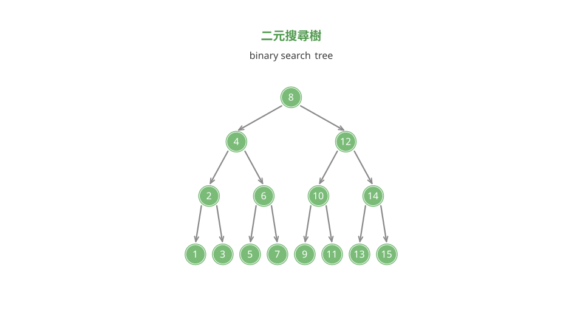
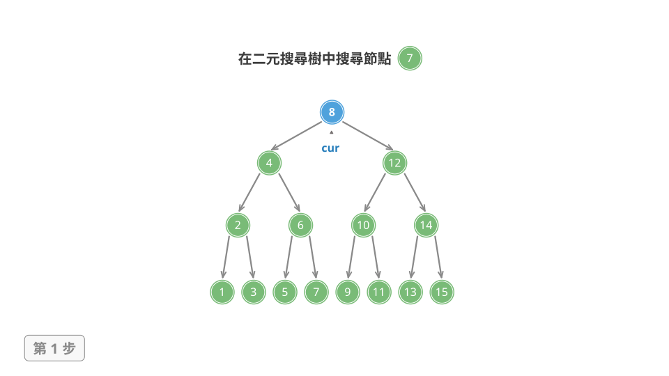
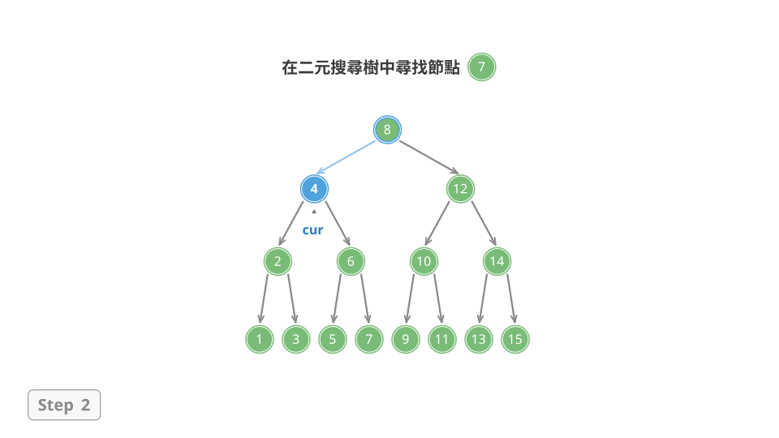
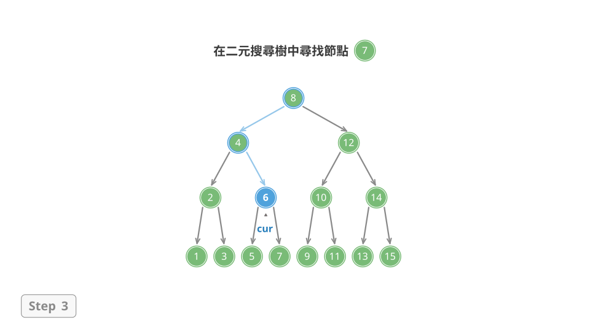
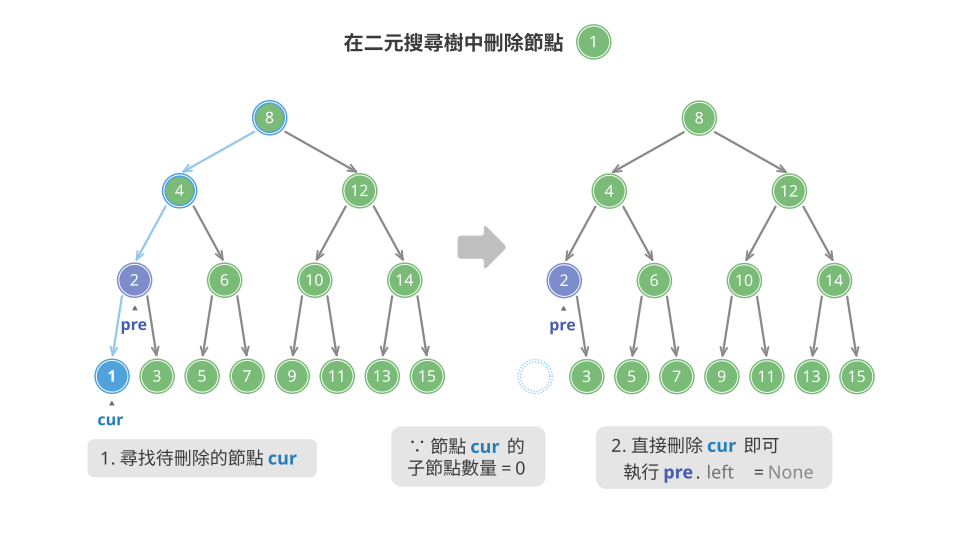
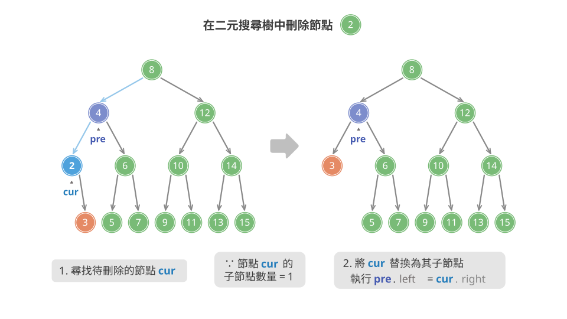
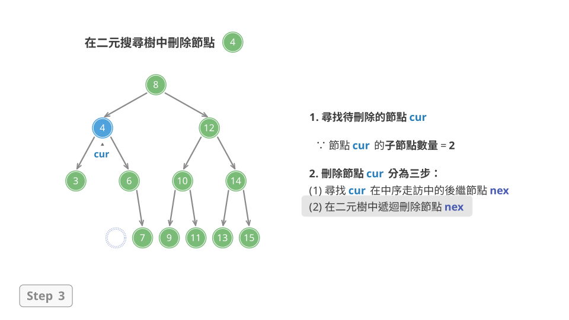
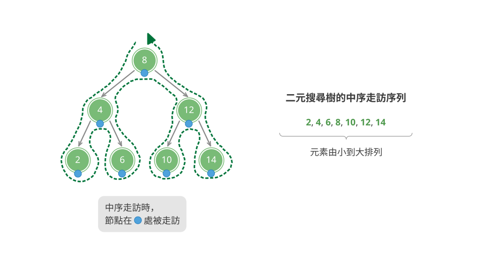

# 二元搜尋樹

如下圖所示，<u>二元搜尋樹（binary search tree）</u>滿足下列條件。

1. 對根節點而言，左子樹中所有節點的值 $<$ 根節點的值 $<$ 右子樹中所有節點的值。
2. 任一節點的左右子樹也都是二元搜尋樹，也就是都滿足條件 `1.`。



## 二元搜尋樹的操作

我們將二元搜尋樹封裝成類別 `BinarySearchTree`，並宣告成員變數 `root`，用來指向樹的根節點。

### 搜尋節點

給定目標節點值 `num`，可以利用二元搜尋樹的性質來搜尋。如下圖所示，我們宣告節點 `cur`，從根節點 `root` 出發，在迴圈中反覆比較節點值 `cur.val` 與 `num` 的大小。

- 若 `cur.val < num`，表示目標節點在 `cur` 的右子樹中，因此執行 `cur = cur.right`。
- 若 `cur.val > num`，表示目標節點在 `cur` 的左子樹中，因此執行 `cur = cur.left`。
- 若 `cur.val = num`，表示已找到目標節點，跳出迴圈並回傳該節點。

=== "<1>"
    

=== "<2>"
    

=== "<3>"
    

=== "<4>"
    

在二元搜尋樹中搜尋，原理與二分搜尋法相同，每一輪都排除一半的可能性。迴圈次數最多為二元樹的高度。當樹平衡時，搜尋需要 $O(\log n)$ 時間。範例程式碼如下：

```src
[file]{binary_search_tree}-[class]{binary_search_tree}-[func]{search}
```

### 插入節點

給定要插入的元素 `num`，為了維持二元搜尋樹「左子樹 < 根節點 < 右子樹」的性質，依下圖的步驟插入。

1. **找出插入位置**：與搜尋節點類似，從根節點出發，在迴圈中比較目前的節點值與 `num`，依大小關係往下搜尋。直到越過葉節點（走到 `None`）時，才跳出迴圈。
2. **在這個位置插入節點**：初始化節點 `num`，將它放在 `None` 的位置。


實作時需要留意以下兩點。

- 二元搜尋樹不允許重複的節點值，否則會違反定義。因此，如果要插入的節點值已存在，就直接返回，略過插入操作。
- 為了插入節點，需要用節點 `pre` 保存上一輪迴圈走訪的節點。走到 `None` 時，就能取得父節點，完成插入操作。

```src
[file]{binary_search_tree}-[class]{binary_search_tree}-[func]{insert}
```

與搜尋節點相同，插入節點需要 $O(\log n)$ 時間。

### 刪除節點

先在二元樹中找到目標節點，再將它刪除。和插入節點一樣，刪除後也必須維持二元搜尋樹「左子樹 < 根節點 < 右子樹」的性質。因此，我們依目標節點有 0、1 或 2 個子節點，分別採取對應的刪除方式。

如下圖所示，若要刪除的節點分支度為 $0$，表示它是葉節點，可直接刪除。



如下圖所示，若要刪除的節點分支度為 $1$，只要用它的子節點取代它即可。



若要刪除的節點分支度為 $2$，就無法直接刪除，必須找一個節點取代它。為了維持二元搜尋樹「左子樹 $<$ 根節點 $<$ 右子樹」的性質，**可選擇右子樹中值最小的節點，或左子樹中值最大的節點**。

假設選擇右子樹中值最小的節點（也就是中序走訪的下一個節點），刪除步驟如下圖所示。

1. 找出要刪除的節點在中序走訪序列中的下一個節點，記為 `tmp`。
2. 用 `tmp` 的值覆寫要刪除的節點值，並在樹中以遞迴刪除節點 `tmp`。

=== "<1>"
    

=== "<2>"
    

=== "<3>"
    

=== "<4>"
    

刪除節點也需要 $O(\log n)$ 時間，其中搜尋要刪除的節點需要 $O(\log n)$ 時間，取得中序走訪的後繼節點需要 $O(\log n)$ 時間。範例程式碼如下：

```src
[file]{binary_search_tree}-[class]{binary_search_tree}-[func]{remove}
```

### 中序走訪的結果有序

如下圖所示，二元樹的中序走訪依循「左 $\rightarrow$ 根 $\rightarrow$ 右」的順序，而二元搜尋樹滿足「左子節點 $<$ 根節點 $<$ 右子節點」的大小關係。

因此，中序走訪二元搜尋樹時，每次都會先走訪剩餘節點中值最小的那一個。由此可得一項重要性質：**二元搜尋樹的中序走訪序列依節點值遞增排列**。

利用中序走訪結果遞增的性質，只要 $O(n)$ 時間就能從二元搜尋樹取得排好序的資料，無須再排序，效率很高。



## 二元搜尋樹的效率

假設要用陣列或二元搜尋樹儲存一組資料。從下表可以看出，二元搜尋樹各項操作的時間複雜度都是對數階，效率穩定且高。只有在經常加入資料、很少搜尋或刪除的情況下，陣列的效率才高於二元搜尋樹。

<p align="center"> 表 <id> &nbsp; 陣列與搜尋樹的效率比較 </p>

|          | 未排序陣列 | 二元搜尋樹  |
| -------- | -------- | ----------- |
| 搜尋元素 | $O(n)$   | $O(\log n)$ |
| 插入元素 | $O(1)$   | $O(\log n)$ |
| 刪除元素 | $O(n)$   | $O(\log n)$ |

理想情況下，二元搜尋樹保持平衡，搜尋任一節點都可在 $\log n$ 輪迴圈內完成。

不過，若持續在二元搜尋樹中插入與刪除節點，樹可能退化成下圖的鏈結串列，各項操作的時間複雜度也會變差為 $O(n)$。


## 二元搜尋樹的常見應用

- 作為系統中的多層索引，有效率地搜尋、插入與刪除資料。
- 作為某些搜尋演算法的底層資料結構。
- 儲存資料流，讓資料保持有序。
