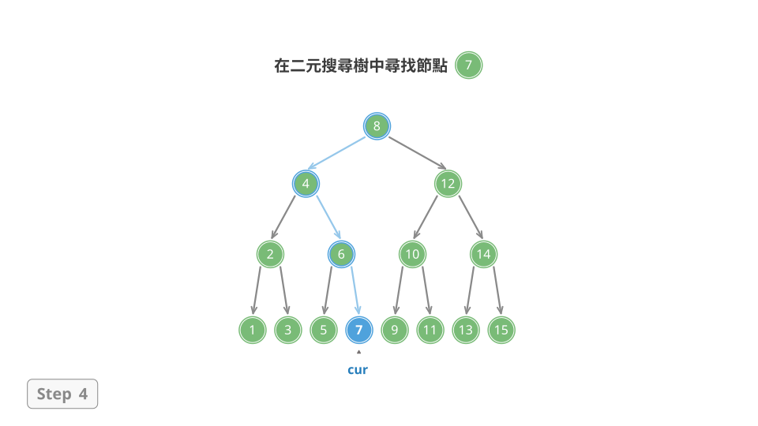
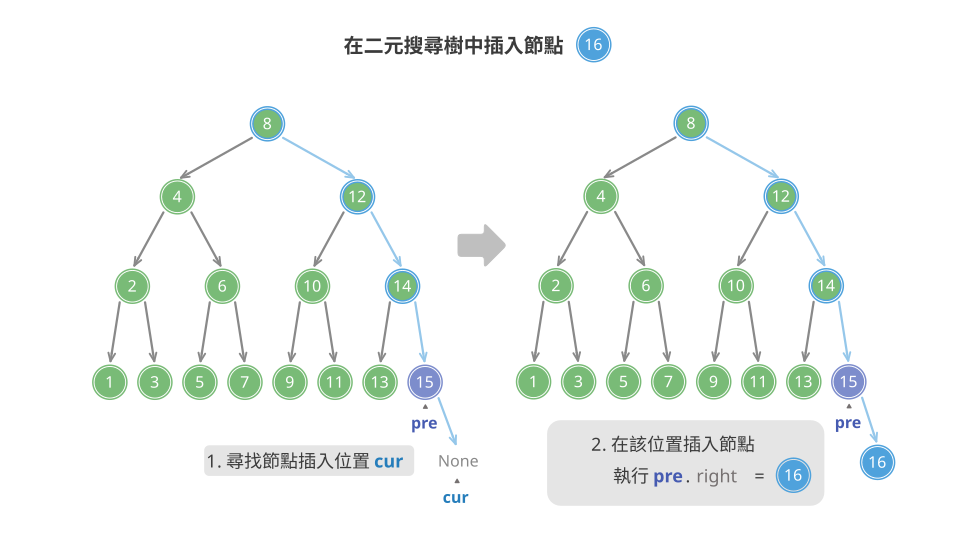
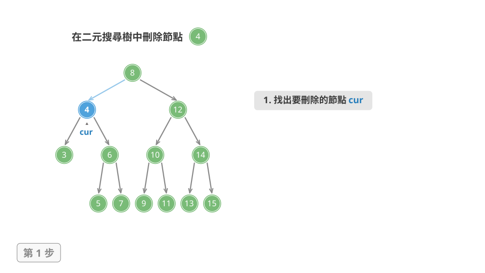
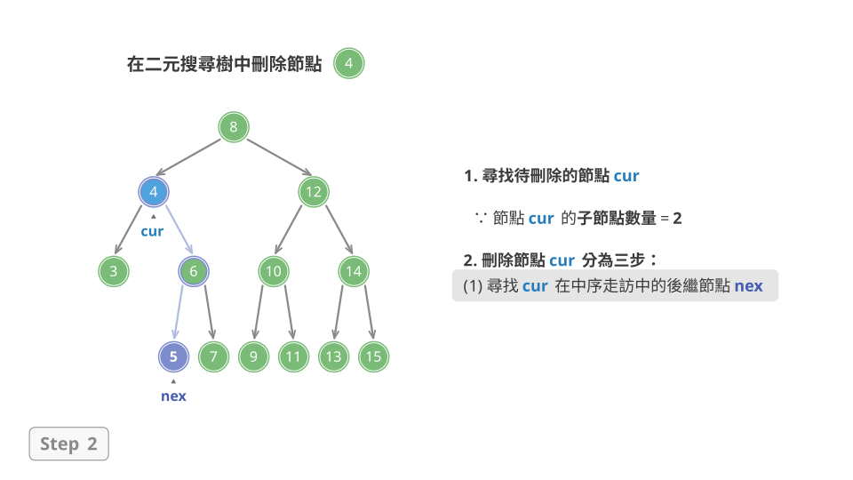
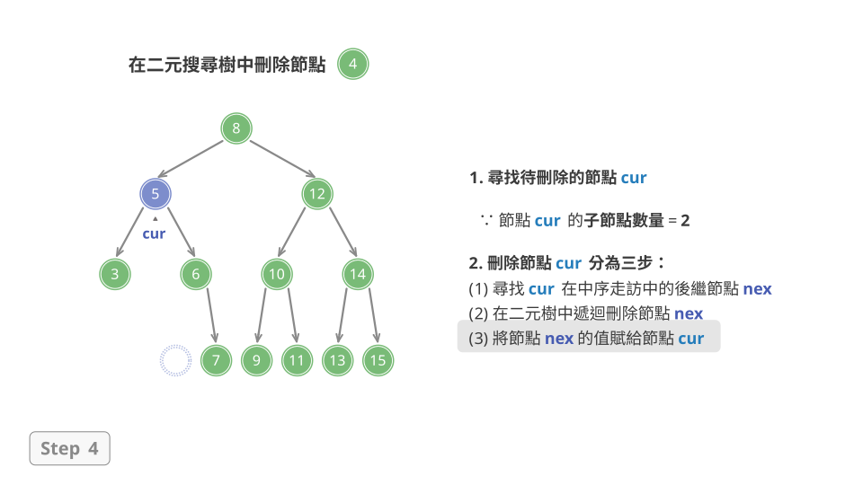
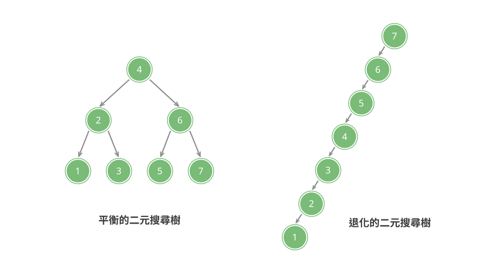

# 7.4 &nbsp; 二元搜尋樹

如圖 7-16 所示，<u>二元搜尋樹（binary search tree）</u>滿足下列條件。

1. 對根節點而言，左子樹中所有節點的值 $<$ 根節點的值 $<$ 右子樹中所有節點的值。
2. 任一節點的左右子樹也都是二元搜尋樹，也就是都滿足條件 `1.`。

{ class="animation-figure" }

<p align="center"> 圖 7-16 &nbsp; 二元搜尋樹 </p>

## 7.4.1 &nbsp; 二元搜尋樹的操作

我們將二元搜尋樹封裝成類別 `BinarySearchTree`，並宣告成員變數 `root`，用來指向樹的根節點。

### 1. &nbsp; 搜尋節點

給定目標節點值 `num`，可以利用二元搜尋樹的性質來搜尋。如圖 7-17 所示，我們宣告節點 `cur`，從根節點 `root` 出發，在迴圈中反覆比較節點值 `cur.val` 與 `num` 的大小。

- 若 `cur.val < num`，表示目標節點在 `cur` 的右子樹中，因此執行 `cur = cur.right`。
- 若 `cur.val > num`，表示目標節點在 `cur` 的左子樹中，因此執行 `cur = cur.left`。
- 若 `cur.val = num`，表示已找到目標節點，跳出迴圈並回傳該節點。

=== "<1>"
    { class="animation-figure" }

=== "<2>"
    { class="animation-figure" }

=== "<3>"
    { class="animation-figure" }

=== "<4>"
    { class="animation-figure" }

<p align="center"> 圖 7-17 &nbsp; 在二元搜尋樹中搜尋節點的範例 </p>

在二元搜尋樹中搜尋，原理與二分搜尋法相同，每一輪都排除一半的可能性。迴圈次數最多為二元樹的高度。當樹平衡時，搜尋需要 $O(\log n)$ 時間。範例程式碼如下：

=== "Python"

    ```python title="binary_search_tree.py"
    def search(self, num: int) -> TreeNode | None:
        """搜尋節點"""
        cur = self._root
        # 用迴圈搜尋，越過葉節點後跳出迴圈
        while cur is not None:
            # 目標節點在 cur 的右子樹中
            if cur.val < num:
                cur = cur.right
            # 目標節點在 cur 的左子樹中
            elif cur.val > num:
                cur = cur.left
            # 找到目標節點，跳出迴圈
            else:
                break
        return cur
    ```

=== "C++"

    ```cpp title="binary_search_tree.cpp"
    /* 搜尋節點 */
    TreeNode *search(int num) {
        TreeNode *cur = root;
        // 用迴圈搜尋，越過葉節點後跳出迴圈
        while (cur != nullptr) {
            // 目標節點在 cur 的右子樹中
            if (cur->val < num)
                cur = cur->right;
            // 目標節點在 cur 的左子樹中
            else if (cur->val > num)
                cur = cur->left;
            // 找到目標節點，跳出迴圈
            else
                break;
        }
        // 回傳目標節點
        return cur;
    }
    ```

=== "Java"

    ```java title="binary_search_tree.java"
    /* 搜尋節點 */
    TreeNode search(int num) {
        TreeNode cur = root;
        // 用迴圈搜尋，越過葉節點後跳出迴圈
        while (cur != null) {
            // 目標節點在 cur 的右子樹中
            if (cur.val < num)
                cur = cur.right;
            // 目標節點在 cur 的左子樹中
            else if (cur.val > num)
                cur = cur.left;
            // 找到目標節點，跳出迴圈
            else
                break;
        }
        // 回傳目標節點
        return cur;
    }
    ```

=== "C#"

    ```csharp title="binary_search_tree.cs"
    /* 搜尋節點 */
    TreeNode? Search(int num) {
        TreeNode? cur = root;
        // 用迴圈搜尋，越過葉節點後跳出迴圈
        while (cur != null) {
            // 目標節點在 cur 的右子樹中
            if (cur.val < num) cur =
                cur.right;
            // 目標節點在 cur 的左子樹中
            else if (cur.val > num)
                cur = cur.left;
            // 找到目標節點，跳出迴圈
            else
                break;
        }
        // 回傳目標節點
        return cur;
    }
    ```

=== "Go"

    ```go title="binary_search_tree.go"
    /* 搜尋節點 */
    func (bst *binarySearchTree) search(num int) *TreeNode {
        node := bst.root
        // 用迴圈搜尋，越過葉節點後跳出迴圈
        for node != nil {
            if node.Val.(int) < num {
                // 目標節點在 cur 的右子樹中
                node = node.Right
            } else if node.Val.(int) > num {
                // 目標節點在 cur 的左子樹中
                node = node.Left
            } else {
                // 找到目標節點，跳出迴圈
                break
            }
        }
        // 回傳目標節點
        return node
    }
    ```

=== "Swift"

    ```swift title="binary_search_tree.swift"
    /* 搜尋節點 */
    func search(num: Int) -> TreeNode? {
        var cur = root
        // 用迴圈搜尋，越過葉節點後跳出迴圈
        while cur != nil {
            // 目標節點在 cur 的右子樹中
            if cur!.val < num {
                cur = cur?.right
            }
            // 目標節點在 cur 的左子樹中
            else if cur!.val > num {
                cur = cur?.left
            }
            // 找到目標節點，跳出迴圈
            else {
                break
            }
        }
        // 回傳目標節點
        return cur
    }
    ```

=== "JS"

    ```javascript title="binary_search_tree.js"
    /* 搜尋節點 */
    search(num) {
        let cur = this.root;
        // 用迴圈搜尋，越過葉節點後跳出迴圈
        while (cur !== null) {
            // 目標節點在 cur 的右子樹中
            if (cur.val < num) cur = cur.right;
            // 目標節點在 cur 的左子樹中
            else if (cur.val > num) cur = cur.left;
            // 找到目標節點，跳出迴圈
            else break;
        }
        // 回傳目標節點
        return cur;
    }
    ```

=== "TS"

    ```typescript title="binary_search_tree.ts"
    /* 搜尋節點 */
    search(num: number): TreeNode | null {
        let cur = this.root;
        // 用迴圈搜尋，越過葉節點後跳出迴圈
        while (cur !== null) {
            // 目標節點在 cur 的右子樹中
            if (cur.val < num) cur = cur.right;
            // 目標節點在 cur 的左子樹中
            else if (cur.val > num) cur = cur.left;
            // 找到目標節點，跳出迴圈
            else break;
        }
        // 回傳目標節點
        return cur;
    }
    ```

=== "Dart"

    ```dart title="binary_search_tree.dart"
    /* 搜尋節點 */
    TreeNode? search(int _num) {
      TreeNode? cur = _root;
      // 用迴圈搜尋，越過葉節點後跳出迴圈
      while (cur != null) {
        // 目標節點在 cur 的右子樹中
        if (cur.val < _num)
          cur = cur.right;
        // 目標節點在 cur 的左子樹中
        else if (cur.val > _num)
          cur = cur.left;
        // 找到目標節點，跳出迴圈
        else
          break;
      }
      // 回傳目標節點
      return cur;
    }
    ```

=== "Rust"

    ```rust title="binary_search_tree.rs"
    /* 搜尋節點 */
    pub fn search(&self, num: i32) -> OptionTreeNodeRc {
        let mut cur = self.root.clone();
        // 用迴圈搜尋，越過葉節點後跳出迴圈
        while let Some(node) = cur.clone() {
            match num.cmp(&node.borrow().val) {
                // 目標節點在 cur 的右子樹中
                Ordering::Greater => cur = node.borrow().right.clone(),
                // 目標節點在 cur 的左子樹中
                Ordering::Less => cur = node.borrow().left.clone(),
                // 找到目標節點，跳出迴圈
                Ordering::Equal => break,
            }
        }

        // 回傳目標節點
        cur
    }
    ```

=== "C"

    ```c title="binary_search_tree.c"
    /* 搜尋節點 */
    TreeNode *search(BinarySearchTree *bst, int num) {
        TreeNode *cur = bst->root;
        // 用迴圈搜尋，越過葉節點後跳出迴圈
        while (cur != NULL) {
            if (cur->val < num) {
                // 目標節點在 cur 的右子樹中
                cur = cur->right;
            } else if (cur->val > num) {
                // 目標節點在 cur 的左子樹中
                cur = cur->left;
            } else {
                // 找到目標節點，跳出迴圈
                break;
            }
        }
        // 回傳目標節點
        return cur;
    }
    ```

=== "Kotlin"

    ```kotlin title="binary_search_tree.kt"
    /* 搜尋節點 */
    fun search(num: Int): TreeNode? {
        var cur = root
        // 用迴圈搜尋，越過葉節點後跳出迴圈
        while (cur != null) {
            // 目標節點在 cur 的右子樹中
            cur = if (cur._val < num)
                cur.right
            // 目標節點在 cur 的左子樹中
            else if (cur._val > num)
                cur.left
            // 找到目標節點，跳出迴圈
            else
                break
        }
        // 回傳目標節點
        return cur
    }
    ```

=== "Ruby"

    ```ruby title="binary_search_tree.rb"
    ### 搜尋節點 ###
    def search(num)
      cur = @root

      # 用迴圈搜尋，越過葉節點後跳出迴圈
      while !cur.nil?
        # 目標節點在 cur 的右子樹中
        if cur.val < num
          cur = cur.right
        # 目標節點在 cur 的左子樹中
        elsif cur.val > num
          cur = cur.left
        # 找到目標節點，跳出迴圈
        else
          break
        end
      end

      cur
    end
    ```

??? pythontutor "執行視覺化示範"

    <div style="height: 549px; width: 100%;"><iframe class="pythontutor-iframe" title="執行視覺化示範" src="https://pythontutor.com/iframe-embed.html#code=class%20TreeNode%3A%0A%20%20%20%20%22%22%22%E4%BA%8C%E5%85%83%E6%A8%B9%E7%AF%80%E9%BB%9E%E9%A1%9E%E5%88%A5%22%22%22%0A%20%20%20%20def%20__init__%28self,%20val%29%3A%0A%20%20%20%20%20%20%20%20self.val%20%3D%20val%0A%20%20%20%20%20%20%20%20self.left%20%3D%20None%0A%20%20%20%20%20%20%20%20self.right%20%3D%20None%0A%0A%0Aclass%20BinarySearchTree%3A%0A%20%20%20%20%22%22%22%E4%BA%8C%E5%85%83%E6%90%9C%E5%B0%8B%E6%A8%B9%22%22%22%0A%0A%20%20%20%20def%20__init__%28self%29%3A%0A%20%20%20%20%20%20%20%20%22%22%22%E5%BB%BA%E6%A7%8B%E6%96%B9%E6%B3%95%22%22%22%0A%20%20%20%20%20%20%20%20%23%20%E5%88%9D%E5%A7%8B%E5%8C%96%E7%A9%BA%E6%A8%B9%0A%20%20%20%20%20%20%20%20self._root%20%3D%20None%0A%0A%20%20%20%20def%20search%28self,%20num%3A%20int%29%20-%3E%20TreeNode%20%7C%20None%3A%0A%20%20%20%20%20%20%20%20%22%22%22%E6%90%9C%E5%B0%8B%E7%AF%80%E9%BB%9E%22%22%22%0A%20%20%20%20%20%20%20%20cur%20%3D%20self._root%0A%20%20%20%20%20%20%20%20%23%20%E7%94%A8%E8%BF%B4%E5%9C%88%E6%90%9C%E5%B0%8B%EF%BC%8C%E8%B6%8A%E9%81%8E%E8%91%89%E7%AF%80%E9%BB%9E%E5%BE%8C%E8%B7%B3%E5%87%BA%E8%BF%B4%E5%9C%88%0A%20%20%20%20%20%20%20%20while%20cur%20is%20not%20None%3A%0A%20%20%20%20%20%20%20%20%20%20%20%20%23%20%E7%9B%AE%E6%A8%99%E7%AF%80%E9%BB%9E%E5%9C%A8%20cur%20%E7%9A%84%E5%8F%B3%E5%AD%90%E6%A8%B9%E4%B8%AD%0A%20%20%20%20%20%20%20%20%20%20%20%20if%20cur.val%20%3C%20num%3A%0A%20%20%20%20%20%20%20%20%20%20%20%20%20%20%20%20cur%20%3D%20cur.right%0A%20%20%20%20%20%20%20%20%20%20%20%20%23%20%E7%9B%AE%E6%A8%99%E7%AF%80%E9%BB%9E%E5%9C%A8%20cur%20%E7%9A%84%E5%B7%A6%E5%AD%90%E6%A8%B9%E4%B8%AD%0A%20%20%20%20%20%20%20%20%20%20%20%20elif%20cur.val%20%3E%20num%3A%0A%20%20%20%20%20%20%20%20%20%20%20%20%20%20%20%20cur%20%3D%20cur.left%0A%20%20%20%20%20%20%20%20%20%20%20%20%23%20%E6%89%BE%E5%88%B0%E7%9B%AE%E6%A8%99%E7%AF%80%E9%BB%9E%EF%BC%8C%E8%B7%B3%E5%87%BA%E8%BF%B4%E5%9C%88%0A%20%20%20%20%20%20%20%20%20%20%20%20else%3A%0A%20%20%20%20%20%20%20%20%20%20%20%20%20%20%20%20break%0A%20%20%20%20%20%20%20%20return%20cur%0A%0A%20%20%20%20def%20insert%28self,%20num%3A%20int%29%3A%0A%20%20%20%20%20%20%20%20%22%22%22%E6%8F%92%E5%85%A5%E7%AF%80%E9%BB%9E%22%22%22%0A%20%20%20%20%20%20%20%20%23%20%E8%8B%A5%E6%A8%B9%E7%82%BA%E7%A9%BA%EF%BC%8C%E5%89%87%E5%88%9D%E5%A7%8B%E5%8C%96%E6%A0%B9%E7%AF%80%E9%BB%9E%0A%20%20%20%20%20%20%20%20if%20self._root%20is%20None%3A%0A%20%20%20%20%20%20%20%20%20%20%20%20self._root%20%3D%20TreeNode%28num%29%0A%20%20%20%20%20%20%20%20%20%20%20%20return%0A%20%20%20%20%20%20%20%20%23%20%E7%94%A8%E8%BF%B4%E5%9C%88%E6%90%9C%E5%B0%8B%EF%BC%8C%E8%B6%8A%E9%81%8E%E8%91%89%E7%AF%80%E9%BB%9E%E5%BE%8C%E8%B7%B3%E5%87%BA%E8%BF%B4%E5%9C%88%0A%20%20%20%20%20%20%20%20cur,%20pre%20%3D%20self._root,%20None%0A%20%20%20%20%20%20%20%20while%20cur%20is%20not%20None%3A%0A%20%20%20%20%20%20%20%20%20%20%20%20%23%20%E6%89%BE%E5%88%B0%E9%87%8D%E8%A4%87%E7%AF%80%E9%BB%9E%EF%BC%8C%E7%9B%B4%E6%8E%A5%E8%BF%94%E5%9B%9E%0A%20%20%20%20%20%20%20%20%20%20%20%20if%20cur.val%20%3D%3D%20num%3A%0A%20%20%20%20%20%20%20%20%20%20%20%20%20%20%20%20return%0A%20%20%20%20%20%20%20%20%20%20%20%20pre%20%3D%20cur%0A%20%20%20%20%20%20%20%20%20%20%20%20%23%20%E6%8F%92%E5%85%A5%E4%BD%8D%E7%BD%AE%E5%9C%A8%20cur%20%E7%9A%84%E5%8F%B3%E5%AD%90%E6%A8%B9%E4%B8%AD%0A%20%20%20%20%20%20%20%20%20%20%20%20if%20cur.val%20%3C%20num%3A%0A%20%20%20%20%20%20%20%20%20%20%20%20%20%20%20%20cur%20%3D%20cur.right%0A%20%20%20%20%20%20%20%20%20%20%20%20%23%20%E6%8F%92%E5%85%A5%E4%BD%8D%E7%BD%AE%E5%9C%A8%20cur%20%E7%9A%84%E5%B7%A6%E5%AD%90%E6%A8%B9%E4%B8%AD%0A%20%20%20%20%20%20%20%20%20%20%20%20else%3A%0A%20%20%20%20%20%20%20%20%20%20%20%20%20%20%20%20cur%20%3D%20cur.left%0A%20%20%20%20%20%20%20%20%23%20%E6%8F%92%E5%85%A5%E7%AF%80%E9%BB%9E%0A%20%20%20%20%20%20%20%20node%20%3D%20TreeNode%28num%29%0A%20%20%20%20%20%20%20%20if%20pre.val%20%3C%20num%3A%0A%20%20%20%20%20%20%20%20%20%20%20%20pre.right%20%3D%20node%0A%20%20%20%20%20%20%20%20else%3A%0A%20%20%20%20%20%20%20%20%20%20%20%20pre.left%20%3D%20node%0A%0A%0A%22%22%22Driver%20Code%22%22%22%0Aif%20__name__%20%3D%3D%20%22__main__%22%3A%0A%20%20%20%20%23%20%E5%88%9D%E5%A7%8B%E5%8C%96%E4%BA%8C%E5%85%83%E6%90%9C%E5%B0%8B%E6%A8%B9%0A%20%20%20%20bst%20%3D%20BinarySearchTree%28%29%0A%20%20%20%20nums%20%3D%20%5B4,%202,%206,%201,%203,%205,%207%5D%0A%20%20%20%20for%20num%20in%20nums%3A%0A%20%20%20%20%20%20%20%20bst.insert%28num%29%0A%0A%20%20%20%20%23%20%E6%90%9C%E5%B0%8B%E7%AF%80%E9%BB%9E%0A%20%20%20%20node%20%3D%20bst.search%287%29%0A%20%20%20%20print%28%22%5Cn%E6%89%BE%E5%88%B0%E7%9A%84%E7%AF%80%E9%BB%9E%E7%89%A9%E4%BB%B6%E7%82%BA%20%7B%7D%EF%BC%8C%E7%AF%80%E9%BB%9E%E5%80%BC%20%3D%20%7B%7D%22.format%28node,%20node.val%29%29&codeDivHeight=472&codeDivWidth=350&cumulative=false&curInstr=162&heapPrimitives=nevernest&origin=opt-frontend.js&py=311&rawInputLstJSON=%5B%5D&textReferences=false"> </iframe></div>
    <div style="margin-top: 5px;"><a href="https://pythontutor.com/iframe-embed.html#code=class%20TreeNode%3A%0A%20%20%20%20%22%22%22%E4%BA%8C%E5%85%83%E6%A8%B9%E7%AF%80%E9%BB%9E%E9%A1%9E%E5%88%A5%22%22%22%0A%20%20%20%20def%20__init__%28self,%20val%29%3A%0A%20%20%20%20%20%20%20%20self.val%20%3D%20val%0A%20%20%20%20%20%20%20%20self.left%20%3D%20None%0A%20%20%20%20%20%20%20%20self.right%20%3D%20None%0A%0A%0Aclass%20BinarySearchTree%3A%0A%20%20%20%20%22%22%22%E4%BA%8C%E5%85%83%E6%90%9C%E5%B0%8B%E6%A8%B9%22%22%22%0A%0A%20%20%20%20def%20__init__%28self%29%3A%0A%20%20%20%20%20%20%20%20%22%22%22%E5%BB%BA%E6%A7%8B%E6%96%B9%E6%B3%95%22%22%22%0A%20%20%20%20%20%20%20%20%23%20%E5%88%9D%E5%A7%8B%E5%8C%96%E7%A9%BA%E6%A8%B9%0A%20%20%20%20%20%20%20%20self._root%20%3D%20None%0A%0A%20%20%20%20def%20search%28self,%20num%3A%20int%29%20-%3E%20TreeNode%20%7C%20None%3A%0A%20%20%20%20%20%20%20%20%22%22%22%E6%90%9C%E5%B0%8B%E7%AF%80%E9%BB%9E%22%22%22%0A%20%20%20%20%20%20%20%20cur%20%3D%20self._root%0A%20%20%20%20%20%20%20%20%23%20%E7%94%A8%E8%BF%B4%E5%9C%88%E6%90%9C%E5%B0%8B%EF%BC%8C%E8%B6%8A%E9%81%8E%E8%91%89%E7%AF%80%E9%BB%9E%E5%BE%8C%E8%B7%B3%E5%87%BA%E8%BF%B4%E5%9C%88%0A%20%20%20%20%20%20%20%20while%20cur%20is%20not%20None%3A%0A%20%20%20%20%20%20%20%20%20%20%20%20%23%20%E7%9B%AE%E6%A8%99%E7%AF%80%E9%BB%9E%E5%9C%A8%20cur%20%E7%9A%84%E5%8F%B3%E5%AD%90%E6%A8%B9%E4%B8%AD%0A%20%20%20%20%20%20%20%20%20%20%20%20if%20cur.val%20%3C%20num%3A%0A%20%20%20%20%20%20%20%20%20%20%20%20%20%20%20%20cur%20%3D%20cur.right%0A%20%20%20%20%20%20%20%20%20%20%20%20%23%20%E7%9B%AE%E6%A8%99%E7%AF%80%E9%BB%9E%E5%9C%A8%20cur%20%E7%9A%84%E5%B7%A6%E5%AD%90%E6%A8%B9%E4%B8%AD%0A%20%20%20%20%20%20%20%20%20%20%20%20elif%20cur.val%20%3E%20num%3A%0A%20%20%20%20%20%20%20%20%20%20%20%20%20%20%20%20cur%20%3D%20cur.left%0A%20%20%20%20%20%20%20%20%20%20%20%20%23%20%E6%89%BE%E5%88%B0%E7%9B%AE%E6%A8%99%E7%AF%80%E9%BB%9E%EF%BC%8C%E8%B7%B3%E5%87%BA%E8%BF%B4%E5%9C%88%0A%20%20%20%20%20%20%20%20%20%20%20%20else%3A%0A%20%20%20%20%20%20%20%20%20%20%20%20%20%20%20%20break%0A%20%20%20%20%20%20%20%20return%20cur%0A%0A%20%20%20%20def%20insert%28self,%20num%3A%20int%29%3A%0A%20%20%20%20%20%20%20%20%22%22%22%E6%8F%92%E5%85%A5%E7%AF%80%E9%BB%9E%22%22%22%0A%20%20%20%20%20%20%20%20%23%20%E8%8B%A5%E6%A8%B9%E7%82%BA%E7%A9%BA%EF%BC%8C%E5%89%87%E5%88%9D%E5%A7%8B%E5%8C%96%E6%A0%B9%E7%AF%80%E9%BB%9E%0A%20%20%20%20%20%20%20%20if%20self._root%20is%20None%3A%0A%20%20%20%20%20%20%20%20%20%20%20%20self._root%20%3D%20TreeNode%28num%29%0A%20%20%20%20%20%20%20%20%20%20%20%20return%0A%20%20%20%20%20%20%20%20%23%20%E7%94%A8%E8%BF%B4%E5%9C%88%E6%90%9C%E5%B0%8B%EF%BC%8C%E8%B6%8A%E9%81%8E%E8%91%89%E7%AF%80%E9%BB%9E%E5%BE%8C%E8%B7%B3%E5%87%BA%E8%BF%B4%E5%9C%88%0A%20%20%20%20%20%20%20%20cur,%20pre%20%3D%20self._root,%20None%0A%20%20%20%20%20%20%20%20while%20cur%20is%20not%20None%3A%0A%20%20%20%20%20%20%20%20%20%20%20%20%23%20%E6%89%BE%E5%88%B0%E9%87%8D%E8%A4%87%E7%AF%80%E9%BB%9E%EF%BC%8C%E7%9B%B4%E6%8E%A5%E8%BF%94%E5%9B%9E%0A%20%20%20%20%20%20%20%20%20%20%20%20if%20cur.val%20%3D%3D%20num%3A%0A%20%20%20%20%20%20%20%20%20%20%20%20%20%20%20%20return%0A%20%20%20%20%20%20%20%20%20%20%20%20pre%20%3D%20cur%0A%20%20%20%20%20%20%20%20%20%20%20%20%23%20%E6%8F%92%E5%85%A5%E4%BD%8D%E7%BD%AE%E5%9C%A8%20cur%20%E7%9A%84%E5%8F%B3%E5%AD%90%E6%A8%B9%E4%B8%AD%0A%20%20%20%20%20%20%20%20%20%20%20%20if%20cur.val%20%3C%20num%3A%0A%20%20%20%20%20%20%20%20%20%20%20%20%20%20%20%20cur%20%3D%20cur.right%0A%20%20%20%20%20%20%20%20%20%20%20%20%23%20%E6%8F%92%E5%85%A5%E4%BD%8D%E7%BD%AE%E5%9C%A8%20cur%20%E7%9A%84%E5%B7%A6%E5%AD%90%E6%A8%B9%E4%B8%AD%0A%20%20%20%20%20%20%20%20%20%20%20%20else%3A%0A%20%20%20%20%20%20%20%20%20%20%20%20%20%20%20%20cur%20%3D%20cur.left%0A%20%20%20%20%20%20%20%20%23%20%E6%8F%92%E5%85%A5%E7%AF%80%E9%BB%9E%0A%20%20%20%20%20%20%20%20node%20%3D%20TreeNode%28num%29%0A%20%20%20%20%20%20%20%20if%20pre.val%20%3C%20num%3A%0A%20%20%20%20%20%20%20%20%20%20%20%20pre.right%20%3D%20node%0A%20%20%20%20%20%20%20%20else%3A%0A%20%20%20%20%20%20%20%20%20%20%20%20pre.left%20%3D%20node%0A%0A%0A%22%22%22Driver%20Code%22%22%22%0Aif%20__name__%20%3D%3D%20%22__main__%22%3A%0A%20%20%20%20%23%20%E5%88%9D%E5%A7%8B%E5%8C%96%E4%BA%8C%E5%85%83%E6%90%9C%E5%B0%8B%E6%A8%B9%0A%20%20%20%20bst%20%3D%20BinarySearchTree%28%29%0A%20%20%20%20nums%20%3D%20%5B4,%202,%206,%201,%203,%205,%207%5D%0A%20%20%20%20for%20num%20in%20nums%3A%0A%20%20%20%20%20%20%20%20bst.insert%28num%29%0A%0A%20%20%20%20%23%20%E6%90%9C%E5%B0%8B%E7%AF%80%E9%BB%9E%0A%20%20%20%20node%20%3D%20bst.search%287%29%0A%20%20%20%20print%28%22%5Cn%E6%89%BE%E5%88%B0%E7%9A%84%E7%AF%80%E9%BB%9E%E7%89%A9%E4%BB%B6%E7%82%BA%20%7B%7D%EF%BC%8C%E7%AF%80%E9%BB%9E%E5%80%BC%20%3D%20%7B%7D%22.format%28node,%20node.val%29%29&codeDivHeight=800&codeDivWidth=600&cumulative=false&curInstr=162&heapPrimitives=nevernest&origin=opt-frontend.js&py=311&rawInputLstJSON=%5B%5D&textReferences=false" target="_blank" rel="noopener noreferrer">全螢幕觀看 ></a></div>

### 2. &nbsp; 插入節點

給定要插入的元素 `num`，為了維持二元搜尋樹「左子樹 < 根節點 < 右子樹」的性質，依圖 7-18 的步驟插入。

1. **找出插入位置**：與搜尋節點類似，從根節點出發，在迴圈中比較目前的節點值與 `num`，依大小關係往下搜尋。直到越過葉節點（走到 `None`）時，才跳出迴圈。
2. **在這個位置插入節點**：初始化節點 `num`，將它放在 `None` 的位置。

{ class="animation-figure" }

<p align="center"> 圖 7-18 &nbsp; 在二元搜尋樹中插入節點 </p>

實作時需要留意以下兩點。

- 二元搜尋樹不允許重複的節點值，否則會違反定義。因此，如果要插入的節點值已存在，就直接返回，略過插入操作。
- 為了插入節點，需要用節點 `pre` 保存上一輪迴圈走訪的節點。走到 `None` 時，就能取得父節點，完成插入操作。

=== "Python"

    ```python title="binary_search_tree.py"
    def insert(self, num: int):
        """插入節點"""
        # 若樹為空，則初始化根節點
        if self._root is None:
            self._root = TreeNode(num)
            return
        # 用迴圈搜尋，越過葉節點後跳出迴圈
        cur, pre = self._root, None
        while cur is not None:
            # 找到重複節點，直接返回
            if cur.val == num:
                return
            pre = cur
            # 插入位置在 cur 的右子樹中
            if cur.val < num:
                cur = cur.right
            # 插入位置在 cur 的左子樹中
            else:
                cur = cur.left
        # 插入節點
        node = TreeNode(num)
        if pre.val < num:
            pre.right = node
        else:
            pre.left = node
    ```

=== "C++"

    ```cpp title="binary_search_tree.cpp"
    /* 插入節點 */
    void insert(int num) {
        // 若樹為空，則初始化根節點
        if (root == nullptr) {
            root = new TreeNode(num);
            return;
        }
        TreeNode *cur = root, *pre = nullptr;
        // 用迴圈搜尋，越過葉節點後跳出迴圈
        while (cur != nullptr) {
            // 找到重複節點，直接返回
            if (cur->val == num)
                return;
            pre = cur;
            // 插入位置在 cur 的右子樹中
            if (cur->val < num)
                cur = cur->right;
            // 插入位置在 cur 的左子樹中
            else
                cur = cur->left;
        }
        // 插入節點
        TreeNode *node = new TreeNode(num);
        if (pre->val < num)
            pre->right = node;
        else
            pre->left = node;
    }
    ```

=== "Java"

    ```java title="binary_search_tree.java"
    /* 插入節點 */
    void insert(int num) {
        // 若樹為空，則初始化根節點
        if (root == null) {
            root = new TreeNode(num);
            return;
        }
        TreeNode cur = root, pre = null;
        // 用迴圈搜尋，越過葉節點後跳出迴圈
        while (cur != null) {
            // 找到重複節點，直接返回
            if (cur.val == num)
                return;
            pre = cur;
            // 插入位置在 cur 的右子樹中
            if (cur.val < num)
                cur = cur.right;
            // 插入位置在 cur 的左子樹中
            else
                cur = cur.left;
        }
        // 插入節點
        TreeNode node = new TreeNode(num);
        if (pre.val < num)
            pre.right = node;
        else
            pre.left = node;
    }
    ```

=== "C#"

    ```csharp title="binary_search_tree.cs"
    /* 插入節點 */
    void Insert(int num) {
        // 若樹為空，則初始化根節點
        if (root == null) {
            root = new TreeNode(num);
            return;
        }
        TreeNode? cur = root, pre = null;
        // 用迴圈搜尋，越過葉節點後跳出迴圈
        while (cur != null) {
            // 找到重複節點，直接返回
            if (cur.val == num)
                return;
            pre = cur;
            // 插入位置在 cur 的右子樹中
            if (cur.val < num)
                cur = cur.right;
            // 插入位置在 cur 的左子樹中
            else
                cur = cur.left;
        }

        // 插入節點
        TreeNode node = new(num);
        if (pre != null) {
            if (pre.val < num)
                pre.right = node;
            else
                pre.left = node;
        }
    }
    ```

=== "Go"

    ```go title="binary_search_tree.go"
    /* 插入節點 */
    func (bst *binarySearchTree) insert(num int) {
        cur := bst.root
        // 若樹為空，則初始化根節點
        if cur == nil {
            bst.root = NewTreeNode(num)
            return
        }
        // 記錄搜尋插入位置時經過的上一個節點
        var pre *TreeNode = nil
        // 用迴圈搜尋，越過葉節點後跳出迴圈
        for cur != nil {
            if cur.Val == num {
                return
            }
            pre = cur
            if cur.Val.(int) < num {
                cur = cur.Right
            } else {
                cur = cur.Left
            }
        }
        // 插入節點
        node := NewTreeNode(num)
        if pre.Val.(int) < num {
            pre.Right = node
        } else {
            pre.Left = node
        }
    }
    ```

=== "Swift"

    ```swift title="binary_search_tree.swift"
    /* 插入節點 */
    func insert(num: Int) {
        // 若樹為空，則初始化根節點
        if root == nil {
            root = TreeNode(x: num)
            return
        }
        var cur = root
        var pre: TreeNode?
        // 用迴圈搜尋，越過葉節點後跳出迴圈
        while cur != nil {
            // 找到重複節點，直接返回
            if cur!.val == num {
                return
            }
            pre = cur
            // 插入位置在 cur 的右子樹中
            if cur!.val < num {
                cur = cur?.right
            }
            // 插入位置在 cur 的左子樹中
            else {
                cur = cur?.left
            }
        }
        // 插入節點
        let node = TreeNode(x: num)
        if pre!.val < num {
            pre?.right = node
        } else {
            pre?.left = node
        }
    }
    ```

=== "JS"

    ```javascript title="binary_search_tree.js"
    /* 插入節點 */
    insert(num) {
        // 若樹為空，則初始化根節點
        if (this.root === null) {
            this.root = new TreeNode(num);
            return;
        }
        let cur = this.root,
            pre = null;
        // 用迴圈搜尋，越過葉節點後跳出迴圈
        while (cur !== null) {
            // 找到重複節點，直接返回
            if (cur.val === num) return;
            pre = cur;
            // 插入位置在 cur 的右子樹中
            if (cur.val < num) cur = cur.right;
            // 插入位置在 cur 的左子樹中
            else cur = cur.left;
        }
        // 插入節點
        const node = new TreeNode(num);
        if (pre.val < num) pre.right = node;
        else pre.left = node;
    }
    ```

=== "TS"

    ```typescript title="binary_search_tree.ts"
    /* 插入節點 */
    insert(num: number): void {
        // 若樹為空，則初始化根節點
        if (this.root === null) {
            this.root = new TreeNode(num);
            return;
        }
        let cur: TreeNode | null = this.root,
            pre: TreeNode | null = null;
        // 用迴圈搜尋，越過葉節點後跳出迴圈
        while (cur !== null) {
            // 找到重複節點，直接返回
            if (cur.val === num) return;
            pre = cur;
            // 插入位置在 cur 的右子樹中
            if (cur.val < num) cur = cur.right;
            // 插入位置在 cur 的左子樹中
            else cur = cur.left;
        }
        // 插入節點
        const node = new TreeNode(num);
        if (pre!.val < num) pre!.right = node;
        else pre!.left = node;
    }
    ```

=== "Dart"

    ```dart title="binary_search_tree.dart"
    /* 插入節點 */
    void insert(int _num) {
      // 若樹為空，則初始化根節點
      if (_root == null) {
        _root = TreeNode(_num);
        return;
      }
      TreeNode? cur = _root;
      TreeNode? pre = null;
      // 用迴圈搜尋，越過葉節點後跳出迴圈
      while (cur != null) {
        // 找到重複節點，直接返回
        if (cur.val == _num) return;
        pre = cur;
        // 插入位置在 cur 的右子樹中
        if (cur.val < _num)
          cur = cur.right;
        // 插入位置在 cur 的左子樹中
        else
          cur = cur.left;
      }
      // 插入節點
      TreeNode? node = TreeNode(_num);
      if (pre!.val < _num)
        pre.right = node;
      else
        pre.left = node;
    }
    ```

=== "Rust"

    ```rust title="binary_search_tree.rs"
    /* 插入節點 */
    pub fn insert(&mut self, num: i32) {
        // 若樹為空，則初始化根節點
        if self.root.is_none() {
            self.root = Some(TreeNode::new(num));
            return;
        }
        let mut cur = self.root.clone();
        let mut pre = None;
        // 用迴圈搜尋，越過葉節點後跳出迴圈
        while let Some(node) = cur.clone() {
            match num.cmp(&node.borrow().val) {
                // 找到重複節點，直接返回
                Ordering::Equal => return,
                // 插入位置在 cur 的右子樹中
                Ordering::Greater => {
                    pre = cur.clone();
                    cur = node.borrow().right.clone();
                }
                // 插入位置在 cur 的左子樹中
                Ordering::Less => {
                    pre = cur.clone();
                    cur = node.borrow().left.clone();
                }
            }
        }
        // 插入節點
        let pre = pre.unwrap();
        let node = Some(TreeNode::new(num));
        if num > pre.borrow().val {
            pre.borrow_mut().right = node;
        } else {
            pre.borrow_mut().left = node;
        }
    }
    ```

=== "C"

    ```c title="binary_search_tree.c"
    /* 插入節點 */
    void insert(BinarySearchTree *bst, int num) {
        // 若樹為空，則初始化根節點
        if (bst->root == NULL) {
            bst->root = newTreeNode(num);
            return;
        }
        TreeNode *cur = bst->root, *pre = NULL;
        // 用迴圈搜尋，越過葉節點後跳出迴圈
        while (cur != NULL) {
            // 找到重複節點，直接返回
            if (cur->val == num) {
                return;
            }
            pre = cur;
            if (cur->val < num) {
                // 插入位置在 cur 的右子樹中
                cur = cur->right;
            } else {
                // 插入位置在 cur 的左子樹中
                cur = cur->left;
            }
        }
        // 插入節點
        TreeNode *node = newTreeNode(num);
        if (pre->val < num) {
            pre->right = node;
        } else {
            pre->left = node;
        }
    }
    ```

=== "Kotlin"

    ```kotlin title="binary_search_tree.kt"
    /* 插入節點 */
    fun insert(num: Int) {
        // 若樹為空，則初始化根節點
        if (root == null) {
            root = TreeNode(num)
            return
        }
        var cur = root
        var pre: TreeNode? = null
        // 用迴圈搜尋，越過葉節點後跳出迴圈
        while (cur != null) {
            // 找到重複節點，直接返回
            if (cur._val == num)
                return
            pre = cur
            // 插入位置在 cur 的右子樹中
            cur = if (cur._val < num)
                cur.right
            // 插入位置在 cur 的左子樹中
            else
                cur.left
        }
        // 插入節點
        val node = TreeNode(num)
        if (pre?._val!! < num)
            pre.right = node
        else
            pre.left = node
    }
    ```

=== "Ruby"

    ```ruby title="binary_search_tree.rb"
    ### 插入節點 ###
    def insert(num)
      # 若樹為空，則初始化根節點
      if @root.nil?
        @root = TreeNode.new(num)
        return
      end

      # 用迴圈搜尋，越過葉節點後跳出迴圈
      cur, pre = @root, nil
      while !cur.nil?
        # 找到重複節點，直接返回
        return if cur.val == num

        pre = cur
        # 插入位置在 cur 的右子樹中
        if cur.val < num
          cur = cur.right
        # 插入位置在 cur 的左子樹中
        else
          cur = cur.left
        end
      end

      # 插入節點
      node = TreeNode.new(num)
      if pre.val < num
        pre.right = node
      else
        pre.left = node
      end
    end
    ```

??? pythontutor "執行視覺化示範"

    <div style="height: 549px; width: 100%;"><iframe class="pythontutor-iframe" title="執行視覺化示範" src="https://pythontutor.com/iframe-embed.html#code=class%20TreeNode%3A%0A%20%20%20%20%22%22%22%E4%BA%8C%E5%85%83%E6%A8%B9%E7%AF%80%E9%BB%9E%E9%A1%9E%E5%88%A5%22%22%22%0A%20%20%20%20def%20__init__%28self,%20val%29%3A%0A%20%20%20%20%20%20%20%20self.val%20%3D%20val%0A%20%20%20%20%20%20%20%20self.left%20%3D%20None%0A%20%20%20%20%20%20%20%20self.right%20%3D%20None%0A%0A%0Aclass%20BinarySearchTree%3A%0A%20%20%20%20%22%22%22%E4%BA%8C%E5%85%83%E6%90%9C%E5%B0%8B%E6%A8%B9%22%22%22%0A%0A%20%20%20%20def%20__init__%28self%29%3A%0A%20%20%20%20%20%20%20%20%22%22%22%E5%BB%BA%E6%A7%8B%E6%96%B9%E6%B3%95%22%22%22%0A%20%20%20%20%20%20%20%20%23%20%E5%88%9D%E5%A7%8B%E5%8C%96%E7%A9%BA%E6%A8%B9%0A%20%20%20%20%20%20%20%20self._root%20%3D%20None%0A%0A%20%20%20%20def%20insert%28self,%20num%3A%20int%29%3A%0A%20%20%20%20%20%20%20%20%22%22%22%E6%8F%92%E5%85%A5%E7%AF%80%E9%BB%9E%22%22%22%0A%20%20%20%20%20%20%20%20%23%20%E8%8B%A5%E6%A8%B9%E7%82%BA%E7%A9%BA%EF%BC%8C%E5%89%87%E5%88%9D%E5%A7%8B%E5%8C%96%E6%A0%B9%E7%AF%80%E9%BB%9E%0A%20%20%20%20%20%20%20%20if%20self._root%20is%20None%3A%0A%20%20%20%20%20%20%20%20%20%20%20%20self._root%20%3D%20TreeNode%28num%29%0A%20%20%20%20%20%20%20%20%20%20%20%20return%0A%20%20%20%20%20%20%20%20%23%20%E7%94%A8%E8%BF%B4%E5%9C%88%E6%90%9C%E5%B0%8B%EF%BC%8C%E8%B6%8A%E9%81%8E%E8%91%89%E7%AF%80%E9%BB%9E%E5%BE%8C%E8%B7%B3%E5%87%BA%E8%BF%B4%E5%9C%88%0A%20%20%20%20%20%20%20%20cur,%20pre%20%3D%20self._root,%20None%0A%20%20%20%20%20%20%20%20while%20cur%20is%20not%20None%3A%0A%20%20%20%20%20%20%20%20%20%20%20%20%23%20%E6%89%BE%E5%88%B0%E9%87%8D%E8%A4%87%E7%AF%80%E9%BB%9E%EF%BC%8C%E7%9B%B4%E6%8E%A5%E8%BF%94%E5%9B%9E%0A%20%20%20%20%20%20%20%20%20%20%20%20if%20cur.val%20%3D%3D%20num%3A%0A%20%20%20%20%20%20%20%20%20%20%20%20%20%20%20%20return%0A%20%20%20%20%20%20%20%20%20%20%20%20pre%20%3D%20cur%0A%20%20%20%20%20%20%20%20%20%20%20%20%23%20%E6%8F%92%E5%85%A5%E4%BD%8D%E7%BD%AE%E5%9C%A8%20cur%20%E7%9A%84%E5%8F%B3%E5%AD%90%E6%A8%B9%E4%B8%AD%0A%20%20%20%20%20%20%20%20%20%20%20%20if%20cur.val%20%3C%20num%3A%0A%20%20%20%20%20%20%20%20%20%20%20%20%20%20%20%20cur%20%3D%20cur.right%0A%20%20%20%20%20%20%20%20%20%20%20%20%23%20%E6%8F%92%E5%85%A5%E4%BD%8D%E7%BD%AE%E5%9C%A8%20cur%20%E7%9A%84%E5%B7%A6%E5%AD%90%E6%A8%B9%E4%B8%AD%0A%20%20%20%20%20%20%20%20%20%20%20%20else%3A%0A%20%20%20%20%20%20%20%20%20%20%20%20%20%20%20%20cur%20%3D%20cur.left%0A%20%20%20%20%20%20%20%20%23%20%E6%8F%92%E5%85%A5%E7%AF%80%E9%BB%9E%0A%20%20%20%20%20%20%20%20node%20%3D%20TreeNode%28num%29%0A%20%20%20%20%20%20%20%20if%20pre.val%20%3C%20num%3A%0A%20%20%20%20%20%20%20%20%20%20%20%20pre.right%20%3D%20node%0A%20%20%20%20%20%20%20%20else%3A%0A%20%20%20%20%20%20%20%20%20%20%20%20pre.left%20%3D%20node%0A%0A%0A%22%22%22Driver%20Code%22%22%22%0Aif%20__name__%20%3D%3D%20%22__main__%22%3A%0A%20%20%20%20%23%20%E5%88%9D%E5%A7%8B%E5%8C%96%E4%BA%8C%E5%85%83%E6%90%9C%E5%B0%8B%E6%A8%B9%0A%20%20%20%20bst%20%3D%20BinarySearchTree%28%29%0A%20%20%20%20nums%20%3D%20%5B4,%202,%206,%201,%203,%205,%207%5D%0A%20%20%20%20for%20num%20in%20nums%3A%0A%20%20%20%20%20%20%20%20bst.insert%28num%29%0A%0A%20%20%20%20%23%20%E6%8F%92%E5%85%A5%E7%AF%80%E9%BB%9E%0A%20%20%20%20bst.insert%2816%29&codeDivHeight=472&codeDivWidth=350&cumulative=false&curInstr=162&heapPrimitives=nevernest&origin=opt-frontend.js&py=311&rawInputLstJSON=%5B%5D&textReferences=false"> </iframe></div>
    <div style="margin-top: 5px;"><a href="https://pythontutor.com/iframe-embed.html#code=class%20TreeNode%3A%0A%20%20%20%20%22%22%22%E4%BA%8C%E5%85%83%E6%A8%B9%E7%AF%80%E9%BB%9E%E9%A1%9E%E5%88%A5%22%22%22%0A%20%20%20%20def%20__init__%28self,%20val%29%3A%0A%20%20%20%20%20%20%20%20self.val%20%3D%20val%0A%20%20%20%20%20%20%20%20self.left%20%3D%20None%0A%20%20%20%20%20%20%20%20self.right%20%3D%20None%0A%0A%0Aclass%20BinarySearchTree%3A%0A%20%20%20%20%22%22%22%E4%BA%8C%E5%85%83%E6%90%9C%E5%B0%8B%E6%A8%B9%22%22%22%0A%0A%20%20%20%20def%20__init__%28self%29%3A%0A%20%20%20%20%20%20%20%20%22%22%22%E5%BB%BA%E6%A7%8B%E6%96%B9%E6%B3%95%22%22%22%0A%20%20%20%20%20%20%20%20%23%20%E5%88%9D%E5%A7%8B%E5%8C%96%E7%A9%BA%E6%A8%B9%0A%20%20%20%20%20%20%20%20self._root%20%3D%20None%0A%0A%20%20%20%20def%20insert%28self,%20num%3A%20int%29%3A%0A%20%20%20%20%20%20%20%20%22%22%22%E6%8F%92%E5%85%A5%E7%AF%80%E9%BB%9E%22%22%22%0A%20%20%20%20%20%20%20%20%23%20%E8%8B%A5%E6%A8%B9%E7%82%BA%E7%A9%BA%EF%BC%8C%E5%89%87%E5%88%9D%E5%A7%8B%E5%8C%96%E6%A0%B9%E7%AF%80%E9%BB%9E%0A%20%20%20%20%20%20%20%20if%20self._root%20is%20None%3A%0A%20%20%20%20%20%20%20%20%20%20%20%20self._root%20%3D%20TreeNode%28num%29%0A%20%20%20%20%20%20%20%20%20%20%20%20return%0A%20%20%20%20%20%20%20%20%23%20%E7%94%A8%E8%BF%B4%E5%9C%88%E6%90%9C%E5%B0%8B%EF%BC%8C%E8%B6%8A%E9%81%8E%E8%91%89%E7%AF%80%E9%BB%9E%E5%BE%8C%E8%B7%B3%E5%87%BA%E8%BF%B4%E5%9C%88%0A%20%20%20%20%20%20%20%20cur,%20pre%20%3D%20self._root,%20None%0A%20%20%20%20%20%20%20%20while%20cur%20is%20not%20None%3A%0A%20%20%20%20%20%20%20%20%20%20%20%20%23%20%E6%89%BE%E5%88%B0%E9%87%8D%E8%A4%87%E7%AF%80%E9%BB%9E%EF%BC%8C%E7%9B%B4%E6%8E%A5%E8%BF%94%E5%9B%9E%0A%20%20%20%20%20%20%20%20%20%20%20%20if%20cur.val%20%3D%3D%20num%3A%0A%20%20%20%20%20%20%20%20%20%20%20%20%20%20%20%20return%0A%20%20%20%20%20%20%20%20%20%20%20%20pre%20%3D%20cur%0A%20%20%20%20%20%20%20%20%20%20%20%20%23%20%E6%8F%92%E5%85%A5%E4%BD%8D%E7%BD%AE%E5%9C%A8%20cur%20%E7%9A%84%E5%8F%B3%E5%AD%90%E6%A8%B9%E4%B8%AD%0A%20%20%20%20%20%20%20%20%20%20%20%20if%20cur.val%20%3C%20num%3A%0A%20%20%20%20%20%20%20%20%20%20%20%20%20%20%20%20cur%20%3D%20cur.right%0A%20%20%20%20%20%20%20%20%20%20%20%20%23%20%E6%8F%92%E5%85%A5%E4%BD%8D%E7%BD%AE%E5%9C%A8%20cur%20%E7%9A%84%E5%B7%A6%E5%AD%90%E6%A8%B9%E4%B8%AD%0A%20%20%20%20%20%20%20%20%20%20%20%20else%3A%0A%20%20%20%20%20%20%20%20%20%20%20%20%20%20%20%20cur%20%3D%20cur.left%0A%20%20%20%20%20%20%20%20%23%20%E6%8F%92%E5%85%A5%E7%AF%80%E9%BB%9E%0A%20%20%20%20%20%20%20%20node%20%3D%20TreeNode%28num%29%0A%20%20%20%20%20%20%20%20if%20pre.val%20%3C%20num%3A%0A%20%20%20%20%20%20%20%20%20%20%20%20pre.right%20%3D%20node%0A%20%20%20%20%20%20%20%20else%3A%0A%20%20%20%20%20%20%20%20%20%20%20%20pre.left%20%3D%20node%0A%0A%0A%22%22%22Driver%20Code%22%22%22%0Aif%20__name__%20%3D%3D%20%22__main__%22%3A%0A%20%20%20%20%23%20%E5%88%9D%E5%A7%8B%E5%8C%96%E4%BA%8C%E5%85%83%E6%90%9C%E5%B0%8B%E6%A8%B9%0A%20%20%20%20bst%20%3D%20BinarySearchTree%28%29%0A%20%20%20%20nums%20%3D%20%5B4,%202,%206,%201,%203,%205,%207%5D%0A%20%20%20%20for%20num%20in%20nums%3A%0A%20%20%20%20%20%20%20%20bst.insert%28num%29%0A%0A%20%20%20%20%23%20%E6%8F%92%E5%85%A5%E7%AF%80%E9%BB%9E%0A%20%20%20%20bst.insert%2816%29&codeDivHeight=800&codeDivWidth=600&cumulative=false&curInstr=162&heapPrimitives=nevernest&origin=opt-frontend.js&py=311&rawInputLstJSON=%5B%5D&textReferences=false" target="_blank" rel="noopener noreferrer">全螢幕觀看 ></a></div>

與搜尋節點相同，插入節點需要 $O(\log n)$ 時間。

### 3. &nbsp; 刪除節點

先在二元樹中找到目標節點，再將它刪除。和插入節點一樣，刪除後也必須維持二元搜尋樹「左子樹 < 根節點 < 右子樹」的性質。因此，我們依目標節點有 0、1 或 2 個子節點，分別採取對應的刪除方式。

如圖 7-19 所示，若要刪除的節點分支度為 $0$，表示它是葉節點，可直接刪除。

{ class="animation-figure" }

<p align="center"> 圖 7-19 &nbsp; 在二元搜尋樹中刪除節點（分支度為 0） </p>

如圖 7-20 所示，若要刪除的節點分支度為 $1$，只要用它的子節點取代它即可。

{ class="animation-figure" }

<p align="center"> 圖 7-20 &nbsp; 在二元搜尋樹中刪除節點（分支度為 1） </p>

若要刪除的節點分支度為 $2$，就無法直接刪除，必須找一個節點取代它。為了維持二元搜尋樹「左子樹 $<$ 根節點 $<$ 右子樹」的性質，**可選擇右子樹中值最小的節點，或左子樹中值最大的節點**。

假設選擇右子樹中值最小的節點（也就是中序走訪的下一個節點），刪除步驟如圖 7-21 所示。

1. 找出要刪除的節點在中序走訪序列中的下一個節點，記為 `tmp`。
2. 用 `tmp` 的值覆寫要刪除的節點值，並在樹中以遞迴刪除節點 `tmp`。

=== "<1>"
    { class="animation-figure" }

=== "<2>"
    { class="animation-figure" }

=== "<3>"
    { class="animation-figure" }

=== "<4>"
    { class="animation-figure" }

<p align="center"> 圖 7-21 &nbsp; 在二元搜尋樹中刪除節點（分支度為 2） </p>

刪除節點也需要 $O(\log n)$ 時間，其中搜尋要刪除的節點需要 $O(\log n)$ 時間，取得中序走訪的後繼節點需要 $O(\log n)$ 時間。範例程式碼如下：

=== "Python"

    ```python title="binary_search_tree.py"
    def remove(self, num: int):
        """刪除節點"""
        # 若樹為空，直接返回
        if self._root is None:
            return
        # 用迴圈搜尋，越過葉節點後跳出迴圈
        cur, pre = self._root, None
        while cur is not None:
            # 找到要刪除的節點，跳出迴圈
            if cur.val == num:
                break
            pre = cur
            # 要刪除的節點在 cur 的右子樹中
            if cur.val < num:
                cur = cur.right
            # 要刪除的節點在 cur 的左子樹中
            else:
                cur = cur.left
        # 若找不到要刪除的節點，直接返回
        if cur is None:
            return

        # 子節點數為 0 或 1
        if cur.left is None or cur.right is None:
            # 有 0 個子節點時，child = null；只有 1 個時，child 指向該子節點
            child = cur.left or cur.right
            # 刪除節點 cur
            if cur != self._root:
                if pre.left == cur:
                    pre.left = child
                else:
                    pre.right = child
            else:
                # 若刪除的是根節點，則重新指定根節點
                self._root = child
        # 子節點數為 2
        else:
            # 取得中序走訪中 cur 的下一個節點
            tmp: TreeNode = cur.right
            while tmp.left is not None:
                tmp = tmp.left
            # 以遞迴刪除節點 tmp
            self.remove(tmp.val)
            # 用 tmp 的值覆寫 cur 的值
            cur.val = tmp.val
    ```

=== "C++"

    ```cpp title="binary_search_tree.cpp"
    /* 刪除節點 */
    void remove(int num) {
        // 若樹為空，直接返回
        if (root == nullptr)
            return;
        TreeNode *cur = root, *pre = nullptr;
        // 用迴圈搜尋，越過葉節點後跳出迴圈
        while (cur != nullptr) {
            // 找到要刪除的節點，跳出迴圈
            if (cur->val == num)
                break;
            pre = cur;
            // 要刪除的節點在 cur 的右子樹中
            if (cur->val < num)
                cur = cur->right;
            // 要刪除的節點在 cur 的左子樹中
            else
                cur = cur->left;
        }
        // 若找不到要刪除的節點，直接返回
        if (cur == nullptr)
            return;
        // 子節點數為 0 或 1
        if (cur->left == nullptr || cur->right == nullptr) {
            // 有 0 個子節點時，child = nullptr；只有 1 個時，child 指向該子節點
            TreeNode *child = cur->left != nullptr ? cur->left : cur->right;
            // 刪除節點 cur
            if (cur != root) {
                if (pre->left == cur)
                    pre->left = child;
                else
                    pre->right = child;
            } else {
                // 若刪除的是根節點，則重新指定根節點
                root = child;
            }
            // 釋放記憶體
            delete cur;
        }
        // 子節點數為 2
        else {
            // 取得中序走訪中 cur 的下一個節點
            TreeNode *tmp = cur->right;
            while (tmp->left != nullptr) {
                tmp = tmp->left;
            }
            int tmpVal = tmp->val;
            // 以遞迴刪除節點 tmp
            remove(tmp->val);
            // 用 tmp 的值覆寫 cur 的值
            cur->val = tmpVal;
        }
    }
    ```

=== "Java"

    ```java title="binary_search_tree.java"
    /* 刪除節點 */
    void remove(int num) {
        // 若樹為空，直接返回
        if (root == null)
            return;
        TreeNode cur = root, pre = null;
        // 用迴圈搜尋，越過葉節點後跳出迴圈
        while (cur != null) {
            // 找到要刪除的節點，跳出迴圈
            if (cur.val == num)
                break;
            pre = cur;
            // 要刪除的節點在 cur 的右子樹中
            if (cur.val < num)
                cur = cur.right;
            // 要刪除的節點在 cur 的左子樹中
            else
                cur = cur.left;
        }
        // 若找不到要刪除的節點，直接返回
        if (cur == null)
            return;
        // 子節點數為 0 或 1
        if (cur.left == null || cur.right == null) {
            // 有 0 個子節點時，child = null；只有 1 個時，child 指向該子節點
            TreeNode child = cur.left != null ? cur.left : cur.right;
            // 刪除節點 cur
            if (cur != root) {
                if (pre.left == cur)
                    pre.left = child;
                else
                    pre.right = child;
            } else {
                // 若刪除的是根節點，則重新指定根節點
                root = child;
            }
        }
        // 子節點數為 2
        else {
            // 取得中序走訪中 cur 的下一個節點
            TreeNode tmp = cur.right;
            while (tmp.left != null) {
                tmp = tmp.left;
            }
            // 以遞迴刪除節點 tmp
            remove(tmp.val);
            // 用 tmp 的值覆寫 cur 的值
            cur.val = tmp.val;
        }
    }
    ```

=== "C#"

    ```csharp title="binary_search_tree.cs"
    /* 刪除節點 */
    void Remove(int num) {
        // 若樹為空，直接返回
        if (root == null)
            return;
        TreeNode? cur = root, pre = null;
        // 用迴圈搜尋，越過葉節點後跳出迴圈
        while (cur != null) {
            // 找到要刪除的節點，跳出迴圈
            if (cur.val == num)
                break;
            pre = cur;
            // 要刪除的節點在 cur 的右子樹中
            if (cur.val < num)
                cur = cur.right;
            // 要刪除的節點在 cur 的左子樹中
            else
                cur = cur.left;
        }
        // 若找不到要刪除的節點，直接返回
        if (cur == null)
            return;
        // 子節點數為 0 或 1
        if (cur.left == null || cur.right == null) {
            // 有 0 個子節點時，child = null；只有 1 個時，child 指向該子節點
            TreeNode? child = cur.left ?? cur.right;
            // 刪除節點 cur
            if (cur != root) {
                if (pre!.left == cur)
                    pre.left = child;
                else
                    pre.right = child;
            } else {
                // 若刪除的是根節點，則重新指定根節點
                root = child;
            }
        }
        // 子節點數為 2
        else {
            // 取得中序走訪中 cur 的下一個節點
            TreeNode? tmp = cur.right;
            while (tmp.left != null) {
                tmp = tmp.left;
            }
            // 以遞迴刪除節點 tmp
            Remove(tmp.val!.Value);
            // 用 tmp 的值覆寫 cur 的值
            cur.val = tmp.val;
        }
    }
    ```

=== "Go"

    ```go title="binary_search_tree.go"
    /* 刪除節點 */
    func (bst *binarySearchTree) remove(num int) {
        cur := bst.root
        // 若樹為空，直接返回
        if cur == nil {
            return
        }
        // 記錄搜尋待刪節點時經過的上一個節點
        var pre *TreeNode = nil
        // 用迴圈搜尋，越過葉節點後跳出迴圈
        for cur != nil {
            if cur.Val == num {
                break
            }
            pre = cur
            if cur.Val.(int) < num {
                // 要刪除的節點在右子樹中
                cur = cur.Right
            } else {
                // 要刪除的節點在左子樹中
                cur = cur.Left
            }
        }
        // 若找不到要刪除的節點，直接返回
        if cur == nil {
            return
        }
        // 子節點數為 0 或 1
        if cur.Left == nil || cur.Right == nil {
            var child *TreeNode = nil
            // 取出要刪除節點的子節點
            if cur.Left != nil {
                child = cur.Left
            } else {
                child = cur.Right
            }
            // 刪除節點 cur
            if cur != bst.root {
                if pre.Left == cur {
                    pre.Left = child
                } else {
                    pre.Right = child
                }
            } else {
                // 若刪除的是根節點，則重新指定根節點
                bst.root = child
            }
            // 子節點數為 2
        } else {
            // 取得中序走訪中待刪節點 cur 的下一個節點
            tmp := cur.Right
            for tmp.Left != nil {
                tmp = tmp.Left
            }
            // 以遞迴刪除節點 tmp
            bst.remove(tmp.Val.(int))
            // 用 tmp 的值覆寫 cur 的值
            cur.Val = tmp.Val
        }
    }
    ```

=== "Swift"

    ```swift title="binary_search_tree.swift"
    /* 刪除節點 */
    func remove(num: Int) {
        // 若樹為空，直接返回
        if root == nil {
            return
        }
        var cur = root
        var pre: TreeNode?
        // 用迴圈搜尋，越過葉節點後跳出迴圈
        while cur != nil {
            // 找到要刪除的節點，跳出迴圈
            if cur!.val == num {
                break
            }
            pre = cur
            // 要刪除的節點在 cur 的右子樹中
            if cur!.val < num {
                cur = cur?.right
            }
            // 要刪除的節點在 cur 的左子樹中
            else {
                cur = cur?.left
            }
        }
        // 若找不到要刪除的節點，直接返回
        if cur == nil {
            return
        }
        // 子節點數為 0 或 1
        if cur?.left == nil || cur?.right == nil {
            // 有 0 個子節點時，child = null；只有 1 個時，child 指向該子節點
            let child = cur?.left ?? cur?.right
            // 刪除節點 cur
            if cur !== root {
                if pre?.left === cur {
                    pre?.left = child
                } else {
                    pre?.right = child
                }
            } else {
                // 若刪除的是根節點，則重新指定根節點
                root = child
            }
        }
        // 子節點數為 2
        else {
            // 取得中序走訪中 cur 的下一個節點
            var tmp = cur?.right
            while tmp?.left != nil {
                tmp = tmp?.left
            }
            // 以遞迴刪除節點 tmp
            remove(num: tmp!.val)
            // 用 tmp 的值覆寫 cur 的值
            cur?.val = tmp!.val
        }
    }
    ```

=== "JS"

    ```javascript title="binary_search_tree.js"
    /* 刪除節點 */
    remove(num) {
        // 若樹為空，直接返回
        if (this.root === null) return;
        let cur = this.root,
            pre = null;
        // 用迴圈搜尋，越過葉節點後跳出迴圈
        while (cur !== null) {
            // 找到要刪除的節點，跳出迴圈
            if (cur.val === num) break;
            pre = cur;
            // 要刪除的節點在 cur 的右子樹中
            if (cur.val < num) cur = cur.right;
            // 要刪除的節點在 cur 的左子樹中
            else cur = cur.left;
        }
        // 若找不到要刪除的節點，直接返回
        if (cur === null) return;
        // 子節點數為 0 或 1
        if (cur.left === null || cur.right === null) {
            // 有 0 個子節點時，child = null；只有 1 個時，child 指向該子節點
            const child = cur.left !== null ? cur.left : cur.right;
            // 刪除節點 cur
            if (cur !== this.root) {
                if (pre.left === cur) pre.left = child;
                else pre.right = child;
            } else {
                // 若刪除的是根節點，則重新指定根節點
                this.root = child;
            }
        }
        // 子節點數為 2
        else {
            // 取得中序走訪中 cur 的下一個節點
            let tmp = cur.right;
            while (tmp.left !== null) {
                tmp = tmp.left;
            }
            // 以遞迴刪除節點 tmp
            this.remove(tmp.val);
            // 用 tmp 的值覆寫 cur 的值
            cur.val = tmp.val;
        }
    }
    ```

=== "TS"

    ```typescript title="binary_search_tree.ts"
    /* 刪除節點 */
    remove(num: number): void {
        // 若樹為空，直接返回
        if (this.root === null) return;
        let cur: TreeNode | null = this.root,
            pre: TreeNode | null = null;
        // 用迴圈搜尋，越過葉節點後跳出迴圈
        while (cur !== null) {
            // 找到要刪除的節點，跳出迴圈
            if (cur.val === num) break;
            pre = cur;
            // 要刪除的節點在 cur 的右子樹中
            if (cur.val < num) cur = cur.right;
            // 要刪除的節點在 cur 的左子樹中
            else cur = cur.left;
        }
        // 若找不到要刪除的節點，直接返回
        if (cur === null) return;
        // 子節點數為 0 或 1
        if (cur.left === null || cur.right === null) {
            // 有 0 個子節點時，child = null；只有 1 個時，child 指向該子節點
            const child: TreeNode | null =
                cur.left !== null ? cur.left : cur.right;
            // 刪除節點 cur
            if (cur !== this.root) {
                if (pre!.left === cur) pre!.left = child;
                else pre!.right = child;
            } else {
                // 若刪除的是根節點，則重新指定根節點
                this.root = child;
            }
        }
        // 子節點數為 2
        else {
            // 取得中序走訪中 cur 的下一個節點
            let tmp: TreeNode | null = cur.right;
            while (tmp!.left !== null) {
                tmp = tmp!.left;
            }
            // 以遞迴刪除節點 tmp
            this.remove(tmp!.val);
            // 用 tmp 的值覆寫 cur 的值
            cur.val = tmp!.val;
        }
    }
    ```

=== "Dart"

    ```dart title="binary_search_tree.dart"
    /* 刪除節點 */
    void remove(int _num) {
      // 若樹為空，直接返回
      if (_root == null) return;
      TreeNode? cur = _root;
      TreeNode? pre = null;
      // 用迴圈搜尋，越過葉節點後跳出迴圈
      while (cur != null) {
        // 找到要刪除的節點，跳出迴圈
        if (cur.val == _num) break;
        pre = cur;
        // 要刪除的節點在 cur 的右子樹中
        if (cur.val < _num)
          cur = cur.right;
        // 要刪除的節點在 cur 的左子樹中
        else
          cur = cur.left;
      }
      // 若找不到要刪除的節點，直接返回
      if (cur == null) return;
      // 子節點數為 0 或 1
      if (cur.left == null || cur.right == null) {
        // 有 0 個子節點時，child = null；只有 1 個時，child 指向該子節點
        TreeNode? child = cur.left ?? cur.right;
        // 刪除節點 cur
        if (cur != _root) {
          if (pre!.left == cur)
            pre.left = child;
          else
            pre.right = child;
        } else {
          // 若刪除的是根節點，則重新指定根節點
          _root = child;
        }
      } else {
        // 子節點數為 2
        // 取得中序走訪中 cur 的下一個節點
        TreeNode? tmp = cur.right;
        while (tmp!.left != null) {
          tmp = tmp.left;
        }
        // 以遞迴刪除節點 tmp
        remove(tmp.val);
        // 用 tmp 的值覆寫 cur 的值
        cur.val = tmp.val;
      }
    }
    ```

=== "Rust"

    ```rust title="binary_search_tree.rs"
    /* 刪除節點 */
    pub fn remove(&mut self, num: i32) {
        // 若樹為空，直接返回
        if self.root.is_none() {
            return;
        }
        let mut cur = self.root.clone();
        let mut pre = None;
        // 用迴圈搜尋，越過葉節點後跳出迴圈
        while let Some(node) = cur.clone() {
            match num.cmp(&node.borrow().val) {
                // 找到要刪除的節點，跳出迴圈
                Ordering::Equal => break,
                // 要刪除的節點在 cur 的右子樹中
                Ordering::Greater => {
                    pre = cur.clone();
                    cur = node.borrow().right.clone();
                }
                // 要刪除的節點在 cur 的左子樹中
                Ordering::Less => {
                    pre = cur.clone();
                    cur = node.borrow().left.clone();
                }
            }
        }
        // 若找不到要刪除的節點，直接返回
        if cur.is_none() {
            return;
        }
        let cur = cur.unwrap();
        let (left_child, right_child) = (cur.borrow().left.clone(), cur.borrow().right.clone());
        match (left_child.clone(), right_child.clone()) {
            // 子節點數為 0 或 1
            (None, None) | (Some(_), None) | (None, Some(_)) => {
                // 有 0 個子節點時，child = nullptr；只有 1 個時，child 指向該子節點
                let child = left_child.or(right_child);
                // 刪除節點 cur
                if !Rc::ptr_eq(&cur, self.root.as_ref().unwrap()) {
                    let pre = pre.unwrap();
                    let left = pre.borrow().left.clone();
                    if left.is_some() && Rc::ptr_eq(left.as_ref().unwrap(), &cur) {
                        pre.borrow_mut().left = child;
                    } else {
                        pre.borrow_mut().right = child;
                    }
                } else {
                    // 若刪除的是根節點，則重新指定根節點
                    self.root = child;
                }
            }
            // 子節點數為 2
            (Some(_), Some(_)) => {
                // 取得中序走訪中 cur 的下一個節點
                let mut tmp = cur.borrow().right.clone();
                while let Some(node) = tmp.clone() {
                    if node.borrow().left.is_some() {
                        tmp = node.borrow().left.clone();
                    } else {
                        break;
                    }
                }
                let tmp_val = tmp.unwrap().borrow().val;
                // 以遞迴刪除節點 tmp
                self.remove(tmp_val);
                // 用 tmp 的值覆寫 cur 的值
                cur.borrow_mut().val = tmp_val;
            }
        }
    }
    ```

=== "C"

    ```c title="binary_search_tree.c"
    /* 刪除節點 */
    // 由於已引入 stdio.h，這裡無法使用 remove 這個名稱
    void removeItem(BinarySearchTree *bst, int num) {
        // 若樹為空，直接返回
        if (bst->root == NULL)
            return;
        TreeNode *cur = bst->root, *pre = NULL;
        // 用迴圈搜尋，越過葉節點後跳出迴圈
        while (cur != NULL) {
            // 找到要刪除的節點，跳出迴圈
            if (cur->val == num)
                break;
            pre = cur;
            if (cur->val < num) {
                // 要刪除的節點在 root 的右子樹中
                cur = cur->right;
            } else {
                // 要刪除的節點在 root 的左子樹中
                cur = cur->left;
            }
        }
        // 若找不到要刪除的節點，直接返回
        if (cur == NULL)
            return;
        // 判斷要刪除的節點是否有子節點
        if (cur->left == NULL || cur->right == NULL) {
            /* 子節點數為 0 或 1 */
            // 有 0 個子節點時，child = nullptr；只有 1 個時，child 指向該子節點
            TreeNode *child = cur->left != NULL ? cur->left : cur->right;
            // 刪除節點 cur
            if (pre == NULL) {
                bst->root = child;
            } else if (pre->left == cur) {
                pre->left = child;
            } else {
                pre->right = child;
            }
            // 釋放記憶體
            free(cur);
        } else {
            /* 子節點數為 2 */
            // 取得中序走訪中 cur 的下一個節點
            TreeNode *tmp = cur->right;
            while (tmp->left != NULL) {
                tmp = tmp->left;
            }
            int tmpVal = tmp->val;
            // 以遞迴刪除節點 tmp
            removeItem(bst, tmp->val);
            // 用 tmp 的值覆寫 cur 的值
            cur->val = tmpVal;
        }
    }
    ```

=== "Kotlin"

    ```kotlin title="binary_search_tree.kt"
    /* 刪除節點 */
    fun remove(num: Int) {
        // 若樹為空，直接返回
        if (root == null)
            return
        var cur = root
        var pre: TreeNode? = null
        // 用迴圈搜尋，越過葉節點後跳出迴圈
        while (cur != null) {
            // 找到要刪除的節點，跳出迴圈
            if (cur._val == num)
                break
            pre = cur
            // 要刪除的節點在 cur 的右子樹中
            cur = if (cur._val < num)
                cur.right
            // 要刪除的節點在 cur 的左子樹中
            else
                cur.left
        }
        // 若找不到要刪除的節點，直接返回
        if (cur == null)
            return
        // 子節點數為 0 或 1
        if (cur.left == null || cur.right == null) {
            // 有 0 個子節點時，child = null；只有 1 個時，child 指向該子節點
            val child = if (cur.left != null)
                cur.left
            else
                cur.right
            // 刪除節點 cur
            if (cur != root) {
                if (pre!!.left == cur)
                    pre.left = child
                else
                    pre.right = child
            } else {
                // 若刪除的是根節點，則重新指定根節點
                root = child
            }
            // 子節點數為 2
        } else {
            // 取得中序走訪中 cur 的下一個節點
            var tmp = cur.right
            while (tmp!!.left != null) {
                tmp = tmp.left
            }
            // 以遞迴刪除節點 tmp
            remove(tmp._val)
            // 用 tmp 的值覆寫 cur 的值
            cur._val = tmp._val
        }
    }
    ```

=== "Ruby"

    ```ruby title="binary_search_tree.rb"
    ### 刪除節點 ###
    def remove(num)
      # 若樹為空，直接返回
      return if @root.nil?

      # 用迴圈搜尋，越過葉節點後跳出迴圈
      cur, pre = @root, nil
      while !cur.nil?
        # 找到要刪除的節點，跳出迴圈
        break if cur.val == num

        pre = cur
        # 要刪除的節點在 cur 的右子樹中
        if cur.val < num
          cur = cur.right
        # 要刪除的節點在 cur 的左子樹中
        else
          cur = cur.left
        end
      end
      # 若找不到要刪除的節點，直接返回
      return if cur.nil?

      # 子節點數為 0 或 1
      if cur.left.nil? || cur.right.nil?
        # 有 0 個子節點時，child = null；只有 1 個時，child 指向該子節點
        child = cur.left || cur.right
        # 刪除節點 cur
        if cur != @root
          if pre.left == cur
            pre.left = child
          else
            pre.right = child
          end
        else
          # 若刪除的是根節點，則重新指定根節點
          @root = child
        end
      # 子節點數為 2
      else
        # 取得中序走訪中 cur 的下一個節點
        tmp = cur.right
        while !tmp.left.nil?
          tmp = tmp.left
        end
        # 以遞迴刪除節點 tmp
        remove(tmp.val)
        # 用 tmp 的值覆寫 cur 的值
        cur.val = tmp.val
      end
    end
    ```

??? pythontutor "執行視覺化示範"

    <div style="height: 549px; width: 100%;"><iframe class="pythontutor-iframe" title="執行視覺化示範" src="https://pythontutor.com/iframe-embed.html#code=class%20TreeNode%3A%0A%20%20%22%22%22%E4%BA%8C%E5%85%83%E6%A8%B9%E7%AF%80%E9%BB%9E%E9%A1%9E%E5%88%A5%22%22%22%0A%20%20def%20__init__%28self,%20val%29%3A%0A%20%20%20%20self.val%20%3D%20val%0A%20%20%20%20self.left%20%3D%20None%0A%20%20%20%20self.right%20%3D%20None%0A%0Aclass%20BinarySearchTree%3A%0A%20%20%22%22%22%E4%BA%8C%E5%85%83%E6%90%9C%E5%B0%8B%E6%A8%B9%22%22%22%0A%0A%20%20def%20__init__%28self%29%3A%0A%20%20%20%20%22%22%22%E5%BB%BA%E6%A7%8B%E6%96%B9%E6%B3%95%22%22%22%0A%20%20%20%20self._root%20%3D%20None%0A%0A%20%20def%20insert%28self,%20num%3A%20int%29%3A%0A%20%20%20%20%22%22%22%E6%8F%92%E5%85%A5%E7%AF%80%E9%BB%9E%22%22%22%0A%20%20%20%20if%20self._root%20is%20None%3A%0A%20%20%20%20%20%20self._root%20%3D%20TreeNode%28num%29%0A%20%20%20%20%20%20return%0A%20%20%20%20cur,%20pre%20%3D%20self._root,%20None%0A%20%20%20%20while%20cur%20is%20not%20None%3A%0A%20%20%20%20%20%20if%20cur.val%20%3D%3D%20num%3A%0A%20%20%20%20%20%20%20%20return%0A%20%20%20%20%20%20pre%20%3D%20cur%0A%20%20%20%20%20%20if%20cur.val%20%3C%20num%3A%0A%20%20%20%20%20%20%20%20cur%20%3D%20cur.right%0A%20%20%20%20%20%20else%3A%0A%20%20%20%20%20%20%20%20cur%20%3D%20cur.left%0A%20%20%20%20node%20%3D%20TreeNode%28num%29%0A%20%20%20%20if%20pre.val%20%3C%20num%3A%0A%20%20%20%20%20%20pre.right%20%3D%20node%0A%20%20%20%20else%3A%0A%20%20%20%20%20%20pre.left%20%3D%20node%0A%0A%20%20def%20remove%28self,%20num%3A%20int%29%3A%0A%20%20%20%20%22%22%22%E5%88%AA%E9%99%A4%E7%AF%80%E9%BB%9E%22%22%22%0A%20%20%20%20if%20self._root%20is%20None%3A%0A%20%20%20%20%20%20return%0A%20%20%20%20%23%20%E6%90%9C%E5%B0%8B%E7%AF%80%E9%BB%9E%0A%20%20%20%20cur,%20pre%20%3D%20self._root,%20None%0A%20%20%20%20while%20cur%20is%20not%20None%3A%0A%20%20%20%20%20%20if%20cur.val%20%3D%3D%20num%3A%0A%20%20%20%20%20%20%20%20break%0A%20%20%20%20%20%20pre%20%3D%20cur%0A%20%20%20%20%20%20if%20cur.val%20%3C%20num%3A%0A%20%20%20%20%20%20%20%20cur%20%3D%20cur.right%0A%20%20%20%20%20%20else%3A%0A%20%20%20%20%20%20%20%20cur%20%3D%20cur.left%0A%20%20%20%20if%20cur%20is%20None%3A%0A%20%20%20%20%20%20return%0A%0A%20%20%20%20%23%20%E5%AD%90%E7%AF%80%E9%BB%9E%E6%95%B8%E7%82%BA%200%20%E6%88%96%201%0A%20%20%20%20if%20cur.left%20is%20None%20or%20cur.right%20is%20None%3A%0A%20%20%20%20%20%20%23%20%E6%9C%89%200%20%E5%80%8B%E5%AD%90%E7%AF%80%E9%BB%9E%E6%99%82%EF%BC%8Cchild%20%3D%20null%EF%BC%9B%E5%8F%AA%E6%9C%89%201%20%E5%80%8B%E6%99%82%EF%BC%8Cchild%20%E6%8C%87%E5%90%91%E8%A9%B2%E5%AD%90%E7%AF%80%E9%BB%9E%0A%20%20%20%20%20%20child%20%3D%20cur.left%20or%20cur.right%0A%20%20%20%20%20%20%23%20%E5%88%AA%E9%99%A4%E7%AF%80%E9%BB%9E%20cur%0A%20%20%20%20%20%20if%20cur%20%21%3D%20self._root%3A%0A%20%20%20%20%20%20%20%20if%20pre.left%20%3D%3D%20cur%3A%0A%20%20%20%20%20%20%20%20%20%20pre.left%20%3D%20child%0A%20%20%20%20%20%20%20%20else%3A%0A%20%20%20%20%20%20%20%20%20%20pre.right%20%3D%20child%0A%20%20%20%20%20%20else%3A%0A%20%20%20%20%20%20%20%20self._root%20%3D%20child%0A%20%20%20%20%23%20%E5%AD%90%E7%AF%80%E9%BB%9E%E6%95%B8%E7%82%BA%202%0A%20%20%20%20else%3A%0A%20%20%20%20%20%20%23%20%E5%8F%96%E5%BE%97%E4%B8%AD%E5%BA%8F%E8%B5%B0%E8%A8%AA%E4%B8%AD%20cur%20%E7%9A%84%E4%B8%8B%E4%B8%80%E5%80%8B%E7%AF%80%E9%BB%9E%0A%20%20%20%20%20%20tmp%3A%20TreeNode%20%3D%20cur.right%0A%20%20%20%20%20%20while%20tmp.left%20is%20not%20None%3A%0A%20%20%20%20%20%20%20%20tmp%20%3D%20tmp.left%0A%20%20%20%20%20%20%23%20%E4%BB%A5%E9%81%9E%E8%BF%B4%E5%88%AA%E9%99%A4%E7%AF%80%E9%BB%9E%20tmp%0A%20%20%20%20%20%20self.remove%28tmp.val%29%0A%20%20%20%20%20%20%23%20%E7%94%A8%20tmp%20%E7%9A%84%E5%80%BC%E8%A6%86%E5%AF%AB%20cur%20%E7%9A%84%E5%80%BC%0A%20%20%20%20%20%20cur.val%20%3D%20tmp.val%0A%0A%22%22%22Driver%20Code%22%22%22%0Aif%20__name__%20%3D%3D%20%22__main__%22%3A%0A%20%20%23%20%E5%88%9D%E5%A7%8B%E5%8C%96%E4%BA%8C%E5%85%83%E6%90%9C%E5%B0%8B%E6%A8%B9%0A%20%20bst%20%3D%20BinarySearchTree%28%29%0A%20%20nums%20%3D%20%5B4,%202,%206,%201,%203,%205,%207%5D%0A%20%20for%20num%20in%20nums%3A%0A%20%20%20%20bst.insert%28num%29%0A%0A%20%20%23%20%E5%88%AA%E9%99%A4%E7%AF%80%E9%BB%9E%0A%20%20bst.remove%281%29%20%23%20%E5%88%86%E6%94%AF%E5%BA%A6%E7%82%BA%200%0A%20%20bst.remove%282%29%20%23%20%E5%88%86%E6%94%AF%E5%BA%A6%E7%82%BA%201%0A%20%20bst.remove%284%29%20%23%20%E5%88%86%E6%94%AF%E5%BA%A6%E7%82%BA%202&codeDivHeight=472&codeDivWidth=350&cumulative=false&curInstr=162&heapPrimitives=nevernest&origin=opt-frontend.js&py=311&rawInputLstJSON=%5B%5D&textReferences=false"> </iframe></div>
    <div style="margin-top: 5px;"><a href="https://pythontutor.com/iframe-embed.html#code=class%20TreeNode%3A%0A%20%20%22%22%22%E4%BA%8C%E5%85%83%E6%A8%B9%E7%AF%80%E9%BB%9E%E9%A1%9E%E5%88%A5%22%22%22%0A%20%20def%20__init__%28self,%20val%29%3A%0A%20%20%20%20self.val%20%3D%20val%0A%20%20%20%20self.left%20%3D%20None%0A%20%20%20%20self.right%20%3D%20None%0A%0Aclass%20BinarySearchTree%3A%0A%20%20%22%22%22%E4%BA%8C%E5%85%83%E6%90%9C%E5%B0%8B%E6%A8%B9%22%22%22%0A%0A%20%20def%20__init__%28self%29%3A%0A%20%20%20%20%22%22%22%E5%BB%BA%E6%A7%8B%E6%96%B9%E6%B3%95%22%22%22%0A%20%20%20%20self._root%20%3D%20None%0A%0A%20%20def%20insert%28self,%20num%3A%20int%29%3A%0A%20%20%20%20%22%22%22%E6%8F%92%E5%85%A5%E7%AF%80%E9%BB%9E%22%22%22%0A%20%20%20%20if%20self._root%20is%20None%3A%0A%20%20%20%20%20%20self._root%20%3D%20TreeNode%28num%29%0A%20%20%20%20%20%20return%0A%20%20%20%20cur,%20pre%20%3D%20self._root,%20None%0A%20%20%20%20while%20cur%20is%20not%20None%3A%0A%20%20%20%20%20%20if%20cur.val%20%3D%3D%20num%3A%0A%20%20%20%20%20%20%20%20return%0A%20%20%20%20%20%20pre%20%3D%20cur%0A%20%20%20%20%20%20if%20cur.val%20%3C%20num%3A%0A%20%20%20%20%20%20%20%20cur%20%3D%20cur.right%0A%20%20%20%20%20%20else%3A%0A%20%20%20%20%20%20%20%20cur%20%3D%20cur.left%0A%20%20%20%20node%20%3D%20TreeNode%28num%29%0A%20%20%20%20if%20pre.val%20%3C%20num%3A%0A%20%20%20%20%20%20pre.right%20%3D%20node%0A%20%20%20%20else%3A%0A%20%20%20%20%20%20pre.left%20%3D%20node%0A%0A%20%20def%20remove%28self,%20num%3A%20int%29%3A%0A%20%20%20%20%22%22%22%E5%88%AA%E9%99%A4%E7%AF%80%E9%BB%9E%22%22%22%0A%20%20%20%20if%20self._root%20is%20None%3A%0A%20%20%20%20%20%20return%0A%20%20%20%20%23%20%E6%90%9C%E5%B0%8B%E7%AF%80%E9%BB%9E%0A%20%20%20%20cur,%20pre%20%3D%20self._root,%20None%0A%20%20%20%20while%20cur%20is%20not%20None%3A%0A%20%20%20%20%20%20if%20cur.val%20%3D%3D%20num%3A%0A%20%20%20%20%20%20%20%20break%0A%20%20%20%20%20%20pre%20%3D%20cur%0A%20%20%20%20%20%20if%20cur.val%20%3C%20num%3A%0A%20%20%20%20%20%20%20%20cur%20%3D%20cur.right%0A%20%20%20%20%20%20else%3A%0A%20%20%20%20%20%20%20%20cur%20%3D%20cur.left%0A%20%20%20%20if%20cur%20is%20None%3A%0A%20%20%20%20%20%20return%0A%0A%20%20%20%20%23%20%E5%AD%90%E7%AF%80%E9%BB%9E%E6%95%B8%E7%82%BA%200%20%E6%88%96%201%0A%20%20%20%20if%20cur.left%20is%20None%20or%20cur.right%20is%20None%3A%0A%20%20%20%20%20%20%23%20%E6%9C%89%200%20%E5%80%8B%E5%AD%90%E7%AF%80%E9%BB%9E%E6%99%82%EF%BC%8Cchild%20%3D%20null%EF%BC%9B%E5%8F%AA%E6%9C%89%201%20%E5%80%8B%E6%99%82%EF%BC%8Cchild%20%E6%8C%87%E5%90%91%E8%A9%B2%E5%AD%90%E7%AF%80%E9%BB%9E%0A%20%20%20%20%20%20child%20%3D%20cur.left%20or%20cur.right%0A%20%20%20%20%20%20%23%20%E5%88%AA%E9%99%A4%E7%AF%80%E9%BB%9E%20cur%0A%20%20%20%20%20%20if%20cur%20%21%3D%20self._root%3A%0A%20%20%20%20%20%20%20%20if%20pre.left%20%3D%3D%20cur%3A%0A%20%20%20%20%20%20%20%20%20%20pre.left%20%3D%20child%0A%20%20%20%20%20%20%20%20else%3A%0A%20%20%20%20%20%20%20%20%20%20pre.right%20%3D%20child%0A%20%20%20%20%20%20else%3A%0A%20%20%20%20%20%20%20%20self._root%20%3D%20child%0A%20%20%20%20%23%20%E5%AD%90%E7%AF%80%E9%BB%9E%E6%95%B8%E7%82%BA%202%0A%20%20%20%20else%3A%0A%20%20%20%20%20%20%23%20%E5%8F%96%E5%BE%97%E4%B8%AD%E5%BA%8F%E8%B5%B0%E8%A8%AA%E4%B8%AD%20cur%20%E7%9A%84%E4%B8%8B%E4%B8%80%E5%80%8B%E7%AF%80%E9%BB%9E%0A%20%20%20%20%20%20tmp%3A%20TreeNode%20%3D%20cur.right%0A%20%20%20%20%20%20while%20tmp.left%20is%20not%20None%3A%0A%20%20%20%20%20%20%20%20tmp%20%3D%20tmp.left%0A%20%20%20%20%20%20%23%20%E4%BB%A5%E9%81%9E%E8%BF%B4%E5%88%AA%E9%99%A4%E7%AF%80%E9%BB%9E%20tmp%0A%20%20%20%20%20%20self.remove%28tmp.val%29%0A%20%20%20%20%20%20%23%20%E7%94%A8%20tmp%20%E7%9A%84%E5%80%BC%E8%A6%86%E5%AF%AB%20cur%20%E7%9A%84%E5%80%BC%0A%20%20%20%20%20%20cur.val%20%3D%20tmp.val%0A%0A%22%22%22Driver%20Code%22%22%22%0Aif%20__name__%20%3D%3D%20%22__main__%22%3A%0A%20%20%23%20%E5%88%9D%E5%A7%8B%E5%8C%96%E4%BA%8C%E5%85%83%E6%90%9C%E5%B0%8B%E6%A8%B9%0A%20%20bst%20%3D%20BinarySearchTree%28%29%0A%20%20nums%20%3D%20%5B4,%202,%206,%201,%203,%205,%207%5D%0A%20%20for%20num%20in%20nums%3A%0A%20%20%20%20bst.insert%28num%29%0A%0A%20%20%23%20%E5%88%AA%E9%99%A4%E7%AF%80%E9%BB%9E%0A%20%20bst.remove%281%29%20%23%20%E5%88%86%E6%94%AF%E5%BA%A6%E7%82%BA%200%0A%20%20bst.remove%282%29%20%23%20%E5%88%86%E6%94%AF%E5%BA%A6%E7%82%BA%201%0A%20%20bst.remove%284%29%20%23%20%E5%88%86%E6%94%AF%E5%BA%A6%E7%82%BA%202&codeDivHeight=800&codeDivWidth=600&cumulative=false&curInstr=162&heapPrimitives=nevernest&origin=opt-frontend.js&py=311&rawInputLstJSON=%5B%5D&textReferences=false" target="_blank" rel="noopener noreferrer">全螢幕觀看 ></a></div>

### 4. &nbsp; 中序走訪的結果有序

如圖 7-22 所示，二元樹的中序走訪依循「左 $\rightarrow$ 根 $\rightarrow$ 右」的順序，而二元搜尋樹滿足「左子節點 $<$ 根節點 $<$ 右子節點」的大小關係。

因此，中序走訪二元搜尋樹時，每次都會先走訪剩餘節點中值最小的那一個。由此可得一項重要性質：**二元搜尋樹的中序走訪序列依節點值遞增排列**。

利用中序走訪結果遞增的性質，只要 $O(n)$ 時間就能從二元搜尋樹取得排好序的資料，無須再排序，效率很高。

{ class="animation-figure" }

<p align="center"> 圖 7-22 &nbsp; 二元搜尋樹的中序走訪序列 </p>

## 7.4.2 &nbsp; 二元搜尋樹的效率

假設要用陣列或二元搜尋樹儲存一組資料。從表 7-2 可以看出，二元搜尋樹各項操作的時間複雜度都是對數階，效率穩定且高。只有在經常加入資料、很少搜尋或刪除的情況下，陣列的效率才高於二元搜尋樹。

<p align="center"> 表 7-2 &nbsp; 陣列與搜尋樹的效率比較 </p>

<div class="center-table" markdown>

|          | 未排序陣列 | 二元搜尋樹  |
| -------- | -------- | ----------- |
| 搜尋元素 | $O(n)$   | $O(\log n)$ |
| 插入元素 | $O(1)$   | $O(\log n)$ |
| 刪除元素 | $O(n)$   | $O(\log n)$ |

</div>

理想情況下，二元搜尋樹保持平衡，搜尋任一節點都可在 $\log n$ 輪迴圈內完成。

不過，若持續在二元搜尋樹中插入與刪除節點，樹可能退化成圖 7-23 的鏈結串列，各項操作的時間複雜度也會變差為 $O(n)$。

{ class="animation-figure" }

<p align="center"> 圖 7-23 &nbsp; 二元搜尋樹退化 </p>

## 7.4.3 &nbsp; 二元搜尋樹的常見應用

- 作為系統中的多層索引，有效率地搜尋、插入與刪除資料。
- 作為某些搜尋演算法的底層資料結構。
- 儲存資料流，讓資料保持有序。
